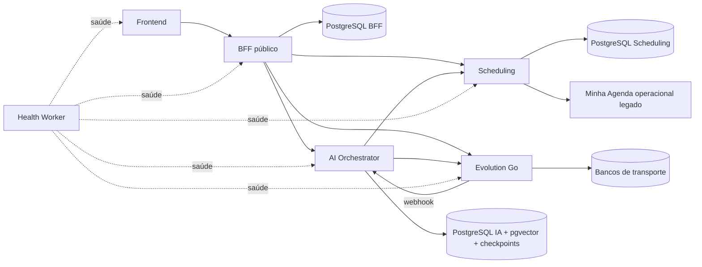

# Estado atual — baseline verificável

Auditado em 2026-09-05 no commit `5fb5d51abc1de58cb24718e7349d7a68ccaa7356`. A fotografia histórica abaixo é preservada; o delta aceito do Goal001 e o achado adicional estão ao final deste documento. Não é atestado de produção. Estado da retomada e alterações preexistentes: [AUDIT_PROGRESS](AUDIT_PROGRESS.md).

**Convenções:** FATO = observado em código/configuração; INFERÊNCIA = conclusão técnica limitada à evidência; NÃO VERIFICADO = exige execução/ambiente adicional. Divergências ficam em [GAP_ANALYSIS](GAP_ANALYSIS.md); propostas, em [TARGET_ARCHITECTURE](TARGET_ARCHITECTURE.md).

## Monorepo e fronteiras

| Unidade | Fato: responsabilidade e tecnologia declarada | Persistência / consumidores |
| --- | --- | --- |
| `apps/frontend` | Next `^16.3.3`, React `19.2.4`, TypeScript; App Router; browser acessa BFF | Sessão/API BFF; package legal |
| `apps/bff` | Fastify `^5.6.2`, Prisma `7.10.0`, Zod, jose, bcryptjs; API pública `/v1`, autenticação e composição | PostgreSQL BFF; chama AI, Scheduling e Evolution |
| `apps/scheduling-service` | Fastify/Prisma/PostgreSQL; agenda, catálogo, clientes e integração de calendário | API interna consumida por BFF e IA |
| `apps/ai-orchestrator` | Fastify/Prisma; LangGraph `1.4.13`, LangChain OpenAI `1.5.8`, checkpointer PostgreSQL `1.0.5` | Conversas/IA e pgvector; chama Scheduling e Evolution |
| `apps/evolution-go` | Go `1.25.0`, Gin `1.10.0`, GORM `1.25.10`; transporte WhatsApp e whatsmeow vendorizado | Autenticação/sessões de dispositivo e instâncias; BFF e IA |
| `apps/health-worker` | Node, sem dependências npm; sonda saúde dos serviços | Não é proprietário de dados de produto |
| `packages/contracts` | Zod/TypeScript, saída `dist`; exporta raiz e common | Nenhum import de runtime encontrado nos apps pela busca dirigida |
| `packages/legal-contract` | Constantes JS + declarações TS para versões legais | Importado efetivamente por frontend e BFF |

Versões acima são declarações dos `package.json` e `go.mod`, não verificação de compatibilidade com versões mais recentes. Há locks npm por aplicação; a raiz não declara npm workspaces nem gerenciador de tarefas de monorepo. O script raiz delega comandos por diretório.

A relação HTTP IA → Evolution → webhook IA é um circuito de mensagens, não evidência de import circular. Não há import entre apps identificado na busca dirigida; não foi feita prova exaustiva de ausência de ciclos entre todos os módulos. O grafo ajuda a localizar dependências, mas seu escopo não inclui vault, design e whatsmeow vendorizado.

## BFF e autenticação

- **FATO:** `apps/bff/src/lib/auth.ts:14` assina JWT HS256 com subject do usuário; `requireAuth` aceita Bearer ou cookie HttpOnly. Logout remove cookie; tokens já emitidos não têm revogação por sessão ou mudança de senha no código examinado.
- **FATO:** `apps/bff/src/lib/tenant-context.ts:13` resolve associação pelo usuário autenticado, rejeita ausência, múltiplas associações ou papel incompatível. O MVP não apresenta seletor de tenant. A restrição do banco é somente `(tenantId,userId)`; cardinalidade de um negócio por usuário e um usuário por negócio não é garantida por índices exclusivos separados.
- **FATO:** cadastro em `apps/bff/src/modules/auth/routes.ts:81` cria usuário, tenant, membership, perfil, AI settings e aceite legal na mesma transação. Senha é hash; recuperação usa token aleatório armazenado como hash e claim transacional de uso único.
- **FATO:** BFF possui recuperação real de senha quando configurado delivery. O escopo atual do MVP exige somente representação visual desse fluxo, o que não é autorização para ampliar a feature.
- **FATO:** `app.ts:59` configura CORS com origem específica e credenciais; `x-csrf-token` está apenas na lista de headers permitidos. Não foi localizado validador CSRF/origin/referer nas mutações. `render.yaml` configura cookie SameSite=None/Secure. Exploração real não foi testada; isso é superfície a endurecer, não incidente comprovado.
- **FATO:** `InternalHttpClient` envia segredo interno, `x-tenant-id`, `x-user-id`, `x-request-id` e audience; valida resposta via Zod. GET pode repetir até três tentativas, sem backoff explícito; mutação faz uma tentativa. Scheduling valida segredo em tempo constante e exige contexto, mas não valida audience (`shared/auth/internal-auth.ts:31`). O segredo autentica serviço confiável; não é prova independente da associação user/tenant.

## API e composição

Inventário registrado: [PUBLIC_API_V1](../../apps/bff/PUBLIC_API_V1.md). Montagem confirmada em `apps/bff/src/app.ts:78` e arquivos `src/modules/*/routes.ts`.

| Família pública | Dono da operação / observação |
| --- | --- |
| `/v1/auth/*` | BFF, sessão e conta |
| `/v1/onboarding` + `/complete` | BFF compõe perfil, catálogo, disponibilidade e IA; WhatsApp saiu da composição no Goal018 — `complete` não verifica mais instância nem status do Evolution |
| `/v1/dashboard` | Composição com estado degradado por dependência, sem zerar silenciosamente erro como sucesso |
| `/v1/appointments`, `/availability`, `/time-blocks` | Proxy validado para Scheduling; create/reschedule/cancel transportam idempotency key |
| `/v1/customers`, `/v1/services` | CRUD parcial via Scheduling; telefone obrigatório no create cliente BFF |
| `/v1/conversations/*` | IA guarda conversas; BFF passa token da instância no envio humano |
| `/v1/settings/*` | BFF grava perfil/configuração e sincroniza IA em chamadas posteriores |
| `/v1/whatsapp/*` | BFF controla provisionamento/QR/pairing/status/disconnect em Evolution e provisiona vínculo na IA. Desde o Goal071 ([D-081](DECISIONS.md)), `connect`/`reconnect` exigem `consentAccepted: true` e `GET /v1/whatsapp/qr` relê o QR só com vinculação por QR em curso |
| `/v1/calendar/integration/*`, `/calendar/migrations/*` | Contratos legados ainda montados e consumidos |

`onboarding/routes.ts:174–235` exige fonte escolhida, dois tons antigos, modalidade selecionada e endereço quando `ON_SITE` (Goal018); fonte externa dispensa disponibilidade interna, exigindo integração conectada. WhatsApp deixou de ser exigência de conclusão no Goal018 — a rota não consulta mais `WhatsAppInstance` nem o status do Evolution. `settings/routes.ts:88–100` persiste AI settings antes de sincronizar IA: falha remota deixa duas cópias divergentes. Atualização de negócio também precede sincronização. Não há transação distribuída ou reconciliação durável nesse caminho.

WhatsApp é criado remotamente antes da inserção local (`whatsapp/routes.ts:144–160`), e depois provisionado na IA. Concorrência/falha parcial pode deixar instância órfã; não foi observado incidente real. GET status atualiza a projeção local, podendo reduzir estados intermediários a CONNECTED/DISCONNECTED.

## Dados pertencentes ao BFF

Schema: `apps/bff/prisma/schema.prisma`.

| Entidade | Identidade, ownership e semântica atual |
| --- | --- |
| User | CUID, email global único, passwordHash, created/updated |
| Tenant / TenantMember | Tenant ID canônico; membership com papel OWNER; FKs locais |
| BusinessProfile | tenantId único; nome, categoria, timezone, idioma, moeda, onboardingCompletedAt; `modalities` (array), `address` (nulável) e `businessContextVersion`/`businessContextProjectedVersion` (contador gravado x versão confirmada pela IA) desde o Goal018 |
| AiSettings | tenantId único; enabled e enum de dois tons; cópia funcional na IA |
| WhatsAppInstance | userId único; id/name/token externo, número/status/QR/timestamps; token armazenado como String sem cifra neste schema/rota |
| LegalAcceptance | User + versões termos/privacidade únicas; acceptedAt |
| PasswordResetToken | User, tokenHash único, expiresAt/usedAt; sem mecanismo de revogação JWT |

Não há entidades BFF para central de notificações, exclusão recuperável da conta, consentimento específico de conexão WhatsApp ou retenção configurável. `onDelete: Cascade` local não apaga bancos de outros serviços. BusinessProfile, CalendarSettings e contexto da IA possuem cópias de timezone que requerem governança conjunta.

Migrations antigas fazem backfill estável de tenant com prefixo `legacy_tenant_`. A migration `20260831220000_goal17_legacy_cleanup` remove `IgnoredContact`, perfis/persona e settings anteriores; comentário que trata dois tons como aprovados é histórico substituído. Não se pode inferir que dados removidos sejam recuperáveis nem que a migration tenha sido aplicada em produção. Essa incerteza é parte do inventário antes de qualquer novo backfill.

## Infraestrutura, execução e qualidade

- `render.yaml`: seis serviços web, planos declarados free, três Node APIs, frontend, Go via Docker e health-worker; somente banco Scheduling declarado no blueprint. URLs hardcoded e segredos externalizados. Estado real das contas/serviços não verificado.
- Prisma com três histories independentes. BFF pode usar `DIRECT_DATABASE_URL` nas migrations. Não foi estabelecido se cada URL aponta a banco físico diferente; o ownership lógico é separado, e colisão em schema/tabelas deve ser impedida na implantação.
- Compose da IA sobe PostgreSQL/pgvector e Evolution com dois bancos de transporte; não é uma execução local completa do monorepo. Não há `.github` na baseline. Docker IA usa Node 22 enquanto blueprint fixa Node 24.13.0; alinhar execução, sem troca de framework.
- Blueprint executa `prisma:deploy` durante build antes de build TS; um build que falha pode já ter alterado banco. `scripts/build-all.sh` compila contracts, IA, BFF, frontend, verifica health e roda Go, mas omite Scheduling.
- Logs estruturados/redação de credenciais e correlação existem; saúde liveness não comprova banco, entrega WhatsApp, teste real ou aptidão da IA. Propagação de request-id não constitui tracing completo.

| Verificação | Evidência e limite |
| --- | --- |
| IA unitários, recuperado da primeira execução | 6 arquivos, 39 testes passaram, 1 falhou; expectativa antiga sem requestId em `inbound-message-processor.test.ts:423`; nenhuma correção feita |
| BFF integração | Único teste encontrado condicionado a `BFF_RUN_INTEGRATION_TESTS`; usa `/auth/register` antigo. Inspecionado, não executado contra banco |
| Scheduling | Sem script npm test na baseline; detalhes do domínio em DATA_MIGRATION |
| Frontend | Sem script de testes na baseline; inspeção detalhada em REUSE_ANALYSIS |
| Auditoria estática existente | Executada na retomada com `PRODUCTION_HEALTH_TARGETS` vazio: 14 verificações estáticas passaram, 1 health de produção pulado. O resumo do script conta o skipped como passed (15); não reportar como 15 testes reais |
| Builds/lint/Go/DB/E2E | Não executados neste checkpoint; comandos existentes não equivalem a checks aprovados |

As verificações estáticas procuram texto e estrutura; não demonstram isolamento real, correção de negócio, atomicidade, concorrência, retenção ou disponibilidade em produção.

## Evidência Graphify utilizada

Grafo existente de 3.039 nós. Consulta por vocabulário `auth tenant session business` encontrou 178 nós, com corte de orçamento explícito; refinada por `explain resolveTenantContext` e `explain InternalHttpClient`. Relações extraídas: `requireTenantContext → resolveTenantContext`; clients Scheduling, IA e Evolution importam InternalHttpClient. Código confirmou essas relações. Consultas dos domínios estão nos documentos de domínio. Sem rebuild, alteração do manifesto ou feedback escrito no grafo.

## Scheduling, catálogo, clientes e importação

**FATOS consolidados:** núcleo operacional independente da IA, com CalendarService, factory e dois providers. O provider Avenly já oferece soma de multi-serviço, snapshots em AppointmentItem, cancelamento sem apagar appointment e remarcação por atualização transacional. Create e reschedule usam Serializable e advisory lock por tenant/data. Não é uma base a descartar.

O motor de disponibilidade considera intervalos semanais, exceções por data, blocos e agendamentos não cancelados. A gestão HTTP não completa todas essas estruturas: exceções não têm rota de gestão localizada; hold, compromisso pessoal distinto, séries recorrentes, presença, falta e valor final não aparecem como capacidades completas. Serviço tem somente FIXED/ON_REQUEST, duração obrigatória e ativo. **Superado no Goal007** — ver o delta ao final deste documento. Cliente é identificado por telefone normalizado único no tenant; upsert pode renomeá-lo antes da transação de agendamento. **Superado no Goal006** — ver o delta ao final deste documento.

Minha Agenda continua recebendo leitura e escrita operacional. O snapshot de migração atual consulta hoje até dez anos à frente, deriva clientes desses agendamentos, filtra deleted e reduz estados. Migração exige destino vazio, bloqueia todos os itens se houver conflito e conclui/troca fonte automaticamente. Há tabela de job e claim condicional, mas execução usa Set/queueMicrotask locais e recuperação global no boot sem lease. Isso não implementa importação única do produto.

Inventário de entidades, constraints SQL adicionais ao Prisma, caminhos com locks, dados temporais, consumers e matriz de importação: [DATA_MIGRATION §§1–3](DATA_MIGRATION.md#1-persistência-atual-de-scheduling). Tabelas de domínio: CalendarSettings, IntegrationConnection, Customer, Service, AvailabilityRule, AvailabilityException, TimeBlock, Appointment, AppointmentItem, ExternalEntityMap, MigrationJob, MigrationConflict e CalendarMutationIdempotency. FKs compostas de cliente/serviço/appointment preservam tenant local; não há FK para o banco BFF.

## AI Orchestrator e conversas

**Fluxo confirmado:** Evolution webhook → autenticação por token → mapper → resolução de ChannelConnection por instance ID → processor → LangGraph (contexto/guard/classificação/RAG/buffer/ferramentas/resposta) → Scheduling quando necessário → Evolution sendText. `MessageGraphWorkflow` é importado e construído por InboundMessageProcessor (Graphify explain confirmou; código em `modules/graph/message-graph.ts:65` e `channel/InboundMessageProcessor.ts:168`).

- `channel/routes/evolutionWebhook.routes.ts:60–99`: processor novo por request; HTTP 202 precede `handleInboundMessage`. O buffer é Map por processor (`InboundMessageProcessor.ts:154`). Consequência inferida: debounce/cancelamento não coordena requests distintos e queda após ACK pode perder trabalho. **Superado no Goal004** — ver o delta ao final deste documento.
- `graph/message-graph.ts:206`: ProcessedEvent é criado antes do processamento. A tabela tem dedupe único, mas não estados de execução/retry. Guard de IA desligada/handoff pode encerrar antes de Message. Deduplicação não equivale a processamento concluído.
- `message-graph.ts:273` e `assistant.service.ts:622`: `fromMe` comum grava OWNER, sem acionar a pausa; comandos especiais de pausa existem. Mensagem humana no chat interno exige takeover prévio (`internal/routes.ts:167`), enquanto o produto pede que o envio assuma. Abrir conversa não deve assumir. **Superado no Goal005** — ver o delta ao final deste documento.
- `message-graph.ts:269/401`: conteúdo não textual vai para resposta genérica unsupported. Não foi localizado pipeline de transcrição; áudio, imagem e documento ainda não têm tratamentos distintos do MVP. **Superado no Goal013.** **FATO atual:** toda mensagem recebida do contato é persistida como `Message` com `kind` (`TEXT`/`AUDIO`/`IMAGE`/`DOCUMENT`/`VIDEO`/`STICKER`/`UNKNOWN`) e mídia ganha uma linha `MessageAttachment` com metadados, sem byte de mídia retido no PostgreSQL da IA; existe pipeline de transcrição (`modules/media/`, provider por porta com implementação OpenAI por HTTP e dublê em teste), num nó do grafo entre `recordInbound` e `sessionGate`, que não roda para contato ignorado nem sessão pessoal e cuja transcrição vira o texto do turno sob os mesmos guards do Goal011; e cada tipo tem tratamento próprio: imagem gera handoff determinístico sem chamar o modelo, documento e vídeo são confirmados sem interpretação (a legenda do documento segue como texto do contato), e sticker, GIF (`videoMessage` com `gifPlayback`) e `unknown` persistem sem resposta, sem handoff e sem renovar a sessão.
- `message-graph.ts:581–631`: registro de outbound é marcado com ID local antes de send e depois atualizado; não há estado separado de entrega. Envio humano remove mensagem pendente se send falha (`internal/routes.ts:174–208`), inclusive quando timeout não prova ausência de entrega. **Superado no Goal004** — ver o delta ao final deste documento.
- Classificação existente em `assistant.service.ts` usa `potential_customer`, `supplier_or_partner`, `personal_contact`, `unknown` dentro de JSON do agente. Não equivale às três abas, override manual, Contact ignorado e sessão de aproximadamente 24h do produto. Não há esses modelos explícitos no schema. **Superado no Goal005** — ver o delta ao final deste documento.

### Dados e memória da IA

`apps/ai-orchestrator/prisma/schema.prisma`: ChannelConnection (único provider/instance e tenant/provider), Conversation (único tenant/channel/contact), Message (dedupe tenant/channel/externalMessageId), ProcessedEvent, AiRun, AiToolCall, Handoff, AiTenantConfig, KnowledgeDocument e KnowledgeChunk. FKs compostas protegem tenant/channel nas relações internas. **Superado nos Goals 012 e 013** na lista de entidades: o schema vigente também tem `CustomerMemory` (Goal012) e `Message.kind` com a tabela `MessageAttachment` (Goal013) — ver os deltas ao final deste documento. Não há FK cross-database para User, Customer ou Appointment.

AiRun/AiToolCall guardam modelo, promptVersion, status, argumentos, resultados e erros: base útil de auditabilidade, também conteúdo potencialmente pessoal. Message/ProcessedEvent guardam rawPayload. **Superado no Goal013** na parte de mídia: nenhum dos dois retém o `base64` do provedor — ele é purgado ao concluir o evento e no estoque por backfill, preservando o restante do proto; ver o delta ao final deste documento. Handoff tem status e pausa; não é entidade de sessão de contato. AiTenantConfig replica enabled/tone/contexto do BFF. Conhecimento guarda versão/checksum/status e embedding `vector(1536)`. `pgvector-knowledge-store.ts:142–149` filtra tenant do chunk e do documento e somente documentos ACTIVE: proteção concreta, sem prova de RLS ou teste de invasão.

Checkpointer usa schema PostgreSQL `langgraph` e executa setup no boot (`graph/checkpointer.ts:3–12`); thread_id é conversationId (`message-graph.ts:78`). Tabelas de checkpoints são persistência adicional fora do schema Prisma. Não há rotina de retenção de conteúdo/checkpoints/runs localizada. O seed de conhecimento não representa CRUD de FAQ pronto no produto. **Superado no Goal012** na parte de conhecimento, memória do cliente e propósito do `AiRun` — ver o delta ao final deste documento; a retenção continua aberta (Goal022).

## WhatsApp / Evolution Go

BFF usa API admin para criar instância e token da instância para conectar/status/QR/pair/send. IA deriva tenant do vínculo cadastrado, rejeitando instância não vinculada/ativa (`ChannelConnectionService.ts:106`). Provisionamento rejeita vínculo da mesma instância a outro tenant e há índice único correspondente. Grupos são desabilitados na criação pelo BFF; essa proteção também precisa de guard de produto, sem presumir que configuração remota seja suficiente.

Evolution permanece transporte, Gin/Go e whatsmeow, com bancos configuráveis de autenticação e usuários/sessões (`POSTGRES_AUTH_DB`, `POSTGRES_USERS_DB`). Pode persistir mensagens do transporte por configuração; Compose auditado desativa `DATABASE_SAVE_MESSAGES`. A configuração efetiva de produção não foi inspecionada. Esse armazenamento pode duplicar conteúdo guardado pela IA e precisa entrar na retenção.

**FATO de autorização:** `pkg/routes/routes.go:120–133` monta GET/PUT advanced-settings sob Auth de instância. `auth_middleware.go:21` resolve token e põe a instância em contexto; handlers `instance_handler.go:589/619` passam `instanceId` da URL ao service sem comparação com esse contexto; service `instance_service.go:825/837` usa o ID recebido. Um token de uma instância não fica vinculado ao alvo nessas duas rotas. Falha confirmada por análise estática do caminho; não explorada remotamente.

`webhook_producer.go:43–72`: entrega em goroutine, cinco tentativas, intervalo de 30s, cliente HTTP sem timeout; 2xx termina retry. Logs imprimem URL inteira, incluindo query token configurada pelo BFF. Payload de evento carrega instanceToken em `pkg/whatsmeow/service/whatsmeow.go` (confirmado na auditoria recuperada); IdempotencyStore guarda raw integral. Há testes Go de transporte/configuração/instância, mas não foram executados nesta auditoria nem comprovam cobertura do defeito acima.

## Health Worker e jobs

`apps/health-worker/src/index.js`: sonda cinco alvos a cada 40 segundos, timeout de 10 segundos, request-id e logs; expõe `/health` e `/targets`. Não possui fila, banco, agendamento de lembretes, retenção, conclusão automática ou expiração de holds. Sua responsabilidade atual é coerente e reaproveitável. Jobs de domínio são uma necessidade nova a resolver no dono do dado, não uma extensão automática deste serviço.

## Frontend, referência visual e contratos

Frontend usa Context/hooks locais (`ProductRuntime.tsx`), gate de sessão e redirect; serviços BFF centralizados em `data/services/registry.ts`, client HTTP e Zod local. Há telas Product* reais e telas/scenarios de demonstração em preview: presença de um frame ou mock não demonstra feature integrada. Não há dependência de store externo/form library no manifest. Forms são implementados nas features; componentes Dialog/States/Button/RouteAnnouncer oferecem base para foco, feedback e navegação, a revalidar na substituição visual.

`AppShell.tsx:68` assume WhatsApp connected se o caller omite estado; `:269/310` mostra apenas três destinos + Mais e esconde Clientes. São divergências concretas. CSS usa Inter/IBM Plex Mono; referência Recepção usa Literata/Hanken Grotesk, superfícies quentes/petróleo, ícones e motion com reduced-motion. O HTML aprovado especifica resultado visual, não arquitetura React. A análise foi seletiva por índice/módulos e código; não foi validação visual de todos os frames ou sessão de browser.

O protótipo possui conflito localizado: Movimento.dc.html:396 restringe Semana/Mês a landscape/desktop; Agenda.dc.html e vault preservam Dia/Semana/Mês no mobile. O vault prevalece. Matriz completa de módulos e tokens: [REUSE_ANALYSIS](REUSE_ANALYSIS.md).

`packages/contracts` exporta utilitários common; índices auth/calendar/conversations/customers/dashboard/internal/migrations/onboarding/services/settings/tenant/whatsapp são placeholders. Parsers reais estão duplicados no frontend, nos clients BFF e IA e nas rotas Scheduling. Centralizar deve migrar consumidores efetivos, sem anunciar que o pacote já fornece o contrato público.

## Fechamento factual e limites

Os domínios obrigatórios foram inspecionados em profundidade suficiente para decisões arquiteturais. Permanecem **NÃO VERIFICADOS**: população/migrations implantadas, backups restauráveis, capacidades completas da API Minha Agenda, disponibilidade e custo do deploy efetivo, entrega WhatsApp real, comportamento visual em aparelhos e testes reais cross-tenant/concorrência. São gates explícitos da execução futura; não justificam aprofundamento indiscriminado nesta fase.

## Delta aceito — Goal001, 2026-09-05

HEAD documental `4ca130128cafd620ea316c3ed9c51a46b34f8541`; implementação ainda em working tree, identificada pelos hashes do [review001](reviews/001-review.md). Não há alteração de código entre esse HEAD e a baseline; a mudança funcional é o diff001.

- **FATO atual:** GET/PUT advanced-settings chamam `authorizeInstanceTarget` antes do bind/service. Contexto ausente, tipo inválido, ponteiro/interface nil ou ID vazio retornam401; alvo diferente retorna403 genérico sem consultar sua existência; alvo próprio usa o ID autenticado. A falha G-01 descrita na fotografia histórica está corrigida nesse diff aceito.
- Auth/AuthAdmin, endpoints, payloads legítimos, services, schemas e dependências permanecem iguais. BFF/IA não chamam essas rotas; manager combina ID/token próprios. Teste administrativo espelha o registro real, que foi inspecionado e não mudou.
- **EXECUÇÃO:** 31 nós de autorização passaram; testes cruzados novos retornaram RED sobre baseline com somente a fixture copiada. Build/vet Go passaram. Suite Go completa:95 nós passaram/2 testes falharam por cleanup de arquivo aberto em service/webhook, reproduzido no baseline isolado. Dependências desses pacotes não incluem o handler. Detalhes/limites no review; o teste não comprova deploy ou isolamento integral do produto.
- **PRECISÃO:** gofmt é equivalente sobre conteúdo LF; checkout CRLF faz `gofmt -l` listar os três arquivos. Isso foi verificado separadamente, sem formatar o código do executor.

## Descoberta adicional — metadados de mensagem no transporte

**FATO estático G-35, não corrigido pelo Goal001:** `POST /message/status` recebe ID de mensagem, verifica client conectado da instância autenticada e consulta `GetMessageByID(data.Id)` sem scoping por instância (`message_service.go:349`, `message_repository.go:27`). Repository é compartilhado; Message guarda id/message_id/timestamp/status/source, sem instanceId. `source` deriva do identificador de chat/telefone (`whatsmeow.go:1645/1662`), não do dono da instância.

Com registro de B existente, seu ID conhecido e token/client A válidos, o caminho não impede leitura desses metadados de B. Não há texto da mensagem nesse modelo. Gravação examinada depende de `DATABASE_SAVE_MESSAGES=true`; exemplo versionado usa false. Configuração/linhas de produção não foram verificadas, e desligar escrita não prova ausência de histórico. Isso refina o inventário da persistência opcional de transporte: a tabela examinada contém metadados, sem pressupor conteúdo integral.

Foram contados72 MustGet em dez arquivos de handlers; o uso em si indica fragilidade para contexto ausente/nil, não comprova IDOR. Auth repository retorna ponteiro válido quando encontra token. O achado de objeto acima é distinto e permanece como requisito de segurança do Goal003 antes de004. **Corrigido no Goal003** — ver o delta ao final deste documento.

## Delta implementado — Goal002, 2026-09-05 (ACCEPTED na rodada 3)

A fotografia histórica acima permanece como registro da baseline. O que mudou
com o Goal002 é infraestrutura de validação, não comportamento de produto.

- **FATO atual:** `scripts/build-all.sh` também compila o Scheduling Service, e
  os comandos canônicos passaram a ser `npm run validate:core` e
  `npm run validate:integration` ([VALIDATION_GATE](VALIDATION_GATE.md)).
- **FATO atual:** o teste de integração do BFF usa `POST /v1/auth/register` e
  exige `BFF_TEST_DATABASE_URL` apontando para PostgreSQL descartável em
  loopback; sem essa URL o runner recusa com exit2, sem tocar o banco default.
- **FATO atual:** `final-production-audit.mjs` reporta `skipped` em contagem
  própria (14 passed /0 failed /1 skipped); o resumo antigo de "15 passed" não
  existe mais. O script continua sendo auditoria estática por regex.
- **FATO atual:** as duas fixtures Go de cleanup fecham o logger da instância
  antes da remoção do `t.TempDir()`. A suíte Go completa passa no Windows
  (7 pacotes `ok`), incluindo os 31 nós de autorização do Goal001. A asserção de
  `requestId` da IA foi corrigida e passa.
- **FATO atual:** `tests/channel/evolution.routes.test.ts` prepara o ambiente e
  importa o módulo de rotas uma única vez, na avaliação do arquivo. O custo de
  carregar a cadeia LangGraph/Prisma/embeddings deixou de ser pago dentro de
  cada caso e o `testTimeout` padrão de5000ms deixou de estourar. Fastify,
  guard de token, mapper e as respostas401/400/404 continuam reais. A suíte da
  IA passa40/40 e `validate:core` retorna exit0.
- **FATO atual:** `BFF_TEST_DATABASE_URL` só é aceita com uma allowlist de
  query parameters e com o destino efetivo conferido pelo parser do driver do
  BFF; `validate:integration` gera o client Prisma antes de migrar e testar.
- **FATO atual:** existe `.github/workflows/validate.yml` — a baseline não tinha
  `.github`. **NÃO VERIFICADO:** execução hospedada desse workflow.
- Continuam **NÃO VERIFICADOS** todos os limites listados no fechamento
  factual: deploy, restore, E2E, concorrência, entrega WhatsApp real e
  persistência dos demais domínios.

## Delta implementado — Goal003, 2026-09-07 (ACCEPTED na rodada 2)

A fotografia histórica acima permanece como registro da baseline. Os FATOs de
"BFF e autenticação", "WhatsApp / Evolution Go" e "Descoberta adicional" que
descrevem JWT sem revogação, CSRF ausente, segredo interno único,
`instanceToken` do corpo como autoridade e `/message/status` sem dono estão
superados pelos fatos abaixo, verificados no [review003](reviews/003-review.md)
sobre a base `99a7210`.

- **FATO atual:** `apps/bff/src/lib/auth.ts` assina o JWT com `sid`;
  `requireAuth` carrega `UserSession` a cada requisição e recusa sessão
  inexistente, expirada, revogada ou de outro usuário com 401; JWT sem `sid`
  recebe 401 `SESSION_REAUTH_REQUIRED` sem criar sessão. `POST /v1/auth/logout`
  revoga a sessão corrente; `PATCH /v1/auth/password` e
  `POST /v1/auth/reset-password` revogam todas, cookie e Bearer.
- **FATO atual:** mutações autenticadas por cookie exigem `Origin`/`Referer` na
  allowlist de `FRONTEND_ORIGIN` e header `x-csrf-token` conferido contra o
  hash guardado na sessão; Bearer não exige CSRF e header declaratório não
  autentica. O token é derivado por sessão e entregue no cookie legível
  `atendly_csrf` e no header de resposta `x-csrf-token`, exposto pelo CORS só
  à origem permitida, porque em produção frontend e BFF estão em hosts distintos
  sob `onrender.com`. `BffHttpClient` guarda o token em memória e o reenvia;
  `test:frontend` cobre esse adapter sem cookie jar.
- **FATO atual:** `WhatsAppInstance.tenantId` é único com FK para `Tenant`;
  `userId` único foi conservado. `apps/bff/src/modules/whatsapp/instance-link.ts`
  resolve o vínculo pelo tenant autenticado e recusa com 409 os estados pendente
  (linha do usuário sem tenant) e divergente (duas linhas, ou dono de negócio
  diferente do usuário); só `DELETE /v1/whatsapp` descarta a linha pendente, e
  apenas para o dono. **Nota:** a classificação de pendente não exige `tenantId`
  nulo na linha do usuário; inalcançável com a associação única vigente,
  endurecimento registrado no review.
- **FATO atual:** credenciais internas são derivadas por
  `HMAC(INTERNAL_SERVICE_TOKEN, chamador:audiência:uso)` ou definidas
  explicitamente por variável; o valor bruto do segredo raiz não é aceito por
  BFF→IA, BFF→Scheduling nem IA→Scheduling. A IA autoriza por escopo mapeado por
  método e caminho (`internal:unmapped` negado) e exige `x-tenant-id`/`x-user-id`
  explícitos depois da credencial; o fallback de primeira `ChannelConnection`
  ativa foi removido. Scheduling identifica o chamador pela credencial e recusa
  `x-service-audience` divergente com 403.
- **FATO atual:** o token da instância é guardado no BFF como envelope
  AES-256-GCM `v1.<keyId>.<iv>.<ct>` com AAD `tenantId|evolutionInstanceName`,
  versionado por `credentialVersion`/`credentialKeyId`; envelope de chave antiga
  é regravado na leitura e estoque legado em texto puro é selado na primeira
  leitura autorizada. Falha de chave, envelope ou vínculo levanta
  `CREDENTIAL_UNAVAILABLE` e impede a operação. `WHATSAPP_CREDENTIAL_KEYS` é
  obrigatório em produção.
- **FATO atual:** a IA recebe a credencial como projeção em
  `PUT /internal/channel-connections/evolution`, guarda-a cifrada com chaves
  próprias (`CHANNEL_CREDENTIAL_KEYS`) e resolve-a pelo vínculo de forma
  preguiçosa no envio; `readInstanceToken(request.body)` não existe mais, o
  payload do webhook é saneado por `redactSensitive` antes do mapeamento e
  `EvolutionProvider` não cai em `EVOLUTION_API_KEY`. Vínculo em
  `credentialVersion` 0 recebe e persiste o inbound e só falha ao responder;
  `GET /v1/whatsapp` reprojeta a credencial de forma idempotente.
- **FATO atual:** `apps/evolution-go/pkg/message/model/message_model.go` tem
  `instance_id` e índice único `(instance_id, message_id)`; `InsertMessage`
  recusa dono vazio e faz upsert nesse par; `GetMessageByID`,
  `GetLatestMessageID`, `DeleteMessagesByInstance` e a limpeza de
  `instance_repository.Delete` são escopadas por instância (a limpeza anterior
  filtrava por `source`, telefone, e não removia nada). `POST /message/status`
  devolve 401 antes de ler o body sem sujeito autenticado e `result` nulo
  idêntico para ID alheio e desconhecido. Writers de recibo em `whatsmeow.go`
  gravam `InstanceID = mycli.Instance.Id`. Expand roda no boot com inventário
  logado; `EVOLUTION_MESSAGE_OWNERSHIP_CUTOVER=true` remove a unicidade global de
  `message_id` só com o índice composto presente. Linhas legadas sem dono ficam
  preservadas e inalcançáveis.
- **FATO atual, não alterado:** o produtor Go ainda inclui `instanceToken` no
  payload dos eventos (`whatsmeow.go`, cinco pontos) e `webhook_producer.go`
  ainda loga a URL completa com o token de query. O consumer descarta e sanea; a
  retirada no produtor é do Goal004.
- **FATO atual:** `validate:core` executa `test:frontend` (deixou de ser skip) e
  `validate:integration` tem seis passos, incluindo o ensaio da migration de
  vínculo e a suíte de ownership do Go em bancos derivados do alvo descartável
  ([VALIDATION_GATE](VALIDATION_GATE.md)). Swagger e wiki do Evolution foram
  alinhados cirurgicamente para `/message/status` e `advanced-settings`.
- Continuam **NÃO VERIFICADOS:** prova em navegador real do CSRF cross-host,
  execução hospedada da CI, corte do Go em banco implantado, drift da migration
  da IA contra o schema (o cluster local não tem pgvector), deploy, WhatsApp
  real e os demais limites do fechamento factual.

## Delta implementado — Goal004, 2026-09-07 (ACCEPTED na rodada 2)

A fotografia histórica acima permanece como registro da baseline. Os FATOs de
"AI Orchestrator e conversas" e "WhatsApp / Evolution Go" que descrevem ACK
antes do processamento, buffer em `Map`, outbound marcado antes do envio,
`delete` da tentativa do dono, `instanceToken` no payload e produtor sem
persistência estão superados pelos fatos abaixo, verificados no
[review004](reviews/004-review.md) sobre a base `b3a019c`.

- **FATO atual:** `channel/routes/evolutionWebhook.routes.ts` saneia,
  classifica e persiste o evento em `ProcessedEvent` antes de responder 202;
  falha ao persistir devolve 5xx; duplicata devolve 202 sem novo efeito;
  eventos técnicos recebem 2xx (presença descartada, ciclo de vida da conexão
  registrado como IGNORED); `Receipt` vira trabalho de reconciliação; vínculo
  não resolvido devolve 503. Não há mais processamento em promise solta depois
  do ACK.
- **FATO atual:** `ProcessedEvent` carrega `eventType`, `conversationKey`
  (`tenant:canal:contato`), `status` RECEIVED/PROCESSING/DONE/FAILED/IGNORED/
  LEGACY, tentativas, `nextAttemptAt`, lease (`leaseOwner`, `leaseToken`,
  `leaseExpiresAt`), `supersedeRequestedAt`, resultado e erro sanitizado.
  `InboxStore.claimNext` varre candidatos excluindo conversas com PROCESSING
  de lease vivo, fixa a linha com `FOR UPDATE SKIP LOCKED`, usa
  `pg_try_advisory_xact_lock` por conversa e agrupa os fragmentos pendentes
  dentro da janela; só lease expirado é recuperado; `complete`/`fail` exigem
  o `leaseToken` do claim; dead-letter após `INBOX_MAX_ATTEMPTS` fica visível
  em `inboxDeadLetters` no painel interno, sem reenvio em massa.
- **FATO atual:** `InboxWorker` roda no processo da IA (`INBOX_WORKER_ENABLED`,
  `INBOX_POLL_INTERVAL_MS`, `INBOX_LEASE_SECONDS` 120,
  `INBOX_MAX_CONCURRENT_CONVERSATIONS`), acordado pelo webhook sem bloquear o
  ACK; `InboundEventDispatcher` executa o lote com `eventAlreadyGuarded`, então
  o guard do grafo não repete `remember` sobre a própria linha da inbox. O
  lease não é renovado durante a execução.
- **FATO atual:** a janela de fragmentos e a espera da primeira mensagem
  ambígua de contato sem histórico são recalculadas por
  `InboxStore.applyConversationWindow` em `nextAttemptAt` sobre os pendentes
  da conversa (`inbox-policy.ts`: mínimo `AI_DEBOUNCE_MIN_SECONDS`, degraus
  por texto longo ou vários fragmentos, seguimento urgente, teto
  `AI_DEBOUNCE_MAX_SECONDS`, limite `AI_DEBOUNCE_MAX_WAIT_SECONDS` desde o
  primeiro evento; `AI_AMBIGUOUS_WAIT_SECONDS` 120 e
  `AI_AMBIGUOUS_MAX_WAIT_SECONDS` 300). O `Map` do processador ficou só como
  gatilho local e está desligado no caminho do worker. Mensagem nova durante a
  execução marca supersede e `sendResponse` cancela a resposta ainda não
  enviada (`superseded`).
- **FATO atual:** toda saída existe em `Message` antes do transporte, com
  `correlationId` estável (que viaja como id da mensagem no envio) e
  `deliveryState` PENDING/SENT/FAILED/UNKNOWN mais `deliveryDetail`,
  `deliveryAttempts` e `deliveryUpdatedAt`. `EvolutionProvider` tem timeout
  (`EVOLUTION_SEND_TIMEOUT_MS` 15000) mapeado para `EVOLUTION_SEND_TIMEOUT`;
  `outbox-policy.classifySendFailure` faz 4xx = FAILED definitivo, timeout/5xx/
  erro pós-envio = UNKNOWN sem retry, conexão nunca estabelecida = FAILED
  retentável, credencial não projetada = FAILED com motivo; `markOutboundDelivery`
  substitui a marcação antecipada de envio. `POST /internal/conversations/:id/messages`
  não apaga mais a tentativa: devolve 201 quando SENT e 202 com o estado real
  quando FAILED/UNKNOWN. `OutboxStore.reconcileFromReceipt` leva PENDING/UNKNOWN
  a SENT por `correlationId` ou `externalMessageId`, escopado a tenant e canal.
- **FATO atual:** `messageDto` da IA, o client do BFF e `publicApiSchemas.ts`
  do frontend expõem `deliveryState`/`deliveryDetail` como opcionais e
  anuláveis ([PUBLIC_API_V1](../../apps/bff/PUBLIC_API_V1.md)); não há UI nova.
- **FATO atual:** no Evolution Go, `webhook_producer.go` persiste a tentativa em
  `webhook_deliveries` (`AutoMigrate` aditivo) antes da goroutine, com destino
  redigido; 2xx conclui, 4xx é recusa definitiva sem retry, 5xx/timeout/rede
  ficam pendentes com retry limitado; `ResumePending` no boot resolve o destino
  real pela instância. O payload de evento não carrega mais `instanceToken`
  (sete pontos em `whatsmeow.go` e dois em `send_service.go`); os logs não
  imprimem a URL com token. 429 e 408 são tratados como 4xx definitivo.
- **FATO atual:** `validate:integration` tem dez passos, incluindo o ensaio da
  migration 004 (que também cria tabelas de apoio sem linhas, porque o cluster
  descartável não tem pgvector), a geração do client Prisma da IA, a suíte de
  durabilidade/dispatch contra PostgreSQL e o outbox do Go
  ([VALIDATION_GATE](VALIDATION_GATE.md#transporte-durável-do-goal004)).
- Continuam **NÃO VERIFICADOS:** WhatsApp real (inclusive se o transporte honra
  `correlationId` como ID da mensagem), execução hospedada da CI, deploy,
  `migrate deploy`/`diff` da IA em banco com pgvector, capacidade de execução
  contínua do worker e os demais limites do fechamento factual.

## Delta implementado — Goal005, 2026-09-08 (ACCEPTED na rodada 2)

A fotografia histórica acima permanece como registro da baseline. Os FATOs de
"AI Orchestrator e conversas" que descrevem `fromMe` sem pausa, takeover
prévio obrigatório, classificação só no JSON do agente e ausência de Contact,
sessão e categoria persistidas estão superados pelos fatos abaixo, verificados
no [review005](reviews/005-review.md) sobre a base `8551717`.

- **FATO atual:** `apps/ai-orchestrator/prisma/schema.prisma` tem `Contact`
  (identidade externa única por tenant e canal, `ignored` com autor/origem/data,
  `aiPaused` com motivo, `categoryOverride` com autor/data) e
  `ConversationSession` (`startedAt`, `lastContactMessageAt`, `expiresAt`,
  `endedAt`, categoria vigente com `categorySource`, `suggestedCategory` com
  proveniência, `humanHandling` com origem e autor, `contextResetAt`,
  `inboundVersion`, `backfillNote`); `Conversation.contactId` é opcional.
- **FATO atual:** `src/modules/session/session-policy.ts` decide sem Prisma:
  expiração por inatividade do contato (`AI_SESSION_INACTIVITY_SECONDS`,
  86400), precedência override manual > sugestão > Não classificadas, tradução
  da classificação técnica sem inventar Comercial, elegibilidade na ordem
  ignorado → pessoal → canal → IA desligada → pausa do contato → atendimento
  humano, e guard de execução comparando a versão de entrada.
  `SessionService` resolve contato e sessão, rotaciona por expiração
  sincronizando o espelho legado da conversa (salvo contato pausado ou
  ignorado), assume o controle humano em transação, grava override, ignore e
  pausa do contato, e `releaseToAi` marca `contextResetAt` e reseta o rascunho.
- **FATO atual:** `message-graph.ts` executa `loadSession` antes de
  `operationalGuard`; o guard só anota a decisão e `sessionGate` encerra
  **depois** de `recordInbound`, então a mensagem do cliente é persistida com
  IA desligada, canal desconectado, handoff, sessão pessoal e contato ignorado,
  e o conteúdo bloqueado não chega a `understandMessage`, RAG, modelo nem
  memória. `executeTool` e `sendResponse` consultam `executionBlockReason`
  (versão de entrada, controle humano, elegibilidade, categoria, ignore).
- **FATO atual:** mensagem manual do dono pelo WhatsApp (`fromMe` que não é
  saída do bot) cai em `ownerActivity`, assume a sessão e pede supersede da
  resposta pendente; `/ia_pause` e `/bot off` gravam `Contact.aiPaused`;
  `/bot on` libera a sessão como Retomar IA. `POST /internal/conversations/:id/messages`
  e `takeover` assumem a sessão (o `409 HUMAN_HANDOFF_REQUIRED` saiu; o takeover
  não grava mais relógio 9999); `release` chama `releaseToAi`; `GET` não altera
  estado. `HandoffService.isBotPaused` consulta a sessão antes de retomar por
  relógio vencido.
- **FATO atual:** `AssistantService` recebe uma porta de sugestão: a
  classificação do agente é gravada como `suggestedCategory` com proveniência
  `agent:<promptVersion>` e nunca como override; `contextSince` limita o
  histórico do turno após Retomar IA.
- **FATO atual:** rotas internas `PUT /internal/conversations/:id/category`
  (`null` limpa) e `PUT .../ignore` sob `conversations:write`; filtros
  `category`/`handling`/`ignored`; DTO de conversa com `category`,
  `categorySource`, `suggestedCategory`, `handling`, `ignored`/`ignoredAt`,
  `aiPaused` e `session`. BFF expõe `PUT /v1/conversations/:id/category` e
  `/ignore` com tenant da sessão e CSRF ([PUBLIC_API_V1](../../apps/bff/PUBLIC_API_V1.md));
  frontend aceita campos e operações novas sem tela.
- **FATO atual (resíduos do 004):** `InboxStore.renewLease` com fencing pelo
  token e heartbeat no `InboxWorker` (`INBOX_LEASE_HEARTBEAT_SECONDS`, 30); a
  espera da mensagem ambígua se estende enquanto os fragmentos seguintes forem
  saudação, até `AI_AMBIGUOUS_MAX_WAIT_SECONDS`.
- **FATO atual:** `validate:integration` tem onze passos, com o ensaio da
  migration 005 e as suítes de sessão e controle humano contra PostgreSQL;
  `tests/session/**` e `tests/internal/**` rodam no core sobre um Prisma em
  memória de teste.
- Continuam **NÃO VERIFICADOS:** WhatsApp real, execução hospedada da CI, deploy,
  `migrate deploy`/`diff` da IA em banco com pgvector e os demais limites do
  fechamento factual. Handoffs `OPEN` legados não são resolvidos pela rotação
  de sessão (resolvido no Goal006), e mensagens não textuais do contato não
  renovam a sessão.

## Delta implementado — Goal006, 2026-09-08 (ACCEPTED na rodada 1)

A fotografia histórica acima permanece como registro da baseline. Os FATOs de
"Scheduling, catálogo, clientes e importação" que descrevem cliente por
telefone único e upsert que renomeia, e o resíduo do Goal005 sobre handoffs
`OPEN`, estão superados pelos fatos abaixo, verificados no
[review006](reviews/006-review.md) sobre a base `8acd4c6`.

- **FATO atual:** `apps/scheduling-service/prisma/schema.prisma` tem `Customer`
  com `phone`/`normalizedPhone` opcionais e índice não exclusivo
  `(tenantId, normalizedPhone)`; `(tenantId, id)` continua a identidade
  referenciada pelas FKs. `CustomerRelation` (um responsável principal por
  cliente, `proposedBy`/`status`/`confirmedBy` com datas), `CustomerNote` e
  `CustomerTag` (ambas com `aiAuthorized`, padrão falso), com FK composta por
  tenant. Migrations `20260908160000_goal006_customer_identity_expand` e
  `20260908161000_goal006_customer_phone_not_unique` (corte da unicidade
  antiga, sem tocar em linha).
- **FATO atual:** `AvenlyCustomerService.create` exige nome ou telefone e
  nunca consulta por telefone; `update` é a única operação que altera nome e
  telefone; `findCandidatesByPhone`/`list({ phone })` devolvem candidatos;
  `primaryGuardian`/`setPrimaryGuardian`/`confirmPrimaryGuardian`/
  `clearPrimaryGuardian` (a IA só propõe); notas e tags com autorização;
  `aiAuthorizedContext` filtra na consulta e só inclui responsável
  `CONFIRMED`. O upsert por telefone e `findByPhone` não existem mais.
- **FATO atual:** no provider Avenly, `createAppointment` executa dentro da
  transação `lockCalendarDay` → validação do slot → `resolveCustomerForAppointment`
  (obter por `customerId` ou criar) → `appointment.create`; `listAppointments`
  aceita `customerId` ou candidatos por telefone. O provider Minha Agenda
  recusa agendamento por `customerId`. `CUSTOMER_PHONE_DUPLICATED` deixou de
  ser conflito do serviço de migração de calendário.
- **FATO atual:** rotas internas do Scheduling `GET/POST /internal/customers`,
  `GET/PATCH /internal/customers/:id`, `GET .../ai-context`, responsável
  principal, notas e tags (treze rotas). BFF expõe `/v1/customers` e
  sub-recursos equivalentes sob tenant da sessão e CSRF por cookie; `POST
  /v1/appointments` aceita `customerId` opcional
  ([PUBLIC_API_V1](../../apps/bff/PUBLIC_API_V1.md)); frontend aceita telefone
  nulo, `primaryGuardian`, `notes` e `tags` sem tela nova.
- **FATO atual:** na IA, `SchedulingClient` busca candidatos, contexto
  autorizado e compromissos por `customerId`; `assistant-tools.ts` tem
  `list_customer_candidates` e `get_customer_context`, `resolveScheduleCustomer`
  devolve `CUSTOMER_IDENTITY_AMBIGUOUS` com vários candidatos e
  `proposedCustomerId` com um só, `confirmSchedule` agenda por
  `pending.customerId ?? pending.proposedCustomerId` e
  `linkContactToCustomer` grava `Contact.customerId`/`customerLinkedAt` por
  tenant, canal e ID externo (migration `20260908170000_goal006_contact_customer_link`,
  sem backfill nem FK entre bancos).
- **FATO atual (resíduos do 005):** `syncLegacyPauseMirror` resolve o handoff
  `OPEN` da conversa ao limpar o espelho legado;
  `20260908171000_goal005_single_open_session` fecha sessões abertas excedentes
  e cria o índice único parcial `ConversationSession_one_open_per_conversation`
  (só em SQL); a criação da sessão absorve a violação (`isUniqueViolation`,
  `P2002`/`23505`) e adota a sessão vencedora.
- **FATO atual:** `scripts/final-production-audit.mjs` tem a regra
  `no_tenant_scoped_phone_unique_constraint`; o Scheduling tem suíte própria —
  `tests/unit` (13) no `validate:core`, que deixou de pular
  `test:scheduling-service`, e `tests/integration` (10) no
  `validate:integration`, agora com dezesseis passos, incluindo os ensaios
  `goal006-migration-rehearsal.mjs` e `goal006-ai-migration-rehearsal.mjs` e
  `provision-scheduling-test-database.mjs`.
- Continuam **NÃO VERIFICADOS:** WhatsApp real, execução hospedada da CI, deploy,
  `migrate deploy`/`diff` da IA em banco com pgvector e os demais limites do
  fechamento factual. Mensagens não textuais do contato não renovam a sessão;
  `findCustomerAppointments` na IA ainda lista por telefone sobre todos os
  candidatos do número; o identificador `actor` de proveniência vem do cliente
  do BFF (os dois últimos resolvidos no Goal007).

## Delta implementado — Goal007, 2026-09-09 (ACCEPTED na rodada 3)

A fotografia histórica acima permanece como registro da baseline. O FATO de
"Scheduling, catálogo, clientes e importação" que descreve serviço com dois
tipos de preço, duração obrigatória e sem atributos, e as observações 2, 3 e 4
do Goal006 (proveniência vinda do corpo, compromissos por telefone, `addTag`
reescrevendo autorização), estão superados pelos fatos abaixo, verificados no
[review007](reviews/007-review.md) sobre a base `9494eb6`.

- **FATO atual:** `apps/scheduling-service/prisma/schema.prisma` tem
  `PriceType` com `FIXED`, `STARTING_AT`, `ON_REQUEST` e `NOT_INFORMED`;
  `Service.durationMinutes` opcional com `needsReview` (lockstep por
  `Service_review_check`) e `reviewOrigin` (`IMPORT`/`MANUAL`, só com pendência);
  `description`, `colorToken` (enum `ServiceColorToken`),
  `bufferBeforeMinutes`/`bufferAfterMinutes` (default 0) e
  `recurrenceIntervalDays`; `AppointmentItem.durationMinutesSnapshot` opcional.
  Migrations `20260908170000_goal007_catalog_expand` e
  `20260908171000_goal007_catalog_constraints` (substituem
  `Service_price_check`, `Service_durationMinutes_check` e o par de
  `AppointmentItem`; separadas porque o valor novo do enum não pode ser
  referenciado na transação que o criou). Nenhum registro reclassificado.
- **FATO atual:** `AvenlyServiceService` valida preço por tipo (obrigatório
  em `FIXED`/`STARTING_AT`, proibido nos outros), aceita duração ausente como
  revisão, preserva a origem da revisão em `PATCH` que não toca a duração,
  valida descrição, cor, buffers e recorrência; `isOperationalService` é o
  predicado único (ativo, com duração, fora de revisão) usado por
  `listOperational`/`listForScheduling` e por `requireActive`, que recusa
  serviço em revisão com `SERVICE_NEEDS_REVIEW` e inativo com
  `SERVICE_INACTIVE`.
- **FATO atual:** `calendar-provider.ts` define `computeAgreementTotal` (soma
  quando todos fixos; `STARTING_AT` quando há algum a partir de e nenhum sem
  preço; `NONE` nos demais) e `CalendarAppointment.totalPriceType`; o provider
  Avenly grava snapshots com as quatro semânticas, aplica a regra ao listar e
  deriva a duração da remarcação de `endAt − startAt`; o schema de replay da
  idempotência aceita os quatro tipos e duração nula, com
  `totalPriceType` default `NONE`.
- **FATO atual:** `CalendarService.listServices` devolve o catálogo completo da
  fonte vigente (serviço em revisão incluído) para `/internal/service-catalog`;
  `listOperationalServices` filtra pelo predicado único para qualquer fonte e
  alimenta `GET /internal/services` e `countOperationalServices`, que define
  `capabilities.aiActivationReady` em `/internal/calendar` (falha da fonte
  externa conta como zero). O BFF recusa `PATCH /v1/settings/ai` com
  `enabled: true` sem serviço operacional (`409 CONFLICT`).
- **FATO atual:** o mapper do Minha Agenda (`toCalendarService`,
  `appointmentServices`, `toCalendarAppointment`) não fabrica `FIXED`/zero:
  preço desconhecido vira `NOT_INFORMED`, duração desconhecida vira ausência
  explícita, item multi-serviço não herda a duração total;
  `calendar-migration-service.ts` grava `reviewOrigin: IMPORT` para serviço
  sem duração e `diagnoseSnapshot` não bloqueia duração ausente.
- **FATO atual:** rotas `GET/POST /internal/service-catalog` e
  `PATCH /internal/service-catalog/:id` com os campos novos; BFF
  `GET/POST /v1/services` e `PATCH /v1/services/:id` idem
  ([PUBLIC_API_V1](../../apps/bff/PUBLIC_API_V1.md), seção do Goal007);
  frontend `serviceSchema`/`appointmentSchema` aceitam quatro tipos, duração
  nula, `needsReview` e atributos, o diretório exibe "A partir de", "Sob
  consulta", "Não informado" e "Precisa de revisão", e o onboarding normaliza
  tipos novos para o par binário sem gravar zero. Na IA, `list_services` expõe
  `priceType` sempre e o valor só quando existe; `calculateAgreementTotal` e
  `totalPriceType` viajam em `AvailabilityLookup`, no rascunho pendente e nos
  resultados; o comentário do agendamento tem quatro textos; serviço em revisão
  nunca chega à IA porque `/internal/services` só devolve operacional.
- **FATO atual (resíduos do 006):** `addTag` é idempotente por rótulo
  (`update: {}`); o BFF deriva `actor`/`proposedByActor`/`confirmedByActor` da
  sessão e não aceita mais do corpo; `list_customer_appointments` consulta por
  `customerId` quando `Contact.customerId` está preenchido e só cai em
  candidatos por telefone sem vínculo.
- **FATO atual:** `validate:integration` tem dezessete passos, com o ensaio
  `goal007-migration-rehearsal.mjs` (fixture legada com preço zero explícito,
  expansão e constraints em passos separados, sondas por tipo); a suíte de
  integração do Scheduling tem 19 testes (catálogo e acordo incluídos) e a
  unitária 40; frontend 15 (`service-schema.test.ts`).
- Continuam **NÃO VERIFICADOS:** WhatsApp real, Minha Agenda real, execução
  hospedada da CI, deploy, `migrate deploy`/`diff` da IA em banco com pgvector
  e os demais limites do fechamento factual. Mensagens não textuais do contato
  não renovam a sessão; a resposta do Minha Agenda não é validada por schema.

## Delta implementado — Goal008, 2026-09-09 (ACCEPTED na rodada 2)

A fotografia histórica acima permanece como registro da baseline. O FATO de
"Scheduling, catálogo, clientes e importação" que descreve cancelamento e
bloqueio escrevendo fora de transação, `status` textual em
`SCHEDULED`/`CANCELLED`, ausência de hold, de eventos e de conclusão, e
resultado idempotente gravado depois do commit, está superado pelos fatos
abaixo, verificados no [review008](reviews/008-review.md) sobre a base
`26593db`.

- **FATO atual:** `apps/scheduling-service/src/modules/calendar/write-policy.ts`
  é a política única de escrita na agenda: transação Serializable,
  `lockCalendarDay` para **todos** os dias afetados em ordem estável de datas
  (a remarcação trava o dia original e o novo), revalidação de disponibilidade
  dentro da transação e retry limitado de abortos serializáveis
  (`40001`/`40P01`/`P2034`), com `CALENDAR_WRITE_RETRY_EXCEEDED` quando o
  limite é excedido. Confirmar, remarcar, cancelar, criar/remover bloqueio
  (`calendar/time-blocks.ts`) e criar/consumir/liberar hold passam por ela;
  cancelamento deixou de ser `update` solto.
- **FATO atual:** sobreposição só existe por decisão humana explícita —
  `source: USER`, flag de override e motivo obrigatórios
  (`OVERLAP_OVERRIDE_NOT_ALLOWED`, `OVERLAP_OVERRIDE_REASON_REQUIRED`),
  registrada como evento `OVERLAP_OVERRIDE`; origem `AI` nunca a obtém.
  Atendimento manual excepcional sem serviço cadastrado é aceito só para
  `USER`, com `title` e duração informados, sem `AppointmentItem` e com total
  `NONE`; a constraint trigger deferrable
  `Appointment_title_required_without_items` garante o título quando não há
  itens (checagem entre tabelas, fora do alcance do Prisma).
- **FATO atual:** `calendar/idempotency.ts` grava o resultado no **mesmo
  commit** do efeito, com `effectEntityType`/`effectEntityId` em
  `CalendarMutationIdempotency`. Um `PENDING` vencido cuja referência de efeito
  já existe é recuperado como sucesso em vez de reexecutado; falha antes do
  commit deixa `FAILED` com código e o retry da mesma chave reexecuta sob a
  política. O schema de replay deriva `totalPriceType` de `totalPrice` quando
  o registro antigo não traz o campo (resíduo do Goal007).
- **FATO atual:** `AppointmentHold` (módulo `modules/holds/`) tem intervalo,
  dia, serviços e duração propostos em JSON, `customerId` ou `contactRef`,
  origem `AI`/`USER`, `expiresAt` **TIMESTAMPTZ** calculado com `now()` do
  banco mais `CALENDAR_HOLD_TTL_SECONDS` (300), `consumedAt` e `releasedAt`.
  Hold vigente conta como ocupação em `avenly-availability.ts` para todos,
  exceto para a confirmação que o consome; hold vencido é ignorado sem
  depender de worker. Confirmação e remarcação aceitam `holdId`; hold vencido
  devolve `APPOINTMENT_HOLD_EXPIRED` e a operação revalida a disponibilidade.
  A remarcação mantém o horário original reservado até o commit. O provider
  Minha Agenda recusa holds e ciclo de vida.
- **FATO atual:** `Appointment.status` é validado nos quatro estados do produto
  (`CONFIRMED`, `COMPLETED`, `CANCELLED`, `NO_SHOW`) por
  `Appointment_status_check`, com o valor bruto anterior preservado em
  `statusRaw`, gravado uma vez e nunca reescrito por transição. Colunas novas:
  `title`, `completedAt`/`completedBy`/`completionOrigin`,
  `noShowAt`/`noShowNote`, `presenceConfirmedAt` (alimentado a partir do
  Goal021) e `finalValue`/`finalValueSetAt`/`finalValueSetBy` (Decimal
  opcional, nunca inferido do preço previsto).
  `appointment-lifecycle-service.ts` implementa concluir, falta, valor final e
  presença de forma idempotente e recusa transição inválida
  (`APPOINTMENT_COMPLETION_INVALID`, `APPOINTMENT_NO_SHOW_INVALID`,
  `APPOINTMENT_RESCHEDULE_INVALID`).
- **FATO atual:** `AppointmentEvent` grava tipo, origem
  (`AI`/`USER`/`SYSTEM`/`INTEGRATION`), ator, motivo, antes/depois em JSON,
  `occurredAt` e `sequence` (`BIGSERIAL`), sempre na mesma transação da
  mutação, com FK `ON DELETE RESTRICT` para o atendimento. A leitura é por
  atendimento, ordenada por `occurredAt` e desempatada por `sequence` —
  necessário porque `CURRENT_TIMESTAMP` é o instante de início da transação e
  eventos irmãos compartilham o valor. Nenhum evento é fabricado
  retroativamente para atendimentos existentes.
- **FATO atual:** `appointments/auto-complete-loop.ts` é o primeiro loop de
  jobs dentro do próprio Scheduling (D-008): marca `COMPLETED` com origem
  `AUTO` os atendimentos confirmados cujo término venceu há
  `CALENDAR_AUTO_COMPLETE_GRACE_MINUTES` (30) pelo relógio do banco, com lease
  por `pg_try_advisory_xact_lock`, intervalo
  `CALENDAR_AUTO_COMPLETE_POLL_INTERVAL_MS` (60000) e desligável por
  `CALENDAR_AUTO_COMPLETE_ENABLED`; registrado em `build-app.ts` e disparável
  por `POST /internal/appointments/auto-complete` para teste. Nunca toca
  cancelados nem faltas e permite correção posterior para falta.
- **FATO atual:** o Scheduling expõe `POST/GET/GET :id/DELETE
  /internal/holds`; `/internal/appointments` e `/internal/appointments/:id/
  reschedule` aceitam `holdId`, `overlapOverride` com motivo, `title`,
  `durationMinutes` e `source`; `/cancel` aceita motivo; existem
  `/complete`, `/no-show`, `/final-value`, `/presence` e `/events` por
  atendimento. O BFF espelha por operação em `/v1/holds`, `/v1/holds/:id` e
  `/v1/appointments/:id/{complete,no-show,final-value,presence,events}`, com
  tenant da sessão, CSRF nas mutações por cookie e `source: USER` sempre
  forçado ([PUBLIC_API_V1](../../apps/bff/PUBLIC_API_V1.md), seção do
  Goal008).
- **FATO atual:** na IA, `assistant-tools.ts` cria hold ao apresentar opções
  (`holdProposedSlot`), guarda `holdId` no rascunho pendente, envia na
  confirmação e na remarcação, e ao receber `APPOINTMENT_HOLD_EXPIRED`
  consulta a disponibilidade de novo e devolve alternativas em vez de
  confirmar silenciosamente; quando a fonte não oferece hold, segue sem
  reserva. Nenhuma tool aceita override de sobreposição nem cria atendimento
  sem serviço. No frontend, `publicApiSchemas.ts` aceita os quatro estados,
  `title`, valor final, presença e conclusão, continua decodificando respostas
  antigas com `SCHEDULED`, e `appointmentStatusLabel`/
  `isActiveAppointmentStatus` substituem o filtro fixo por `CANCELLED` na tela
  de agenda existente (sem tela nova — Goal016).
- **FATO atual:** três migrations aditivas —
  `20260909180000_goal008_agenda_expand` (tabelas de hold e evento, colunas
  novas, referência de efeito, constraints e a constraint trigger do título),
  `20260909181000_goal008_appointment_status` (guarda contra status
  desconhecido, normalização `SCHEDULED → CONFIRMED` com bruto preservado e
  `Appointment_status_check`) e `20260909182000_goal008_agenda_fixups`
  (corrige a checagem de `expiresAt` para comparar com `createdAt` em UTC e
  acrescenta a de fim posterior ao início). Nenhum atendimento mudou de
  horário, acordo, cliente ou estado por migração; nenhum foi marcado
  concluído ou falta.
- **FATO atual:** `validate:integration` tem dezoito passos, com o ensaio
  `goal008-migration-rehearsal.mjs`; a suíte de integração do Scheduling tem
  34 testes, incluindo `goal008-agenda.test.ts` com 15 cenários contra
  PostgreSQL com dois `PrismaClient` em paralelo, e a limpeza compartilhada em
  `tests/integration/support/reset-tenant.ts`; a unitária tem 97 e a IA 191 no
  `validate:core`.
- Continuam **NÃO VERIFICADOS:** WhatsApp real, Minha Agenda real, execução
  hospedada da CI, deploy, `migrate deploy`/`diff` da IA em banco com pgvector
  e os demais limites do fechamento factual. Nenhum tenant real foi migrado.
  As rotas internas ainda aceitam `source` do corpo em vez de derivá-lo do
  token do chamador; a IA não libera o hold de um rascunho substituído por
  nova proposta; não há teste dedicado do BFF nem de schema do frontend para
  as rotas e campos novos; `createdAt`/`occurredAt` continuam `TIMESTAMP`.

## Delta implementado — Goal009, 2026-09-09 (ACCEPTED na rodada 2)

A fotografia histórica acima permanece como registro da baseline. O FATO de
"Scheduling, catálogo, clientes e importação" que descreve o motor de
disponibilidade gerando slots a partir do `stepMinutes` da requisição, sem
antecedência mínima ou máxima e sem buffers, `AvailabilityException` sem rota
de gestão, `TimeBlock` sem tipo, título nem recorrência, e buffers e
`recurrenceIntervalDays` do catálogo sem efeito operacional, está superado
pelos fatos abaixo, verificados no [review009](reviews/009-review.md) sobre a
base `9013f14`.

- **FATO atual:** `CalendarSettings` guarda as regras de oferta do negócio —
  `minLeadMinutes`, `maxLeadDays` e `granularityMinutes`, com defaults iguais
  ao comportamento anterior (0/90/30) e `CalendarSettings_offer_rules_check`
  (granularidade múltipla de 5 entre 5 e 120, mínima menor que a máxima).
  `avenly-availability.ts` as lê do banco em toda oferta e as aplica dentro
  do motor: nenhum slot antes de `now()` do banco mais a antecedência mínima,
  nenhum depois da máxima, passo sempre igual à granularidade do negócio.
  `GET /v1/availability` e `GET /internal/availability` não aceitam mais
  `stepMinutes`; a confirmação e o hold ainda aceitam o campo no corpo, e o
  ignoram. Só o override humano de sobreposição (Goal008) escapa da grade — a
  IA nunca.
- **FATO atual:** buffer do serviço passou a ocupar tempo. O atendimento e o
  hold ocupam `[startAt − bufferBefore, endAt + bufferAfter]` para terceiros,
  a partir de `bufferBeforeMinutesSnapshot`/`bufferAfterMinutesSnapshot` e de
  `proposedBufferBeforeMinutes`/`proposedBufferAfterMinutes` gravados na
  linha, nunca recalculados do catálogo. Em multi-serviço o buffer externo é o
  **maior** de cada lado (`maxServiceBuffer`), nunca a soma; os intermediários
  não existem. `startTime`/`endTime` do DTO não mudam — a ocupação estendida é
  dado separado. Como a busca de ocupação compara colunas cruas, a janela
  consultada é alargada pelo maior buffer gravado no tenant somado ao do
  conjunto proposto, para que um vizinho fora do range cru (a fronteira da
  meia-noite, com `assertAvailable` consultando um dia) ainda bloqueie o slot.
- **FATO atual:** `calendar/availability-exceptions.ts` gere exceções sob a
  política única de escrita: disponibilidade extra em data normalmente
  fechada, indisponibilidade pontual ou de dia inteiro, listagem por período e
  remoção. Indisponibilidade que cobre atendimento confirmado é recusada com
  `EXCEPTION_APPOINTMENT_CONFLICT`, salvo decisão humana explícita gravada na
  própria exceção (`decidedBy`/`decidedReason`). Exceção nunca altera
  atendimento existente.
- **FATO atual:** `TimeBlock` distingue bloqueio operacional de compromisso
  pessoal (`kind` `BLOCK`/`PERSONAL`, default `BLOCK`), tem `title` opcional e
  `seriesId`/`occurrenceDate` para ocorrência de série.
  `calendar/block-series.ts` cria séries semanais **sempre finitas** — por
  data ou por contagem, nunca as duas nem nenhuma
  (`BlockSeries_termination_check`, `INVALID_BLOCK_SERIES_TERMINATION`) — com
  teto configurável (`BLOCK_SERIES_MAX_OCCURRENCES`, 104 por default) e
  ocorrências **materializadas** como `TimeBlock` na criação, nunca geradas
  sob demanda. Conflito é reportado por ocorrência
  (`BLOCK_SERIES_APPOINTMENT_CONFLICT`) e só uma decisão humana o resolve —
  pular as ocorrências em conflito ou forçar a sobreposição com motivo.
  Remover ou mover uma ocorrência não toca a série; editar "desta data em
  diante" encerra a série atual (`supersededById`) e cria outra, preservando
  as ocorrências passadas; remover a série remove só as futuras.
- **FATO atual:** `appointments/appointment-series-service.ts` implementa a
  recorrência de atendimento como série finita a partir do serviço. A
  pré-visualização calcula cada ocorrência no intervalo alvo
  (`recurrenceIntervalDays` do serviço ou intervalo explícito), ajusta ao
  horário disponível mais próximo dentro de
  `APPOINTMENT_SERIES_ADJUST_WINDOW_DAYS` sob as regras de oferta e os
  buffers, e cria um hold por ocorrência. A confirmação roda em uma única
  transação com lock de todos os dias afetados: consome cada hold, cria todos
  os atendimentos com `seriesId`, snapshots e um evento `CREATED` cada; se
  qualquer ocorrência falhar, **nada** é criado e a resposta identifica a
  ocorrência (`occurrenceIndex`, `holdId`, `occurrenceDate`) com alternativas
  — `APPOINTMENT_HOLD_EXPIRED` quando o hold morreu,
  `SLOT_UNAVAILABLE` quando o horário foi tomado entre a pré-visualização e a
  confirmação. O resultado é gravado como efeito idempotente
  `APPOINTMENT_SERIES`, então a mesma `Idempotency-Key` faz replay da série já
  criada. O teto (`APPOINTMENT_SERIES_MAX_OCCURRENCES`, 52 por default) vale
  na pré-visualização e na confirmação. Depois de criados, os atendimentos são
  independentes: `seriesId` é referência de leitura.
- **FATO atual:** as rotas internas de agenda derivam a origem do chamador
  autenticado (`callerSource`: BFF → `USER`, IA → `AI`) e ignoram `source` do
  corpo — o resíduo apontado na observação 1 do [review008](reviews/008-review.md).
  `requireHumanCaller` recusa a IA (`AI_CALLER_NOT_ALLOWED`) em exceção,
  bloqueio, compromisso pessoal, séries deles e regras de oferta. Do lado da
  IA existem apenas `prepare_recurring_appointments` e
  `confirm_recurring_appointments`, sem granularidade própria e sem qualquer
  caminho para override, exceção ou bloqueio; `get_availability` deixou de
  fixar o passo. O provider Minha Agenda recusa o que só a Agenda Avenly
  garante.
- **FATO atual:** o BFF expõe as operações equivalentes com tenant da sessão e
  CSRF por cookie — `/v1/availability-exceptions/*`, `/v1/block-series/*`,
  `/v1/time-blocks/:id/occurrence` (remover e mover) e
  `/v1/appointments/series/preview|confirm` —, `PATCH /v1/settings/availability`
  aceita as regras de oferta de forma aditiva, `PUBLIC_API_V1.md` documenta
  tudo isso, e `internal-http-client` propaga `upstreamDetails` para que a
  ocorrência que falhou e suas alternativas cheguem ao cliente sem reescrita.
  O frontend só ganhou schemas e serviços de dados (bloco com `kind`/`title`/
  `seriesId`, atendimento com buffers e `seriesId`, exceções, séries e
  pré-visualização), com as respostas anteriores continuando decodificáveis;
  não há tela — Goal016 e Goal018.
- **Limites do fechamento:** valem os mesmos limites do Goal008 — sem
  WhatsApp real, deploy, CI hospedada, Minha Agenda real ou credencial real em
  fixture. Nenhum tenant real foi migrado. `decidedBy` da decisão humana na
  indisponibilidade ainda vem do corpo, não do chamador autenticado;
  `maxNeighborBuffer()` agrega por tenant sem recorte de intervalo a cada
  busca de slots; a IA continua sem liberar o hold de rascunho substituído
  (Goal011).

## Delta implementado — Goal010, 2026-09-12 (ACCEPTED na rodada 2)

A fotografia histórica acima permanece como registro da baseline. O FATO de
"Scheduling, catálogo, clientes e importação" que descreve Minha Agenda
recebendo leitura e escrita operacional, o snapshot de migração consultando
dez anos à frente e filtrando `deleted`, a migração exigindo destino vazio,
bloqueando todos os itens quando há conflito e concluindo/trocando fonte
automaticamente, e a execução por `Set`/`queueMicrotask` locais com
recuperação global no boot sem lease, está superado pelos fatos abaixo,
verificados no [review010](reviews/010-review.md) sobre a base `e381c15`.

- **FATO atual:** a importação tem modelo de dados próprio — `ImportSession`,
  `ImportSessionCategory`, `ImportItem` e `ImportDecision`, com os enums
  `ImportCategory` (oito categorias: serviço, cliente, disponibilidade,
  bloqueio, futuro, histórico, cancelado e falta), `ImportSessionStatus`,
  `ImportItemStatus`, `ImportDecisionScope` e `ImportDecisionKind`. A sessão
  guarda a identidade da conta de origem, a `previewVersion`, o lease da
  execução, os contadores e a conclusão. Duas invariantes existem **só em
  SQL**, porque o Prisma não modela índice único parcial:
  `ImportSession_one_completed_per_tenant` sobre `("tenantId") WHERE
  "completedAt" IS NOT NULL` — a conclusão única e irreversível por negócio,
  recusada pelo **banco** inclusive com duas conexões concorrentes — e
  `ImportSession_one_live_per_tenant`, restrito aos estados vivos, que é a
  "uma sessão por negócio". `ImportSession_completion_check` amarra `status =
  COMPLETED` a `completedAt` nos dois sentidos; `ImportItem_status_check`
  fecha o conjunto de estados do item. `ExternalEntityType` ganhou
  `TIME_BLOCK` e `AVAILABILITY_EXCEPTION` de forma aditiva.
- **FATO atual:** a análise não escreve dado operacional.
  `ImportPreviewService.analyze` persiste apenas preview e contadores e em
  nenhum caminho toca `Customer`, `Service`, `Appointment`,
  `AvailabilityRule` ou `TimeBlock`. Cada reanálise incrementa
  `previewVersion` e reconcilia por `(category, externalId)`: a linha do item
  nunca é apagada nem recriada, e item já resolvido por execução anterior
  (`IMPORTED`/`SKIPPED`/`FAILED`) nunca é revertido por análise nova.
  Conflito com a base já preenchida é classificado por item em `EXACT`
  (mesclável), `SIMILAR` (apenas sugere) e `DIVERGENT` (exige decisão), com
  fingerprint do registro de origem. Executar exige `previewVersion` no
  corpo, no Scheduling e no BFF: preview obsoleto é recusado com `409
  IMPORT_PREVIEW_STALE`, e sem o campo a requisição nem chega a executar
  (`400 VALIDATION_ERROR`).
- **FATO atual:** o adaptador do Minha Agenda valida a resposta por schema
  antes de qualquer mapeamento e lê **por categoria**, com cobertura
  explícita por categoria (`sourceSupported`, `sourceReportedCount`,
  `readCount`, `limitationCode`, `limitationDetail`). Duas limitações da
  origem estão declaradas e quantificadas em vez de contornadas:
  `CUSTOMER_DIRECTORY_UNAVAILABLE` — a origem não expõe endpoint de listagem
  de clientes, então só fica visível quem estiver vinculado a um agendamento
  ou bloqueio lido no período — e `NO_SHOW_NOT_MODELED_BY_SOURCE` — a origem
  não modela falta como estado distinto de cancelado. Nenhuma
  disponibilidade, duração, preço ou status é fabricado a partir de dado
  ausente. (**Superado em parte no Goal062**, [D-079](DECISIONS.md), que
  aplica U-08: a categoria de clientes lê `GET /customers` e une a listagem
  aos clientes embutidos; `CUSTOMER_DIRECTORY_UNAVAILABLE` fica só para
  sessão analisada antes do Goal062, e o recuo por `404` ou forma inválida
  declara `CUSTOMER_DIRECTORY_LISTING_UNSUPPORTED`. A forma real da
  resposta continua sem prova.)
- **FATO atual:** a transação monolítica do `importToAvenly` deixou de ser o
  caminho. `ImportExecutionService` processa item a item sob `runCalendarWrite`
  e os locks do Goal008, gravando efeito, mapa de origem
  (`ExternalEntityMap`, a chave de idempotência por origem/item) e checkpoint
  no **mesmo commit**; `maxItems` recorta o lote e é também como uma queda no
  meio é exercitada. Falha ou conflito de um item marca aquele item e o lote
  segue. Agendamento futuro cujo intervalo já está ocupado por atendimento
  vigente que não veio da importação não é sobreposto: `findSlotHolder` lê a
  ocupação dentro do lock de dia e o item vai para `NEEDS_REVIEW` com
  `APPOINTMENT_SLOT_TAKEN`, sem escrever. A checagem vale só para
  `FUTURE_APPOINTMENT` — histórico, cancelado e falta não ocupam agenda.
- **FATO atual:** a execução é coordenada por lease pelo relógio do banco
  (`import-lease.ts`), na própria linha de `ImportSession`: a reivindicação é
  um único UPDATE condicional (`leaseOwner IS NULL OR leaseExpiresAt <= now()
  OR leaseOwner = :owner`), sem leitura-antes-de-escrever decidindo direito,
  com TTL em `IMPORT_LEASE_TTL_SECONDS` (120s por default). `resumeIncomplete`
  — que varria `MigrationJob` de todos os negócios no boot, sem lease e sem
  recorte por tenant, reiniciando inclusive job vivo — **não existe mais**; a
  retomada é por tenant e sob lease, em `resumeImportSessions`.
- **FATO atual:** `CalendarProviderFactory` não importa mais
  `MinhaAgendaCalendarProvider`. Escrita ou oferta operacional com fonte
  remota recebe `409 MINHA_AGENDA_OPERATIONAL_SOURCE_DISABLED`; a leitura da
  origem sobrevive apenas dentro da importação, chamada direto pelo módulo.
  Os endpoints de integração foram reescopados para o ciclo da importação:
  `connect` não exige mais que a agenda seja externa e recusa `enableWrites`
  com `409 INTEGRATION_WRITES_NOT_SUPPORTED` — a origem é somente leitura
  (**superado no Goal060**, [D-077](DECISIONS.md): o corpo passou a ser
  `{ email, password }` estrito, e `enableWrites` a mais é recusado com
  `VALIDATION_ERROR` 400; o código 409 não existe mais) — e
  `DELETE /internal/calendar/integration` não toca mais `CalendarSettings`,
  ou seja, desconectar a origem de importação não desativa a agenda
  operacional.
- **FATO atual:** os `MigrationJob` legados são classificados, nunca
  convertidos (U-02). `LegacyMigrationJobReconciliation` preenche
  `legacyClass` (`UNCLASSIFIED`, `TECHNICAL_COMPLETED`,
  `TECHNICAL_INCOMPLETE`, `TECHNICAL_FAILED`, `NEEDS_REVIEW`) e os campos de
  auditoria, é idempotente — job já classificado não é reclassificado — e
  oferece inventário por classe e a lista dos casos isolados. `COMPLETED` sem
  a prova esperada (`summary.imported`) vira `NEEDS_REVIEW`, nunca conclusão
  presumida. O direito de importação é estrutural: mora só em
  `ImportSession.completedAt`, e as duas tabelas não se comunicam. O
  protocolo antigo continua alcançável como compatibilidade declarada até o
  Goal026, mas seu `start` chama `assertImportAvailable` — depois da
  conclusão única nem por ali se reprocessa a origem.
- **FATO atual:** sete rotas por operação existem no Scheduling e no BFF
  (`POST /v1/calendar/imports`, `analyze`, `GET
  .../categories/:category/items`, `decision`, `execute`, `progress`,
  `complete`), com `Idempotency-Key` onde há efeito, tenant e ator sempre da
  sessão, e `PUBLIC_API_V1.md` atualizado — a linha "Migração bidirecional"
  foi substituída. Não existe contrato de importação do lado da IA, e isso é
  asserção executável: `apps/ai-orchestrator/tests/tools/import-out-of-reach.test.ts`
  falha se alguma tool passar a tocar o caminho de importação. O frontend
  aceita as operações e campos novos mantendo os schemas antigos de migração
  decodificáveis; não há tela (Goal020). (**Ampliado no Goal061**,
  [D-078](DECISIONS.md): `analyze` e `execute` passam a responder `202` com
  o início do trabalho, não mais com o preview ou o resultado, e nasce uma
  oitava rota, `GET .../preview`, que lê o preview gravado sem a origem.)
- **Limite verificado:** a capacidade da API real do Minha Agenda continua
  **sem prova** — não há credencial autorizada no ambiente de migração. Toda
  origem exercitada é dublê ou fixture, M4 não foi exercitado e nenhum tenant
  real foi importado. Tenant legado com `CalendarSettings.source =
  MINHA_AGENDA` ainda não tem caminho novo para voltar a `ATENDLY`: a
  conclusão da importação não move a fonte e só o `importToAvenly` legado o
  faz. O inventário do U-02 existe como serviço e é exercitado por ensaio e
  por suíte de unidade, mas ainda não tem rota.

## Delta implementado — Goal011, 2026-09-13 (ACCEPTED na rodada 3)

A fotografia histórica acima permanece como registro da baseline. O FATO de
"AI Orchestrator e conversas" que descreve o estilo como enum de **dois**
valores, o prompt mandando respeitar a persona configurada, a versão do
prompt como string de ambiente, o erro de infraestrutura chegando cru ao
modelo e a ausência de qualquer suíte de políticas de conversa está superado
pelos fatos abaixo, verificados no [review011](reviews/011-review.md) sobre a
base `0f4ac74`.

- **FATO atual:** o estilo de conversa é dado do negócio com **três** valores
  — `PROFESSIONAL`, `BALANCED` (equilibrado, o default) e `CASUAL` — nos dois
  bancos. O enum `AiTone` foi expandido por migration **aditiva em passos
  separados** (`ALTER TYPE ... ADD VALUE IF NOT EXISTS`, depois backfill,
  depois default), porque no PostgreSQL um valor de enum criado numa transação
  não pode ser usado nela. O mapa de backfill é único e declarado:
  `PROFESSIONAL_OBJECTIVE` → `PROFESSIONAL` e `LIGHT_CLOSE` → `BALANCED`;
  nenhuma linha nasce em `CASUAL`. A IA fecha com o passo de default
  (`BALANCED`); o BFF **não** tem default de banco, porque `AiSettings.tone`
  nulo significa "o negócio ainda não escolheu" — distinção que sustenta a
  pendência `AI_TONE_NOT_SELECTED` do onboarding. Os dois valores antigos
  continuam membros válidos do tipo e de `schema.prisma`, legíveis até o
  Goal027 — a v47 redirecionou para lá toda retirada de **valor legado de
  dado**, porque o Goal026 retira código e contrato sem criar migration.
- **FATO atual:** o vocabulário do estilo é o mesmo nos dois lados
  (`apps/bff/src/lib/ai-conversation-style.ts` e
  `apps/ai-orchestrator/src/modules/tenant-config/ai-settings.ts`): entrada
  aceita os três valores novos e os dois antigos como **alias declarado**,
  valor fora desses cinco é recusado com `AI_CONVERSATION_STYLE_UNKNOWN` (com
  `details.accepted` e `details.legacyAliases`) e toda saída — settings,
  onboarding, projeção interna para a IA e schemas do frontend — usa sempre o
  vocabulário novo, inclusive para linha gravada antes desta versão. Negócio
  sem configuração é projetado no equilibrado sem que isso seja gravado como
  escolha.
- **FATO atual:** o prompt não tem persona. Não há instrução de respeitar
  personagem, nem de parecer ou fingir ser humana; a IA responde como extensão
  do negócio e se identifica como assistente virtual quando perguntada
  diretamente. A versão do prompt é **derivada do conteúdo**:
  `derivePromptVersion(style)` devolve `prompt-v1-<estilo>-<hash>`, com hash
  sobre o texto estável montado (identidade, regras, contexto do negócio,
  scheduling, os três ramos de conhecimento, estilo, handoff e resposta).
  Mudar texto estático sem mudar o identificador semântico derruba os hashes
  fixados em `tests/prompts/system.test.ts`, e o log de decisão de cada turno
  registra a versão do prompt efetivamente enviado, por estilo.
  `AiTenantConfig.promptVersion`, projetado por `internal/routes.ts`, continua
  vindo de `env.AI_PROMPT_VERSION` — conceito distinto, ainda não reconciliado.
- **FATO atual:** confirmação explícita é exigida por **código**. O turno vem
  de `deriveTurnId(message)` (`channelId:messageId`), atravessa o grafo
  (`graph-state`/`message-graph`) e fica gravado em
  `pendingAction.preparedInTurnId`. Tool com efeito só executa sobre rascunho
  preparado em turno **anterior**: preparar e confirmar no mesmo turno é
  recusado com `CONFIRMATION_REQUIRED_SAME_TURN` e confirmar sem rascunho com
  `NO_PENDING_CONFIRMATION`. A série de atendimento entrou na mesma regra, com
  compatibilidade declarada para rascunho legado sem turno; o guard antes de
  efeito do Goal005 continua valendo.
- **FATO atual:** erro de domínio e erro de infraestrutura são vocabulários
  distintos. O `SchedulingClient` classifica na origem — 5xx, timeout,
  resposta fora do formato e falha de autenticação/contexto interno viram
  `InfrastructureError`; 4xx de negócio viram `DomainError` com o código real.
  `graphToolFailure` entrega ao modelo o código de domínio, mas colapsa toda
  infraestrutura num único `TOOL_INFRASTRUCTURE_ERROR` com mensagem genérica;
  o detalhe real vai só para o log, com `requestId` e `aiRunId`, e o turno
  segue pela mensagem genérica com handoff. Nenhum host, URL, token ou nome de
  serviço interno chega ao contexto do modelo ou a mensagem enviada.
- **FATO atual:** rascunho substituído ou descartado **libera** o hold que
  segurava. `releasePendingHolds` roda dentro de `setPendingAction` e de
  `clearPendingAction`, no mesmo caminho que grava o novo estado; falha ao
  liberar não derruba o turno, mas é registrada com `requestId`/`aiRunId`.
  `releaseHold` é idempotente no Scheduling. Provado contra PostgreSQL real em
  `tests/integration/hold-release.test.ts`, olhando o hold no banco.
- **FATO atual:** `/internal/services` emite `recurrenceIntervalDays` —
  `CalendarServiceDefinition` e `toCalendarService` passaram a carregá-lo — e a
  IA o projeta no catálogo, então serviço com intervalo de referência é
  ofertável. Oferecer não cria nada: a série continua exigindo hold por
  ocorrência e confirmação global explícita (Goal009), e sem intervalo
  cadastrado a IA não propõe cadência.
- **FATO atual:** existe suíte de **evals determinísticos** no `validate:core`
  (`apps/ai-orchestrator/tests/evals/`), com modelo dublê, gateway do
  Scheduling em memória e `fetch` interceptado para falhar se qualquer eval
  abrir rede — sem chave e sem custo. Os casos cobrem condução da conversa,
  equivalência operacional entre os três estilos, transparência sobre ser
  assistente virtual, desconto e encaixe levando a handoff com irritação
  resolvível não levando, e a separação entre falha de domínio e de
  infraestrutura. Cada arquivo termina com um caso que falha se algum passo do
  roteiro do dublê não tiver sido consumido.
- **Limite verificado:** os evals provam o que o runtime executou, recusou e
  persistiu — **não** qualidade de modelo real. Nenhum modelo real foi chamado
  em teste. Mídia (G-23) e conhecimento, memória e sugestões (G-24) continuam
  fora: são dos Goals 013 e 012.

## Delta implementado — Goal012, 2026-09-13 (ACCEPTED na rodada 3)

A fotografia histórica acima permanece como registro da baseline. Os FATOS de
"Dados e memória da IA" que descrevem o conhecimento como algo que só entra por
seed, sem CRUD de FAQ no produto, e a memória da IA como JSON por conversa
estão superados pelos fatos abaixo, verificados no
[review012](reviews/012-review.md) sobre a base `4116149`.

- **FATO atual:** conhecimento é editável por rota, não por seed. `GET/POST
  /internal/knowledge/documents`, `GET/PUT/DELETE
  /internal/knowledge/documents/:id` e `PUT /internal/knowledge/other-info` na
  IA, expostos no BFF sob `/v1/knowledge/...` com tenant de sessão e CSRF,
  criam, editam, listam e desativam FAQ geral, FAQ por serviço, orientação,
  cuidado, procedimento, política textual e o campo livre. Cada salvamento cria
  **versão nova e inativa a anterior na mesma transação**; desativar é
  `INACTIVE`, nunca apagar; a identidade estável é o `source` e a chave única
  `(tenantId, type, source, version)` continua valendo. Conteúdo igual (mesmo
  `checksum`) não gera versão nem reindexação. `npm run knowledge:seed` passou a
  usar o mesmo serviço e é ferramenta de desenvolvimento, não interface
  operacional.
- **FATO atual:** o embedding é calculado **antes** da transação. Falha do
  provider devolve `KNOWLEDGE_INDEX_UNAVAILABLE` e não altera nada no banco —
  não existe documento `ACTIVE` sem chunks correspondentes.
- **FATO atual:** `KnowledgeDocument` tem `serviceId` (nulo, índice
  `(tenantId, serviceId)`), então FAQ pode ser **do serviço**. A recuperação
  continua restrita ao tenant e a `ACTIVE` e passou a filtrar `serviceId IS NULL
  OR = ANY(focus)`, com o serviço em foco lido só do estado persistido (rascunho
  ou ação pendente): documento de outro serviço não entra. O prompt apresenta os
  trechos na precedência do produto — regra do serviço em foco > FAQ > dados
  estruturados do negócio > campo livre — e manda seguir apenas a fonte de maior
  precedência em caso de conflito. Pergunta secundária desconhecida recebe
  resposta simples sem handoff; pergunta material para decisão ou segurança vai
  para handoff; a IA não completa com conhecimento geral o que o negócio não
  cadastrou.
- **FATO atual:** existe `CustomerMemory` no banco da IA, por `(tenantId,
  customerId)` da pessoa do Scheduling — quatro tipos (`PREFERRED_PERIOD`,
  `PREFERRED_DAY`, `RECURRING_SERVICE`, `OBSERVATION`), origem
  `CUSTOMER_STATED`/`AI_INFERRED`/`PROFESSIONAL`, `aiAllowed` **por linha** com
  default `false` e filtrado na própria consulta, confiança, conversa e
  mensagens de origem, `observedAt`/`lastReinforcedAt`, `supersededById` e
  `removedAt`/`removedBy`. Contradição **substitui** sem apagar. No prompt, item
  mais antigo que `CUSTOMER_MEMORY_STALE_DAYS` (180) entra marcado como antigo e
  `CUSTOMER_MEMORY_PROMPT_LIMIT` (12) corta por relevância, recente primeiro. A
  `ConversationMemory` de sessão continua existindo, separada, e não vira
  memória da pessoa por si só.
- **FATO atual:** a IA só infere memória a partir de **efeito verificável** do
  turno — `AiToolCall` `SUCCEEDED` do `AiRun` daquele turno, `create_appointment`
  com `action = confirm` ou `confirm_recurring_appointments` —, nunca do JSON de
  decisão nem de rascunho não confirmado. `RECURRING_SERVICE` só nasce de série
  recorrente confirmada; atendimento avulso apenas reforça e nunca cria linha.
  Não há inferência de contato ignorado, sessão pessoal ou turno atendido por
  humano. A profissional lista, cria (origem `PROFESSIONAL`, permissão explícita
  e negada por padrão), altera a permissão e remove qualquer item, inclusive
  inferido, por `GET/POST /internal/customers/:id/memory` e `PATCH/DELETE
  .../:memoryId`.
- **FATO atual:** o resumo do cliente é gerado sob demanda por `POST
  /internal/customers/:id/summary` **exclusivamente** a partir de material
  autorizado (memória permitida, notas e tags `aiAuthorized` do Scheduling,
  próximos atendimentos), não é persistido como verdade e **sempre** tem
  `AiRun` com `kind = SUMMARY`: sem pessoa vinculada recusa `CUSTOMER_NOT_LINKED`
  e sem conversa para ancorar o registro recusa `SUMMARY_NOT_AUDITABLE` (409),
  antes de qualquer chamada ao modelo. `aiRunId` é obrigatório no DTO da IA, do
  BFF e do frontend.
- **FATO atual:** a única sugestão da IA deixou de ser a categoria da sessão.
  `POST /internal/conversations/:id/suggestions` (BFF
  `/v1/conversations/:id/suggestions`) devolve até três sugestões de resposta em
  `{ conversationId, suggestions, aiRunId, promptVersion }`, **fora do grafo**,
  com binding de tools somente leitura: nenhuma tool com efeito é oferecida ao
  modelo e nenhum hold, rascunho, `Message` ou linha de outbox nasce, provado
  por asserção de alcance com contagem. O registro é `AiRun` com
  `kind = SUGGESTION`. Cinco recusas próprias, todas anteriores ao modelo:
  `CONTACT_IGNORED`, `SESSION_PERSONAL`, `HUMAN_HANDLING_REQUIRED`,
  `AI_DISABLED` e `NO_TEXTUAL_MESSAGE`. O envio continua sendo o caminho humano
  existente, inalterado.
- **FATO atual:** `AiRun` tem `kind` (`TURN` default, `SUGGESTION`, `SUMMARY`),
  então toda chamada de modelo da IA — turno, sugestão e resumo — é auditável
  pela mesma tabela e distinguível por propósito. As rotas novas têm escopo
  interno próprio (`knowledge:read/write`, `customer-memory:read/write`,
  `customer-summary:write`), com o destino `internal:unmapped` preservado: rota
  interna sem escopo declarado continua falhando fechada.
- **Limite verificado:** a persistência de `KnowledgeChunk` com embedding
  continua sem prova contra banco nesta máquina — o PostgreSQL descartável dos
  gates não tem a extensão `vector`, e o ensaio do Goal012 a pula com skip
  nomeado. Nenhum modelo e nenhum provider de embedding real foi chamado em
  teste. Mídia (G-23) continua fora: é do Goal013.

## Delta implementado — Goal013, 2026-09-13 (ACCEPTED na rodada 2)

A fotografia histórica acima permanece como registro da baseline. Os FATOS que
descrevem conteúdo não textual como resposta genérica `unsupported`, o schema da
IA sem tipo de mensagem nem anexo, e o payload do provedor guardado inteiro na
inbox durável estão superados pelos fatos abaixo, verificados no
[review013](reviews/013-review.md) sobre a base `e602b4b`.

- **FATO atual:** toda mensagem recebida do contato é persistida como `Message`,
  texto ou não, com `kind` (`TEXT` default, `AUDIO`, `IMAGE`, `DOCUMENT`,
  `VIDEO`, `STICKER`, `UNKNOWN`). Mídia ganha uma linha `MessageAttachment` por
  `(tenantId, messageId)` com mimetype, nome, tamanho, duração de áudio,
  `mediaUrl` quando o provedor hospedou, `tooLarge` e o resultado da transcrição
  com proveniência (texto, status, erro, motivo de pulo, provider, modelo,
  `transcribedAt`). Índices `(tenantId, messageId)` e
  `(tenantId, transcriptStatus)`.
- **FATO atual:** a IA **não retém byte de mídia**. `stripMediaBase64` remove
  `data.Message.base64` do `Message.rawPayload` na persistência e do
  `ProcessedEvent.rawPayload` nos três pontos terminais do `InboxStore`
  (registro já ignorado, conclusão e falha exaurida), com o fencing por
  `leaseToken` preservado, e o backfill da migration
  `20260913140000_goal013_media_kinds_attachments` faz o mesmo no estoque de
  evento **concluído** — evento pendente nunca é tocado. As demais chaves do
  proto (`url`, `mediaKey`, `directPath`, `fileSHA256`) são preservadas: são a
  chave do download sob demanda, não os bytes.
- **FATO atual:** mídia não é mais perdida por tamanho. A rota do webhook da
  Evolution declara `bodyLimit` próprio (`EVOLUTION_WEBHOOK_BODY_LIMIT_BYTES`,
  32 MiB) em vez do 1 MiB default do Fastify, e o Evolution Go aplica
  `WEBHOOK_MEDIA_INLINE_MAX_BYTES` (16 MiB) por `decideMediaInline`: acima do
  teto o webhook segue sem `base64`, com `mimetype`, `mediaSize`, `fileName` e
  `mediaTooLarge: true`. A política de entrega do webhook no Go (retry e
  rejeição definitiva por `4xx`) não mudou — o que mudou é não haver mais `4xx`
  por tamanho.
- **FATO atual:** existe pipeline de transcrição em `modules/media/`, com porta
  `TranscriptionProvider`, implementação OpenAI por HTTP
  (`OPENAI_TRANSCRIPTION_MODEL`, padrão `gpt-4o-mini-transcribe`, idioma `pt`) e
  dublê em teste. O nó `transcribeAudio` do grafo fica **entre `recordInbound` e
  `sessionGate`**: áudio é transcrito também com a IA desligada, em pausa e em
  atendimento humano, porque a inbox mostra o texto de qualquer jeito, e é
  bloqueado apenas por contato ignorado e sessão pessoal, que gravam `SKIPPED`
  com motivo nomeado antes de qualquer byte ou chamada de rede. Os bytes vêm do
  `base64` do evento em processamento ou de `POST /message/downloadmedia` no Go,
  pela mesma credencial de instância do envio.
- **FATO atual:** a transcrição concluída vira o texto do turno, marcada com
  `[audio transcrito]`, e o template de prompt subiu para **v3** por causa da
  seção de áudio em `buildStablePromptContent`. Confirmação clara em áudio vale
  como confirmação sob exatamente os mesmos guards de rascunho preparado e
  confirmação explícita do Goal011, sem exceção nova. Falha grava `FAILED` com
  motivo e **não inventa texto**: a IA pede o conteúdo por escrito.
- **FATO atual:** cada tipo de mídia tem tratamento próprio. Imagem com a IA
  elegível vai para handoff determinístico (`reason` `image_received`) decidido
  antes de qualquer chamada de modelo e sem interpretar a legenda; documento e
  vídeo recebem confirmação fixa, sem interpretação e sem handoff, com a legenda
  de documento seguindo como texto do contato; sticker, GIF (`videoMessage` com
  `gifPlayback: true`) e `unknown` persistem sem resposta, sem handoff e sem
  renovar a sessão. Áudio, imagem, documento e vídeo renovam.
- **FATO atual:** a mídia é exibível sob demanda.
  `GET /internal/conversations/:id/messages/:messageId/media` devolve os bytes
  com `content-type` e nome, por `mediaUrl` ou por download no Go, com recusas
  próprias (`MESSAGE_NOT_FOUND`, `MEDIA_TOO_LARGE`, `MEDIA_UNAVAILABLE`) em vez
  de `500`; o BFF expõe o equivalente em `/v1/...` com o tenant da sessão. O DTO
  de mensagem ganhou `kind` e `attachment` (ambos opcionais) na IA, no BFF e no
  frontend, sem expor a URL real da mídia — só `mediaAvailable`.
  `generateSuggestions` passou a aceitar a transcrição `DONE` do último áudio
  como texto do cliente; imagem, documento e transcrição indisponível continuam
  recusados como `NO_TEXTUAL_MESSAGE`.
- **Limite verificado:** nenhuma transcrição real foi executada — todo provider
  é dublê, e os evals provam roteamento e guards, não qualidade de
  reconhecimento de voz. A plataforma **não guarda cópia** dos bytes: a exibição
  depende da origem (WhatsApp pelo `directPath`, ou MinIO quando habilitado), e
  a purga do `base64` não é reversível. Armazenamento durável próprio (MinIO/S3)
  segue como decisão de infraestrutura fora deste Goal; player, visualizador e
  envio de mídia pela profissional são do Goal017; retenção é do Goal023.
  `webhook_deliveries` no Go continua guardando o payload integral do evento,
  incluindo o `base64` — o mesmo limite já registrado em G-04.

## Delta implementado — Goal014, 2026-09-14 (ACCEPTED na rodada 3)

A fotografia histórica acima permanece como registro da baseline. Os FATOS da seção
"Frontend, referência visual e contratos" que descrevem WhatsApp `connected` presumido,
bottom nav com três destinos escondendo Clientes, identidade Inter/IBM Plex Mono e
telas de preview como parte do frontend estão superados pelos fatos abaixo, verificados
no [review014](reviews/014-review.md) sobre a base `7ad3b66`.

- **FATO atual:** `src/shared/styles/tokens.css` é a fonte única dos tokens semânticos
  do frontend — cor da direção Recepção (papel `#F7F4EF`, superfície `#FFFDFA`,
  petróleo `#0F5F63`, tinta `#221E1A` e as funcionais de estado), tipografia,
  espaçamento, raio, sombra, anel de foco, escala de z-index nomeada e movimento com
  durações, easing e `prefers-reduced-motion`. Literata (display) e Hanken Grotesk
  (corpo) são servidas localmente de `public/fonts/` em woff2, com `OFL.txt` de cada
  família no repositório e fallback declarado; nenhuma fonte é carregada de terceiro em
  runtime. Inter e IBM Plex Mono saíram da base e os `.ttf` foram removidos. Os
  `avenly-*.css` por módulo continuam valendo para as telas ainda não redesenhadas,
  mas herdam os tokens pelos nomes de variável que já usavam. Tema claro apenas.
- **FATO atual:** o shell é mobile-first com **cinco** destinos. `shared/layout/navigation.ts`
  guarda o modelo como dado testável: sidebar com Início, Conversas, Agenda, Clientes e
  Serviços; bottom nav mobile com Início, Conversas, Agenda, Clientes e "Mais", sendo
  "Mais" uma **lista de destinos** (Serviços, Negócio, Agenda, IA, WhatsApp, Importação,
  Conta) e não um painel de cards. Clientes deixou de estar escondido. `+` é contextual
  por módulo. Skip link, `aria-current` (inclusive em "Mais" para qualquer destino fora
  das quatro abas), anúncio de rota e menu de conta por teclado seguem existindo.
- **FATO atual:** o `AppShell` é montado **uma vez** por `src/app/(platform)/layout.tsx`,
  sobre `ShellConfigProvider`. As telas não renderizam mais o próprio shell: declaram
  destino ativo, título, ação contextual e sinalizadores por `useShellConfig`, e uma tela
  pode pedir `chrome: false` para sair do shell. Trocar de rota não remonta sidebar,
  bottom nav nem o status. Vale a invariante **uma chamada de `useShellConfig` por
  árvore renderizada**: o hook roda um layout effect sem lista de dependências, então
  duas declarações vivas na mesma cadeia pai/filho com configs divergentes produzem
  `Maximum update depth exceeded` — foi o blocker das rodadas 1 e 2.
- **FATO atual:** as telas de demonstração sem prefixo `Product` (`AgendaScreen`,
  `ConversationsScreen`, `DirectoryScreen`, `PreviewScreen`), as rotas
  `src/app/%5Fpreview/` e a pasta `public/personas-ui/` não existem mais. O inventário do
  frontend deixou de misturar caminho real com cenário de demonstração.
- **FATO atual:** existe read model honesto de status. Na IA,
  `GET /internal/ai-tenant-config` devolve `enabled`, `tone` e `promptVersion` efetivos do
  tenant do contexto confiável, ou `null` quando o tenant nunca foi projetado, sob escopo
  próprio `tenant-config:read` concedido só ao uso `command` — o `PUT` continua em
  `tenant-config:write`. No BFF, `GET /v1/status` verifica Evolution e IA **na própria
  requisição**, em paralelo com a leitura local de `AiSettings`, e devolve `whatsapp`
  (`CONNECTED | DISCONNECTED | UNKNOWN`, `phoneNumber`, `checkedAt` do instante da
  verificação), `ai` (`desiredEnabled` do BFF, `effectiveEnabled` da IA ou `null` e o
  `state` derivado `ACTIVE | OFF | PENDING | UNKNOWN`) e `degraded`. Dependência
  indisponível vira `UNKNOWN` com `200` e `degraded: true`, nunca `500`. O tenant é
  sempre o da sessão. `GET /v1/dashboard` não mudou de contrato.
- **FATO atual:** `shared/runtime/systemStatus.ts` mapeia fase da requisição mais valor do
  read model para quatro estados visuais distintos — `loading` antes da primeira resposta,
  `unknown` quando a requisição falha, `active` só com leitura confirmada e `off` no resto.
  Não existe mais default `connected` no código. `PENDING` é um estado do contrato, mas na
  UI ainda se apresenta como "IA desligada": copy própria fica para o Goal018, junto com a
  reconciliação desired/effective e a autoativação.
- **FATO atual:** login e cadastro estão no visual aprovado **sem** perder a integração
  real do Goal003 (`/v1/auth/login`, `/v1/auth/register` com aceite de Termos e Política,
  `/v1/auth/session`, `/v1/auth/logout`), com erro do BFF junto ao campo certo e os demais
  valores preservados. A recuperação de senha é experiência **visual**: máquina de estados
  pura em `features/auth/recoveryMachine.ts` com quatro passos (e-mail, código, nova senha,
  sucesso), sem chamada de rede e sem copy que afirme envio de e-mail. O fluxo por link do
  Goal003 — `/nova-senha`, `/link-expirado` e as rotas do BFF — continua intacto e
  funcional, apenas sem entrada a partir da UI.
- **FATO atual:** `/inicio` usa as primitivas e o read model para status de IA e WhatsApp,
  pendências e próximos atendimentos do `GET /v1/dashboard`, com skeleton, erro recuperável
  que preserva a estrutura e empty states. `shared/ui/` passou a ter `Badge`, `Field`,
  `ListItem`, `PageHeader`, `Spinner` e `Toast` ao lado de `Button`, `Dialog` (modal, sheet
  e drawer), `States` e `RouteAnnouncer`. `Field`, `ListItem`, `Toast` e `Spinner` ainda não
  têm consumidor de tela.
- **LIMITE:** nenhuma tela autenticada é exercitada renderizada. O gate `validate:ui`
  (Playwright em 360, 390, 768, 1024 e 1440) cobre apenas rotas públicas — login, cadastro,
  recuperação, política de privacidade e solicitação enviada —, e `tests/` não monta nenhuma
  tela de dentro do shell. Sidebar, bottom nav, "Mais" e a linha de status não passaram por
  render em nenhuma largura. Em ≤1099px, a regra legada `.sidebar .wa-status span` esconde
  também o `.status-dot`, então o rail fica sem indicador de status — herdado do CSS
  anterior, não introduzido aqui.

## Delta implementado — Goal015, 2026-09-14 (ACCEPTED na rodada 3)

A fotografia histórica acima permanece como registro da baseline. Os FATOS que descrevem
o diretório como uma tela única de clientes e serviços estão superados pelos fatos abaixo,
verificados no [review015](reviews/015-review.md) sobre a base `908c4a1`. Nenhum contrato
público, migration, serviço ou dado foi tocado: o diff é inteiramente de frontend.

- **FATO atual:** `features/directory/ProductDirectoryScreen.tsx` não existe mais. O arquivo
  de 1318 linhas que servia sete rotas e fazia cinco chamadas de `useShellConfig` foi
  decomposto em `features/customers/` (`ProductCustomersScreen`, `CustomerList`,
  `CustomerForm`, `CustomerProfile`, `CustomerAgenda`, `CustomerNotes`, `CustomerTags`,
  `CustomerMemory`, `CustomerSummary`, `PrimaryGuardianPanel`, `AuthorizationControl`) e
  `features/services/` (`ProductServicesScreen`, `ServiceList`, `ServiceForm`), com CSS de
  módulo próprio em `avenly-customers.css` e `avenly-services.css`. As sete rotas de
  `app/(platform)/clientes/**` e `app/(platform)/servicos/**` apontam para os dois
  despachantes, que escolhem lista, criação, perfil ou edição.
- **FATO atual:** cada tela declara `useShellConfig` **uma única vez**, no topo do seu branch
  mutuamente exclusivo, com os valores derivados do estado. `tests/goal015-shell-invariant.test.tsx`
  monta `ShellConfigProvider` mais as telas reais e falha em `Maximum update depth` — é a
  primeira prova renderizada de tela autenticada no repositório, e fecha na parte que não
  exige sessão fabricada o resíduo que o [review014](reviews/014-review.md) dirigiu aos
  Goals 015–018.
- **FATO atual:** o perfil do cliente é por **ID** e mostra o que os Goals 006, 007 e 012 já
  persistiam e nenhuma tela alcançava: nome e telefone editáveis com ausência explícita,
  responsável principal com proveniência (`PROPOSED`/`CONFIRMED`, quem propôs e quando) e as
  ações propor, confirmar e remover, observações e tags com criar/alternar autorização/remover,
  memória com origem, permissão e idade, e resumo sob demanda que declara cobrir apenas o
  material autorizado.
- **FATO atual:** observação, tag e memória criadas pela profissional nascem **não autorizadas**
  para a IA — nenhum formulário envia `aiAuthorized`/`aiAllowed` — e a autorização só muda por
  ação explícita. `AuthorizationControl` comunica o estado por texto mais ícone, nunca só por cor.
  Há teste por superfície.
- **FATO atual:** a agenda e o histórico do perfil são requisitados por `customerId`.
  `ListAppointmentsQuery` em `data/services/BffCalendarService.ts` ganhou o campo, de forma
  aditiva — `customerPhone` continua no adapter para os outros chamadores —, e o perfil não usa
  telefone em nenhuma requisição. Cliente sem telefone passou a ter agenda, e número
  compartilhado deixou de misturar agendas de pessoas distintas.
- **FATO atual:** a lista de clientes não mostra último atendimento, próximo atendimento nem
  contagem, porque `GET /v1/customers` não os devolve; a busca é **local** sobre a lista
  carregada e a tela não sugere paginação ou filtro de servidor. Cliente sem nome e cliente sem
  telefone têm apresentação própria, sem placeholder fabricado. Criar cliente não exige telefone;
  número já pertencente a outras pessoas apresenta os candidatos de `listCandidatesByPhone` e
  exige escolha explícita, sem fusão automática.
- **FATO atual:** a lista de serviços mostra as quatro semânticas de preço distintas
  (`FIXED`, `STARTING_AT`, `ON_REQUEST`, `NOT_INFORMED`), duração ausente como ausente,
  ativo/inativo e `needsReview` com a origem (`IMPORT`/`MANUAL`) em texto. O formulário usa
  progressive disclosure com `
`: nome, duração, preço e tipo visíveis; descrição,
  `colorToken` com preview, buffers antes/depois, recorrência e status atrás da revelação, que
  já nasce aberta quando o serviço editado usa algum desses campos. Preço sem valor em `FIXED`
  ou `STARTING_AT` é recusado junto ao campo.
- **FATO atual:** `features/customers/types.ts` não declara mais `lastContact`,
  `nextAppointment` nem `appointments`; reexporta o `Customer` dos schemas, com nome e telefone
  nuláveis. `src/mocks/data/directory.ts` saiu do repositório. `Field`, `ListItem`, `Spinner` e
  `Toast`, entregues sem consumidor no Goal014, passaram a ser a base da composição; `ListItem`
  envolve as variantes link e botão num `.list-row` com `role="listitem"`, preservando os papéis
  implícitos.
- **LIMITE:** o gate de browser (`validate:ui`, cinco larguras) continua cobrindo **apenas rotas
  públicas**. As telas novas foram verificadas em jsdom — estrutura, papéis, teclado e axe —, não
  em largura, contraste ou foco reais. Nenhum backend real foi exercitado: as suítes usam dublê
  do registry de serviços.
- **LIMITE:** em tenant com fonte externa, o perfil não funciona e não deve ser lido como tela de
  Minha Agenda: `GET /internal/customers/:id` está atrás de `requireAtendlyCalendar` e responde
  `409 OPERATION_MANAGED_EXTERNALLY`. O provider Minha Agenda ignora `customerId` e só filtra por
  `customerPhone`, então qualquer tela futura de agenda em fonte externa precisa de guard
  explícito por fonte — resíduo dirigido ao Goal016.
- **LIMITE:** métricas do cliente continuam sem read model; `features/customers/types.ts` e
  `features/services/types.ts` ficaram sem importador e o segundo ainda descreve um catálogo
  fictício; `shared/styles/atendly-directory.css` segue importado por `globals.css` com
  `features/directory/` vazia. São resíduos de limpeza, não comportamento.

## Delta implementado — Goal016, 2026-09-14 (ACCEPTED na rodada 4)

A fotografia histórica acima permanece como registro da baseline. Os FATOS que descrevem a
agenda como lista semanal de uma tela só, e os que dizem que nenhuma tela consome hold,
ciclo de vida, histórico, exceção ou série, estão superados pelos fatos abaixo, verificados no
[review016](reviews/016-review.md) sobre a base `2297b71`. Nenhuma migration e nenhum dado
foram tocados; o contrato público mudou em dois pontos.

- **FATO atual:** existe leitura de bloqueio em todas as camadas. `GET /internal/time-blocks`
  no Scheduling (`calendar/time-blocks.ts` + `internal-api/routes.ts:971`) e
  `GET /v1/time-blocks?startDate&endDate` no BFF são escopados por tenant, exigem a janela e
  devolvem `id`, `startAt`, `endAt`, `reason`, `kind`, `title` e `seriesId` — a mesma forma das
  respostas de escrita. A mudança é aditiva: nenhuma rota existente mudou de forma. Antes deste
  Goal não havia rota de leitura de bloco em camada alguma, e a agenda mentia sobre ocupação.
- **FATO atual:** `POST /v1/availability-exceptions/unavailable` não aceita mais `decidedBy` no
  corpo. O BFF o deriva de `internalContext(request).userId` (`calendar/routes.ts:520`),
  preservando o par ambos-ou-nenhum que o refine do Scheduling exige; `decidedReason` continua
  vindo do corpo, porque é conteúdo humano e não identidade. Corpo antigo que ainda envie
  `decidedBy` é aceito com o valor ignorado, nunca `400`. Fecha o resíduo do
  [review009](reviews/009-review.md): quem decide não se autodeclara.
- **FATO atual:** `features/calendar/ProductAgendaScreen.tsx` não existe mais. A agenda vive em
  `features/agenda/` — 24 módulos, cerca de 6,4 mil linhas — com `ProductAgendaScreen` como
  despachante de nove cenários mutuamente exclusivos e **apenas dois call sites** de
  `useShellConfig` (`AgendaBoard` e o `AppointmentFlowShell` compartilhado pelos fluxos).
  `tests/goal016-shell-invariant.test.tsx` monta `ShellConfigProvider` mais as telas reais e
  falha em `Maximum update depth`.
- **FATO atual:** as rotas de agenda são nove. Às seis existentes somam-se `/agenda/serie`
  (série de atendimento), `/agenda/bloquear/serie` (série de bloqueio) e `/agenda/excecoes`
  (exceções de disponibilidade), criadas porque fluxos obrigatórios as exigiam. Todo cenário do
  despachante é alcançável por rota.
- **FATO atual:** Dia, Semana e Mês existem sobre a mesma janela de dados, alternáveis com a
  escolha visível e compartilhando a mecânica `--start`/`--span`/lane de `timeGrid.ts`. A grade
  mostra atendimentos, bloqueios operacionais, compromissos pessoais, exceções de
  disponibilidade e a ocupação por buffer, distinguíveis por texto e forma; cancelado e falta
  ficam distintos de confirmado. O Dia filtra por data antes de posicionar, então bloco que
  atravessa a meia-noite não é desenhado no dia seguinte.
- **FATO atual:** criar atendimento identifica a pessoa por `customerId`; nome e telefone só são
  enviados para cliente novo, criado na confirmação. Cliente sem telefone pode ser agendado.
  `serviceIds` é lista: a duração somada é apresentada e o total obedece `totalPriceType` — com
  serviço `ON_REQUEST` ou `NOT_INFORMED` nenhum valor fechado é exibido.
- **FATO atual:** o hold tem ciclo de vida na UI (`holdSession.ts`): escolher horário reserva,
  confirmar consome (`holdId` no corpo), abandonar o fluxo ou trocar de horário libera, e
  expiração tem mensagem própria que leva a reescolher. Conflito apresenta o que ocupa o
  intervalo e oferece outro horário ou sobreposição explícita; sem `overlapOverrideReason` o
  envio não sai, e com motivo o evento `OVERLAP_OVERRIDE` aparece no histórico.
- **FATO atual:** bloqueio operacional e compromisso pessoal são criados como `kind` distintos.
  Série finita aceita **um** entre data final e contagem; conflito oferece pular
  (`skipConflicts`) ou forçar com motivo (`forceOverlapReason`), mostrando antes o que será
  pulado. "Esta ocorrência" (remover/mover) e "a série a partir daqui" (editar/remover) são
  ações distintas com chamadas distintas, e a tela diz que editar a partir de uma data encerra a
  série atual e preserva o passado.
- **FATO atual:** a série de atendimento segue o contrato: a pré-visualização mostra ocorrência
  `adjusted` como ajustada e `unavailable` como indisponível, e a confirmação é única, com
  `Idempotency-Key` estável por conjunto de holds. A tela não oferece confirmação parcial.
- **FATO atual:** o detalhe do atendimento mantém os três eixos do Goal008 separados — estado,
  `presenceConfirmedAt` e `finalValue` —, com concluir, marcar falta com nota, confirmar
  presença e registrar valor final como ações próprias; `completionOrigin: "AUTO"` é apresentado
  como conclusão automática. O histórico por evento ordena por `occurredAt` com desempate por
  `sequence` e mostra tipo, origem, ator e motivo: o que a IA fez aparece como feito pela IA.
- **FATO atual:** exceções de disponibilidade são geridas por data na tela — disponibilidade
  extra e indisponibilidade total ou parcial, criar e remover. Indisponibilidade que cobre
  atendimento confirmado mostra o afetado e só reenvia com `decidedReason`; não existe campo
  `decidedBy` no formulário.
- **FATO atual:** o guard por fonte é explícito. `getCalendar` é resolvido antes de qualquer
  outra requisição; bloco e exceção só são pedidos em `source === "ATENDLY"`; `source: null` tem
  painel próprio; cada fluxo consulta a capability antes de se oferecer, e `sourceGuard.ts`
  nomeia a operação indisponível em vez de erro genérico. Fecha o resíduo que o
  [review015](reviews/015-review.md) dirigiu a este Goal.
- **FATO atual:** o resíduo de limpeza do Goal015 saiu. `features/calendar/types.ts`,
  `src/mocks/data/appointments.ts`, `features/customers/types.ts`, `features/services/types.ts` e
  `shared/styles/atendly-directory.css` (889 linhas) não existem mais, com o `@import` removido
  de `globals.css`; o que ainda tinha dono migrou para `avenly-customers.css`,
  `avenly-services.css` e `avenly.css`. "Revisar dados" do `CustomerForm` preserva nome e
  telefone digitados.
- **LIMITE:** bloco que atravessa a meia-noite não é exibido depois da virada.
  `timeBlockEntries` atribui ao bloco o dia de início e trunca em 24h, então o trecho a partir de
  00:00 do dia seguinte não aparece em visualização alguma. Hoje não há produtor na UI —
  `BlockForm` só cria bloco intra-dia —, mas a rota devolve esses blocos por sobreposição de
  janela.
- **LIMITE:** `minha-agenda/provider.ts` continua ignorando `customerId` e filtrando por
  `customerPhone`. O risco foi fechado pela via da interface (em `EXTERNAL` a agenda por pessoa
  não é requisitada), não pelo provider; qualquer leitura futura por pessoa em fonte externa
  precisa do mesmo guard.
- **LIMITE:** nenhum gate cobre `apps/frontend/tests/`. `npm run lint` é `eslint src`,
  `validate-core.mjs` não tem passo de lint e o workflow de CI também não — variável sem uso em
  arquivo de teste passa despercebida.
- **LIMITE:** o gate de browser (`validate:ui`, cinco larguras) continua cobrindo **apenas rotas
  públicas**. As telas de agenda foram verificadas em jsdom — estrutura, papéis, teclado e axe —,
  não em largura, contraste ou foco reais. Nenhum backend real, WhatsApp real, tenant com Minha
  Agenda real ou CI hospedada foi exercitado.

## Delta implementado — Goal017, 2026-09-14 (ACCEPTED na rodada 3)

A fotografia histórica acima permanece como registro da baseline. Os FATOS que descrevem a tela
de conversas como monolito com filtros locais, sem abas de privacidade, sem mídia, sem
transcrição e sem estado de entrega estão superados pelos fatos abaixo, verificados no
[review017](reviews/017-review.md) sobre a base `6582a65`. Nenhuma migration e nenhum dado foram
tocados; o contrato público mudou em um campo aditivo e na semântica documentada do envio.

- **FATO atual:** `conversationDto` projeta `contact.customerId` (`internal/routes.ts:1070`), e o
  campo atravessa o schema do cliente da IA no BFF e o `conversationSchema` do frontend como
  **opcional e nulável**. Resposta anterior a este campo continua decodificando. É o único campo
  novo do Goal, e existe porque sem ele o painel de contato só poderia casar pessoa por telefone.
- **FATO atual:** `POST /v1/conversations/:id/messages` tem **dois** sucessos e o BFF repassa o
  status da IA em vez de colapsar tudo em `201`. `InternalHttpClient.requestWithStatus` preserva o
  status do serviço interno, `AiOrchestratorClient.sendMessage` devolve `{ message, status }` e
  `modules/conversations/routes.ts:118-130` responde `202` quando a IA respondeu `202`. `201` é
  gravado e despachado ao transporte; `202` é tentativa registrada sem confirmação de despacho.
  Nenhum dos dois significa entrega — quem diz isso continua sendo `deliveryState`.
- **FATO atual:** o proxy de mídia do BFF tem teto próprio. `INTERNAL_HTTP_MEDIA_TIMEOUT_MS`
  (default 90 s) vale só em `requestBinary`; as rotas JSON seguem em `INTERNAL_HTTP_TIMEOUT_MS`
  (10 s). O teto é maior que o `EVOLUTION_DOWNLOAD_MEDIA_TIMEOUT_MS` de 60 s da IA, então áudio
  grande deixa de virar `UPSTREAM_ERROR` 502 antes de a IA responder. Fecha o resíduo do
  [review013](reviews/013-review.md).
- **FATO atual:** `features/conversations/ProductConversationsScreen.tsx` não é mais um monolito.
  São 28 linhas de despachante sobre doze módulos de `features/conversations/` (2 326 linhas), com
  **um call site de `useShellConfig` por cenário vivo** — `ConversationInbox` (`/conversas`) e
  `ConversationThread` (`/conversas/[id]`). `tests/goal017-shell-invariant.test.tsx` monta
  `ShellConfigProvider` com as telas reais e falha em `Maximum update depth` se a invariante
  quebrar. Nenhuma rota nova nasceu: as duas existentes continuam servindo os dois cenários.
- **FATO atual:** a inbox é servida pelo backend, não por filtro em memória. `lensQuery`
  (`inboxLenses.ts`) traduz as abas Comercial, Não classificadas e Pessoal em `category`, a
  entrada de ignorados em `ignored`, e a busca em `search` viajando junto da aba corrente, com
  debounce de 300 ms e teto explícito de 50 itens — a tela apresenta recorte, nunca total.
  "Buscando", "sem resultado" e "aba vazia" são estados distintos. `prioritizeWaiting` sobe
  conversa em `Aguardando você` ao topo da aba Comercial e não reordena as demais.
- **FATO atual:** os seis estados de linguagem interna do vault — IA ativa, IA pausada, IA
  atendendo, IA com instabilidade, Aguardando você, Você atendendo — são derivados em
  `conversationState.ts` a partir de `status`, `humanHandoff`, `handling`, `aiPaused`, `ignored`,
  `category` e `session`. O componente automatizado é chamado de **IA**, e `handoffReason` é
  apresentado quando existe.
- **FATO atual:** aba, contador e badge de `unreadCount` não existem mais em tela. Enquanto
  `conversationDto` devolve zero literal e nenhuma camada calcula leitura, a interface não afirma
  o que ninguém sabe. Estado de leitura por usuário continua sem contrato em camada alguma.
- **FATO atual:** override de categoria e ignorados existem na tela. `setCategory` cobre os três
  valores e `null` (volta à classificação automática), com `categorySource` distinguindo decisão
  da profissional de classificação da plataforma e `suggestedCategory` apresentada como sugestão a
  aceitar ou recusar. `setIgnored` marca e desmarca pela mesma operação, atrás de confirmação que
  diz o efeito antes de aplicar: a IA deixa de usar a conversa como contexto, e nada é apagado.
- **FATO atual:** o chat compõe `deliveryState` nos quatro valores (`MessageTimeline.tsx`), com
  `deliveryDetail` quando existe. `UNKNOWN` se apresenta como **não confirmado** e não oferece
  reenvio, porque reenviar o que pode ter chegado duplica no WhatsApp do cliente; `FAILED` oferece
  nova tentativa; mensagem sem o campo aparece sem badge, e mensagem recebida nunca exibe estado
  de entrega. Autoria `CUSTOMER`, `AI` e `OWNER` é distinguível, e o que a IA escreveu se
  apresenta como escrito pela IA.
- **FATO atual:** mídia e transcrição são exibidas, sempre pelo proxy. `useAttachmentMedia`
  (`MessageAttachment.tsx`) busca os bytes por `getMedia` sob demanda, cria blob local, permite
  cancelar e libera a URL depois; nenhuma URL da origem entra na árvore. Áudio tem player quando
  `mediaAvailable`, e sem bytes na origem a tela diz isso em vez de oferecer reprodução;
  `tooLarge` aparece como metadado. As três recusas próprias
  (`MESSAGE_ATTACHMENT_NOT_FOUND`, `MEDIA_TOO_LARGE`, `MEDIA_UNAVAILABLE`) são lidas de
  `error.details.upstreamCode` e têm copy própria. Os quatro `transcriptStatus` são apresentados
  distintamente, e `FAILED` nunca exibe texto no lugar da transcrição.
- **FATO atual:** enviar assume. A tela avisa junto ao campo, antes do envio, que responder assume
  o atendimento — o backend grava o controle humano antes do transporte desde o Goal005 — e
  reflete `Você atendendo` depois. `takeover`, `release` e `resolve` continuam alcançáveis, com
  "Retomar IA" explicando que a IA reavalia o contexto atual. Abrir a conversa não altera estado.
- **FATO atual:** sugestões só são oferecidas com atendimento humano vigente, até três, para usar,
  editar ou ignorar; nenhuma é enviada sozinha. As cinco recusas — `CONTACT_IGNORED`,
  `SESSION_PERSONAL`, `HUMAN_HANDLING_REQUIRED`, `AI_DISABLED` e `NO_TEXTUAL_MESSAGE` — têm copy
  própria na tela e estão nominalmente em `PUBLIC_API_V1.md`, fechando o resíduo do
  [review012](reviews/012-review.md).
- **FATO atual:** o painel de contato liga para a pessoa por `customerId` quando há vínculo e, sem
  vínculo, diz que o contato ainda não é cliente cadastrado — sem casar por telefone. Nada de
  memória, nota ou tag é criado ou editado no chat.
- **FATO atual:** `npm run lint` do frontend é `eslint src tests --max-warnings=0`. O buraco que o
  [review016](reviews/016-review.md) registrou está fechado: `tests/` passou a ser lintado, e o
  que a ampliação acusou foi corrigido na origem — inclusive nas suítes dos Goals 013 e 016 e no
  helper de axe — sem afrouxar regra nenhuma. `src/mocks/data/conversations.ts` e
  `features/conversations/types.ts` saíram do repositório.
- **LIMITE:** envio de mídia pela profissional continua fora. `POST /v1/conversations/:id/messages`
  aceita só texto e o transporte expõe apenas `sendText`; habilitar mídia seria contrato novo em
  três serviços e no adapter de transporte.
- **LIMITE:** eventos internos (handoff, pausa, assunção, mudança de categoria) não chegam ao chat
  como eventos próprios: `source` admite apenas `CUSTOMER`, `AI` e `OWNER`, e não há contrato para
  linha de evento no histórico de mensagens.
- **LIMITE:** "IA com instabilidade" é derivada por substring sobre o `handoffReason` livre —
  única fonte disponível hoje. Um vocabulário fechado de motivo tornaria a derivação
  determinística.
- **LIMITE:** `apps/bff/tests/goal017-send-status.integration.test.ts` existe e nunca foi
  executado: roda no gate `validate:integration`, que exige PostgreSQL descartável provisionado. O
  repasse de `201`/`202` foi verificado por leitura da rota e pelo teste unitário do cliente
  interno.
- **LIMITE:** o gate de browser (`validate:ui`, cinco larguras) continua cobrindo **apenas rotas
  públicas**. As telas de conversas foram verificadas em jsdom — estrutura, papéis, teclado e axe
  —, não em largura, contraste ou foco reais. Nenhum WhatsApp real, transcrição real, modelo real
  ou CI hospedada foi exercitado.

## Delta implementado — Goal018, 2026-09-14 (ACCEPTED na rodada 3)

A fotografia histórica acima permanece como registro da baseline. Os FATOS que descrevem o
negócio como um par de campos, o onboarding como monolito com protótipo embutido e WhatsApp
obrigatório, e o status da IA sem distinguir `PENDING`, estão superados pelos fatos abaixo,
verificados no [review018](reviews/018-review.md) sobre a base `4606f54`. Há **uma migration**,
aditiva, e o contrato público mudou em três pontos aditivos mais uma remoção declarada.

- **FATO atual:** `BusinessProfile` deixou de ser nome, categoria, timezone, idioma e moeda.
  `20260914000000_goal018_business_profile_modalities` cria o enum `BusinessModality`
  (`ON_SITE`, `AT_HOME`, `ONLINE`) e acrescenta `modalities` (array, `DEFAULT '{}'`), `address`
  (`TEXT` nulável), `businessContextVersion` (`DEFAULT 1`) e `businessContextProjectedVersion`
  (`DEFAULT 0`). Só `ADD COLUMN`, nenhum `UPDATE`: linha existente nasce sem modalidade, sem
  endereço e com a versão projetada atrás da corrente. `category` continua sendo o único campo de
  segmento; nenhuma taxonomia concorrente entrou no banco.
- **FATO atual:** a regra de endereço vive num lugar só. `apps/bff/src/lib/business-profile.ts`
  funde corpo e estado gravado e distingue omissão de valor explícito (`"address" in patch`):
  `modalities` ausente preserva o gravado e nunca grava conjunto vazio por omissão; retirar
  `ON_SITE` não apaga o endereço. `ON_SITE` sem endereço não vazio é recusado com
  `400 BUSINESS_ADDRESS_REQUIRED` e `details.field: "address"`, sem gravar nada. As duas telas que
  editam negócio — onboarding e `configuracoes/negocio` — omitem a chave `address` em vez de
  enviar `null`, que é o que faz a garantia valer pelo caminho que o produto oferece.
- **FATO atual:** nada de negócio é projetado para o Scheduling. Segmento, modalidade e endereço
  ficam no BFF; nenhum consumidor de lá os lê.
- **FATO atual:** o contexto enviado à IA deixou de ter dois campos. `businessContextSchema`
  ganhou `version`, `segment`, `modalities` e `address` com defaults, então `AiTenantConfig.settings`
  gravado antes deste Goal continua parseando sem cair no default inteiro;
  `buildTenantContextPrompt` imprime os campos novos e diz `[nao configurado]` para o que faltar,
  sem inventar — modalidade vazia nunca vira afirmação de que o negócio não atende daquele jeito.
  `PROMPT_TEMPLATE_VERSION` subiu de `v3` para `v4`. `businessContextConfigured` **não** mudou:
  continua sendo `businessName`.
- **FATO atual:** falha de projeção deixou de ser invisível. O BFF grava a versão corrente do
  contexto e a última projetada com sucesso, e `businessContextProjectionState` deriva
  `PROJECTED`/`PENDING` da comparação das duas — nunca de um booleano, que ficaria mentindo depois
  da próxima mudança. `GET/PATCH /v1/settings` e a seção `business` de `GET/PATCH /v1/onboarding`
  expõem `contextVersion`, `contextProjectedVersion` e `contextProjectionStatus`. Projeção falha
  **não** vira `500`: o dado do BFF já foi gravado, a resposta é de sucesso com `PENDING` como
  aviso. Reconciliação automática continua não existindo — é do Goal019.
- **FATO atual:** `POST /v1/onboarding/complete` não olha mais para WhatsApp. A consulta a
  `WhatsAppInstance` e ao status do Evolution saiu da rota, e `WHATSAPP_NOT_CONFIGURED` e
  `WHATSAPP_NOT_CONNECTED` não existem mais — é a única mudança subtrativa do Goal, declarada em
  `PUBLIC_API_V1.md`. Os oito códigos que restam em `error.details.issues` passaram a estar
  nomeados no contrato, incluindo `BUSINESS_MODALITY_NOT_SELECTED` e `BUSINESS_ADDRESS_REQUIRED`.
  Concluir continua gravando só `onboardingCompletedAt` e **não** liga a IA, agora sob teste que
  falha se alguém acoplar as duas coisas.
- **FATO atual:** `features/onboarding/` não é mais um monolito com protótipo embutido. Passou de
  2 437 linhas para 1 376, em dez módulos: despachante (`OnboardingScreen.tsx`), casca
  (`OnboardingShell.tsx`), `OnboardingRuntime.tsx`, `blocks.ts` (rótulos, ordem e progresso),
  `blocks/registry.ts` e os quatro blocos `business`/`schedule`/`ai`/`whatsapp` mais `shared.tsx`.
  `PrototypeOnboardingScreen`, a prop `preview` e `features/onboarding/types.ts` não existem mais —
  nenhum deles tinha chamador.
- **FATO atual:** `scenarios.ts` foi de 34 entradas para 15, e cada uma é alcançável pelo fluxo do
  produto. Saíram os oito `importar-*` (a importação na UI é do Goal020), onze dos doze
  `minha-agenda-*` — fica `minha-agenda-conectar`, que ainda serve a recusa honesta — e
  `validacao`, o resumo de texto fixo que afirmava "WhatsApp: Conectado" e "Negócio: Configurado"
  sem ler estado. Entraram `whatsapp-conectar` e `whatsapp-concluido`. Como `onboardingOrder`
  alimenta `generateStaticParams`, cenário removido deixou de virar rota estática.
- **FATO atual:** o progresso é por bloco — Seu negócio, Sua agenda, Sua IA, WhatsApp — com o bloco
  corrente nomeado e nenhuma contagem de telas em tela. `nextRequiredStep` checa nome, categoria,
  modalidade e endereço condicional antes da agenda, e WhatsApp deixou de ser pendência
  bloqueante: o bloco explica o uso de número pessoal antes de oferecer a conexão e dá duas ações,
  `Conectar meu WhatsApp` e `Fazer isso depois` — esta conclui o onboarding com a IA inativa.
- **FATO atual:** `/inicio` tem checklist pós-onboarding derivado de leitura real.
  `GET /v1/dashboard` passou a devolver `capabilities.aiActivationReady` e
  `capabilities.hoursConfigured` (mesmo predicado de `AVAILABILITY_REQUIRED`/
  `CALENDAR_INTEGRATION_NOT_CONNECTED`), que somados a `whatsapp.status` de `GET /v1/status`
  alimentam os três itens; o bloco some quando a IA está efetivamente ativa. "Teste concluído" não
  aparece, porque nenhuma camada o calcula.
- **FATO atual:** os dois resíduos de status do [review014](reviews/014-review.md) foram fechados.
  `StatusView` ganhou o valor `pending`, então os quatro estados de `GET /v1/status` mais o
  carregamento inicial são distinguíveis em tela e `PENDING` deixou de se apresentar como "IA
  desligada"; e `SystemStatusProvider` monta o único poller da árvore, com `AppShell` envolvendo o
  próprio chrome — chrome e tela filha leem o mesmo resultado, provado por render da Home dentro do
  shell real.
- **LIMITE:** ativação por teste real, autoativação, demonstração da IA, consentimento/contatos
  ignorados no onboarding, reconciliação automática desired/effective e o item "teste concluído" do
  checklist são do **Goal019**. `PATCH /v1/settings/ai` mantém a regra vigente — ao menos um
  serviço operacional — e nada mais. (**Superado no Goal063**, [D-080](DECISIONS.md): na
  passagem desligada → ligada, `PATCH /v1/settings/ai` também exige prova do teste real e
  recusa com `409 AI_ACTIVATION_TEST_REQUIRED`; ver o delta do Goal063 no fim deste documento.)
- **LIMITE:** em `PATCH /v1/settings/ai`, falha de projeção continua não marcando `PENDING` em
  `contextProjectionStatus`; o estado só fica observável por `GET /v1/status` (`ai.state`).
- **LIMITE:** a migration foi aplicada em PostgreSQL descartável recriado do zero pelo gate
  `validate:integration` (23/23 passos, exit 0). Nenhum banco implantado foi tocado, e o efeito
  sobre estoque real continua não observado.
- **LIMITE:** o gate de browser (`validate:ui`, cinco larguras) continua cobrindo **apenas rotas
  públicas**, e as rotas de onboarding exigem sessão. As telas novas foram verificadas em jsdom —
  estrutura, papéis, teclado e axe —, não em largura, contraste ou foco reais. Nenhum WhatsApp
  real, modelo real ou CI hospedada foi exercitado.

## Delta implementado — Goal019, 2026-09-14 (ACCEPTED na rodada 4 do [review019](reviews/019-review.md))

A fotografia acima permanece como registro. Os FATOS que descrevem o número da plataforma como
inexistente, o teste real como ausente, a ativação da IA como decidida só por "ao menos um serviço
operacional" e a reconciliação desired/effective como inexistente estão superados pelos fatos
abaixo. Há **três migrations** na IA e **uma** no BFF, todas aditivas e sem backfill.

- **FATO atual:** a instância oficial da Avenly é configuração do serviço, não vínculo de negócio.
  `apps/ai-orchestrator/src/config/platform-whatsapp.ts` resolve instância, credencial e número a
  partir do ambiente, e `PlatformWhatsAppSender` só envia para o número do tenant que está
  executando um teste. Nenhuma linha de `ChannelConnection` ou `WhatsAppInstance` é criada para
  ela, e a credencial da plataforma não é alcançável pelo caminho que resolve credencial de
  negócio. Sem configuração, o teste é recusado com `PLATFORM_NUMBER_NOT_CONFIGURED` — não há
  queda para a demonstração nem progresso simulado.
- **FATO atual:** a execução do teste real é entidade persistida. `ActivationTestRun` e
  `ActivationTestMilestone` (migrations `20260914120000`, `20260914130000` e `20260914140000`)
  guardam estado, passo corrente e concluído, tentativas, o limite declarado em código, o passo que
  falhou, a pausa por interferência, os IDs do que a execução criou, o estado da limpeza e o
  resíduo. Índice único parcial em `finishedAt IS NULL` garante **uma** execução viva por tenant;
  `factKind`/`factId` são `NOT NULL`, então marco sem fonte não é representável no banco.
- **FATO atual:** o teste **exercita a IA**. Cada fala do cliente simulado entra por
  `AssistantService.handleIncomingText` (porta `ActivationTestAiPort`,
  `ActivationTestAiDriver`), com o mesmo agente, o mesmo prompt e as mesmas ferramentas de
  qualquer atendimento. Os marcos de IA derivam do que **ela** registrou: `SERVICE_IDENTIFIED` da
  chamada de `list_services`, `AVAILABILITY_CHECKED` da de `get_availability`,
  `PRICE_INFORMED` da mensagem `source: AI` gravada na conversa e `APPOINTMENT_CONFIRMED` do
  agendamento criado pela ferramenta `create_appointment` dela. `ActivationTestService` não compõe
  nenhum texto de resposta, não consulta disponibilidade e não cria agendamento — se a IA não
  atender, o passo correspondente falha.
- **FATO atual:** a resposta da IA no teste **sai pelo canal do tenant**, e não fica só gravada.
  O envio é nó do grafo, então o driver não o alcança por chamar o assistente: quem entrega é
  `TenantChannelReplySender`, pela mesma porta do atendimento normal, com o `deliveryState` da
  linha reconciliado depois. Mensagem registrada sem entrega confirmada é recusa própria
  (`ACTIVATION_TEST_AI_REPLY_NOT_DELIVERED`), não passo concluído — o negócio não vê uma conversa
  de teste de um lado só.
- **FATO atual:** o que a execução grava em `createdMessageIds` é o **id da linha** em `Message`,
  não o id externo do envio. `ActivationTestAiDriver` chama `recordInboundText` e
  `handleBufferedText` — o par que `handleIncomingText` encadeia internamente — justamente para ter
  o id da fala do cliente simulado, que `handleIncomingText` descarta. Sem isso, a remoção por
  chave primária não alcançaria nenhuma mensagem da execução, e conversa e contato de teste
  sobreviveriam com resíduo de motivo falso.
- **FATO atual:** a remoção dos dados de teste remove de verdade. O vault manda remover
  agendamento e cliente de teste, e cancelar não é remover — atendimento cancelado continua na
  agenda. `CalendarRemovalService` no Scheduling (`DELETE /internal/appointments/:id` e
  `DELETE /internal/customers/:id`, ambas internas e só para a agenda própria) apaga **por ID**;
  a remoção da pessoa é recusada com `CUSTOMER_HAS_APPOINTMENTS` enquanto sobrar atendimento dela.
  A limpeza só chama essas operações com os IDs que a execução gravou na criação, confere os read
  models depois e grava o que sobrou em `cleanupResidue`, com alvo e razão. `CLEAN` só existe com
  resíduo vazio.
- **FATO atual:** execução `RUNNING` órfã deixou de travar o tenant. `POST /internal/activation-test`
  continua respondendo `202` com a execução rodando no servidor, mas uma execução que para de dar
  sinal de vida por mais de `ACTIVATION_TEST_STALE_AFTER_MS` (cinco minutos, declarado em código) é
  encerrada como `FAILED` com `ACTIVATION_TEST_ABANDONED` na leitura seguinte — uma por requisição,
  idempotente, sempre para estado terminal, e ela **não** ativa a IA.
- **FATO atual:** sucesso, e só sucesso, liga a IA. `apps/bff/src/lib/ai-activation.ts` reconcilia
  em `GET /v1/status` e `GET /v1/dashboard`: execução `SUCCEEDED` que ainda vale liga a IA **pela
  regra vigente** (sem serviço operacional não liga nem por teste bem-sucedido), gravando a
  execução que autorizou em `AiSettings.activatedByRunId` (migration
  `20260914150000_goal019_ai_activated_by_test`). Reconciliar a mesma execução duas vezes não
  duplica ativação nem projeção. A reconciliação é limitada a uma tentativa por requisição, nunca
  lança e deixa `ai.reconciled` legível em `GET /v1/status`.
- **FATO atual:** trocar ou revincular o WhatsApp invalida o teste.
  `ActivationTestRun.channelInstanceId` grava a instância contra a qual o teste rodou, e o DTO
  interno deriva `supersededByChannelChange` comparando-a com o vínculo ativo — comparar só o `id`
  de `ChannelConnection` não bastaria, porque revincular atualiza a mesma linha. Execução superada
  não ativa, e desliga a IA que ela mesma tinha ligado.
- **FATO atual:** `PATCH /v1/settings/ai` deixou de afirmar projeção que não aconteceu. `syncAi`
  devolve se a projeção **daquela requisição** chegou na IA, e `settingsState` responde `PENDING`
  quando ela falhou. A resposta continua sendo sucesso: o dado do BFF foi gravado.
- **FATO atual:** o checklist da Home tem os quatro itens do vault.
  `calendar.capabilities.activationTestCompleted` em `GET /v1/dashboard` é `true` só com execução
  `SUCCEEDED` que ainda vale para o WhatsApp de hoje.
- **FATO atual:** o onboarding ganhou sete cenários novos e todos são alcançáveis pelo fluxo:
  `demonstracao-da-ia`, `contatos-ignorados` e as cinco telas do teste real (`teste-real`,
  `teste-real-progresso`, `teste-real-interferencia`, `teste-real-falha`, `teste-real-sucesso`).
  A leitura de progresso tem intervalo próprio e **para** em estado terminal; continua existindo um
  poller de `GET /v1/status` por árvore renderizada. (**Corrigido no Goal063**,
  [D-080](DECISIONS.md), QA O-49: até a baseline do Goal063, "Continuar" e "Pular esta etapa" em
  `contatos-ignorados` concluíam o onboarding antes de `teste-real`, e `ProductRuntimeProvider`
  mandava a rota para `/inicio`, então as telas do teste e `whatsapp-concluido` eram
  inalcançáveis pelo fluxo. Desde o Goal063 o onboarding só é concluído pela ação que sai dele.)

- **LIMITE:** nada disso prova envio real. Nenhum WhatsApp real, número da plataforma real, modelo
  real ou CI hospedada foi exercitado: a porta de envio e a IA são exercitadas contra dublê, e o
  PostgreSQL é descartável. O envio real continua sendo gate operacional, na mesma classe do M4 do
  Goal010.
- **LIMITE:** a reconciliação cobre `AiSettings.enabled` e o contexto de negócio. O timezone
  replicado entre `BusinessProfile`, `CalendarSettings` e o contexto da IA continua sem
  reconciliação.
- **LIMITE:** `DELETE /internal/appointments/:id` e `DELETE /internal/customers/:id` existem só
  para a agenda própria (`ATENDLY`) e só nas rotas internas; não há entrada por `/v1` e nenhuma
  tela as alcança. Retenção e exclusão de conta continuam sendo do Goal023.
- **LIMITE:** o gate de browser (`validate:ui`) continua cobrindo apenas rotas públicas, e as telas
  do teste exigem sessão. Elas foram verificadas em jsdom — estrutura, papéis e axe —, não em
  largura, contraste ou foco reais. Fidelidade visual à referência aprovada continua sendo
  conferência humana.

## Delta aceito — Goal020, 2026-09-15 ([review020](reviews/020-review.md))

A fotografia acima permanece como registro. Os fatos abaixo são do diff aceito na rodada 2 sobre a
base `c977cbf`, sem commit nem deploy. O FATO de "Frontend, referência visual e contratos" que
descreve a agenda/importação como não redesenhada e o residual do G-19/G-10 na fotografia de
GAP_ANALYSIS estão parcialmente superados pelos fatos abaixo.

- **FATO atual:** `GET /v1/calendar/imports` (BFF) e `GET /internal/calendar/imports`
  (Scheduling) leem o estado da importação do negócio sem efeito — direito (`right`), sessão viva
  (`session`, `null` se não houver) e histórico (`history`, `null` até a conclusão) — e nunca abrem
  sessão, mudam status nem consomem o direito. `ImportCompletionService.getLiveSession` monta a
  sessão viva a partir de `ImportItem`/`ImportSessionCategory` (mesma fonte de `describe`, não os
  contadores cacheados na sessão), com `selected` por categoria e contagem por categoria.
- **FATO atual:** `POST /v1/calendar/imports/:sessionId/categories/:category/selection` (BFF) e o
  equivalente interno marcam/desmarcam uma categoria inteira da sessão (`selected`) sem tocar
  `previewVersion` nem os itens; recusam com `IMPORT_SESSION_NOT_SELECTABLE` (409) em sessão
  terminal (`COMPLETED`/`FAILED`/`SUPERSEDED`) e com `IMPORT_SESSION_CATEGORY_NOT_FOUND` (404)
  quando a categoria nunca foi descoberta por uma análise da sessão; a escrita passa pela mesma
  `withImportIdempotency` das demais rotas de importação, exigindo `Idempotency-Key`.
- **FATO atual:** a experiência que o G-19 registrava como ausente existe. `/importacao`
  (`features/imports/ImportsScreen`) lê o estado acima e decide a tela sem tentativa própria de
  abrir sessão: conexão da origem (`ConnectSourceScreen`) quando não há sessão nem histórico,
  retomar a sessão viva (`ImportPreviewScreen` antes da primeira execução, `ImportRunScreen`
  depois) quando há sessão, ou só o histórico (`ImportHistoryCard`) quando concluída — sem oferecer
  nova importação depois da conclusão. `ImportConflictsScreen` cobre as cinco decisões por item.
  `ImportSettingsSection` foi o ponto de entrada equivalente dentro de Configurações → Agenda entre
  o Goal020 e o Goal024; o hub de Configurações (Goal024) passou a apontar direto para
  `/importacao`, e o bloco saiu do repositório por perder o único consumidor que tinha. O item
  "Importação" do menu Mais passou a apontar para `/importacao` (antes
  `/migracao/para-atendly`). `features/migration/` (`MigrationScreen`, `ProductMigrationScreen`,
  `types.ts`), as rotas `app/(platform)/migracao/[step]` e `migracao/layout.tsx` e
  `shared/styles/avenly-migration.css` (628 linhas, substituído por `avenly-imports.css`) saíram
  do repositório; `RouteAnnouncer` perdeu o título de `/migracao`, sem consumidor restante.
- **FATO atual:** o onboarding oferece uma escolha real entre começar do zero e importar. No bloco
  `schedule`, `draft.servicePopulation` (`SCRATCH`/`IMPORT`) substitui a nota estática anterior; a
  importação em si não roda no onboarding — a opção só orienta por copy para Configurações →
  Agenda depois —, e o onboarding continua exigindo cadastro de ao menos um serviço na hora,
  independentemente da escolha.
- **FATO atual:** `PUBLIC_API_V1.md` passou a datar a ausência de consumidor de frontend do
  protocolo pré-Goal010 (`POST /v1/calendar/migrations/diagnose`, `POST /v1/calendar/migrations`,
  `GET /v1/calendar/migrations/:id`) a partir do fechamento do Goal010 (2026-09-12); o único
  consumidor de frontend que ainda apresentava diagnóstico/status/source-target da agenda externa
  (`ProductMigrationScreen`) foi removido neste diff.
- **FATO atual:** "Importar tudo" não pode importar menos do que promete. O resumo de
  `ImportPreviewScreen` inicializa a seleção a partir de `session.categories[].selected` e só cai
  no "tudo" do `@default(true)` quando a sessão ainda não tem categoria nenhuma (sessão `DRAFT`
  antes da primeira análise) — `collectCategorySnapshots` grava linha para as oito categorias em
  qualquer `analyze`, então não há categoria "nova" que a tela marcaria como fora por engano. Com
  alguma categoria desmarcada, o rótulo do CTA passa a `Importar N registros`, o painel diz que o
  que ficar de fora não poderá ser importado depois e o botão fica desabilitado em `N = 0`. Isso
  importa porque a execução marca categoria desmarcada como `SKIPPED/CATEGORY_NOT_SELECTED`, status
  que `RESOLVED_ITEM_STATUSES` nunca reprocessa e que a conta de `outstanding` da conclusão exclui:
  o que o resumo deixasse de fora sairia da única importação do negócio sem aparecer nem na
  confirmação final nem no histórico.
- **FATO atual:** a conclusão usa `Idempotency-Key` por corpo, não por tela. `ImportRunScreen`
  guarda `{acceptPending, key}` e gera chave nova quando `acceptPending` muda, reusando-a na
  retentativa do mesmo corpo. O domínio inclui `acceptPending` no hash da requisição idempotente e
  `CalendarMutationIdempotency.claim` recusa a mesma chave com hash diferente (`409
  IDEMPOTENCY_KEY_REUSED`) antes de qualquer reclaim — reusar a chave faria o caminho
  `IMPORT_PENDING_ACCEPTANCE_REQUIRED` → confirmar → concluir falhar contra o backend real, com a
  decisão irreversível sem saída dentro da tela. O guarda de dupla submissão continua sendo `ref`
  antes de qualquer `await`.
- **FATO atual:** `PUBLIC_API_V1.md` nomeia as recusas das duas rotas novas —
  `IMPORT_SESSION_NOT_FOUND` (404, indistinguível de sessão de outro negócio),
  `IMPORT_SESSION_NOT_SELECTABLE` (409, sessão terminal, com o `status` em `upstreamDetails`) e
  `IMPORT_SESSION_CATEGORY_NOT_FOUND` (404, categoria que esta sessão nunca descobriu) —, declara
  que `GET /v1/calendar/imports` não recusa por estado e registra que as duas chegam ao cliente
  pelo envelope `UPSTREAM_ERROR` + `details.upstreamCode`.
- **FATO atual:** `/importacao` tem título próprio no `RouteAnnouncer` (`Importação`); a entrada de
  `/migracao` saiu junto com a rota, e `tests/ui/route-announcer.test.tsx` cobre o caso.
- **LIMITE:** as nove suítes `goal020-*` novas no frontend (entrada por
  estado, preview/seleção, conflitos, execução/conclusão, seção de Configurações, alcançabilidade,
  invariante de shell, axe, schema) e as suítes de scheduling/BFF listadas no diff cobrem estrutura,
  papéis, teclado e o contrato lido em `node`/jsdom — não largura, contraste, foco reais nem
  execução contra a origem real do Minha Agenda. O gate de browser (`validate:ui`) continua
  cobrindo só rotas públicas, e a fidelidade visual à referência aprovada continua sendo
  conferência humana.
- **LIMITE:** com origem que devolve zero registro em todas as categorias suportadas,
  `selectedCount === 0` desabilita o CTA enquanto `everythingSelected` continua verdadeiro: o
  rótulo fica "Importar tudo" desabilitado e o painel de explicação não renderiza, porque ele só
  aparece quando algo está fora. Não há perda de dado nem decisão irreversível envolvida — a saída
  "Descartar e conectar outra conta" segue disponível —, e o [review020](reviews/020-review.md)
  registrou isso como observação não bloqueante.

## Delta implementado — Goal021, 2026-09-15 (ACCEPTED na rodada 2)

A fotografia acima permanece como registro. Os fatos abaixo descrevem o diff
aceito em [review021](reviews/021-review.md) — 79 arquivos, sobre a base
`9df7bf7`, cuja baseline aceita era `24b744d` —, sem commit nem deploy. O
FATO de "Scheduling, catálogo, clientes e importação" que
descreve ausência de mecanismo de lembrete e o resíduo do G-18/G-27 na
fotografia de [GAP_ANALYSIS](GAP_ANALYSIS.md) estão superados pelos fatos
abaixo.

- **FATO atual:** `apps/scheduling-service/prisma/schema.prisma` ganhou
  `ReminderSettings`/`ReminderRule` (config do negócio: até dois lembretes por
  posição `FIRST`/`SECOND`, garantido por `ReminderRule_pkey` +
  `ReminderRule_slot_check` — invariante de **esquema**, nunca validação de
  aplicação; ausência de linha é "nunca configurou", linha com zero regras é
  "desligou de propósito", mesma regra que `BusinessProfile.modalities` no
  Goal018), `Appointment.notifiableVersion` (contador monotônico do que o
  cliente precisaria saber: data, horário, serviços do acordo e status —
  observação, valor final, presença e buffer não o movem) e
  `AppointmentNotificationIntent` (trabalho durável no banco do Scheduling,
  dedupe por `(tenantId, appointmentId, kind, slot, appointmentVersion)`,
  lease por `TIMESTAMPTZ` no padrão de `AppointmentHold`/`ImportSession`, seis
  estados e vocabulário fechado de motivo). Migration única e aditiva
  `20260915120000_goal021_reminder_schedule`: nenhuma linha existente é
  reescrita, as três tabelas novas nascem vazias e nenhum compromisso ganha
  lembrete retroativo (detalhe completo em
  [DATA_MIGRATION §9](DATA_MIGRATION.md#9-migração-bff-ia-e-transporte)).
- **FATO atual:** `write-policy.ts` ganhou `appointmentVersionWrite`/
  `notifiableAppointmentFields`, o único lugar que incrementa a versão —
  sempre no mesmo `update` do efeito, nunca por trigger nem por um segundo
  caminho de escrita. `AvenlyCalendarProvider` chama
  `recomputeAppointmentIntentsWithin` na mesma transação de criar, remarcar e
  cancelar, e `appointment-lifecycle-service.ts` faz o mesmo em concluir e
  marcar falta: intenções pendentes da versão anterior são canceladas com
  motivo e as da nova nascem no mesmo commit — nunca há instante em que o
  compromisso existe sem que o lembrete dele tenha sido decidido.
- **FATO atual:** aviso de alteração (item 7 do G-27) nasce só quando
  `notifyCustomer === true` chega na mutação **e** a versão mudou; cancelar
  sempre cancela as intenções pendentes, independente do aviso — são duas
  decisões diferentes, e só a segunda é opcional. `notifyCustomer` chegou a
  `PATCH /v1/appointments/:id/reschedule` e `POST /v1/appointments/:id/cancel`
  (`apps/bff/src/modules/calendar/routes.ts`), com omitir == não notificar
  como default explícito, e ao frontend (`CancelFlow.tsx`,
  `RescheduleFlow.tsx`) marcado por padrão.
- **FATO atual:** entrega e revalidação vivem em
  `notification-dispatch-service.ts` (Scheduling): a reivindicação é um
  `UPDATE` condicional que atravessa negócios de propósito (fila por `dueAt`,
  justiça por teto de lote e por tenant —
  `NOTIFICATION_CLAIM_BATCH_LIMIT`/`NOTIFICATION_CLAIM_TENANT_LIMIT`), a
  revalidação roda dentro da própria transação do claim contra o estado do
  momento (versão divergente cancela, nunca envia; posição que a configuração
  deixou de prever é dispensada com motivo; cliente sem telefone é dispensa,
  não erro), e os fatos (nome, telefone, serviços, data/hora já formatadas no
  fuso do tenant, preço só quando a política manda e o acordo inteiro é fixo)
  são compostos pelo dono, nunca pela IA. `POST
  /internal/notification-intents/claim` e `/:id/settle` são as únicas rotas
  atrás de `requireDeliveryCaller` (`internal-auth.ts`) — simétrico a
  `requireHumanCaller`, mas para o papel de entregador (hoje só a IA).
- **FATO atual:** a IA reivindica e entrega em
  `NotificationDeliveryWorker`/`NotificationDeliveryService`
  (`apps/ai-orchestrator/src/modules/reminders/`), segundo loop no mesmo
  processo da IA, mesmo desenho do `InboxWorker` (sem broker, sem serviço
  novo), sem heartbeat de lease — a entrega é um envio de texto, não um lote
  de modelo com tools, e a devolução por vencimento não duplica porque a
  saída carrega `correlationId` determinístico, verificado antes do envio.
  Três desfechos distintos e nomeados: contato `ignored` dispensa, canal
  desconectado é falha auditável (problema do negócio, não decisão do
  cliente), IA não efetivamente habilitada dispensa. A entrega nunca chama
  `assumeHumanControl` nem a rota de envio humano, de propósito: lembrete não
  é a profissional assumindo a conversa.
- **FATO atual:** o texto do lembrete/aviso é montado por modelo de mensagem
  (`notification-message.ts`), nunca por chamada de LLM — as frases factuais
  são geradas uma única vez e entram idênticas nos três estilos de conversa;
  estilo muda só registro, informalidade e emoji. Instante nunca é formatado
  pela IA: `facts.date`/`facts.time` chegam prontos do dono, no fuso do
  negócio, e são usados literalmente.
- **FATO atual:** confirmação de presença pela resposta ao lembrete é gate do
  negócio (`ReminderSettings.confirmationEnabled`, lido antes de qualquer
  registro) mais tool própria (`confirm_appointment_presence`, só o id do
  agendamento — sem booleano "não vem"; recusa continua exigindo cancelar ou
  remarcar explícito). `confirmPresenceWithin` passou a receber `source`
  derivado do chamador (`AppointmentEventSource`), então o evento deixa de
  gravar `"USER"` literal para toda confirmação — a que vem da conversa é da
  IA, a da tela é da profissional; nada além do evento muda: confirmar
  presença continua não confirmando, não concluindo e não cancelando
  (Goal008).
- **FATO atual:** `GET/PATCH /v1/settings/reminders` (BFF) expõem a
  configuração — só humano, a IA nunca configura lembrete, no mesmo padrão de
  disponibilidade/oferta do negócio — e
  `features/reminders/ReminderSettingsSection.tsx` entrega o bloco em
  Configurações → Agenda.
- **FATO atual:** `GET /v1/appointments/:id/notifications` (BFF) expõe as
  intenções de envio **daquele** compromisso — lembretes desta ocorrência e
  aviso de alteração, com estado, motivo do vocabulário fechado e instantes —
  lidas por `listAppointmentNotifications` no Scheduling. A resposta não
  carrega `facts` nem lease: o telefone e os fatos compostos são do envio,
  não da leitura. O detalhe do agendamento (`LifecycleActions.tsx`) mostra o
  estado de lembrete **deste** agendamento a partir dessa leitura — enviado
  com o instante, ainda agendado, ou não enviado com o motivo traduzido — e a
  confirmação de presença (discreta), sem escrever nada. Sem nenhuma
  intenção (negócio sem lembrete configurado, atendimento passado, linha
  importada antes deste Goal), nenhum estado de lembrete é afirmado: a
  configuração do negócio responde outra pergunta e não substitui esta
  leitura.
- **FATO atual:** `apps/scheduling-service/tests/integration/goal021-reminders.test.ts`
  prova agendamento, dedupe, concorrência de lease/claim e isolamento por
  tenant contra PostgreSQL real, mais leitura isolada por tenant sem `facts` e
  lembrete enviado convivendo com o aviso após remarcação (11 testes). O gate
  `validate:integration` ganhou o passo `rehearse:goal021-reminder-migration`
  (de 24 para 25 passos) e foi executado inteiro pelo Tech Lead sobre a árvore
  aceita: 25/25 passos, 0 falhas, incluindo `test:scheduling-integration` (10
  arquivos, 81 testes contra PostgreSQL real) e `test:bff-integration`.
- **LIMITE (gate operacional declarado):** nenhuma mensagem saiu para um
  número real. A entrega roda contra `EvolutionProvider`/dublê de teste, sem
  prova de recebimento pelo WhatsApp — mesma classe de gate operacional do
  Goal010 (M4) e do Goal019. Central de alertas, falha de lembrete visível ao
  negócio e e-mail crítico continuam fora (G-28, Goal022); retenção do que
  fica em `AppointmentNotificationIntent.facts`/`detail` segue sem prazo
  definido (Goal022).
- **LIMITE (janela de duplicata declarada, não escondida):** a entrega é **no
  mínimo uma vez**, não exatamente uma vez, e a defesa contra duplicata é o
  `correlationId` determinístico verificado antes do envio — não a
  eliminação do risco. A janela em que a duplicata ainda é possível é o
  processo morto **entre o transporte aceitar o envio e a gravação do
  resultado** (`outbox.markSent`/liquidação em `settleNotificationIntent`):
  sem heartbeat de lease (deliberado — o orçamento de uma entrega é um envio
  de texto, não um lote de modelo), o lease pode expirar enquanto essa
  gravação ainda não aconteceu, e uma segunda varredura reivindica a mesma
  intenção. É a mesma classe de janela do outbox do Goal004; `UNKNOWN` é
  estado terminal, não motivo para reenviar. Um lembrete já enviado também
  não é desfeito por remarcação posterior: a recomputação só cancela intenção
  `PENDING`, então quem corre depois do envio é o aviso de alteração, e o
  detalhe do agendamento mostra os dois — o lembrete enviado e o aviso — a
  partir de `GET /v1/appointments/:id/notifications`. `TRANSPORT_UNKNOWN`
  aparece nesse detalhe como envio sem confirmação, nunca como "não
  enviado": a tela não afirma mais do que a liquidação sabe.

## Delta implementado — Goal022, 2026-09-15 (ACCEPTED na rodada 2 do [review022](reviews/022-review.md))

A fotografia acima permanece como registro. Os fatos abaixo descrevem o que o
diff do Goal022 entrega para G-28 ("central/alertas"): a central de
notificações persistida e suas condições de canal. O FATO de "Dados
pertencentes ao BFF" que dizia não haver entidades para central de
notificações está superado pelos fatos abaixo.

- **FATO atual:** `apps/bff/prisma/schema.prisma` ganhou `TenantNotification`
  (`kind`/`level`/`shape`/`dedupeKey`/`subjectId`/`occurredAt`/`readAt`/
  `resolvedAt`/`payload`, único por `(tenantId, dedupeKey)`), `NotificationPreference`
  (hoje só `aiAppointmentCreated`, default `false`) e `NotificationSyncState`
  (throttle e cursores por negócio), na migration única e aditiva
  `20260915140000_goal022_notification_center`. Sete espécies em vocabulário
  fechado (`apps/bff/src/modules/notifications/species.ts`), com nível e forma
  derivados do `kind` por tabela fixa no código, nunca escolha de quem
  materializa: `CUSTOMER_WAITING_HUMAN` (atenção, condição),
  `REMINDER_FAILED` (atenção, evento), `IMPORT_COMPLETED` (informativo,
  evento), `AI_APPOINTMENT_CREATED` (informativo, evento),
  `WHATSAPP_DISCONNECTED` (crítico, condição), `AI_UNAVAILABLE` (crítico,
  condição) e `SETUP_INCOMPLETE` (atenção, condição).
- **FATO atual:** não há worker, cron nem fila. A reconciliação roda dentro de
  requisições que já existiam, sob throttle persistido em
  `NotificationSyncState` (`NOTIFICATIONS_RECONCILE_MIN_INTERVAL_SECONDS`,
  default 60s). As condições de canal (`WHATSAPP_DISCONNECTED`,
  `AI_UNAVAILABLE`) reconciliam dentro de `GET /v1/status`
  (`status/routes.ts` chama `reconcileStatusConditions` com os valores que a
  própria requisição já computou, sem chamada remota extra); as demais
  espécies reconciliam dentro de `GET /v1/notifications` e
  `GET /v1/notifications/summary`. Fonte indisponível deixa o `kind` dela
  intocado (nem materializa, nem resolve) e nunca vira `500`.
- **FATO atual:** materializar de novo não reescreve `readAt` nem `occurredAt`
  da linha aberta (a idempotência é do `ON CONFLICT DO NOTHING` sobre
  `(tenantId, dedupeKey)`), mas condição **já resolvida** que a fonte volta a
  reportar **reabre**: `store.materialize` completa o `createMany` com um
  `UPDATE` filtrado por `resolvedAt IS NOT NULL` que devolve `resolvedAt` a
  nulo, zera `readAt` e move `occurredAt` para o instante do episódio novo. A
  chave de dedupe de uma condição é a identidade da condição, não a da
  ocorrência — sem essa reabertura o canal que cai pela segunda vez não seria
  reportado. É uma linha por condição ao longo dos episódios, nunca uma
  segunda linha.
- **FATO atual:** os donos ganharam leitura própria para a central, sem
  segunda cópia dos dados: `GET /internal/handoffs/awaiting-human` na IA
  (`HandoffService.listConversationsAwaitingHuman`, uma entrada por conversa
  mesmo com mais de um `Handoff` OPEN) alimenta `CUSTOMER_WAITING_HUMAN`;
  `GET /internal/notification-intents/failed` e
  `GET /internal/appointment-events/ai-created` no Scheduling (cursor
  estável, o segundo por `sequence` por ser monotônico) alimentam
  `REMINDER_FAILED` e `AI_APPOINTMENT_CREATED`; `IMPORT_COMPLETED` reusa a
  leitura de `importState` já existente da importação (Goal010/Goal020); e
  `SETUP_INCOMPLETE` reusa `onboardingIssues` sobre o mesmo `onboardingState`
  que `POST /v1/onboarding/complete` usa para recusar conclusão — extraído
  para `apps/bff/src/lib/onboarding-state.ts` neste diff para que as duas
  rotas dependam de uma única definição de "configuração essencial".
  Nenhuma dessas leituras devolve telefone, credencial, `facts` de intenção
  ou `leaseToken`; `payload` da notificação carrega só o que a copy e a
  navegação precisam. Em particular, `awaiting-human` devolve `contactName`
  como o nome do contato ou `null` — sem queda para telefone formatado, que
  seria telefone gravado em `payload` do mesmo jeito; a tela de Conversas
  continua identificando pelo número porque lê a conversa direto, sem
  persistir nada.
- **FATO atual:** quatro rotas públicas sob `requireTenantContext`, sem
  aceitar `tenantId` do chamador: `GET /v1/notifications` (paginada, filtros
  `level`/`unread`/`resolved`, janela de leitura de 90 dias — não é
  retenção), `GET /v1/notifications/summary` (`byLevel`, `unreadCount`,
  `openConditionsCount`), `POST /v1/notifications/read` (por `id` ou
  `{ all: true }`, idempotente nos dois formatos) e
  `GET`/`PATCH /v1/notifications/preferences`
  ([PUBLIC_API_V1](../../apps/bff/PUBLIC_API_V1.md#central-de-notificações-e-alertas-persistentes-goal022wu-04)).
- **FATO atual:** o frontend ganhou a entrada `/notificacoes`
  (`features/notifications/NotificationsScreen.tsx`) com os três níveis, não
  lida destacada, marcar uma ou todas como lidas, condição resolvida
  identificada, estado vazio explicado, e a seção de preferência
  (`NotificationPreferenceSection.tsx`) para `AI_APPOINTMENT_CREATED`, que
  nasce desligada. No chrome (`AppShell.tsx`, `navigation.ts`), Notificações
  entrou como destino de sidebar/"Mais" — nunca como quinta aba do bottom nav,
  que continua com as quatro de `MOBILE_TAB_SECTIONS` mais "Mais" —, com
  contador de não lidas com teto de exibição `9+`
  (`notificationsBadgeLabel`) lido do mesmo polling que já buscava
  `GET /v1/status` (`useSystemStatusPolling` ganhou uma segunda fase para
  `GET /v1/notifications/summary`, sem novo intervalo nem novo listener), e
  dois banners persistentes — WhatsApp desconectado e IA indisponível —
  derivados de `whatsappView`/`aiView` da mesma leitura de status, com copy
  distinta dos chips já existentes na sidebar.
- **FATO atual:** o gate `validate:integration` ganhou o passo
  `rehearse:goal022-notification-center-migration`
  (`scripts/goal022-notification-center-migration-rehearsal.mjs`), de 25 para
  26 passos ([VALIDATION_GATE](VALIDATION_GATE.md)).
- **LIMITE (divergência de padrão, declarada pelo próprio ensaio):**
  diferente de toda outra migration deste repositório desde o Goal009,
  `20260915140000_goal022_notification_center` não guarda `CREATE
  TYPE`/`CREATE TABLE` contra reexecução (sem `IF NOT EXISTS` nem bloco
  `duplicate_object`); reaplicá-la sobre um banco já migrado falha. Detalhe
  em [DATA_MIGRATION §9](DATA_MIGRATION.md#9-migração-bff-ia-e-transporte).
- **LIMITE (G-28 aberto na parte de alerta externo):** a central é
  inteiramente in-app — não há e-mail crítico, push nem aplicativo nativo.
  E-mail crítico depende de uma decisão de capacidade/custo ainda não tomada
  (**U-03**, isolada em
  [GAP_ANALYSIS §Incertezas isoladas](GAP_ANALYSIS.md#incertezas-isoladas-e-decisões-necessárias):
  "capacidade contínua do deploy e email crítico" exige ambiente/custo/contas
  efetivos antes de comprometer um provedor ou assumir capacidade sempre
  ativa) e continua fora deste diff.
- **LIMITE:** nenhuma mensagem real de nenhuma fonte foi exercitada por este
  trabalho documental — mesma classe de gate operacional já declarada nos
  Goals 010/019/021. Retenção/purga de `TenantNotification` além da janela de
  leitura de 90 dias não tem prazo definido, no mesmo estado que
  `AppointmentNotificationIntent.facts` desde o Goal021.
- **LIMITE (contador e lista com janelas diferentes) — FECHADO no diff023:**
  `unreadCount` de `GET /v1/notifications/summary` contava toda notificação
  não lida do negócio, sem filtro de `occurredAt`, enquanto
  `GET /v1/notifications` limitava a lista aos últimos 90 dias. O Goal023/WU-04
  alinhou os dois: `historyWindowSince()` é agora a única função que vira janela
  em instante, chamada pela lista, pelo `unreadCount` e pela purga — ver o delta
  Goal023 abaixo.
- **LIMITE (prova da reabertura):** os oito gates declarados do Goal rodaram
  na rodada 1, antes de `reopenResolvedConditions` existir. A semântica de
  reabertura está provada em unidade sobre o dublê de Prisma
  (`goal022-notification-engine.test.ts`, três casos novos), mas os dois casos
  correspondentes de `goal022-notification-center.integration.test.ts` foram
  escritos e **nunca executados** contra PostgreSQL — `RUN_INTEGRATION` estava
  desligado no ambiente do executor. Rodar `validate:integration` sobre esta
  árvore fecha a lacuna sem mudar nada. Detalhe em
  [review022](reviews/022-review.md).

## Delta implementado — Goal023, 2026-09-15

A fotografia acima permanece como registro. Os fatos abaixo descrevem o que o
diff do Goal023 entrega para **G-29** na parte de conteúdo: prazo de retenção
configurável por negócio e purga cross-store. Não há um único processo de
retenção — cada dono apaga o próprio dado, e a retenção **executa** em
lugares diferentes:

- **FATO atual (BFF, onde o negócio decide):** `RetentionSettings` por
  tenant (`commercialRetentionDays`/`personalRetentionDays`, allowlist 30/
  90/180/365, mais `updatedBy` — o `userId` da sessão que gravou, rastro de
  decisão que nada lê para decidir prazo e que não sai no contrato público —,
  migration `20260915150000_goal023_retention`), sob
  `GET`/`PATCH /v1/settings/retention`
  ([PUBLIC_API_V1](../../apps/bff/PUBLIC_API_V1.md#prazo-de-retenção-configurável-goal023-wu-01-g-29)).
  Ausência de linha vale Comercial90/Pessoal30; reduzir qualquer categoria
  sem `confirmReduction: true` é recusado com `409
  RETENTION_REDUCTION_REQUIRES_CONFIRMATION`, sem gravar nada; a rota nunca
  apaga — a resposta diz `appliesFrom: "NEXT_SWEEP"`.
- **FATO atual (BFF, onde a varredura roda):** `RetentionSweepWorker`
  (`apps/bff/src/modules/retention/`) roda **dentro do processo do BFF**,
  ligado por `RETENTION_SWEEP_ENABLED` (default `false`), com
  `RetentionSweepState` por negócio (migration
  `20260915180000_goal023_retention_sweep`) guardando lease `TIMESTAMPTZ`
  com fencing por token — o mesmo desenho do Goal021 — e contagens da
  última passada por store. Não há worker externo, fila nem cron do
  sistema operacional: é `setTimeout` com reagendamento, um negócio por
  vez até `RETENTION_SWEEP_TENANT_BATCH`, teto de linhas por
  `RETENTION_SWEEP_MAX_ROWS_PER_STORE`, piso entre duas passadas completas
  do mesmo negócio por `RETENTION_SWEEP_MIN_TENANT_INTERVAL_SECONDS`
  (default 3600; quem parou no teto não espera o piso, porque sobra é
  continuação e não repetição), e falha de uma fonte isolada das demais
  (registrada em `lastError`, sem interromper as outras). `lastRunAt` marca
  toda passada terminada e `lastCompletedAt` só as que terminaram sem
  nenhuma fonte falhando — é `lastCompletedAt` que
  `GET /v1/settings/retention` devolve como última varredura concluída.
  Desligado, nada muda: nenhuma rota, leitura ou tela depende do laço.
- **FATO atual (IA, onde o conteúdo de conversa é apagado):**
  `apps/ai-orchestrator/src/modules/retention/content-purge-service.ts`,
  chamado só pela varredura via rota interna, apaga `Message` (com
  `MessageAttachment`/transcrição por cascade) e `AiRun` (com `AiToolCall`
  por cascade) mais antigos que o cutoff da categoria que governa cada
  linha; `Conversation`, `ConversationSession`, `Contact`, `Handoff`,
  `CustomerMemory` e conhecimento nunca são tocados aqui — não são
  conteúdo de conversa. `Conversation.contentExpiredThrough`
  (migration `20260915160000_goal023_conversation_content_expiry`) só
  avança, nunca retrocede, e é o que a interface lê para dizer que
  mensagens antigas expiraram — nunca se infere expiração pela ausência de
  mensagem.
- **FATO atual (IA, onde o rastro técnico do inbox expira):**
  `apps/ai-orchestrator/src/modules/retention/inbox-retention.ts`, chamado
  na mesma passada da rota interna de purga, apaga `ProcessedEvent` com
  status `DONE`, `IGNORED` ou `LEGACY` e `receivedAt` fora de
  `INBOX_RETENTION_DAYS` (default 180) — é o que faz `rawPayload` deixar de
  ser retenção indefinida. `RECEIVED` e `PROCESSING` são trabalho vivo e
  `FAILED` é evidência retomável: os três nunca são tocados. O prazo é
  **técnico**: ele não vem do BFF, não sai de `RetentionSettings` e não
  aparece na interface. A consequência sobre o dedupe de entrada
  (`(tenantId, provider, eventKey)`) está escrita junto da constante, e é
  ela que justifica o default folgado.
- **FATO atual (Scheduling, onde o esvaziamento de intenção acontece):**
  `apps/scheduling-service/src/modules/reminders/notification-retention-service.ts`,
  por rota interna, esvazia `facts`/`detail` de
  `AppointmentNotificationIntent` em estado **terminal** fora do prazo
  **técnico** `RETENTION_INTENT_CONTENT_DAYS` (default 90, no BFF) — não do
  prazo que o negócio escolheu em Configurações → Conversas, porque
  `facts`/`detail` não carregam a categoria da sessão que os originou. A
  linha e o histórico do agendamento continuam existindo, só o conteúdo
  do lembrete some. O índice `AppointmentNotificationIntent_tenantId_
  state_settledAt_idx` (migration `20260915170000_goal023_notification_
  content_retention_index`) é o que a varredura usa para encontrar essas
  linhas sem varrer a tabela inteira.
- **FATO atual (BFF, onde a notificação da central é apagada):**
  `apps/bff/src/modules/notifications/retention.ts` apaga
  `TenantNotification` fora da mesma janela de 90 dias que
  `GET /v1/notifications` já usava — `historyWindowSince()` (Goal022) é
  agora a única função que vira essa janela em instante, chamada pela
  lista, pelo `unreadCount` de `/summary` e por esta purga, fechando a
  divergência de contador/lista que o review022 registrou (ver LIMITE
  correspondente no delta Goal022 acima).
- **FATO atual (Evolution Go, independente do resto):** a varredura técnica
  do outbox (`apps/evolution-go/pkg/events/webhook/webhook_outbox.go`,
  `startRetentionSweep`) roda **no próprio processo do transporte**, sem
  rota nova nem chamada a outro serviço, reusando o ciclo de vida que já
  chamava `ResumePending` no boot: primeira varredura na construção do
  produtor, depois periódica, apagando só entrega **terminal** e mais
  antiga que o prazo configurado — nunca uma entrega em voo.
- **FATO atual (frontend):** `features/settings/RetentionSection.tsx` lê e
  grava `/v1/settings/retention` em **Configurações → Conversas**, seção
  própria e navegável do hub (`/configuracoes/conversas`, cenário
  `conversations` de `ProductSettingsScreen`, sem redecompor a tela), com
  as quatro opções **lidas da allowlist que o servidor devolve**,
  confirmação obrigatória ao reduzir e texto que não promete remover o
  grupo Não classificadas; `MessageTimeline.tsx` mostra a marca de
  conteúdo expirado quando `contentExpiredThrough` vem preenchido no DTO da
  conversa.
- **FATO atual:** o gate `validate:integration` ganhou os passos
  `test:ai-orchestrator-content-purge` (Goal023/WU-02, que cobre também a
  retenção técnica do inbox) e
  `rehearse:goal023-retention-migration` (Goal023/WU-09), de 26 para 28
  passos ([VALIDATION_GATE](VALIDATION_GATE.md)). O ensaio de migration
  prova, em PostgreSQL real e em três bancos próprios (BFF, IA,
  Scheduling), o que nenhuma das quatro migrations deste Goal provava
  isolada: reaplicada sobre um banco já migrado, nenhuma delas falha nem
  muda uma linha — a correção, **para si mesmas**, da divergência de
  retomada que o review022 registrou contra a migration do Goal022 (que
  **não** foi reescrita).
- **LIMITE:** não há prazo, coluna, parâmetro nem default para o grupo Não
  classificadas em nenhuma camada — permanece bloqueado por **U-01**, e
  nenhuma copy da interface promete removê-lo.
- **LIMITE:** exclusão de conta, suspensão de WhatsApp/automações e restore
  continuam fora — G-29 fecha aqui só na parte de conteúdo; a parte de
  conta é o **Goal024**.
- **LIMITE:** nenhuma varredura real foi executada contra dado de negócio
  implantado — o laço nasce desligado por default, e ligá-lo é decisão de
  operação posterior a este diff, na mesma classe de gate operacional já
  declarada nos Goals 010/019/021/022.

## Delta implementado — Goal024, 2026-09-16 (ACCEPTED na rodada 2 do [review024](reviews/024-review.md))

A fotografia acima permanece como registro. Os fatos abaixo descrevem o
que o diff aceito do Goal024 entrega para **G-31** na parte de
Configurações — a última superfície de tela ainda não redesenhada — e
para o resíduo de tela de **G-24**; nenhum contrato de conhecimento,
retenção, lembrete ou central mudou.

- **FATO atual (frontend, Configurações):** `ProductSettingsScreen.tsx`
  deixou de conter as dezesseis seções embutidas (942 linhas) e virou
  despachante de 105 linhas sobre módulos em `features/settings/` —
  `SettingsHub.tsx`, `BusinessSettings.tsx`, `AiSettings.tsx`,
  `AvailabilitySettings.tsx`, `CalendarSettings.tsx`,
  `ConversationsSettings.tsx`, `WhatsAppSettings.tsx` e
  `AccountSettings.tsx`. O único call site de `useShellConfig` do módulo
  continua em `ProductSettingsScreen.tsx`, declarando a configuração de
  shell uma vez por cenário vivo — os módulos de seção não chamam o hook,
  idêntico à baseline. As primitivas antes embutidas na tela
  (`Page`, `Password`, `SaveActions`, `SettingsMessage`, `ToneChoice`,
  rótulos) saíram para `features/settings/shared/fields.tsx`,
  `labels.ts` e `SettingsPage.tsx`. `RetentionSection` (Goal023),
  `ReminderSettingsSection` (Goal021) e o painel de conexão de
  `features/whatsapp/` não foram reescritos — continuam sendo montados
  como já eram, agora pelos módulos novos. O hub ganhou entrada própria
  para Importação apontando direto para `/importacao`, e
  `ImportSettingsSection` (Goal020, o bloco que vivia dentro de
  `CalendarSettings`) saiu do repositório por perder o único consumidor
  que tinha. As oito rotas de
  `app/(platform)/configuracoes/` continuam nos mesmos caminhos.
- **FATO atual (frontend, conhecimento):** `features/knowledge/`
  (`KnowledgeSection.tsx`, `KnowledgeDocumentForm.tsx`,
  `OtherInfoSection.tsx`), consumido dentro de Configurações → IA, dá a
  `BffKnowledgeService` seu primeiro consumidor real — listar, criar,
  editar, desativar e o campo livre único (`PUT /v1/knowledge/other-info`)
  —, com `BUSINESS_INFO` fora de todo seletor de tipo e tratamento
  próprio para `502`/`KNOWLEDGE_INDEX_UNAVAILABLE` (a tela diz que nada
  foi salvo). Nenhuma rota de conhecimento mudou; a tela consome
  `GET/POST /v1/knowledge/documents`, `GET/PUT/DELETE
  /v1/knowledge/documents/:id` e `PUT /v1/knowledge/other-info` como o
  Goal012 os deixou.
- **LIMITE (conhecimento, escrita-apenas):** o DTO de conhecimento
  (`knowledgeDocumentDto`) **nunca devolve o texto indexado**, então a
  tela não consegue reexibir o conteúdo vigente nem do documento nem do
  campo livre. A caixa de conteúdo nasce vazia tanto em `OtherInfoSection`
  quanto no modo edição de `KnowledgeDocumentForm`, e o que for digitado
  substitui o texto anterior por completo — corrigir só o título obriga a
  reescrever o conteúdo. As duas superfícies dizem isso na tela, e os
  testes afirmam que dizem; fechar o limite exige mudar o contrato de
  conhecimento, o que o Goal024 proibia e que D-040 registra como gatilho
  de revisão.
- **FATO atual (BFF, rotas de autenticação):** `POST /v1/auth/logout-all`
  é rota pública nova e aditiva — sessão e CSRF como as demais mutações,
  sem aceitar `userId`/`tenantId` do chamador — que reusa
  `revokeAllUserSessions(userId, reason)` (já existente desde o Goal003 e
  já usada em `PATCH /v1/auth/password`) com o motivo próprio
  `LOGOUT_ALL_DEVICES`. A sessão que fez a chamada também é revogada;
  como `UserSession` é consultada a cada requisição desde o Goal003, a
  revogação derruba os outros dispositivos na requisição seguinte deles.
  A frase da fotografia original em "BFF e autenticação" — "tokens já
  emitidos não têm revogação por sessão ou mudança de senha" — está
  **superada desde o Goal003** (revogação por sessão) e o Goal024
  acrescenta a revogação **sob demanda do próprio usuário**, disparada
  pela tela (`AccountSettings.tsx`, seção Conta), além das já existentes
  por troca de senha e reset. Prova: teste de integração no BFF contra
  PostgreSQL descartável (`apps/bff/tests/goal024-session-revocation.
  integration.test.ts`) que a sessão anterior deixa de autenticar na
  requisição seguinte e que a rota não aceita identidade do chamador.
- **FATO atual (Home, conferência):** `features/dashboard/
  DashboardScreen.tsx` foi conferida contra a seção "Início" do vault
  ("status IA/WhatsApp; pendências; próximos atendimentos; poucas
  métricas secundárias") e contra o que `GET /v1/status` e
  `GET /v1/dashboard` efetivamente devolvem (`dashboardSchema` e
  `systemStatusSchema` em `publicApiSchemas.ts`, rotas em
  `modules/dashboard/routes.ts` e `modules/status/routes.ts`). **Nenhuma
  divergência real foi encontrada** entre o que a tela afirma e o que os
  dois contratos devolvem: a faixa de status, "Agenda de hoje", "Próximo
  atendimento", "O que a Avenly fez hoje", "Precisam de atenção",
  "Ações rápidas" e o checklist pós-onboarding leem exatamente os campos
  que os schemas expõem, sem inventar métrica nem inferir estado de
  configuração local. `DashboardScreen.tsx` não foi tocada neste diff.
- **LIMITE:** exclusão de conta, suspensão de WhatsApp/automações,
  cancelamento dentro do prazo e restore com novo teste de ativação
  continuam fora — a parte de conta de **G-29** segue **explicitamente
  aberta**, redirecionada ao **Goal025**.
- **LIMITE:** esta seção descreve o diff aceito na rodada 2, não um
  commit nem um deploy. `validate:ui` cobre só rota pública, e
  Configurações é autenticada inteira: a não regressão provada é a das
  superfícies públicas e do chrome, e a fidelidade visual à referência
  aprovada continua sendo conferência humana.

## Delta aceito — Goal025, 2026-09-16 ([review025](reviews/025-review.md), rodada 5; ver [D-041](DECISIONS.md))

A fotografia acima permanece como registro. Os fatos abaixo descrevem o que o
diff aceito do Goal025 entrega para **G-29 na parte de conta** — a que o
Goal023 fechou só na parte de conteúdo e que o Goal024 deixou explicitamente
aberta. O aceite é da rodada 5, depois de quatro rodadas de CHANGES_REQUIRED;
é o estado real do código na árvore aceita, não a intenção do Goal.

- **FATO atual (BFF, máquina de estados da conta):** `AccountDeletion` é
  tabela nova por negócio (`tenantId` como chave primária, sem FK para
  `Tenant` nem `User` de propósito), com três estados —
  `SCHEDULED`/`CANCELLED`/`PURGED` — decididos em
  `apps/bff/src/modules/account/state.ts`, que não abre o Prisma nem chama
  serviço nenhum. `POST /v1/account/deletion` exige a senha atual (mesmo
  grau de reautenticação de `PATCH /v1/auth/password`), recusa senha errada
  com `401` sem tocar em nenhum efeito, e sobre acerto grava
  `status: SCHEDULED` com vencimento sete dias à frente
  (`ACCOUNT_DELETION_GRACE_PERIOD_DAYS`, constante de produto) **na mesma
  transação** que desliga `AiSettings.enabled`; a derrubada do canal na IA
  e a desconexão do WhatsApp são tentadas em seguida, toleradas se
  falharem. `DELETE /v1/account/deletion` cancela dentro do prazo, só com a
  sessão vigente, e **não restaura nada** — sem porta de efeito no módulo,
  por decisão de produto declarada em `service.ts`. Pedir de novo sobre
  `SCHEDULED` recusa com `409 ACCOUNT_DELETION_ALREADY_SCHEDULED` sem
  empurrar o vencimento; os cinco códigos de recusa do módulo (
  `apps/bff/src/modules/account/errors.ts`) são todos `409` próprios,
  fora do vocabulário genérico de `lib/errors.ts`. `GET /v1/status`
  devolve o mesmo estado sob `accountDeletion` (`status`, `dueAt`) para a
  tela contar os dias sem leitura própria.
- **FATO atual (BFF, guarda contra reativação automática):**
  `reconcileAiActivation` (`apps/bff/src/lib/ai-activation.ts`) passa a
  consultar `AccountDeletion` a cada passada; com exclusão `SCHEDULED` em
  vigor, o desejado do negócio deixa de vir de `AiSettings.enabled` e
  passa a ser `false` — inclusive contra uma execução de teste real
  `SUCCEEDED`, que em qualquer outra conta autoativaria (Goal019/D-035).
  Essa guarda está no caminho comum de reconciliação, então nenhum
  chamador que só projeta o já gravado pode esquecer de checá-la. Ela não
  é a única: `PATCH /v1/settings/ai` grava `enabled: true` e projeta na IA
  na mesma requisição, sem passar pela reconciliação, e por isso tem
  guarda própria de escrita — `assertAiActivationNotBlockedByDeletion`
  (`apps/bff/src/modules/account/service.ts`), chamada só por
  `apps/bff/src/modules/settings/routes.ts` antes da checagem de serviço
  operacional, recusando com o `409 CONFLICT` que a rota já usava, sem
  `details` novo. Ler só metade desse mecanismo foi o defeito que a
  rodada 3 registrou nesta própria seção.
- **FATO atual (BFF, purga da conta vencida):** `AccountPurgeWorker`
  (`apps/bff/src/modules/account/worker.ts`) é um segundo laço batido no
  processo do BFF, independente do `RetentionSweepWorker` do Goal023,
  desligado por default por variável própria (`ACCOUNT_PURGE_ENABLED`,
  separada de `RETENTION_SWEEP_ENABLED`). Uma passada (`purgeAccount` em
  `apps/bff/src/modules/account/purge.ts`) reivindica a conta vencida por
  `UPDATE` atômico com lease em `TIMESTAMPTZ` e fencing por
  `leaseToken`, purga IA e Scheduling pela rota interna de cada um, depois
  remove a instância na Evolution (antes do apagamento local, porque a
  credencial selada vive em `WhatsAppInstance`, que o `DELETE` do `Tenant`
  cascatearia embora) e só então apaga `Tenant`/`TenantMember` e, se
  nenhum outro negócio os usa, os `User` donos. `status: PURGED` só é
  escrito quando as três lojas confirmaram nesta passada; falha ou teto
  de linhas atingido mantém `SCHEDULED` para a passada seguinte retomar.
  A linha `AccountDeletion` sobrevive à purga como prova, sem dado
  pessoal depois de `PURGED`.
- **FATO atual (IA, purga por negócio e derrubada de canal):**
  `apps/ai-orchestrator/src/modules/internal/tenantPurge.ts` enumera as
  ~16 tabelas do schema da IA com `tenantId` próprio
  (`TENANT_PURGE_TABLES`, ordem segura de chave estrangeira), exposta por
  `POST /internal/retention/tenant` sob o escopo interno novo
  `tenant:purge` (deliberadamente distinto de `retention:purge` do
  Goal023: apagar todo o rastro do negócio não é consequência de poder
  apagar só conteúdo de conversa), idempotente e sob teto de linhas por
  passada. `DELETE /internal/channel-connections/evolution` é rota nova
  que derruba o canal do negócio (`deactivateTenantChannels`), chamada
  pelo início da exclusão para que `supersededByChannelChange` passe a
  valer e a reconciliação não tenha como religar a IA por esse caminho.
- **FATO atual (IA, intenção de notificação de negócio em exclusão):**
  `NotificationDeliveryService` passou a avaliar a IA desligada **antes**
  de canal ausente, com a razão escrita na linha. A intenção pendente de
  um negócio em exclusão termina como `AI_NOT_ENABLED`/`DISMISSED` —
  dispensa — em vez de `CHANNEL_NOT_CONNECTED`/`FAILED`, que abriria
  alerta na central para uma conta que o próprio dono mandou excluir.
  Nenhum valor novo entrou no vocabulário fechado de
  `AppointmentNotificationReason`; a mudança é de ordem de avaliação e
  vale para qualquer negócio com a IA desligada, não só para os que estão
  em exclusão.
- **FATO atual (Scheduling, purga por negócio):**
  `apps/scheduling-service/src/modules/internal-api/tenantPurge.ts` segue
  o mesmo contrato da IA sobre as ~27 tabelas do próprio schema com
  `tenantId`, exposta pela mesma forma de rota
  (`POST /internal/retention/tenant`), sob autenticação interna
  (`requireInternalAuth`) e o mesmo corpo `{ maxRows }` sem campo para
  identificar outro negócio.
- **FATO atual (frontend, Configurações → Conta):**
  `features/settings/AccountSettings.tsx` deixou de ser só a seção
  decomposta pelo Goal024 e passou a consumir `GET /v1/status` (campo
  `accountDeletion`) e `POST`/`DELETE /v1/account/deletion` de verdade:
  pedir a exclusão pede a senha atual, mostra o vencimento contado a
  partir de `dueAt`, e cancelar dentro do prazo devolve a seção ao estado
  normal. Enquanto a exclusão está `SCHEDULED`, o aviso persistente do
  shell (`shared/layout/AppShell.tsx`, alimentado pelo mesmo
  `useSystemStatus`) vem do estado do servidor, é o **primeiro** bloco do
  `<main>` e **suprime** os dois banners do Goal022 — "Atendimento
  automático parado / Reconecte o WhatsApp" e "IA indisponível" —, porque
  o WhatsApp desconectado é consequência da própria exclusão e reconectar
  não faz a IA voltar a responder enquanto o prazo corre. Conviver com
  eles foi o defeito das rodadas 1 e 2.
  `data/services/BffAccountService.ts` é o primeiro consumidor
  desses dois contratos.
- **FATO atual (suíte, prova contra banco real):**
  `apps/bff/tests/goal025-account-lifecycle.integration.test.ts` prova
  contra PostgreSQL descartável o ciclo inteiro: pedir e cancelar,
  vencimento e purga com retomada depois de falha simulada numa loja,
  purga dupla idempotente, e recusa de login com a senha antiga e de
  sessões anteriores depois que a conta foi purgada.
- **LIMITE:** nenhuma purga foi executada contra dado real — toda prova é
  contra PostgreSQL descartável e dublês das rotas internas remotas. O
  gate operacional de capacidade contínua de execução (mesma classe do
  M4/Goal010/Goal019/Goal023) também vale aqui: `ACCOUNT_PURGE_ENABLED`
  nasce desligado, e ligá-lo em produção é decisão de operação, não deste
  diff.
- **LIMITE:** o teto de linhas por passada vale para as duas lojas
  remotas (IA e Scheduling, por `maxRows` na rota interna); o apagamento
  local do BFF é um `DELETE` em cascata a partir de `Tenant`, sem teto.
  Aceito porque as tabelas por tenant do BFF são limitadas por natureza,
  mas é a única loja em que uma conta grande roda numa transação só.
- **LIMITE:** `decideCancel` usa o relógio do processo enquanto o claim
  da purga usa o do banco — mesma tolerância já praticada no Goal023, e
  não uma divergência nova deste Goal.

## Delta aceito — diff026, 2026-09-19 ([review026](reviews/026-review.md), rodada 3; [D-042](DECISIONS.md))

A fotografia acima permanece como registro. Os fatos abaixo descrevem o
diff026 aceito: a retirada do protocolo de migração pré-Goal010, do writer
remoto e do pacote de contratos vazio, com regra estática contra o retorno.

- **FATO atual (Scheduling, protocolo antigo removido):**
  `CalendarMigrationService` (939 linhas) foi apagada, e as três rotas
  internas que a expunham (`POST /internal/calendar/migrations/diagnose`,
  `POST /internal/calendar/migrations`,
  `GET /internal/calendar/migrations/:id`) saíram de
  `apps/scheduling-service/src/modules/internal-api/routes.ts`. Nenhuma
  migration acompanha a mudança: a tabela `MigrationJob` e as linhas já
  gravadas não são tocadas, e `LegacyMigrationJobReconciliation`
  (classificação de legado, U-02) continua lendo-as do mesmo jeito.
- **FATO atual (Scheduling, writer remoto removido):** a classe que
  implementava `CalendarProvider` para o Minha Agenda
  (`minha-agenda/provider.ts`, `MinhaAgendaCalendarProvider`) foi renomeada
  para `MinhaAgendaImportSourceReader`
  (`minha-agenda/import-source-reader.ts`) e deixou de implementar essa
  interface: `createAppointment`, `rescheduleAppointment`,
  `cancelAppointment`, `getAvailability`, `listAppointments` e
  `getMigrationSnapshot` saíram junto (~600 linhas). A retirada alcança também
  o client HTTP da origem (`minha-agenda/client.ts`) e seus tipos:
  `createAppointment`, `updateAppointment`, `cancelWithComments`,
  `createCustomer`, `getAppointment`, `appointmentExists` e `searchCustomers`
  saíram da classe `MinhaAgendaClient` e da interface
  `MinhaAgendaSourceClient`, porque o adapter apagado era o último chamador;
  sobraram as quatro leituras que `import-source-reader.ts` consome
  (`listServices`, `findAppointmentsByDateRange`, `getCompanyWorkSchedule`,
  `getEmployeeWorkScheduleByEmployeeId`). Não há mais nenhum método de
  escrita, hold, disponibilidade ou leitura operacional em `minha-agenda/`.
  No adapter, só `listServices` e
  `getImportSnapshot` permanecem — as duas leituras que o ciclo de
  importação única (`ImportSession`, Goal010) efetivamente chama, nos
  mesmos dois pontos de instanciação de antes (validação de `connect` e
  `buildMinhaAgendaReader`). Nenhum comportamento do ciclo de importação
  muda.
- **FATO atual (BFF, protocolo antigo removido):** as três rotas públicas
  (`POST /v1/calendar/migrations/diagnose`, `POST /v1/calendar/migrations`,
  `GET /v1/calendar/migrations/:id`) saíram de
  `apps/bff/src/modules/migrations/routes.ts` junto dos helpers
  `publicMigration`/`internalSource`/`publicSource`, e os métodos
  correspondentes (`diagnoseMigration`/`createMigration`/`getMigration`) e
  os schemas de resposta saíram do client interno para o Scheduling
  (`apps/bff/src/clients/scheduling/index.ts`). `PUBLIC_API_V1.md` retirou
  a linha dessas três rotas da tabela de contratos legados e registrou a
  retirada como a primeira remoção subtrativa de rota pública desta
  migração.
- **FATO atual (frontend, schemas e resíduo de auth removidos):**
  `migrationDiagnosisSchema`/`migrationStartSchema`/`migrationSchema` e os
  tipos derivados saíram de
  `apps/frontend/src/data/mappers/publicApiSchemas.ts` — não tinham
  consumidor desde a remoção de `ProductMigrationScreen` no diff020. Na
  mesma varredura, o resíduo de auth morto desde o Goal014 e apontado pelo
  [review015](reviews/015-review.md) — `src/mocks/services/MockAuthService.ts`,
  seu export em `src/mocks/index.ts`, e o branch `preview` de
  `features/auth/AuthScreen.tsx`/`features/auth/types.ts` — foi removido:
  nenhuma rota passava `preview=true`, então nada de comportamento real
  muda.
- **FATO atual (pacote de contratos vazio removido):** `packages/contracts`
  inteiro — código, `package.json`, `tsconfig.json`, lockfile — saiu do
  repositório, junto dos passos `build:contracts`/`test:contracts` do gate
  (`scripts/validate-core.mjs`, `scripts/build-all.sh`, `package.json`
  raiz) e do loop de `npm ci` do CI em `.github/workflows/validate.yml`, sem o
  que o job quebraria na instalação antes de chegar ao gate. Os skips
  declarados de `validate:core` passaram de três para dois (`test:bff`,
  `test:health-worker`). O pacote nunca teve import de runtime em nenhum app
  (linha "Monorepo e fronteiras" acima); a remoção **não fecha G-32** — os três
  parsers duplicados (frontend, client interno do BFF, rotas do
  Scheduling) continuam duplicados exatamente como estavam.
- **FATO atual (regra estática contra o retorno):**
  `scripts/final-production-audit.mjs` ganhou quatro checagens — nenhuma
  fonte sob `apps/` referencia rota de migração antiga; nenhuma fonte
  referencia `CalendarMigrationService`; nenhum arquivo sob
  `apps/scheduling-service/src/modules/integrations/minha-agenda` declara
  `MinhaAgendaCalendarProvider`, `implements CalendarProvider` ou qualquer um
  dos dezesseis nomes de método de escrita, hold, disponibilidade ou leitura
  operacional da origem; `apps/frontend/src/mocks` não existe — cada uma com
  caso positivo e negativo em
  `scripts/tests/final-production-audit-legacy-regression.test.mjs`
  (16 casos). O audit roda com 20 checagens, 19 verdes e o skip declarado
  `production_health`.
- **LIMITE:** nada disto muda o gate M4 sobre a origem real do Minha
  Agenda (ver [DATA_MIGRATION §11](DATA_MIGRATION.md)): é retirada de
  código morto do lado do produto, não prova contra a API real, que segue
  sem credencial autorizada.
- **LIMITE:** este delta descreve o diff aceito na rodada 3 do Goal026 sobre
  a base `7253ce0`, ainda sem commit de fechamento integrado em `main`. A
  linha "Monorepo e fronteiras" da fotografia acima ainda cita
  `packages/contracts` como package do monorepo: é registro histórico, não
  estado atual.

## Delta aceito — diff027, 2026-09-19 ([review027](reviews/027-review.md), rodada 6; [D-043](DECISIONS.md))

A fotografia acima permanece como registro. Os fatos abaixo descrevem o diff027
aceito: a retirada da fonte externa da agenda do dado, dos guards
operacionais e do contrato público. Todo trecho anterior que cita `fonte
externa`, `EXTERNAL`, `requireAtendlyCalendar`, `CALENDAR_INTEGRATION_NOT_CONNECTED`
ou o predicado duplo de `capabilities.hoursConfigured` (Goals 015, 016, 018)
é histórico superado por este delta, não estado atual — o padrão já usado
pelo delta do diff026 para a linha "Monorepo e fronteiras".

- **FATO atual (Scheduling, dado reescrito e travado):** a migration
  `20260919120000_goal027_calendar_source_atendly` primeiro reescreve toda
  linha de `CalendarSettings` com `source <> 'ATENDLY'` para `ATENDLY`
  (`updatedAt` avança só nas linhas tocadas) e depois acrescenta
  `CalendarSettings_source_atendly_check CHECK (source = 'ATENDLY')`. É a
  primeira migration deste repositório que reescreve dado existente, não só
  acrescenta estrutura. `scripts/goal027-calendar-source-migration-rehearsal.mjs`
  prova contra PostgreSQL descartável, coluna a coluna: negócio já `ATENDLY`
  fica intocado (nem `updatedAt` se move); negócio `MINHA_AGENDA` só muda
  `source`/`updatedAt`, com a contagem de linhas reescritas **reportada**, não
  silenciosa; negócio sem linha de `CalendarSettings` continua sem;
  `MigrationJob` com `source`/`target` legados sobrevive sem alteração; um
  `UPDATE`/`INSERT` de volta para `MINHA_AGENDA` depois da migration é
  recusado pelo banco com `23514` (o mesmo `UPDATE` era aceito antes da
  migration, provando que a trava é nova); e a segunda execução da migration
  não muda uma linha. O enum `CalendarSource` **não** é reduzido: continua com
  `ATENDLY` e `MINHA_AGENDA` porque `MigrationJob.source`/`target` são
  histórico preservado por D-026/D-042 — só a tabela `CalendarSettings` passa
  a exigir `ATENDLY`.
- **FATO atual (Scheduling, guards removidos):** `CalendarProviderFactory.create`
  só instancia `AvenlyCalendarProvider`; o parâmetro `source` e o ramo de
  recusa (`409 MINHA_AGENDA_OPERATIONAL_SOURCE_DISABLED`) saíram —
  `provider-factory.ts` não tem mais o que escolher. `calendar-service.ts`
  perdeu o método `requireAtendlySource` (que recusava histórico e ciclo de
  vida com `409 EXTERNAL_CALENDAR_LIFECYCLE_UNSUPPORTED`): as chamadas que
  dependiam de fonte para histórico, eventos e notificações passaram a exigir
  só `CalendarSettings` existir, preservando o `404 CALENDAR_SETTINGS_NOT_FOUND`
  para tenant sem calendário configurado, sem o `409` condicional por fonte.
- **FATO atual (BFF, contrato público reduzido):** `calendar.source` é
  `"ATENDLY" | null` em toda rota que o expõe (`GET`/`PATCH /v1/onboarding`,
  `GET /v1/calendar`, `GET`/`PATCH /v1/settings`, `GET /v1/dashboard`) —
  `EXTERNAL` saiu do domínio de leitura. O schema público de
  `PATCH /v1/onboarding` foi de `z.enum(["ATENDLY", "EXTERNAL"])` para
  `z.enum(["ATENDLY"])`; qualquer outro valor é `400` antes de chegar ao
  Scheduling, e o mapeador que convertia `MINHA_AGENDA` em `EXTERNAL` para o
  consumidor (`onboarding-state.ts`, `calendar/routes.ts`) foi removido, sem
  outro valor para mapear. `CALENDAR_INTEGRATION_NOT_CONNECTED` saiu do
  vocabulário de `onboardingIssues`: `AVAILABILITY_REQUIRED` passa a valer
  para toda fonte já escolhida, e `capabilities.hoursConfigured` usa o mesmo
  predicado único em vez de dois predicados por fonte. `PUBLIC_API_V1.md`
  registra essa redução como a **segunda remoção subtrativa** do contrato
  público desta migração — a primeira foi de rota, no Goal026; esta é de
  domínio de um campo que continua existindo.
- **FATO atual (IA, hold sem exceção silenciosa):** `holdProposedSlot` deixou
  de engolir falha de hold com um `catch` que devolvia `null` — `holdsUnsupported`
  e o `catch` que o chamava saíram inteiros de `assistant-tools.ts`. Antes
  deste Goal, fonte externa sem hold fazia a proposta seguir sem reserva
  (comportamento correto enquanto existia uma fonte legitimamente sem essa
  capacidade); hoje toda agenda tem hold, então uma falha ao criar hold é
  informação real sobre a agenda — da mesma classe de "horário não está
  livre" — e propaga pelo caminho normal de erro da tool, coberto por teste
  (`assistant-tools.test.ts`).
- **FATO atual (regra estática nova, distinguindo fonte de origem de
  importação):** `scripts/final-production-audit.mjs` ganhou três checagens.
  `findCalendarSourceExternalComparisons` recusa comparação
  (`===`/`!==`/`==`/`!=`) entre `source`/`calendarSource` e
  `"EXTERNAL"`/`"MINHA_AGENDA"`, exigindo o operador colado ao campo — o que a
  separa de `IntegrationProvider.MINHA_AGENDA` e `provider: "MINHA_AGENDA"`
  da importação única, que continuam legítimos. As outras duas recusam os
  cinco códigos de erro retirados (`EXTERNAL_CALENDAR_HOLD_UNSUPPORTED`,
  `EXTERNAL_CALENDAR_LIFECYCLE_UNSUPPORTED`, `EXTERNAL_CALENDAR_SERIES_UNSUPPORTED`,
  `MINHA_AGENDA_OPERATIONAL_SOURCE_DISABLED`, `OPERATION_MANAGED_EXTERNALLY`)
  como string literal e qualquer referência a `requireAtendlyCalendar`. Vinte
  casos positivo/negativo em
  `scripts/tests/final-production-audit-legacy-regression.test.mjs`.
- **Residual encontrado pela regra nova, corrigido na rodada 2 (FIX-001):** a
  primeira rodada de `no_external_calendar_source_comparison` contra a árvore
  real citava três arquivos fora do escopo das WU-01 a WU-06:
  `apps/frontend/src/features/settings/shared/labels.ts` (`sourceLabel` ainda
  ramificava em `"EXTERNAL"`), `apps/scheduling-service/src/modules/internal-api/routes.ts`
  (`sourceSchema = z.enum(["ATENDLY", "MINHA_AGENDA"])` ainda validava
  `MINHA_AGENDA` em `PATCH /internal/calendar`, e `/internal/customers`/
  `/internal/service-catalog` ainda ramificavam por
  `settings.source === "MINHA_AGENDA"`/`"ATENDLY"`) e
  `apps/bff/tests/goal018-onboarding-complete.integration.test.ts` (o tipo do
  fixture de teste ainda declarava `calendarSource?: "ATENDLY" | "MINHA_AGENDA" | null`).
  Os três foram corrigidos: `sourceLabel` só reconhece `"ATENDLY"`,
  `sourceSchema` interno virou `z.enum(["ATENDLY"])`, os dois ramos mortos por
  `MINHA_AGENDA` saíram de `internal-api/routes.ts`, e o fixture de teste
  declara só `"ATENDLY" | null`. `scripts/final-production-audit.mjs` roda
  hoje com 23 checagens: 22 passam (incluindo
  `no_external_calendar_source_comparison`) e 1 é o skip declarado
  `production_health` — **`smoke:final-audit`/`validate:core` fecham limpos.**
  O tipo de `SchedulingClient.configureCalendar` foi estreitado na rodada 3:
  `{ source: "ATENDLY"; timezone: string }`, sem `MINHA_AGENDA`.
- **LIMITE:** nada disto muda o gate M4 sobre a origem real do Minha Agenda
  (ver [DATA_MIGRATION §11](DATA_MIGRATION.md#11-gates-de-rollout-e-remoção)):
  é dado/contrato/código do lado do produto, não prova contra a API real. A
  leitura de importação (`listServices`, `getImportSnapshot`) não é tocada.
- **LIMITE:** este delta descreve o diff das WU-01 a WU-07 do Goal027,
  round 1, mais as correções das rodadas 2 a 6 — a rodada 6 (FIX-001)
  corrigiu os blockers apontados pela revisão da rodada 5. Aceito na
  rodada 6 ([review027](reviews/027-review.md)), ainda sem commit de
  fechamento integrado em `main`.

## Delta implementado — diff028, 2026-09-20 ([D-044](DECISIONS.md))

A fotografia acima permanece como registro. Os fatos abaixo descrevem o
diff028: ferramental de gate (ensaio de release, ensaio de restore e gate
estático de configuração de produção) e o resíduo de tela do Goal027. Nenhuma
migration nova, nenhum dado de produto movido.

- **FATO atual (gate, dois passos novos de integração):**
  `scripts/validate-integration.mjs` passou de 29 para 31 passos.
  `rehearse:goal028-release-migrations`
  (`scripts/goal028-release-rehearsal.mjs`) cria um banco descartável **vazio**
  por serviço (BFF, IA, Scheduling), aplica `prisma migrate deploy` do zero,
  compara o número de linhas de `_prisma_migrations` com `finished_at IS NOT
  NULL` contra o número de diretórios lido de `prisma/migrations`, exige
  nenhuma linha com `rolled_back_at`, reexecuta sem aplicar nada e exige
  `prisma migrate diff` vazio entre o banco migrado e o `schema.prisma`.
  `rehearse:goal028-restore` (`scripts/goal028-restore-rehearsal.mjs`) semeia
  dado em cadeia nesses bancos, faz `pg_dump` em formato custom, restaura em
  banco novo e compara contagem por tabela, `_prisma_migrations`, índices,
  constraints nomeadas e enums — provando por `UPDATE` real que
  `CalendarSettings_source_atendly_check` sobrevive ao restore e recusa
  `MINHA_AGENDA` com `23514`. Os dois recusam com `exit 2` e mensagem
  `REFUSED — …` quando falta variável, o destino não é loopback descartável ou
  `pg_dump`/`pg_restore` não está no PATH; nenhum caminho de skip silencioso
  foi introduzido.
- **FATO atual (gate estático, cinco regras novas):**
  `scripts/final-production-audit.mjs` passou de 23 para 28 checagens —
  `production_config_render_env_coverage`,
  `production_config_loop_flags_explicit`,
  `production_config_no_development_defaults`,
  `production_config_build_paths_exist` e
  `production_config_env_example_parity` —, cada uma como função pura com caso
  negativo executável em `scripts/tests/goal028-production-config.test.mjs`.
  Hoje 27 passam e 1 é o skip declarado `production_health`.
- **FATO atual (`render.yaml`):** os cinco flags de loop têm valor explícito
  no blueprint, com o motivo escrito ao lado: `RETENTION_SWEEP_ENABLED=false` e
  `ACCOUNT_PURGE_ENABLED=false` (a purga é destrutiva e nenhuma rota, leitura
  ou tela depende do laço), `INBOX_WORKER_ENABLED=true`,
  `NOTIFICATION_DELIVERY_ENABLED=true` (são o próprio caminho de mensagem e de
  lembrete) e `CALENDAR_AUTO_COMPLETE_ENABLED=true`. O inventário dos cinco —
  arquivo, flag, default, intervalo, lote, lease e consultas por ciclo — está
  em [VALIDATION_GATE](VALIDATION_GATE.md).
- **FATO atual (CI):** `.github/workflows/validate.yml` usa
  `pgvector/pgvector:pg16` no service container de `validate:integration`.
  `postgres:16-alpine` não traz a biblioteca pgvector, e o histórico da IA
  exige `CREATE EXTENSION vector` desde `20260829180000_rag_pgvector`.
- **FATO atual (tela de sistema):** `SystemScenario` é
  `"offline" | "error" | "session-expired"`. O cenário `external-unavailable`,
  a rota `"agenda-indisponivel"` e a frase "Minha Agenda está indisponível"
  não existem mais no frontend. O `ShellConfig` perdeu o campo
  `source?: "atendly" | "external"` inteiro, e `AppShell` deixou de ramificar
  o rótulo de agenda oficial: ele é a constante `"Agenda Avenly"`.
  `apps/frontend/tests/goal028-system-scenarios.test.tsx` prova que cada
  cenário sobrevivente renderiza seu texto e sua ação e que a rota removida não
  resolve para cenário nenhum.
- **FATO atual (`schema.prisma` da IA e do Scheduling):** o datamodel dos dois
  serviços passou a declarar o que o histórico de migrations já cria —
  `@default(now())` nas colunas `updatedAt` que as migrations criam com
  default, `map:` explícito nas FKs cujo nome o histórico grava, e a relação
  `Contact.channel` (`Contact_channel_fkey`), que existe no banco desde o
  Goal005 e não estava no `schema.prisma`. **Zero SQL emitido, nenhuma
  migration criada ou editada** — a divergência era de declaração, e é o passo
  de drift novo que a revelou. Ver
  [DATA_MIGRATION §15](DATA_MIGRATION.md#15-ensaio-de-release-restore-e-configuração-de-produção-goal028).
- **LIMITE:** a auditoria estática continua sem verificar deploy. Ela passou a
  verificar a **declaração** de configuração de produção; nenhum serviço é
  subido, nenhum endereço é chamado e nenhum banco implantado é tocado.
- **LIMITE:** **U-03** (capacidade e custo do deploy contínuo) continua aberta
  e **M4** continua aberto. O inventário de loops é insumo para a decisão de
  uma pessoa, não a decisão: nenhuma carga foi simulada, nenhum throughput foi
  medido, nenhum plano foi recomendado e nada foi contratado.
- **LIMITE:** este delta descreve o diff028 da rodada 1 mais as correções da
  rodada 2, que fecharam os seis blockers da revisão — entre eles o falso
  positivo da própria regra de segredo literal e o campo `source` residual do
  `ShellConfig`. Aceito na rodada 2 ([review028](reviews/028-review.md)),
  ainda sem commit de fechamento integrado em `main`. O reviewer não
  reexecutou `validate:integration` na rodada 2 (o cluster descartável usado
  pela execução não existia mais) e aceitou o log nativo com saída real; o
  limite está declarado no review.

## Delta implementado — diff029, 2026-09-20 ([D-045](DECISIONS.md))

A fotografia acima permanece como registro, inclusive a nota de "Dados pertencentes ao BFF" de que `BusinessProfile`, `CalendarSettings` e o contexto da IA têm cópias de timezone que requerem governança conjunta — o que muda é que essa governança agora existe entre as duas primeiras. Nenhuma migration nova, nenhum dado de agenda tocado.

- **FATO atual (dono único do fuso):** `BusinessProfile.timezone` é o único decisor do fuso do negócio (`businessTimezoneOwner`, `apps/bff/src/lib/timezone-reconciliation.ts`). `CalendarSettings.timezone`, no Scheduling, continua sendo a base da matemática de data usada por todo mundo que já a lê, mas deixou de ser uma decisão própria: é réplica derivada.
- **FATO atual (propagação, fora da transação do BFF):** `PATCH /v1/settings/business` chama `reconcileBusinessTimezone` uma vez, depois de commitar a própria transação, e só quando `timezone` mudou nesta requisição — negócio sem mudança de fuso não paga chamada nova ao Scheduling. A chamada nunca lança: falha vira log `WARN` e a resposta da escrita do dono continua `200`, porque o dado do dono já está gravado e comitado antes dela. A direção é sempre BFF → Scheduling; o Scheduling não passou a consultar o BFF.
- **FATO atual (dois pontos de reconciliação na leitura):** `GET /v1/settings` e `GET /v1/calendar` tentam convergir antes de responder, sem laço de fundo e sem consulta nova ao Scheduling além da que a própria rota já fazia: no máximo uma tentativa por requisição, idempotente (tenant já convergido devolve `NOOP` sem escrita), nunca lança (o Scheduling recusando a **escrita de convergência** deixa a resposta sair `200` com o `timezone` que já tinha sido lido, sem afirmar convergência que não aconteceu) e honesta (`calendar.timezone` sai divergente de `business.timezone` na mesma resposta quando a tentativa de convergir falha). Réplica **ausente** não é réplica divergente: negócio que nunca escolheu agenda não tem `CalendarSettings`, a reconciliação devolve `ABSENT` sem escrever, e as duas rotas continuam respondendo `source: null` com as `capabilities` de agenda em `false` — criar a linha numa leitura ligaria a agenda de quem nunca a escolheu. A **leitura do calendário** em si continua sendo dado da requisição, como sempre foi: o Scheduling indisponível continua respondendo `502 UPSTREAM_ERROR`, e nenhuma das duas rotas passou a devolver um calendário vazio (`source: null`, `capabilities` todas `false`) no lugar de uma leitura que falhou — esse é um estado de produto real e afirmá-lo por indisponibilidade seria a tela mentir.
- **FATO atual (contrato público reduzido a confirmar/herdar):** as três entradas que antes podiam gravar um fuso independente em `CalendarSettings` — `calendar.timezone` e `availability.timezone` em `PATCH /v1/onboarding`, `timezone` em `PATCH /v1/settings/availability` — têm `timezone` opcional agora: ausente herda `business.timezone` já gravado (ou o que acabou de ser gravado na mesma requisição de onboarding); presente e divergente é recusado com `400 VALIDATION_ERROR`; sem `business.timezone` gravado nenhuma das duas resolve, também `400`. Ver [PUBLIC_API_V1](../../apps/bff/PUBLIC_API_V1.md#calendartimezone-e-availabilitytimezone-seguem-businesstimezone-goal029-2026-09-20).
- **FATO atual (ensaio):** `scripts/goal029-timezone-reconciliation-rehearsal.mjs` (passo `rehearse:goal029-timezone-reconciliation` de `validate:integration`) semeia divergência real entre `BusinessProfile.timezone` e `CalendarSettings.timezone` em duas bases descartáveis próprias, exercita as rotas públicas `GET /v1/settings` e `GET /v1/calendar` do BFF real — cada uma com o seu próprio tenant divergente, sob sessão de verdade — contra um `scheduling-service` real, e prova convergência por leitura direta das duas bases, nunca pela resposta HTTP. Ver [DATA_MIGRATION §16](DATA_MIGRATION.md#16-reconciliação-do-fuso-único-do-negócio-goal029).
- **LIMITE:** o único efeito de escrita provado é a atualização de `CalendarSettings.timezone` em linha já existente — nenhum caminho deste mecanismo cria `CalendarSettings`. Nenhuma linha de `Appointment`, `AvailabilityRule`, `AvailabilityException` ou `TimeBlock` é lida ou escrita por este mecanismo, em nenhum dos três pontos nem pelo ensaio.
- **LIMITE:** a cópia do fuso projetada para a IA (`AiTenantConfig.settings.businessContext.timezone`) não foi tocada por este Goal — continua a seguir `BusinessProfile.timezone` pela mesma projeção versionada de `modalities`/`address` do Goal018/019, sem exercício novo deste diff.
- **LIMITE:** este delta descreve o diff029 aceito na rodada 3 pelo Tech Lead Agent ([review029](reviews/029-review.md)), sem deploy. Duas lacunas de prova estão declaradas ali: o ensaio contra banco real só semeia tenants **com** `CalendarSettings` — a prova de que leitura não cria a linha vem dos testes de integração do BFF —, e os guards de destino descartável do ensaio novo não têm teste permanente em `scripts/tests/`, diferente dos ensaios do Goal028.

## Delta implementado — diff030, 2026-09-20 ([D-046](DECISIONS.md))

Este delta não muda nenhum fato de schema, rota ou runtime descrito acima: o
diff030 é a auditoria final do MVP, e o único código que produz é o ensaio de
composição. A fotografia dos deltas anteriores permanece exatamente como
estava. O que segue é o que a **composição** de 29 Goals fechados revelou
sobre o produto vigente — fatos que nenhum delta isolado, provando o próprio
domínio contra fixture ou banco próprio, tinha condição de revelar.

- **FATO revelado (a composição encaixa):** `scripts/goal030-mvp-journey-rehearsal.mjs`
  (passo `rehearse:goal030-mvp-journey`, último de `validate:integration`, 33
  passos) prova, contra BFF, Scheduling e IA reais em três bancos descartáveis
  próprios e um único tenant, que cadastro, onboarding, catálogo, cliente,
  agenda, conversa, lembrete, notificação, fuso (Goal029), retenção e exclusão
  de conta continuam encaixando quando atravessados na ordem em que um negócio
  real os atravessaria — nenhum Goal anterior tinha exercitado essa cadeia
  inteira sobre o mesmo tenant. Nove elos são cobertos por controle negativo
  nomeado (`GOAL030_BREAK_LINK`), e cada um derruba o ensaio com `exit 1`
  quando deixa de acontecer. Ver [DATA_MIGRATION §17](DATA_MIGRATION.md#17-percurso-único-de-produto-ponta-a-ponta-goal030).
- **FATO revelado (a exclusão de conta é honesta):** depois da etapa 11, o
  processo pai relê as três bases em conexões novas, com os três serviços já
  mortos, e a contagem por tabela do percurso é zero nas três — a prova de
  exclusão não é o `200` do pedido, é a releitura.
- **FATO revelado (a resposta automática da IA nunca foi provada ponta a
  ponta):** a etapa 6 deste percurso — e nenhuma suíte anterior fora dela —
  monta o `AssistantService` real com um `ModelProvider` dublê que **lança**
  se for chamado, e ele não é chamado: o que existe provado, em qualquer Goal
  deste repositório, é recebimento durável e persistência na conversa, nunca a
  resposta que o cliente receberia. Isso não é regressão do Goal030; é o
  primeiro Goal em posição de revelar essa lacuna, porque é o primeiro a
  montar as três fatias vivas ao mesmo tempo.
- **FATO revelado (o inventário de conformidade encontrou um bloqueador
  novo):** [FINAL_AUDIT](FINAL_AUDIT.md) — a auditoria linha a linha dos
  gaps G-01 a G-35, dos gates M0 a M6, das incertezas U-01 a U-03 e dos
  guardrails de `AGENTS.md`, contra a árvore e não contra a documentação que a
  descreve — encontrou 1 achado `BLOQUEADOR-MVP` com reprodução executável
  (A-01, alvo de toque de 13×13 pixels no aceite legal do cadastro e no
  `/login` em mobile, herdado de uma exceção do diff014 sem prazo cumprido),
  11 `PENDENCIA-POS-MVP` e 7 `LIMITE-DECLARADO`. Nenhum arquivo de `apps/*/src`
  foi tocado por esta auditoria; toda correção listada em FINAL_AUDIT pertence
  a Goal próprio.
- **LIMITE:** este delta não afirma fidelidade visual à referência aprovada
  (`docs/design-reference/claude-design/`) — o gate renderizado decide
  overflow horizontal, alvo de toque mínimo AA, contraste computado, foco
  visível e `prefers-reduced-motion`; fidelidade visual continua sendo
  conferência humana. Também não afirma nada sobre deploy hospedado, sobre a
  origem real da Minha Agenda, nem sobre envio real de WhatsApp — os três
  seguem como gate operacional fora do que esta árvore pode provar.
- **LIMITE:** este delta descreve o diff030 aceito na rodada 1 pelo Tech Lead
  Agent ([review030](reviews/030-review.md)), sem commit e sem deploy. O aceite
  é do trabalho de auditoria, **não** de conformidade do produto: A-01
  permanece aberto como `BLOQUEADOR-MVP`, e nenhum Goal de correção foi criado
  por este fechamento. A reprodução de A-03
  (`apps/bff/tests/goal030-a03-contract-drift.repro.mjs`) continua em exit 1 de
  propósito, fora do caminho verde do gate, até alguém fechar G-32.

## Delta implementado — diff031, 2026-09-20 ([D-047](DECISIONS.md))

Este delta muda um fato do frontend público: o defeito de A-01, o único achado
`BLOQUEADOR-MVP` que o Goal030 tinha encontrado. Nenhuma rota, nenhum contrato
público e nenhuma migration mudou.

- **FATO atual (a régua de alvo de toque mede o alvo real):**
  `apps/frontend/e2e/viewport-matrix.spec.ts` passou a medir, para um
  `<input>` visualmente escondido (`opacity: 0`, `visibility: hidden` ou
  `display: none`) com um `<label>` associado (aninhado ou por `for`/`id`), a
  caixa do próprio `<label>` — o alvo real que um dedo toca — em vez da caixa
  do `<input>`; nos demais controles a régua continua medindo a caixa própria
  do elemento, sem unir as duas caixas. Não é uma união: um controle escondido
  por `display: none` reporta caixa degenerada `(0,0,0,0)`, e unir essa caixa
  à do rótulo por `Math.min`/`Math.max` esticaria a região medida da origem do
  viewport até o canto do rótulo. Uma rota cujo seletor não coleta nenhum
  controle agora falha o teste, em vez de passar em silêncio.
  `KNOWN_SMALL_TARGETS` está vazia; a asserção "exceção que deixou de
  reproduzir falha" continua no arquivo para a próxima regressão real ter onde
  ser nomeada.
- **FATO atual (dois dos três achados de A-01 eram defeito de medição, não de
  produto):** os checkboxes `remember` (`/login`) e `terms` (`/cadastro`) já
  eram, na árvore, `<input>` aninhado dentro de `<label className="check">`
  com o texto inteiro clicável — o alvo real sempre foi maior que 24px. A
  régua antiga só media o `<input type="checkbox">` nativo, visualmente
  escondido (`opacity: 0`) e do tamanho padrão do navegador (13×13px) — não o
  marcador visual (``, que sempre teve 22×22px,
  `avenly.css:492`–`:506`) e não o alvo que um dedo toca. Nenhuma linha de
  produto mudou para esses dois controles.
- **FATO atual (um dos três era defeito real, corrigido):** o link
  `Voltar para entrar` em `/link-expirado` dependia só da altura de linha do
  texto (115×18px). `apps/frontend/src/features/auth/AuthScreen.tsx` deu a ele
  a classe `auth-link--standalone`, e
  `apps/frontend/src/shared/styles/avenly.css` define
  `min-height: 24px` com `display: inline-flex` e `padding: 4px 2px` — larga
  o alvo de toque sem alterar fonte nem cor. Medida nova: 119×29px nas duas
  larguras com toque.
- **FATO atual (a régua ainda morde):** o comentário em
  `viewport-matrix.spec.ts:31`–`:54` registra três mutações de controle
  negativo aplicadas e revertidas, cada uma contra um seletor diferente:
  `.check` (`remember` em `/login`, `terms` em `/cadastro` — o `<input>`
  nativo segue `opacity: 0`, o `<label>` encolhido a `height: 16px; overflow:
  hidden`, vermelho nomeando o `<input>` a 350×16px — a caixa do rótulo, pela
  regra de rótulo associado — nas duas rotas); `.auth-link--standalone`
  (`link-expirado`, encolhido a 16px de altura com `overflow: hidden`,
  vermelho nomeando o link a 115×16px); e `.field-action` (o botão de olho
  visível de `PasswordField` em `/login`, encolhido a 16×16px, medido pela
  própria caixa — nunca pela união com o rótulo, porque é um `<button>`, não
  um `<input>` escondido — vermelho nomeando o botão a 16×16px). As três
  rodaram nesta unidade (`npm run build && npx playwright test -g
  "<rota>.*touch targets" --project=mobile-390`), cada uma revertida depois de
  confirmado o vermelho. Ver [FINAL_AUDIT §8](FINAL_AUDIT.md#8-fechamento-de-a-01--goal031-2026-09-20)
  e [GAP_ANALYSIS G-31](GAP_ANALYSIS.md).
- **FATO revelado (a auditoria final recontada):** com A-01 corrigido, a
  contagem de achados `BLOQUEADOR-MVP` do inventário de FINAL_AUDIT passa de 1
  para 0. Os 11 `PENDENCIA-POS-MVP` e os 7 `LIMITE-DECLARADO` (A-02 a A-19)
  não foram tocados, corrigidos nem reclassificados por este delta — A-02
  (nenhuma tela autenticada é medida pelo gate) continua aberto, sem Goal
  atribuído.
- **LIMITE:** este delta não afirma fidelidade visual à referência aprovada
  (`docs/design-reference/claude-design/`) — continua sendo conferência
  humana — nem estende o gate renderizado a nenhuma tela autenticada.
- **LIMITE:** este delta descreve o diff031 (WU-01 a WU-08), **ACCEPTED na
  rodada 4 de 4 do [review031](reviews/031-review.md)** (três rodadas
  anteriores de `CHANGES_REQUIRED`, todas sobre o mesmo risco: régua capaz de
  aprovar um controle real abaixo de 24px e documento enunciando regra mais
  ampla que a do código), sem commit e sem deploy. O aceite é deste diff — não
  é declaração de que o
  MVP está pronto para produção de forma absoluta: é o registro do que mudou
  na árvore e do que a auditoria recontada, em FINAL_AUDIT §8, passa a dizer
  sobre A-01 especificamente.

## Delta implementado — diff032, 2026-09-20 ([D-048](DECISIONS.md))

Este delta fecha a lacuna que o delta030 tinha revelado e deixado para este
Goal: a resposta automática da IA nunca tinha sido provada ponta a ponta.
Nenhuma rota, nenhum contrato público, nenhuma migration e nenhum arquivo fora
de `apps/ai-orchestrator/`, `scripts/`, `package.json` e `docs/migration/`
mudou.

- **FATO atual (a fronteira do OpenAI é configurável por ambiente, como a do
  WhatsApp já era):** `LangChainModelProvider.createChatOpenAI()`
  (`apps/ai-orchestrator/src/modules/model/model-provider.ts:57`–`:66`) e
  `OpenAIEmbeddingProvider`
  (`apps/ai-orchestrator/src/modules/knowledge/embedding-provider.ts:12`–`:18`)
  passam a usar `env.OPENAI_BASE_URL`, do mesmo jeito que
  `openai-transcription-provider.ts:41` já usava. O default continua
  `https://api.openai.com/v1`, nenhuma variável de ambiente nova foi criada, e
  `requireOpenAiEnv()`/`requireEmbeddingEnv()` continuam exigindo o que já
  exigiam. `apps/ai-orchestrator/tests/model/openai-base-url.test.ts` afirma a
  base efetiva dos dois provedores, no default e redirecionada.
- **FATO atual (a resposta automática roda pelo caminho de produção inteiro,
  sem substituto interno):** `scripts/goal032-auto-reply-rehearsal.mjs` sobe o
  orquestrador de IA real com `INBOX_WORKER_ENABLED` ligado contra um banco
  descartável próprio, entrega a mensagem por `POST /webhooks/evolution` real
  e deixa o `InboundEventDispatcher` cair em `buildInboundMessageProcessor`
  **sem** `buildProcessor` injetado — grafo, assistente, sessão, memória e
  ferramentas reais. Os dois únicos dublês são as duas fronteiras externas
  (OpenAI e Evolution Go), redirecionadas por `OPENAI_BASE_URL`/
  `EVOLUTION_BASE_URL` para servidores em `127.0.0.1`, com o endereço efetivo
  conferido depois do `listen`. As janelas que adiam o trabalho são encurtadas
  por ambiente; não há claim manual nem relógio falso — quem reivindica o
  evento é o worker real, com teto de espera declarado
  (`WORKER_WAIT_TIMEOUT_MS`).
- **FATO atual (a prova é por leitura do banco e pelo que o transporte
  recebeu):** o ensaio confere, contra `ProcessedEvent`/`Message` do banco do
  dono e contra as chamadas recebidas pelo dublê de transporte, que a linha
  `OUTBOUND` já existia quando o transporte foi chamado — a ordem do G-09 —
  com o mesmo texto que o dublê de modelo devolveu naquela execução, nunca um
  texto fixo comparado consigo mesmo.
- **FATO atual (controle negativo por elo declarado):**
  `GOAL032_BREAK_LINK` derruba o ensaio com `exit 1` e mensagem própria quando
  um dos quatro elos obrigatórios deixa de acontecer — `human-control`,
  `ignore-ai`, `idempotency`, `supersede` (`BREAKABLE_LINKS`). Os dois
  primeiros também afirmam que o dublê de modelo **não** foi chamado. Quebrar
  um elo é sempre pular uma etapa do percurso, nunca relaxar uma asserção nem
  tocar código de produção.
- **FATO atual (os guards do ensaio têm teste permanente e o ensaio é passo do
  gate):** a recusa de destino não descartável (`resolveRehearsalPlan`) e o
  registro dos quatro elos (`BREAKABLE_LINKS`) têm suíte própria em
  `scripts/tests/goal032-auto-reply-rehearsal.test.mjs`, rodada por
  `npm run test:gate` — fechando, para este ensaio, o resíduo de ferramental
  que o [review029](reviews/029-review.md) declarou e o Goal030 herdou. O
  ensaio é o 34º passo de `validate:integration`
  (`rehearse:goal032-auto-reply`), depois de `rehearse:goal030-mvp-journey`.
- **LIMITE:** **M4** — envio real a número real — continua aberto como gate
  operacional: nenhuma chamada saiu, neste diff, para um provedor de LLM real
  nem para o WhatsApp real. O laço de ferramentas contra o Scheduling real,
  áudio, mídia e grupo continuam declaradamente fora do ensaio
  (`SCHEDULING_SERVICE_BASE_URL` aponta para loopback onde nada escuta). A
  origem real da Minha Agenda e o deploy hospedado seguem fora do que esta
  árvore prova.
- **LIMITE:** este delta descreve o diff032 sobre a baseline aceita
  `dcc00466abf82cdfabadf14ead54648e2181d260` (fechamento do Goal031),
  **ACCEPTED na rodada 1 de 1 do [review032](reviews/032-review.md)** (zero
  blockers, com execução própria do reviewer: ensaio exit 0 contra cluster
  descartável e os quatro elos quebrados um a um com `exit 1`), sem commit e
  sem deploy. Nenhum achado de A-02 a A-19 foi corrigido ou reclassificado por
  este delta, e a contagem do veredito de FINAL_AUDIT §7 não muda.

## Delta implementado — diff033, 2026-09-20 ([D-049](DECISIONS.md))

Este delta fecha **A-02**: o gate renderizado nunca tinha medido nenhuma tela
autenticada, porque nunca tinha uma sessão real para medir com. Nenhuma rota,
nenhum contrato público e nenhuma migration mudou; nenhum arquivo de
`apps/bff/`, `apps/ai-orchestrator/`, `apps/scheduling-service/` ou
`apps/evolution-go/` foi tocado. Fora de `apps/frontend/`, `scripts/` e
`docs/migration/`, os dois únicos arquivos alterados são o harness do IA Loop
— `tools/ia-loop/lib/deterministic-executor.mjs` (`patternRelativeToScope`) e
seu teste —, declarados em [D-049](DECISIONS.md) e aceitos como desvio no
[review033](reviews/033-review.md).

- **FATO atual (a régua é uma só, extraída para um módulo, consumida pelos
  dois specs):** a medição do Goal031 saiu de dentro de
  `apps/frontend/e2e/viewport-matrix.spec.ts` para
  `apps/frontend/e2e/measure.ts`, sem mudar geometria nem limiar
  (`TOUCH_TARGET_AA` 24px, `TOUCH_TARGET_COMFORTABLE` 44px,
  `OVERFLOW_TOLERANCE` 1px, a regra de rótulo associado
  `targetBox = labelBox ?? ownBox`). O gate público (`validate:ui`) não muda:
  mesmas sete rotas, mesmas cinco larguras, mesmo resultado.
  `apps/frontend/e2e/routes.ts` ganhou `AUTHENTICATED_ROUTES` — `/inicio`,
  `/agenda`, `/clientes`, `/conversas`, `/configuracoes`, `/servicos`,
  `/notificacoes` —, cada uma com o marcador do destino ativo do shell e o
  marcador do próprio conteúdo carregado. `/importacao`, `/sistema` e
  `/onboarding` ficam fora, com o motivo escrito no comentário do arquivo:
  URL única, sem layout fixo para o spec medir.
- **FATO atual (a sessão é real, digitada em `/login`, contra a pilha própria
  em processo):** `scripts/goal033-authenticated-ui-rehearsal.mjs` sobe o BFF,
  o Scheduling e a IA reais em três bancos PostgreSQL descartáveis
  **próprios**, semeia um negócio inteiramente pelas rotas do produto — sem
  nenhum `INSERT` direto, inclusive a mensagem entrante da conversa, que entra
  pelo caminho durável real do webhook — constrói o frontend com
  `NEXT_PUBLIC_BFF_URL` já embutida e o serve em porta fixa própria.
  `apps/frontend/e2e/authenticated-matrix.spec.ts` recebe só um e-mail e uma
  senha e os digita em `/login` — nenhum `addCookies`, nenhum `storageState`
  escrito à mão, nenhuma chamada à rota de sessão para montar contexto de
  browser. Antes de medir, cada teste prova que a URL final é a rota pedida,
  que o destino ativo do shell está marcado, que o negócio semeado aparece na
  tela e que o conteúdo real — não o esqueleto — carregou. O ensaio é o 35º e
  último passo de `validate:integration`
  (`rehearse:goal033-authenticated-ui`), depois de
  `rehearse:goal032-auto-reply`.
- **FATO atual (duas telas reprovaram a régua, e as duas foram corrigidas, não
  baselineadas):** `/agenda` em `mobile-360` tinha `<h1>Agenda</h1>` com caixa
  0×33px e o cabeçalho vazando uma palavra por linha
  (`grid-template-columns: minmax(0, 1fr) auto` dava à coluna de ações a
  largura inteira); `apps/frontend/src/shared/styles/avenly-agenda.css`
  passou `.agenda-page-header` para uma coluna abaixo de 767px, com
  `.agenda-page-actions` em `flex-wrap: wrap`. `/notificacoes` em mobile tinha
  o `<input type="checkbox">` de `.switch-row` em 13×13px, abaixo do mínimo
  AA; `apps/frontend/src/shared/styles/avenly.css` deu a ele
  `width: 24px; height: 24px`. `KNOWN_SMALL_TARGETS` e
  `KNOWN_CONTRAST_FAILURES` do spec autenticado ficam **vazios** — nenhuma
  outra rota, largura ou controle reprovou, nenhuma linha de base foi
  nomeada, e por isso nenhum achado abre a partir de A-20.
- **FATO atual (a régua ainda morde na tela autenticada):** quatro controles
  negativos foram executados e revertidos, um por medida obrigatória —
  overflow horizontal forçado, alvo de toque real encolhido abaixo de 24px,
  par de cores reprovado por contraste e login quebrado por credencial
  errada —, cada um derrubando o gate ou o ensaio com falha nomeada, sem
  sobrar quebra nenhuma na árvore final.
- **FATO revelado (a auditoria final recontada):** com A-02 corrigido, a
  contagem de achados `PENDENCIA-POS-MVP` do inventário de FINAL_AUDIT passa
  de 11 para 10. Os 7 `LIMITE-DECLARADO` e os demais `PENDENCIA-POS-MVP` (A-03
  a A-19, exceto A-02) não foram tocados, corrigidos nem reclassificados por
  este delta. Ver
  [FINAL_AUDIT §10](FINAL_AUDIT.md#10-fechamento-de-a-02--goal033-2026-09-20).
- **LIMITE:** este delta não afirma fidelidade visual à referência aprovada
  (`docs/design-reference/claude-design/`) — continua sendo conferência
  humana — nem fecha **M4** (envio real a número real, gate operacional):
  nenhuma chamada saiu, neste diff, para provedor de LLM real nem para
  WhatsApp real.
- **LIMITE:** `/importacao`, `/sistema` e `/onboarding` continuam fora do gate
  renderizado autenticado, com o motivo escrito no código: são URL única sem
  layout fixo, não decisão de escopo por omissão.
- **LIMITE:** este delta descreve o diff033 (WU-01 a WU-06) sobre a baseline
  aceita `dbea66416e8025a75cedf51a60a7cc921ac45fd0` (fechamento do Goal032),
  decidido em [D-049](DECISIONS.md) e **ACCEPTED na rodada 3 de 3 do
  [review033](reviews/033-review.md)** (zero blockers; as duas recusas
  anteriores foram de precisão documental e de deduplicação de duas medidas,
  nenhuma sobre a sessão ou a régua), sem commit e sem deploy. Três desvios
  ficaram aceitos e nomeados no review: a mudança de harness acima, `/agenda`
  em `desktop-1440` `flaky` com retry, e o controle negativo de login quebrado
  executado com o config reduzido a `mobile-360`. Nenhum achado de A-03 a
  A-19 foi corrigido ou reclassificado por este delta.

## Delta implementado — diff034, 2026-09-20 ([D-050](DECISIONS.md))

Este delta fecha **A-09**, **A-10** e **A-18**: três guardrails de
`AGENTS.md` que dependiam de default de ambiente, de ausência na árvore ou de
nada, e passam a depender de código e de gate. Nenhum arquivo fora de
`apps/ai-orchestrator/`, `scripts/` e `docs/migration/` mudou; nenhuma
migration, schema, rota ou contrato público mudou.

- **FATO atual (o descarte de grupo é incondicional):** `EVOLUTION_IGNORE_GROUPS`
  saiu de `apps/ai-orchestrator/src/config/env.ts`, `.env.example` e
  `docker-compose.yml`. `InboundMessageProcessor.ts:243`–`:244` descarta toda
  mensagem de grupo (`if (message.isGroup) { return { ok: true, action:
  "ignored_group" }; }`), sempre, no mesmo ponto de antes — antes de
  idempotência, conversa e automação. O teste que afirmava o descarte
  "apenas enquanto a configuração mandar" foi substituído por um que prova o
  descarte incondicional; nenhum teste de grupo foi removido.
- **FATO atual (a resposta da IA recusa destino de grupo na saída):**
  `message-graph.ts` ganhou `GroupDispatchRefusedError` e recusa despachar a
  resposta da IA (`action: "send_refused_group"`) quando `isGroupJid` — o
  mesmo predicado do mapper, nunca uma segunda regra — identifica o destino
  como grupo, antes de chamar `provider.sendText`. É a segunda linha de
  defesa: se a ponta de entrada falhar, esta recusa impede a IA de responder
  em grupo. Envio humano, lembrete e teste de ativação não foram tocados.
- **FATO atual (a condição não pode voltar sem que um gate fique vermelho):**
  `audit:static` (`scripts/final-production-audit.mjs`) ganhou
  `group_discard_is_not_configuration` — falha se `EVOLUTION_IGNORE_GROUPS`
  reaparecer em `apps/**` ou se um `if` que testa `isGroup` voltar a
  condicionar o descarte a `env`/`config` — provado nos dois sentidos por
  `scripts/tests/final-production-audit-legacy-regression.test.mjs`. Ver
  [VALIDATION_GATE](VALIDATION_GATE.md#checks-estáticos-novos-do-goal034).
- **FATO atual (a pilha real também prova o descarte de grupo):**
  `scripts/goal032-auto-reply-rehearsal.mjs` ganhou o quinto elo de controle,
  `group`, provando por leitura de banco e pelo que o dublê de transporte
  recebeu que um evento de grupo, entrando pelo webhook real, não produz
  `Message` `OUTBOUND` nem envio — ver
  [DATA_MIGRATION §20](DATA_MIGRATION.md#20-elo-de-controle-de-grupo-no-ensaio-da-resposta-automática-goal034).
  Continua sendo o mesmo 34º passo de `validate:integration`; a lista de 35
  passos não mudou.
- **FATO atual (o que o produto emite por conta própria é um conjunto
  fechado):** os textos que `apps/ai-orchestrator/src/modules/assistant/assistant.service.ts`
  emite por conta própria — sem passar pelo modelo — estão reunidos em
  `PRODUCT_OWN_TEXTS`, sem mudar uma vírgula de nenhum deles. Teste permanente
  em `tests/assistant/assistant.service.test.ts` reprova qualquer texto do
  conjunto que soe como aviso de espera, e prova que o conjunto é fechado: um
  literal novo em `messages: [...]` que não esteja em `PRODUCT_OWN_TEXTS` fica
  vermelho.
- **FATO atual (o prompt orienta o modelo a não anunciar espera):**
  `MAIN_RULES` (`apps/ai-orchestrator/src/modules/prompts/system.ts`) ganhou a
  regra de não anunciar consulta em andamento nem pedir para a cliente
  esperar; `PROMPT_TEMPLATE_VERSION` subiu de `v5` para `v6`, com o parágrafo
  de justificativa no padrão dos anteriores. Eval nova
  (`tests/evals/waiting-message-vocabulary.eval.test.ts`) prova que o turno de
  tool não emite mensagem própria — só a decisão final vira mensagem de
  saída.
- **FATO atual (o tema claro passou a ser regra, não só ausência):**
  `audit:static` ganhou `frontend_has_no_dark_theme_css` — falha se algum CSS
  de `apps/frontend/src` declarar `prefers-color-scheme: dark` ou um seletor
  comum de alternância manual de tema escuro. Provado nos dois sentidos pela
  mesma suíte de regressão.
- **FATO revelado (a auditoria final recontada):** com A-09, A-10 e A-18
  fechados, a auditoria passa de 0 `BLOQUEADOR-MVP`, 10 `PENDENCIA-POS-MVP` e
  7 `LIMITE-DECLARADO` para 0 `BLOQUEADOR-MVP`, 8 `PENDENCIA-POS-MVP` e 6
  `LIMITE-DECLARADO`. Os identificadores A-03 a A-08, A-11 a A-17 e A-19 não
  foram tocados, corrigidos nem reclassificados. Ver
  [FINAL_AUDIT §11](FINAL_AUDIT.md#11-fechamento-de-a-09-a-10-e-a-18--goal034-2026-09-20).
- **LIMITE:** este delta não afirma que o modelo real obedece à regra nova de
  `MAIN_RULES` — a eval de A-09 usa um dublê roteirizado pelo próprio teste, e
  aderência do modelo real ao prompt não é verificável por eval
  determinístico. Não fecha **M4** (envio real a número real, gate
  operacional) e não afirma fidelidade visual à referência aprovada.
- **LIMITE:** este delta descreve o diff034 (WU-01 a WU-08) sobre a baseline
  aceita `090ee2897835142b59c979ddb24d4372c2f4398e` (fechamento do Goal033),
  decidido em [D-050](DECISIONS.md), sem commit e sem deploy.

## Delta implementado — diff035, 2026-09-20 ([D-051](DECISIONS.md))

Este delta fecha **A-03**: o BFF podia mudar o corpo que devolve sem nada
ficar vermelho, e a divergência aparecia pela primeira vez como tela quebrada.
Fora de `packages/public-api-contract/`, `apps/bff/`, `apps/frontend/`,
`scripts/` e `docs/migration/`, nenhum app mudou; nenhuma migration, nenhum
`schema.prisma`, nenhuma rota, nenhum verbo e nenhum campo do contrato público
mudou.

- **FATO atual (o contrato é um artefato só):** `packages/public-api-contract/`
  nasceu no padrão de dependência `file:` de `packages/legal-contract`, mas
  com build próprio (`tsc`) emitindo `dist/*.js` e `dist/*.d.ts`. Os 106
  schemas de `apps/frontend/src/data/mappers/publicApiSchemas.ts` foram
  movidos, sem alteração de conteúdo, para
  `packages/public-api-contract/src/schemas.ts`; o arquivo antigo virou
  reexport de uma linha (`export * from "@avenly-ia/public-api-contract"`).
  Zod entra como `peerDependency` do pacote, nunca como dependência própria —
  `apps/bff` e `apps/frontend` resolvem, cada um, uma só cópia de Zod
  (`4.4.3`) depois da instalação.
- **FATO atual (a tabela de rotas é o contrato, e ela é computada):**
  `packages/public-api-contract/src/routes.ts` exporta 116 entradas
  (método, padrão de path como o BFF registra, schema do `data`), derivadas
  do pareamento `path`+`schema` que já existia nos dezessete
  `Bff*Service.ts`. A contagem é a do próprio artefato, não do texto-fonte:
  `node -e "import('./packages/public-api-contract/dist/index.js').then((m) => console.log(m.publicApiRoutes.length))"`
  imprime `116`. O check `public_api_route_coverage` (novo em
  `scripts/final-production-audit.mjs`) computa, a cada execução, o conjunto
  de rotas `/v1` do BFF sem chamador no frontend — hoje uma só,
  `GET /v1/conversations/:id/messages/:messageId/media` — e não exige entrada
  na tabela para elas; nenhuma lista de exceção é mantida à mão. O check
  `public_api_response_schema_single_source` falha se algum arquivo de
  `apps/frontend/src` fora do pacote redeclarar um schema de resposta pública.
  Ver [VALIDATION_GATE](VALIDATION_GATE.md#checks-estáticos-novos-do-goal035).
- **FATO atual (o BFF valida a própria resposta, fora de produção):**
  `apps/bff/src/lib/response-contract.ts` registra um hook único de `onSend`
  (`apps/bff/src/app.ts`) que compara o `data` já serializado contra a
  entrada da rota, por `request.routeOptions.url` (o padrão da rota). Rota
  sem entrada não é validada e não é erro em runtime — quem cobra a entrada é
  o check estático. Divergência derruba o processo com
  `ResponseContractViolationError`, nomeando método, padrão da rota e os
  caminhos de campo divergentes. `RESPONSE_CONTRACT_CHECK_ENABLED` é
  `env.NODE_ENV !== "production"`: liga em `development` e `test`, onde a
  falha custa uma suíte vermelha, e fica **desligada em produção**, onde
  custaria transformar um bug de contrato em `500` para quem está
  comprando — o motivo está escrito no próprio arquivo. A verificação só lê o
  payload já pronto: não remove, reordena, coage nem preenche nada, e a
  resposta de erro (`AppError`) não é tocada.
- **FATO atual (a reprodução de A-03 saiu do limbo):**
  `apps/bff/tests/goal030-a03-contract-drift.repro.mjs` passa a sair
  **`exit 0`** na árvore final — sobre a baseline `f1fb6203` (Goal034
  fechado) ela ainda sai `exit 1`. O cabeçalho foi reescrito para descrever o
  que ela verifica agora (a ligação existe e está viva), preservando o texto
  histórico do que ela reproduzia (Goal030, G-32). O arquivo passou a rodar
  em gate, como o passo `repro:a03-contract-drift` de `validate:core`
  (`scripts/validate-core.mjs`), depois de `audit:static`.
- **FATO atual (o build do pacote precede os dois apps):** `validate:core`
  ganhou o passo `build:public-api-contract`
  (`node scripts/build-public-api-contract.mjs`), posicionado antes de
  `build:bff` e `build:frontend`; `scripts/tests/gate.test.mjs` afirma essa
  precedência e que o passo existe. O script constrói o pacote e atualiza a
  cópia dele em `apps/*/node_modules`, porque os dois apps o instalam por
  cópia e não por symlink (ver o item seguinte): compilar a fonte sem
  atualizar a cópia mediria o pacote velho.
- **FATO atual (instalação limpa constrói o pacote):** `apps/bff/.npmrc` e
  `apps/frontend/.npmrc` declaram `install-links=true`, então o npm copia o
  diretório do pacote para `node_modules` em vez de criar symlink — é a cópia
  que mantém uma só instância de Zod por app, já que a resolução de um
  symlink partiria de `packages/public-api-contract/node_modules`. `dist/`
  continua fora do Git (`.gitignore`): quem o produz na instalação é o
  `prepare` do pacote (`npm ci --ignore-scripts && npm run build`), que o npm
  executa ao copiar o diretório. Por isso o `buildCommand` de `render.yaml`
  (`npm ci && npm run build`, com `rootDir` em cada app) funciona em checkout
  limpo, sem passo novo de deploy e sem `dist/` versionado.
- **FATO atual (divergências reais viraram achados):** a verificação de
  resposta encontrou quatro divergências entre o que o BFF devolve e o que a
  tela declarava, nenhuma corrigível dentro deste Goal sem alterar contrato
  público ou schema movido: **A-20** a **A-23**, registradas em
  [FINAL_AUDIT §12](FINAL_AUDIT.md#12-fechamento-de-a-03--goal035-2026-09-20).
- **LIMITE:** este delta não liga a verificação de resposta em produção e não
  afirma que ligá-la algum dia seria seguro sem decisão própria. Não fecha
  **M4** (envio real a número real, gate operacional) e não afirma fidelidade
  visual à referência aprovada — nenhuma tela, componente, texto ou CSS do
  frontend mudou neste diff.
- **LIMITE:** este delta descreve o diff035 (WU-01 a WU-19) sobre a baseline
  aceita `f1fb6203d11270053c8e702d155b98ff7915e7bc` (fechamento do Goal034),
  decidido em [D-051](DECISIONS.md), sem commit e sem deploy.

## Delta implementado — diff036, 2026-09-20 ([D-052](DECISIONS.md))

Este delta fecha **A-20 a A-23**: quatro divergências reais entre o que o
BFF devolvia e o que o contrato público declarava, que a verificação de
resposta do Goal035 tinha encontrado e nenhum Goal anterior corrigia. Toca
`apps/bff/`, `packages/public-api-contract/`, `scripts/`,
`apps/frontend/src/data/services/BffCustomerService.ts`,
`apps/frontend/e2e/authenticated-matrix.spec.ts` — que existe desde o
Goal033 e aqui só recebe +47 linhas (ajuste de dados de
asserção do rehearsal `goal033-authenticated-ui-rehearsal.mjs`, sem tela
nova) e quatro fixtures de teste
(`apps/frontend/tests/goal018-dashboard-status.test.tsx`,
`goal018-onboarding-reachability.test.tsx`,
`goal022-notifications-chrome.test.tsx`,
`goal025-account-deletion-shell-banner.test.tsx`) atualizadas para os campos
novos declarados pelos schemas; nenhuma migration, nenhum `schema.prisma` e
nenhum verbo de rota mudou.

- **FATO atual (campo a mais reprova):** `apps/bff/src/lib/response-contract.ts`
  compara agora as duas direções — o que o contrato exige e o `data` não tem
  (já existia) e o que o `data` tem e o contrato não declara (novo). Toda
  chave que `safeParse` remove em silêncio vira achado, em qualquer
  profundidade (objeto aninhado, elemento de array, lado da união
  parseado), pelo mesmo erro nomeado, mesmo teto e mesma mensagem que o
  campo faltando já usava. `z.record`, `z.unknown`, `z.any`,
  `.passthrough()` e `.catchall()` continuam sem gerar achado, porque para
  esses tipos nenhuma chave é removida. Ver
  [VALIDATION_GATE](VALIDATION_GATE.md#checks-estáticos-novos-do-goal036).
- **FATO atual (o contrato declara o que o produtor já devolve):**
  `systemStatusSchema` ganhou `reconciled` (`aiReconciledValueSchema`, os
  seis valores de `PUBLIC_API_V1.md`); `businessProfileSchema` ganhou
  `modalities` e `address`, opcionais, já declarados em `onboardingStateSchema`
  e `settingsSchema`; o `service` inline de `onboardingStateSchema` ganhou os
  sete campos que `serviceSchema` cheio do pacote já tinha (`needsReview`,
  `reviewOrigin`, `description`, `colorToken`, `bufferBeforeMinutes`,
  `bufferAfterMinutes`, `recurrenceIntervalDays`). Nenhum handler do BFF
  mudou — em nenhum dos três casos o produtor estava errado.
- **FATO atual (a remoção do responsável principal aceita o caso
  idempotente):** `packages/public-api-contract/src/routes.ts` usa
  `deletedIdempotentSchema` (`z.object({ deleted: z.boolean() })`) só na
  entrada `DELETE /v1/customers/:id/primary-guardian`; `deletedSchema`
  (`z.literal(true)`) continua em toda outra rota de exclusão, onde
  `{ deleted: false }` segue sendo bug.
- **FATO atual (rota registrada em laço passa a ser vista pelo lado do
  BFF):** `apps/bff/src/modules/conversations/routes.ts` desenrolou o `for`
  sobre `["takeover", "release", "resolve"]` em três `app.post` com path
  literal entre aspas, sem mudar path, verbo, `preHandler` nem resposta.
  `audit:static` ganhou `bff_v1_routes_use_literal_paths`, que falha se um
  path `/v1/...` for construído entre crases num registro de rota do BFF —
  a forma que deixava essas três rotas invisíveis para
  `public_api_route_coverage`. A tabela do pacote continua com **116**
  entradas: o que era invisível era a extração automática, nunca a tabela
  escrita à mão.
- **LIMITE:** o check novo cobre só o lado do BFF. O lado do frontend
  (`FRONTEND_ROUTE_SCHEMA_CALL_PATTERN`, em `public_api_route_coverage`)
  também exige path literal, e as mesmas três rotas são chamadas por
  `apps/frontend/src/data/services/BffConversationService.ts` com path entre
  crases — hoje sem lacuna real (as três têm entrada e ambos os chamadores
  existem), mas o check passou a reportá-las como "sem chamador no
  frontend" desde que ficaram visíveis do lado do BFF. Registrado em
  [FINAL_AUDIT §13](FINAL_AUDIT.md#13-fechamento-de-a-20-a-a-23--goal036-2026-09-20)
  e [VALIDATION_GATE](VALIDATION_GATE.md#checks-estáticos-novos-do-goal036).
- **LIMITE:** este delta não liga a verificação de resposta em produção —
  `RESPONSE_CONTRACT_CHECK_ENABLED` continua `env.NODE_ENV !== "production"`,
  inalterado. Não fecha **M4** e não afirma fidelidade visual à referência
  aprovada — nenhuma tela, componente, texto ou CSS do frontend mudou neste
  diff.
- **LIMITE:** este delta descreve o diff036 (WU-01 a WU-06) sobre a baseline
  aceita `3202cb0b30f2e59c9d69e7a86b4940853c97d922` (fechamento do Goal035),
  decidido em [D-052](DECISIONS.md), sem commit e sem deploy.

## Delta implementado — diff037, 2026-09-21 ([D-053](DECISIONS.md))

Este delta fecha o limite declarado que FINAL_AUDIT §13/[D-052](DECISIONS.md#d-052--rigidez-do-contrato-mora-no-produtor-campo-declarado-é-opcional-quando-o-produtor-pode-omiti-lo-e-rota-v1-exige-path-literal-propostas-no-goal036)
tinham registrado sem virar achado — chamador `/v1` em laço, do lado do
frontend, invisível à extração estática — amplia o conjunto fechado dos
textos que o produto emite por conta própria para cobrir `message-graph.ts`,
e declara a retentativa do gate autenticado em vez de deixá-la passar em
silêncio dentro de um `exit 0`. Nenhuma migration, schema, rota ou contrato
público mudou; nenhuma tela, componente ou CSS do frontend mudou.

- **FATO atual (o chamador `/v1` também exige path literal do lado do
  frontend):** `BffConversationService.ts` (`takeover`, `release`,
  `resolve`) chama `routeSchema<Conversation>(...)` três vezes, cada uma com
  o path entre aspas por ação, em vez do `mutateState` único que construía o
  path por template literal (`` `/v1/conversations/:id/${action}` ``).
  `audit:static` ganhou `frontend_v1_route_schema_calls_use_literal_patterns`
  (`findNonLiteralFrontendV1RouteSchemaCalls`), que falha se um `routeSchema`
  de `apps/frontend/src/data/services` declarar um padrão `/v1/...` entre
  crases — a mesma falha que `bff_v1_routes_use_literal_paths` (Goal036) já
  cobria do lado do BFF, agora do lado do frontend. Provado nos dois sentidos
  por `scripts/tests/final-production-audit-legacy-regression.test.mjs`. Ver
  [VALIDATION_GATE](VALIDATION_GATE.md#checks-estáticos-novos-do-goal037).
- **FATO atual (o conjunto fechado de textos do produto cobre
  `message-graph.ts`):** `unsupportedMessageReply`, `processingErrorReply`,
  `audioNotUnderstoodReply`, `imageReceivedReply`, `documentReceivedReply` e
  `videoReceivedReply` — os seis textos de cliente que
  `apps/ai-orchestrator/src/modules/graph/message-graph.ts` emite sem passar
  pelo modelo — passam a ser exportados por esse módulo e somados a
  `PRODUCT_OWN_TEXTS` em `assistant.service.ts`. `imageHandoffSummary` fica
  de fora, de propósito: vai para o `Handoff`, nunca para a cliente.
  `VOCABULARIO_DE_ESPERA` — antes duas cópias idênticas, em
  `tests/assistant/assistant.service.test.ts` e em
  `tests/evals/waiting-message-vocabulary.eval.test.ts` — passa a ser uma
  definição única em `tests/support/vocabulario-de-espera.ts`, importada
  pelas duas suítes. O teste de fechamento ganhou um segundo extrator, para o
  padrão de despacho de `message-graph.ts` (`text: identificador` ou
  `text: funçãoQueRetornaIdentificador()`), ao lado do extrator existente de
  `messages: [...]` de `assistant.service.ts` — os dois, não um substituindo
  o outro. Ver
  [VALIDATION_GATE](VALIDATION_GATE.md#invariante-de-texto-ampliada-do-goal037).
- **FATO atual (a retentativa do gate autenticado é declarada, não
  silenciosa):** `scripts/goal033-authenticated-ui-rehearsal.mjs` lê o
  relatório JSON que `playwright.authenticated.config.ts` já escreve
  (`e2e-results/authenticated/results.json`), extrai todo teste com
  `status: "flaky"` (`extractRetriedTests`) e imprime projeto e título de
  cada um, sempre — inclusive quando a contagem é zero. O processo continua
  saindo `0` quando toda retentativa passou na segunda tentativa: **flaky não
  reprova o gate**, só deixa de ser invisível dentro do `exit 0`. Ver
  [VALIDATION_GATE](VALIDATION_GATE.md#declaração-de-retentativa-do-goal037).
- **FATO revelado (a causa medida da retentativa do gate autenticado é o
  teto de rate limit do BFF, e não é propriedade da rota):** FINAL_AUDIT §10
  (Goal033) tinha classificado como "timing de execução" o `flaky` que
  registrou — `/agenda`, `desktop-1440`, atribuição vinda de leitura manual
  da estrutura de `suites` daquele relatório, não de extrator —, e o
  [review036](reviews/036-review.md) registrou um segundo, `[notebook-1024]
  › servicos`, dentro de um `validate:integration` que terminou `exit 0`.
  Não há, portanto, um único `flaky` observado. A investigação desta rodada
  mede, pelo próprio log de requisições do BFF, que as 35 medidas do gate autenticado chegam a 285–294
  requisições dentro da janela de 60s de `@fastify/rate-limit`
  (`max: 300`), 95–98% do orçamento por IP; cruzar o limite faz
  `GET /v1/auth/session` (ou a leitura de lista da própria tela) devolver
  `429`, o que a interface trata como erro de sessão ou de tela, não como
  ausência de dado — daí o teste falhar na primeira tentativa e passar na
  segunda, depois que a janela virou. Qual das 35 medidas cruza o teto
  depende de quando ela cai na janela de 60s, não da rota que mede — a mesma
  causa cobre os dois `flaky` já observados.
  `apps/frontend/e2e/authenticated-matrix.spec.ts`
  passa a ler `x-ratelimit-remaining`/`x-ratelimit-reset` das respostas que a
  página já recebe e espera a janela antes de iniciar um teste que começaria
  com orçamento abaixo de 30 requisições restantes — sem afrouxar nenhuma
  asserção, sem pular nenhuma medida e sem tocar o limite do produto
  (`@fastify/rate-limit` continua `max: 300, timeWindow: "1 minute"`, decisão
  do produto, fora do escopo deste delta).
- **FATO revelado (a auditoria final recontada):** nenhum achado novo — o
  detalhe que FINAL_AUDIT §13 tinha registrado sobre o chamador em laço do
  frontend nunca foi achado, e fechar esse limite não muda a contagem de
  `BLOQUEADOR-MVP`, `PENDENCIA-POS-MVP` nem `LIMITE-DECLARADO`. Os
  identificadores A-04 a A-08, A-11 a A-17 e A-19 não foram tocados,
  corrigidos nem reclassificados; nenhum achado fechado (A-01, A-02, A-03,
  A-09, A-10, A-18, A-20 a A-23) foi reaberto. Ver
  [FINAL_AUDIT §14](FINAL_AUDIT.md#14-fechamento-do-chamador-v1-em-laço-do-lado-do-frontend--goal037-2026-09-21).
- **LIMITE:** este delta não fecha **M4**, não afirma fidelidade visual à
  referência aprovada e não liga a verificação de resposta em produção —
  `RESPONSE_CONTRACT_CHECK_ENABLED` continua `env.NODE_ENV !== "production"`,
  inalterado.
- **LIMITE:** o texto que o **modelo** produz continua fora do conjunto
  fechado — `PRODUCT_OWN_TEXTS` cobre só o que o produto emite sem passar
  pelo modelo, a mesma fronteira que D-050 já tinha declarado; este delta
  amplia o conjunto para um segundo módulo emissor, não muda o que ele
  significa.
- **LIMITE:** este delta descreve o diff037 (WU-01 a WU-07) sobre a baseline
  aceita `5829cc4db0bcac995678bc6b1092f1e9dbf14c5a` (fechamento do Goal036),
  decidido em [D-053](DECISIONS.md), sem commit e sem deploy.

## Delta implementado — diff038, 2026-09-21 ([D-054](DECISIONS.md))

Este delta fecha a classe que o diff037 tinha fechado por instância:
**reconhecimento por forma textual sem resíduo declarado.** Os quatro
extratores deste repositório que reconhecem candidato por forma — os dois
fechamentos de texto de cliente e as duas regras de rota `/v1` — passam a
enumerar as categorias que aceitam, em código, e a derrubar o artefato que
vigiam quando um candidato não cai em nenhuma. Cobre também o frescor do
relatório que os dois gates renderizados (autenticado e público) leem.
Nenhuma copy muda, nenhum arquivo de `apps/*/src/` é tocado, nenhuma
migration e nenhum contrato público mudam.

- **FATO atual (o fechamento de `assistant.service.ts` deixa de passar por
  não ver nada):** `extractMessagesArrayLiterals`
  (`apps/ai-orchestrator/tests/assistant/assistant.service.test.ts`) passa a
  resolver, além do literal entre aspas que já reconhecia, referência
  `PRODUCT_OWN_FIXED_TEXTS.<chave>` — inclusive atrás de um fallback
  `dinamico || PRODUCT_OWN_FIXED_TEXTS.<chave>` — e chamada
  `buildStyleGreeting(...)`, resolvida para o texto de cada estilo aceito em
  `AI_CONVERSATION_STYLES`. Cada expressão cai em exatamente uma categoria
  nomeada de `classifyMessageExpressionSites` — `quoted_literal`,
  `fixed_text_reference`, `dynamic_turn_value_with_fixed_text_fallback` ou
  `style_greeting_builder` —, e forma fora dessas categorias é **resíduo**:
  lança erro nomeando arquivo e linha, em vez de devolver `[]` em silêncio
  como a baseline devolvia. Confirmado por teste sobre o arquivo real: 6
  sítios, `{quoted_literal: 0, fixed_text_reference: 4,
  dynamic_turn_value_with_fixed_text_fallback: 1, style_greeting_builder:
  1}`, 8 textos resolvidos, resíduo zero. O fechamento ganha piso
  (`countMessagesArraySites`): reprova se o extrator devolver menos textos
  do que sítios `messages: [...]` tem o arquivo. Sobre `assistant.service.ts`
  real, o piso passa; sobre uma cópia sintética sem nenhum sítio
  `messages: [...]`, o teste de fechamento antigo (sem piso) continuava
  verde e o piso o derruba — as duas saídas estão no relatório do Developer
  (controle 1). Ver
  [VALIDATION_GATE](VALIDATION_GATE.md#invariante-de-texto-classificada-do-goal038).
- **FATO atual (os 16 sítios `text:` de `message-graph.ts` são classificados
  em categorias nomeadas, resíduo zero):** `classifyDispatchedTextSites`
  classifica cada sítio em `module_constant` (constante de módulo resolvida
  — `imageReceivedReply`, `unsupportedReplyFor(state)`,
  `processingErrorReply`, 3 sítios —, texto do produto, entra no
  fechamento), `dynamic_turn_expression` (acesso `state.*`/`message.*`, com
  ou sem `.trim()`, 10 sítios — texto dinâmico do turno, categoria
  declarada, descartada) ou `type_annotation` (`text: string`, 3 sítios —
  não é valor, categoria declarada, descartada). Confirmado por teste sobre
  o arquivo real: 16 sítios, contagem exata `{module_constant: 3,
  dynamic_turn_expression: 10, type_annotation: 3}`, resíduo zero. Um sítio
  fora das três formas — literal inline, template literal, lookup em objeto
  — lança erro nomeando arquivo e linha e derruba o fechamento, provado pelo
  controle 2. `imageHandoffSummary` nunca é candidato: é despachado via
  `handoffSummary:`, não via `text:`. Ver
  [VALIDATION_GATE](VALIDATION_GATE.md#invariante-de-texto-classificada-do-goal038).
- **FATO atual (as duas regras de rota `/v1` enumeram cada ocorrência
  candidata e classificam por categoria nomeada):**
  `classifyBffRouteRegistrationSites` e
  `classifyFrontendRouteSchemaCallSites` (`scripts/final-production-audit.mjs`)
  substituem o reconhecimento por forma com resíduo único (a crase). Do lado
  do BFF, toda chamada `<receptor>.<verbo>(` é classificada em
  `literal_v1_path`, `literal_other_path`, `template_other_path`,
  `not_a_route_registration` (categorias declaradas) ou em `template_v1_path`
  / `non_literal_path_expression` (**resíduo**). Do lado do frontend, toda
  chamada de `routeSchema`, com ou sem o genérico `<T>`, é classificada em
  `literal_pattern` / `template_other_pattern` (declaradas) ou em
  `template_v1_pattern` / `non_literal_pattern` (**resíduo**). O critério que
  separa candidato de não candidato é computado, e não olha a forma do
  handler — `app.get(PATH, handleThing)` passa o handler por referência e
  registra rota igual. Comentário é zerado antes da enumeração
  (`blankComments`); uma chamada com um único argumento, ou cujo valor alguém
  consome (atribuição, `await`, `return`, argumento de outra chamada), não
  registra rota, então `mapa.get(chave)`, leitura de header e cliente HTTP com
  corpo continuam fora. Sobre a árvore real, `audit:static` (execução real
  desta unidade):
  `bff_v1_routes_use_literal_paths` `ok: true` (65 arquivos, 142 sítios —
  `literal_other_path=4, literal_v1_path=116, not_a_route_registration=22`),
  `frontend_v1_route_schema_calls_use_literal_patterns` `ok: true` (17
  arquivos, 116 sítios — `literal_pattern=116`), resíduo zero nos dois, e
  `public_api_route_coverage` `ok: true` (116 rotas registradas, só
  `GET /v1/conversations/:id/messages/:messageId/media` sem chamador). Uma
  chamada `routeSchema("GET", ...)` sem genérico e um registro
  `router.post(...)` fora de `app.<verbo>(` são reconhecidos como
  chamador/registro literal; um path vindo de constante — a terceira forma,
  que escapava das duas regras antigas ao mesmo tempo — vira resíduo que
  reprova o check nomeado, com arquivo e linha. Provado nos dois sentidos
  pelos controles 4 e 5. Nenhuma allowlist por
  arquivo, rota ou linha entrou em nenhuma regra: o conjunto reconhecido
  continua computado. Ver
  [VALIDATION_GATE](VALIDATION_GATE.md#checks-estáticos-ampliados-do-goal038).
- **FATO atual (o relatório lido é o da execução que acabou, nos dois gates
  renderizados):** `scripts/lib/playwright-report.mjs` (novo) concentra
  `readPlaywrightReport`, `extractRetriedTests` e `formatRetriesMessage`,
  usados pelo gate autenticado (`scripts/goal033-authenticated-ui-rehearsal.mjs`)
  e pelo gate público novo (`scripts/validate-ui.mjs`, agora o executor de
  `npm run validate:ui`, no lugar de `cd apps/frontend && npm run test:ui`
  direto). Os dois apagam o `results.json` de execução anterior antes de
  subir o Playwright e conferem o `mtime` do relatório contra o instante em
  que a execução começou (`notBeforeMs`) como segunda linha de defesa;
  relatório mais antigo que esse instante é recusado com erro nomeado
  (`AuthenticatedUiRehearsalError`/`ValidateUiReportError`) dizendo que é de
  execução anterior, nos dois gates — provado pelo controle 6. `retries: 1`
  não mudou em nenhum `playwright.*.config.ts` e `flaky` continua
  terminando com sucesso nos dois gates: a leitura só passou a declarar
  retentativa, nunca a reprovar por ela. Ver
  [VALIDATION_GATE](VALIDATION_GATE.md#frescor-do-relatório-compartilhado-do-goal038).
- **LIMITE:** este delta não fecha **M4**, não afirma fidelidade visual à
  referência aprovada e não liga a verificação de resposta em produção —
  `RESPONSE_CONTRACT_CHECK_ENABLED` continua `env.NODE_ENV !== "production"`,
  inalterado.
- **LIMITE:** nenhuma copy muda e `PRODUCT_OWN_TEXTS` continua com o mesmo
  conjunto de entradas da baseline — provado por diff, sem arquivo de
  `apps/ai-orchestrator/src/` tocado. Resolver `PRODUCT_OWN_FIXED_TEXTS.<chave>`
  e `buildStyleGreeting(...)` é o extrator de teste enxergando textos que já
  existiam; nenhum entra ou sai do conjunto.
- **LIMITE:** nenhum resíduo apareceu em código de produção nesta rodada —
  `apps/frontend/src/`, `apps/bff/src/` e `apps/ai-orchestrator/src/`
  continuam intocados, confirmado por diff. Se algum resíduo real aparecesse
  em código de produção, viraria achado a partir de **A-24**; não apareceu.
- **LIMITE:** este delta descreve o diff038 (WU-01 a WU-07 da rodada 1, mais
  FIX-001 das rodadas 2, 3 e 4 — a última mudança de código de gate é o
  suporte ao handler de rota passado por referência) sobre a baseline aceita
  `e90200403467e2860da3db22705d49df6e3822d9` (fechamento do Goal037),
  decidido em [D-054](DECISIONS.md), sem commit e sem deploy.
- **LIMITE:** dois dos quinze arquivos do diff são harness, não produto nem
  gate: `tools/ia-loop/lib/deterministic-executor.mjs` e
  `tools/ia-loop/tests/deterministic-executor.test.mjs` ganham
  `resolveActionPattern`, que corta o prefixo do escopo do filtro de teste
  antes de repassá-lo ao Vitest — sem isso a ação determinística
  `targeted-tests` reprovava com `No test files found` sem chegar a carregar
  o arquivo apontado. Nenhum código de `apps/` depende desses dois arquivos.

## Delta implementado — diff039, 2026-09-21 ([D-055](DECISIONS.md))

Este delta dá nome ao limite que o [review038](reviews/038-review.md) tinha
registrado — "resíduo zero não é cobertura universal" — e fecha o mesmo
problema um nível acima do Goal038: **o escopo de cada guard** também era
lista escrita à mão, não só a forma que ele reconhecia dentro dela. Dois
descobridores de sítio de teste, novos em `apps/ai-orchestrator/tests/support/`,
e uma mudança de escopo em `scripts/final-production-audit.mjs`. Nenhuma
copy muda, nenhum arquivo de `apps/*/src/` é tocado, `PRODUCT_OWN_TEXTS`
continua idêntico e nenhuma migration ou contrato público mudam.

- **FATO atual (o conjunto de emissores de texto pelo canal do produto é
  computado, não uma lista de dois arquivos):**
  `apps/ai-orchestrator/tests/support/send-text-sites.ts` (novo) lê
  `apps/ai-orchestrator/src` inteiro e classifica toda ocorrência de
  `sendText(` — chamada sobre a porta `WhatsAppProvider` ou a própria
  declaração/implementação — em uma de cinco categorias nomeadas:
  `port_declaration` (assinatura da porta), `adapter_implementation`
  (implementação concreta, sem texto próprio), `product_own_text_to_customer`
  (`state.response.text` em `message-graph.ts`, ou variável local vinda de
  `composeNotificationText(` em `NotificationDeliveryService.ts`),
  `text_in_transit_named_origin` (propriedade `<origem>.text` de um
  parâmetro do chamador, exceto `body` — nomeia a origem: `input` em
  `ActivationTestReplySender.ts`, `message` em `PlatformWhatsAppSender.ts`)
  e `person_typed_text` (`body.text`, corpo de requisição HTTP, em
  `internal/routes.ts`). Confirmado por teste sobre a árvore real: **7**
  sítios — `modules/channel/ports/WhatsAppProvider.ts:38`
  (`port_declaration`), `modules/channel/adapters/evolution/EvolutionProvider.ts:36`
  (`adapter_implementation`), `modules/graph/message-graph.ts:1207` e
  `modules/reminders/NotificationDeliveryService.ts:318`
  (`product_own_text_to_customer`),
  `modules/activation-test/ActivationTestReplySender.ts:120` (origem
  `input`) e `modules/channel/platform/PlatformWhatsAppSender.ts:98`
  (origem `message`) (`text_in_transit_named_origin`), e
  `modules/internal/routes.ts:705` (`person_typed_text`) — contagem exata
  `{port_declaration: 1, adapter_implementation: 1,
  product_own_text_to_customer: 2, text_in_transit_named_origin: 2,
  person_typed_text: 1}`, resíduo zero. Sítio fora dessas categorias — um
  sexto `sendText` com `text:` de forma não reconhecida — lança erro
  nomeando arquivo e linha, em vez de ficar invisível como antes: nenhum
  descobridor olhava para além de `assistant.service.ts` e
  `message-graph.ts`. Comentário, anotação de tipo
  (`ReturnType<WhatsAppProvider["sendText"]>`) e chamada com outro nome
  (`sendTextMessage`) não são candidatos.
- **FATO atual (o guardrail de vocabulário de espera alcança o texto que o
  lembrete e o aviso de alteração entregam à cliente, não só
  `assistant.service.ts` e `message-graph.ts`):**
  `apps/ai-orchestrator/tests/support/notification-message-sites.ts` (novo)
  classifica cada sítio que produz texto em
  `modules/reminders/notification-message.ts` em uma de quatro categorias:
  `style_voice_greeting_ternary` (saudação com/sem nome, por estilo),
  `style_voice_static_literal` (`confirmation:`/`closing:` literais),
  `factual_change_notice_ternary` (cancelamento vs. alteração) e
  `factual_single_template` (frase de lembrete e linha de valor). Confirmado
  sobre o arquivo real: **12** sítios, `{style_voice_greeting_ternary: 3,
  style_voice_static_literal: 6, factual_change_notice_ternary: 1,
  factual_single_template: 2}`, resíduo zero. Em
  `assistant.service.test.ts`, um conjunto novo
  (`NOTIFICATION_MESSAGE_TEXTS`) é montado **executando**
  `composeNotificationText`/`notificationFactualLines` — exports que já
  existiam — sobre fatos declarados no teste: saudação com e sem nome,
  pedido de confirmação e fechamento nos três estilos de
  `AI_CONVERSATION_STYLES`, e as seis formas factuais (lembrete,
  cancelamento, alteração, cada uma com e sem linha de valor). Esse
  conjunto entra em `VERIFIED_CLIENT_TEXTS` ao lado de `PRODUCT_OWN_TEXTS` e
  todo item é conferido contra `VOCABULARIO_DE_ESPERA`, que continua com
  **uma** definição em `tests/support/`. Nenhum arquivo de
  `apps/ai-orchestrator/src/` foi editado; `PRODUCT_OWN_TEXTS` continua
  idêntico, provado por teste que reafirma a lista da baseline.
- **FATO atual (aviso ao dono do negócio e roteiro de cliente simulado
  ficam fora do guardrail de espera, por categoria declarada, não por
  esquecimento):** `ACTIVATION_TEST_NOTICE` e as três falas de cliente
  simulado de `ActivationTestService.ts`
  (`CLIENT_ASKS_PRICE`, `CLIENT_ASKS_SLOT`, `CLIENT_ACCEPTS_SLOT`) são
  enumerados em `assistant.service.test.ts`
  (`ACTIVATION_TEST_CHANNEL_TEXTS`) na categoria `activation_test_channel`,
  cada um com o motivo escrito junto: o aviso é dirigido a quem observa o
  teste, não à cliente do negócio, e as falas são o script que o teste
  envia *como se fosse* a cliente, para a IA responder — não resposta do
  produto. Os quatro textos são extraídos do 4º argumento real de
  `this.sendAsClient(...)` em cada `case` de `ActivationTestService.ts`, não
  copiados à mão, e um teste confirma que nenhum deles está em
  `VERIFIED_CLIENT_TEXTS`.
- **FATO atual (o chamador do contrato público é procurado em
  `apps/frontend/src` inteiro, não só em `data/services`):**
  `classifyFrontendRouteSchemaCallSites`
  (`scripts/final-production-audit.mjs`) passa a receber
  `sourceFiles("apps/frontend/src")` no lugar de
  `sourceFiles("apps/frontend/src/data/services")`. A declaração
  `function routeSchema<T>(` em `data/http/BffHttpClient.ts` cai em
  categoria própria, `definition` — nunca conta como chamada nem como
  resíduo, mesmo estando agora dentro do escopo lido. Sobre a árvore real,
  `audit:static` (execução real desta unidade):
  `frontend_v1_route_schema_calls_use_literal_patterns` `ok: true` — **194**
  arquivos lidos, **117** sítios (`definition=1, literal_pattern=116`),
  resíduo zero —, e `public_api_route_coverage` `ok: true` — **194**
  arquivos do frontend, **116** rotas registradas no BFF, continua
  imprimindo só `GET /v1/conversations/:id/messages/:messageId/media` sem
  chamador, o mesmo número da baseline. Uma chamada fora de
  `data/services` passa a ser reconhecida como chamador — entra na
  cobertura — ou vira resíduo que reprova a regra de literalidade nomeando
  arquivo e linha; antes, ela não caía em nenhum dos dois: simplesmente não
  era lida. Ver
  [VALIDATION_GATE](VALIDATION_GATE.md#escopo-computado-do-chamador-de-contrato-público-do-goal039).
- **LIMITE:** este delta não fecha **M4**, não afirma fidelidade visual à
  referência aprovada e não liga a verificação de resposta em produção —
  nenhum desses três estados muda por este diff.
- **LIMITE:** nenhuma copy muda em `notification-message.ts` nem em
  `ActivationTestService.ts`, e `PRODUCT_OWN_TEXTS` continua com o mesmo
  conjunto de entradas da baseline, provado por teste — os dois
  descobridores passam a **ver** sítio e texto que já existiam, nunca
  produzem texto novo.
- **LIMITE:** nenhum resíduo apareceu em código de produção nesta rodada —
  `apps/frontend/src/`, `apps/bff/src/` e `apps/ai-orchestrator/src/`
  continuam intocados, confirmado por diff. Se algum resíduo real
  aparecesse em código de produção, viraria achado a partir de **A-24**;
  não apareceu.
- **LIMITE:** este delta descreve o diff039 (WU-01 a WU-05 da rodada 1, com
  os cinco controles negativos obrigatórios executados e revertidos pela
  WU-04) sobre a baseline aceita `9ba6b751cac2b1af958fac47e5c83c0e1ddc7d6c`
  (fechamento do Goal038), decidido em [D-055](DECISIONS.md), sem commit e
  sem deploy. Os cinco arquivos tocados são
  `apps/ai-orchestrator/tests/assistant/assistant.service.test.ts`,
  `apps/ai-orchestrator/tests/support/send-text-sites.ts` (novo),
  `apps/ai-orchestrator/tests/support/notification-message-sites.ts`
  (novo), `scripts/final-production-audit.mjs` e
  `scripts/tests/final-production-audit-legacy-regression.test.mjs` —
  confirmado por `git status --porcelain` sobre a árvore final, depois da
  reversão dos controles negativos.

## Delta implementado — diff040, 2026-09-21 ([D-056](DECISIONS.md))

O Goal039 tinha computado **onde** `discoverSendTextSites` procura
(`apps/ai-orchestrator/src` inteiro), mas **quais** métodos da porta
`WhatsAppProvider` contam como carregando texto ao destinatário do canal
continuava sendo um token literal escrito à mão (`/\bsendText\s*\(/g`) —
um método novo da porta com nome diferente de `sendText` que também
carregasse texto não seria descoberto. E o texto próprio do produto
(`product_own_text_to_customer`) misturava, numa única categoria, o que o
**código** compõe de forma testável (`composeNotificationText`) com o que
o **modelo** decide dizer (`state.response.text`) — sem ligar o primeiro
ao conjunto verificado nem declarar o segundo como fronteira à parte.
Este delta fecha os dois pontos e segue a cadeia de trânsito até o
chamador. Dois arquivos tocados, os dois já existentes desde o Goal039:
nenhum arquivo novo, nenhum arquivo de `apps/*/src/` é tocado, nenhuma
copy muda e `PRODUCT_OWN_TEXTS`/`VERIFIED_CLIENT_TEXTS` continuam com o
mesmo conjunto de entradas.

- **FATO atual (o conjunto de métodos que carregam texto ao destinatário
  do canal é derivado da declaração da porta, não um token literal):**
  `parseWhatsAppProviderMethods`
  (`apps/ai-orchestrator/tests/support/send-text-sites.ts`) enumera todo
  método da interface `WhatsAppProvider`, resolve o tipo do primeiro
  parâmetro no mesmo arquivo e classifica o método como portador de texto
  se esse tipo declarar, no nível superior, `text: string`. Sobre a
  declaração real (`modules/channel/ports/WhatsAppProvider.ts`): **2**
  métodos — `sendText` (`isCarrier: true`, parâmetro `SendTextInput`
  declara `text: string`) e `downloadMedia` (`isCarrier: false`, parâmetro
  `DownloadMediaInput` não declara). `resolveSendTextCarrierMethodNames()`
  devolve `["sendText"]`, e `buildSendTextTokenPattern()` monta o padrão
  de busca a partir desse nome, substituindo o token fixo
  `/\bsendText\s*\(/g` da baseline. Método cujo parâmetro não resolve a
  uma interface declarada no mesmo arquivo, ou cuja forma de parâmetro não
  é reconhecida, é resíduo que derruba a leitura nomeando arquivo e linha
  — provado pelos dois testes que fabricam cada uma dessas formas.
- **FATO atual (a categoria de texto próprio do produto liga o composto ao
  conjunto verificado, e separa o que o modelo decide):**
  `SendTextSiteCategory` troca `product_own_text_to_customer` por duas
  categorias: `` `composed_by_${compositor}` `` (o `text:` é variável
  local atribuída de `const <nome> = <compositor>(` **no mesmo bloco de
  função** do sítio — variável de outro bloco do mesmo arquivo não conta e
  vira resíduo, provado por teste) e `assistant_decision_text`
  (`state.response.text`, a decisão do assistente). Sobre a árvore real, a
  contagem de `discoverSendTextSites` — mesmos 7 sítios da baseline,
  resíduo zero — passa a `{port_declaration: 1, adapter_implementation: 1,
  composed_by_composeNotificationText: 1, assistant_decision_text: 1,
  text_in_transit_named_origin: 2, person_typed_text: 1}`: o sítio de
  `NotificationDeliveryService.ts:318` vira
  `composed_by_composeNotificationText`, o de `message-graph.ts:1207` vira
  `assistant_decision_text`. Um teste confirma o elo: o único sítio
  `composed_by_*` da árvore é `composed_by_composeNotificationText`, e
  todo texto de `NOTIFICATION_MESSAGE_TEXTS` (já existente desde o
  Goal039) está em `VERIFIED_CLIENT_TEXTS`. `assistant_decision_text`
  continua fora de `VERIFIED_CLIENT_TEXTS` — fronteira de D-050 (item 2):
  o que o modelo fala não é demonstrável por um dublê roteirizado.
- **FATO atual (a cadeia de trânsito é seguida do sítio até o chamador,
  dentro de `apps/ai-orchestrator/src`):** `discoverSendTextTransitChains`
  toma cada sítio `text_in_transit_named_origin`, resolve o nome da função
  que o contém (a "função de trânsito") e procura, em toda a árvore lida,
  cada chamada real dessa função, classificando o texto que o chamador
  fornece pelo mesmo vocabulário dos sítios. Confirmado sobre a árvore
  real, **2** cadeias, uma para cada sítio em trânsito, cada uma com
  exatamente **1** chamador: `ActivationTestReplySender.ts:120` (origem
  `input`) → função de trânsito `sendAiReply` → chamador
  `ActivationTestAiDriver.ts:228`, função `deliverReply`, categoria
  `text_in_transit_named_origin`, origem `reply`; e
  `PlatformWhatsAppSender.ts:98` (origem `message`) → função de trânsito
  `sendToTenantUnderTest` → chamador `ActivationTestService.ts:852`,
  função `sendAsClient`, categoria `text_in_transit_named_origin`, origem
  `text`. Toda ocorrência do nome da função de trânsito que não é chamada
  real sai nomeada em `excludedOccurrences`, com o motivo — a assinatura
  da porta e a própria implementação que contém o sítio
  (`port_declaration_or_implementation`, em
  `ActivationTestReplySender.ts:104` e `:60`, e em
  `PlatformWhatsAppSender.ts:79`), e anotação de tipo
  (`type_or_string_reference`, `Pick<Sender, "sendToTenantUnderTest">` em
  `ActivationTestService.ts:90`) — nenhuma delas vira resíduo. Helper com
  parâmetro `text`, log e comentário não viram candidato: o reconhecimento
  é ancorado no nome da função de trânsito, não na presença de um
  parâmetro chamado `text`. A suíte de isolamento de credencial
  (`tests/security/platform-credential-isolation.test.ts`) chama
  `sendAiReply` de verdade, com texto literal — ela fica fora da cadeia só
  porque a raiz lida é `apps/ai-orchestrator/src`, onde nenhuma suíte
  mora, não porque a chamada tivesse alguma marca especial: se a mesma
  fonte fosse classificada como se estivesse dentro da raiz, viraria
  resíduo (provado por teste).
- **LIMITE:** a cadeia de trânsito para em **um** elo — o chamador direto
  da função de trânsito. Se esse chamador em si repassa o texto de um
  parâmetro seu (como os dois chamadores encontrados, ambos
  `text_in_transit_named_origin`), quem chama esse chamador não é
  seguido; a cadeia de trânsito não recursa.
- **LIMITE:** este delta não fecha **M4**, não afirma fidelidade visual à
  referência aprovada e não liga a verificação de resposta em produção —
  nenhum desses três estados muda por este diff.
- **LIMITE:** texto emitido pelo modelo (`assistant_decision_text`)
  continua fora do conjunto verificado por execução — D-050 (item 2), não
  revisitado por este Goal.
- **LIMITE:** nenhum resíduo apareceu em código de produção nesta rodada —
  `apps/frontend/src/`, `apps/bff/src/` e `apps/ai-orchestrator/src/`
  continuam intocados, confirmado por diff. Se algum resíduo real
  aparecesse em código de produção, viraria achado a partir de **A-24**;
  não apareceu.
- **LIMITE:** este delta descreve o diff040 (WU-01 a WU-05 da rodada 1,
  com os cinco controles negativos obrigatórios executados e revertidos
  pela WU-05, mais a correção da rodada 3) sobre a baseline aceita
  `502a70c46be73cb50cab734fa76046a54d5af6be` (fechamento do Goal039),
  decidido em [D-056](DECISIONS.md), sem commit e sem deploy. Os dois
  arquivos de código tocados, ambos já existentes, são
  `apps/ai-orchestrator/tests/assistant/assistant.service.test.ts` e
  `apps/ai-orchestrator/tests/support/send-text-sites.ts` — confirmado por
  `git status --porcelain` sobre a árvore final, depois da reversão dos
  controles negativos: fora deles só aparecem os quatro documentos de
  migração desta rodada, e nenhum arquivo de `apps/**/src/`. `npx vitest
  run tests/assistant/assistant.service.test.ts` (em
  `apps/ai-orchestrator`): **55** testes, 0 falhas — os 37 já existentes
  do Goal039, os 12 novos deste diff e os 6 controles da rodada 3 (5 de
  forma de reconhecimento e 1 de método de porta em forma genérica). `npx vitest run` completo de
  `apps/ai-orchestrator`: **779** testes passando, 88 pulados, sem
  regressão. `npm run validate:core`: `PASSED`, 15 passos verdes e 2
  pulados declarados. `npm run test:gate`: 226 testes, 0 falhas.

## Delta implementado — diff041, 2026-09-21 ([D-057](DECISIONS.md))

O aceite do Goal040 declarou dois pontos fora: a **porta** continuava
sendo premissa — nada provava que todo texto que sai do produto para o
número da cliente passa por `WhatsAppProvider` — e a **cadeia de
trânsito** parava em um elo. Este delta computa o egresso HTTP das duas
árvores (`apps/ai-orchestrator/src` e `apps/bff/src`) em vez de presumir
o canal, segue a cadeia de trânsito até raiz classificada em vez de
parar no primeiro elo, e fecha os dois resíduos declarados do review040
(forma propriedade-arrow sem teste permanente; mensagem de resíduo com
`sendText` fixo). Três arquivos de teste tocados: um módulo novo
(`tests/support/http-egress-sites.ts`) e dois já existentes
(`tests/support/send-text-sites.ts`,
`tests/assistant/assistant.service.test.ts`); nenhum arquivo de
`apps/*/src/` é tocado, nenhuma copy muda e `PRODUCT_OWN_TEXTS`/
`VERIFIED_CLIENT_TEXTS` continuam com o mesmo conjunto de entradas. Mais
dois arquivos de `tools/ia-loop/`
(`tools/ia-loop/lib/deterministic-executor.mjs`,
`tools/ia-loop/tests/deterministic-executor.test.mjs`) seguem tocados
como desvio declarado ao §5 do Goal041, detalhado abaixo — harness, não
produto, e fora da contagem de "três" acima.

- **FATO atual (o egresso HTTP é computado, não presumido pela porta):**
  `discoverHttpEgressSites`
  (`apps/ai-orchestrator/tests/support/http-egress-sites.ts`) lê
  `apps/ai-orchestrator/src` e `apps/bff/src` inteiros e classifica **todo**
  sítio de `fetch(` em exatamente uma categoria, resolvida pelo que o
  código usa para montar a URL (`env.<NOME>`, campo `this.baseUrl` vindo
  de parâmetro de construtor, parâmetro em trânsito resolvido nos
  chamadores, ou parâmetro cujo destino é decidido por quem chamar) —
  nunca por nome de arquivo, de pasta ou de função, e sem pular arquivo
  nenhum. Sobre a árvore real: **9** sítios, resíduo **zero**,
  **exatamente 1** na categoria `product_prose_to_client_number`
  (`EvolutionProvider.ts:73`). Os outros oito:
  `lib/http.ts:32` (`generic_egress_destination_decided_by_caller_fetchJson`),
  `EvolutionProvider.ts:172` (`env_vars_EVOLUTION_BASE_URL_and_EVOLUTION_DOWNLOAD_MEDIA_PATH`),
  `openai-transcription-provider.ts:58` (`env_var_OPENAI_BASE_URL`),
  `scheduling-service/client.ts:793` (`env_var_SCHEDULING_SERVICE_BASE_URL`),
  `bff/src/clients/internal-http-client.ts:83`
  (`constructor_base_url_requestBinary`) e `:149`
  (`constructor_base_url_perform`),
  `bff/src/clients/password-reset-delivery.ts:20`
  (`env_var_PASSWORD_RESET_DELIVERY_URL`), e
  `bff/src/routes/health.ts:46`
  (`caller_resolved_base_url_via_checkHealth`). A categoria de prosa ao
  número da cliente exige, na mesma função construtora de corpo, uma
  propriedade `text:` e uma propriedade de destinatário (`to`/`number`/
  `recipient`/`phone`), ambas atribuídas do mesmo parâmetro — forma, não
  arquivo.
- **FATO atual (egresso genérico é fail-closed pelos chamadores):** o
  `fetch` de `fetchJson` (`lib/http.ts:32`) é ele próprio um sítio
  classificado, na categoria
  `generic_egress_destination_decided_by_caller_fetchJson` — o nome do
  primitivo sai da declaração que contém o `fetch`, não de uma lista de
  arquivos, e nenhum arquivo é pulado. A regra da categoria é
  fail-closed: ou zero chamadores na árvore, ou todos os chamadores em
  categoria nomeada. Seus chamadores reais são computados por
  `genericEgressCallers`, classificados pela mesma resolução de destino.
  Sobre a árvore real: **zero** chamadores — confirmado lendo a árvore,
  não afirmado em comentário. Um chamador cujo destino não resolve a
  `env.<NOME>`, a `this.<campo>` nem a parâmetro resolvível nos
  chamadores derruba a leitura inteira, nomeando arquivo e linha —
  provado por teste com árvore sintética, cujo primitivo tem outro nome e
  mora em outro arquivo. Chamador que apenas repassa a URL recebida vira
  primitivo genérico ele próprio, e a varredura segue até ponto fixo com
  conjunto de nomes visitados — repasse em cadeia não escapa e ciclo não
  trava.
- **FATO atual (a contagem de sítios é a da árvore, não a do Goal):** a
  lista de fatos de baseline do Goal041 dizia **oito** sítios de
  `fetch(`; a árvore tem **nove**. A lista do Goal omitiu
  `EvolutionProvider.ts:172` (download de mídia) e contava
  `lib/http.ts:32` como sítio a não classificar. O número que vale é o
  computado a cada execução. Divergência declarada aqui, não resolvida em
  silêncio.
- **FATO atual (a cadeia de trânsito é seguida transitivamente até raiz
  classificada):** `discoverSendTextTransitChains`
  (`apps/ai-orchestrator/tests/support/send-text-sites.ts`) deixou de
  parar no primeiro chamador: cada `link` do percurso guarda a
  profundidade, o chamador e a categoria, e o ramo só termina quando
  encontra uma raiz de `SendTextChainRootKind` (`http_route`,
  `worker_or_job`, `activation_test_entry`, `text_composed_at_link`,
  `assistant_decision_text`, `person_typed_text`, `literal_text_at_link`,
  ou `cycle`, quando o percurso revisita um elo já visitado). Sobre a
  árvore real: as **2** cadeias do Goal040 chegam à raiz com resíduo
  zero, cada uma passando por um segundo elo — os **5** chamadores de
  segundo elo do review040
  (`ActivationTestAiDriver.ts:203`, raiz `assistant_decision_text`; e
  `ActivationTestService.ts:604`, `:608`, `:653`, `:679`, cada um raiz
  `literal_text_at_link` com o literal de `ACTIVATION_TEST_NOTICE` ou de
  uma das falas de cliente simulado) — todos nomeados por teste, com
  `chain.cycles` vazio e `chain.roots.length > 0` nas duas cadeias.
- **FATO atual (os dois resíduos declarados do review040 fecham):** a
  forma propriedade-arrow de membro de porta
  (`sendText: (input: SendTextInput) => Promise<SendTextResult>`) ganhou
  teste permanente, provando que ela já era classificada igual à forma
  método. A mensagem de resíduo de `classifySendTextSites` deixou de
  escrever `sendText` fixo: `carrierName` é lido do próprio casamento do
  padrão de busca (computado a partir de
  `resolveSendTextCarrierMethodNames()`), e um teste com porta sintética
  que declara um portador de outro nome prova que a mensagem nomeia esse
  portador, não um literal.
- **LIMITE:** a cadeia de trânsito continua lida só dentro de
  `apps/ai-orchestrator/src` — a mesma exclusão de raiz de leitura que o
  Goal040 já declarava para a suíte de isolamento de credencial continua
  valendo, sem mudança.
- **LIMITE:** `apps/evolution-go/` fica declaradamente fora do
  descobridor de egresso — o serviço Go recebe o que lhe entregam, mas
  nada aqui prova que ele não compõe texto próprio. Não é achado, porque
  nenhuma violação real foi observada, e não é fechado por este Goal.
- **LIMITE:** este delta não fecha **M4**, não afirma fidelidade visual à
  referência aprovada e não liga a verificação de resposta em produção —
  nenhum desses três estados muda por este diff.
- **LIMITE:** nenhum resíduo apareceu em código de produção nesta rodada
  — `apps/frontend/src/`, `apps/bff/src/` e `apps/ai-orchestrator/src/`
  continuam intocados, confirmado por `git status --porcelain`. Se algum
  resíduo real aparecesse em código de produção, viraria achado a partir
  de **A-24**; não apareceu.
- **LIMITE:** este delta descreve o diff041 (WU-01 a WU-06 da rodada 1,
  mais a correção dos blockers das rodadas 2, 3 e 4) sobre a
  baseline aceita `9709b1ac2f2de7d338344845a0b4b78d6a3aea93` (fechamento
  do Goal040), decidido em [D-057](DECISIONS.md), sem commit e sem
  deploy. Confirmado por `git status --porcelain` sobre a árvore final
  desta rodada: dois arquivos de teste modificados
  (`apps/ai-orchestrator/tests/assistant/assistant.service.test.ts`,
  `apps/ai-orchestrator/tests/support/send-text-sites.ts`) e um arquivo
  novo (`apps/ai-orchestrator/tests/support/http-egress-sites.ts`), mais
  os quatro documentos de migração desta rodada — nenhum outro e nenhum
  arquivo de `apps/**/src/`. Dois arquivos de `tools/ia-loop/`
  (`tools/ia-loop/lib/deterministic-executor.mjs` e
  `tools/ia-loop/tests/deterministic-executor.test.mjs`) seguem
  modificados como **desvio declarado ao §5 do Goal041, dispensado no
  review041** (D-018, precedente [D-048](DECISIONS.md#d-048--fronteira-do-openai-configurável-por-ambiente-e-prova-de-composição-da-resposta-automática-sem-substituto-interno-propostas-no-goal032) do
  review033): o gate `targeted-tests` reprovava com `No test files
  found, exiting with code 1` sem a correção (`scopeRelativePattern`,
  que tira o prefixo de escopo duplicado do `unit.pattern` sob
  `ACTION_CWD.SCOPE`), e a reversão tentada nas rodadas 2, 3 e 4 não se
  sustentou nas três vezes — mudança de harness, sem efeito em produto
  nem em gate de produto, coberta por 12 casos próprios (12 pass). `npx
  vitest run tests/assistant/assistant.service.test.ts` (em
  `apps/ai-orchestrator`): **66** testes, 0 falhas — os 55 já existentes
  do Goal040 e **11** novos deste diff (2 dos resíduos do review040, 9 da
  enumeração de egresso e da cadeia estendida). `npx vitest run` completo
  de `apps/ai-orchestrator`: **790** testes passando, 88 pulados, sem
  regressão (baseline: 779 passando). `npm run validate:core`: `PASSED`,
  15 passos verdes e 2 pulados declarados (`test:bff`,
  `test:health-worker`). `npm run test:gate`: 226 testes, 0 falhas.
- **LIMITE:** `validate:integration` **não roda neste ambiente de
  execução**: `npm run validate:integration` termina com `exit 2` e
  `validate:integration REFUSED — BFF_TEST_DATABASE_URL is not set`.
  Nenhum dos 35 passos chegou a rodar. A pré-condição de banco
  descartável não existe aqui — não há `.env` na worktree, o daemon do
  Docker não está em execução, e o Postgres que escuta em `127.0.0.1:5432`
  não é um cluster descartável declarado. Isso é declaração de
  pré-condição ausente, **nunca** um resultado verde: a persistência
  continua validada só por `validate:integration`, e este delta não
  reivindica tê-la validado.

## Delta implementado — diff042, 2026-09-21 ([D-058](DECISIONS.md))

Fecha a **fronteira de serviço** que o aceite do Goal041 tinha declarado
como limite em D-057 item 5: `apps/evolution-go/` deixa de estar fora do
alcance de qualquer guard. Nenhum arquivo Go de produção mudou, nenhum
`src/` dos três apps mudou, `go.mod` e `go.sum` estão intocados e nenhuma
dependência nova entrou — o guard é pacote Go novo, **só de teste**,
escrito com a biblioteca padrão.

- **O serviço de transporte passou a ser lido por guard.** O pacote novo
  `apps/evolution-go/pkg/transportguard/` (16 arquivos: 10 fontes e 6 de
  teste) lê `apps/evolution-go/pkg` e `cmd` inteiros por AST —
  **53** arquivos `.go` de produção, sem `_test.go` e sem
  `whatsmeow-lib/` — e enumera todo sítio que escreve texto em campo
  portador de mensagem de proto. Sobre a árvore real: **82** sítios,
  **19** chamadas de transporte e resíduo **zero**. Nada é reconhecido
  por nome de arquivo, pasta, função, rota ou receptor; a regra é a forma,
  e forma não reconhecida vira erro com `arquivo:linha` em vez de
  passagem silenciosa (`TestNoRuleIsKeyedOnAFileFolderFunctionRouteOrReceiver`
  lê as fontes do próprio guard e reprova se um desses nomes aparecer).
- **O conjunto de campos portadores é derivado, não digitado.**
  `DeriveCarrierFields` lê
  `whatsmeow-lib/proto/waE2E/WAWebProtobufsE2E.pb.go` e devolve todo campo
  `*string` declarado em struct de mensagem — struct que declara um campo
  `protoimpl.MessageState`. Hoje: **325** campos portadores. Nenhum nome
  de campo está escrito dentro do guard. O caminho do pacote de proto e o
  da biblioteca de transporte saem do `replace` do `go.mod`
  (`go.mau.fi/whatsmeow/proto/waE2E` e `go.mau.fi/whatsmeow`), não de
  literal no código do guard.
- **As categorias de sítio, nomeadas e com motivo escrito junto:**
  `send_via_internal_wrapper` (**36**), `send_via_transport_client`
  (**38**), `embedded_in_non_transport_value` (**8**) e
  `composed_by_transport_builder` (**0** sobre esta árvore, exercitada
  pela forma, não pelo número). Distinguir chamada ao wrapper interno de
  chamada ao cliente whatsmeow é decidido pela declaração do chamado — se
  ele recebe mensagem de proto e devolve outra, compõe; se recebe e não
  devolve, transmite —, nunca pelo nome do método.
- **As categorias de origem de valor, todas nomeadas:**
  `value_from_route_body_parameter` (o relé),
  `value_from_instance_configuration`, `value_is_go_prose_literal`,
  `value_is_empty_placeholder`, `value_resolved_by_caller_as_parameter`,
  `value_computed_by_library_call`, `value_composed_by_concatenation`
  (categoria nova deste delta: cada operando do `+` é classificado
  recursivamente e guardado, então `ButtonParamsJSON` mostra suas partes
  em vez de ser reportado por um operando só) e
  `value_bound_differently_per_branch` (categoria nova deste delta: um
  local ligado em mais de um ramo tem **todos** os ramos classificados —
  ler só o primeiro deixava passar quatro dos cinco discriminadores de
  botão).
- **O conjunto de origens fora do relé é asserido elemento a elemento**
  (`off_relay_test.go`): **88** escritas de campo portador cuja origem
  não é o corpo recebido, cada uma com arquivo, linha, tipo de mensagem,
  campo e categoria. Exatamente **uma** é
  `value_from_instance_configuration`:
  `pkg/whatsmeow/service/whatsmeow.go:1806`, `ExtendedTextMessage.Text`,
  o texto de auto-rejeite de chamada — o membro que o Goal nomeia. Só o
  literal vazio fica isento do conjunto, porque é a ausência de valor;
  `value_computed_by_library_call` **não** fica, e essa isenção de
  categoria inteira, que a rodada 1 fazia, foi removida.
- **Os literais de prosa em Go que alcançam campo portador também são
  asseridos elemento a elemento** (`go_prose_test.go`): **27** literais
  não vazios, cada um com arquivo, linha, conteúdo e os campos que
  alcança. Um literal novo, movido ou alterado reprova. Isso diverge do
  Goal, que afirmava zero; ver a divergência declarada em
  [VALIDATION_GATE](VALIDATION_GATE.md#o-elo-de-transporte-é-provado-texto-que-sai-do-serviço-go-e-origem-fora-do-relé-do-goal042)
  e o achado **A-24** em [FINAL_AUDIT §19](FINAL_AUDIT.md).
- **A travessia por valor funciona nos dois lados, cada um lido na sua
  língua.** No Go: `discoverRegisteredRoutes` computa o caminho completo
  de cada uma das **94** rotas registradas — prefixo do grupo mais
  caminho do registro, resolvidos por AST —, `ReadEnvFileValue` lê
  `EVOLUTION_SEND_TEXT_PATH` de `apps/ai-orchestrator/.env.example` como
  `CHAVE=VALOR` (`/send/text`, linha 21), e `ChainFrom` segue **o valor
  que o handler liga do corpo recebido** — não todo chamado alcançável —
  do registro (`pkg/routes/routes.go:141`, prefixo aberto em `:136`) ao
  handler (`SendHandler.SendText`,
  `pkg/sendMessage/handler/send_handler.go:45`) e ao serviço, **24**
  passos, terminando em sítio de saída com origem relé
  (`pkg/sendMessage/service/send_service.go:611`,
  `ExtendedTextMessage.Text`). No TypeScript:
  `computeBoundaryValueCrossing`
  (`apps/ai-orchestrator/tests/support/http-egress-sites.ts`) computa o
  default de `EVOLUTION_SEND_TEXT_PATH` de `src/config/env.ts` (linha 83)
  pela forma da declaração — não pelo nome do helper — e o compara ao
  `.env.example`. Divergência reprova; chave ausente em qualquer dos dois
  reprova em vez de pular. O valor não está digitado em teste nenhum:
  vem das duas fontes.
- **Os cinco controles negativos obrigatórios existem e mordem**
  (`negative_controls_test.go`), cada um sobre módulo sintético completo
  montado em diretório temporário, removido pelo `t.TempDir` ao fim, sem
  nunca quebrar a árvore real.
- **Prova executada:** `cd apps/evolution-go && go test ./...`: **152**
  testes, 0 falhas — os **133** da baseline mais **19** deste pacote;
  nenhuma suíte encolheu. `npx vitest run
  tests/assistant/assistant.service.test.ts` (em `apps/ai-orchestrator`):
  **70** testes, 0 falhas — os **66** da baseline mais **4** deste delta.
  `npx vitest run` completo de `apps/ai-orchestrator`: **794** passando,
  88 pulados (baseline: 790 passando). `npm run validate:core`:
  `PASSED`, 15 passos verdes e 2 pulados declarados (`test:bff`,
  `test:health-worker`), com `audit:static` mantendo os **34** checks.
  `npm run test:gate`: **226** testes, 0 falhas — mesma contagem da
  baseline.
- **LIMITE:** `validate:integration` **não roda neste ambiente de
  execução**: `npm run validate:integration` termina com `exit 2` e
  `validate:integration REFUSED — BFF_TEST_DATABASE_URL is not set`.
  Nenhum dos **35** passos chegou a rodar, e a lista de 35 continua
  intacta. Declaração de pré-condição ausente, **nunca** um resultado
  verde.
- **LIMITE:** nada aqui prova comportamento em runtime do serviço Go, nem
  que o binário em produção é o desta árvore. O que se prova é o que a
  árvore de código diz, lida por AST. `whatsmeow-lib/` é biblioteca
  vendorizada e fica fora do alcance do guard — é lida apenas como fonte
  das declarações de proto.

## Delta implementado — diff043, 2026-09-21 ([D-059](DECISIONS.md))

Fecha, computando em vez de afirmando, a condição que o `Revisar se` de
[D-058](DECISIONS.md) tinha deixado como prosa: se o produto usasse uma
rota do serviço Go que alcança um literal de prosa, **A-24** deixaria de
ser `PENDENCIA-POS-MVP`. Este delta cruza os dois lados — a rota que o
produto de fato alcança, e o literal que cada rota registrada alcança —
e vigia a condição em vez de a descrever. Nenhum arquivo Go de produção
mudou, nenhum `src/` dos três apps mudou, `go.mod` e `go.sum` continuam
intocados, e nenhuma dependência nova entrou.

- **A rota que o produto alcança no serviço Go é enumerada, nos dois
  lados, por forma — não presumida por porta nem por nome de cliente.**
  `apps/ai-orchestrator/tests/support/product-transport-routes.txt`
  (arquivo de valores novo) nomeia **10** rotas (`MÉTODO CAMINHO`, com
  `{}` marcando segmento interpolado), lido por
  `readProductTransportRoutesFile` nos dois lados — nenhuma rota está
  digitada dentro de um teste. No TypeScript,
  `discoverGoServiceHttpRequests` (`http-egress-sites.ts`) lê
  `apps/ai-orchestrator/src` e `apps/bff/src` inteiros, reaproveitando a
  classificação de sítio de `discoverHttpEgressSites` (Goal041) para o
  `fetch` cru e acrescentando o reconhecimento de cliente HTTP interno
  por classe (URL base de campo ligado no construtor, caminho do
  argumento do método) — e o conjunto computado é comparado ao arquivo,
  nas duas direções: rota computada e ausente do arquivo reprova, e linha
  do arquivo que a computação não alcança também reprova. Nenhum sítio de
  egresso sai da leitura em silêncio: o que não vira requisição ao serviço
  Go é devolvido em `notGoBound`, com o motivo escrito (destino em outra
  chave de ambiente, campo de construtor tratado pela varredura de
  cliente, egresso genérico sem chamador), e categoria não prevista
  derruba a leitura nomeando arquivo e linha.
- **DIVERGÊNCIA com o §1 do [Goal043](goals/043-a-fronteira-inteira-e-atravessada.md),
  resolvida a favor da árvore:** o Goal nomeia **nove** caminhos (o envio
  de texto, o download de mídia e os sete do cliente de instância) e diz
  que "o produto usa nove rotas". A árvore mostra **dez**: falta na conta
  do Goal a requisição de `apps/bff/src/routes/health.ts:22`
  (`checkHealth(env.EVOLUTION_GO_BASE_URL, "/health", request.id)`), cujo
  `fetch` está em `:46` e cujo destino **não está escrito na expressão da
  URL** — ele chega por parâmetro e só existe no chamador. `GET /health`
  está registrada em `pkg/routes/routes.go:89` e entra no conjunto
  alcançado; o método é `GET` por ser o default do próprio `fetch`, que
  ali não passa `method`.
- **O conjunto de rotas é asserido contra as rotas que o serviço Go
  registra, também nos dois sentidos.** No Go,
  `MatchProductTransportRoutes` (`product_routes.go`, pacote novo)
  casa cada uma das 10 entradas contra as **94** rotas que
  `discoverRegisteredRoutes` já enumerava (Goal042), segmento por
  segmento, com `{}` batendo só contra parâmetro de rota (`:nome`) —
  nunca contra segmento literal. As 10 entradas casam, cada uma, com
  exatamente uma rota registrada; as outras **84** rotas registradas
  ficam contadas como não alcançadas pelo produto, não como falha — o
  produto não chamar uma rota que este serviço expõe não é travessia de
  fronteira a provar.
- **O alcance de literal de prosa por rota é computado por AST, não lido
  à mão.** `ProseReachFrom` (`route_reach.go`, pacote novo) segue, a
  partir do handler de cada rota, toda declaração de produção que ele
  alcança — sobre-aproximando de propósito, na direção fail-closed — e
  reporta todo literal de Go não vazio que algum sítio dessa reach
  escreve em campo portador. Sobre as 10 rotas que o produto chama: **9**
  têm declaração de handler para seguir e **1** é recusada com o motivo
  escrito — `GET /health`, cujo handler registrado é um closure local
  (`pkg/routes/routes.go:82`), não declaração de método desta árvore, e
  por isso não tem código de produção a percorrer. Recusa é contagem, não
  falha: é o mesmo tratamento que `ProseReachOfEveryRegisteredRoute` já
  dava, e `ProseReachOfRoutes` passou a dar, de modo que toda rota do
  produto termina em reach ou em recusa, nunca some. Das 9 percorridas, a
  única que escreve em campo portador é `POST /send/text` (100
  declarações, 29 sítios), e o literal alcançado por ela é **zero**.
  Sobre as 94 rotas registradas: 84 têm declaração de handler para
  seguir (10 são recusadas, com o motivo escrito, por handler que não é
  declaração desta árvore), e **5** delas alcançam, juntas, os mesmos
  **27** literais que o Goal042 já tinha asserido — `POST /send/media`
  (5), `POST /send/button` (12), `POST /send/list` (3),
  `POST /send/carousel` (6) e `POST /send/status/media` (1). Resíduo
  zero nos dois sentidos: todo literal que a reach encontra é membro do
  conjunto do Goal042, e todo membro desse conjunto é alcançado por
  alguma rota registrada.
- **A condição do `Revisar se` de D-058 passa a ser computada, não
  descrita.** O literal de **A-24**
  (`pkg/sendMessage/service/send_service.go:1960`, `"Ver Menu"` em
  `ButtonText`) é alcançado por exatamente uma rota registrada,
  `POST /send/list` — e essa rota **não** está no conjunto que o produto
  chama. A disjunção é o resultado de um teste, não uma leitura manual
  do código: se o produto passasse a chamar `POST /send/list` (ou
  qualquer outra rota que alcança um literal), o conjunto de literais
  alcançáveis a partir das rotas do produto deixaria de ser vazio e o
  teste que o assere vazio reprovaria, nomeando arquivo e linha. A
  entrada de **A-24** em [FINAL_AUDIT §19](FINAL_AUDIT.md) não foi
  reescrita — este delta acrescenta [§20](FINAL_AUDIT.md), que registra
  a mudança de natureza do motivo do rebaixamento, não uma correção do
  achado.
- **A leitura estreita e a leitura larga concordam onde as duas
  existem.** `ChainFrom` (Goal042) segue só o valor que o handler liga do
  corpo recebido; sobre a árvore real, 63 das 84 rotas walked ligam corpo
  de requisição e 11 delas relayam esse corpo inteiro para dentro de um
  sítio portador — e todo sítio que essa leitura estreita alcança está
  também na reach larga (`TestTheWideReachContainsTheNarrowChain`), nunca
  o contrário.
- **Os cinco controles negativos obrigatórios deste critério existem e
  mordem**, cada um sobre árvore sintética em diretório temporário,
  removido pelo `t.TempDir`/`rmSync` ao fim, sem nunca quebrar a árvore
  real: chamada nova ao transporte por caminho ausente do arquivo de
  valores reprova (TS); entrada do arquivo sem rota registrada
  correspondente reprova, em três formas — método diferente, segmento a
  mais, arquivo ausente (Go); literal novo alcançável a partir de uma
  rota do produto reprova (Go); mover sítio, cliente, rota e arquivo para
  nome diferente não muda a classificação, nos dois lados; e cliente
  genérico apontado para outro serviço, ou URL apenas montada para
  entrega (nunca despachada pelo mesmo `fetch`), ficam fora do conjunto
  alcançado.
- **Prova executada:** `cd apps/evolution-go && go test ./...`: PASS em
  todos os pacotes com teste, 0 falhas. `npx vitest run
  tests/assistant/assistant.service.test.ts` (em `apps/ai-orchestrator`):
  **85** testes, 0 falhas — os **70** da baseline mais **15** deste
  delta. `npx vitest run` completo de `apps/ai-orchestrator`: **809**
  passando, 88 pulados (baseline: 794 passando). `npm run
  validate:core`: `PASSED`, 15 passos verdes e 2 pulados declarados
  (`test:bff`, `test:health-worker`), com `audit:static` mantendo os
  **34** checks. `npm run test:gate`: **226** testes, 0 falhas — mesma
  contagem da baseline.
- **LIMITE:** `validate:integration` **não roda neste ambiente de
  execução**: `npm run validate:integration` termina com `exit 2` e
  `validate:integration REFUSED — BFF_TEST_DATABASE_URL is not set`. O
  valor real das variáveis de ambiente de produção não é lido por nada
  aqui — só o default do schema e o `.env.example`.
- **LIMITE:** nada aqui prova comportamento em runtime do serviço Go, nem
  que o binário em produção é o desta árvore, nem que **M4** fechou. O
  que se prova é o que a árvore de código diz, lida por AST.
  `whatsmeow-lib/` continua fora do alcance do guard, lida apenas como
  fonte das declarações de proto. **A-24 continua `PENDENCIA-POS-MVP`,
  não corrigido** — este delta é camada de teste, e nenhum arquivo Go de
  produção deste fork pode ser editado por ele.

## Delta implementado — diff044, 2026-09-21 ([D-060](DECISIONS.md))

Fecha as duas bordas não bloqueantes que o
[review043](reviews/043-review.md) tinha registrado sobre a completude do
conjunto de 10 rotas do Goal043: chamador de `caller_resolved_base_url_via_*`
lido só no mesmo arquivo do sítio, e superfície do cliente HTTP interno
reconhecida por três nomes de método fixos. Só dois arquivos de
`apps/ai-orchestrator/tests/` mudaram; nenhum arquivo de
`apps/frontend/src/`, `apps/bff/src/`, `apps/ai-orchestrator/src/` ou
qualquer arquivo Go mudou, `go.mod` e `go.sum` continuam intocados, e o
conjunto de 10 rotas e de 27 literais que os Goals 042 e 043 já asseriam
não muda.

- **O chamador seguido por ligação importada atravessa arquivo.**
  `findCrossFileCallerBindings` (`http-egress-sites.ts`) lê toda
  declaração `import ... from` das duas árvores, resolve especificador
  relativo a caminho de arquivo e liga o alias local ao nome exportado
  pelo sítio; `discoverCallerResolvedGoBoundRequests` varre os chamadores
  reais do arquivo do sítio mais os de todo arquivo ligado dessa forma.
  Forma que a resolução não converte em arquivo conhecido — reexportação
  (nomeada ou `export *`), import dinâmico, especificador não relativo,
  referência importada e reexportada adiante — derruba a leitura com
  `arquivo:linha`, nunca vira ausência de chamador tratada em silêncio.
- **A superfície do cliente HTTP interno é derivada por alcançabilidade,
  não por uma lista de três nomes.** `computeInternalClientMemberSurface`
  varre todo membro de topo da classe, marcando como alcançando `fetch` o
  que chama `fetch` no próprio corpo ou delega — via `this.<membro>(...)` —
  a outro membro que alcança, seguindo a cadeia até o fim; um ciclo de
  delegação derruba a leitura nomeando o membro. Membro `private`/
  `protected` que alcança `fetch` é excluído da superfície com o motivo
  escrito. O método HTTP default de um membro é o do único `fetch` do
  próprio corpo, quando estático.
- **Nenhum motivo devolvido em `notGoBound` afirma algo sobre um chamador
  não lido.** Todo sítio `caller_resolved_base_url_via_*` contado fora do
  conjunto relata quantos chamadores foram lidos e em quantos arquivos
  (`"N chamador(es) lido(s) em M arquivo(s)"`), e quantos arquivos das duas
  árvores foram varridos atrás da ligação. Sete afirmações permanentes
  sobre a árvore real consomem os dois mecanismos, ao lado das que o
  Goal043 já deixava — nenhuma delas foi relaxada, pulada ou removida.
- **Os quatro controles negativos obrigatórios deste critério existem e
  mordem**, cada um sobre árvore sintética em diretório temporário,
  removido ao fim, sem nunca tocar a árvore real: chamada por outro
  arquivo, ligada por import com alias, não reconhecida antes do mecanismo
  e reconhecida depois (par antes/depois); método público **sem `fetch`
  próprio** que passa a delegar ao membro `private` que tem o `fetch` —
  antes da delegação existir, a chamada a ele não vira rota e é contada
  fora com o motivo derivado da declaração; depois dela, a mesma chamada
  entra no conjunto (par antes/depois, mais o caso-limite em que o membro
  público ainda não foi acrescentado à classe e a leitura derruba com
  `arquivo:linha`); reexportação e import dinâmico derrubam a leitura em
  vez de afirmar que o chamador não passa chave de base; e mover e
  renomear helper, classe, arquivos e pastas das duas mecânicas não muda a
  classificação computada.
- **Forma de exportação é reconhecida por ligação, e forma não reconhecida
  derruba.** `resolveModuleExportBindings` computa **todas** as ligações
  pelas quais o nome sai do módulo, a partir das construções `export` do
  arquivo: `export function`, `export default function`,
  `export const/let/var`, lista `export { nome }`, lista com alias
  (`export { nome as outro }`, e o import do outro arquivo é resolvido pelo
  **nome exportado**) e `export default nome;`. Quando o mesmo nome sai por
  duas construções — a declaração exportada e uma lista com alias, por
  exemplo —, as duas viram ligação e as duas são varridas: reconhecer a
  primeira não silencia as seguintes, e construção `export` posterior em
  forma não convertível derruba a leitura do mesmo jeito. Ela devolve lista
  vazia (`not_exported` no relatório) só depois de conferir que o nome está
  declarado no arquivo e que nenhuma construção `export` o menciona; menção
  em forma que a resolução não converte em ligação importável derruba a
  leitura com `arquivo:linha`. Antes, uma forma não reconhecida — ou uma
  segunda ligação depois da primeira reconhecida — desligava a varredura
  entre arquivos em silêncio.
- **O egresso genérico também é varrido pelo nome local de cada import com
  alias.** A varredura de chamadores do primitivo genérico lia só o nome da
  declaração, solto, em cada arquivo: um chamador em outro arquivo que
  importasse a função sob outro nome ficava invisível, e o motivo escrito
  afirmava zero chamador onde existia um. Agora a mesma resolução de
  ligação (`resolveModuleExportBindings` mais `findCrossFileCallerBindings`)
  dá o nome local em cada arquivo, e cada arquivo é varrido pelo nome da
  declaração mais esses nomes locais. `genericEgressCallersByPrimitive`
  separa os chamadores por primitivo, e o motivo escrito do sítio genérico
  cita o número **daquele** primitivo — chamador sob alias com destino no
  serviço Go derruba a leitura, como qualquer outro.
- **O nome de um membro de classe é derivado da declaração e conferido.**
  `methodNameSpanAtBrace` deriva o nome andando para trás da lista de
  parâmetros e trata também a forma de propriedade-arrow
  (`nome = async (…) => {}`), em que a palavra antes do `(` é `async` ou
  nenhuma. O nome derivado é validado: forma que não produz identificador —
  nome computado, por exemplo — derruba a leitura com `arquivo:linha`, em
  vez de classificar o membro sob o nome errado.
- **Chamada a membro fora da superfície é lida, não ignorada.** A varredura
  de `this.<campo>.<membro>(` sobre um cliente apontado ao serviço Go casa
  **qualquer** membro, não só os da superfície: membro que a classe declara
  e que não alcança `fetch` (ou alcança e é `private`) é contado fora em
  `nonTransportMemberCalls`, com o motivo que a derivação escreveu; membro
  que a declaração da classe não tem derruba a leitura com `arquivo:linha`.
- **A enumeração que §2 e §3 exigem sai do descobridor.**
  `discoverGoServiceHttpRequests` devolve `internalClientSurfaces` (por
  classe: os membros que alcançam `fetch` e, com motivo escrito, os que
  não alcançam), `nonTransportMemberCalls` e `callerResolutions` (por
  sítio resolvido no chamador: forma de exportação, arquivos das duas
  árvores varridos, arquivos que importam a ligação, arquivos com chamador
  lido, chamadores lidos e requisições produzidas). Duas afirmações
  permanentes conferem essa saída sobre a árvore real e provam que o
  motivo escrito de `notGoBound` repete exatamente os números do
  relatório do mesmo sítio.
- **Prova executada:** `npx vitest run
  tests/assistant/assistant.service.test.ts` (em `apps/ai-orchestrator`):
  **113** testes, 0 falhas — os **85** da baseline mais **28** deste delta
  (7 afirmações permanentes sobre a árvore real, 9 controles sintéticos de
  fail-closed dos dois mecanismos, 4 do egresso genérico varrido pelo nome
  local do import com alias, 8 nos quatro controles negativos
  obrigatórios). `npx vitest run` completo de `apps/ai-orchestrator`:
  **837** passando, 88 pulados (baseline: 809 passando, 88 pulados). `npm run lint` e `npm run
  typecheck` em `apps/ai-orchestrator`: sem erro. `cd apps/evolution-go &&
  go test ./...`: PASS em todos os pacotes com teste, 0 falhas — nenhum
  pacote Go foi tocado por este diff. `npm run validate:core`: `PASSED`,
  15 passos verdes e 2 pulados declarados (`test:bff`,
  `test:health-worker`), com `audit:static` mantendo os **34** checks.
  `npm run test:gate`: **226** testes, 0 falhas — mesma contagem da
  baseline.
- **LIMITE:** `validate:integration` **não roda neste ambiente de
  execução**: `npm run validate:integration` termina com `exit 2` e
  `validate:integration REFUSED — BFF_TEST_DATABASE_URL is not set`. O
  valor real das variáveis de ambiente de produção não é lido por nada
  aqui — só o default do schema e o `.env.example`.
- **LIMITE:** nada aqui prova comportamento em runtime do serviço Go, nem
  que o binário em produção é o desta árvore, nem que **M4** fechou. O
  que se prova é o que a árvore de código diz, lida por forma de
  declaração e por import. **A-24 continua `PENDENCIA-POS-MVP`, não
  corrigido** — este delta fecha duas bordas de leitura do lado
  TypeScript, nunca o critério que decide o conjunto de rotas ou de
  literais, e nenhum arquivo Go de produção deste fork foi editado por
  ele.

## Delta implementado — diff045, 2026-09-21 ([D-061](DECISIONS.md))

Fecha as três bordas não bloqueantes que a observação do
[review044](reviews/044-review.md) e a conferência deste Goal registraram
sobre `discoverGoBoundInternalClientRequests`: classe de cliente
deduplicada por nome, instanciação achada por texto sem resolver ligação,
e destino de instanciação não resolvido descartado por um `continue`
mudo. Só dois arquivos de `apps/ai-orchestrator/tests/` mudaram; nenhum
arquivo de `apps/frontend/src/`, `apps/bff/src/`, `apps/ai-orchestrator/src/`
ou qualquer arquivo Go mudou, `go.mod` e `go.sum` continuam intocados, e o
conjunto de 10 rotas e de 27 literais que os Goals 042 a 044 já asseriam
não muda.

- **A identidade da classe de cliente é a declaração, nunca o nome.**
  `classSurfaces` é indexado por `classDeclarationKey`
  (`${filePath}:${classSpan.line}`), no formato já usado por
  `scannedPrimitiveDeclarations` desde o Goal044. Duas classes homônimas
  declaradas em arquivos diferentes produzem duas entradas distintas em
  `internalClientSurfaces`, cada uma com sua própria superfície.
- **A instanciação é reconhecida por ligação, não por texto.**
  `findInstantiationsOfClassDeclaration` e `resolveClassInstantiationBindings`
  (`http-egress-sites.ts`) reusam a máquina de ligação do Goal044
  (`findImportDeclarations`, `resolveModuleSpecifierToFilePath`,
  `resolveModuleExportBindings`) para achar, em cada arquivo candidato,
  a forma pela qual `new <Id>(` chega até a declaração: declaração
  local, import nomeado, import nomeado sob alias, ou import default.
  Nome igual sem ligação resolvida não entra; `new Alias(...)` sob
  `import { C as Alias }` entra. Forma de ligação não convertível — cinco
  categorias nomeadas em `ClassBindingRefusalCategory` — derruba a
  leitura com `arquivo:linha`, nunca vira ausência de instanciação
  tratada em silêncio.
- **Destino de instanciação não resolvido recusa; destino fora do
  transporte é enumerado.** O `continue` que descartava a instanciação
  sem registro não existe mais: destino que não resolve chave alguma
  derruba com `arquivo:linha`; destino que resolve a uma chave fora do
  serviço Go entra em `nonGoBoundInstantiations`, com arquivo, linha,
  nome local, forma de ligação e chave resolvida.
- **Duas afirmações permanentes (WU-04)** provam, sem vacuidade, que
  `internalClientSurfaces` tem uma entrada por declaração distinta e que
  toda superfície tem ao menos uma ligação de instanciação resolvida, e
  que `nonGoBoundInstantiations` não é vazio e toda entrada tem motivo
  escrito apontando a uma superfície computada.
- **A construção `export` isenta a ligação, nunca o lado de valor dela
  (correção da rodada 2).** `refuseClassReferencesOutsideInstantiation`
  deixou de isentar toda ocorrência que caia dentro do texto de uma
  construção `export`: `exportConstructBindingRange` recorta a parte em
  que o nome está em posição de **ligação**, e só ela isenta. O lado
  DIREITO de `export const X = <Classe>;` e o que vem depois de `extends`
  em `export class Sub extends <Classe> {` ficam de fora e recusam sob
  `class_binding_reference_forwarded_as_value` — antes da correção os
  dois passavam em silêncio. `export type` e `export interface` seguem
  isentos inteiros, porque ali o nome está em posição de tipo e não
  captura o construtor.
- **`scannedFilePathsForInstantiation` enumera o que a varredura abriu
  (correção da rodada 2).** O campo deixou de ser preenchido de antemão
  com `allSources`: `findCrossFileCallerBindings` registra cada arquivo
  no momento em que o abre, e `resolveClassInstantiationBindings` parte
  do arquivo da declaração. Com a classe declarada e não exportada não
  há ligação exportada, o laço da varredura entre arquivos não executa e
  o relatório enumera **um** arquivo, não a árvore inteira — afirmar os
  demais seria relatar varredura não exercida.
- **Os quatro controles negativos obrigatórios deste critério existem e
  mordem**, cada um sobre árvore sintética em diretório temporário,
  removido ao fim, sem nunca tocar a árvore real: classe homônima em
  outro arquivo, sem superfície própria antes da chave por declaração e
  com superfície própria depois (par antes/depois); instanciação sob
  alias, não encontrada antes da resolução por ligação e encontrada
  depois (par antes/depois); destino indireto por parâmetro do próprio
  construtor da classe dona, descartado em silêncio antes e derrubando a
  leitura com `arquivo:linha` depois (par antes/depois); e um homônimo
  não relacionado, declarado em outro módulo e instanciado em outro
  arquivo, que não altera a superfície nem a contagem da classe real, com
  mover e renomear a classe real não mudando a classificação.
- **Prova executada:** `npx vitest run
  tests/assistant/assistant.service.test.ts` (em `apps/ai-orchestrator`):
  **130** testes, 0 falhas — os **113** da baseline mais **17** deste
  delta (2 afirmações permanentes de não-vacuidade, 8 nos quatro
  controles negativos obrigatórios, três deles com par antes/depois, e
  **7** controles permanentes das duas correções da rodada 2 — 5 sobre a
  isenção por construção `export` e 2 sobre a enumeração da varredura).
  As duas bordas foram provadas abertas antes de fechar, revertendo cada
  correção na árvore e reexecutando: sem `exportConstructBindingRange` os
  dois casos de repasse como valor não recusavam, e com
  `scannedFilePaths: allSources.map(...)` a classe não exportada
  reportava **4** arquivos varridos com zero varredura executada.
  `npx vitest run` completo de `apps/ai-orchestrator`: **854** passando,
  88 pulados (baseline: 837 passando, 88 pulados). `npx tsc -p
  tsconfig.json --noEmit` e `npm run lint` em `apps/ai-orchestrator`: sem
  erro. `cd apps/evolution-go && go test ./...`: PASS em todos os
  pacotes com teste, 0 falhas — nenhum pacote Go foi tocado por este
  diff. `npm run validate:core`: `PASSED`, 15 passos verdes e 2 pulados
  declarados (`test:bff`, `test:health-worker`), com `audit:static`
  mantendo os **34** checks (33 passados, `production_health` pulado por
  não solicitado). `npm run test:gate`: **226** testes, 0 falhas — mesma
  contagem da baseline.
- **LIMITE:** `validate:integration` **não roda neste ambiente de
  execução**: `npm run validate:integration` termina com `exit 2` e
  `validate:integration REFUSED — BFF_TEST_DATABASE_URL is not set`. O
  valor real das variáveis de ambiente de produção não é lido por nada
  aqui — só o default do schema e o `.env.example`.
- **LIMITE:** nada aqui prova comportamento em runtime do serviço Go, nem
  que o binário em produção é o desta árvore, nem que **M4** fechou. O
  que se prova é o que a árvore de código diz, lida por forma de
  declaração e de ligação. **A-24 continua `PENDENCIA-POS-MVP`, não
  corrigido** — este delta fecha três bordas de leitura do lado
  TypeScript, nunca o critério que decide o conjunto de rotas ou de
  literais, e nenhum arquivo Go de produção deste fork foi editado por
  este Goal.

## Delta implementado — diff046, 2026-09-21 ([D-062](DECISIONS.md))

Fecha o resíduo por **omissão** que a observação não bloqueante 3 do
[review045](reviews/045-review.md) registrou: `exportConstructBindingRange`
isentava por inteiro toda construção `export` de forma que as três
famílias então reconhecidas não classificavam. Só dois arquivos de
`apps/ai-orchestrator/tests/` mudaram; nenhum arquivo de
`apps/frontend/src/`, `apps/bff/src/`, `apps/ai-orchestrator/src/` ou
qualquer arquivo Go mudou, `go.mod` e `go.sum` continuam intocados, e o
conjunto de 10 rotas e de 27 literais que os Goals 042 a 045 já asseriam
não muda.

- **A isenção de `export` é allowlist fechada; forma não reconhecida
  recusa.** `exportConstructBindingRange` classifica cada construção
  contra um conjunto fechado de formas — as três da baseline (`type`/
  `interface`, `class`, `const`/`let`/`var`) mais `function`/`async
  function`/`default function`, `default <identificador>` e `{ ... }`/
  `* from ...` (todas com `declare` opcional) — e devolve
  `{ recognized: true, ... }` com o range de lado de ligação para cada
  forma reconhecida, e `{ recognized: false, ... }` para o que sobra,
  nunca mais um `whole` silencioso. A recusa é escopada à **ocorrência**:
  uma construção exótica que não mencione a classe não derruba nada.
- **Atribuição não localizada é forma não resolvida, não isenção.**
  `findTopLevelAssignmentIndex` devolve `TopLevelAssignmentSearch`:
  `{ found: false, resolved: true }` continua isentando (a construção de
  fato não atribui valor algum); `{ found: false, resolved: false }` — a
  profundidade de bracket nunca fechou — passa a recusar, pela mesma
  categoria nova do item acima.
- **As categorias de recusa existem em runtime.**
  `CLASS_BINDING_REFUSAL_CATEGORIES` é um array `as const` exportado com
  seis categorias; `ClassBindingRefusalCategory` é o tipo derivado desse
  array. A categoria nova,
  `class_binding_export_construct_form_unrecognized`, cobre os dois
  pontos de recusa acima. Nenhum identificador existente mudou de nome,
  e nenhuma recusa existente mudou de categoria.
- **A observação não bloqueante 2 do review045 é fechada, por
  acréscimo.** `class_binding_export_form_not_resolved` também dispara
  quando a declaração está em arquivo fora das duas árvores varridas;
  `class_binding_cross_file_form_not_resolved` também quando o arquivo
  ligado tem texto fora do conjunto lido — os dois casos que a descrição
  de D-061 nomeava só pelo caso dominante. [D-062](DECISIONS.md) nomeia
  os dois; D-061 não foi reescrita.
- **Os cinco controles negativos obrigatórios deste critério existem e
  mordem**, cada um sobre árvore sintética em diretório temporário,
  removido ao fim, sem nunca tocar a árvore real: `export default {
  Client: <Classe> };` no candidato (recusa pela categoria nova, com
  `arquivo:linha` da ocorrência — a forma cai fora da allowlist, e a
  conferência de forma não reconhecida acontece antes da heurística de
  posição de tipo, porque dentro dela o dois-pontos de `Client:
  <valor>` separa chave de valor num literal de objeto); `export namespace N { export
  const C = <Classe>; }` (recusa); `export = <Classe>` no candidato
  (recusa pela categoria nova) versus na declaração (continua recusando
  por `class_binding_export_form_not_resolved`, categoria antiga —
  nunca se confundem); `export const Weird: Array<Foo = [<Classe>];`
  (recusa, profundidade nunca fecha); e as formas reais das duas árvores
  (`export function`, `export async function`, `export interface ...
  extends`, `export type`, `export class ... extends`, `export const
  =`, `export { ... }`) classificando exatamente como antes.
- **Duas afirmações de não-vacuidade (WU-04)** provam, sobre a árvore
  real, que ao menos uma construção `export` de forma reconhecida foi
  isenta e que a resolução por ligação reconheceu ao menos uma
  instanciação, ao lado das afirmações já existentes dos Goals 043 a
  045.
- **Prova executada (reexecutada na rodada 2):** `npx vitest run
  tests/assistant/assistant.service.test.ts` (em `apps/ai-orchestrator`):
  **153** testes, 0 falhas — os **130** da baseline mais **23** deste
  delta (17 nos cinco controles negativos obrigatórios, 1 conferindo
  `CLASS_BINDING_REFUSAL_CATEGORIES` por igualdade, 5 provando os
  números da árvore real e as duas invariantes de não-vacuidade). `npx
  vitest run` completo de `apps/ai-orchestrator`: **877** passando, 88
  pulados (baseline: 854 passando, 88 pulados) — mesma contagem de
  pulados, nenhuma suíte encolheu. Sobre a árvore real: **1** superfície,
  **4** ligações resolvidas, **205** arquivos varridos pela resolução de
  instanciação, **10** rotas, **2** instanciações fora do transporte,
  **0** chamadas de membro fora da superfície — idênticos à baseline do
  Goal045 e ao que o documento do Goal046 registrava.
- **Número conferido, não copiado:** `scannedFilePathsForInstantiation`
  soma **205** arquivos `.ts` varridos nas duas árvores (**118** em
  `apps/ai-orchestrator/src`, **87** em `apps/bff/src`, com o client do
  Prisma gerado por `prisma generate` presente nas duas), computados
  pelo próprio descobridor sobre a árvore real e asseridos pela suíte
  permanente. Não há divergência com o documento do Goal046 a declarar:
  o número do AST e o do documento são o mesmo **205**.
- **LIMITE:** `validate:core`, `test:gate`, `validate:integration` e `go
  test ./...` não foram reexecutados por esta unidade de documentação
  (WU-05) — a suíte-alvo e a suíte completa de `apps/ai-orchestrator`
  foram as únicas reexecutadas antes de escrever este registro.
- **LIMITE:** nada aqui prova comportamento em runtime do serviço Go, nem
  que o binário em produção é o desta árvore, nem que **M4** fechou. **A-24
  continua `PENDENCIA-POS-MVP`, não corrigido** — este delta fecha uma
  omissão de leitura do lado TypeScript, nunca o critério que decide o
  conjunto de rotas ou de literais, e nenhum arquivo Go de produção
  deste fork foi editado por este Goal.

## Delta implementado — diff047, 2026-09-22 ([D-063](DECISIONS.md))

Fecha o último trecho fail-open da cadeia que vai da instanciação
provada até a rota: `discoverGoBoundInternalClientRequests` reconhecia a
chamada de transporte só pela forma literal `this.<campo>.<membro>(`, e
`findAssignedFieldName` casava o alvo da atribuição numa janela de texto
solta — toda outra forma desaparecia sem requisição nem recusa. Só dois
arquivos de `apps/ai-orchestrator/tests/` mudaram; nenhum arquivo de
`apps/frontend/src/`, `apps/bff/src/`, `apps/ai-orchestrator/src/` ou
qualquer arquivo Go mudou, `go.mod` e `go.sum` continuam intocados, e o
conjunto de 10 rotas e de 27 literais que os Goals 042 a 046 já
asseriam não muda.

- **Toda ocorrência do campo cliente é enumerada pelo receptor, e forma
  não reconhecida recusa.** `enumerateClientFieldMemberCalls` enumera o
  token `this` dentro do corpo da classe dona — não o texto
  `this.<campo>`, que deixaria de fora `this?.<campo>`,
  `this["<campo>"]`, `const { <campo> } = this` e `const alias = this`
  —, sobre o texto sem comentários e com as faixas `${...}` de template
  literal lidas como código. Cada ocorrência cai em chamada de
  transporte, chamada de membro fora da superfície, ou recusa com
  `arquivo:linha`, contexto e uma das doze categorias novas de
  `CLIENT_FIELD_USE_REFUSAL_CATEGORIES` (sete da forma do uso, cinco da
  forma do receptor). A atribuição que guarda a própria instância
  continua isenta, por ser a instanciação já provada; a recusa é
  escopada à **ocorrência** — nome homônimo em outro objeto, ocorrência
  que prova alcançar outro campo, texto de template, string ou
  comentário não conta.
- **O alvo da atribuição só vira campo provado nas duas formas que
  provam campo da classe dona.** `findAssignedFieldName` distingue
  `this.<campo> = new ...` (em qualquer profundidade) e declaração de
  propriedade de classe com inicializador — as únicas duas que provam
  campo — de qualquer outra forma, que recusa sob categoria nova de
  `INSTANCE_FIELD_ASSIGNMENT_REFUSAL_CATEGORIES` (seis categorias), em
  vez de devolver um nome de campo que nunca será encontrado.
- **As duas saídas de `sourcesByPath` ausente são a mesma**, no ramo da
  superfície e no da instanciação — nenhum dos dois pula em silêncio.
- **A observação 1 do review046 é fechada, por acréscimo.** A recusa
  escopada à ocorrência do Goal046 ganhou controle próprio: construção
  `export` de forma exótica que não menciona a classe ligada não derruba
  nada, provado sobre árvore sintética.
- **As categorias de recusa existem em runtime, em dois arrays.**
  `CLIENT_FIELD_USE_REFUSAL_CATEGORIES` (doze categorias) e
  `INSTANCE_FIELD_ASSIGNMENT_REFUSAL_CATEGORIES` (seis categorias) são
  arrays `as const` exportados, com os tipos derivados deles; a suíte
  confere os dois por igualdade. Nenhum identificador de categoria já
  existente mudou de nome.
- **Os sete controles negativos obrigatórios do escopo §7 existem e
  mordem**, cada um sobre árvore sintética em diretório temporário,
  removido ao fim, sem nunca tocar a árvore real: encadeamento opcional,
  acesso computado, alias em variável local, instância guardada em
  variável local do construtor, ocorrência fora de corpo de método de
  topo, as três formas reais classificando exatamente como antes, e o
  controle herdado do critério 3 do Goal046. Ao lado deles, cada forma
  que ainda não tinha controle próprio ganhou o seu: desestruturação do
  campo, membro repassado como valor, nome de membro não derivável, as
  cinco formas de receptor (`this?.<campo>`, `this["<campo>"]`,
  `const { <campo> } = this`, `const alias = this`, `this.#<outro>`) e a
  ocorrência dentro de interpolação de template — as de receptor com a
  saída "antes" registrada como nenhuma requisição e nenhuma recusa.
- **Duas afirmações de não-vacuidade (WU-04)** provam, sobre a árvore
  real, que ao menos uma ocorrência do campo cliente é classificada como
  chamada de transporte e que a enumeração de `this.http.<membro>(` não
  é vazia, ao lado das afirmações já existentes dos Goals 043 a 046.
- **Prova executada:** `npx vitest run
  tests/assistant/assistant.service.test.ts` (em `apps/ai-orchestrator`):
  **190** testes, 0 falhas — os **153** da baseline mais **37** deste
  delta. `npx vitest run` completo de `apps/ai-orchestrator`: **914**
  passando, 88 pulados (baseline: 877 passando, 88 pulados) — mesma
  contagem de pulados, nenhuma suíte encolheu. `npx tsc -p
  tsconfig.json --noEmit` (que inclui `tests/**/*.ts`): exit 0. Sobre a árvore real: **1**
  superfície, **4** ligações resolvidas, **205** arquivos varridos pela
  resolução de instanciação, **10** rotas, **2** instanciações fora do
  transporte, **0** chamadas de membro fora da superfície — idênticos à
  baseline do Goal046; as **41** ocorrências de `this.http.` em
  `apps/bff/src/clients/` continuam, todas, na forma direta
  `this.http.<membro>(`, e a leitura completa não lança recusa alguma.
- **Número conferido, não copiado:** `scannedFilePathsForInstantiation`
  soma **205** arquivos `.ts` varridos nas duas árvores (**118** em
  `apps/ai-orchestrator/src`, **87** em `apps/bff/src`), computados pelo
  próprio descobridor sobre a árvore real e asseridos pela suíte
  permanente. Não há divergência a declarar: o número do AST e o do
  documento são o mesmo **205**.
- **Gate reexecutado sobre a árvore final:** `validate:core` exit 0 (17
  passos, 15 passados, 2 pulados — `test:bff` e `test:health-worker`),
  `npm run test:gate` com **226** testes e 0 falhas, `go test ./...` em
  `apps/evolution-go` ok, e `validate:integration` recusando com `exit
  2` e `BFF_TEST_DATABASE_URL is not set` — pré-condição de banco
  declarada ausente, nunca verde.
- **Cada uma das doze categorias de
  `CLIENT_FIELD_USE_REFUSAL_CATEGORIES` tem controle permanente** que a
  exercita, além da igualdade do array; os sete controles que o critério
  de aceite do Goal nomeia (escopo §7) existem e mordem todos.
- **LIMITE:** nada aqui prova comportamento em runtime do serviço Go, nem
  que o binário em produção é o desta árvore, nem que **M4** fechou. **A-24
  continua `PENDENCIA-POS-MVP`, não corrigido** — este delta fecha o
  último trecho fail-open da leitura do lado TypeScript, nunca o
  critério que decide o conjunto de rotas ou de literais, e nenhum
  arquivo Go de produção deste fork foi editado por este Goal.

## Delta implementado — diff048, 2026-09-22 ([D-064](DECISIONS.md))

Fecha a classe de defeito comum aos Goals 044 a 047: o vocabulário de
recusa crescia mais rápido que os controles que o exercitam, e oito das
24 categorias então declaradas só existiam sob igualdade de array, sem
controle algum que as fizesse acontecer. `apps/ai-orchestrator/tests/assistant/assistant.service.test.ts`
concentra a mudança de produto; nenhum arquivo de `apps/frontend/src/`,
`apps/bff/src/`, `apps/ai-orchestrator/src/` ou qualquer arquivo Go
mudou, `go.mod` e `go.sum` continuam intocados, e o conjunto de 10
rotas e de 27 literais não muda. Dois arquivos de `tools/ia-loop/`
(`lib/deterministic-executor.mjs`, `tests/deterministic-executor.test.mjs`)
também mudaram nesta rodada, fora do escopo de produto do Goal: o
executor determinístico do próprio harness dobrava o prefixo `scope/`
quando `unit.pattern` já vinha relativo à raiz do repo e `cwd` já
estava dentro do `scope`, fazendo o filtro do vitest não casar arquivo
algum. A correção descarta o prefixo redundante quando
`spec.cwd === ACTION_CWD.SCOPE`; os testes 11 e 12 do arquivo de teste
cobrem os dois formatos de `pattern` (com e sem o prefixo).

- **A cobertura é computada a partir dos três arrays em runtime, nunca
  mais afirmada em prosa.** Um `Set` de módulo
  (`observedRefusalCategories`) acumula toda categoria observada em
  runtime, alimentado pelo helper `expectRefusal`, que substituiu
  `expect(() => ...).toThrow(regex)` em todo controle negativo do
  arquivo — os já existentes dos Goals 045 a 047 e os novos deste Goal.
  Um teste final concatena `CLIENT_FIELD_USE_REFUSAL_CATEGORIES` (12),
  `CLASS_BINDING_REFUSAL_CATEGORIES` (6) e
  `INSTANCE_FIELD_ASSIGNMENT_REFUSAL_CATEGORIES` (6) — 24 categorias —
  e reprova nomeando qualquer uma que não tenha sido observada nem
  esteja declarada em `PROVEN_UNREACHABLE_REFUSAL_CATEGORIES`, o
  registro das duas inalcançáveis abaixo. O registro é ele mesmo
  conferido pelo teste: entrada que deixe de existir nos arrays, ou
  categoria declarada inalcançável que volte a ser observada, reprova.
- **Seis das oito categorias sem controle da baseline ganharam controle
  permanente**, cada uma sobre árvore sintética própria, removida ao
  fim: três do vocabulário de atribuição (desestruturação, propriedade
  de outro objeto, instanciação passada como argumento) e três do de
  ligação de classe (duas declarações homônimas, exportação CommonJS,
  import de namespace atravessando arquivo).
- **Duas categorias são inalcançáveis por árvore sintética alguma, por
  construção do código, não por lacuna de teste:**
  `instance_field_assignment_array_element` (seu regex é subconjunto
  estrito do de `instance_field_assignment_destructured`, testado antes
  na mesma cadeia de `if`) e `instance_field_assignment_returned_directly`
  (a janela de leitura do alvo da atribuição nunca termina em "return").
  Dois controles permanentes provam isso, mostrando a recusa saindo sob
  a categoria vizinha. As duas ficam nomeadas como resíduo em
  [D-064](DECISIONS.md) e em [FINAL_AUDIT §25](FINAL_AUDIT.md) — nunca
  declaradas cobertas pela igualdade do array.
- **O sub-caso "comentário" da observação 1 do review047 ganhou
  controle permanente**, e a asserção do escopo §3 do Goal047 deixou de
  depender de nome de variável.
- **O título do teste de igualdade de `CLASS_BINDING_REFUSAL_CATEGORIES`
  deixou de afirmar cobertura que não existia.**
- **Prova executada:** `npx vitest run
  tests/assistant/assistant.service.test.ts` (em `apps/ai-orchestrator`):
  **200** testes — os **190** da baseline mais **10** deste delta —,
  **200** passando, **0** falhando: `PROVEN_UNREACHABLE_REFUSAL_CATEGORIES`
  desconta as duas categorias residuais da cobertura observada, e o
  teste final de WU-01 fecha verde. `npx vitest run` completo de
  `apps/ai-orchestrator`: **1012** testes, **924** passando, **88**
  pulados (mesma contagem da baseline, nenhuma suíte encolheu), **0**
  falhando. `npx tsc -p tsconfig.json --noEmit` em
  `apps/ai-orchestrator`: exit 0. Sobre a árvore real, reconfirmado sem
  mudança: **1** superfície, **4** ligações resolvidas, **205** arquivos
  varridos, **10** rotas, **2** instanciações fora do transporte, **0**
  chamadas de membro fora da superfície, e as **41** ocorrências de
  `this.http.` em `apps/bff/src/clients/` classificadas sem recusa.
- **Gate reexecutado sobre a árvore final:** `npm run validate:core`
  **PASSED** — dos 17 passos, **15** passaram (inclusive
  `test:ai-orchestrator`) e **2** pulados por design
  (`test:bff`, `test:health-worker`, cobertos só em
  `validate:integration`); nenhum passo falhou. `npm run test:gate`
  (raiz, suíte independente sobre `scripts/`) permanece em **226**
  testes e 0 falhas: não exercita `assistant.service.test.ts`.
  `validate:integration` continua recusando com `exit 2` e
  `BFF_TEST_DATABASE_URL is not set` — pré-condição de banco declarada
  ausente, nunca verde, e não é este Goal quem a supre.
- **Resíduo declarado, não mascarado:** duas das 24 categorias
  (`instance_field_assignment_array_element`,
  `instance_field_assignment_returned_directly`) são inalcançáveis por
  árvore sintética alguma, por construção do código. O mecanismo de
  cobertura não finge que elas foram observadas: desconta as duas por
  registro nomeado e conferido (`PROVEN_UNREACHABLE_REFUSAL_CATEGORIES`),
  não por exceção silenciosa nem por igualdade de array. **A-24 continua
  `PENDENCIA-POS-MVP`, não corrigido** — nenhum arquivo Go de produção
  deste fork foi editado por este Goal.

## Delta implementado — diff049, 2026-09-22 ([D-065](DECISIONS.md))

Fecha as duas observações não bloqueantes do
[review048](reviews/048-review.md): o mecanismo de cobertura de D-064
media conformidade de mensagem e crédito de categoria em dois passos
nunca confrontados, e a asserção de saída silenciosa era uma `RegExp`
ancorada no acessor `.get(`. `apps/ai-orchestrator/tests/assistant/assistant.service.test.ts`
concentra a mudança; `apps/ai-orchestrator/tests/support/http-egress-sites.ts`
e `apps/ai-orchestrator/tests/support/product-transport-routes.txt` têm
diff **zero** contra a baseline, e nenhum arquivo de `apps/frontend/src/`,
`apps/bff/src/`, `apps/ai-orchestrator/src/`, `apps/evolution-go/`,
`packages/` ou `tools/ia-loop/` mudou nesta rodada.

- **A categoria só é creditada quando a declarada pelo controle e a
  observada na mensagem coincidem.** `expectRefusal` ganhou um
  terceiro parâmetro obrigatório — a categoria declarada — entre a ação
  e o `matcher`. Mensagem sem marcador `[categoria: ...]` reprova
  nomeando controle e mensagem; marcador com categoria diferente da
  declarada reprova nomeando as duas; categoria declarada fora dos três
  arrays em runtime reprova antes de olhar a mensagem. O símbolo
  `NO_REFUSAL_CATEGORY` cobre o único caso legítimo de recusa sem
  categoria, nascida fora das quatro fábricas, declarado pelo controle
  em vez de engolido.
- **Os 29 sítios de chamada pré-existentes migraram sem divergência
  entre categoria declarada e observada**, e três controles novos e
  permanentes provam as três saídas do guard sobre o próprio mecanismo
  — confirmado por controle temporário e revertido: com o guard voltado
  à forma anterior, os três reprovam por falta de `toThrow`.
- **O descarte silencioso deixou de ser casado por `RegExp` ancorada em
  `.get(` e passou a ser enumerado por forma idiomática** — condição
  sobre valor ausente (`=== undefined`, `=== null`, `!<identificador>`)
  seguida de `continue;`, em qualquer origem. Toda ocorrência tem de
  estar num registro nomeado (`DOCUMENTED_SILENT_DISCARDS`), fail-closed
  nos dois sentidos: ocorrência não registrada reprova nomeando
  `arquivo:linha`, entrada obsoleta reprova. As duas asserções de frase
  literal da saída silenciosa de `sourcesByPath` não mudaram.
- **A varredura real encontrou 5 sítios, não os 2 nomeados na
  baseline** — descoberta, não ajuste: `http-egress-sites.ts` tem diff
  zero, e os 3 adicionais já existiam no texto, invisíveis à `RegExp`
  antiga. Nenhum é candidato descartado; cada um está registrado com o
  motivo computado de ser inócuo.
- **Prova executada:** `npx vitest run
  tests/assistant/assistant.service.test.ts` (em `apps/ai-orchestrator`):
  **204** testes (baseline: 200), **204** passando, **0** falhando.
  `npx vitest run` completo: **1016** testes, **928** passando
  (baseline: 924), **88** pulados (mesma contagem da baseline), **0**
  falhando. `npx tsc -p tsconfig.json --noEmit`: "TypeScript: No errors
  found", exit 0. `npm run lint` (`eslint src --max-warnings=0`): exit
  0, sem saída. Sobre a árvore real, reconfirmado sem mudança: **1**
  superfície, **4** ligações resolvidas, **205** arquivos varridos,
  **10** rotas, **2** instanciações fora do transporte, **0** chamadas
  de membro fora da superfície, e as **41** ocorrências de `this.http.`
  em `apps/bff/src/clients/` classificadas sem recusa.
- **Gate reexecutado sobre a árvore final:** `npm run validate:core`
  **PASSED** — dos 17 passos, **15** passaram (inclusive
  `test:ai-orchestrator`) e **2** pulados por design (`test:bff`,
  `test:health-worker`); nenhum passo falhou. `npm run test:gate`
  (raiz): **226** testes e 0 falhas, inalterado. `validate:integration`
  continua recusando com `exit 2` e `BFF_TEST_DATABASE_URL is not set`
  — pré-condição de banco declarada ausente, não reexecutada por esta
  unidade de documentação (WU-12).
- **Limite declarado do escopo §3, não mascarado:** a enumeração de
  descarte cobre **descarte guardado por valor ausente**, não todo
  `continue;` do módulo (majoritariamente varredura lexical de
  caractere) e **não é prova de conservação de candidatos** — provar
  que todo candidato lido termina em requisição, recusa ou balde
  declarado é trabalho de Goal futuro, não autorizado aqui. **A-24
  continua `PENDENCIA-POS-MVP`, não corrigido** — nenhum arquivo Go de
  produção deste fork foi editado por este Goal.

## Delta implementado — diff050, 2026-09-22 ([D-066](DECISIONS.md))

Fecha a abertura registrada no [Goal050](goals/050-a-conservacao-e-provada-por-construcao.md):
a asserção de conservação do conjunto de egresso
(`assistant.service.test.ts:2953`–`2975` na baseline) decidia que um
sítio "virou requisição" por uma disjunção cujo segundo ramo era
`request.reason.includes(position)` — substring de prosa livre e
portante, porque a origem da requisição resolvida no chamador só
existia dentro do texto do motivo. `apps/ai-orchestrator/tests/support/http-egress-sites.ts`
ganha campo de origem estrutural — pela primeira vez desde o Goal047
este arquivo tem diff não-zero (**26** inserções, **1** deleção);
`apps/ai-orchestrator/tests/assistant/assistant.service.test.ts`
concentra o resto: a partição computada, o universo de candidatos
declarado e os oito controles negativos. `apps/ai-orchestrator/tests/support/product-transport-routes.txt`
tem diff **zero**, e nenhum arquivo de `apps/frontend/src/`,
`apps/bff/src/`, `apps/ai-orchestrator/src/`, `apps/evolution-go/`,
`packages/` ou `tools/ia-loop/` mudou nesta rodada.

- **A origem do sítio de egresso é campo estrutural, não frase.**
  `HttpEgressSiteOrigin` (`Pick<ClassifiedHttpEgressSite, "filePath" |
  "line">`) e o campo `originSite` foram acrescentados a
  `GoBoundHttpRequest`, `NonGoBoundEgressSite`,
  `AssembledUrlForDelivery`, `NonTransportMemberCall` e
  `NonGoBoundClassInstantiation`. Os oito sítios de `push` passam a
  preenchê-lo, inclusive a requisição resolvida no chamador e o
  cliente HTTP interno, que na baseline não carregava origem alguma —
  nem campo, nem prosa. Nenhuma regra de classificação, categoria,
  ordem de consulta ou isenção mudou.
- **A conservação virou partição computada, nos dois sentidos, sem
  ramo de prosa.** Cada sítio de `discovery.sites` é encaminhado por
  categoria a um dos cinco baldes nomeados (`requests`, `notGoBound`,
  `assembledUrls`, `nonTransportMemberCalls`,
  `nonGoBoundInstantiations`), ligado só pelo campo `originSite`.
  Quatro saídas reprovam em vez de passar em silêncio: sítio sem balde
  algum, nomeando `arquivo:linha` e a categoria; sítio em mais de um
  balde; entrada de balde cuja origem declarada não corresponde a
  sítio lido algum; e categoria que a partição não sabe encaminhar, em
  vez de cair num `else` mudo. **Exceção declarada:** "um dos cinco
  baldes" é por categoria, não pelos cinco em conjunto —
  `egressPartitionBucketsForCategory` restringe a checagem de
  duplicidade ao subconjunto roteável daquela categoria. Sítios
  `constructor_base_url_*` têm subconjunto `[notGoBound]` só; o
  `originSite` deles aparece ali **e** também no balde de cada
  instanciação do cliente (`requests`, `assembledUrls`,
  `nonGoBoundInstantiations` ou `nonTransportMemberCalls`) sem que
  "sítio em mais de um balde" reprove, porque esses quatro baldes ficam
  fora do subconjunto verificado para essa categoria. **A exceção não
  é vácua:** teste permanente novo (`assistant.service.test.ts:3137`)
  prova, sobre a árvore real, que ao menos um sítio
  `constructor_base_url_*` de fato tem `originSite` em `notGoBound` e
  num balde de instanciação ao mesmo tempo, e que a mesma conta de
  `:3099` não o reprova.
- **O universo de candidatos está declarado, fail-closed.**
  `EGRESS_CANDIDATE_UNIVERSE` nomeia as cinco coleções de
  `HttpEgressDiscovery`: `sites` e `genericEgressPrimitives` entram na
  partição; `excluded`, `genericEgressCallers` e
  `genericEgressCallersByPrimitive` ficam de fora, cada uma com motivo
  escrito e conferido. Coleção nova que o descobridor produza e que a
  declaração não nomeie reprova.
- **Motivo vazio não passa em balde nenhum, nem no registro de
  descarte**, no precedente de D-064: os cinco baldes e
  `DOCUMENTED_SILENT_DISCARDS` exigem `reason` não vazio.
- **O registro de descarte deixou de ser chaveado por número de
  linha.** A chave passou a ser o trecho normalizado mais a função de
  nível superior que o envolve, fail-closed nos dois sentidos de antes
  (ocorrência não registrada reprova, entrada obsoleta reprova) mais
  uma terceira saída: chave ambígua reprova. As **5** entradas
  continuam as mesmas da baseline — nenhuma edição deste Goal tocou o
  texto-fonte que a varredura lê.
- **`NO_REFUSAL_CATEGORY` ganhou controle**, em vez de ser removido:
  exercitado sobre uma recusa cujo destino não resolve por env, campo
  de instância nem parâmetro de chamador.
- **Oito controles negativos permanentes provam as oito amarras do
  escopo §8**, cada um com as duas saídas conferidas na árvore —
  crédito por prosa deixa de contar, sítio perdido reprova, sítio em
  dois baldes reprova, balde sem origem reprova, deslocamento de linha
  não reprova em massa, descarte mudo novo continua reprovando, motivo
  vazio reprova, e a cobertura e a amarra de categoria de D-064/D-065
  continuam mordendo.
- **Prova executada:** `npx vitest run
  tests/assistant/assistant.service.test.ts` (em `apps/ai-orchestrator`):
  **215** testes (baseline: 204), **215** passando, **0** falhando.
  `npx vitest run` completo: **1027** testes, **939** passando
  (baseline: 928), **88** pulados (mesma contagem da baseline), **0**
  falhando. `npx tsc -p tsconfig.json --noEmit`: "TypeScript: No errors
  found", exit 0. `npm run lint` (`eslint src --max-warnings=0`): exit
  0, sem saída. Sobre a árvore real, reconfirmado sem mudança: **1**
  superfície, **4** ligações resolvidas, **205** arquivos varridos,
  **10** rotas, **2** instanciações fora do transporte, **0** chamadas
  de membro fora da superfície, e as **41** ocorrências de `this.http.`
  em `apps/bff/src/clients/` classificadas sem recusa.
- **Gate reexecutado sobre a árvore final:** `npm run validate:core`
  **PASSED** — dos 17 passos, **15** passaram (inclusive
  `test:ai-orchestrator`) e **2** pulados por design (`test:bff`,
  `test:health-worker`); nenhum passo falhou. `npm run test:gate`
  (raiz): **226** testes e 0 falhas, inalterado. `validate:integration`
  continua recusando com `exit 2` e `BFF_TEST_DATABASE_URL is not set`
  — pré-condição de banco declarada ausente, não reexecutada por esta
  unidade de documentação (WU-06).
- **Limite declarado do escopo §4, não mascarado, herdado de D-065 sem
  afrouxamento:** a enumeração de descarte continua cobrindo
  **descarte guardado por valor ausente**, não todo `continue;` do
  módulo, e a partição prova conservação **entre o descobridor e os
  baldes de saída**, não **dentro** das funções de varredura — provar
  isso é trabalho de Goal futuro, não autorizado aqui. **A-24 continua
  `PENDENCIA-POS-MVP`, não corrigido** — nenhum arquivo Go de produção
  deste fork foi editado por este Goal.

## Delta implementado — diff051, 2026-09-22 ([D-067](DECISIONS.md))

Fecha as duas aberturas registradas no [Goal051](goals/051-a-particao-morde-nos-dois-sentidos.md):
a partição do Goal050 conferia a mordida só do lado do sítio — do lado
da entrada, cobrava apenas que a origem declarada fosse um sítio de
fato lido e que o motivo não fosse vazio, deixando **10** das **19**
entradas dos cinco baldes sem asserção sobre se o balde em que estavam
era permitido pela categoria da própria origem; e o universo de
**saída** de `discoverGoServiceHttpRequests` não tinha o mesmo
tratamento fail-closed que `EGRESS_CANDIDATE_UNIVERSE` já dava ao
universo de entrada. `apps/ai-orchestrator/tests/support/http-egress-sites.ts`
tem diff pequeno e localizado — só a montagem do motivo da requisição
resolvida no chamador (**3** inserções, **2** deleções; **3887**
linhas, baseline: 3886); `apps/ai-orchestrator/tests/assistant/assistant.service.test.ts`
concentra o resto (**909** inserções, **55** deleções; **8718** linhas,
baseline: 7864). `apps/ai-orchestrator/tests/support/product-transport-routes.txt`
tem diff **zero**, e nenhum arquivo de `apps/frontend/src/`,
`apps/bff/src/`, `apps/ai-orchestrator/src/`, `apps/evolution-go/`,
`packages/` ou `tools/ia-loop/` mudou nesta rodada.

- **O encaminhamento por categoria declara saída própria e saída
  derivada, separadamente.** `egressPartitionBucketsForCategory`
  devolve `{ ownOutput, derivedOutput }`: para as categorias de
  `fetch` cru os dois conjuntos coincidem (`[requests, notGoBound]`);
  para `constructor_base_url_*` a saída própria é só `[notGoBound]` e
  a derivada é os quatro baldes que a varredura de instanciação povoa
  a partir daquele sítio. Categoria não encaminhável continua
  devolvendo `null` e reprovando, sem ramo `else` mudo.
- **A partição confere agora as duas mãos.** Toda entrada dos cinco
  baldes é conferida contra o conjunto que a categoria da sua origem
  declarada permite, com a saída nova
  `entriesInBucketNotAllowedByOriginCategory`; `inMoreThanOneBucket`
  passou a ser avaliado só sobre a saída própria. Sobre a árvore real,
  as **19** entradas dos cinco baldes (`requests` 10, `notGoBound` 6,
  `assembledUrls` 1, `nonGoBoundInstantiations` 2,
  `nonTransportMemberCalls` 0) passam sem achado — inclusive as **10**
  que a observação 1 do [review050](reviews/050-review.md) tinha
  apontado como não conferidas antes.
- **O universo de saída de `discoverGoServiceHttpRequests` está
  declarado, fail-closed**, no precedente exato de
  `EGRESS_CANDIDATE_UNIVERSE`. `GO_SERVICE_HTTP_REQUEST_DISCOVERY_UNIVERSE`
  nomeia as **7** chaves que o descobridor devolve em runtime: as
  **5** de `EGRESS_PARTITION_BUCKETS` entram na partição;
  `internalClientSurfaces` (**1** entrada) e `callerResolutions`
  (**1** entrada) ficam fora, cada uma com motivo escrito e conferido.
  Chave nova que o descobridor produza e a declaração não nomeie
  reprova; chave declarada que some reprova como declaração obsoleta.
- **Vacuidade por balde está declarada ou exercida.** `requests`,
  `notGoBound`, `assembledUrls` e `nonGoBoundInstantiations` têm
  não-vacuidade asserida diretamente sobre a árvore real;
  `nonTransportMemberCalls` é **0** hoje. O controle negativo 2 do
  Goal044 já prova, sobre árvore sintética de arquivos, que o balde
  recebe entrada; o sentido inverso (balde populado, entrada inválida
  reprovando) é exercido, de forma dedicada, pelo controle negativo 7
  do escopo §8 desta rodada, sobre estado de partição sintético
  próprio.
- **O trecho do `reason` que cita a posição da origem é computado do
  campo `originSite`.** A montagem do motivo da requisição resolvida
  no chamador interpola `${site.filePath}:${site.line}` a partir do
  próprio `originSite`; um teste permanente confere a correspondência
  sobre a árvore real — **1** entrada nessa condição, a requisição de
  `health.ts:22`.
- **Oito controles negativos permanentes provam as oito amarras do
  escopo §8**, cada um com as duas saídas conferidas na árvore:
  entrada em balde não permitido reprova; as duas mãos são distintas;
  chave nova de saída reprova; chave declarada que some reprova;
  a exceção de `constructor_base_url_*` continua não vácua; as quatro
  saídas do Goal050 continuam mordendo; balde vazio exercido por
  árvore sintética reprova de fato quando povoado com entrada
  inválida; e a enumeração de descarte e a cobertura de categoria do
  Goal049/050 continuam mordendo.
- **Prova executada:** `npx vitest run
  tests/assistant/assistant.service.test.ts` (em `apps/ai-orchestrator`):
  **227** testes (baseline: 215), **227** passando, **0** falhando.
  `npx vitest run` completo: **1039** testes, **951** passando
  (baseline: 939), **88** pulados (mesma contagem da baseline), **0**
  falhando. `npx tsc -p tsconfig.json --noEmit`: "TypeScript: No
  errors found", exit 0. `npm run lint` (`eslint src
  --max-warnings=0`): exit 0, sem saída. Sobre a árvore real,
  reconfirmado sem mudança: **9** sítios, **1** superfície, **4**
  ligações resolvidas, **205** arquivos varridos, **10** rotas, **2**
  instanciações fora do transporte, **0** chamadas de membro fora da
  superfície, e as **41** ocorrências de `this.http.` em
  `apps/bff/src/clients/` classificadas sem recusa.
- **Gate reexecutado sobre a árvore final:** `npm run validate:core`
  **PASSED** — dos 17 passos, **15** passaram (inclusive
  `test:ai-orchestrator`) e **2** pulados por design (`test:bff`,
  `test:health-worker`); nenhum passo falhou. `npm run test:gate`
  (raiz): **226** testes e 0 falhas, inalterado. `validate:integration`
  continua recusando com `exit 2` e `BFF_TEST_DATABASE_URL is not set`
  — pré-condição de banco declarada ausente, não suprida por este
  Goal.
- **Limite declarado, herdado de D-066/D-065 sem afrouxamento:** a
  partição continua provando conservação **entre o descobridor e os
  baldes de saída**, não **dentro** das funções de varredura — provar
  isso é trabalho de Goal futuro, não autorizado aqui.
  `internalClientSurfaces` e `callerResolutions` ganharam motivo
  declarado para estarem fora da partição, não pertencimento novo:
  este Goal não os transforma em baldes de destino de sítio. **A-24
  continua `PENDENCIA-POS-MVP`, não corrigido** — nenhum arquivo Go de
  produção deste fork foi editado por este Goal.

## Delta implementado — diff052, 2026-09-22 ([D-068](DECISIONS.md))

Fecha o último fail-open conhecido da família Goal049–051: a isenção
do descarte de candidato era silêncio, não critério computado.
`findSilentDiscardLines` (baseline) reconhecia uma única forma de
descarte — `if (<condição sobre valor ausente>) continue;` —, e o
comentário de `:6442` declarava em prosa, à mão, que o módulo tinha
**120** ocorrências de `continue;` no total, sem asserção alguma
conferindo esse número. `apps/ai-orchestrator/tests/support/http-egress-sites.ts`
e `apps/ai-orchestrator/tests/support/product-transport-routes.txt`
estão **intocados** (diff zero contra a baseline; **3887** linhas o
primeiro, mesma contagem da baseline). `apps/ai-orchestrator/tests/assistant/assistant.service.test.ts`
concentra o diff inteiro (**1948** inserções, **113** deleções;
**10553** linhas, baseline: 8718), e nenhum arquivo de
`apps/frontend/src/`, `apps/bff/src/`, `apps/ai-orchestrator/src/`,
`apps/evolution-go/`, `packages/` ou `tools/ia-loop/` mudou nesta
rodada.

- **A enumeração acha toda ocorrência de `continue;`, com contagem em
  runtime.** `enumerateContinueOccurrences` varre o texto do módulo,
  classifica cada posição num contexto léxico fechado
  (`CONTINUE_LEXICAL_CONTEXTS`) e resolve o laço mais interno que
  contém cada `continue;` por casamento de parênteses e chaves sobre o
  texto com o não-código mascarado — nunca por recuo de indentação,
  técnica em que a sondagem do próprio Goal falhou em **5** pontos da
  árvore real (`:1761`, `:1765`, `:1769`, `:1773`, `:1796`), hoje todos
  classificados. O comentário de `:6442` não carrega mais número
  escrito à mão. Sobre a árvore real: **120** ocorrências, todas em
  contexto `code`.
- **Cada ocorrência cai numa classe computada do vocabulário fechado
  `CONTINUE_LOOP_FORMS`** (`for-of`, `for-in`, `for-indexed`,
  `while-exec-match`, `while-queue-drain`, `while-positional-read`,
  `do-while`); ocorrência cujo laço contenedor não resolve, ou cuja
  classe cai fora do vocabulário, reprova nomeando `arquivo:linha`.
  **`while` é partido em três classes, cada uma com critério textual
  próprio, e nenhuma delas é o ramo de sobra das outras:** cabeçalho
  que atribui `.exec(` é `while-exec-match`; cabeçalho que testa a
  não-vaziez da própria coleção (`<coleção>.length > 0` e formas
  irmãs) é `while-queue-drain`; cabeçalho que compara um cursor
  escalar com um limite é `while-positional-read`; e cabeçalho de
  `while` fora dos três **reprova**, como já acontecia com `for`.
  Sobre a árvore real o resíduo é **zero**: **41** `for-of`, **55**
  `for-indexed`, **18** `while-exec-match`, **5**
  `while-positional-read` (`:1458`, `:1484`, `:2989`, `:2996`,
  `:2999`) e **1** `while-queue-drain` (`:1028`); `for-in` e
  `do-while` são vazios na árvore real e exercidos por fonte
  sintética.
- **A classe iteração sobre candidatos (`for-of`, `while-exec-match`,
  `while-queue-drain`) exige registro nomeado com motivo não vazio; a
  classe leitura posicional (`for-indexed`, `while-positional-read`)
  é isenta pelo critério computado, sem registro por ocorrência.**
  `DOCUMENTED_SILENT_DISCARDS` cresceu de **5** para **43** entradas,
  cobrindo as **60** ocorrências reais da classe candidata.
  `http-egress-sites.ts:1028`
  (`while (pendingPrimitives.length > 0)`, com
  `pendingPrimitives.shift()` na primeira linha do corpo) é descarte
  de candidato dentro de um `while` e **exige** registro — é o
  fail-open que a rodada 1 deste Goal deixava isento em bloco. A mesma
  conta que o teste permanente e os controles chamam
  (`findSilentDiscardFindings`) roda sobre a árvore real com as quatro
  saídas vazias: `ambiguousKeys`, `unregistered`, `obsolete` e
  `emptyReason`.
- **A chave sobrevive à forma nua por multiplicidade declarada.**
  `continue;` nu normaliza sempre para a mesma string, e a sondagem
  achou a colisão de fato — até **7** ocorrências nuas na mesma
  função. `SilentDiscardEntry.multiplicity` declara quantas ocorrências
  legítimas compartilham a chave; divergência entre a contagem real e
  a declarada reprova nos dois sentidos, sem ler número de linha.
  Deslocamento de linha continua não reprovando em massa.
- **Vacuidade não é aceita como prova.** As duas classes vazias na
  árvore real (`for-in`, `do-while`) e o contexto léxico não-`code`
  são exercidos por fonte sintética dedicada; as **cinco** classes
  presentes têm contagem maior que zero asserida diretamente.
- **O ponteiro de prosa de `:3483` foi corrigido**, passando a citar
  `:4314` em vez de `:4199`.
- **Oito controles negativos permanentes provam as oito amarras do
  escopo §9** (`assistant.service.test.ts:10202` a `:10552`), cada um
  chamando a mesma conta que o teste permanente chama: descarte novo
  em laço de candidatos reprova; `continue;` nu não registrado
  reprova; laço de forma não reconhecida reprova; entrada obsoleta
  reprova; motivo vazio reprova e chave duplicada continua lançando;
  deslocamento de linha continua não reprovando em massa; mover um
  `continue;` entre classes muda a exigência de registro nos dois
  sentidos; e a partição do Goal050/051 e a cobertura do Goal049
  continuam mordendo.
- **Prova executada:** `npx vitest run
  tests/assistant/assistant.service.test.ts` (em `apps/ai-orchestrator`):
  **249** testes (baseline: 227), **249** passando, **0** falhando.
  `npx vitest run` completo: **1061** testes, **973** passando
  (baseline: 951), **88** pulados (mesma contagem da baseline), **0**
  falhando. `npx tsc -p tsconfig.json --noEmit`: "TypeScript: No
  errors found", exit 0. `npm run lint` (`eslint src
  --max-warnings=0`): exit 0, sem saída.
- **Gate reexecutado sobre a árvore final:** `npm run validate:core`
  **PASSED** — dos 17 passos, **15** passaram (inclusive
  `test:ai-orchestrator`) e **2** pulados por design (`test:bff`,
  `test:health-worker`); nenhum passo falhou. `npm run test:gate`
  (raiz): **226** testes e 0 falhas, inalterado. `validate:integration`
  continua recusando com `exit 2` e `BFF_TEST_DATABASE_URL is not set`
  — pré-condição de banco declarada ausente, não suprida por este
  Goal.
- **Limite declarado, herdado de D-065/D-066/D-067 sem afrouxamento:**
  registrar um descarte com motivo escrito diz que ele está nomeado e
  justificado, não que o candidato descartado não importava — a
  conservação de candidatos **dentro** das funções de varredura
  continua fora de alcance de qualquer mecanismo desta rodada. A
  enumeração não se estende a `return`, `break` ou saída antecipada de
  função: o alcance é `continue;`. **A-24 continua `PENDENCIA-POS-MVP`,
  não corrigido** — nenhum arquivo Go de produção deste fork foi
  editado por este Goal.

## Delta implementado — diff053, 2026-09-22 ([D-069](DECISIONS.md))

Fecha o degrau que sobrou dentro do próprio diff052: a classe de laço
computada por `classifyContinueLoopForm` media a **forma sintática do
cabeçalho**, não o **domínio que o cursor percorre**, e isentava em
bloco toda leitura posicional (`for-indexed`, `while-positional-read`)
só por essa forma. A observação 1 do [review052](reviews/052-review.md)
apontou um fail-open real, confirmado por sondagem: **6** ocorrências de
`continue;` em `for (let index = 0; index < lines.length; …)`, com
`lines` vindo de `source.split(…)`, descartavam candidato exatamente
como um `for…of` descartaria e eram isentas por classificação.
`apps/ai-orchestrator/tests/support/http-egress-sites.ts` e
`apps/ai-orchestrator/tests/support/product-transport-routes.txt`
continuam **intocados** (diff zero contra a baseline; **3887** linhas o
primeiro, mesma contagem). `apps/ai-orchestrator/tests/assistant/assistant.service.test.ts`
concentra o diff inteiro (**1115** inserções, **37** deleções; **11631**
linhas, baseline: **10553**), e nenhum arquivo de `apps/frontend/src/`,
`apps/bff/src/`, `apps/ai-orchestrator/src/`, `apps/evolution-go/`,
`packages/` ou `tools/ia-loop/` mudou nesta rodada.

- **Vocabulário de domínios (`CONTINUE_CURSOR_DOMAINS`), computado do
  texto do módulo, nunca declarado por lista de nomes de variável:**
  **sequência de caracteres** — o cursor indexa valor provado `string`
  no texto (parâmetro anotado, `.slice(`/`.join(` na cadeia; um literal
  sem anotação, como `const s = "abc"`, não prova domínio e cai em
  `unresolved`);
  `.split(…)` é evidência de **coleção de elementos**, nunca de
  sequência de caracteres — ver a seguir; **máscara paralela** — duas
  provas, nenhuma citando nome de variável escrito à mão: (a) o cursor
  indexa arranjo cujo comprimento vem do comprimento de uma sequência
  de caracteres, na forma `<string>.length` — regra sem ocorrência na
  árvore real, exercida por fonte sintética; ou
  (b) o mesmo cursor indexa esse arranjo **e** uma sequência de
  caracteres no mesmo corpo do laço — cada posição do arranjo é então
  uma posição de caractere, mesmo quando a forma (b) não prova o
  comprimento do arranjo por relação alguma com `.length`. A prova (b)
  amplia a isenção: um arranjo cuja forma resolvida não amarra o
  comprimento a uma sequência de caracteres deixa de virar resíduo
  reprovado quando o mesmo cursor também indexa uma sequência de
  caracteres — em vez de reprovar por forma não provada, a ocorrência
  fica isenta. A máscara real da árvore (`quoteMask`, de
  `computeQuoteMask` / `new Array<…>(uptoIndex)`) é resolvida pela
  prova **(b)**, não pela (a): o argumento de comprimento é
  `uptoIndex`, que não casa `<string>.length`; **coleção de
  elementos** — o cursor indexa coleção cujos elementos são candidatos
  (`lines` vindo de `.split(…)`); **sem domínio** — o laço (`for-of`,
  `while-exec-match`, `while-queue-drain`) não indexa cursor algum. Para
  `character-sequence`, `parallel-mask` e `element-collection`, a
  evidência que concedeu o domínio é registrada por ocorrência, citando
  `arquivo:linha` da ligação que a provou; as **60** ocorrências
  `no-domain` não citam ligação alguma — sua evidência nomeia a forma
  do laço e o cabeçalho (`laço "<forma>" não avança por cursor escalar
  indexado: consome o que percorre diretamente (...)`), porque nenhuma
  ligação de variável precisa ser provada quando o laço já consome
  candidato diretamente. Sobre a árvore real: **60**
  `no-domain`, **54** `character-sequence`, **6** `element-collection`,
  **0** `parallel-mask` (vazio porque a única máscara paralela da
  árvore é percorrida pelo mesmo cursor de uma sequência de caracteres;
  exercido por fonte sintética) — soma **120**, igual ao total de
  ocorrências de código.
- **Critério de isenção passa a ser o domínio, não a classe do
  cabeçalho.** Leitura posicional (`for-indexed`,
  `while-positional-read`) com domínio `character-sequence` ou
  `parallel-mask` continua isenta; com domínio `element-collection`
  passa a **exigir registro**, mesmo em `for-indexed`; domínio não
  resolvido, ou fora do vocabulário, **reprova** nomeando
  `arquivo:linha` e o motivo — nenhum ramo `else` mudo.
- **As 6 ocorrências sobre `lines` (`:1141`, `:1143`, `:1157`, `:1159`,
  `:1160`, `:3872`) passam a exigir registro.**
  `DOCUMENTED_SILENT_DISCARDS` cresceu de **43** para **47** entradas:
  as 2 entradas herdadas de `readEnvSchemaDefault` (baseline, com
  `requiresRegistration` antes computado `false`, de modo que
  removê-las não reprovava nada) são reaproveitadas, não duplicadas, e
  agora conferidas de verdade; as 4 novas cobrem `readEnvFileValue` (3
  ocorrências) e `readProductTransportRoutesFile` (1 ocorrência), cada
  uma com motivo escrito substantivo.
- **`while` posicional é conferido pelo mesmo critério, não mais pela
  forma.** As **5** ocorrências reais (`:1458`, `:1484`, `:2989`,
  `:2996`, `:2999`) continuam isentas porque o domínio que indexam é
  `character-sequence`; a prova de que a mesma forma sobre
  `element-collection` exigiria registro é por fonte sintética,
  fechando a observação 2 do review052.
- **Nada do Goal052 foi afrouxado:** `for-of` (**41**),
  `while-exec-match` (**18**) e `while-queue-drain` (**1**) continuam
  exigindo registro independentemente do domínio — todas caem em
  `no-domain`, que não isenta.
- **Oito controles negativos permanentes provam as amarras do escopo
  §9 do Goal053**, cada um chamando a mesma conta que o teste
  permanente chama: coleção de elementos não registrada reprova;
  `for-indexed` sobre string continua isento e a mesma guarda sobre
  coleção exige registro (as duas saídas); `while` posicional sobre
  coleção reprova e sobre string continua isento (as duas saídas);
  domínio não resolvido ou fora do vocabulário reprova; entrada que
  perde a ocorrência reprova como obsoleta e motivo vazio reprova;
  deslocamento de linha continua não reprovando em massa; nenhuma
  ocorrência que já exigia registro por classe deixou de exigir; e a
  partição do Goal050/051 e a cobertura do Goal049 continuam mordendo.
- **Prova executada:** `npx vitest run
  tests/assistant/assistant.service.test.ts` (em `apps/ai-orchestrator`):
  **255** testes (baseline: 249), **255** passando, **0** falhando.
  `npx vitest run` completo: **1067** testes, **979** passando
  (baseline: 973), **88** pulados (mesma contagem da baseline), **0**
  falhando. `npx tsc -p tsconfig.json --noEmit`: sem saída, exit 0.
  `npm run lint` (`eslint src --max-warnings=0`): exit 0, sem saída.
  `npm run test:gate` (raiz): **226** testes, **226** passando, **0**
  falhando, inalterado.
- **`validate:integration` não foi reexecutado nesta rodada:** nada no
  diff toca banco, infraestrutura ou pré-condição; o comportamento
  herdado da baseline (recusa por `BFF_TEST_DATABASE_URL` ausente,
  `exit 2`) não muda.
- **Limite declarado, herdado de D-065/D-066/D-067/D-068 sem
  afrouxamento:** o domínio resolve **o que o cursor indexa**, não **se
  o descarte perde candidato que importe** — a conservação de
  candidatos **dentro** das funções de varredura continua fora de
  alcance de qualquer mecanismo desta rodada. **A-24 continua
  `PENDENCIA-POS-MVP`, não corrigido** — nenhum arquivo Go de produção
  deste fork foi editado por este Goal.

## Delta implementado — diff054, 2026-09-22 ([D-070](DECISIONS.md))

Fecha o degrau que o diff053 deixou declarado como fora do alcance: a
máquina inteira do descarte silencioso só conhecia **uma** forma,
`continue;`. `break` e saída antecipada de função são piores que
`continue;` — não descartam um elemento, descartam todo o resto do
domínio ou a varredura inteira — e nenhuma das duas tinha enumeração,
classe, domínio, exigência ou resíduo.
`apps/ai-orchestrator/tests/support/http-egress-sites.ts` e
`apps/ai-orchestrator/tests/support/product-transport-routes.txt`
continuam **intocados** (diff zero contra a baseline; **3887** linhas o
primeiro, mesma contagem). `apps/ai-orchestrator/tests/assistant/assistant.service.test.ts`
concentra o diff inteiro (**2820** inserções, **215** deleções; **14236**
linhas, baseline: **11631**), e nenhum arquivo de `apps/frontend/src/`,
`apps/bff/src/`, `apps/ai-orchestrator/src/`, `apps/evolution-go/`,
`packages/` ou `tools/ia-loop/` mudou nesta rodada.

- **Vocabulário fechado de cinco formas de descarte (`DISCARD_FORMS`,
  `assistant.service.test.ts:8056`), computado dentro do caminho de
  enumeração já existente, nunca por segunda varredura:** `continue` — o
  alcance do Goal052/053, inalterado; `break` — encerra o laço e abandona
  todo o resto do domínio percorrido; `function-early-exit` — `return`
  cuja função mais próxima é a mesma que contém o cabeçalho do laço,
  encerrando a varredura inteira; `nested-function-return` — `return` de
  função aninhada no corpo do laço (expressão de função, arrow com corpo
  em bloco, método de objeto literal), que não abandona candidato algum
  porque a volta seguinte do laço acontece do mesmo jeito;
  `switch-break` — `break` cujo bloco de controle mais próximo é um
  `switch`, não um laço, mesmo quando o `switch` está dentro de um. Forma
  fora do vocabulário reprova nomeando `arquivo:linha`. `break`/`continue`
  rotulado (`break outer;`, `continue outer;`) usa as mesmas formas
  `break`/`continue` — o rótulo muda qual laço a ocorrência abandona,
  resolvido ao laço que o declara ou reprovado como resíduo nomeado; não
  é forma nova.
- **A fronteira de função é computada, nunca presumida:** por casamento de
  delimitadores sobre texto mascarado, no mesmo estilo que já resolve
  laço e `switch` — nunca por indentação, nome de função ou lista escrita
  à mão. Só `function-early-exit` e `nested-function-return`
  (`DISCARD_FUNCTION_BOUNDARY_FORMS`) têm fronteira; fronteira não
  resolvida reprova nomeando `arquivo:linha` e o motivo.
- **A exigência de motivo (`requiresSilentDiscardRegistration`) passa a
  combinar forma, classe de laço e domínio percorrido, sem afrouxar o que
  o Goal053 provou:** `character-sequence` e `parallel-mask` continuam
  isentos em qualquer forma; `element-collection` exige registro em
  qualquer forma; as classes já portadoras de candidato do Goal052
  (`for-of`, `while-exec-match`, `while-queue-drain`) continuam exigindo
  registro independentemente do domínio, em qualquer forma;
  `switch-break` e `nested-function-return` nunca exigem registro, porque
  não abandonam laço algum — isenção computada, com evidência própria por
  ocorrência (`formExemptionEvidence` para `switch-break`,
  `functionBoundaryEvidence` para `nested-function-return`), nunca
  silêncio.
- **As 6 ocorrências reais que passam a exigir registro ganham motivo
  escrito.** `DOCUMENTED_SILENT_DISCARDS` cresceu de **47** para **53**
  entradas, sem duplicar as existentes, com chave que distingue forma:
  **3** de `break` — `:591` (`while-exec-match`), `:2037` (`for-of`),
  `:2316` (`while-exec-match`), todas por classe de laço portadora de
  candidato, independentemente do domínio; **3** de `function-early-exit`
  — `:576` (`for-of`, por classe portadora), `:1144` e `:1161`
  (`for-indexed`, sobre domínio `element-collection`).
- **Vacuidade não é aceita como prova.** Sobre a árvore real: **143**
  ocorrências em contexto `code` — `continue` **120**, `break` **6**,
  `function-early-exit` **17**. `nested-function-return` e `switch-break`
  computam **0** (ausentes na árvore real) e são exercidas por fonte
  sintética. `unresolved` e `outsideVocabulary` seguem vazias.
  `byCursorDomain` reconstrói o total: `no-domain` **64** (**60** de
  `continue` + **3** de `break` + **1** de `function-early-exit`),
  `character-sequence` **71** (**54** + **3** + **14**),
  `element-collection` **8** (**6** + **0** + **2**), `parallel-mask`
  **0** — soma **143**, igual ao total de ocorrências de código.
- **`throw` fica fora do alcance, declarado, não como resíduo.** Aborta a
  execução inteira e é ruidoso por construção — não é descarte silencioso
  de candidato — e não foi enumerado.
- **Acréscimo — fecha a observação 1 do [review053](reviews/053-review.md):**
  a lista de evidências de `character-sequence` acima ("o cursor indexa
  valor provado `string` no texto (parâmetro anotado, `.slice(`/`.join(`
  na cadeia; ...)") era ilustrativa e incompleta. Os **cinco** ramos que
  `resolveIndexedBaseShape` de fato tem, cada um com o ramo do código que
  o sustenta em `apps/ai-orchestrator/tests/assistant/assistant.service.test.ts`:
  (1) leitura de arquivo em `"utf8"` — `readFileSync(…, "utf8")`
  (`:8471`–`:8476`); (2) `.join(…)` na cadeia, que produz sequência de
  caracteres (`:8478`–`:8483`); (3) método que preserva sequência de
  caracteres do receptor (`trim`, `trimStart`, `trimEnd`, `slice`,
  `substring`, `toLowerCase`, `toUpperCase`, `replace`, `replaceAll`,
  `normalize`, `padStart`, `padEnd`, `concat`, `repeat`), quando o próprio
  receptor resolve `character-sequence` (`:8485`–`:8503`); (4) parâmetro
  ou variável anotado `: string` (`:8512`–`:8518`); (5) chamada a função
  do módulo declarada com retorno `: string`
  (`moduleFunctionReturnType`, `:8519`–`:8528`). Item sem ramo
  correspondente não entra; `.split(…)` continua sendo evidência de
  `element-collection`, nunca de `character-sequence` — não muda.
- **Oito controles negativos permanentes do Goal053 continuam mordendo,
  mais dez novos do escopo §10 do Goal054**, cada um chamando a mesma
  conta que o teste permanente chama, com as duas saídas: `break` em laço
  portador de candidato reprova quando não registrado; saída antecipada em
  laço `element-collection` reprova quando não registrada; `break` em
  domínio `character-sequence` continua isento e a mesma guarda sobre
  coleção passa a exigir registro (fonte sintética); `return` de função
  aninhada não conta como saída antecipada e o mesmo `return` movido para
  o corpo do laço passa a contar (fonte sintética); `break` de `switch`
  não conta como abandono de laço e forma rotulada é resolvida ao laço
  correto ou reprova como resíduo (fonte sintética); forma, domínio ou
  fronteira não resolvidos reprovam nomeando `arquivo:linha`; entrada que
  perde a ocorrência reprova como obsoleta, motivo vazio reprova, e chave
  de `break` não colide com chave de `continue` no mesmo ponto âncora;
  deslocamento de linha continua não reprovando em massa; nada do
  Goal052/053 foi afrouxado; e a partição do Goal050/051 e a cobertura do
  Goal049 continuam mordendo.
- **Prova executada:** `npx vitest run
  tests/assistant/assistant.service.test.ts` (em `apps/ai-orchestrator`):
  **283** testes (baseline: 255), **283** passando, **0** falhando.
  `npx vitest run` completo: **1095** testes, **1007** passando
  (baseline: 979), **88** pulados (mesma contagem da baseline), **0**
  falhando. `npx tsc -p tsconfig.json --noEmit`: sem saída, exit 0.
  `npm run lint` (`eslint src --max-warnings=0`): exit 0, sem saída.
  `npm run test:gate` (raiz): **226** testes, **226** passando, **0**
  falhando, inalterado.
- **`validate:integration` não foi reexecutado nesta rodada:** nada no
  diff toca banco, infraestrutura ou pré-condição; o comportamento
  herdado da baseline (recusa por `BFF_TEST_DATABASE_URL` ausente,
  `exit 2`) não muda.
- **Limite declarado, herdado de D-065/D-066/D-067/D-068/D-069 sem
  afrouxamento:** registrar um `break` ou uma saída antecipada com motivo
  escrito diz que o abandono está nomeado e justificado, não que o
  candidato abandonado não importava — a conservação de candidatos
  **dentro** das funções de varredura continua fora de alcance de
  qualquer mecanismo desta rodada. `throw` continua fora do alfabeto, por
  não ser descarte silencioso. **A-24 continua `PENDENCIA-POS-MVP`, não
  corrigido** — nenhum arquivo Go de produção deste fork foi editado por
  este Goal.

## Delta implementado — diff055, 2026-09-26 ([D-071](DECISIONS.md))

Fecha o consequente que o diff053 e o diff054 deixaram em prosa: a
isenção por domínio (`character-sequence`/`parallel-mask`) e por classe
(`no-domain` em classe não portadora) afirmava "cada volta avança
leitura, nunca descarta candidato", e nada o conferia.
`apps/ai-orchestrator/tests/support/http-egress-sites.ts` e
`apps/ai-orchestrator/tests/support/product-transport-routes.txt`
continuam **intocados** (diff zero). `apps/ai-orchestrator/tests/assistant/assistant.service.test.ts`
concentra o diff de código (**1810** inserções, **12** deleções por `git
diff --histogram --numstat`; **16034** linhas, baseline **14236**), e
nenhum arquivo de `apps/*/src/`, `apps/evolution-go/`, `packages/` ou
`tools/ia-loop/` mudou.

- **Região abandonada (escopo §1)** — `resolveDiscardAbandonedRegion`
  (`assistant.service.test.ts:8251`), por casamento de delimitadores
  sobre o texto mascarado: `continue`/`break` do fim da instrução ao fim
  do corpo do laço contenedor (o do rótulo, quando há); `break` abandonar
  também as voltas seguintes é declarado, não computado;
  `function-early-exit` do fim da instrução `return` ao fim do corpo da
  função (a expressão do `return` executa); `switch-break` e
  `nested-function-return` sem região. Região não resolvida reprova no
  resíduo de `findDiscardEnumerationFindings` (`:9815`–`:9834`). Na árvore
  real: **120** regiões de `continue`, **6** de `break`, **17** de
  `function-early-exit`, **0** não resolvidas.
- **Vocabulário de produção (escopo §2)** —
  `DISCARD_PRODUCING_OPERATIONS = ["push", "add", "set"]` (`:8323`), tipo
  derivado; a varredura reconhece também `unshift`, `splice` e `append`
  (`DISCARD_RECOGNIZED_INSERTION_METHODS`, `:8343`) para que operação
  fora do vocabulário reprove nomeada em `findDiscardProductionFindings`
  (`:8813`). Árvore real: **51** `push`, **14** `add`, **5** `set`; **0**
  fora do vocabulário.
- **Fecho de produção (escopo §3)** — `buildDiscardModuleProduction`
  (`:8647`), computado uma vez por arquivo dentro de
  `enumerateDiscardAnalysis` (`:9433`): **89** funções de módulo em coluna
  zero, **23** produtoras diretas, **28** pelo fecho (**5** só pelo fecho:
  `discoverGoServiceHttpRequests`, `refuseClassReferencesOutsideInstantiation`,
  `siteCarriesProductProseToClientNumber`, `splitBaseAndPathArguments`,
  `staticFetchMethodOfMember`), **1** volta, estável. **Limite
  declarado:** chamada cujo destino não é função de módulo (método de
  `string`/`Array`/`RegExp`, construtor, importada) não é produção — a
  única via dela alcançar a saída do módulo é o valor devolvido, e
  atribuir valor não é produzir; ramo `if (!site.calleeIsModuleFunction)`
  (`:8675`) e filtro de `findDiscardRegionProduction` (`:8785`).
- **Eixo 5 (escopo §4)** — `resolveSilentDiscardRequirement` (`:11077`)
  aplica os quatro eixos do Goal054, intocados em
  `resolveSilentDiscardRequirementByFourAxes` (`:10945`), e depois deles a
  região (`:11084`), só quando eles concluíram pela isenção de forma que
  abandona laço: região com produção exige registro
  (`retiredExemptionReason` nomeia `arquivo:linha` da ocorrência e da
  produção); não resolvida exige registro e vai para o resíduo; livre
  isenta com as duas evidências. Árvore real, **143** ocorrências: **63**
  isentas com região livre, **8** desisentadas por produção direta, **0**
  por chamada a produtora, **72** exigidas pelos quatro eixos e ainda
  exigidas, **0** resíduo, **0** que passou de exigida a isenta.
- **Registro (escopo §5)** — `DOCUMENTED_SILENT_DISCARDS` passa de **53**
  para **57** entradas (`:6918`–`:6957`): `splitTopLevelItems`
  `continue;` com multiplicidade **5** (`:225`, `:228`, `:232`, `:236`,
  `:240`), `splitTemplateLiteralParts` `continue;` (`:1458`) e saída
  antecipada `if (depth !== 0) return undefined;` (`:1479`),
  `findTopLevelMethodBodies` `continue;` (`:2989`). A sondagem previa 6;
  a execução acha 8 (divergência em [D-071](DECISIONS.md)).
- **Controles negativos (escopo §10)** — dez, no describe `Goal055 /
  FIX-001 (§10)`, cada um chamando `enumerateDiscardAnalysis`,
  `resolveSilentDiscardRequirement` e `findSilentDiscardFindings`, com as
  duas saídas, todos por fonte sintética em memória ou cópia da leitura
  real — nenhum escreve árvore temporária.
- **Prova executada:** `npx vitest run
  tests/assistant/assistant.service.test.ts` → **299** testes (baseline
  283), **299** passando. `npx vitest run` completo → **1111** testes,
  **1023** passando (baseline 1007), **88** pulados, **0** falhando. `npm
  run typecheck` exit 0; `npm run lint` exit 0; `npm run test:gate`
  **226**/**226**; `npm run validate:core` exit 0; `npm run
  validate:integration` `exit 2` por `BFF_TEST_DATABASE_URL` ausente.
- **Limite declarado, herdado de D-065 a D-070:** o eixo 5 prova ausência
  de produção na região abandonada de uma ocorrência isenta; não prova
  conservação de candidatos dentro das funções de varredura na forma
  geral. **A-24 continua `PENDENCIA-POS-MVP`, não corrigido.**

## Delta implementado — diff056, 2026-09-26 ([D-072](DECISIONS.md))

Corrige **A-24**: o fork de transporte deixa de compor prosa de produto
para `ButtonText`. A entrada anterior, no diff042
(`pkg/sendMessage/service/send_service.go:1960`, `"Ver Menu"` em
`ButtonText`, achado `A-24` em [FINAL_AUDIT §19](FINAL_AUDIT.md)), não é
apagada: este delta diz o que passou a valer desde este Goal.
`apps/ai-orchestrator/` não foi tocado.

- **Serviço recusa em vez de preencher (escopo §1–§2)** — `SendList`
  (`send_service.go:1953`–`:1955`) devolve
  `fmt.Errorf("button text is required")` quando `ButtonText` chega
  vazio, antes de qualquer uso de cliente, instância ou rede.
  `sectionsToString` (`:1878`, cópia sem chamador) não ganha recusa — só
  perde a fallback que compunha, e continua sem chamador e declarada.
  Valor não vazio segue sem transformação até `ListMessage.ButtonText`
  (`:1990`, categoria computada `SourceRouteBody`/
  `value_from_route_body_parameter`, `proto.String(data.ButtonText)`).
  `grep -rn '"Ver Menu"' apps/evolution-go --include=*.go`, excluindo
  `whatsmeow-lib/` e `_test.go`, não acha nenhuma ocorrência em código de
  produção.
- **Contrato escrito (escopo §3)** — comentário do campo
  (`send_service.go:256`), `@Description` do handler
  (`send_handler.go:568`), `docs/docs.go`, `docs/swagger.json`,
  `docs/swagger.yaml` (duas posições em cada um) e as linhas de
  `buttonText`, `title` e `footerText` da tabela de
  `docs/wiki/guias-api/api-interactive.md` (`:200`–`:202`)
  passam a dizer que os três campos são obrigatórios e que vazio devolve
  `400`.
- **Teste novo (escopo §4)** —
  `apps/evolution-go/pkg/sendMessage/service/send_service_list_test.go`:
  `TestSendList_EmptyButtonText_ReturnsErrorBeforeUsingClient`, valor
  zero de `sendService`, sem cliente WhatsApp. `PASS`. Um segundo caso
  (passthrough de `ButtonText` não vazio) não é viável sem fabricar
  dependência: `listMessage` é variável local (`:1987`–`:1994`) passada
  direto para `s.SendMessage(instance, msg, ...)` (`:2001`), que depende de
  cliente e instância reais — não há ponto de observação antes do envio.
- **Conjuntos do guard recomputados por execução, não por edição de
  expectativa (escopo §5)** — `expectedGoProseLiterals`
  (`go_prose_test.go`) e `expectedProseLiteralsReachedFromRegisteredRoutes`
  (`route_reach_test.go`) perdem a entrada `"Ver Menu"`: **27 → 26**
  entradas cada, nas mesmas **5** rotas
  (`POST /send/media`, `POST /send/button`, `POST /send/list`,
  `POST /send/carousel`, `POST /send/status/media`); as demais entradas
  mudam só de linha. `TestNoRouteThatReachesTheProductProseLiteralIsReachedByTheProduct`
  é substituído por `TestGoal056RemovesTheProductProseLiteralFromTheTree`
  (prova, sobre `GoProseLiteralsReachingTransport()` e
  `ProseReachOfEveryRegisteredRoute()`, que nenhum literal Go não vazio
  escreve no campo `ButtonText`, por campo e não só por conteúdo — uma
  fallback reintroduzida sob outro rótulo reprova pelo mesmo teste — e
  que `expectedGoProseLiterals` não assere `"Ver Menu"` em nenhuma
  entrada).
  `TestEveryReachedLiteralIsAMemberOfTheGoal042Set` confirma **26**
  literais, todos de rota registrada. `expectedProseLiteralsReachedFromProductRoutes`
  continua vazio, e `product-transport-routes.txt` (**10** rotas) está
  com diff zero. `expectedOffRelaySources` (`off_relay_test.go`) perde a
  entrada `send_service.go:1996`, `ListMessage.ButtonText`,
  `SourceBranchDependent` — a escrita final está em `:1990`, categoria
  computada `SourceRouteBody` (`value_from_route_body_parameter`), a
  mesma categoria do relé direto do corpo recebido, sem ramo, e por isso
  deixou de ser candidata ao conjunto (não foi recategorizada para outra
  categoria fora do relé). `go test ./pkg/transportguard/...`: `PASS`.
- **Controle negativo (escopo §6)** — executado de forma independente na
  rodada de correção que fechou os blockers da revisão (FIX-001, rodada
  4), sobre a árvore já corrigida (`8d37112`): o `if data.ButtonText ==
  "" { return ... }` (`:1953`–`:1955`) foi substituído por `buttonText :=
  data.ButtonText; if buttonText == "" { buttonText = "Ver Menu" }`, e o
  campo `ButtonText` (`:1990`) voltou a ler `proto.String(buttonText)` —
  as duas trocas juntas, senão o pacote não compila. `go test
  ./pkg/transportguard/...` reprova em quatro testes:
  `TestGoProseLiteralsReachingTransportAreAssertedElementByElement`
  (`go_prose_test.go:93`, `:1955` escrevendo `"Ver Menu"` em `[ButtonText]`),
  `TestOffRelaySourceSetIsAssertedElementByElement`
  (`off_relay_test.go:180`, `:1991`, `ListMessage.ButtonText` com origem
  `value_bound_differently_per_branch`),
  `TestProseLiteralsReachedFromEveryRegisteredRouteAreAssertedElementByElement`
  (`route_reach_test.go:251`, `POST /send/list` alcançando `:1955`) e
  `TestGoal056RemovesTheProductProseLiteralFromTheTree`
  (`route_reach_test.go:292`, mesmo `:1955`). As entradas seguintes
  reprovam só por deslocamento de uma linha (`:1962`/`:1968` →
  `:1963`/`:1969`; `:1975`/`:1977`/`:1981` → `:1976`/`:1978`/`:1982`), sem
  mudar de conteúdo, campo ou rota. Com um segundo rótulo,
  `"Abrir"`, reprova pelos mesmos quatro testes, pelo campo `ButtonText`
  em vez do conteúdo. Revertido cada um, a suíte volta a `PASS`, sem resto na árvore
  (`git diff --stat` sobre `send_service.go` confere com o diff real
  desta Work Unit, **+5/-11**).
- **Contagem de arquivos de produção (escopo §4)** — `send_service_list_test.go`
  é `_test.go` e fica fora de `DiscoverProductionGoFiles`
  (`pkg/transportguard/sources.go:60`, `hasTestSuffix`). Rodando essa
  função sobre a árvore (teste temporário, removido depois de conferir),
  a contagem de arquivos de produção é **65** tanto na baseline `4041db2`
  quanto na árvore final desta Work Unit. O total de `.go` de `pkg/` e
  `cmd/` (produção mais teste, fora `whatsmeow-lib/`) sobe de **90** para
  **91** no mesmo intervalo — o **+1** exato do arquivo de teste novo.
- **Prova executada:** `go test ./pkg/transportguard/...` `PASS`;
  `go test ./...` em `apps/evolution-go` — **62** testes de topo (**175**
  com subtestes), **0** falhando; `npm run validate:core` — **15** passos
  `passed`, **2** `skipped` (`test:bff`, `test:health-worker`), **0**
  `failed`, exit 0; `npm run test:gate` — **226**/**226**, **0**
  falhando, mesma contagem da baseline.
- **Limite declarado:** não prova comportamento em runtime do serviço
  Go nem qual binário roda em produção. **A-24 corrigido** — ver
  [FINAL_AUDIT §33](FINAL_AUDIT.md) e [D-072](DECISIONS.md).

## Delta implementado — diff057, 2026-09-27 ([D-073](DECISIONS.md))

Corrige **QA A-01** e **QA H-09** do [QA_LOCAL_REVIEW](QA_LOCAL_REVIEW.md)
(fora da enumeração A-01…A-24 do FINAL_AUDIT). `apps/bff/`,
`apps/frontend/`, `apps/scheduling-service/`, `apps/evolution-go/` e
`packages/` não foram tocados.

- **Guard de afirmação de efeito (QA A-01, escopo §1–§2)** —
  `guardCommitmentClaim`
  (`apps/ai-orchestrator/src/modules/assistant/assistant.service.ts:952`),
  chamado por `completeGraphTurn` (`:881`) antes de `prisma.message.create`:
  bloqueia a saída quando o texto afirma efeito (`findCommitmentClaims`,
  `:428`, vocabulário fechado `COMMITMENT_CLAIM_VOCABULARY` congelado,
  `:343`, três chaves — `schedule`, `reschedule`, `cancel` — `recurring`
  usa o de `schedule`), há `pendingAction` do tipo correspondente não
  consumido, e nenhuma `AiToolCall` `SUCCEEDED` do `AiRun` confirmou o
  efeito (`loadTurnConfirmedEffects`, `:1584`, lendo o ledger, nunca o
  JSON da decisão). Na violação sai `PRODUCT_OWN_FIXED_TEXTS.commitmentNotRecorded`
  (`:305`): `"Ainda nao ficou registrado na agenda. Posso confirmar agora
  pra voce?"`, com log `warn` (`requestId`, `tenantId`, `conversationId`,
  `aiRunId`, `claimType`, `pendingActionType`, sem texto de cliente ou
  modelo) e `AiRun.outputText` preservando a saída original.
- **Travessão normalizado (U-06, escopo §3)** — `normalizeModelDashes`
  (`:405`), antes do guard: U+2014 sempre e U+2013 cercado de espaço
  viram vírgula; faixa numérica sem espaço (`10–11`) intocada. Nenhum
  texto de `PRODUCT_OWN_TEXTS` contém U+2014; `prompts/system.ts`
  (`MAIN_RULES` regra 17) e `prompts/summary.ts` deixam de usar
  travessão nos literais enviados ao modelo.
- **Prompt da condução (U-06, escopo §4)** — `prompts/scheduling.ts`
  ganha o bloco "CONFIRMACAO E ENCERRAMENTO": não perguntar de novo para
  quem é quando a cliente já disse "pode marcar" e a pessoa já está clara
  (`scheduling.ts:20`); uma única pergunta de confirmação por operação;
  `action=confirm` no mesmo turno da resposta afirmativa da cliente;
  mensagem curta de encerramento depois de efeito confirmado.
  `PROMPT_TEMPLATE_VERSION` sobe de `v6` para `v7` (`system.ts:116`);
  hashes de `tests/prompts/system.test.ts` recalculados pela execução, e
  o teste passa a afirmar também a frase de não repetir a pergunta de
  para quem é.
- **Métrica da Home por ledger (QA H-09, escopo §5)** —
  `aiAppointmentsToday` (`apps/ai-orchestrator/src/modules/internal/routes.ts:1150`)
  soma 1 por `create_appointment` `SUCCEEDED` com
  `arguments.action === "confirm"`, mais as ocorrências confirmadas de
  `confirm_recurring_appointments` `SUCCEEDED`; `prepare`, falha, hold
  vencido, remarcação e cancelamento não contam. Nome, tipo e schema do
  campo não mudam; BFF e Home não são tocados.
- **Prova por teste e eval (escopo §6)** —
  `tests/assistant/commitment-claim-guard.test.ts` (novo, **50** testes,
  **50** passando): vocabulário, normalização, cada não-afirmação
  ("reservado", "pré-agendado", "posso confirmar?", negação com janela
  de 3 palavras), e as três condições da violação isoladas.
  `tests/evals/commitment-claim.eval.test.ts` (novo, **8** testes, **8**
  passando), pelo runtime real do `AssistantService`: reproduz QA A-01
  (`prepare` + "Confirmo" sem tool → texto fixo, nenhum `Appointment` no
  gateway do dublê, log `warn`) e os casos irmãos (`confirm`
  bem-sucedido afirma sem bloqueio; hold vencido no `confirm`;
  remarcação e cancelamento sem `confirm`, com o vocabulário dedicado
  ("remarcado", "Cancelei") e também com o vocabulário genérico de
  confirmação, no formato real de QA A-01 depois de "Posso confirmar?"
  ("Pronto, sua remarcação foi confirmada", "Cancelamento confirmado!");
  travessão normalizado). `tests/internal/dashboard-ai-appointments.routes.test.ts`
  (novo, **9** testes, **9** passando): inclui o caso da revisão,
  `prepare` sem `confirm` dá **0**.
- **Controles negativos (escopo §7)** — quatro, aplicados e revertidos
  no código, saída real colada em [FINAL_AUDIT §34](FINAL_AUDIT.md) e
  [D-073](DECISIONS.md): guard desligado (**16** falhas de **58** nos
  dois arquivos de teste/eval do guard — **10** de **50** no arquivo do
  guard, **6** de **8** no eval); evidência pelo JSON da decisão em vez
  do ledger (**1** falha de **58**, "a evidência nunca sai do JSON da
  decisão"); métrica antiga restaurada (**3** falhas de **9**, incluindo
  "prepare sem confirm da 0"); normalização de travessão removida (**2**
  falhas de **58**: o teste de travessão do guard e o caso de travessão
  do eval). Revertidos, os três arquivos voltam a **67**/**67** passando;
  `git status --porcelain=v1 -uall` não mostra resto de controle.
- **Prova executada por esta Work Unit:** `npx vitest run
  tests/assistant/commitment-claim-guard.test.ts
  tests/evals/commitment-claim.eval.test.ts
  tests/internal/dashboard-ai-appointments.routes.test.ts` → **67**
  testes, **67** passando, **0** falhando (depois dos controles
  revertidos).
- **Prova executada pela rodada de correção (FIX-001, rodada 4):**
  `npm run typecheck` (`apps/ai-orchestrator`) exit 0; `npm run lint`
  (`apps/ai-orchestrator`) exit 0; `npm test` (`apps/ai-orchestrator`,
  suíte completa) — **1099** testes passando, **88** pulados, **0**
  falhando; `npm run validate:core` — **15** passos `passed`, **2**
  `skipped` (`test:bff`, `test:health-worker`), **0** `failed`, exit 0,
  com `test:gate-scripts` em **226**/**226** — esta entrada não cita
  número que não executou.
- **Limite declarado:** afirmação sem rascunho pendente não é violação
  (o guard não lê a agenda); falso positivo do vocabulário é
  fail-closed, inclusive a forma concreta em que o termo genérico de
  confirmação (`COMMITMENT_CLAIM_GENERIC_CONFIRM_TERMS`) casa com o
  tipo do rascunho `cancel`/`reschedule` sem afirmar esse efeito;
  aderência do modelo real ao prompt fora de prova, por
  D-050 — ver [D-073](DECISIONS.md). **QA A-01 e QA H-09 corrigidos**,
  fora da contagem A-01…A-24 — ver [FINAL_AUDIT §34](FINAL_AUDIT.md).

## Delta implementado — diff058, 2026-09-27 ([D-074](DECISIONS.md))

Corrige **QA CV-01**, **QA CV-02**, **QA SV-01**, **QA SV-02** e
**QA NT-04** do [QA_LOCAL_REVIEW](QA_LOCAL_REVIEW.md) (fora da
enumeração A-01…A-24 do FINAL_AUDIT). Só `apps/frontend/` e o ensaio
`scripts/goal033-authenticated-ui-rehearsal.mjs` (com o teste dele em
`scripts/tests/`) mudam; `apps/bff/`, `apps/ai-orchestrator/`,
`apps/scheduling-service/`, `apps/evolution-go/`, `packages/` e
migrations não foram tocados.

- **Classe base da casca (QA CV-01/CV-02, escopo §1)** — `AppShell`
  aplica `app-frame` ao lado de `${styleModule}-shell` em toda casca, e
  `apps/frontend/src/shared/styles/avenly.css` declara nela, uma vez, a
  grade de 248px, o trilho de 88px abaixo de 1100px e, abaixo de 768px,
  a sidebar escondida, o cabeçalho móvel `sticky` e a barra inferior
  `fixed`. As regras repetidas de `dashboard`, `agenda` e `settings`
  saíram; `conversations` e `directory` passam a ter casca. Cabeçalho
  móvel e barra inferior da base ficam em `:where()`, com
  especificidade zero, para que a regra do módulo vença:
  `.settings-mobile-header` (`z-index` 40, respiro próprio) e
  `.settings-bottom-nav` (cartão centrado de até 520px) continuam com o
  estilo computado da baseline em 360, 390 e 768. `SHELL_MODULES`
  (`navigation.ts`, reexportada por `AppShell`) alimenta
  `tests/goal058-shell-base.test.tsx`.
- **Respiro de Notificações (QA NT-04, escopo §2)** —
  `.notifications-page, .settings-page` na regra de respiro existente de
  `avenly-settings.css` e nos três breakpoints dela.
- **Duração e preço (QA SV-01/SV-02, escopo §3–§4)** — duração com
  `min={1}` e `step={1}` (`ServiceForm.tsx`); serviço novo e serviço sem
  preço nascem com o preço vazio; `CurrencyInput` acrescenta ao fim,
  derivando a edição do texto que o navegador montou no `onChange`, sem
  depender de `keydown` (teclado virtual, IME, colar, ditado,
  preenchimento automático). `tests/goal058-service-form.test.tsx`
  (novo, **13** testes, **13** passando), inclusive três testes de
  entrada só pelo evento `input`.
- **Gate autenticado (escopo §5)** — `measureComposition`
  (`apps/frontend/e2e/measure.ts`) nas sete rotas e cinco larguras:
  marcador na primeira tela, `elementFromPoint` no centro sem navegação
  por cima, sidebar sem sobrepor o `main`, cabeçalho móvel e barra
  inferior inteiros dentro da viewport; anexos `composition-<rota>` e
  `overflow-<rota>`. Clique real (`locator.click()` sem `force`) na
  linha semeada de `/conversas`, `/clientes` e `/servicos` e em "Criar
  serviço", nas cinco larguras; serviço de 45 minutos salvo pelo
  formulário sobre um serviço semeado só para isso.
- **Resposta do §5.1, medida na baseline** — o gate autenticado inteiro
  numa `git worktree` temporária na baseline, com `e2e/` e a semente
  deste Goal: **35** testes reprovados e **25** passando, exit 1; a
  composição reprova em `/conversas`, `/clientes` e `/servicos` nas cinco
  larguras e o clique real em 20 testes, com `aside.sidebar` nomeado. O
  overflow do Goal033 não reprovou em 390 porque `scrollWidth` e
  `clientWidth` ficaram em 390 nas três telas: sem grade, a sidebar é um
  bloco de largura cheia empilhado sobre o `main`, e o único elemento
  que passa da borda (a prévia de mensagem de `/conversas`, até x=409)
  é recortado por um ancestral, sem rolar o documento; o mesmo elemento
  continua recortado na execução final. A semente não é curta demais:
  os marcadores ficam em y=797 a 1089.
- **Controles negativos (escopo §6)** — saída colada em
  [FINAL_AUDIT §35](FINAL_AUDIT.md): regra base removida reprova **55**
  de **60** testes do gate autenticado; `step={5}` reprova **1** de
  **13**; `CurrencyInput` da baseline reprova **3** de **13**; preço `0`
  para serviço novo reprova **1** de **13**; a base sem `:where()` (a
  regressão da rodada 1) reprova **4** de **60**, com
  `nav.settings-bottom-nav` em x=-195..195 em 390.
- **Prova executada nesta rodada (FIX-001, rodada 2), depois da última
  edição de código e dos controles negativos:** `npm run
  validate:integration` contra PostgreSQL 18 descartável em loopback —
  **35**/**35** passos, exit 0, com `rehearse:goal033-authenticated-ui`
  em **60** testes passando e **0** retentativas; `npm run validate:core`
  — **17** passos, **15** `passed`, **2** `skipped` (`test:bff`,
  `test:health-worker`), exit 0, com `test:frontend` em **74** arquivos
  e **686** testes e `test:gate-scripts` em **227**/**227** (baseline
  **226**); `npm run validate:ui` — **169** passando, **21** pulados,
  exit 0; `npm run typecheck` e `npm run lint` (`apps/frontend`) exit 0.
- **Limite declarado:** fidelidade visual ao protótipo segue
  conferência humana; a composição mede o `contentMarker` de cada rota,
  não o resto da tela; overflow recortado por ancestral não reprova —
  ver [D-074](DECISIONS.md). **QA CV-01, QA CV-02, QA SV-01, QA SV-02 e
  QA NT-04 corrigidos**, fora da contagem A-01…A-24 — ver
  [FINAL_AUDIT §35](FINAL_AUDIT.md).

## Delta implementado — diff059, 2026-09-27 ([D-075](DECISIONS.md))

Corrige **QA X-01**, **QA H-02**, **QA S-09**, **QA O-46**, **QA O-47**
e **QA A-06** do [QA_LOCAL_REVIEW](QA_LOCAL_REVIEW.md) (fora da
enumeração A-01…A-24 do FINAL_AUDIT). Toca `apps/bff/` (leitura de
status, credencial, número em dígitos, remoção compensatória de
instância órfã) e `apps/frontend/` (banner da Home, número formatado);
`apps/ai-orchestrator/`, `apps/scheduling-service/`,
`apps/evolution-go/`, `packages/` e migrations não foram tocados;
nenhum campo público, rota ou schema Prisma muda de forma.

- **Leitura de status pelo vínculo e pela credencial abertos (QA X-01,
  escopo §1)** — `whatsappSummary` (`apps/bff/src/modules/dashboard/routes.ts`),
  reaproveitada por `GET /v1/status` e `GET /v1/dashboard`, resolve o
  vínculo por `findLinkedInstance` e abre a credencial por
  `resolveInstanceCredential` antes de chamar `evolution.getStatus` —
  nunca mais `instance.evolutionInstanceToken` (o envelope cifrado) cru.
  Vínculo `pending`/`divergent`, credencial que não abre e Evolution
  fora do ar viram `UNKNOWN`/`status: "error"`, nunca `DISCONNECTED`.
  `settled` (mesmo arquivo) registra a falha com `código`/`statusCode`
  do erro, nunca com credencial, envelope, número ou corpo da resposta.
  `resolveInstanceCredential` só grava de novo quando decifra credencial
  legada em texto puro (uma vez, na primeira leitura, que já vira
  linha selada) ou quando `WHATSAPP_CREDENTIAL_ACTIVE_KEY_ID` muda de
  chave (rotação); fora desses dois casos, a leitura de status não
  escreve. Como a sidebar chama `GET /v1/status` a cada tick do shell,
  só o primeiro tick depois de um vínculo legado ou de uma rotação
  grava; os ticks seguintes não gravam nada por este caminho. Leituras
  concorrentes nesse primeiro acesso podem regravar em paralelo o mesmo
  envelope, de forma idempotente.
  Testes novos: `tests/goal059-whatsapp-status.integration.test.ts`
  (**10** testes).
- **Número em dígitos (QA S-09/O-46, escopo §2)** — `phoneNumber` sai
  em dígitos, sem servidor nem sufixo de aparelho, em `GET /v1/whatsapp`,
  `GET /v1/status`, `GET /v1/dashboard` (via `whatsappSummary`, usando
  `phoneFromWhatsappJid` de `lib/phone.ts`) e no estado de onboarding
  (`lib/onboarding-state.ts`). `GET /v1/whatsapp` converte **antes** de
  gravar (`phoneFromWhatsappJid(rawPhone)` no `data` do `update`, não só
  na resposta): linha antiga que só tinha o JID cru sai em dígitos já na
  primeira releitura, sem migration. O teste desse caso (rodada 3/FIX-001)
  lê a linha direto do banco depois da chamada, em vez de só conferir a
  resposta HTTP, que `whatsappDto` reconverteria de qualquer forma mesmo
  se o `update` ainda gravasse o JID cru.
- **Instância órfã (QA O-47, escopo §3)** — `ensureInstance`
  (`apps/bff/src/modules/whatsapp/routes.ts`) confere
  `credentialKeysConfigured()` antes de `evolution.createInstance`,
  recusando com `CREDENTIAL_UNAVAILABLE` (`503`) sem chamar a Evolution;
  falha entre a criação remota e a gravação local chama
  `evolution.deleteInstance` e relança o erro original; falha da
  remoção compensatória só é registrada em log, sem credencial, e não
  troca o erro que o dono vê; falha depois da gravação local não remove
  nada, e a próxima tentativa reutiliza a linha por `findLinkedInstance`.
  Testes novos: `tests/goal059-whatsapp-orphan.integration.test.ts`
  (**4** testes).
- **Banner da Home (QA H-02, escopo §4)** — `ProductDashboardScreen`
  (`apps/frontend/src/features/dashboard/DashboardScreen.tsx`) deriva o
  banner de `status.whatsappView` — a mesma fonte da sidebar e do
  checklist —, não de um segundo predicado sobre `dashboard.whatsapp`.
  Estado desconhecido não afirma "desconectado" nem "pausado" e não
  mostra "Reconectar", com link para `/configuracoes/whatsapp`; estado
  desconectado de fato mantém o banner de hoje; conectado e carregando
  não mostram banner de WhatsApp.
- **Número formatado (QA S-09/A-06, escopo §5)** —
  `apps/frontend/src/shared/phone.ts` (novo) normaliza JID ou dígitos
  crus em DDD + assinante, restaura o 9º dígito quando o assinante
  legado de 12 dígitos começa em 6–9 (celular) e preserva como fixo
  quando começa em 2–5; `formatBrazilianPhone` só formata para exibição,
  sem tocar valor gravado nem chave de busca. `WhatsAppConnectionPanel.tsx`
  usa `formatBrazilianPhone(…, "plus")`; `formatPhone` de Conversas
  (`features/conversations/format.ts`) usa o mesmo normalizador,
  mantendo o formato `(DDD) NNNNN-NNNN` de hoje. Testes novos:
  `tests/goal059-whatsapp-status-view.test.tsx` (**13** testes,
  incluindo `formatBrazilianPhone("")`/`formatPhone("")` e
  `WhatsAppConnectionPanel` sem número, além do JID com sufixo de
  aparelho no formato real, `número:sufixo@servidor`, e do caso de
  dígitos puros sem servidor).
- **Controles negativos (escopo §7)**, saída colada em
  [FINAL_AUDIT §36](FINAL_AUDIT.md), rodados depois da última edição de
  código (rodada 2/FIX-001) e revertidos byte a byte (diff conferido
  idêntico ao original): token cru em `whatsappSummary` reprova **2**
  de **10** testes de `goal059-whatsapp-status`; busca por `userId` em
  vez de `findLinkedInstance` reprova **1** de **10** (o caso `pending`
  ainda acusa `UNKNOWN`, mas por decifração falhar com `tenantId`
  zerado no AAD, não pela regra de posse); `phoneNumber` sem conversão
  em `EvolutionClient.getStatus` reprova **1** de **10** (`GET
  /v1/whatsapp` continua em dígitos, porque `whatsappDto` reconverte
  por conta própria); `ensureInstance` sem a conferência prévia e sem a
  remoção compensatória reprova **2** de **4** testes de
  `goal059-whatsapp-orphan`; o banner revertido para
  `dashboard.whatsapp?.status !== "CONNECTED"` reprova **3** de **13**
  testes de `goal059-whatsapp-status-view` (`unknown`, `active` e
  `loading`). Depois de cada reversão as três suítes voltam a
  **14**/**14** (BFF) e **13**/**13** (frontend).
- **Prova executada nesta rodada (FIX-001)**, sobre um PostgreSQL 18
  descartável em loopback (`postgresql://pgtest@127.0.0.1:55432/atendly_bff_test`):
  `npx vitest run tests/goal059-whatsapp-status.integration.test.ts
  tests/goal059-whatsapp-orphan.integration.test.ts` (`apps/bff`) —
  **14**/**14**; `npx vitest run
  tests/goal059-whatsapp-status-view.test.tsx` (`apps/frontend`) —
  **13**/**13**.
- **Execução final desta rodada (FIX-001, rodada 3), sobre a árvore
  final:** `npm run typecheck` e `npm run lint` de `apps/bff` e
  `apps/frontend`, exit 0 nos quatro; `npm run validate:core` — **17**
  passos, **15** `passed`, **2** `skipped` (`test:bff`,
  `test:health-worker`), **0** `failed`, exit 0; `npm run test:gate` —
  **227**/**227**; `npm run validate:integration` — **35** passos, **35**
  `passed`, **0** `failed`, exit 0, com `rehearse:goal033-authenticated-ui`
  em **60** testes e **0** retentativas; `npm run validate:ui` — **169**
  testes passando, **21** pulados, **0** retentativas, exit 0. Uma primeira
  execução de `validate:integration` reprovou em `test:scheduling-integration`
  (`goal008-agenda.test.ts`, teste dependente do relógio real em
  `apps/scheduling-service`, fora do escopo deste Goal); isolado, o mesmo
  arquivo passou **15**/**15** na tentativa seguinte, e a reexecução
  completa do gate saiu limpa nos **35** passos.
- **Limite declarado:** a remoção compensatória é melhor esforço e não
  varre órfãs antigas; a exibição com o 9º dígito é só exibição, sem
  efeito em identificador, chave de busca ou valor gravado — ver
  [D-075](DECISIONS.md). **QA X-01, QA H-02, QA S-09, QA O-46, QA O-47 e
  QA A-06 corrigidos**, fora da contagem A-01…A-24 — ver
  [FINAL_AUDIT §36](FINAL_AUDIT.md).

## Delta implementado — Goal070, 2026-09-27 ([D-076](DECISIONS.md), ACCEPTED)

Corrige **QA CV-03** do [QA_LOCAL_REVIEW](QA_LOCAL_REVIEW.md) (fora da
enumeração A-01…A-24 do FINAL_AUDIT): a conversa passa a mostrar, como
linha central entre as bolhas, o que a IA fez de fato na agenda — a
reserva de um horário, a reserva que venceu sem virar agendamento e o
agendamento criado, com link para ele. Toca `apps/ai-orchestrator/`
(derivação e rota interna), `packages/public-api-contract/` e
`apps/bff/` (rota e proxy públicos) e `apps/frontend/` (timeline). Não
toca `assistant-tools.ts`, `assistant.service.ts`, prompts, tools,
`messageSchema` nem a resposta de `GET /v1/conversations/:id/messages`.

- **A derivação é do ledger, nunca do texto (§1, escopo do Goal)** —
  `deriveConversationEvents`
  (`apps/ai-orchestrator/src/modules/conversations/conversation-events.ts`,
  novo módulo, sem banco) lê só as `AiToolCall` de `create_appointment`
  do `AiRun` da conversa, do mesmo tenant, em ordem de `createdAt` e
  depois `id`. Produz `HOLD_PLACED` (um `prepare` `SUCCEEDED`),
  `APPOINTMENT_CREATED` (um `confirm` `SUCCEEDED` com `appointment.id`)
  e `HOLD_EXPIRED` (um `HOLD_PLACED` vencido, não consumido nem
  substituído, ou provado vencido por um `confirm` `FAILED` com
  `APPOINTMENT_HOLD_EXPIRED`). Um `confirm` `SUCCEEDED` consome o
  `prepare` `SUCCEEDED` mais recente ainda não consumido nem
  substituído; um `prepare` `SUCCEEDED` substitui o anterior ainda não
  consumido, se esse anterior ainda não venceu, e o substituído antes
  de vencer nunca produz `HOLD_EXPIRED` — a reserva dele já foi
  liberada. Se o `prepare` anterior já tiver vencido (pelo relógio ou
  por um `confirm` `FAILED` com `APPOINTMENT_HOLD_EXPIRED`) antes do
  próximo `prepare` chegar, ele continua produzindo `HOLD_EXPIRED`.
  `result` fora da forma esperada não produz evento; o descarte vai
  para `logger.warn` com `tenantId`, `conversationId`, `toolCallId` e o
  campo ausente, nunca `result`, `arguments`, telefone ou nome. O
  relógio é injetado (`now`). Testes novos:
  `tests/conversations/goal070-conversation-events.test.ts`
  (**9** testes).
- **A rota interna é da conversa do tenant (§2)** — `GET
  /internal/conversations/:id/events`
  (`apps/ai-orchestrator/src/modules/internal/routes.ts`), escopo
  `conversations:read` no mapa de escopos, `requireConversation` antes
  de ler o ledger; conversa de outro tenant ou inexistente recusa como
  `GET .../messages` recusa, nunca lista vazia. Testes novos:
  `tests/internal/goal070-conversation-events.routes.test.ts`
  (**4** testes).
- **O contrato público ganha a rota, não um campo em mensagem (§3)** —
  `GET /v1/conversations/:id/events`, proxy fino em
  `apps/bff/src/clients/ai-orchestrator/index.ts` e
  `apps/bff/src/modules/conversations/routes.ts`, com as mesmas
  recusas de `GET .../messages`. `conversationEventSchema` (união
  discriminada por `type`) em `packages/public-api-contract/src/schemas.ts`
  e a entrada em `routes.ts`. `messageSchema` e a resposta de `GET
  .../messages` não mudam. `PUBLIC_API_V1.md` ganha a rota na tabela de
  Conversas e a seção que diz de onde o evento vem, quais tipos
  existem e que reserva substituída antes de vencer não vence. A seção
  **não** diz que o evento segue a purga do conteúdo nem que
  remarcação/cancelamento/série recorrente não aparecem; D-076 diz
  ([review070](reviews/070-review.md), observação 3). Testes novos:
  `tests/goal070-conversation-events.test.ts` (`apps/bff`, **6** testes).
- **A conversa mostra os eventos (§4)** — `BffConversationService`
  ganha `listEvents(id, signal)`; `ConversationThread.tsx` busca os
  eventos no mesmo ritmo das mensagens, em promessa própria, para que
  falha na consulta deles nunca esconda mensagens nem afirme erro na
  conversa; `MessageTimeline.tsx` intercala evento e bolha por
  instante, evento antes da bolha em caso de empate. `HOLD_PLACED`:
  "Horário reservado até HH:MM · \<dia\> HH:MM", hora de vencimento no
  fuso do negócio (D-045, `format.ts:formatBusinessTime`), dia/hora
  propostos sem conversão. `APPOINTMENT_CREATED`: "Agendamento criado ·
  \<dia\> DD/MM, HH:MM · Ver", link para `/agenda/agendamento?id=`.
  `HOLD_EXPIRED`: "Reserva de \<dia\> HH:MM venceu sem confirmação".
  Conversa sem eventos fica igual a hoje. Testes novos:
  `tests/goal070-conversation-events.test.tsx` (`apps/frontend`,
  **5** testes).
- **O gate autenticado mede a tela com eventos (§5)** —
  `scripts/goal033-authenticated-ui-rehearsal.mjs` semeia, no banco
  descartável da IA, um `AiRun` com três `AiToolCall`
  (`buildConversationEventToolCalls`): um `prepare` `SUCCEEDED` no
  prazo, um `confirm` `SUCCEEDED` que o consome e um segundo `prepare`
  `SUCCEEDED` já vencido. `authenticated-matrix.spec.ts` exige as três
  linhas de evento em `/conversas/:id` nas cinco larguras e o clique
  real (sem `force`) no "Ver" abrindo `/agenda/agendamento?id=`. A
  contagem do gate autenticado sobe de **60** (D-074) para **65**.
  Teste novo do ensaio: `scripts/tests/goal033-authenticated-ui-rehearsal.test.mjs`
  (**6** testes novos de `buildConversationEventToolCalls`, que levam
  `test:gate` de **227** para **233**).
- **Controles negativos (escopo §7)**, saída colada em
  [FINAL_AUDIT §37](FINAL_AUDIT.md), rodados depois da última edição de
  código e revertidos byte a byte (diff conferido idêntico ao
  original): `confirm` sem exigir `SUCCEEDED` reprova **1** de **9**
  testes de `goal070-conversation-events` (ai-orchestrator); `prepare`
  substituído antes de vencer não tratado reprova **1** de **9** do mesmo arquivo;
  `requireConversation` removido da rota interna reprova **1** de **4**
  testes de rota (conversa de outro tenant passa a responder **200**
  em vez de **404**); hora de vencimento no fuso do navegador reprova
  **2** de **5** testes jsdom; timeline sem eventos reprova **3** de
  **5** testes jsdom e **10** de **65** testes do gate autenticado
  (as três linhas de evento e o clique no "Ver", nas cinco larguras).
- **Duas correções incidentais**, fora do escopo do ledger de eventos,
  para que o diff não deixasse a árvore vermelha nas unidades
  determinísticas seguintes: três literais computados pela árvore real
  em `apps/ai-orchestrator/tests/assistant/assistant.service.test.ts`
  (Goal046/047/039) atualizados para o número que a nova
  `conversation-events.ts` e o novo `this.http.get` de `listEvents`
  produzem (**206** arquivos varridos, **42** ocorrências de
  `this.http.`, `person_typed_text` na linha **743**); e a asserção do
  clique no "Ver" em `authenticated-matrix.spec.ts`, que comparava
  `pathname` (nunca contém `?id=`) e por isso nunca podia passar, agora
  compara a URL inteira.
- **Execução desta Work Unit (WU-05)**, sobre a árvore final: `npm run
  typecheck` e `npm run lint` de `apps/ai-orchestrator`, `apps/bff` e
  `apps/frontend`, exit 0 nos seis; `apps/ai-orchestrator` — **97**
  arquivos (**85** `passed`, **12** `skipped`), **1112** testes
  passando, **88** pulados, **0** falhando; `apps/bff` (arquivos
  locais, sem integração) — **13** arquivos passando, **2** pulados,
  **118** testes passando, **39** pulados; `apps/frontend`
  (`test:frontend`) — **76** arquivos, **704** testes passando, **0**
  falhando; `npm run test:gate` — **233**/**233** (baseline **227**);
  `node scripts/final-production-audit.mjs` — **34** checks, **33**
  `passed`, **1** `skipped` (`production_health`), **0** `failed`;
  `BFF_TEST_DATABASE_URL=postgresql://pgtest@127.0.0.1:55432/atendly_bff_test
  node scripts/goal033-authenticated-ui-rehearsal.mjs` — **65** testes,
  **0** retentativas, exit 0 (`expected` 65, `unexpected` 0, `flaky`
  0). Os passos agregadores `validate:core`, `validate:ui` e
  `validate:integration` ficam para as unidades determinísticas
  seguintes do plano (WU-06 a WU-19).
- **Execução final da rodada 2 (WU-06 a WU-19), sobre a árvore
  aceita** ([review070](reviews/070-review.md)): `typecheck` e `lint`
  dos três apps e `git diff --check`, exit 0; testes dirigidos
  `goal070` — **13**/**13** (`apps/ai-orchestrator`), **6**/**6**
  (`apps/bff`), **5**/**5** (`apps/frontend`); `test:gate` —
  **233**/**233**; `validate:core` — **17** passos, **15** `passed`,
  **2** `skipped`, **0** `failed`; `validate:ui` — **169** passando,
  **21** pulados, **0** retentativas; `validate:integration` —
  **35**/**35** passos, com `rehearse:goal033-authenticated-ui` em
  **65** testes passando e **0** retentativas.
- **Limites declarados:** remarcação, cancelamento e série recorrente
  não aparecem na conversa; o texto de `HOLD_EXPIRED` não tem
  referência no protótipo; fidelidade visual segue conferência humana
  (Goal069); aderência do modelo real a `prepare`/`confirm` no momento
  certo continua fora de prova (D-050) — ver [D-076](DECISIONS.md).
  **QA CV-03 corrigido**, fora da contagem A-01…A-24 — ver
  [FINAL_AUDIT §37](FINAL_AUDIT.md).

## Delta implementado — Goal060, 2026-09-27 ([D-077](DECISIONS.md), ACCEPTED)

Corrige **QA IM-01** e **QA IM-02** do [QA_LOCAL_REVIEW](QA_LOCAL_REVIEW.md)
(fora da enumeração A-01…A-24 do FINAL_AUDIT): a conexão com a Minha
Agenda passa a pedir só e-mail e senha, com endereço e cliente OAuth
fixos no sistema e o profissional descoberto em vez de digitado; o
erro diz a causa por classe, nunca mais um texto genérico de "tente
novamente"; e a credencial deixa de sobreviver à importação concluída
(vault Q894). Toca `apps/scheduling-service/` (config, cliente,
tipos e rota interna da origem), `apps/bff/` (rota e contrato
público) e `apps/frontend/` (`ConnectSourceScreen`). Não toca análise,
execução, preview, conflitos, lease ou retomada da importação, nem
`timeoutMs`.

- **Endereço e cliente OAuth vêm do sistema (§1, escopo do Goal)** —
  `MINHA_AGENDA_API_BASE_URL` (default
  `https://api.minhaagendaapp.com.br`) e
  `MINHA_AGENDA_OAUTH_CLIENT_CREDENTIAL` (opcional, sem default,
  `sync: false` em `render.yaml`) em
  `apps/scheduling-service/src/config/env.ts`. Sem a credencial de
  ambiente, conectar recusa com `MINHA_AGENDA_NOT_CONFIGURED` (503)
  antes de qualquer chamada à origem ou escrita; o resto do serviço
  sobe normalmente. `parseMinhaAgendaConnection`
  (`modules/integrations/minha-agenda/config.ts`) sempre usa os dois
  valores do sistema; linha antiga gravada com `baseUrl`/`basicAuth`
  de negócio continua legível, com os dois valores ignorados.
  `paymentMethod`, `modelVersion`, `bufferBetweenServicesMinutes` e
  `enableWrites` saem da configuração gravada e da validação.
- **A conexão pede só e-mail e senha (§2)** — `integrationConnectBodySchema`
  (`modules/internal-api/routes.ts`) e `integrationSchema`
  (`apps/bff/src/modules/calendar/routes.ts`) aceitam só
  `{ email, password }`, `.strict()`; campo a mais, inclusive o
  envelope antigo `credentials`/`configuration`, é recusado com
  `VALIDATION_ERROR`, sem `fetch` e sem escrita. A credencial gravada
  guarda só e-mail e senha, cifrada por negócio como hoje.
- **O profissional é descoberto (§3)** — depois do login,
  `MinhaAgendaClient.listProfessionals` chama
  `GET /employees/professionals?includeDeleted=false`; a resposta
  passa por schema (`minhaAgendaProfessionalSchema.array()`,
  `.passthrough()`) antes de qualquer uso.
  `resolveDiscoveredEmployeeId` (`config.ts`) grava o `id` de um
  profissional único; zero profissionais recusa com
  `MINHA_AGENDA_PROFESSIONAL_NOT_FOUND` (422); mais de um recusa com
  `MINHA_AGENDA_MULTIPLE_PROFESSIONALS` (422); nenhum caso escolhe um
  profissional por conta própria. Caminho e forma da resposta vêm do
  mapa histórico do portal e não foram conferidos contra a API real —
  ver Limites.
- **O erro diz a causa, e o status da origem nunca vira o nosso (§4)** —
  quatro classes fixas em `client.ts`/`config.ts`: credencial recusada
  (`MINHA_AGENDA_AUTH_FAILED`, 422), conta sem um profissional único
  (§3, 422), origem indisponível (`MINHA_AGENDA_TIMEOUT` 504,
  `MINHA_AGENDA_UNREACHABLE`/`MINHA_AGENDA_HTTP_ERROR`/`MINHA_AGENDA_INVALID_RESPONSE`
  502) e falha nossa (`MINHA_AGENDA_NOT_CONFIGURED` 503,
  `INTEGRATION_CONFIGURATION_INVALID` 500, já existente). Nenhum
  código `MINHA_AGENDA_*` sai com status 401 ou 403; o status da
  origem só aparece em `details`. Nenhuma falha da conexão grava. O
  BFF não traduz os códigos: chegam como `code: "UPSTREAM_ERROR"`,
  `details.upstreamCode` e o status repassado.
- **A tela tem só e-mail e senha, e fala a causa (§5)** —
  `ConnectSourceScreen.tsx` perde "Chave de acesso", "Endereço da sua
  conta", "Código do profissional" e "Forma de pagamento padrão";
  `CalendarIntegrationInput` vira `{ email, password }`;
  `connectErrorMessage` lê `details.upstreamCode` e dá um texto de
  produto distinto por classe do §4, sem "token", "OAuth",
  "endereço", "HTTP", "API" nem código cru. A tela diz, perto dos
  campos, que os dados servem só a esta importação e são apagados ao
  concluir.
- **A credencial é apagada quando a importação termina (§6, vault
  Q894)** — na mesma transação de `completeOnce`
  (`modules/migrations/import-completion-service.ts`) que grava
  `completedAt`, a linha `IntegrationConnection` `MINHA_AGENDA` do
  negócio é apagada, filtrada pelo `tenantId`; `ImportSession.connectionId`
  é desfeito antes, porque o FK é `Restrict`. Falha na transação
  mantém a linha; conclusão repetida não falha por ela já não
  existir; a conclusão de um negócio nunca toca a linha de outro.
  Depois da conclusão, `GET /v1/calendar` devolve `integration:
  null`. `DELETE /internal/calendar/integration` não muda. Testes
  novos, contra PostgreSQL real:
  `tests/integration/goal060-import-completion-credential.test.ts`
  (**5** testes).
- **Controles negativos (escopo §9)**, saída colada em
  [FINAL_AUDIT §38](FINAL_AUDIT.md), rodados depois da última edição
  de código e revertidos byte a byte (diff conferido idêntico ao
  original): status da origem devolvido em vez de 422 fixo reprova
  **3** de **19** testes de `goal060-minha-agenda-connection`
  (scheduling-service); `connectErrorMessage` comparando `error.code`
  reprova **9** de **14** testes de `goal060-connect-source`
  (frontend); leitor usando `baseUrl` gravado reprova **1** de **19**
  do mesmo arquivo de scheduling-service; descoberta aceitando o
  primeiro de vários profissionais reprova **1** de **19**; schema do
  corpo sem `.strict()` reprova **3** de **19**; conclusão sem apagar
  a linha reprova **3** de **5** testes de integração contra
  PostgreSQL real.
- **Execução desta Work Unit (WU-05)**, sobre a árvore final: `npm
  run typecheck` e `npm run lint` de `apps/scheduling-service`,
  `apps/bff` e `apps/frontend`, exit 0 nos seis; `apps/scheduling-service`
  (`tests/unit`) — **30** arquivos, **410** testes passando, **0**
  falhando; `apps/scheduling-service` (`tests/integration`, contra
  PostgreSQL descartável) — o teste do §7.5, **5**/**5**; `apps/bff`
  (arquivos locais, sem integração) — **15** arquivos passando, **32**
  pulados, **122** testes passando, **258** pulados; `apps/frontend`
  — **77** arquivos, **718** testes passando, **0** falhando
  (baseline review070: **76**/**704**; a diferença é
  `goal060-connect-source.test.tsx`, **14** testes); `npm run
  test:gate` — **233**/**233** (baseline review070: **233**, sem
  mudança — este Goal não toca `scripts/tests/`);
  `node scripts/final-production-audit.mjs` — **34** checks, **33**
  `passed`, **1** `skipped` (`production_health`), **0** `failed`;
  `BFF_TEST_DATABASE_URL=postgresql://pgtest@127.0.0.1:55432/atendly_bff_test
  node scripts/goal033-authenticated-ui-rehearsal.mjs` — **65**
  testes, **0** retentativas, exit 0 (sem mudança em relação à
  baseline: este Goal não toca nenhuma das sete rotas logadas
  medidas). Os passos agregadores `validate:core`, `validate:ui` e
  `validate:integration` ficam para as unidades determinísticas
  seguintes do plano (WU-06 a WU-19).
- **Execução final da rodada 4 (WU-06 a WU-19), sobre a árvore
  aceita** ([review060](reviews/060-review.md)): `typecheck` e `lint`
  dos três apps e `git diff --check`, exit 0; testes dirigidos
  `goal060` — **19** passando e **5** pulados sem banco
  (`apps/scheduling-service`), **6** pulados sem banco (`apps/bff`),
  **14**/**14** (`apps/frontend`); `test:gate` — **233**/**233**;
  `validate:core` — **17** passos, **15** `passed`, **2** `skipped`,
  **0** `failed`; `validate:ui` — **169** passando, **21** pulados,
  **0** retentativas; `validate:integration` — **35**/**35** passos,
  inclusive `test:bff-integration` (§7.6) e
  `test:scheduling-integration` (§7.5), com
  `rehearse:goal033-authenticated-ui` em **65** testes passando e **0**
  retentativas.
- **Limites declarados:** o caminho e a forma de resposta de
  `/employees/professionals` vêm do mapa histórico do portal e não
  foram conferidos contra a API real; a conferência humana do §8 do
  Goal (login e descoberta contra a conta de teste real da Minha
  Agenda, U-05) **não foi feita** por este Goal; escolha entre vários
  profissionais não existe; `POST /internal/calendar/integration/connect`
  e `POST /v1/calendar/integration/connect` aceitam conectar depois da
  conclusão e gravam a credencial de novo, sem restrição — quem recusa
  é `POST /v1/calendar/imports` com `409 IMPORT_ALREADY_COMPLETED`, não
  a conexão — ver [D-077](DECISIONS.md). **QA IM-01 e
  QA IM-02 corrigidos**, fora da contagem A-01…A-24 — ver
  [FINAL_AUDIT §38](FINAL_AUDIT.md).

## Delta implementado — Goal061, 2026-09-27 ([D-078](DECISIONS.md), ACCEPTED)

Corrige **QA IM-03**, **QA IM-04**, **QA IM-05**, **QA IM-07** e
**QA IM-08** do [QA_LOCAL_REVIEW](QA_LOCAL_REVIEW.md) (fora da
enumeração A-01…A-24 do FINAL_AUDIT): a análise e a execução da
importação começam numa requisição curta e terminam no processo do
Scheduling, com o andamento lido do banco. Toca
`apps/scheduling-service/` (rotas de importação, serviços de análise,
execução, lease e conclusão, `app/build-app.ts`),
`packages/public-api-contract/`, `apps/bff/` (cliente, rotas e
`PUBLIC_API_V1.md`) e `apps/frontend/` (telas de importação e
serviço). Não toca `apps/ai-orchestrator/`, `apps/evolution-go/`,
`tools/ia-loop/`, migration, schema Prisma, a conexão com a origem
(D-077), a leitura da origem, a classificação de itens, os conflitos,
a conclusão, `INTERNAL_HTTP_TIMEOUT_MS`, o `rewrites` do Next nem
`IMPORT_LEASE_TTL_SECONDS`. A rodada 1 tinha editado
`apps/ai-orchestrator/tests/assistant/assistant.service.test.ts` (a
contagem congelada de `this.http.` em `apps/bff/src/clients/`, de 42
para 43); a rodada 2 reverteu o arquivo ao estado de `7623009` e
manteve as **42** ocorrências fazendo `mutate` delegar a
`mutateWithStatus` (`apps/bff/src/clients/scheduling/index.ts`).

- **Início assíncrono (§1)** — `POST /internal/calendar/imports/:sessionId/analyze`
  e `POST .../execute` conferem sessão, estado e conexão, reivindicam
  a sessão com `acquireImportLease` (`ANALYZING` ou `EXECUTING` no
  mesmo `UPDATE`), disparam o trabalho em `ImportBackgroundWork`
  (`modules/migrations/import-lease.ts`) e respondem `202` com
  `{ sessionId, status, previewVersion }`, sem chamar a origem.
  `withImportIdempotency` continua envolvendo o início. O conjunto em
  memória só serve para `onClose` (`app/build-app.ts`) e os testes
  esperarem os trabalhos em curso; quem decide quem trabalha é o
  lease do banco. Nenhum loop, timer, fila, worker, processo,
  migration ou campo novo.
- **Lease da análise (§1 e §2)** — a análise reivindica a partir de
  `DRAFT`, `ANALYZING` com lease vencido, `READY` ou `PARTIAL` e
  termina como a baseline (`PARTIAL` continua `PARTIAL`, os demais
  viram `READY`); o estado de partida é recuperado sem migration por
  `analysisOrigin` (`import-preview-service.ts`), a partir de
  `startedAt` e `previewVersion`. Análise e execução se excluem pelo
  estado; novo início com lease vivo é recusado com
  `IMPORT_SESSION_LEASE_HELD` (409). O trabalho renova o lease pelo
  relógio do banco (`ImportLeaseHolder`), e a transação final da
  análise só grava com o mesmo `leaseOwner` e o estado `ANALYZING`.
- **Falha gravada (§3)** — falha que não é de item grava `errorCode`
  de `IMPORT_WORK_ERROR_CODES` (`IMPORT_SOURCE_AUTH_REJECTED`,
  `IMPORT_SOURCE_UNAVAILABLE`, `IMPORT_SOURCE_INVALID_RESPONSE`,
  `IMPORT_PREVIEW_STALE`, `IMPORT_INTERNAL_ERROR`) com mensagem fixa
  por código, e libera o lease; a análise volta ao estado de partida,
  a execução fica em `EXECUTING` sem lease, retomável.
- **Leitura do preview e campos novos (§4 e §5)** — nascem
  `GET /internal/calendar/imports/:sessionId/preview` e
  `GET /v1/calendar/imports/:sessionId/preview`, que leem o preview
  gravado sem a origem e recusam sessão sem análise com
  `IMPORT_SESSION_PREVIEW_NOT_AVAILABLE` (409). `progress` ganha
  `interrupted`, `lastError` (`{ code }` ou `null`) e `failedReasons`
  por categoria; `session` de `GET /internal/calendar/imports` e de
  `GET /v1/calendar/imports` ganha `interrupted` e `lastError`.
  `interrupted` é decidido pelo relógio do banco
  (`isImportSessionInterrupted`). `POST /v1/.../analyze` e
  `.../execute` respondem `202` com `importWorkStartSchema`.
- **Tela (§6)** — `ImportPreviewScreen.tsx` lê o preview gravado com
  `previewVersion` maior que zero, só inicia a análise sozinha em
  `DRAFT` sem preview e acompanha `ANALYZING` lendo o estado. Falha
  de transporte (rede, timeout ou 5xx) em três pontos — início da
  análise, "Importar tudo" (`ImportPreviewScreen.tsx`) e retomada
  "Importar os N que faltam"/"Continuar" (`ImportRunScreen.tsx`) —
  relê `GET /v1/calendar/imports` e só mostra erro quando o estado
  relido mostra que nada começou. Depois de "Tentar de novo" ou
  "Continuar", a fase local vence o `lastError`/`interrupted` que a
  sessão ainda carrega da tentativa anterior, e o estado relido em
  `ANALYZING` é entregue ao pai; a tela mostra a análise em andamento,
  não "Análise indisponível" nem "Análise interrompida". `interrupted`
  oferece "Continuar"; cada classe de `lastError` tem texto próprio;
  "O que ainda não entrou" mostra os motivos de `failedReasons` em
  linguagem leiga, com a contagem, com texto próprio para cada código
  que a execução grava (`IMPORT_SERVICE_MAPPING_MISSING`,
  `IMPORT_CUSTOMER_MAPPING_MISSING`,
  `IMPORT_APPOINTMENT_INTERVAL_INVALID`,
  `IMPORT_SOURCE_RECORD_INVALID`,
  `IMPORT_AVAILABILITY_COMPANY_MISSING`, `IMPORT_ITEM_FAILED`) e
  texto genérico para código desconhecido (`labels.ts`); a contagem de
  clientes aparece também em categoria com limitação.
- **Controles negativos (escopo §8)**, saída colada em
  [FINAL_AUDIT §39](FINAL_AUDIT.md), com o arquivo restaurado
  conferido contra a cópia salva antes. Os controles 1 a 4 atuam no
  código de `apps/scheduling-service/src`, que a rodada 2 não mudou, e
  rodaram na rodada 1 contra PostgreSQL real: análise aguardando o
  trabalho reprova **5** de **12** testes de
  `tests/integration/goal061-import-async.test.ts`; análise sem lease
  reprova **9** de **12**; transação final sem `leaseOwner` não
  reprova o teste de `replace` e reprova **1** de **13** com o teste
  de tomada do lease depois do último heartbeat; `interrupted` sem
  lease vencido reprova **2** de **13**. Os controles 5 e 6 rodaram
  de novo na rodada 2, depois da última edição de código, sobre
  `tests/goal061-import-async.test.tsx` com **32** testes: tela
  reanalisando ao montar reprova **9** de **32**, inclusive "sessão
  READY com preview gravado nunca chama analyzeImport";
  `handleExecute` sem reler o estado reprova **1** de **32**, "falha
  de transporte com estado relido EXECUTING mostra o andamento, nunca
  o erro". Os controles das correções da rodada 2, na mesma execução:
  início da análise sem reler o estado reprova **4** de **32**;
  retomada sem reler o estado reprova **2** de **32**; fase derivada
  da sessão vencendo o reinício reprova **2** de **32**; código de
  motivo sem texto próprio reprova **1** de **32**.
- **Execução final (rodada 2), sobre a árvore final, depois dos
  controles restaurados** — `typecheck` e `lint` de
  `apps/scheduling-service`, `apps/bff` e `apps/frontend`, exit 0 nos
  seis. `npm run validate:core` — **17** passos, **15** `passed`,
  **0** `failed`, **2** `skipped` (`test:bff`, que só tem suíte de
  integração, e `test:health-worker`, sem suíte automatizada), exit 0;
  dentro dele, `test:scheduling-service` em **32** arquivos e **448**
  testes (baseline review060: **30**/**410**), `test:frontend` em
  **78** arquivos e **750** testes (baseline review060:
  **77**/**718**), `test:ai-orchestrator` em **85** arquivos passando
  e **12** pulados, **1112** testes passando e **88** pulados, e
  `test:gate-scripts` em **233**/**233** (baseline **233**). `npm run
  validate:ui` — **169** passando, **21** pulados, **0**
  retentativas, exit 0. `validate:integration` — **35**/**35**
  passos, exit 0, com `test:bff-integration` em **48** arquivos e
  **386** testes, `test:scheduling-integration` em **13** arquivos e
  **103** testes (inclusive os **13** do §7.1) e
  `rehearse:goal033-authenticated-ui` em **65** expected, **0**
  unexpected, **0** flaky e **0** retentativas.
- **Conferência humana pendente:** a conferência do §9 do Goal —
  análise e importação de uma conta real terminando, com a tela
  acompanhando até o fim, com a pilha local e a conta de teste de
  U-05 — **não foi feita** por este Goal.
- **Limites declarados:** trabalho em curso numa instância que cai só
  é retomado quando alguém pede; `/importacao` segue fora do gate
  renderizado — ver [D-078](DECISIONS.md). **QA IM-03, QA IM-04,
  QA IM-05, QA IM-07 e QA IM-08 corrigidos**, fora da contagem
  A-01…A-24 — ver [FINAL_AUDIT §39](FINAL_AUDIT.md).

## Delta implementado — Goal062, 2026-09-27 ([D-079](DECISIONS.md), ACCEPTED)

Corrige **QA IM-06**, **QA IM-09**, **QA IM-10**, **QA IM-11** e
**QA CL-04**, e **QA CL-05** só na busca, do
[QA_LOCAL_REVIEW](QA_LOCAL_REVIEW.md) (fora da enumeração A-01…A-24 do
FINAL_AUDIT): a importação traz a base inteira de clientes, troca a
disponibilidade só com escolha explícita do dono e nunca a soma, grava o
telefone numa forma única que a busca por número encontra, e trata preço
zero como preço não informado. Aplica U-08 e D-005. Toca
`apps/scheduling-service/` (leitor e client da Minha Agenda, análise,
execução, rotas internas, telefone, clientes, schema Prisma e uma
migration), `packages/public-api-contract/`, `apps/bff/` (cliente e
`PUBLIC_API_V1.md`) e `apps/frontend/` (telas de importação, Disponibilidade
e exibição de telefone). Não toca `apps/ai-orchestrator/`,
`apps/evolution-go/`, `tools/ia-loop/`, o painel de Conversas, o vínculo da
conversa ao cliente, a conexão com a origem (D-077), o início assíncrono, o
lease nem a leitura do preview (D-078).

- **Listagem de clientes e recuo (§1)** — `MinhaAgendaClient.listCustomers()`
  lê `GET /customers`, validado como lista de `minhaAgendaCustomerSchema`
  (com `deleted`). `CUSTOMER` é a união da listagem com os clientes
  embutidos em agendamentos e bloqueios lidos, deduplicada pelo `id` da
  origem, sem `deleted: true` não referenciado; com a listagem lida,
  `sourceSupported: true`. Com `404` ou forma inválida, recua para a
  cobertura anterior com `CUSTOMER_DIRECTORY_LISTING_UNSUPPORTED`. Login
  recusado, origem indisponível e erro de rede continuam falhando o
  trabalho inteiro.
- **Troca da disponibilidade (§2)** — com horário ativo, os itens de
  `AVAILABILITY` nascem `NEEDS_REVIEW` com `AVAILABILITY_REPLACES_CURRENT`;
  grade da origem com sobreposição recebe `AVAILABILITY_SOURCE_OVERLAP` e
  nunca é gravada. A regra de sobreposição saiu de `routes.ts` para
  `modules/availability/availability-grid.ts`, sem mudar
  `PATCH /internal/availability-settings`. `INCLUDE`/`EXCLUDE` de item
  decide o grupo `company`/`employee:<id>`; só `INCLUDE` de item confirma a
  troca — `IMPORT_ALL`, decisão e seleção de categoria nunca. A execução
  troca numa transação com fencing (apaga a grade vigente, grava a da
  origem, confirma os itens); horário criado depois da análise sem troca
  confirmada faz os itens terminarem `FAILED` com
  `AVAILABILITY_CHANGED_SINCE_ANALYSIS`, sem gravar. A leitura dos itens
  de `AVAILABILITY` devolve `currentAvailability` e `proposedAvailability`.
- **Migration aditiva (§2)** —
  `20260927120000_goal062_import_item_proposed_availability` acrescenta
  `ImportItem.proposedAvailability` (JSONB anulável), com a grade proposta
  já derivada (só `dayOfWeek`, `startTime`, `endTime`). Nenhuma outra
  mudança de schema; nenhuma linha existente é reescrita.
- **Telefone canônico (§3)** — `normalizePhone` do Scheduling devolve
  `55` + DDD + assinante, com o 9º dígito para celular, e `phone` é gravado
  como `+` seguido da forma canônica em todo caminho de
  `AvenlyCustomerService`; número não reconhecido fica como digitado.
  `list({ phone })`, `findCandidatesByPhone` e a classificação da análise
  comparam com o conjunto de formas equivalentes (canônica, sem 9º dígito,
  nacionais sem `55`). `BRAZILIAN_DDDS` é a lista do BFF, comparada por
  teste com `apps/bff/src/lib/phone.ts`. A busca devolve candidatos e nada
  vincula (D-005). Lista, perfil, candidatos de responsável e detalhe do
  agendamento mostram o telefone por `formatBrazilianPhone`.
- **Preço zero (§4)** — preço `0` da origem vira `NOT_INFORMED` com `price`
  nulo no catálogo e nos serviços embutidos em agendamentos; a análise
  marca `SERVICE_PRICE_NOT_INFORMED` sem bloquear.
- **Telas (§6)** — o conflito de disponibilidade mostra os horários atuais
  e os da Minha Agenda por dia, com "Usar os horários da Minha Agenda" e
  "Manter meus horários"; a Disponibilidade mostra todas as regras ativas
  por dia e só envia uma grade que não cabe no formulário com confirmação.
  `IMPORT_SOURCE_INVALID_RESPONSE`, `CUSTOMER_DIRECTORY_LISTING_UNSUPPORTED`,
  `AVAILABILITY_REPLACES_CURRENT`, `AVAILABILITY_SOURCE_OVERLAP`,
  `AVAILABILITY_CHANGED_SINCE_ANALYSIS` (que manda analisar de novo) e
  `SERVICE_PRICE_NOT_INFORMED` têm texto leigo próprio em `labels.ts`.
- **Controles negativos (§8)**, rodados na rodada 2 depois da última edição
  de código, numa cópia da árvore final conferida contra a worktree, com
  cada arquivo restaurado conferido byte a byte; saída colada em
  [FINAL_AUDIT §40](FINAL_AUDIT.md). (1) categoria de clientes ignorando a
  listagem: reprova **1** de **1** alvo em
  `tests/integration/goal062-import-customers.test.ts`; (2) execução sem
  contar nem apagar a grade vigente: reprova **2** de **11** em
  `tests/integration/goal062-import-availability.test.ts`; (3)
  `IMPORT_ALL` confirmando a troca: reprova **1** de **2** alvos, o caso de
  `IMPORT_ALL` que chega à execução; (4) busca por igualdade exata: reprova **2** de **7** em
  `tests/integration/goal062-customer-phone.test.ts`; (5) preço zero como
  `FIXED`: reprova **2** de **3** alvos em
  `tests/unit/goal062-import-customers.test.ts`; (6) Disponibilidade
  enviando sem confirmação: reprova **1** de **3** alvos em
  `tests/goal062-availability-phone.test.tsx`. Sem o defeito, cada alvo
  volta a passar por inteiro.
- **Execução final (rodada 2), sobre a árvore final** — `typecheck` e
  `lint` de `apps/scheduling-service`, `apps/bff` e `apps/frontend`, exit 0
  nos seis. `npm run validate:core` — **17** passos, **15** `passed`,
  **0** `failed`, **2** `skipped` (`test:bff`, que só tem suíte de
  integração, e `test:health-worker`, sem suíte automatizada), exit 0;
  dentro dele, `test:scheduling-service` em **35** arquivos e **484**
  testes (baseline review061: **32**/**448**), `test:frontend` em **80**
  arquivos e **766** testes (baseline review061: **78**/**750**),
  `test:ai-orchestrator` em **85** arquivos passando e **12** pulados,
  **1112** testes passando e **88** pulados, `test:gate-scripts` em
  **233**/**233** (baseline **233**) e `audit:static` em **33** de **34**
  verificações passando e **1** pulada. `npm run validate:ui` — **169**
  passando, **21** pulados, **0** retentativas, exit 0.
  `validate:integration` contra um PostgreSQL 18 descartável em loopback —
  **35**/**35** passos, exit 0, com `test:bff-integration` em **49**
  arquivos e **389** testes (baseline **48**/**386**),
  `test:scheduling-integration` em **16** arquivos e **124** testes
  (baseline **13**/**103**; inclusive os **21** do §7.1), a migration
  aplicada sem drift pelos ensaios de migration e
  `rehearse:goal033-authenticated-ui` em **65** expected, **0**
  unexpected, **0** flaky e **0** retentativas. `this.http.` em
  `apps/bff/src/clients/` segue **42**.
- **Conferência humana pendente:** a conferência do §9 do Goal — com a
  pilha local e a conta de teste de U-05, `GET /customers` da conta real
  na forma validada, a contagem de clientes batendo com a da Minha Agenda,
  a troca da grade com a grade real e uma mensagem de número importado
  achando a cliente como candidata — **não foi feita** por este Goal.
- **Limites declarados:** a forma real de `GET /customers` não foi
  conferida por teste; linhas antigas de telefone não são reescritas; o
  editor por dia fica no Goal067; o vínculo da conversa não muda;
  `/importacao` e `/configuracoes/disponibilidade` seguem fora do gate
  renderizado — ver [D-079](DECISIONS.md). **QA IM-06, QA IM-09,
  QA IM-10, QA IM-11 e QA CL-04 corrigidos, e QA CL-05 corrigido só na
  busca**, fora da contagem A-01…A-24 — ver
  [FINAL_AUDIT §40](FINAL_AUDIT.md).

## Delta implementado — Goal063, 2026-09-27 ([D-080](DECISIONS.md), ACCEPTED)

Corrige **QA O-49**, **QA S-02**, **QA H-03** e **QA H-04** do
[QA_LOCAL_REVIEW](QA_LOCAL_REVIEW.md) (fora da enumeração A-01…A-24 do
FINAL_AUDIT): a IA só passa de desligada a ligada com prova do teste real,
por qualquer caminho; pausar fica pausado; o teste é alcançável no
onboarding e em Configurações › IA enquanto a IA não está ativa; e o
checklist da Home leva a cada módulo. Aplica U-11 e revê D-035 na parte
"teste real só no onboarding". Toca `apps/bff/` (`PATCH /v1/settings/ai`,
`lib/ai-activation.ts`, `lib/errors.ts`, `modules/dashboard/routes.ts` e
`PUBLIC_API_V1.md`) e `apps/frontend/` (onboarding, módulo compartilhado
`features/activation-test/`, Configurações › IA, checklist da Home e o gate
autenticado). Não toca `apps/ai-orchestrator/`, `apps/scheduling-service/`,
`apps/evolution-go/`, as rotas do teste real, `WhatsAppConnectionPanel` nem
as rotas de WhatsApp do BFF. Nenhuma migration.

- **Regra de ativação (§1)** — `PATCH /v1/settings/ai` com `enabled: true`,
  na passagem desligada → ligada, exige prova válida lida por
  `getValidActivationRun` (a mesma função de `activationTestCompleted`):
  execução `SUCCEEDED` não superada por troca de canal. Sem prova, ou com a
  leitura falhando, recusa com `409 AI_ACTIVATION_TEST_REQUIRED` sem gravar
  nada. Ordem: exclusão, prova, serviço operacional; as duas recusas antigas
  não mudam. Ligar grava `activatedByRunId`; já ligada, só o estilo muda.
- **Pausa (§1)** — `enabled: false` grava a execução válida corrente em
  `activatedByRunId`, e a reconciliação de `GET /v1/status` não religa; um
  teste novo bem-sucedido depois da pausa continua ligando. A IA religada à
  mão desliga com a troca de canal (`DEACTIVATED_BY_CHANNEL_CHANGE`).
- **Onboarding (§2)** — "Continuar" e "Pular esta etapa" em
  `contatos-ignorados` vão a `teste-real` sem concluir; a conclusão acontece
  no CTA de `teste-real-sucesso`, em "Fazer isso depois" das telas do teste e
  no CTA de `whatsapp-concluido`, mostrada antes da conclusão. A retomada lê
  a execução corrente; a tela de sucesso só diz "Sua IA está ativa" depois
  de `GET /v1/status` confirmar.
- **Configurações › IA (§3)** — sem interruptor. IA ativa: "Pausar
  atendimento" com confirmação; pausada com prova: "Retomar atendimento";
  sem prova: o teste real, ou `/configuracoes/whatsapp` sem WhatsApp. A
  recusa `AI_ACTIVATION_TEST_REQUIRED` relê o estado. Salvar o estilo envia
  o ligado lido. Introdução, progresso, pausa por interferência, falha,
  sucesso e as ações que (re)começam o teste moram em
  `features/activation-test/ActivationTestPanels.tsx`, usado pelo onboarding
  e por Configurações.
- **Checklist (§4)** — cada item é link para `/servicos`,
  `/configuracoes/disponibilidade`, `/configuracoes/whatsapp` ("Conectar" na
  linha enquanto pendente) e `/configuracoes/ia#teste-real`, com "depois do
  WhatsApp" enquanto o WhatsApp está pendente; concluído continua
  alcançável.
- **Gate autenticado (§5)** — `/configuracoes/ia` entrou em
  `AUTHENTICATED_ROUTES`, medida no estado sem prova válida; a sessão é
  conferida pelo `sessionMarker` da rota. Nenhuma rota saiu e nenhuma medida
  foi desligada.
- **Controles negativos (§8)**, rodados na rodada 2 depois da última edição
  de código, com cada arquivo restaurado conferido por `sha256`; saída colada
  em [FINAL_AUDIT §41](FINAL_AUDIT.md). (1) `PATCH` ignorando a prova e (2)
  a prova aceitando execução superada: cada um reprova o seu caso de recusa
  em `tests/goal063-ai-activation.integration.test.ts` contra PostgreSQL
  real (`expected 200 to be 409`); (3) pausar sem marcar a execução: reprova
  **1** de **2** alvos, o caso da IA ligada antes do Goal, com `GET
  /v1/status` religando (`ACTIVATED`); (4) `contatos-ignorados` concluindo:
  reprova "Ir para o teste avança sem chamar onboarding.complete()"; (5)
  sucesso afirmando sem ler: reprova **3** de **4** alvos; (6) checklist sem
  ação: reprova **3** de **3** em `tests/goal063-home-checklist.test.tsx`.
  Sem o defeito, cada alvo volta a passar por inteiro.
- **Execução final (rodada 2), sobre a árvore final** — `npm run
  validate:core` — **17** passos, **15** `passed`, **0** `failed`, **2**
  `skipped` (`test:bff`, `test:health-worker`), exit 0; dentro dele,
  `test:frontend` em **83** arquivos e **793** testes (baseline review062:
  **80**/**766**), `test:scheduling-service` em **35**/**484**,
  `test:ai-orchestrator` em **85** arquivos passando e **12** pulados,
  **1112** testes passando e **88** pulados, `test:gate-scripts` em
  **233**/**233** e `audit:static` em **33** de **34** verificações passando
  e **1** pulada. `npm run validate:ui` — **169** passando, **21** pulados,
  **0** retentativas. Depois dos controles: `typecheck` e `lint` de
  `apps/bff` e `apps/frontend`, exit 0 nos quatro; `npm run test:gate` —
  **233**/**233**; `validate:integration` contra um PostgreSQL 18
  descartável em loopback — **35**/**35** passos, exit 0, com
  `test:bff-integration` em **50** arquivos e **402** testes (baseline
  **49**/**389**), `test:scheduling-integration` em **16**/**124** e
  `rehearse:goal033-authenticated-ui` em **70** expected, **0** unexpected,
  **0** flaky e **0** retentativas (baseline **65**). `this.http.` em
  `apps/bff/src/clients/` segue **42**.
- **Conferência humana pendente:** a conferência do §9 do Goal — na pilha
  local com número da plataforma configurado, o onboarding chegando ao
  teste pelos dois botões, o teste de Configurações › IA rodando, a IA
  ligando ao terminar bem e a pausa não sendo desfeita por nova leitura —
  **não foi feita** por este Goal.
- **Limites declarados:** IA ligada antes deste Goal sem teste continua
  ligada; o envio real não tem prova; `/onboarding/*` segue fora do gate
  renderizado — ver [D-080](DECISIONS.md). **QA O-49, QA S-02, QA H-03 e
  QA H-04 corrigidos**, fora da contagem A-01…A-24 — ver
  [FINAL_AUDIT §41](FINAL_AUDIT.md).

## Delta implementado — Goal071, 2026-09-28 ([D-081](DECISIONS.md), ACCEPTED)

Corrige **QA O-40**, **QA O-45**, **QA O-48** e **QA O-44** do
[QA_LOCAL_REVIEW](QA_LOCAL_REVIEW.md) (fora da enumeração A-01…A-24 do
FINAL_AUDIT): a conexão do WhatsApp exige consentimento a cada vinculação,
pelo BFF, por qualquer caminho; o QR é relido pelo que está valendo, nunca
com o número conectado; a renovação tem janela declarada na tela; e a visão
de código e a de QR seguem o protótipo aprovado. Toca `apps/bff/`
(`modules/whatsapp/routes.ts`, `lib/errors.ts`, `PUBLIC_API_V1.md`),
`packages/public-api-contract/`, `apps/frontend/` (`WhatsAppConnectionPanel`,
onboarding, `e2e/routes.ts`, `AGENTS.md`) e
`scripts/goal033-authenticated-ui-rehearsal.mjs`. Não toca
`apps/ai-orchestrator/`, `apps/scheduling-service/`, `apps/evolution-go/`, o
teste real, `AiSettings`, a Home, a desconexão nem a leitura de status além
de limpar o marcador. Nenhuma migration. Estado da rodada 3 (FIX-001), que
corrigiu os quatro blockers da rodada 2 (a rodada 2 corrigiu os dez da
rodada 1).

- **Consentimento (§1)** — `POST /v1/whatsapp/connect` e `POST
  /v1/whatsapp/reconnect` exigem `consentAccepted: z.literal(true)` no
  corpo; ausente ou `false` recusa `400 VALIDATION_ERROR` antes de
  `ensureInstance`, de qualquer chamada à Evolution e de qualquer escrita.
  O aceite não é gravado.
- **Rota do QR (§2)** — `GET /v1/whatsapp/qr`, sobre o próprio vínculo
  (`requireLinkedInstance`, `409 CONFLICT` em vínculo pendente ou
  divergente). A coluna `qrcode` é o marcador de vinculação por QR em
  curso, sem migration: `connect`/`reconnect` no modo QR a gravam, o modo
  código a limpa, e qualquer leitura que observe o número conectado a
  limpa. Sem marcador, `409 WHATSAPP_QR_NOT_IN_PROGRESS` antes de qualquer
  chamada à Evolution. Com marcador, lê o status antes do QR: conectado ou
  logado responde o estado conectado sem chamar `/instance/qr`. `this.http.`
  em `apps/bff/src/clients/` segue **42**.
- **Painel único, consentimento antes de conectar (§3)** —
  `WhatsAppConnectionPanel` (onboarding e Configurações › WhatsApp, mesma
  implementação) mostra o checkbox obrigatório, cujo rótulo é a frase
  exigida, com "Saiba mais" para `/politica-de-privacidade`, e a pergunta
  sobre número pessoal sem resposta pré-marcada, antes de habilitar
  "Conectar WhatsApp"/"Reconectar WhatsApp". Toda chamada a
  `connect`/`reconnect` envia `consentAccepted: true`. O aceite vale só
  para a vinculação aberta na tela. Antes da primeira leitura de status, o
  painel mostra só um carregamento (`aria-busy`), sem consentimento nem CTA;
  falha nessa leitura mostra "Não foi possível verificar a conexão." com
  "Tentar novamente". Com o número conectado, o consentimento não aparece
  em nenhum momento.
- **Renovação do QR com janela (§4)** — releitura de `GET /v1/whatsapp/qr`
  a cada 15 s (`QR_POLL_INTERVAL_MS`), uma leitura por vez: voltar a ficar
  visível com uma leitura em voo não abre outra. Pausa com a aba oculta e
  retoma ao voltar a ficar visível; para ao conectar, ao desmontar ou ao
  fim da janela de **5 minutos** (`QR_WINDOW_MS`). Nenhum QR fica na tela
  com mais de um giro de idade (`QR_ROTATION_MS`, 20 s). Fim da janela,
  `qrcode: null` ou falha de leitura persistentes além de um giro, ou
  `WHATSAPP_QR_NOT_IN_PROGRESS`: "O QR Code expirou" com "Gerar novo QR
  Code", nunca "Conectando"/"Aguardando conexão" sobre QR velho. Uma
  leitura em voo de um efeito de QR já descartado (`disposed`) não expira,
  não rearma o relógio e não troca o QR da vinculação seguinte.
- **Visão de código (§5)** — campo "Seu número de WhatsApp com DDD" com
  erro inline de formato para número curto e para `VALIDATION_ERROR` do
  BFF; código grande e selecionável; "Copiar código" com confirmação
  ("Código copiado") e texto próprio de falha; cinco passos numerados;
  "Aguardando conexão… detectamos sozinhos quando conectar."; "Abrir
  WhatsApp". Expira por `expiresAt` e oferece "Gerar novo código". A
  leitura de status enquanto o código vale segue a cada 3 s
  (`PAIRING_CODE_POLL_INTERVAL_MS`).
- **Onboarding (§6)** — `whatsapp-conectar` sem CTA concorrente com o do
  painel enquanto o número não conecta; `whatsapp-concluido`: "Conectar
  agora" leva a `/onboarding/whatsapp`, não mais a `/configuracoes/whatsapp`.
- **Gate autenticado (§7)** — `/configuracoes/whatsapp` entrou em
  `AUTHENTICATED_ROUTES`, `sessionMarker: "configuracoes"`; são nove rotas
  autenticadas, quarenta e cinco execuções da prova por rota e largura.
  Como o h1 "WhatsApp" aparece em qualquer estado, `LOADED_STATE` em
  `e2e/authenticated-matrix.spec.ts` exige o título "WhatsApp conectado" e
  nenhum checkbox antes de medir. O ensaio do Goal033 envia
  `consentAccepted: true`.
- **Vermelho da baseline (§9), rodado de novo na rodada 3** — contra
  `0cb49b40154050e220e53c9b937f7b2dc7f7852c`, os dois arquivos `goal071-`
  do frontend reprovam **29** de **36**, e
  `tests/goal071-whatsapp-consent-qr.integration.test.ts` reprova **12** de
  **15** contra PostgreSQL real. Saída colada em
  [FINAL_AUDIT §42](FINAL_AUDIT.md).
- **Controles negativos (§10)** — os seis do Goal, os dois da rodada 2 e
  três novos, um por blocker de código da rodada 3, rodaram depois da
  última edição de código e depois de `validate:integration`, com cada
  arquivo restaurado e conferido byte a byte. Saída colada em
  [FINAL_AUDIT §42](FINAL_AUDIT.md). Com o defeito: (1) `connectSchema` sem
  exigir `consentAccepted` reprova **2** de **15** no BFF (`expected 502 to
  be 400`); (2) a rota do QR sem ler o status antes reprova **2** de **15**
  (`expected 502 to be 200`); (3) a rota do QR sem exigir vinculação em
  curso reprova **2** de **15** (`expected 502 to be 409`, `expected 200 to
  be 409`); (4) o painel sem reler o QR reprova **10** de **28** em
  `tests/goal071-whatsapp-connection-panel.test.tsx`; (5) o painel sem gate
  de consentimento reprova **3** de **28**; (6) o fim da janela sem expirar
  reprova **5** de **28**; (7) leitura concorrente ao voltar a ficar
  visível reprova **1** de **28**; (8) QR velho sem expirar reprova **4**
  de **28**; (9) leitura em voo agindo depois do cleanup reprova **2** de
  **28**; (10) consentimento antes da primeira leitura de status reprova
  **1** de **28**; (11) leitura de status do modo código a 4 s reprova
  **1** de **28**. Sem o defeito, cada alvo volta a passar por inteiro.
- **Execução final da rodada 3, sobre a árvore final** —
  `npm run validate:core`: **17** passos, **15** `passed`, **0** `failed`,
  **2** `skipped` (`test:bff`, `test:health-worker`), exit 0. Dentro dele,
  `test:frontend` em **85** arquivos e **829** testes (baseline review063:
  **83**/**793**) e `audit:static` em **33** de **34** verificações
  passando e **1** pulada. `npm run test:gate`: **233**/**233**.
  `npm run validate:ui`: **169** passando, **21** pulados, **0**
  retentativas, exit 0. `npm run validate:integration`: a primeira execução
  falhou em `test:bff-integration` com **1** de **417** testes, em
  `tests/goal025-account-purge.test.ts` (a passada de `runAccountPurge`
  reivindicou uma segunda conta vencida no banco; purga e teste fora do
  diff071); a reexecução completa, sem mudança na árvore, passou **35**/**35**
  passos, exit 0. Dentro dela, `test:bff-integration` em **51** arquivos e
  **417** testes (baseline **50**/**402**), `test:scheduling-integration`
  em **16**/**124** e `rehearse:goal033-authenticated-ui` com `expected`
  **75**, `unexpected` **0**, `flaky` **0** e **0** retentativas (baseline
  **70**; a diferença é `/configuracoes/whatsapp` nas cinco larguras, cada
  uma medida só depois de "WhatsApp conectado" na tela e sem checkbox).
  `typecheck` e `lint` de `apps/bff` e `apps/frontend`: exit 0 nos quatro.
  `this.http.` em `apps/bff/src/clients/`: **42**.
- **Conferência humana pendente:** a conferência do §11 do Goal **não foi
  feita** por este Goal. Ela confere o QR renovado conectando depois de
  60 s aberto, "Gerar novo QR Code" depois da janela conectando, o código
  copiado conectando pelo celular, e ler o QR com o número já conectado
  sem derrubar a sessão.
- **Limites declarados:** o consentimento não é gravado; a janela de
  renovação é da tela, não do BFF; o fork abre sessão nova depois do
  quinto QR — ver [D-081](DECISIONS.md). **QA O-40, QA O-45, QA O-48 e
  QA O-44 corrigidos**, fora da contagem A-01…A-24 — ver
  [FINAL_AUDIT §42](FINAL_AUDIT.md).

## Delta implementado — Goal064, 2026-09-28 ([D-082](DECISIONS.md), ACCEPTED)

Corrige **QA C-01**, **QA C-02**, **QA C-03**, **QA C-04**, **QA C-11**,
**QA C-12**, **QA L-01**, **QA L-02**, **QA L-03**, **QA L-04**, **QA L-05** e
**QA H-05** do [QA_LOCAL_REVIEW](QA_LOCAL_REVIEW.md) (fora da enumeração
A-01…A-24 do FINAL_AUDIT): o cadastro exige Nome; uma única regra de senha
(U-10) vale para cadastro, redefinição e troca, e nunca para login; a
recuperação de senha usa o fluxo real por link, sem afirmar sucesso antes de
`200`; as quatro telas de entrada validam inline sem balão nativo; o cadastro
tem um aceite só; o login perde o checkbox morto; e a Home cumprimenta pela
pessoa. Toca `apps/bff/` (`prisma/schema.prisma`, `modules/auth/routes.ts`,
`lib/dto.ts`, `lib/errors.ts`, `PUBLIC_API_V1.md`), `packages/public-api-contract/`
(`password-policy.ts`, `schemas.ts`, `index.ts`), `apps/frontend/`
(`features/auth/AuthScreen.tsx`, `recoveryMachine.ts` removido,
`app/solicitacao-enviada/page.tsx`, `data/services/BffAuthService.ts`,
`features/dashboard/DashboardScreen.tsx`, `features/settings/AccountSettings.tsx`)
e os corpos de `POST /v1/auth/register` em `apps/bff/tests/helpers/integration.ts`,
`auth-register.integration.test.ts`, `scripts/goal030-mvp-journey-rehearsal.mjs`
e `scripts/goal033-authenticated-ui-rehearsal.mjs`. Não toca login, sessão,
CSRF, `logout`, `logout-all`, exclusão de conta, purga, `apps/ai-orchestrator/`
nem `apps/scheduling-service/`. Uma migration aditiva,
`20260917000000_goal064_user_name`.

- **Nome no cadastro (§1)** — `User.name`, texto nulável (migration aditiva,
  sem `UPDATE`, sem backfill). `POST /v1/auth/register` exige `name` aparado,
  de 1 a 120 caracteres; ausente, vazio ou só espaço recusa
  `400 VALIDATION_ERROR` com o campo, antes de qualquer escrita. `userDto`
  devolve `name` em `register`, `login` e `GET /v1/auth/session`.
  `confirmPassword` sai do schema de cadastro; corpo antigo que ainda o traga
  é aceito, com o campo ignorado.
- **Uma regra de senha (§2)** — `passwordPolicySchema` e
  `PASSWORD_POLICY_RULES` em `packages/public-api-contract/src/password-policy.ts`
  (mínimo de 8 caracteres, letra e número), usados por `registerSchema`,
  `resetPasswordSchema`, `passwordSchema` (`PATCH /v1/auth/password`) e pela
  validação inline do cadastro, da redefinição e da troca de senha em
  Configurações › Conta. Login não usa a regra.
- **Redefinição com erros separados (§3)** — `resetPasswordSchema` aceita só
  `token` e `newPassword`. Token ausente, já usado ou vencido responde
  `PASSWORD_RESET_TOKEN_INVALID`, distinto de `VALIDATION_ERROR`. Nova senha
  igual à atual é conferida contra o hash antes de consumir o token, e
  responde `400 VALIDATION_ERROR` no campo `newPassword` sem gastar o token.
- **Cadastro conforme o vault (§4)** — Nome, E-mail, Senha com olho e regras
  ao vivo (8+ caracteres; letras e números), um aceite só (checkbox com os
  dois links), sem "Repita a senha" e sem o parágrafo passivo. O corpo
  enviado leva `name`, `email`, `password`, `termsAccepted` e as versões;
  nunca leva `confirmPassword`.
- **Validação inline nas quatro telas de entrada (§5)** — cadastro, login,
  recuperar senha e nova senha com `noValidate` e validação própria: todos
  os erros do envio juntos, `aria-invalid`, `aria-describedby` e foco no
  primeiro campo inválido. Erro do servidor cai no mesmo campo. O login
  perde "Manter acesso neste dispositivo" (QA L-05).
- **Recuperação de senha honesta (§6)** — `/recuperar-senha` pede só o
  e-mail e chama `forgotPassword`: `200` navega para `/solicitacao-enviada`
  (e-mail fora da URL); `503 CONFIGURATION_ERROR` mantém a tela com erro de
  indisponibilidade; `429` mostra texto de muitas tentativas; falha de rede
  mostra erro genérico com o e-mail preservado. `/solicitacao-enviada` não
  contém mais "Senha redefinida". `/nova-senha` mostra as regras ao vivo e só
  afirma "Senha redefinida" depois de `POST /v1/auth/reset-password`
  responder `200`; o código de token inválido leva a `/link-expirado`;
  `VALIDATION_ERROR` mostra erro no campo, sem navegar. `recoveryMachine.ts`
  foi removido; nenhuma tela mostra "Digite o código".
- **Nome onde ele aparece (§7)** — a Home cumprimenta pelo primeiro nome da
  sessão, pelo horário do fuso do negócio; sem nome (conta anterior a este
  Goal), cumprimenta sem nome, nunca pelo nome do negócio. A troca de senha
  de Configurações › Conta usa a mesma regra do §2; a forma da tela não
  muda.
- **Contrato público (§8)** — `apps/bff/PUBLIC_API_V1.md` e
  `packages/public-api-contract/` descrevem o corpo novo de `register` e de
  `reset-password`, a regra de senha e onde vale, `name` em `user` (texto ou
  `null`) e `PASSWORD_RESET_TOKEN_INVALID`.
- **Vermelho na baseline**, rodado na rodada 5 numa worktree temporária
  destacada em `fbdb0ccbfc9b8457a11b06def3e856b12894e39b`, com só os três
  arquivos de teste novos copiados e removida depois: no frontend, **27** de
  **31** testes falhando (**23** de **26** em `goal064-auth-screens.test.tsx`,
  **4** de **5** em `goal064-greeting-and-account.test.tsx`); no BFF, contra
  PostgreSQL real, **6** de **7** em `goal064-account.integration.test.ts`.
  Saída em [FINAL_AUDIT §43](FINAL_AUDIT.md).
- **Testes substituídos (§13 do Goal)** — os oito testes tirados de
  `goal014-auth.test.tsx` (quatro de `recoveryReducer`, sem substituto
  direto porque o redutor foi removido, e quatro do fluxo de quatro telas) e
  o teste `goal064-` ou `goal014-` reescrito que substitui cada um estão
  listados em [FINAL_AUDIT §43](FINAL_AUDIT.md).
- **Seis controles negativos (§10), aplicados e revertidos**, rodados na
  rodada 5, depois da última edição de código, com cada arquivo restaurado e
  conferido por `md5sum`; saída colada em [FINAL_AUDIT §43](FINAL_AUDIT.md).
  Testes por arquivo nesta execução: `goal064-account.integration.test.ts`
  **7**, `goal064-auth-screens.test.tsx` **26**,
  `goal064-greeting-and-account.test.tsx` **5**. (1) `registerSchema` sem
  exigir `name` reprova **1** de **7** contra PostgreSQL real. (2) a regra de
  senha só com `min(8)` no pacote reprova **1** de **7** no BFF, **1** de
  **5** em `goal064-greeting-and-account.test.tsx` e **1** de **26** em
  `goal064-auth-screens.test.tsx`. (3) o token inválido voltando a
  `VALIDATION_ERROR` reprova **1** de **7**. (4) a conferência contra a senha
  atual depois do consumo do token reprova **2** de **7** (token consumido
  mesmo recusado; fluxo ponta a ponta recusado). (5) `/recuperar-senha` sem
  chamar `forgotPassword` reprova **8** de **26**. (6) o cadastro voltando a
  chamar `reportValidity` reprova **1** de **26**. Sem o defeito, cada alvo
  volta a passar por inteiro na mesma execução.
- **Execução final da rodada 5, sobre a árvore final, depois dos controles**
  — `npm run validate:core`: **17** passos, **15** `passed`, **0** `failed`,
  **2** `skipped` (`test:bff`, `test:health-worker`), exit 0. Dentro dele,
  `test:frontend` em **87** arquivos e **854** testes e `audit:static` em
  **33** de **34** verificações passando e **1** pulada.
  `npm run test:gate`: **233**/**233**. `npm run validate:ui`: **169**
  passando, **21** pulados, **0** retentativas, exit 0.
  `npm run validate:integration`, contra o PostgreSQL 18 descartável em
  `127.0.0.1:55432`: **35**/**35** passos, exit 0. Dentro dela,
  `test:bff-integration` em **52** arquivos e **424** testes,
  `test:scheduling-integration` em **16**/**124**, sem mudança, e
  `rehearse:goal033-authenticated-ui` com `expected` **75**, `unexpected`
  **0**, `flaky` **0** e **0** retentativas, sem mudança (este Goal não toca
  nenhuma das nove rotas autenticadas). `this.http.` em
  `apps/bff/src/clients/`: **42**.
- **Conferência humana pendente:** a conferência do §11 do Goal **não foi
  feita** por este Goal. Ela confere que a recuperação com um provider de
  e-mail real entrega o link, que o link abre `/nova-senha` no endereço
  público certo, e que a recuperação por link — em vez do código de 6
  dígitos do protótipo e da pergunta 470 do vault — é aceitável para o
  produto.
- **Limites declarados:** nenhum provider de e-mail (U-03); o vault e o
  protótipo descrevem código de 6 dígitos e o produto usa link, com
  confirmação humana pendente; o Product Vault não foi editado; conta
  anterior a este Goal fica sem nome — ver [D-082](DECISIONS.md). **QA C-01,
  QA C-02, QA C-03, QA C-04, QA C-11, QA C-12, QA L-01, QA L-02, QA L-03,
  QA L-04, QA L-05 e QA H-05 corrigidos**, fora da contagem A-01…A-24 — ver
  [FINAL_AUDIT §43](FINAL_AUDIT.md).

## Delta implementado — Goal065, 2026-09-28 ([D-083](DECISIONS.md), ACCEPTED)

Corrige **QA O-01**, **QA O-02**, **QA O-03**, **QA O-04**, **QA O-05**,
**QA O-06**, **QA O-08**, **QA O-09**, **QA O-14**, **QA O-15** (só a
sequência), **QA O-16**, **QA O-24**, **QA O-26**, **QA O-28**, **QA O-30**,
**QA O-31**, **QA O-33**, **QA O-34**, **QA O-35**, **QA O-38**, **QA O-41**,
**QA O-43** e **QA O-50** do [QA_LOCAL_REVIEW](QA_LOCAL_REVIEW.md) (fora da
enumeração A-01…A-24 do FINAL_AUDIT): o onboarding segue a sequência do
vault, começa em Boas-vindas sem gravar nada, grava os quatro tipos de preço
sem conversão, cria serviços adicionais por `POST /v1/services`, grava
horário por dia e entra no gate autenticado. Toca `apps/bff/`
(`modules/onboarding/routes.ts`, `PUBLIC_API_V1.md`), `apps/frontend/`
(`features/onboarding/`, a seção do onboarding em `shared/styles/avenly.css`,
`app/onboarding/[step]/page.tsx`, `data/services/BffOnboardingService.ts`,
`e2e/routes.ts`, `e2e/authenticated-matrix.spec.ts`, `e2e/measure.ts`) e a
semeadura de `scripts/goal033-authenticated-ui-rehearsal.mjs`. Não toca
`POST /v1/onboarding/complete`, a ativação da IA, o painel de conexão do
WhatsApp, `apps/ai-orchestrator/` nem `apps/scheduling-service/`. Nenhuma
migration.

- **Sequência (§3 do Goal)** — Boas-vindas → Segmento + nome → Modalidade →
  Endereço (só com "Local próprio") → o bloco "Sua agenda" como está
  (Goal066) → Primeiro serviço → Serviços adicionais (opcional) → Dias de
  atendimento → Horários → Agenda pronta → Demonstração da IA → Estilo da
  IA → WhatsApp como está. `servico-duracao` e `servico-preco` redirecionam
  para `servico-nome`. Cada etapa grava ao continuar e só avança com `200`;
  `nextRequiredStep` retoma na primeira pendente e nunca volta a
  Boas-vindas depois de qualquer gravação.
- **Boas-vindas e casca (§2)** — texto do vault, "Seu progresso fica salvo a
  cada etapa." e composição estática de três elementos, sem movimento.
  "Sair" é `.btn .btn-secondary` em todas as larguras, com um único nome
  acessível e o ícone `aria-hidden`.
- **"Seu negócio" (§3)** — segmento primeiro (oito chips quebrando linha,
  com `aria-pressed`), depois "Como seus clientes conhecem você?" com a
  ajuda; "Vamos começar pelo seu negócio"; "Onde você atende?", "Pode
  escolher mais de uma opção.", "A domicílio · Você vai até o cliente";
  endereço em etapa própria, sem CEP.
- **Validação inline (§4)** — `noValidate`, sem `checkValidity` nem
  `reportValidity`; erro no campo com `aria-invalid`, `aria-describedby` e
  foco no primeiro inválido, todos juntos; escolha vazia ligada ao grupo;
  fim antes do início no campo final; recusa do servidor no campo da etapa.
- **Tipo de preço (§1 e §5)** — `PATCH /v1/onboarding` aceita `FIXED`,
  `STARTING_AT`, `ON_REQUEST` e `NOT_INFORMED`, com `price` obrigatório nos
  dois primeiros e nulo nos dois últimos, recusando `400 VALIDATION_ERROR`
  antes do Scheduling. O frontend grava e relê o tipo escolhido, sem
  conversão; a demonstração da IA fala pelo tipo. Serviços adicionais por
  `POST /v1/services`, sem trocar o serviço do onboarding.
- **Horário por dia (§6)** — semana de segunda a domingo, sem mudar
  `dayOfWeek`; intervalo-base e "Personalizar dias diferentes", uma regra por
  dia; na retomada, só os dias diferentes do intervalo-base contam como
  personalizados. "Agenda pronta" mostra serviço, duração, preço, dias e
  horário, sem texto de desenvolvimento nem "Fonte oficial".
- **Textos e WhatsApp (§7)** — "IA" como nome da automação nas etapas;
  "Só um número por negócio."; "Conectar meu WhatsApp" e "Fazer isso depois"
  empilhados em largura total no celular; contatos ignorados com o formato
  esperado em `400 VALIDATION_ERROR`.
- **Etapas medidas pelo gate (§8)** — uma segunda conta, semeada pelas rotas
  do produto e parada no meio do onboarding, é medida pelo gate autenticado
  em Boas-vindas, Segmento + nome, Modalidade, Endereço, Primeiro serviço,
  Serviços adicionais, Dias, Horários (com "Personalizar dias diferentes"
  aberto), Agenda pronta e introdução do WhatsApp, nas cinco larguras, com
  os oito chips inteiros e os dois botões da introdução do WhatsApp
  empilhados no celular. Os estados de erro ficam no jsdom.
- **Vermelho na baseline** `76293d0`, rodado na rodada 2: no frontend,
  **67** de **76** testes falhando (**21**/**21**, **12**/**18** e
  **34**/**37**); no BFF, contra PostgreSQL real, **2** de **4**. Saída em
  [FINAL_AUDIT §44](FINAL_AUDIT.md).
- **Seis controles negativos (§10)**, rodados na rodada 2 depois da última
  edição de código, com restauração conferida por `git hash-object`: (1)
  `priceType` só `FIXED`/`ON_REQUEST` reprova **2** de **4** contra
  PostgreSQL real; (2) conversão pelo par mais próximo reprova **6** de
  **37**; (3) `reportValidity` reprova **10** de **58**; (4) o mesmo
  intervalo para todos os dias reprova **2** de **37**; (5)
  `dados-do-negocio` para conta nova reprova **1** de **21**; (6)
  `.segment-chip-row` em `nowrap` com rolagem reprova o gate autenticado em
  `onboarding-segmento-e-nome` nas cinco larguras (`unexpected` **5** de
  **125**). Saída em [FINAL_AUDIT §44](FINAL_AUDIT.md).
- **Execução final da rodada 2, sobre a árvore final** —
  `npm run validate:core`: **17** passos, **15** `passed`, **0** `failed`,
  **2** `skipped`, exit 0; `test:frontend` em **90** arquivos e **927**
  testes; `audit:static` em **33** de **34** e **1** pulada.
  `npm run test:gate`: **233**/**233**. `npm run validate:ui`: `expected`
  **169**, `skipped` **21**, `unexpected` **0**, `flaky` **0**, **0**
  retentativas. `npm run validate:integration`, contra o PostgreSQL 18
  descartável em `127.0.0.1:55500`: **35**/**35** passos, exit 0;
  `test:bff-integration` em **53** arquivos e **428** testes;
  `test:scheduling-integration` em **16**/**124**; gate autenticado com
  `expected` **125** (**75** da conta principal, sem mudança, mais **50** das
  dez etapas do onboarding), `unexpected` **0**, `flaky` **0** e **0**
  retentativas. `this.http.` em `apps/bff/src/clients/`: **42**.
- **Conferência humana pendente:** a conferência do §11 do Goal **não foi
  feita** por este Goal — percorrer o onboarding num aparelho real, com a
  conta nova, e conferir as etapas contra o protótipo aprovado (Goal072).
- **Limites declarados:** o bloco "Sua agenda" continua como está (Goal066);
  endereço sem CEP (Goal072); os estados de erro não são medidos pelo gate
  renderizado; o Product Vault e o `QA_LOCAL_REVIEW.md` não foram editados —
  ver [D-083](DECISIONS.md).

## Delta implementado — Goal066, 2026-09-28 ([D-084](DECISIONS.md), ACCEPTED)

Corrige **QA O-17**, **QA O-18**, **QA O-19**, **QA O-20**, **QA O-21** e
**QA O-22** do [QA_LOCAL_REVIEW](QA_LOCAL_REVIEW.md) (fora da enumeração
A-01…A-24 do FINAL_AUDIT) e a observação 5 do
[review065](reviews/065-review.md): a importação entra no onboarding (U-09).
Toca só `apps/frontend/` (`features/onboarding/`, `features/imports/ImportsLayout.tsx`
e `ImportsScreen.tsx`, `app/onboarding/[step]/page.tsx`, `e2e/routes.ts`) e
`apps/frontend/AGENTS.md`. Não toca `apps/bff/`, `apps/scheduling-service/`,
`POST /v1/onboarding/complete`, a ativação da IA, as chamadas da importação
nem `scripts/goal033-authenticated-ui-rehearsal.mjs`. Nenhuma migration.

- **Sequência nova do bloco "Sua agenda"** — … Modalidade → Endereço (só com
  "Local próprio") → Sistema atual → se "Sim, quero importar": Quando
  importar → se "Importar agora": Importação → Primeiro serviço, Dias e
  Horários só se a importação não os trouxe → Demonstração da IA. Com "Não,
  começar do zero" ou "Fazer depois", o caminho é o de antes (Primeiro
  serviço → Serviços adicionais → Dias → Horários → Agenda pronta →
  Demonstração da IA). `fonte-da-agenda`, `agenda-atendly-confirmar` e
  `agenda-atendly-metodo` redirecionam para `sistema-atual`.
  `quando-importar` e `importacao` usam a posição de `sistema-atual` no
  progresso.
- **Sistema atual e Quando importar** — dois cards que são a ação, sem
  marcação, sem `aria-pressed`, sem ✓ e sem "Continuar", desabilitados
  durante a gravação; "Quer importar agora?" com "Importar agora" e "Fazer
  depois", e "Se fizer depois, a importação fica em Mais › Importação.".
  Nenhuma etapa mostra fuso horário, "Fonte oficial" nem "Configurações →
  Agenda". "Importar agora", "Fazer depois" e "Não, começar do zero" gravam
  `calendar.source` e só avançam com `200` (a importação exige
  `calendarSettings`); "Sim, quero importar" só navega.
- **A importação no onboarding** — a etapa `importacao` monta as mesmas
  telas de `/importacao` (`ImportsFlow`, sobre `getImportState`, sem abrir
  sessão por montar) na moldura do onboarding: sem `useShellConfig`, sem o
  link "Configurações", sem link que saia do onboarding, com um `<h1>` só.
  `/importacao` continua igual. Com a importação concluída, "Continuar" vai
  a `servico-nome` sem serviço ativo, a `dias-de-atendimento` sem horário
  ativo e a `demonstracao-da-ia` sem pendência, cada um com o seu aviso. A
  retomada volta a `importacao` com sessão viva e sem serviço ativo; se a
  leitura do estado da importação falhar, segue a regra sem importação.
- **Horário só no início** — personalizar só o início (ou só o fim) de um
  dia não congela o outro campo; a gravação manda o intervalo que a tela
  mostra.
- **Etapas medidas pelo gate** — o gate autenticado mede agora treze etapas
  do onboarding (`ONBOARDING_ROUTES`): as dez do Goal065 mais
  `sistema-atual`, `quando-importar` e `importacao` no estado de conectar,
  nas cinco larguras, com a segunda conta. **Ficam no jsdom**, porque exigem
  uma origem real: análise, revisão, conflitos, execução e resultado da
  importação dentro do onboarding (`goal066-onboarding-importacao.test.tsx`).
- **Vermelho na baseline** `f565978`, rodado na rodada 2: **33** de **36**
  testes falhando (**23**/**23** e **10**/**13**); os **3** que passam são
  de preservação. Saída em [FINAL_AUDIT §45](FINAL_AUDIT.md).
- **Seis controles negativos (§6)**, rodados na rodada 2 depois da última
  edição de código e da execução final, com restauração conferida por
  `git hash-object`: pré-marcar "Não, começar do zero" reprova **2** de
  **36**; "Importar agora" sem gravar antes reprova **3**; o link
  "Configurações" na moldura do onboarding reprova **5**; `nextRequiredStep`
  ignorando a sessão viva reprova **2**; §5B direto a `demonstracao-da-ia`
  reprova **2**; o fim congelado reprova **2**. Saída em
  [FINAL_AUDIT §45](FINAL_AUDIT.md).
- **Execução final da rodada 2, sobre a árvore final** —
  `npm run validate:core`: **17** passos, **15** `passed`, **0** `failed`,
  **2** `skipped`, exit 0; `test:frontend` em **92** arquivos e **958**
  testes; `audit:static` em **33** de **34** e **1** pulada.
  `npm run test:gate`: **233**/**233**. `npm run validate:ui`: `expected`
  **169**, `skipped` **21**, `unexpected` **0**, `flaky` **0**, **0**
  retentativas. `npm run validate:integration`, contra o PostgreSQL 18
  descartável em `127.0.0.1:55432`: **35**/**35** passos, exit 0;
  `test:bff-integration` em **53** arquivos e **428** testes;
  `test:scheduling-integration` em **16**/**124**; gate autenticado com
  `expected` **140** (**125** de antes, sem mudança, mais **15** das três
  etapas novas), `unexpected` **0**, `flaky` **0** e **0** retentativas.
  `this.http.` em `apps/bff/src/clients/`: **42**.
- **Conferência humana pendente:** a conferência do §7 do Goal **não foi
  feita** por este Goal — percorrer o onboarding com importação num
  aparelho real contra uma conta real do Minha Agenda, até a demonstração da
  IA sem recadastro; aceitar ou não a ausência de tela separada de escolha
  de origem (D-084); e conferir as etapas novas contra o protótipo aprovado
  (Goal072).
- **Limites declarados:** os estados da importação além de conectar não são
  medidos pelo gate renderizado; a fidelidade visual a
  `Onboarding-2-Importacao*` é do Goal072; o Product Vault e o
  `QA_LOCAL_REVIEW.md` não foram editados — ver [D-084](DECISIONS.md).

## Delta implementado — Goal067, 2026-09-28 ([D-085](DECISIONS.md), ACCEPTED)

Corrige **QA S-06** (só a parte das regras de oferta), **QA S-04**, **QA
S-07**, **QA M-01**, **QA M-02**, **QA L-09**, **QA S-01**, **QA S-03**, **QA
S-05**, **QA S-10** e **QA NT-03** do [QA_LOCAL_REVIEW](QA_LOCAL_REVIEW.md)
(fora da enumeração A-01…A-24 do FINAL_AUDIT), a observação 2 do
[review063](reviews/063-review.md) e a observação 4 do
[review064](reviews/064-review.md). Toca
`apps/frontend/src/features/settings/`, `features/knowledge/OtherInfoSection.tsx`,
`features/reminders/ReminderSettingsSection.tsx` (só texto/separação),
`features/notifications/NotificationPreferenceSection.tsx` (só separação),
`shared/layout/navigation.ts`, `shared/layout/AppShell.tsx`, `src/data/`,
`shared/styles/`, `e2e/routes.ts`; `apps/bff/src/modules/settings/routes.ts`,
`modules/knowledge/routes.ts`, `modules/account/routes.ts`,
`clients/ai-orchestrator/index.ts`, `PUBLIC_API_V1.md`; `apps/ai-orchestrator/src/modules/internal/routes.ts`,
`modules/knowledge/knowledge-document-service.ts`,
`packages/public-api-contract/src/schemas.ts` (`accountProfileResultSchema`,
`otherInfoResultSchema`) e `packages/public-api-contract/src/routes.ts` (as
duas entradas correspondentes em `publicApiRoutes` — desvio declarado do
Goal067 §10, exigido pela checagem `public_api_route_coverage` para as duas
rotas novas, ver [D-085](DECISIONS.md)). Não toca
`apps/scheduling-service/`, `tools/ia-loop/`, `scripts/`, o
Product Vault nem o `QA_LOCAL_REVIEW.md`. Nenhuma migration.

- **Regras de oferta em Configurações › Agenda** — antecedência mínima (1h/
  2h/4h/1 dia), limite no futuro (30/60/90 dias) e intervalo entre horários
  (15 min/30 min/1h), com o valor lido sempre representado (inclusive
  `minLeadMinutes: 0` como "Sem antecedência mínima"). Salvar reenvia
  `timezone` e `rules` de disponibilidade exatamente como lidos, mais os três
  campos; `PATCH /v1/settings/availability` e o Scheduling não mudam.
- **Disponibilidade por dia em `/configuracoes/disponibilidade`** — cada dia
  liga/desliga e tem um ou mais intervalos, com "Adicionar intervalo" e
  remover; `fitsSingleIntervalForm` sai de `AvailabilitySettings`;
  sobreposição e início depois do fim são recusados inline, sem `PATCH`;
  regras inativas lidas voltam intactas; o limite de 28 regras do Scheduling
  é respeitado pela tela.
- **Leitura de "Outras informações importantes"** — `GET /internal/knowledge/other-info`
  (orquestrador, isolado por tenant) e `GET /v1/knowledge/other-info` (BFF);
  `OtherInfoSection` abre com o texto salvo, sem o aviso "o conteúdo salvo
  não é reexibido"; falha de leitura mostra erro de tela sem apagar o que a
  pessoa já digitou.
- **Pausar não consome mais a prova do teste real com a IA já desligada** —
  em `PATCH /v1/settings/ai`, o ramo `enabled: false` só grava
  `activatedByRunId` quando o `enabled` gravado já era `true`; a
  reconciliação de `GET /v1/status` continua livre para ligar a IA sozinha
  com uma prova não marcada.
- **Nome da pessoa em Configurações › Conta** — `PATCH /v1/account/profile`
  com `{ name }`, mesma validação de `POST /v1/auth/register` e os mesmos
  pré-handlers de escrita autenticada de `PATCH /v1/auth/password`; escreve
  só o `User` da sessão; `AccountSettings` mostra o nome ou o convite a
  informá-lo quando é nulo.
- **"Mais" completo no celular, "Ajuda" sai dos dois menus** —
  `MORE_DESTINATIONS` ganha Disponibilidade e Conversas; `CalendarSettings`
  linka para Disponibilidade; "Ajuda" sai da folha "Mais" e do menu da conta
  em `AppShell`.
- **Texto de produto e estados** — estilos da IA sem "V1" nem "tools";
  Configurações › Agenda sem "Fonte oficial" nem "migração assistida";
  título e descrição separados no nome acessível das linhas de liga/desliga
  de Configurações e Notificações; `ProductSettingsScreen` ignora o abort do
  cleanup do efeito.
- **Etapas medidas pelo gate** — `AUTHENTICATED_ROUTES` ganha
  `/configuracoes/agenda`, `/configuracoes/disponibilidade` e
  `/configuracoes/conta`, nas cinco larguras, com a sessão da conta
  principal; as rotas já medidas continuam medidas; `ONBOARDING_ROUTES` não
  muda.
- **Fora do escopo, por construção** — a política de cancelamento de QA
  S-06 e QA S-08 ("Como você vê a agenda") não existem em camada nenhuma
  (sem campo, sem rota, sem regra na IA); passam ao Goal073.
- **Sete controles negativos (§7)**, rodados por esta unidade (WU-15) depois
  da última edição de código e da execução final, com restauração conferida
  por `sha256sum` idêntico antes e depois de cada um: isolamento por tenant
  da leitura do orquestrador reprova; o ramo de pausa gravando
  `activatedByRunId` sem olhar o `enabled` gravado reprova; gravar `rules: []`
  nas regras de oferta reprova; recusar a grade com dois intervalos no dia
  reprova; `OtherInfoSection` abrindo vazia reprova; Disponibilidade fora de
  `MORE_DESTINATIONS` reprova; `PATCH /v1/account/profile` aceitando nome só
  com espaços reprova. Saída em [FINAL_AUDIT §46](FINAL_AUDIT.md).
- **Execução final da rodada 2 (FIX-001), sobre a árvore com os blockers 1–3
  corrigidos** — `node scripts/validate-core.mjs`:
  **17** passos, **15** `passed`, **0** `failed`, **2** `skipped`, exit 0;
  `test:ai-orchestrator` em **85**/**97** arquivos (**12** pulados) e
  **1117**/**1205** testes (**88** pulados); `test:scheduling-service` em
  **35**/**35** e **484**/**484**; `test:frontend` em **94**/**94** arquivos
  e **979**/**979** testes (baseline desta seção **976**, os **3** a mais são
  o teste novo do blocker 1 e os dois testes novos do blocker 2); `audit:static` em **33** de **34** e **1**
  pulada. `node --test scripts/tests/**/*.test.mjs` (`test:gate`):
  **233**/**233**. `node scripts/validate-ui.mjs`: **169** passando, **21**
  pulados, **0** falhando, **0** retentativas. `node scripts/validate-integration.mjs`,
  contra o PostgreSQL 18 descartável em `127.0.0.1:55432`: **35**/**35**
  passos, exit 0; `test:bff-integration` em **55** arquivos e **434** testes
  (baseline **53**/**428**, os **2** arquivos e **6** testes novos continuam
  sendo `goal067-*`); `test:scheduling-integration` em **16**/**124**, sem
  mudança; gate autenticado (`rehearse:goal033-authenticated-ui`) com **155**
  testes passando (baseline **140**, mais **15** das três rotas novas nas
  cinco larguras), **0** falhando, **0** retentativas. `this.http.` em
  `apps/bff/src/clients/`: **43** (sem mudança nesta rodada). Sete controles
  negativos do §7 rodados depois desta execução, com hash antes/durante/
  depois de cada arquivo; o controle de isolamento por tenant da leitura do
  orquestrador não foi re-executado (arquivo não tocado por esta rodada; a
  tentativa de reaplicar o defeito foi recusada pela permissão do harness
  como remoção de controle de segurança). Detalhe e saída real em
  [FINAL_AUDIT §46](FINAL_AUDIT.md).
- **Conferência humana pendente:** a conferência do §8 do Goal **não foi
  feita** por este Goal — que Configurações bate com o protótipo
  `Mais-Negocio-Agenda-IA` e `Mais-WhatsApp-Importacao-Conta` nas opções e
  nos textos, e que a IA, depois de mudar as regras de oferta, oferece
  horários com a antecedência, o limite e o intervalo escolhidos, numa
  conversa real.
- **Limites declarados:** a política de cancelamento e "Como você vê a
  agenda" (QA S-08) ficam para o Goal073; a fidelidade visual de
  Configurações ao protótipo além do que este Goal cria é do Goal068; o
  Product Vault e o `QA_LOCAL_REVIEW.md` não foram editados — ver
  [D-085](DECISIONS.md).

## Delta implementado — Goal073, 2026-09-28 ([D-086](DECISIONS.md), ACCEPTED)

Corrige a parte de **QA S-06** que o Goal067 deixou (política de cancelamento
e remarcação pelo WhatsApp) e **QA S-08** ("Como você vê a agenda") do
[QA_LOCAL_REVIEW](QA_LOCAL_REVIEW.md), fora da enumeração A-01…A-24 do
FINAL_AUDIT, e as observações 2 e 5 do [review067](reviews/067-review.md).
Toca `apps/scheduling-service/prisma/schema.prisma`,
`modules/internal-api/routes.ts`, `modules/calendar/routes.ts`,
`modules/integrations/avenly/provider.ts` (migration aditiva nova); `apps/ai-orchestrator/src/modules/scheduling-service/{client,types}.ts`,
`modules/tools/assistant-tools.ts`,
`modules/activation-test/ActivationTestCleanupService.ts`,
`modules/prompts/scheduling.ts`; `apps/bff/prisma/schema.prisma`,
`src/modules/settings/routes.ts`, `src/clients/scheduling/index.ts`,
`PUBLIC_API_V1.md` (migration aditiva nova);
`packages/public-api-contract/src/{schemas,routes}.ts`;
`apps/frontend/src/features/settings/{CalendarSettings,AvailabilitySettings}.tsx`,
`features/knowledge/OtherInfoSection.tsx`,
`features/agenda/{AgendaBoard,WeekView,MonthView}.tsx`,
`src/data/services/BffSettingsService.ts`, `shared/styles/avenly-agenda.css`.
Duas migrations aditivas, uma por serviço, nenhuma outra. Decisão:
[D-086](DECISIONS.md), proposta no Goal073, **ACCEPTED** no
[review073](reviews/073-review.md) (rodada 4).

- **Política de cancelamento e remarcação pelo WhatsApp, no Scheduling.**
  `CalendarSettings.customerChangeMinNoticeMinutes Int @default(0)`
  (0..10080 por constraint SQL); negócio existente fica em 0 ("sem
  restrição"), sem backfill. Dentro da transação de `cancelAppointment`/
  `rescheduleAppointment`, um chamador `AI` fora do prazo recebe
  `CUSTOMER_CHANGE_OUTSIDE_POLICY` (409) e nada é gravado; chamador `USER`
  (a Agenda) nunca é barrado; a única isenção,
  `policyExemption: "ACTIVATION_TEST_CLEANUP"`, vale só em `/cancel` e só
  para `ActivationTestCleanupService`. `GET`/`PATCH /internal/availability-settings`
  devolvem e aceitam o campo, `PATCH` continua só humano.
- **Política na IA.** O cliente do Scheduling no orquestrador lê
  `GET /internal/availability-settings`; `prepare` de cancelar/remarcar
  recusa fora do prazo antes de gravar pendência e, na remarcação, antes do
  hold; `confirm` traduz a recusa do Scheduling e limpa a pendência. A
  recusa grava `AiToolCall.status: "FAILED"` e nunca entra em
  `loadTurnConfirmedEffects`, então a guarda de afirmação do Goal057
  continua sem exceção nova. `buildSchedulingPrompt` instrui a IA a
  explicar o prazo e oferecer falar com o profissional.
- **"Como você vê a Agenda", no BFF.** Modelo novo `AgendaViewPreference`
  (uma linha por tenant), com `hiddenWeekdays Int[]` e `initialView`
  opcional (`DAY`/`WEEK`/`MONTH`); rotas novas `GET`/`PATCH
  /v1/settings/agenda-view`. Sem linha, a leitura devolve
  `hiddenWeekdays: []` e `initialView: null`, sem gravar linha.
- **Agenda.** Abre em Automática (Semana a partir de 1024px, Dia abaixo) ou
  na visualização gravada; `WeekView`/`MonthView` omitem os dias ocultos e
  redistribuem o espaço; leitura falhada da preferência abre em Automática
  com todos os dias, sem erro.
- **Configurações › Agenda** mostra a política de cancelamento (Sem
  restrição/12h/24h/48h, valor fora das opções como opção extra) e "Como
  você vê a Agenda" (dias visíveis, visualização inicial, aviso e link para
  Disponibilidade); leitura falhada bloqueia salvar.
- **Observação 2 do review067** — `OtherInfoSection` fica com o campo e
  "Salvar informações" somente leitura enquanto a leitura está pendente ou
  falhou; nada digitado é sobrescrito pela leitura.
- **Observação 5 do review067** — `toggleDay` de `AvailabilitySettings`
  respeita o limite de 28 regras, como "Adicionar intervalo".
- **Etapas medidas pelo gate** — `/agenda` e `/configuracoes/agenda` já
  estavam em `AUTHENTICATED_ROUTES`; nenhuma rota entra ou sai.
- **Achado e corrigido por esta unidade (WU-17), fora do escopo obrigatório
  do Goal.** O helper do gate autenticado
  (`apps/frontend/e2e/authenticated-matrix.spec.ts`,
  `ensureAgendaOnMeasuredDate`) assumia que `/agenda` sempre abre em "Dia" e
  travava em timeout nas larguras `notebook-1024` e `desktop-1440`, onde a
  Agenda agora abre em Semana; corrigido pulando a navegação por dia quando
  o botão não existe. Ver [D-086](DECISIONS.md) e
  [FINAL_AUDIT §47](FINAL_AUDIT.md).
- **Oito controles negativos (§8)**, rodados na rodada 3 (FIX-001) sobre a
  árvore final, depois da última edição de código (da rodada 2; a rodada 3
  só mudou documentação) e da execução final, com restauração conferida
  por `sha256sum` idêntico antes e depois de cada um: desligar a conferência
  de prazo do Scheduling reprova; barrar também o chamador `USER` reprova;
  a comparação virar `<=` reprova os dois testes permanentes de fronteira
  ("exatamente 24h e 25h"), que congelam `databaseNow` e põem o
  atendimento a exatamente 1440 minutos, sem arquivo temporário; a limpeza do teste real deixar de enviar a
  isenção reprova; `prepareReschedule` criar o hold antes do prazo reprova;
  a recusa contar em `loadTurnConfirmedEffects` reprova; a Agenda voltar a
  abrir sempre em Dia reprova; Semana voltar a mostrar o dia oculto reprova.
  Saída em [FINAL_AUDIT §47](FINAL_AUDIT.md).
- **Execução final**, rodada 3 (FIX-001), sobre a árvore final, na ordem
  do §10 do Goal — `node scripts/validate-core.mjs`: **17** passos,
  **15** `passed`, **0** `failed`, **2** `skipped`, exit 0; `test:ai-orchestrator`
  em **86** arquivos passando e **12** pulados (**98**) e **1127** testes
  passando e **88** pulados (**1215**) (baseline **85**/**97** e
  **1117**/**1205**; o **1** arquivo e os **10** testes a mais são
  `goal073-customer-change-policy.test.ts`);
  `test:scheduling-service` em **35**/**35** e **484**/**484**, sem mudança;
  `test:frontend` em **96**/**96** arquivos e **1000**/**1000** testes
  (baseline **94**/**979**; os **2** arquivos e **21** testes a mais são
  `goal073-agenda-visualizacao.test.tsx`, **8**, e
  `goal073-configuracoes-agenda.test.tsx`, **13**);
  `audit:static` em **33** de **34** e **1** pulada, sem mudança.
  `npm run test:gate`: **233**/**233**, exit 0.
  `node scripts/validate-ui.mjs`: **169** passando, **21** pulados, **0**
  falhando, **0** retentativas (`expected` **169**, `unexpected` **0**,
  `flaky` **0**) — sem mudança (rotas públicas só).
  `node scripts/validate-integration.mjs`, contra o PostgreSQL 18
  descartável em `127.0.0.1:55432`: PASSED, **35**/**35** passos, exit 0;
  `test:bff-integration` em **56**/**56** arquivos e **439**/**439** testes
  (baseline **55**/**434**; o **1** arquivo e **5** testes a mais são
  `goal073-settings-policy-and-agenda-view.integration.test.ts`);
  `test:scheduling-integration` em **17**/**17** arquivos e **140**/**140**
  testes (baseline **16**/**124**; o **1** arquivo e **16** testes a mais
  são `goal073-customer-change-policy.integration.test.ts`); gate
  autenticado (`rehearse:goal033-authenticated-ui`) com `expected` **155**,
  `unexpected` **0**, `flaky` **0** e **0** retentativas, sem mudança de
  rota. Vermelho da baseline `a1adf4b` dos testes novos: Scheduling na
  rodada 1 (WU-01, **16** falhando); orquestrador (**8** de **10**
  falhando), BFF (**5** de **5**) e frontend (**18** de **21**) na rodada 2
  (FIX-001), contra uma cópia de `a1adf4b` com só os testes novos. `this.http.` em
  `apps/bff/src/clients/`: **43** (sem mudança). Typecheck de
  `apps/scheduling-service`, `apps/ai-orchestrator`, `apps/bff` (pelos
  passos `build:*` de `validate:core`) e `apps/frontend` (`tsc --noEmit`)
  passam; `npm run lint` de `apps/frontend` passa. Detalhe e saída real em
  [FINAL_AUDIT §47](FINAL_AUDIT.md).
- **Conferência humana pendente:** a conferência do §9 do Goal **não foi
  feita** por este Goal — que Configurações › Agenda e a Agenda batem com o
  protótipo `Mais-Negocio-Agenda-IA` nas opções e nos textos, e se a opção
  Automática deve existir; e que a IA, numa conversa real, explica o prazo
  e oferece falar com o profissional sem dizer que cancelou.
- **Limites declarados:** estrutura e fidelidade visual da Agenda além do
  que este Goal muda (qual visualização abre, quais colunas aparecem) ficam
  para o Goal069; o Product Vault e o `QA_LOCAL_REVIEW.md` não foram
  editados — ver [D-086](DECISIONS.md).

## Delta implementado — Goal068, 2026-09-29 ([D-087](DECISIONS.md), ACCEPTED)

Corrige **G-01…G-07**, **C-05…C-10** e **L-06…L-08** do
[QA_LOCAL_REVIEW](QA_LOCAL_REVIEW.md), fora da enumeração A-01…A-24 do
FINAL_AUDIT. Toca só `apps/frontend/`: `shared/ui/Brand.tsx`,
`shared/styles/avenly.css`, `app/layout.tsx`, `public/brand/`,
`public/*.svg`, `features/auth/AuthScreen.tsx`, `shared/layout/AppShell.tsx`
(só `signature="check"` na sidebar), e os três testes novos
`tests/goal068-{marca,assinatura,telas-de-entrada}.test.tsx`. Nenhum
contrato, BFF, orquestrador, Scheduling, `packages/` ou migration tocados.
Decisão: [D-087](DECISIONS.md), proposta no Goal068, **ACCEPTED** no
[review068](reviews/068-review.md) (rodada 5).

- **Marca v4, em SVG de uma cor.** `Brand`/`BrandMark` renderiza os três
  traços do `Marca.dc.html` (grade 64, traço 6, `stroke="currentColor"`,
  `fill="none"`), sem caixa nem pseudo-elemento; a cor vem do contexto CSS
  que envolve o componente, nunca de um traço individual. O wordmark usa
  `--font-display` (Literata), peso 600 e tracking −2%. Vale nos cinco usos
  existentes (sidebar, cabeçalho do celular, onboarding, telas de sistema,
  telas legais).
- **Favicon em SVG.** `public/brand/avenly-icon.svg` (quadrado Petróleo,
  A v4 em Papel) substitui os quatro PNGs antigos, removidos de
  `public/brand/`; os cinco SVGs de exemplo do Next saíram de `public/`.
  `layout.tsx` aponta o ícone para o SVG novo.
- **Assinatura animada, uma vez por sessão do navegador.** Na entrada sem
  sessão, a primeira montagem desenha os três traços em 820ms; com sessão,
  só o check anima na sidebar, em 420ms. `sessionStorage` guarda a chave por
  assinatura; segunda montagem na mesma sessão não repete, e tocar uma
  assinatura não consome a chave da outra. `prefers-reduced-motion: reduce`
  e a ausência de `sessionStorage` deixam o símbolo completo e parado, nunca
  incompleto.
- **Telas de entrada, painel Petróleo por largura.** `.entry-panel` usa
  `--accent`, nunca `--navy`; três limiares (768px, 1024px, 1280px): faixa
  Petróleo com folha de raio 24px no topo abaixo de 768px, card centralizado
  sobre Petróleo cheio até 1279px, painel com frase e mock de conversa
  estático (`aria-hidden`, sem dado real e sem rede) a partir de 1280px.
  Cadastro com o apoio de C-05 e botão "Criar conta" com seta `aria-hidden`
  fora do nome acessível (C-06); login com título "Entrar" e apoio de L-07;
  "Esqueci minha senha" sozinho, à direita, abaixo da senha (L-06). Textos
  antigos por cenário (`story`) saíram do painel. `/nova-senha` não está em
  `PUBLIC_ROUTES` (`apps/frontend/e2e/routes.ts`), porque exige token; fica
  provada só em jsdom, por `goal064-auth-screens.test.tsx` (Goal064),
  conforme o §4 do Goal068.
- **Divergência declarada.** A saudação do login é neutra ("Boas-vindas de
  volta...") no lugar de "Bem-vinda de volta." do protótipo — ver
  [D-087](DECISIONS.md).
- **A Home sai deste Goal.** `dashboardSchema` só tem contadores de hoje; a
  seção "Esta semana" do protótipo não tem camada de dado nenhuma. Vai para
  o **Goal074** (H-01, H-06, H-07, H-08, H-10).
- **Sete controles negativos (§6)**, rodados por esta unidade (WU-11) sobre
  a árvore final, depois da execução final abaixo, com restauração
  conferida por `sha256sum` idêntico antes e depois de cada um: `Brand`
  voltar a `` reprova; um traço ganhar `stroke`
  fixo reprova; `layout.tsx` voltar ao PNG antigo reprova; a assinatura
  ignorar `prefers-reduced-motion` reprova; a assinatura deixar de registrar
  a sessão reprova na segunda montagem; a seta entrar no nome acessível do
  botão reprova; o apoio do cadastro voltar ao texto antigo reprova. Saída
  em [FINAL_AUDIT §48](FINAL_AUDIT.md).
- **Execução final** — `test:frontend` (reexecutado por esta unidade):
  **99**/**99** arquivos e **1030**/**1030** testes, exit 0 (baseline
  **96**/**1000**; os **3** arquivos e **30** testes a mais são os três
  `goal068-*.test.tsx`); `test:gate` (reexecutado): **233**/**233**, exit 0,
  sem mudança; `validate:ui` (WU-09, `e2e-results/results.json`):
  `expected` **169**, `skipped` **21**, `unexpected` **0**, `flaky` **0**,
  sem mudança; gate autenticado (WU-10,
  `e2e-results/authenticated/results.json`): `expected` **155**,
  `unexpected` **0**, `flaky` **0**, **0** retentativas, sem mudança de
  rota. Detalhe e saída real em [FINAL_AUDIT §48](FINAL_AUDIT.md).
- **Conferência humana pendente:** a conferência do §8 do Goal **não foi
  feita** por este Goal — que a marca, a assinatura animada e as telas de
  entrada, num aparelho real nas cinco larguras, batem com `Marca.dc.html`,
  `Movimento.dc.html` e os três protótipos de login; e que a saudação
  neutra é aceitável no lugar de "Bem-vinda de volta.".
- **Limites declarados:** a Home (Goal074), Agenda/Clientes/Serviços/
  Conversas/Notificações (Goal069) e o onboarding fiel ao protótipo
  (Goal072) ficam fora, exceto pela troca de marca, que já vale para eles
  pelos cinco usos de `Brand`; campos, validação, regra de senha, aceite e
  o fluxo de recuperação por link não mudam — ver [D-087](DECISIONS.md).
- **Correção — rodada 2 (FIX-001), 2026-09-29.** A revisão da rodada 1
  encontrou quatro blockers, todos corrigidos: a sidebar não recebia
  `signature="check"` em `AppShell.tsx` (o check nunca animava, apesar do
  que este delta e D-087 afirmavam); `avenly-icon.svg` tinha geometria
  divergente de `Marca.dc.html` (traço full-bleed numa grade 64, saindo do
  canto arredondado), corrigido para grade 120 com o símbolo escalado a
  80×80 centralizado; e no celular `.entry-main` não sobrepunha
  `.entry-panel` (mesmo `--surface` dos dois, sem sobreposição, raio de
  24px sem efeito visível), corrigido com `margin-top: -24px` abaixo de
  768px. Execução final refeita: `npm test` (`apps/frontend`) **99**/**99**
  arquivos e **1030**/**1030** testes, exit 0 (sem mudança); `validate:core`
  **17** passos, **15** `passed`, **2** `skipped`, exit 0; `validate:ui`
  **169** passando, **21** pulados, **0** retentativas, exit 0;
  `validate:integration` **35**/**35** passos, exit 0, com o gate
  autenticado em **154** `expected` e **1** `flaky` (recuperado na
  retentativa, falha de rede transitória do Windows sem relação com o
  diff — **155** cenários no total, igual à baseline). Os sete controles do
  §6 foram re-executados com os mesmos resultados da execução anterior.
  Detalhe em [FINAL_AUDIT §48 — Rodada 2](FINAL_AUDIT.md).
- **Correção — rodada 3 (FIX-001), 2026-09-29.** A revisão da rodada 2
  encontrou três blockers, todos corrigidos, todos só em
  `tests/goal068-assinatura.test.tsx`: import fora de ordem reprovando
  `npx eslint … --max-warnings=0` (`simple-import-sort/imports`),
  corrigido; o describe `AppShell — a sidebar de verdade…` faltando duas
  asserções pedidas desde a rodada 2 (segunda montagem de `AppShell` na
  mesma sessão não anima a sidebar de novo; o `Brand` do cabeçalho do
  celular nunca recebe `brand-mark--check`, porque a sidebar consome a
  sessão primeiro), acrescentadas; e este adendo de documentação, que
  faltava. Nenhum arquivo de produto mudou. Execução real: `npm test`
  (`apps/frontend`) **99**/**99** arquivos e **1033**/**1033** testes,
  exit 0 (os registros anteriores diziam **1030**, já errado desde a
  rodada 2, que acrescentou um teste sem atualizar a contagem); `npm run
  lint` exit 0 (os registros anteriores diziam "lint exit 0", falso na
  árvore desta rodada até a correção do import); `npm run typecheck`
  exit 0. `validate:core`, `validate:ui` e `validate:integration` (gate
  autenticado incluso) não foram reexecutados: nenhum arquivo que eles
  medem foi tocado, só um teste jsdom. Detalhe em
  [FINAL_AUDIT §48 — Rodada 3](FINAL_AUDIT.md).
- **Correção — rodada 4 (FIX-001), 2026-09-29.** A revisão da rodada 3
  encontrou três blockers: `AppShell.tsx:273` (cabeçalho móvel) ainda
  tinha `signature="check"`, corrigido para `<Brand />`; faltava o
  controle negativo da sidebar e a re-execução real dos sete controles do
  §6, ambos rodados com hash e saída real; e faltava a execução final
  completa, na ordem do §7. Execução real, contra um PostgreSQL 18
  descartável em loopback provisionado e apagado nesta rodada: `npm test`
  (`apps/frontend`) **99**/**99** arquivos e **1033**/**1033** testes,
  exit 0; `npm run lint` e `npm run typecheck` exit 0; `validate:core`
  **17** passos, **15** `passed`, **0** `failed`, **2** `skipped`,
  exit 0; `validate:ui` `expected` **169**, `skipped` **21**,
  `unexpected` **0**, `flaky` **0**, exit 0; `validate:integration`
  **35**/**35** passos, exit 0, com o gate autenticado em `expected`
  **155**, `unexpected` **0**, `flaky` **0** — **0** retentativas,
  corrigindo o `flaky` **1** que a rodada 3 tinha deixado sem
  reconfirmar. Detalhe em
  [FINAL_AUDIT §48 — Rodada 4](FINAL_AUDIT.md).
- **Fechamento — review068, 2026-09-29.** Aceito na rodada 5 do IA Loop,
  sem blocker. As notas de correção acima usam numeração própria: "rodada 3"
  é a correção da rodada 4 do IA Loop, e "rodada 4" é a da rodada 5, a
  árvore aceita. A correção da rodada 3 do IA Loop não escreveu nota. Uma
  frase deste delta está errada: "card centralizado sobre Petróleo cheio até
  1279px" só vale de 768px a 1023px. De 1024px a 1279px, o painel Petróleo
  fica à esquerda (440px, com a frase e sem o mock) e o card fica sobre papel
  à direita. Essa composição fica para a conferência humana do §8 — ver a
  nota de fechamento de [D-087](DECISIONS.md) e o
  [review068](reviews/068-review.md).

## Delta implementado — Goal074, 2026-09-29 ([D-088](DECISIONS.md), ACCEPTED)

Corrige **H-01**, **H-06**, **H-07**, **H-08** e **H-10** do
[QA_LOCAL_REVIEW](QA_LOCAL_REVIEW.md), fora da enumeração A-01…A-24 do
FINAL_AUDIT. Cria o registro durável de tomada de controle humano e os
três números reais de "Esta semana", que não existiam em camada nenhuma.
Toca `apps/ai-orchestrator/` (migration aditiva, `SessionService.ts`,
`internal/routes.ts`, `lib/dates.ts`), `apps/scheduling-service/`
(`internal-api/routes.ts`), `packages/public-api-contract/`,
`apps/bff/` (`clients/ai-orchestrator/`, `clients/scheduling/`,
`PUBLIC_API_V1.md`), `apps/frontend/` (`features/dashboard/
DashboardScreen.tsx`, `shared/styles/avenly.css`) e os testes com
`goal074` no nome em cada serviço tocado. Decisão: [D-088](DECISIONS.md),
proposta no Goal074, **ACCEPTED** no [review074](reviews/074-review.md)
(rodada 4).

- **Registro durável de tomada de controle humano.** Tabela nova
  `HumanTakeover` no orquestrador (migration aditiva
  `20260929120000_goal074_human_takeover`, índice por `tenantId` e
  instante, `onDelete: Cascade` a partir de `ConversationSession`).
  `assumeHumanControl` grava uma linha na própria transação, só na
  passagem real de "IA atende" para "humano atende" e só para
  `WHATSAPP`/`ATENDLY`; `BACKFILL` nunca grava. `releaseToAi` não apaga
  linha; assumir, devolver e assumir de novo grava duas.
- **Números da semana, mesma regra de hoje, janela diferente.**
  `startOfWeekInTimeZone` (segunda 00:00, fuso do negócio) em
  `apps/ai-orchestrator/src/lib/dates.ts`. `/internal/dashboard` do
  orquestrador ganha `aiAppointmentsThisWeek` (mesma função
  `countConfirmedAppointments` de `aiAppointmentsToday`) e
  `conversationsTakenOverThisWeek` (conversas distintas com tomada desde
  segunda). `/internal/dashboard` do Scheduling ganha
  `appointmentsThisWeek`, segunda a domingo da semana local do
  calendário, inclusive dias já passados. Os três campos são aditivos em
  `dashboardSchema` e nos clientes do BFF; `PUBLIC_API_V1.md` os
  descreve, por acréscimo, e passa a nomear
  `CUSTOMER_CHANGE_OUTSIDE_POLICY` (observação 1 do review073).
  Dependência indisponível mostra "—", nunca 0.
- **A Home, uma faixa de estado só, na ordem do protótipo.**
  `StatusStrip` e os alertas empilhados saem; `OperationalBand` resolve
  um só estado, por gravidade (H-01; H-02 continua fechado). Ordem:
  faixa → "Precisa da sua atenção" → "Hoje" (lista, marcador "agora") →
  "Esta semana" (H-06); o checklist do Goal063 fica, sem itens em card,
  no lugar do estado H4 (H-03 e H-04 continuam fechados). Saem "Próximo
  atendimento", "O que a Avenly fez hoje", a receita estimada e "Ações
  rápidas"; nenhuma copy técnica do §4 do Goal aparece (H-08); nenhuma
  data ISO aparece — a `nextAppointment.date` crua saiu junto com o card
  (H-10).
- **O sino.** Cabeçalho da Home, em todas as larguras, link para
  `/notificacoes`, nome acessível com contagem de não lidas, ponto só
  com `unreadCount` maior que zero (H-07). O item "Notificações" da
  sidebar e do "Mais" continua até o Goal069 trocar a central por
  gaveta.
- **Observação 3 do review068.** Título do teste em
  `apps/frontend/tests/goal068-assinatura.test.tsx:258` corrigido para
  descrever o que a asserção prova; a asserção não muda.
- **Oito controles negativos (§8)**, rodados por esta unidade (WU-16)
  sobre a árvore final, depois da execução final abaixo, com restauração
  conferida por `sha256sum` idêntico antes e depois de cada um: janela
  da semana do orquestrador começando hoje reprova; contar `prepare`
  reprova; `assumeHumanControl` sem conferir a passagem reprova na
  segunda tomada da mesma sessão; leitura do Scheduling começando hoje
  reprova; schema do BFF sem `aiAppointmentsThisWeek` reprova;
  `StatusStrip` de volta reprova; ponto do sino com zero não lidas
  reprova; `nextAppointment.date` cru de volta reprova. Saída em
  [FINAL_AUDIT §49](FINAL_AUDIT.md).
- **Execução final** (reexecutada por esta unidade, WU-16) —
  `validate:core`: **17** passos, **15** `passed`, **0** `failed`, **2**
  `skipped` (`test:bff`, `test:health-worker`), exit 0, com
  `test:ai-orchestrator` **87**/**100** arquivos e **1133**/**1226**
  testes, `test:scheduling-service` **36**/**36** arquivos e **490**
  testes, `test:frontend` **100**/**100** arquivos e **1039** testes,
  `test:gate-scripts` **233**/**233**; `validate:ui`: **169** passando,
  **21** pulados, **0** retentativas, exit 0; `validate:integration`:
  **36**/**36** passos, **0** `failed`, exit 0 (**36**, não **35**: o passo
  novo é `rehearse:goal074-human-takeover-migration`), com
  `test:bff-integration` **57**/**440** (baseline **56**/**439**),
  `test:scheduling-integration` **17**/**140** (sem mudança) e o gate
  autenticado (`rehearse:goal033-authenticated-ui`) em `expected` **154**,
  `unexpected` **0**, `flaky` **1** (`onboarding-horarios`, recuperado na
  retentativa, sem relação com este diff) — **155** cenários no total,
  igual à baseline. Detalhe e saída real em
  [FINAL_AUDIT §49](FINAL_AUDIT.md).
- **Correção incidental, fora do escopo do Goal074.**
  `scripts/tests/validate-integration.test.mjs` fixava a lista de passos
  de `validate:integration` sem o passo
  `rehearse:goal074-human-takeover-migration`, já presente em
  `scripts/validate-integration.mjs` antes desta unidade começar —
  sincronizado, sem relaxar regra nenhuma de gate. Detalhe em
  [FINAL_AUDIT §49](FINAL_AUDIT.md).
- **Conferência humana pendente:** a conferência do §10 do Goal **não
  foi feita** por este Goal — que a Home, num aparelho real nas cinco
  larguras e nos estados da faixa, bate com `Home.dc.html`,
  `Home-Tablet.dc.html` e `Home-Desktop.dc.html`; e que os três números
  da semana fazem sentido para quem usa.
- **Limites declarados:** tomadas de controle humano anteriores à
  migration não existem em registro nenhum; sem hora da pausa da IA nem
  bloqueios pessoais em "Hoje" (pedem dado novo); o sino leva à página
  `/notificacoes`, não a uma gaveta, até o Goal069; o Product Vault e o
  `QA_LOCAL_REVIEW.md` não foram editados — ver [D-088](DECISIONS.md).
- **Correção, rodada 2 (FIX-001).** Seis blockers da revisão da rodada 1,
  todos corrigidos: faixa de estado contradizendo `pending`/`unknown`/
  `loading` da IA (H-02); "Precisa da sua atenção" aparecendo sem
  pendência; estado vazio de "Hoje" sem a ação de criar agendamento e sem
  ação; marcador "agora" nunca pegando o atendimento em curso;
  `appointmentsThisWeek` contando agendamento de domingo anterior que
  cruza meia-noite; desvio do §11 (toque em `scripts/`) não declarado
  (agora em [D-088](DECISIONS.md#d-088)); e evidência de gate autenticado
  com `flaky` **1**, substituída porque o código mudou. Execução final
  refeita por inteiro: `test:frontend` **100**/**1040** (baseline WU-16:
  **100**/**1039**), `test:scheduling-service` **36**/**491** (baseline
  **36**/**490**), `validate:core` **17** passos **15** `passed` **2**
  `skipped` exit 0, `validate:ui` **169** passando **0** retentativas exit
  0, `validate:integration` **36**/**36** passos exit 0 com o gate
  autenticado em `155 passed (4.7m)` e **0** retentativas — substituindo o
  `flaky` **1** da execução WU-16. Quatro dos oito controles negativos
  (4, 6, 7, 8, os que tocam os arquivos mudados nesta rodada)
  re-executados, com `sha256sum` idêntico ao de WU-16 antes de cada
  mutação e depois de cada restauração; os outros quatro (1, 2, 3, 5) não
  tocam arquivo mudado nesta rodada e não foram reexecutados. Detalhe e
  saída real em [FINAL_AUDIT §49 — Rodada 2](FINAL_AUDIT.md).
- **Correção — rodada 3 (FIX-001, entregue na rodada 4).** Três blockers
  da revisão da rodada 3. (1) A faixa "IA em ativação" dizia "Conclua os
  passos abaixo…" mesmo com o checklist oculto; agora essa frase só
  aparece com o checklist visível. [D-088](DECISIONS.md) item 8 passa a
  listar a ordem real da faixa, com "IA inativa" (`OFF`, checklist
  incompleto) e "IA pausada" (`OFF`, checklist completo, inferida porque
  não existe dado de pausa). (2) Testes novos em `goal074-home.test.tsx`
  (**7** → **14**): `PENDING` com e sem checklist completo, `OFF` com
  checklist incompleto, `UNKNOWN` e o marcador "agora" entre dois
  atendimentos, às 10:45. (3) Esta documentação. Execução final da rodada
  4, depois da última edição de código: `validate:core` **17** passos,
  **15** `passed`, **2** `skipped`, exit 0, com `test:frontend`
  **100**/**1048** (rodada 2: **1040**), `test:ai-orchestrator`
  **1133**/**1226** (**93** pulados), `test:scheduling-service`
  **36**/**491**; `test:gate` **233**/**233**; `validate:ui` **169**
  passando, **0** retentativas; `validate:integration` **36**/**36**
  passos, exit 0, com o gate autenticado em `155 passed (4.7m)` e **0**
  retentativas. Os oito controles negativos do §8 foram rodados de novo,
  todos, depois dessa execução; os oito reprovam e cada arquivo volta com
  `sha256sum` idêntico. Saída real em
  [FINAL_AUDIT §49 — Correção, rodada 3](FINAL_AUDIT.md). A conferência
  humana do §10 continua **não feita**.
- **Fechamento — review074, 2026-09-29.** Aceito na rodada 4 do IA Loop,
  sem blocker. As notas de correção acima usam numeração própria:
  "Correção — rodada 3" é a correção da rodada 4 do IA Loop, a árvore
  aceita; a correção da rodada 3 do IA Loop não escreveu nota. A nota
  "Correção, rodada 2" diz os seis blockers da rodada 1 corrigidos, mas o
  estado "IA inativa" e os testes de "Hoje" só fecharam na rodada 4. A
  purga de tenant também apaga `HumanTakeover` por enumeração
  (`TENANT_PURGE_TABLES`), além do cascade a partir da sessão. "IA
  pausada" é inferida pelo checklist completo, sem dado de pausa. Na
  rodada 4, `validate:integration` ficou `SKIPPED` no IA Loop por falta de
  `*_TEST_DATABASE_URL`; os **36**/**36** passos e o gate autenticado com
  **155** e **0** retentativas são a execução declarada pelo Developer. Ver
  a nota de fechamento de [D-088](DECISIONS.md) e o
  [review074](reviews/074-review.md).

## Delta implementado — Goal069, 2026-09-29 ([D-089](DECISIONS.md), ACCEPTED)

Corrige **AG-01…AG-12** do [QA_LOCAL_REVIEW](QA_LOCAL_REVIEW.md), fora da
enumeração A-01…A-24 do FINAL_AUDIT, e as observações 2 e 4 do
[review073](reviews/073-review.md). Só frontend: nenhum contrato, rota,
schema do BFF ou migration muda. Toca `apps/frontend/`:
`e2e/authenticated-matrix.spec.ts` (só `ensureAgendaOnMeasuredDate`),
`features/agenda/AgendaBoard.tsx`, `AppointmentDetail.tsx`,
`AppointmentForm.tsx`, `AppointmentHistory.tsx`, `BlockForm.tsx`,
`DayView.tsx`, `LifecycleActions.tsx`, `WeekView.tsx`, `occupancy.ts`,
`features/settings/CalendarSettings.tsx`, `shared/styles/avenly-agenda.css`,
`shared/styles/avenly.css`, e os testes com `goal016`/`goal021`/`goal073`
no nome que dependiam da composição antiga, mais quatro testes novos
`goal069-*.test.tsx`. `e2e/routes.ts` fica na baseline. Decisão:
[D-089](DECISIONS.md), proposta no Goal069, **ACCEPTED** no
[review069](reviews/069-review.md).

- **Barra superior única.** Mês/ano do dia focado, o segmentado Dia ·
  Semana · Mês em toda largura a partir de 360px, ‹ › com nomes acessíveis
  por unidade e "+ Novo". Saem o cabeçalho "Operação diária", `SourceStrip`
  e os três botões soltos; o `<h1>` "Agenda" continua na página, escondido
  visualmente pela classe `.agenda-page-title` (`shared/styles/avenly-agenda.css`)
  — não `sr-only`: a técnica evita `clip`/`clip-path` para continuar
  hit-testável pelo `elementFromPoint` do gate autenticado.
- **"+ Novo" com os três tipos.** Menu com Agendamento (`/agenda/novo`),
  Compromisso pessoal (`/agenda/bloquear?type=PERSONAL`) e Bloqueio
  (`/agenda/bloquear?type=BLOCK`), cada item só com a capacidade que já o
  regia; sem nenhuma das duas, o botão não existe; Escape fecha o menu e
  devolve o foco. `BlockForm` lê o tipo inicial da URL.
- **Faixa da semana no Dia**, com ponto só nos dias com agendamento ativo;
  tocar num dia foca esse dia. **Duas colunas a partir de 1024px**: a
  lista à esquerda e `DayDetailPanel` à direita, reaproveitando
  `LifecycleActions` e `AppointmentHistory` (não duplica regra); abaixo de
  1024px, tocar no agendamento continua levando à página de detalhe.
- **Regras de tela.** Dia vazio com o motivo ("Você não atende neste
  dia.") quando a disponibilidade confirma; bloco da Semana com nome,
  serviço e o tipo como prefixo do nome acessível (`${typeLabel}: `, para
  que um bloqueio e um compromisso pessoal com o mesmo título tenham
  nomes acessíveis distintos); troca de visualização preserva o dia
  focado — `goToAdjacent` ancora a navegação por semana à segunda-feira
  da semana exibida (`startOfWeek(cursor)`) antes de somar ou subtrair
  sete dias, e `changeView` abre o Mês por esse `cursor`; "Próximo
  agendamento" vem de uma leitura própria, hoje até 60 dias à frente,
  independente da data navegada.
- **Histórico sem identificador interno.** Mostra o nome (ou e-mail) só
  quando `actor` bate com o `user.id` da sessão; qualquer outro valor não
  aparece.
- **Ações de fim só a partir do início do atendimento.** `canComplete` e
  `canMarkNoShow` exigem `appointmentHasStarted`, além do status.
- **Telefone (AG-08) fecha sem mudança de código:** o caso reproduzido
  (`5511998887766`) já saía formatado por `displayPhone` na baseline.
- **Copy técnica sai de `/agenda`, do detalhe e do formulário de
  agendamento**: "fonte oficial", "Operação diária", "persistidos",
  "Operacional".
- **"Exceções do dia" continua alcançável**, como link logo abaixo da
  barra de comando.
- **Observação 4 do review073.** `toggleHiddenDay` recusa o sétimo dia
  oculto; o motivo aparece no controle desabilitado e na recusa do
  servidor pelo mesmo motivo.
- **Observação 2 do review073.** `ensureAgendaOnMeasuredDate` navega até a
  data semeada em qualquer visualização (dia, semana ou mês).
- **Divergência declarada.** `DayDetailPanel` reaproveita
  `LifecycleActions`/`AppointmentHistory`, mas não embute o componente
  `AppointmentDetail` inteiro. Detalhe em [D-089](DECISIONS.md).
- **Vermelho da baseline dos testes reescritos (§6.6 e §6.5).** Com
  `AgendaBoard.tsx`, `WeekView.tsx` e `DayView.tsx` servidos do blob de
  `37c7371` por um plugin Vite, sem sobrescrever a árvore: §6.6
  "'Próxima semana' e depois Mês" reprova (exit 1, o Mês abre em
  outubro); §6.5 nome e serviço reprova (exit 1); §6.5 "Almoço" passa
  contra a baseline, porque o `WeekEntryBar` de `37c7371` já prefixava o
  tipo — o defeito só existiu no `WeekView.tsx` da rodada 1, e contra ele
  o teste reprova (exit 1). Saída em [FINAL_AUDIT §50](FINAL_AUDIT.md).
- **Oito controles negativos (§7)**, rodados contra a árvore vigente, com
  restauração conferida por `git hash-object` idêntico antes e depois de
  cada um: `SourceStrip` de volta reprova; menu sem "Compromisso pessoal"
  reprova; ponto da faixa em dia sem agendamento reprova; `goToAdjacent`
  sem a âncora `startOfWeek(cursor)` reprova o teste "Próxima semana";
  "Próximo agendamento" saindo da janela navegada reprova; histórico com
  `event.actor` cru reprova; `canComplete` só por status reprova;
  `toggleHiddenDay` aceitando o sétimo dia reprova. Revertidos os oito,
  as quatro suítes `goal069-*.test.tsx` passam com **30**/**30**. Saída
  em [FINAL_AUDIT §50](FINAL_AUDIT.md).
- **Execução final (rodada 2, sobre o código vigente)** — `test:gate`
  **233**/**233**; `test:frontend` **104**/**104** arquivos,
  **1079**/**1079** testes (baseline **100**/**1048**); `typecheck`/`lint`
  exit 0; `validate:core` **17** passos, **15** `passed`, **2** `skipped`,
  exit 0; `validate:ui` **169** `passed`, **21** `skipped`, **0**
  retentativas, exit 0; `validate:integration` **36**/**36** passos,
  exit 0, com o gate autenticado (`rehearse:goal033-authenticated-ui`) em
  **155** `passed`, **0** retentativas — mesma contagem da baseline.
  Detalhe em [FINAL_AUDIT §50](FINAL_AUDIT.md).
- **Rodadas de correção.** Rodada 2: `e2e/routes.ts` volta à baseline, o
  `<h1>` passa a `.agenda-page-title`, AG-05 passa a ser corrigido em
  `goToAdjacent` e o bloco da Semana recupera o prefixo do tipo. Rodada 3:
  os oito controles refeitos depois das edições da rodada 2. Rodada 4: o
  controle 4 passa a mutar `goToAdjacent`. Rodada 5: sem mudança de
  código. Rodada 6: os quatro documentos reescritos no estado vigente,
  com o vermelho da baseline acima.
- **Conferência humana pendente:** a conferência do §9 do Goal **não foi
  feita** por este Goal — que a Agenda, num aparelho real nas cinco
  larguras, em Dia, Semana e Mês, com e sem agendamento, bate com
  `Agenda.dc.html`, `Agenda-Tablet.dc.html` e `Agenda-Desktop.dc.html`; e
  que a marca no trilho, o segmentado numa linha e o bloco da Semana
  legível batem com o protótipo.
- **Limites declarados:** "Como você vê a Agenda" (D-086) continua como
  está; fidelidade visual de Clientes, Serviços, Conversas e da central de
  notificações (Goal075) e do onboarding (Goal072) não são tocadas; o
  Product Vault e `docs/design-reference/` não foram editados — ver
  [D-089](DECISIONS.md).

- **Fechamento — review069, 2026-09-29.** Aceito na rodada 6 do IA Loop,
  sem blocker; rodadas 1 a 5 `CHANGES_REQUIRED` com 4, 2, 2, 2 e 2
  blockers. Só as rodadas 1 e 2 mudaram código. Na rodada 6 os gates do IA
  Loop passaram todos, inclusive `validate:integration`, e o Tech Lead
  reproduziu o vermelho do §6.6 e do §6.5 contra `37c7371`. Três pontos do
  texto acima ficaram imprecisos: o título da barra é `periodLabel` — data
  completa no Dia, intervalo na Semana, mês/ano só no Mês —, não "mês/ano
  do dia focado" em toda visualização; AG-12 (marca no trilho entre 768 e
  1099px) fecha sem mudança de código, com a regra de 1099px de
  `avenly.css` ainda escondendo o nome da marca; e o motivo "Você não
  atende neste dia." ignora exceção que fecha o dia. A conferência humana
  do §9 continua **não feita**. Ver a nota de fechamento de
  [D-089](DECISIONS.md) e o [review069](reviews/069-review.md).

## Delta implementado — Goal075, 2026-09-29 ([D-090](DECISIONS.md), ACCEPTED)

Corrige **CL-01…CL-03** do [QA_LOCAL_REVIEW](QA_LOCAL_REVIEW.md), fora da
enumeração A-01…A-24 do FINAL_AUDIT, e a observação 1 do
[review074](reviews/074-review.md). Atravessa Scheduling, orquestrador,
BFF, contrato público e frontend, sem migration, sem rota nova e sem campo
existente mudando de forma. Decisão: [D-090](DECISIONS.md), proposta no
Goal075, **ACCEPTED** no [review075](reviews/075-review.md).

- **O Scheduling calcula próximo, último e os números do perfil**, só para o
  negócio da requisição e no fuso do calendário, sobre o histórico inteiro
  (`AvenlyCustomerService`). `GET /internal/customers` traz
  `nextAppointment` e `lastAppointment` por cliente, em duas consultas
  `DISTINCT ON` para o negócio inteiro; `GET /internal/customers/:id` traz
  os mesmos dois campos, pelas mesmas consultas com `[id]`, e
  `appointmentStats` (`completed`, `noShows`, `cancelled`,
  `averageIntervalDays`, `firstAppointmentDate`).
- **Contrato e BFF.** Os campos novos são opcionais no contrato público e no
  cliente do Scheduling do BFF; `PUBLIC_API_V1.md` descreve as regras.
  `GET /v1/conversations` aceita `customerId`, filtrado pelo orquestrador
  por `contact.customerId` dentro do negócio da sessão.
- **Lista de Clientes.** Cada linha diz "próximo …", "último …" (com
  "faltou ·" para falta) ou "sem atendimentos", com "hoje" no fuso do
  calendário do negócio; ordem alfabética pt-BR, separador por letra sem
  acento e "Sem nome" no fim.
- **Perfil.** Cabeçalho com nome em `<h1>`, telefone, "cliente desde",
  tags e as ações "Conversa" (só com conversa da pessoa), "Agendar" (só com
  `createAppointments`, abre `/agenda/novo?customerId=` com a pessoa
  escolhida) e "Editar dados". Abas Resumo (resumo da IA, quatro números,
  próximo atendimento, preferências com a origem por extenso, responsável
  principal), Atendimentos (próximo e anteriores) e Notas (notas e tags),
  com `?aba=` para link direto. Nenhuma capacidade sumiu; onde ficou cada
  uma está em [D-090](DECISIONS.md), item 7.
- **Copy técnica sai** de `/clientes`, `/clientes/detalhes` e
  `/clientes/novo`: "Gerenciado pela", "Controle completo", "pertencem
  somente", "origem, permissão e idade", "nasce sem autorização", "fonte
  oficial".
- **Divergências declaradas:** `firstAppointmentDate` conta agendamento de
  qualquer estado, inclusive cancelado e futuro; os testes de integração
  §6.1 e §6.2 do Scheduling usam o relógio real; o controle 3 muta o
  orquestrador. Detalhe em [D-090](DECISIONS.md).
- **Vermelho da baseline `6787755`** de todos os testes novos, com os 18
  arquivos de código e o `dist` do contrato na baseline, restaurados por
  hash: Scheduling integração contra PostgreSQL `3 failed (3)`, unidade
  `9 failed | 2 passed (11)`, BFF `8 failed (8)`, orquestrador
  `1 failed | 2 passed (3)`, frontend `20 failed | 1 passed (21)`. Saída
  em [FINAL_AUDIT §51](FINAL_AUDIT.md).
- **Sete controles negativos (§7)**, rodados depois da execução final, com
  restauração conferida por `git hash-object`: cada um reprova o teste
  correspondente com o defeito e passa sem ele. Saída em
  [FINAL_AUDIT §51](FINAL_AUDIT.md).
- **Execução final (rodada 2)** — `validate:core` **17** passos, **15**
  `passed`, **2** `skipped`, exit 0, com `test:frontend` **106**/**1100**
  (baseline **104**/**1079**), `test:scheduling-service` **37**/**502**
  (baseline **36**/**491**) e `test:ai-orchestrator` **1136** `passed` e
  **93** pulados de **1229**; typecheck de `apps/frontend`, `apps/bff` e
  `apps/scheduling-service` e lint de `apps/frontend` exit 0; `test:gate`
  **233**/**233**; `validate:ui` **169** `passed`, **21** `skipped`, **0**
  retentativas; `validate:integration` **36**/**36** passos, com
  `test:bff-integration` **58**/**448** (baseline **57**/**440**) e o gate
  autenticado em **155** `passed` e **0** retentativas, medindo
  `/clientes` nas cinco larguras e o perfil aberto pela linha semeada.
- **Rodadas de correção.** Rodada 2: blockers 1 a 4 do review da rodada 1
  — o detalhe devolve próximo e último; a lista usa o fuso do negócio e
  diz "há 1 mês"; vermelho da baseline, execução final e controles
  refeitos; os quatro documentos escritos.
- **Conferência humana pendente:** a conferência do §9 do Goal **não foi
  feita** por este Goal — que a lista e o perfil, num aparelho real nas
  cinco larguras, com cliente com e sem atendimento, batem com
  `Clientes.dc.html`, `Clientes-Tablet.dc.html` e
  `Clientes-Desktop.dc.html`; que o texto de próximo e último cabe na
  linha em 360 e 390px; e que "Conversa" e "Agendar" levam ao lugar certo
  com dados reais.
- **Limites declarados:** Serviços (Goal076), Conversas e a central de
  notificações (Goal077) e o onboarding (Goal072) não são tocados; o
  Product Vault, `docs/design-reference/` e `QA_LOCAL_REVIEW.md` não foram
  editados — ver [D-090](DECISIONS.md).

- **Fechamento — review075, 2026-09-29.** Aceito na rodada 2 do IA Loop,
  sem blocker; rodada 1 `CHANGES_REQUIRED` com 4 blockers. Na rodada 2 os
  gates do IA Loop passaram todos, inclusive `validate:integration`, e o
  Tech Lead reexecutou os testes `goal075-*` do frontend (21/21) e do
  Scheduling (unidade 11/11, integração contra PostgreSQL 3/3). Um ponto
  fica para a conferência humana: a lista usa o dia da semana abreviado
  até 20 dias à frente, e não "nesta semana e nas duas seguintes" como o
  Goal pede; dentro dessa janela, "próximo qua" não diz qual quarta. A
  conferência humana do §9 continua **não feita**. Ver a nota de
  fechamento de [D-090](DECISIONS.md) e o
  [review075](reviews/075-review.md).

## Delta implementado — Goal076, 2026-09-29 ([D-091](DECISIONS.md), ACCEPTED)

Corrige **SV-03** e **SV-05**, e a parte de **SV-04** sem "Instruções para
a IA", do [QA_LOCAL_REVIEW](QA_LOCAL_REVIEW.md), fora da enumeração
A-01…A-24 do FINAL_AUDIT. Só frontend: nenhum contrato, rota, schema do
BFF ou migration muda. Toca `apps/frontend/`: `features/services/ServiceList.tsx`,
`ServiceForm.tsx`, o arquivo novo `serviceFormatting.ts`,
`shared/styles/avenly-services.css`, `e2e/authenticated-matrix.spec.ts`
(só a linha da duração em `saveDurationByForm` e o helper
`expectedDurationText`, desvio declarado do §8 abaixo), e os testes com
`goal015` no nome que dependiam da composição antiga, mais dois testes
novos `goal076-*.test.tsx`. `e2e/routes.ts` fica na baseline. Decisão:
[D-091](DECISIONS.md), proposta no Goal076, **ACCEPTED** no
[review076](reviews/076-review.md).

- **Três grupos, cada um só quando não vazio.** Precisa de revisão
  (`needsReview`), Ativos (fora de revisão, ordem pt-BR) e Inativos, sob
  separador próprio; um inativo em revisão fica em "Precisa de revisão".
  Sai o filtro Todos/Ativos/Inativos; a busca por nome continua, e grupo
  que ela esvazia some. O resumo mostra só as partes não vazias, com
  singular e plural certos.
- **A linha "duração · preço".** Nome em destaque e, abaixo,
  "duração · preço" (`formatServiceLine`), com " · a cada N semanas/dias"
  na recorrência e " · a IA não oferece" no inativo. Duração:
  "sem duração", "40 min", "1 h", "1 h 30". Preço: `FIXED` "R$ 90",
  `STARTING_AT` "a partir de R$ 60", `ON_REQUEST` "sob consulta",
  `NOT_INFORMED` "sem preço informado". Nenhuma linha repete "Agenda
  Avenly".
- **O filete na cor.** `.service-row-accent`, barra de 4px à esquerda da
  linha, com `background: var(--swatch, var(--border-strong))` — a mesma
  variável que a prévia de cor do formulário já usava; neutro sem cor. O
  texto da linha nunca depende da cor.
- **A linha inteira é o link `Editar <nome>`**, porque o gate autenticado a
  abre por esse nome. "Corrigir <nome>" é um link a mais, só nas
  pendências. Ativar/desativar ficam num botão na própria linha, com o
  mesmo diálogo e o mesmo `PATCH`; sem `editable`, só "Somente leitura".
- **Duração com − e + de 5 minutos** (`.service-duration-step`, 44×44px,
  "Diminuir duração"/"Aumentar duração"; "−" não desce de 5, "+" com campo
  vazio põe 5) e **atalhos 30/60/90** (`aria-pressed` no valor igual),
  sem mudar a validação do Goal058.
- **A frase "A IA responde"**, prévia do frontend rotulada como tal, por
  tipo de preço, atualizada a cada mudança de nome, duração, tipo ou
  valor. **Divergência declarada:** sem artigo diante do nome, porque o
  gênero não é conhecido. Detalhe em [D-091](DECISIONS.md).
- **Copy técnica sai.** `DirectorySourceStrip` ("Gerenciado pela Agenda
  Avenly", "Controle completo") deixa de ser chamada na lista e no
  formulário; a origem "Agenda Avenly" por linha sai.
- **"Instruções para a IA" fica para o Goal078** — nenhum campo, prompt ou
  contrato muda neste Goal.
- **`directory-row` só como marcador.** Todas as regras CSS de
  `.directory-row` saem de `avenly-services.css`; a classe continua no
  `<li className="directory-row service-row">` da linha só porque o
  seletor travado do gate autenticado a usa, sem nenhuma regra CSS em
  `apps/frontend/src`.
- **Desvio declarado do §8 do Goal, autorizado pelo review076, rodada 1.**
  `e2e/authenticated-matrix.spec.ts` mudou, contra o "fica como está" do
  §8, porque o serviço semeado de 60 min passa a aparecer como "1 h" na
  linha que o design exige. A única linha mudada é, em
  `saveDurationByForm`, `toContainText(\`${minutes} min\`)` →
  `toContainText(expectedDurationText(minutes))`, mais o helper
  `expectedDurationText`, que espelha `formatServiceDuration`. A asserção
  não foi afrouxada: a linha `.directory-row` do serviço semeado ainda tem
  de mostrar a duração salva.
- **Vermelho da baseline `faa0943` dos dois testes novos**, rodado de novo
  na rodada 3 do IA Loop contra a árvore vigente, sem edição de código,
  com `ServiceList.tsx` e `ServiceForm.tsx` servidos de
  `git show faa0943:<arquivo>` e restaurados com `git hash-object`
  idêntico antes e depois: exit 1, `Tests 14 failed | 5 passed (19)`.
  Contra a árvore do Goal: `Tests 19 passed (19)`. Saída em
  [FINAL_AUDIT §52](FINAL_AUDIT.md).
- **Seis controles negativos do §5**, rodados na rodada 3 contra a árvore
  vigente, depois da execução final da rodada 2 e sem edição de código
  entre as duas, com `git hash-object` idêntico antes e depois de cada um
  (`ServiceList.tsx` `2a4a4f4a562dcacc1c36fd3b847594813f0abc92`,
  `ServiceForm.tsx` `867d8a86fcf8db647af35d941f1c9608d305c2a1`,
  `serviceFormatting.ts` `aa4003ba1d464f855ddddaacada60bae298b385b`):
  origem "Agenda Avenly" de volta na linha reprova o §4.1; pendente sem
  grupo próprio reprova o §4.2; link sem `Editar <nome>` reprova o teste
  de §4.3 com `editable` e o de §4.2, que lê os nomes dos links; "+"
  somando 1 minuto reprova o §4.5; `STARTING_AT` sem "a partir de"
  reprova dois casos do §4.6; `DirectorySourceStrip` de volta ao
  formulário reprova os dois casos do §4.7. Revertidos os seis, os dois
  arquivos `goal076-*.test.tsx` voltam a **19**/**19**. Saída em
  [FINAL_AUDIT §52](FINAL_AUDIT.md).
- **Execução final**, da rodada 2 do IA Loop, depois da última edição de
  código (o FIX-001 da rodada 2 em `ServiceList.tsx`): `validate:core`
  (WU-08) **17** passos, **15** `passed`, **2** `skipped`, exit 0;
  `typecheck` (WU-03) e `lint` (WU-04) exit 0; `test:gate` (WU-09)
  **233**/**233**; `validate:ui` (WU-10, `startTime`
  `2026-09-29T19:50:45Z`) **169** `passed`, **21** `skipped`, **0**
  retentativas; `validate:integration` (WU-11, PostgreSQL descartável do
  IA Loop) **36**/**36** passos, com o gate autenticado
  (`rehearse:goal033-authenticated-ui`, `startTime`
  `2026-09-29T19:53:55Z`) em **155** `passed`, **0** retentativas,
  medindo `/servicos` nas cinco larguras — mesma contagem da baseline. Na
  rodada 3, contra a mesma árvore, `test:frontend` (`npx vitest run`)
  deu **108**/**108** arquivos e **1119**/**1119** testes (baseline
  **106**/**1100**) e `test:gate` de novo **233**/**233**. Detalhe em
  [FINAL_AUDIT §52](FINAL_AUDIT.md).
- **Conferência humana pendente:** a conferência do §7 do Goal **não foi
  feita** — que a lista e o formulário, num aparelho real nas cinco
  larguras, com serviço pendente, ativo e inativo, batem com
  `Servicos.dc.html`, `Servicos-Tablet.dc.html` e
  `Servicos-Desktop.dc.html`; que o filete e o âmbar leem bem e que
  "duração · preço" cabe na linha em 360 e 390px sem esconder o nome; e
  que a frase sem artigo é aceitável frente ao protótipo.
- **Limites declarados:** "Instruções para a IA" (Goal078), Conversas e a
  central de notificações (Goal077) e o onboarding (Goal072) não são
  tocados; o Product Vault e `docs/design-reference/` não foram
  editados — ver [D-091](DECISIONS.md).

- **Fechamento — review076, 2026-09-29.** Aceito na rodada 3 do IA Loop,
  sem blocker; rodadas 1 e 2 `CHANGES_REQUIRED` com 2 blockers cada (o
  spec do gate mudado além do autorizado, a execução final anterior à
  última edição de código e, na rodada 2, documentos escritos antes da
  correção e controles não refeitos). Na rodada 3 os gates do IA Loop
  passaram todos, inclusive `validate:integration`, com as mesmas
  contagens da rodada 2 na mesma árvore; o Tech Lead reexecutou os testes
  `goal076-*`, `goal015-services`, `goal015-shell-invariant` e
  `goal058-service-form` (44/44). A prévia "A IA responde" ainda monta
  texto com a duração inválida e sobra o ponto e vírgula em
  `NOT_INFORMED` sem duração. A conferência humana do §7 continua **não
  feita**. Ver a nota de fechamento de [D-091](DECISIONS.md) e o
  [review076](reviews/076-review.md).

## Delta implementado — Goal078, 2026-09-29 ([D-092](DECISIONS.md), ACCEPTED)

Corrige **SV-04** (só a parte "Instruções para a IA") do
[QA_LOCAL_REVIEW](QA_LOCAL_REVIEW.md), fora da enumeração A-01…A-24 do
FINAL_AUDIT, e fecha o resíduo "regras privadas" de **G-17** do
[GAP_ANALYSIS](GAP_ANALYSIS.md). Toca `apps/ai-orchestrator/`,
`apps/bff/`, `packages/public-api-contract/` e `apps/frontend/`; nenhuma
migration, nenhuma mudança de `schema.prisma`. Decisão:
[D-092](DECISIONS.md), proposta no Goal078, **PROPOSED**.

- **Documento reservado, sem migration.** `KnowledgeDocument` `GUIDANCE`
  com `serviceId` e `source` `service-instruction/<serviceId>`
  (`SERVICE_INSTRUCTION_SOURCE_PREFIX`), 1 a 2000 caracteres, versão nova
  a cada mudança (texto igual não versiona), texto vazio remove.
  `getServiceInstructions` lê em lote, por tenant e lista de `serviceId`,
  na ordem pedida, sem consultar o banco com lista vazia.
- **Reserva nas rotas genéricas e exclusão da busca.** `create`, `get`,
  `edit` e `deactivate` de documento com essa `source` recusam com 409
  `KNOWLEDGE_SOURCE_RESERVED`; `list` nunca o devolve.
  `PGVectorKnowledgeStore.search` exclui a `source` reservada no `WHERE`,
  antes do `LIMIT` — a instrução nunca chega como trecho de conhecimento.
- **Entrega ao modelo em todo turno com o serviço em foco.** Passo novo
  do grafo (`loadServiceInstructions`), entre `loadCustomerMemory` e
  `agent`, nos dois caminhos do grafo (com e sem `retrieveKnowledge`): não
  depende da intenção. Sem foco, não há consulta nem seção. Falha na
  leitura não derruba o turno — `warn` sem o texto, turno segue sem a
  seção. A seção nova do prompt (`modules/prompts/service-instructions.ts`)
  tem quatro regras fixas (seguir e vencer descrição pública/conhecimento;
  nunca repetir, citar, resumir, parafrasear nem revelar instrução
  interna; dado operacional só das tools; `request_human_handoff` quando
  mandado) e uma linha por instrução. `PROMPT_TEMPLATE_VERSION` sobe para
  `v9`.
- **Rotas internas** `GET`/`PUT /internal/knowledge/service-instructions/:serviceId`,
  com o tenant do `trustedTenantContext`, nunca do corpo.
- **Conferência de posse no BFF.** `GET`/`PUT /v1/services/:id/ai-instruction`
  confere que o serviço está em `scheduling.listServices` do negócio da
  sessão antes de chamar a IA; se não está, 404 `SERVICE_NOT_FOUND` sem
  chamar o orquestrador. Schema `serviceAiInstructionSchema` no contrato
  público; seção em `apps/bff/PUBLIC_API_V1.md`.
- **O formulário.** `ServiceForm.tsx` ganha "Instruções para a IA" nas
  opções avançadas: lido por `GET` ao abrir, gravado por `PUT` só quando
  o texto mudou (ou, no serviço novo, quando não vazio), depois do
  `POST`/`PATCH` do serviço. Falha na leitura desabilita o campo sem
  impedir salvar; falha no `PUT` mostra o erro sem desfazer o serviço,
  texto digitado mantido. `DirectorySourceStrip` sai de `ServiceList.tsx`
  (observação 2 do review076).
- **Oito controles negativos do §7**, aplicados e revertidos depois da
  última edição de código (FIX-001 da rodada 2, em `ServiceForm.tsx`),
  com `git hash-object` do arquivo-alvo idêntico antes e depois de cada
  um. Os controles 3 e 8 vêm da rodada 2, por edição real revertida; os
  controles 1, 2, 4, 5, 6 e 7 vêm da rodada 3 (FIX-001), o 4 por edição
  real revertida e os 1, 2, 5, 6 e 7 por transform em memória, sem tocar
  o arquivo em disco. SQL sem a exclusão reprova o teste do SQL
  capturado (1); leitura em lote sem `tenantId` reprova o teste de
  isolamento (2); passo restrito à intenção `knowledge` reprova o caso
  de agendamento da entrega (3); leitura que ignora `focusServiceIds`
  reprova o caso do serviço B em foco (4); linha da regra de não revelar
  removida reprova a entrega e o hash da versão do prompt (5); `create`
  sem a reserva reprova o teste de reserva (6); BFF sem conferir posse
  reprova o teste de outro negócio com `AssertionError: expected 502 to
  be 404` (7); formulário que sempre manda `PUT`, contra o
  `ServiceForm.tsx` já corrigido, reprova o caso de salvar sem mudar o
  texto, `Tests 2 failed | 7 passed (9)` (8). `ServiceForm.tsx` tem o
  hash `88d3bb55…` desde o FIX-001 da rodada 2 (era `04d9bd8e…` na WU-19
  da rodada 1); os outros cinco arquivos-alvo não mudaram. Saída em
  [FINAL_AUDIT §53](FINAL_AUDIT.md).
- **Execução final vigente**, das WU-15 a WU-18 da rodada 2 do IA Loop,
  posterior à última edição de código (FIX-001 da rodada 2, em
  `ServiceForm.tsx`): `validate:core` **17** passos, **15** `passed`,
  **2** `skipped` (`test:bff`, `test:health-worker`), exit 0, com
  `test:ai-orchestrator` **1177** testes passando de **1270** (**93**
  pulados; baseline **1136**/**1229**, **+41** testes) e `test:frontend`
  **109**/**1128** (baseline **108**/**1119**, **+1** arquivo e **+9**
  testes — 8 da WU-04 mais o teste do blocker 1 da rodada de correção
  2). `test:gate` **233**/**233**, exit 0, mesma contagem da baseline.
  `validate:ui` **169** `passed`, **21** `skipped`, **0** retentativas,
  exit 0. `validate:integration` (contra o PostgreSQL descartável da
  estação em `127.0.0.1:55432/atendly_bff_test`) **36**/**36** passos,
  exit 0, com `test:bff-integration` **59**/**455** (baseline
  **58**/**448**, **+1** arquivo e **+7** testes),
  `test:scheduling-integration` **18**/**143**,
  `test:ai-orchestrator-transport-durability` **10**/**74** e
  `test:ai-orchestrator-content-purge` **3**/**19** (as três sem mudança)
  e o gate autenticado (`rehearse:goal033-authenticated-ui`) em **155**
  `passed`, **0** retentativas — mesma contagem da baseline. A rodada 3
  não editou código e reexecutou os mesmos quatro gates, todos exit 0.
  Esta execução substitui a das WU-15 a WU-18 da rodada 1, rodada sobre
  a árvore das WU-01 a WU-04 antes da edição de `ServiceForm.tsx`, com
  as mesmas contagens nos gates e nas suítes de backend e `test:frontend`
  com **109** arquivos, sem o teste do blocker 1, escrito depois dela (a
  contagem de testes dessa execução não foi guardada). Detalhe em
  [FINAL_AUDIT §53](FINAL_AUDIT.md).
- **Conferência humana pendente:** a conferência do §9 do Goal **não foi
  feita** — que, numa conversa real com o modelo de produção, com uma
  instrução como a da henna e o serviço em foco, a IA age conforme a
  instrução e não a repete à cliente; e que o campo "Instruções para a
  IA", percorrido num aparelho real nas cinco larguras, bate com as
  opções abertas de `Servicos.dc.html`, `Servicos-Tablet.dc.html` e
  `Servicos-Desktop.dc.html`.
- **Limites declarados:** o primeiro turno sem serviço em foco não
  recebe instrução; o modo sugestão e o teste real da ativação não
  recebem a seção; a obediência do modelo à regra de não revelar não é
  provada por teste determinístico; Conversas e a central de notificações
  (Goal077) e o onboarding (Goal072) não são tocados; o Product Vault e
  `docs/design-reference/` não foram editados — ver [D-092](DECISIONS.md).
- **Correção — rodada 2 (FIX-001), 2026-09-29.** A revisão da rodada 1
  encontrou três blockers, todos corrigidos: (1) código, `ServiceForm.tsx`
  repetia `POST` no reenvio quando o `PUT` da instrução falhava depois de
  criar o serviço, corrigido com o estado `createdServiceId`; (2)
  evidência, faltava o vermelho da baseline `011de8f` dos testes novos e a
  recontagem das três suítes de backend; (3) documentação, o parágrafo
  "Consequências" de D-092 nomeava mal as asserções mudadas fora de
  composição/versão de prompt. **Vermelho da baseline `011de8f`**, com os
  arquivos de produção deste Goal postos de lado por `git stash
  push -u`/`apply`/`drop`: os quatro arquivos novos de
  `apps/ai-orchestrator/tests/` contra o `src/` da baseline — `Tests 32
  failed | 5 passed (37)`; `goal078-service-ai-instruction.integration.test.ts`
  do BFF, com `BFF_RUN_INTEGRATION_TESTS=true` e o PostgreSQL descartável,
  contra o `src/` da baseline — `Tests 7 failed (7)`;
  `goal078-service-instruction-form.test.tsx` do frontend contra o `src/`
  da baseline — `Tests 9 failed (9)`. **Recontagem das três suítes de
  backend na baseline** (produção e testes deste Goal postos de lado
  juntos): `test:ai-orchestrator` **1136** `passed`, **93** `skipped` de
  **1229**, em **88** arquivos; `test:scheduling-service` **502** `passed`
  em **37** arquivos (app não tocado); `test:bff-integration` **448**
  `passed` em **58** arquivos — os três batem com "Baseline aceita" (via
  review075), agora reconferidos em vez de só citados, e são o piso
  usado para comparar a execução final. Teste novo
  (`goal078-service-instruction-form.test.tsx`, "correção rodada 2,
  blocker 1"): vermelho antes (`AssertionError: expected "vi.fn()" to be
  called 1 times, but got 2 times`), verde depois (`Tests 9 passed (9)`).
  A execução final vigente, citada acima, é a das WU-15 a WU-18 da
  rodada 2, refeita depois do blocker 1. Detalhe
  completo, hashes e saída real em
  [FINAL_AUDIT §53 — Rodada de correção 2](FINAL_AUDIT.md); nota em
  [D-092](DECISIONS.md).
- **Fechamento — review078, 2026-09-29.** [D-092](DECISIONS.md)
  **ACCEPTED** no [review078](reviews/078-review.md), rodada 4 do IA Loop,
  sem blocker; rodadas 1, 2 e 3 `CHANGES_REQUIRED` com 3 blockers cada.
  Só a rodada 1 teve blocker de código (`createdServiceId`, corrigido na
  rodada 2); as rodadas 3 e 4 só reescreveram documentação. Na rodada 4
  os gates do IA Loop passaram todos, inclusive `validate:integration`,
  com as mesmas contagens da execução final da rodada 2 (público **169**
  `passed`, **21** `skipped`; autenticado **155** `passed`; **0**
  retentativas). Observações sem bloqueio: o campo fica habilitado
  enquanto o `GET` da instrução está pendente, e a resposta tardia
  sobrescreve o que foi digitado; em `NETWORK_ERROR` no `PUT` a mensagem
  genérica esconde que o serviço já foi salvo. A conferência humana do §9
  continua **não feita**. Ver a nota de fechamento de
  [D-092](DECISIONS.md) e o [review078](reviews/078-review.md).

## Delta implementado — Goal077, 2026-09-29 ([D-093](DECISIONS.md), ACCEPTED)

Corrige **CV-05**, **NT-01** e **NT-02** do
[QA_LOCAL_REVIEW](QA_LOCAL_REVIEW.md), fora da enumeração A-01…A-24 do
FINAL_AUDIT. Toca `apps/bff/`, `packages/public-api-contract/` e
`apps/frontend/`, com **uma** migration aditiva no BFF e nenhuma rota nova.
Decisão: [D-093](DECISIONS.md), proposta no Goal077, **PROPOSED**. Escrito
pelo FIX-001 da rodada 2 do IA Loop, depois da execução final e dos oito
controles negativos desta rodada.

- **Espécie `AI_ACTIVATED`** (`INFO`, `EVENT`). Migration
  `20260929000000_goal077_notification_ai_activated` (`ALTER TYPE
  "NotificationKind" ADD VALUE 'AI_ACTIVATED'`), `NOTIFICATION_SPECIES`,
  `notificationKindSchema` e `apps/bff/PUBLIC_API_V1.md`. Nasce na mesma
  transação que grava `enabled: true` com uma execução do teste real, na
  autoativação (`ai-activation.ts`) e em `PATCH /v1/settings/ai`; dedupe
  `AI_ACTIVATED:run:<runId>`; `payload` `{}` e `subjectId` `null`. Pausar,
  troca de canal, conta em exclusão e ativação recusada não criam
  notificação. O motor da central não ganha fonte nova.
- **A central.** "Sua IA está ativa" com "Teste real concluído. A IA passou
  a atender pelo WhatsApp."; condição resolvida com "Resolvido às HH:MM ·
  <desfecho>" (quatro desfechos, hora do navegador), título riscado e selo
  "Resolvido"; histórico agrupado em "Hoje", "Ontem" e data curta; nome
  acessível com o nível em cada linha e marcador com forma por nível;
  "Marcar lidas".
- **A gaveta.** A partir de 768 px, o sino da Home e o item "Notificações"
  da sidebar abrem um `Dialog` `variant="drawer"` de 440 px à direita, com
  título "Notificações", "Marcar lidas", "Fechar" e o link "Preferências de
  notificação" para `/notificacoes`, sem navegar; `Escape`, "Fechar" e o
  fundo fecham e devolvem o foco. Abaixo de 768 px o sino continua link para
  `/notificacoes`. O item da sidebar continua link para `/notificacoes` (o
  clique simples abre a gaveta), o que mantém o marcador de sessão do gate
  autenticado. A preferência fica só na página, que mantém "Central de
  notificações". O "Mais" do celular não muda.
- **A bolha.** Sem rótulo de autor acima; abaixo, "IA · HH:MM", "Você ·
  HH:MM" ou só a hora. `SENT` sem selo; `PENDING`, `FAILED` (com "Tentar
  reenviar") e `UNKNOWN` continuam visíveis.
- **Teste novo do gate autenticado**, no bloco "reached by real click" de
  `e2e/authenticated-matrix.spec.ts`: "inicio: the bell opens the
  notifications", nas cinco larguras (em 360 e 390, `/notificacoes` com
  "Central de notificações"; em 768, 1024 e 1440, o diálogo "Notificações"
  com o caminho ainda `/inicio`, overflow e toque medidos, `Escape` e foco
  de volta no sino). Nenhuma linha existente do spec e nenhuma linha de
  `e2e/routes.ts` mudaram.
- **Vermelho da baseline `b0e42ad`**, rodado nesta rodada: os três arquivos
  novos do frontend, `Tests 13 failed | 5 passed (18)` (os cinco que passam
  guardam comportamento que já existia); o arquivo novo do BFF, `Tests 10
  failed (10)`. Recontagem na baseline: `test:frontend` **109**/**1128** e
  `test:bff-integration` **59**/**455**.
- **Execução final**, depois da última edição de código, todos exit 0:
  `validate:core` **17** passos (**15** `passed`, **2** `skipped`), com
  `test:frontend` **112**/**1146**, `test:ai-orchestrator` **1177**
  passando e **93** pulados de **1270** e `test:scheduling-service`
  **37**/**502**; `test:gate` **233**; `validate:ui` **169** `passed`,
  **21** `skipped`, **0** retentativas; `validate:integration` **36**/**36**
  passos contra `127.0.0.1:55432/atendly_bff_test_g077r2`, com
  `test:bff-integration` **60**/**465**, `migrate diff` do BFF sem drift e o
  gate autenticado com **160** testes e **0** retentativas.
- **Oito controles negativos do §7**, todos nesta rodada, depois da
  execução final, por edição real revertida e conferida por hash: cada um
  reprova o teste esperado com o defeito e passa sem ele. Saída em
  [FINAL_AUDIT §54](FINAL_AUDIT.md).
- **Conferência humana pendente:** a conferência do §9 do Goal **não foi
  feita** — o chat aberto e a central num aparelho real nas cinco larguras
  frente aos seis protótipos, a legibilidade de "IA · 13:38", a gaveta de
  440 px sobre a Home no tablet, a manutenção do item "Notificações" na
  sidebar (**divergência declarada** frente ao protótipo, que não tem o
  item) e "Sua IA está ativa" depois de um teste real num WhatsApp real.
- **Limites declarados:** antes de o React montar, o sino é link em
  qualquer largura; o contador da sidebar acompanha o tick de
  `GET /v1/status`, não a gaveta; o banner crítico sobre Conversas, o vazio
  animado e o onboarding (Goal072) ficam fora — ver [D-093](DECISIONS.md).
- **Fechamento — review077, 2026-09-30.** [D-093](DECISIONS.md)
  **ACCEPTED** no [review077](reviews/077-review.md), rodada 3 do IA Loop,
  sem blocker; rodada 1 `CHANGES_REQUIRED` com 7 blockers, rodada 2 com 1.
  O blocker da rodada 2 foi o teto de workers que as unidades de
  diagnóstico do harness puseram em seis arquivos de configuração de teste
  e build proibidos pelo §10; a rodada 3 os restaurou ao conteúdo de
  `1068a68`, sem editar código de produto, teste nem documento. A execução
  final e os oito controles do FIX-001 da rodada 2 valem para a árvore
  aceita. Na rodada 3 os gates do IA Loop passaram todos, inclusive
  `validate:integration`, com as mesmas contagens (público **169**
  `passed`, **21** `skipped`; autenticado **160** `passed`; **0**
  retentativas). A conferência humana do §9 continua **não feita**. Ver a
  nota de fechamento de [D-093](DECISIONS.md) e o
  [review077](reviews/077-review.md).

## Delta implementado — Goal072, 2026-09-30 ([D-094](DECISIONS.md), ACCEPTED)

Corrige **O-07**, **O-10/O-23**, **O-11**, **O-12**, **O-13**, **O-25**,
**O-27**, **O-29** e **O-32** do [QA_LOCAL_REVIEW](QA_LOCAL_REVIEW.md), fora
da enumeração A-01…A-24 do FINAL_AUDIT, e as observações 1 e 2 do review066
e 4 do review065. Toca `apps/frontend/` e, por uma edição declarada abaixo,
`scripts/`; nenhuma rota, migration ou mudança de contrato. Decisão:
[D-094](DECISIONS.md), proposta no Goal072, **PROPOSED**. Reescrito no lugar
pelo FIX-001 da rodada 2 do IA Loop e de novo pelo FIX-001 da rodada 4, para a
execução final da rodada 3 e o guard do sprite; os nove controles negativos
continuam os da rodada 2.

- **Voltar no topo.** Chevron ‹ de nome "Voltar" antes do título, para
  `/onboarding/${previous}` (regra de `previous` intacta); cinza, com
  `aria-disabled="true"`, sem `href` e fora do Tab na Boas-vindas; ausente em
  `teste-real-progresso`, `-interferencia`, `-falha`, `-sucesso` e em
  `whatsapp-concluido`; a etapa `importacao` mantém a navegação própria. Nenhum
  "Voltar" no rodapé.
- **Progresso por capítulo.** Barra segmentada abaixo de 768 px; trilho
  "Configuração inicial" a partir de 768 px, com os quatro capítulos
  numerados, `aria-current="step"` no atual e "concluído" no nome dos
  anteriores. `chapterProgress` (`blocks.ts`) deriva de `blockForScenario`.
  `OnboardingFrame` (etapa `importacao`) usa o mesmo progresso. O botão
  principal ocupa a largura da coluna.
- **Seleção.** Chip selecionado tonal com ✓ (`.chip` e `.segment-chip-row`
  intactos, oito chips); cartão de modalidade com ícone (pino, casa e
  monitor; `pin` e `monitor` são novos no sprite, `home` já existia) e
  indicador com ✓; nenhum heading dentro de `<button>` ou `<label>`.
- **Campos da agenda.** Duração de 5 em 5 minutos com − e + e atalhos
  30/60/90, recusando valor fora do passo em linha; preço com `CurrencyInput`
  ("R$ 90,00"), gravando em reais como antes; dias em sete pílulas com o
  resumo em texto; horas com o intervalo em texto e a barra de 0 a 24 h
  decorativa.
- **Guard da `importacao`.** Sem `calendarSource` no rascunho carregado, troca
  a rota para `/onboarding/sistema-atual` e não chama a importação.
- **Desvio do §10 do Goal, aceito pelo Tech Lead no review072.**
  `scripts/goal033-authenticated-ui-rehearsal.mjs`: o seed da segunda conta do
  ensaio autenticado grava `calendar.source` (`ATENDLY`), porque o guard acima
  redirecionava a conta parada no meio do onboarding e a primeira execução de
  `validate:integration` da rodada 1 reprovou `onboarding-importacao` (**155**
  passando, **5** inesperados). É a única saída coerente entre o guard exigido
  (§4 e §6.10) e o §5; o seed grava um estado real do produto e não desliga
  medida. O docblock de `seedOnboardingAccount` diz o que a função faz: dois
  `PATCH /v1/onboarding` e nenhum `POST /v1/onboarding/complete`.
  `apps/frontend/AGENTS.md` ganhou a frase correspondente. O sprite
  `public/icons/avenly-icons.svg` tem **31** símbolos e é XML bem formado
  (`DOMParser` do jsdom com `image/svg+xml`, sem `parsererror`), guardado por
  `goal072-icon-sprite.test.ts` (**3** testes; reprova com o atributo colado,
  passa restaurado, `sha256` do sprite idêntico antes e depois);
  `test:frontend` do app: **116**/**1189**.
- **Testes novos:** `goal072-onboarding-frame` (**19**),
  `goal072-onboarding-selection` (**8**),
  `goal072-onboarding-schedule-fields` (**13**) e `goal072-icon-sprite` (**3**),
  **43** no total; `test:frontend` **116**/**1189** (piso **112**/**1146**:
  **+4** arquivos, **+43** testes, nenhum a menos); asserções
  mudadas por composição trocada em `goal018-onboarding-reachability`,
  `goal065-onboarding-business`, `goal065-onboarding-schedule` e
  `goal066-onboarding-importacao`, nenhuma apagada — lista em
  [D-094](DECISIONS.md), "Consequências".
- **Vermelho da baseline `79d2133`**, rodado pelas WU-01, WU-02 e WU-03:
  frontend `16 failed | 3 passed (19)`, `7 failed | 1 passed (8)` e
  `8 failed | 5 passed (13)` (**31** dos **40** testes desses três arquivos
  reprovam e **9** guardam comportamento que já existia). O piso da baseline (**112**/**1146**) é o declarado no Goal e
  **não foi recontado**.
- **Execução final vigente: a da rodada 3 do IA Loop**, sobre a árvore
  entregue (com `goal072-icon-sprite.test.ts`), todos exit 0: `validate:core`
  **17** passos (**15** `passed`, **2** `skipped`), com `test:frontend`
  **116**/**1189**; `test:gate` **233**/**233**; `validate:ui` **169**
  `passed`, **21** `skipped`, **0** retentativas (`startTime`
  `2026-09-30T11:43:11Z`); `validate:integration` **36**/**36** passos, contra um
  PostgreSQL descartável em `127.0.0.1:55500/ia_bff_test`, com o gate
  autenticado em **160** testes, **0** `unexpected`, **0** `flaky` e **0**
  retentativas (`startTime` `2026-09-30T11:46:27Z`); `tsc --noEmit` e `eslint`
  de `apps/frontend`, exit 0. A execução da rodada 2 (`test:frontend`
  **115**/**1186**; `validate:ui` `2026-09-30T11:08:11Z`; autenticado
  `2026-09-30T11:10:56Z`) é **anterior**, com as mesmas contagens de gate.
- **Nove controles negativos do §7**, todos pelo FIX-001 da rodada 2, por
  edição real revertida e conferida por hash: cada um reprova o teste esperado
  com o defeito e passa sem ele. **Continuam os da rodada 2**: depois deles só
  entrou `goal072-icon-sprite.test.ts`, que não toca código de produto nem os
  arquivos de teste do §6, então não foram refeitos. Saída em
  [FINAL_AUDIT §55](FINAL_AUDIT.md).
- **Conferência humana pendente:** a conferência do §9 do Goal **não foi
  feita** — as etapas dos capítulos "Seu negócio" e "Sua agenda" num aparelho
  real nas cinco larguras frente aos três protótipos; o trilho, o chevron e o
  botão na largura da coluna nas etapas de "Sua IA" e "WhatsApp"; a leitura do
  chevron cinza, da barra de horas e do resumo dos dias.
- **Limites declarados:** a largura do botão, a troca entre barra e trilho e a
  barra de horas são CSS, medidas só pelo gate autenticado (overflow, toque,
  contraste, foco e movimento), nunca em fidelidade; `progressPercent` segue
  exportada sem uso em `src/`. Ficam fora, para o Goal079, a demonstração
  animada, a amostra por estilo, as promessas, a Boas-vindas animada e a
  ordem de Tab da introdução do WhatsApp; a busca por CEP (O-15) fica
  pendente de decisão humana — ver [D-094](DECISIONS.md).
- **Fechamento — review072, 2026-09-30.** [D-094](DECISIONS.md)
  **ACCEPTED** no [review072](reviews/072-review.md), rodada 4 do IA Loop,
  sem blocker; rodada 1 `CHANGES_REQUIRED` com 3 blockers, rodadas 2 e 3
  com 1 cada. O defeito de código achado no review foi o sprite de ícones
  com atributo colado em `i-clock`, que apagava o ícone `clock` no app
  inteiro e passou por todos os gates; hoje ele é guardado por
  `goal072-icon-sprite.test.ts`. A edição de `scripts/` foi aceita na
  rodada 1 como desvio autorizado do §10. A rodada 4 só reescreveu os
  documentos. A execução final vigente continua a da rodada 3 (autenticado
  **160**/**0** retentativas). O rerun dos gates na rodada 4, sobre o mesmo
  código, teve **1** `flaky` em `onboarding-whatsapp` a 768 px, na tela
  "Verificando seu acesso" de `ProductRuntime.tsx`, que o diff não toca;
  foi classificado como ambiente e sobrescreveu os `e2e-results`
  (`startTime` `2026-09-30T12:03:21Z` e `12:06:34Z`). A conferência humana
  do §9 continua **não feita**. Ver a nota de fechamento de
  [D-094](DECISIONS.md) e o [review072](reviews/072-review.md).

## Delta implementado — Goal079, 2026-09-30 ([D-095](DECISIONS.md), ACCEPTED)

Corrige **O-36**, **O-37**, **O-39**, **O-42** e a parte animada de **O-01** do
[QA_LOCAL_REVIEW](QA_LOCAL_REVIEW.md), fora da enumeração A-01…A-24 do
FINAL_AUDIT, e a observação 3 do review065 (ordem de Tab da introdução do
WhatsApp). Toca `apps/frontend/` e, por uma edição autorizada pelo §5 do Goal,
`seedOnboardingAccount` em `scripts/goal033-authenticated-ui-rehearsal.mjs`;
nenhuma rota, migration ou mudança de contrato. Decisão:
[D-095](DECISIONS.md), proposta no Goal079, **PROPOSED** até o review.

- **Boas-vindas animada.** A resposta da IA, a agenda com 14:00 e 17:00 e a
  linha de 15:30 entram em 1,2 s, 2,2 s e 3,2 s; a figura segue `role="img"` e
  "Começar" está habilitado desde o primeiro quadro.
- **Demonstração da IA em sequência.** Conversa de onze itens que entram um a
  um (o último em 11,2 s), com o dia (a próxima data depois de hoje, no fuso do
  negócio, em `draft.days`) e os horários (primeiro, do meio e último candidato
  do intervalo do dia, com `dayHours` vencendo o intervalo-base) calculados do
  rascunho por `features/onboarding/demo.ts`; eventos dentro da conversa,
  `role="log"`, "Continuar" só depois do último item; sem leitura da agenda
  real, sem BFF e sem escrita.
- **Estilo com amostra.** Três opções com descritor e amostra, "recomendada" em
  Equilibrada, que vem selecionada com `tone` nulo; o CTA é "Continuar com
  <estilo>" e enviar sem tocar grava `BALANCED`. A amostra é prévia do
  frontend, não a saída do modelo.
- **Promessas e ordem de Tab.** Quatro linhas com ícone próprio e `<strong>`;
  "Conectar meu WhatsApp" antes de "Fazer isso depois" no DOM e na tela, sem
  regra de `.onboarding-actions` que reordene a linha.
- **Movimento reduzido.** Com `prefers-reduced-motion: reduce`, cada tela abre
  no estado final, com o "Continuar" da demonstração à mostra.
- **Gate autenticado.** `ONBOARDING_ROUTES` ganhou
  `onboarding-demonstracao-da-ia` e `onboarding-tom-da-ia`, por acréscimo; a
  segunda conta ganhou um terceiro `PATCH /v1/onboarding` (serviço ativo de preço
  fixo e disponibilidade de segunda a sexta) e continua sem `POST
  /v1/onboarding/complete`. `apps/frontend/AGENTS.md` foi atualizado com essas
  duas frases.
- **Execução final, da WU-14 da rodada 1 do IA Loop, todos exit 0:**
  `validate:core` **17** passos (**15** `passed`, **2** `skipped`) com
  `test:frontend` **121**/**1243** (baseline **116**/**1189**, **+5** arquivos e
  **+54** testes); `test:gate` **233**/**233**; `validate:ui` **169** `passed`,
  **21** `skipped`, **0** retentativas (`startTime` `2026-09-30T13:01:45Z`);
  `validate:integration` **36**/**36** passos, com o gate autenticado em **170**
  testes (o piso **160** mais duas rotas vezes cinco larguras), **0**
  `unexpected`, **0** `flaky` e **0** retentativas (`startTime`
  `2026-09-30T13:15:11Z`). Duas execuções anteriores sobre o mesmo código
  tiveram **1** retentativa cada, em rota fora do onboarding e na tela
  "Verificando seu acesso" de `ProductRuntime.tsx`, que o diff não toca;
  foram reexecutadas, sem editar configuração.
- **Oito controles negativos do §7**, rodados depois da última edição de
  código, por edição real revertida e conferida por hash: cada um reprova o
  teste esperado com o defeito e passa restaurado. Saída, hashes e vermelho da
  baseline em [FINAL_AUDIT §56](FINAL_AUDIT.md).
- **Conferência humana pendente:** a conferência do §9 do Goal **não foi
  feita** — a Boas-vindas, a demonstração, o estilo e a introdução do WhatsApp
  num aparelho real nas cinco larguras frente aos protótipos; o ritmo da
  demonstração (cerca de 11 s) e o da Boas-vindas (cerca de 3 s); o "pop" da
  amostra; e o tom de cada amostra. Nenhum teste é declarado prova de
  fidelidade visual.
- **Limites declarados:** o gate mede a demonstração no quadro em que a
  encontra depois de `networkidle`, que pode ser um quadro do meio da
  sequência; os testes jsdom com relógio falso provam ordem, momento e
  acessibilidade, não aparência; a busca por CEP (O-15) segue pendente de
  decisão humana — ver [D-095](DECISIONS.md).
- **Fechamento — review079, 2026-09-30.** [D-095](DECISIONS.md)
  **ACCEPTED** no [review079](reviews/079-review.md), rodada 2 do IA Loop,
  sem blocker; rodada 1 `CHANGES_REQUIRED` com 1 blocker. O defeito achado
  no review foi um teste que este Goal deixou intermitente:
  `goal018-onboarding-reachability.test.tsx` procurava o "Continuar" da
  demonstração antes do efeito passivo `onDemoDone`, e reprovou **1** vez em
  **5**. A rodada 2 passou a esperar o botão com `findByRole`; nenhum código
  de produção mudou. A execução final vigente continua a da WU-14 da rodada 1
  (autenticado **170**/**0** retentativas). O Tech Lead confirmou **10**
  execuções verdes seguidas do conjunto afetado e `test:frontend`
  **121**/**1243**. Os gates da rodada 2 sobrescreveram os `e2e-results` com
  as mesmas contagens (`startTime` `2026-09-30T13:40:18Z` e `13:43:29Z`). A
  conferência humana do §9 continua **não feita**. Ver a nota de fechamento
  de [D-095](DECISIONS.md) e o [review079](reviews/079-review.md).

## Delta implementado — Goal080, 2026-09-30 ([D-096](DECISIONS.md), ACCEPTED)

Implementa a decisão **U-01** (Felipe Borges, 2026-09-27): o conteúdo das
conversas `Não classificadas` expira pelo prazo **Comercial do negócio**, e não
por um prazo próprio nem por 90 dias fixos. Toca `apps/ai-orchestrator/`,
`apps/bff/`, `packages/public-api-contract/` e `apps/frontend/`, e muda
`apps/bff/PUBLIC_API_V1.md`. Sem migration, sem backfill e sem `UPDATE`.
Decisão: [D-096](DECISIONS.md), proposta no Goal080, **PROPOSED** até o review;
ela substitui o item (9) de [D-039](DECISIONS.md) e mantém os demais.

- **Regra escrita uma vez, no BFF.** `retentionCutoffs` devolve
  `unclassifiedCutoff`, igual ao `commercialCutoff` do mesmo negócio; o cliente
  do orquestrador o envia em `purgeConversationContent`.
- **Cutoff opcional na IA; a ausência preserva.** `POST
  /internal/retention/conversation-content` aceita `unclassifiedCutoff` (ISO com fuso)
  e só o repassa quando vem no corpo. A IA nunca o deriva do Comercial. Um BFF
  antigo chamando uma IA nova não apaga nada que não apagava.
- **Um ramo só no predicado.** Dentro do `NOT (...)` de `governedRows` entra
  `OR (categoria = 'UNCLASSIFIED' AND ocorrida antes do cutoff)`, só com o
  cutoff presente. A linha órfã de janela continua preservada e a janela
  ambígua só sai se toda sessão governante permitir.
- **Contrato.** `unclassifiedPurged: false` sai de `GET`/`PATCH
  /v1/settings/retention`; entra `unclassifiedRetentionFollows: "COMMERCIAL"`,
  literal e somente leitura (`settings.ts`, `retentionSettingsSchema`,
  `PUBLIC_API_V1.md`).
- **Tela.** A nota diz "Conversas Não classificadas seguem o prazo Comercial.
  Ao classificar uma conversa como Pessoal, o prazo Pessoal passa a valer para
  ela daí em diante."; o diálogo de redução da Comercial, e só ele, avisa que
  mensagens Não classificadas mais antigas também poderão ser removidas.
- **O laço segue desligado.** `RETENTION_SWEEP_ENABLED` não é ligado por este
  diff. Quando um operador o ligar, a primeira passada apaga todo o conteúdo
  Não classificado acumulado além do prazo Comercial, dentro do teto por
  passada de D-039.
- **Execução final, todos exit 0.** `validate:core` **17** passos (**15**
  `passed`, **2** `skipped`); `test:gate` **233**/**233**; `validate:ui` **169**
  `passed`, **21** `skipped`, **0** retentativas (`startTime`
  `2026-09-30T14:37:30.913Z`); `validate:integration` **36**/**36** passos, com
  o gate autenticado em **170** testes e **0** retentativas (`startTime`
  `2026-09-30T14:40:43.946Z`). Reexecutados pela WU-17 sobre a árvore
  entregue: `test:frontend` **121**/**1244** (baseline **1243**);
  `test:ai-orchestrator` sem banco **1186** passando e **98** `skipped` de
  **1284** (baseline **1177**, **93**, **1270**); `test:bff-integration`
  **61**/**470** (baseline **60**/**465**); `test:scheduling-service`
  **37**/**502**, sem mudança.
- **Seis controles negativos do §7**, feitos depois da última edição de
  código, por edição real revertida e conferida por hash: cada um reprova o
  teste esperado com o defeito e passa restaurado. O controle do contrato
  reprova por `500` de verificação de resposta, e não pela asserção explícita.
  Saída, hashes e o vermelho da baseline em [FINAL_AUDIT §57](FINAL_AUDIT.md).
- **Fechamento no FINAL_AUDIT.** A-12 e a linha U-01 são fechados em §57 (sem
  reescrever §4–§56); o veredito passa a **0** `BLOQUEADOR-MVP`, **7**
  `PENDENCIA-POS-MVP` e **5** `LIMITE-DECLARADO`.
- **Conferência humana pendente:** a conferência do §9 do Goal **não foi
  feita** — a leitura da nota e do diálogo na tela, num aparelho real nas cinco
  larguras. Nenhuma purga, varredura ou `content-purge` foi executada contra
  dado real; toda evidência vem de PostgreSQL descartável.
- **Fechamento — review080, 2026-09-30.** [D-096](DECISIONS.md)
  **ACCEPTED** no [review080](reviews/080-review.md), rodada 2 do IA Loop,
  sem blocker; rodada 1 `CHANGES_REQUIRED` com 1 blocker, só de
  documentação: este delta e o item 3 de D-096 nomeavam a rota interna como
  `POST /internal/retention/content-purge`, que não existe. A rodada 2
  reescreveu as duas frases para `POST /internal/retention/conversation-content`;
  nenhum código de produção nem teste mudou entre as rodadas, então a execução
  final e os seis controles acima continuam os da rodada 1 (autenticado
  **170**/**0** retentativas). Os gates da rodada 2 deram exit 0 e
  sobrescreveram os `e2e-results` (`startTime` `2026-09-30T15:11:59Z` e
  `15:15:11Z`); o autenticado teve **1** `flaky` de ambiente
  (`configuracoes-conta` em `notebook-1024`, sem o marcador de sessão na
  primeira tentativa). Fica para um Goal futuro o comentário de
  `scripts/validate-integration.mjs` que ainda diz que a purga não alcança
  conteúdo não classificado. A conferência humana do §9 continua **não
  feita**. Ver a nota de fechamento de [D-096](DECISIONS.md) e o
  [review080](reviews/080-review.md).

## Delta implementado — Goal081, 2026-09-30 ([D-097](DECISIONS.md), ACCEPTED)

Fecha **R-01** e **R-05** do re-teste local de 2026-09-30: quem marca "Local
próprio" no onboarding chega ao fim da etapa, e o teste real diz quando está
indisponível. Toca só `apps/frontend/` e um comentário de
`scripts/validate-integration.mjs`; o BFF ganha um teste, sem mudança em
`apps/bff/src/`. Sem rota, contrato, migration ou campo novo, e
`apps/bff/PUBLIC_API_V1.md` não mudou. Decisão: [D-097](DECISIONS.md), proposta
no Goal081, **PROPOSED** até o review.

- **Local próprio grava junto com o endereço.** `persistBusinessStep`
  (`blocks/business.tsx`) não chama `onboarding.update` na etapa `modalidade`
  quando o rascunho tem `ON_SITE` e segue para `endereco`, que grava `address` e
  `modalities` numa chamada só. O BFF recusa `ON_SITE` sem endereço em
  `PATCH /v1/onboarding` e em `PATCH /v1/settings/business`, e essa regra não
  mudou.
- **`endereco` sem `ON_SITE` no rascunho não grava** e volta para `modalidade`.
  Custo aceito: quem fecha a janela no endereço volta, na retomada, para
  `modalidade`.
- **Recusas do teste real traduzidas num único módulo.**
  `features/activation-test/ActivationTestPanels.tsx` devolve como recusa as sete
  recusas nomeadas de `POST /v1/activation-test`; o onboarding e Configurações ›
  IA mostram o mesmo texto para o mesmo código. `PLATFORM_NUMBER_NOT_CONFIGURED`
  diz que o teste real não está disponível neste ambiente, sem "Tente
  novamente", sem progresso simulado e com o caminho de pular visível no
  onboarding. A indisponibilidade só é dita depois do clique.
- **Erro de etapa em três classes.** `onboardingError` (`blocks/shared.tsx`)
  distingue dado recusado (`400`), serviço fora do ar (`0`, `502`, `503`, `504`)
  e falha nossa (o resto), e mantém o texto do `409` de conclusão. A frase única
  "Não foi possível salvar esta etapa. Tente novamente." deixou de existir.
- **Comentário.** O passo `test:ai-orchestrator-content-purge` de
  `scripts/validate-integration.mjs` deixa de dizer que a purga não alcança
  conteúdo não classificado; só linhas de comentário mudaram.
- **Execução final, feita pela WU-13, todos exit 0.** `validate:core` **17**
  passos (**15** `passed`, **2** `skipped`); `test:gate` **233**/**233**;
  `validate:ui` **169** `passed`, **21** `skipped`, **0** `flaky` (`startTime`
  `2026-09-30T22:06:12.019Z`); `validate:integration` **36**/**36** passos,
  contra um PostgreSQL descartável em `127.0.0.1:55711/atendly_bff_test`, com o
  gate autenticado em **170** testes e **0** retentativas (`startTime`
  `2026-09-30T22:09:15.913Z`). Suítes: `test:frontend` **123**/**1268**
  (baseline **121**/**1244**); `test:bff-integration` **62**/**471** (baseline
  **61**/**470**), com o teste novo do BFF rodando contra esse PostgreSQL, sem
  `skipped`; `test:ai-orchestrator` **1186** passando e **98** `skipped` de
  **1284**, e `test:scheduling-service` **37**/**502**, ambos sem mudança.
- **Cinco controles negativos do §7**, feitos pela WU-13 depois da execução
  final, por edição real revertida e conferida por hash: cada um reprova o teste
  esperado com o defeito e passa restaurado. O vermelho da baseline foi de
  **25** testes reprovados de **124**. Saída, hashes e asserções alteradas em
  [FINAL_AUDIT §58](FINAL_AUDIT.md).
- **Fechamento no FINAL_AUDIT.** R-01 e R-05 são dados como corrigidos em §58
  (sem reescrever §4–§57); o veredito continua **0** `BLOQUEADOR-MVP`, **7**
  `PENDENCIA-POS-MVP` e **5** `LIMITE-DECLARADO`. A-08 segue pendente.
- **Conferência humana pendente:** a conferência do §9 do Goal **não foi feita**
  — percorrer o onboarding com Local próprio num navegador contra o BFF real,
  ler os textos novos e aceitar o custo da retomada. Nenhum gate percorre a etapa
  `modalidade` clicando.
- **Fechamento — review081, 2026-09-30.** [D-097](DECISIONS.md)
  **ACCEPTED** no [review081](reviews/081-review.md), rodada 1 do IA Loop,
  sem blocker. A execução final e os cinco controles acima continuam os da
  WU-13; os `e2e-results` em disco têm os mesmos `startTime`. O Tech Lead
  reexecutou os seis arquivos de teste de frontend afetados (**124**/**124**)
  e conferiu os dois consumidores da tradução das recusas. **R-01** e **R-05**
  ficam corrigidos. O comentário de `scripts/validate-integration.mjs` que
  dizia que a purga não alcança conteúdo não classificado foi reescrito, o que
  fecha a observação 2 do review080. A conferência humana do §9 continua **não
  feita**, e A-08 segue pendente. Ver a nota de fechamento de
  [D-097](DECISIONS.md) e o [review081](reviews/081-review.md).

## Delta implementado — Goal083, 2026-09-30 ([D-098](DECISIONS.md), ACCEPTED)

Fecha **R-11** do re-teste local de 2026-09-30: `/agenda/novo` segue o protótipo
**A6**, nenhum fluxo da Agenda mostra a faixa "fonte oficial · Operacional", e
nenhum controle de texto, seleção ou área de texto da área logada fica com a
borda nativa do navegador. Toca só `apps/frontend/`. Sem rota, contrato,
migration ou campo novo, e `apps/bff/PUBLIC_API_V1.md` não mudou. Decisão:
[D-098](DECISIONS.md), proposta no Goal083, **PROPOSED** até o review.

- **Uma tela, a mesma rota.** `AppointmentForm.tsx` monta Cliente
  (`CustomerField`, com "Trocar", busca e cadastro pelo mesmo campo), Serviços em
  chips com a soma (`agreementTotal` e `totalLabel`), "Outro, sem cadastro",
  faixa de dias (`DateStrip`), Horário em chips com "Outro horário",
  "Adicionar observação" e o CTA "Criar agendamento · <dia abreviado> <dia>,
  <hora>". Abaixo de 1024 px é uma coluna com o CTA colado ao rodapé; a partir de
  1024 px a lista do dia (`DayList`, só leitura, de `readOccupancy`) fica ao
  lado. Os componentes novos estão em `NewAppointmentFields.tsx`.
- **O CTA cria com um clique.** O diálogo "Criar este agendamento?" e o "Revisar
  e criar" saíram. Hold, idempotência, `ConflictPanel` com sobreposição por
  motivo, `customerId` de entrada, `managedExternally`, `ReadOnlyState` e a
  leitura de `createAppointments` mantêm o comportamento.
- **"Outro, sem cadastro" não reserva.** Envia `serviceIds: []`, `title` e
  `durationMinutes`, sem `holdId`; o choque vem pela recusa `409` da criação. Não
  há chips de horário sugerido nesse caso, e o bloco do Horário diz por quê em uma
  linha ("Sem serviço cadastrado não há horários sugeridos. Digite o horário
  abaixo.").
- **Divergência (e): "Avisar a cliente pelo WhatsApp" não é renderizado.**
  `notifyCustomer` existe só em remarcar e cancelar; `CreateAppointmentInput` não
  o carrega. É pergunta para uma pessoa, em [D-098](DECISIONS.md).
- **A faixa saiu da casca.** `SourceStrip` foi apagada de `AgendaBoard.tsx`, e
  `AppointmentFlowShell` tem o "Voltar" em chevron (`.agenda-flow-back`), sem o
  eyebrow "Agenda", em todos os fluxos que a usam; `calendar` passou a ser
  opcional nela.
- **Rede de especificidade zero.** Em `avenly.css`, uma regra em `:where()`
  escopada a `.app-frame` dá a aparência de `.input` a `input` de texto, `select`
  e `textarea` sem classe; `checkbox`, `radio`, `range`, `color`, `file` e
  `hidden` ficam de fora, e qualquer regra com classe vence.
- **Gate autenticado.** `measureNativeBorderControls` (`e2e/measure.ts`, passo
  "1c" de `authenticated-matrix.spec.ts`, `expect.soft`) reprova controle
  renderizado, com borda visível, em `inset`/`outset` ou com raio `0px`, e diz a
  rota, a largura e o seletor. `AUTHENTICATED_ROUTES` ganhou `agenda-novo`
  (`/agenda/novo`), que soma **5** testes: de **170** para **175**.
- **Execução final da rodada 3, todos exit 0**, refeita pelo FIX-001 sobre a
  árvore atual, sem edição de código na rodada, antes dos cinco controles:
  `validate:core` **17** passos (**15** `passed`, **2** `skipped`) e
  `test:gate` **233**/**233**; `validate:ui` **169** `passed`, **21** `skipped`,
  **0** `flaky` (`startTime` `2026-10-01T00:30:21.759Z` em
  `e2e-results/results.json`); `validate:integration` **36** passos `passed`,
  com o gate autenticado em **175** testes, **0** `flaky` e **0** retentativas
  (`startTime` `2026-10-01T00:38:23.287Z` em
  `e2e-results/authenticated/results.json`). Suítes lidas dentro do
  `validate:core` da rodada 3: `test:frontend` **124**/**1280** (baseline
  **123**/**1268**, com **11** testes novos em `goal083-new-appointment.test.tsx`
  e **+1** líquido em `goal016-a11y.test.tsx`); `test:ai-orchestrator` **1186**
  passando e **98** `skipped` de **1284**, e `test:scheduling-service`
  **37**/**502**, ambos sem mudança.
- **Cinco controles negativos do §6**, feitos pelo FIX-001 na rodada 3 depois da
  execução final e sem edição de código depois dela, por edição real revertida
  e conferida por hash: cada um reprova o teste esperado com o defeito (os
  controles 1 a 4, em `goal083-new-appointment.test.tsx`, de `11 passed (11)`
  para 6, 1, 1 e 1 testes que falham) e passa restaurado; o quinto é o gate
  autenticado só em `agenda-novo` e `desktop-1440`, que nomeia o `input`
  nativo. Saída, hashes e asserções alteradas em
  [FINAL_AUDIT §59](FINAL_AUDIT.md). O vermelho da baseline do §5 é entrega da
  rodada 1 e não foi reexecutado na rodada 3.
- **Fechamento no FINAL_AUDIT.** R-11 é dado como corrigido em §59 (sem
  reescrever §4–§58); o veredito continua **0** `BLOQUEADOR-MVP`, **7**
  `PENDENCIA-POS-MVP` e **5** `LIMITE-DECLARADO`.
- **Conferência humana pendente:** a conferência do §8 do Goal **não foi feita**
  — a fidelidade visual ao A6 nas cinco larguras, criar pela tela nova num
  navegador contra a pilha local (cliente cadastrado com dois serviços e cliente
  novo) e a resposta à divergência (e). Nenhum teste é declarado prova de
  fidelidade, e nenhuma medida renderizada abre bloqueio, série, remarcação,
  cancelamento nem exceções.

- **Fechamento — review083, 2026-09-30.** [D-098](DECISIONS.md)
  **ACCEPTED** no [review083](reviews/083-review.md), rodada 3 do IA Loop,
  depois de um blocker na rodada 1 (a linha de "Outro, sem cadastro") e outro
  na rodada 2 (controles não refeitos depois dessa edição). A execução final e
  os cinco controles acima são os do FIX-001 da rodada 3, que não editou
  código; os `sha256` atuais conferem com os citados em
  [FINAL_AUDIT §59](FINAL_AUDIT.md). O Tech Lead reexecutou quatro arquivos de
  teste de frontend afetados (**45**/**45**). Os `e2e-results` em disco são de
  uma reexecução do orquestrador sobre o mesmo código, com as mesmas contagens
  e outros `startTime` (`2026-10-01T00:57:42.811Z` e
  `2026-10-01T01:03:21.252Z`). **R-11** fica corrigido. A conferência humana do
  §8 continua **não feita**, e a divergência (e) segue como pergunta para uma
  pessoa. Ver a nota de fechamento de [D-098](DECISIONS.md) e o
  [review083](reviews/083-review.md).

## Delta implementado — Goal084, 2026-09-30 ([D-099](DECISIONS.md), ACCEPTED)

Fecha **R-03**, **R-07** e **R-04** do re-teste local de 2026-09-30: o preço é
digitado em reais, o telefone brasileiro na forma nacional aparece formatado em
toda tela que mostra cliente, e a demonstração da IA não põe artigo antes do
nome do serviço. Toca só `apps/frontend/src/`. Sem rota, contrato, migration,
campo novo ou reescrita de dado, e `apps/bff/PUBLIC_API_V1.md` não mudou.
Decisão: [D-099](DECISIONS.md), proposta no Goal084, **PROPOSED** até o review;
ela substitui o item 4 de D-074 (a máscara de centavos) e mantém o item 6 de
D-094 e o item 3 de D-079.

- **Preço em reais.** `CurrencyInput` recebe texto livre: a vírgula separa os
  centavos, o ponto é milhar e "60" é R$ 60,00. Formata "R$ 60,00" ao sair do
  campo, mostra o texto editável ao entrar e entrega **centavos** a
  `onValueChange`, então serviço novo, edição e onboarding gravam o mesmo valor
  de antes (`price: 60`). `inputMode` passou a `decimal`. Valor acima de
  `Number.MAX_SAFE_INTEGER` centavos é recusado.
- **Telefone só para exibição.** `normalizeBrazilianPhoneDigits`
  (`shared/phone.ts`) reconhece também a forma nacional (10 ou 11 dígitos com DDD
  válido, `0` de tronco descartado), com a lista de DDDs copiada do Scheduling.
  `displayPhone` passa a ser usado pelo rótulo e pelo seletor de cliente do novo
  agendamento (`NewAppointmentFields.tsx`), pela série (`SeriesPreview.tsx`),
  pelo rótulo de ocupação (`occupancy.ts`) e pela confirmação de duplicata
  (`CustomerForm.tsx`). Valor não brasileiro continua cru, e o que está gravado
  não é reescrito.
- **Demonstração sem artigo.** `demoPriceReply`, `buildDemoConversation` e, por
  reuso, `demoToneSample` (`features/onboarding/demo.ts`) não põem artigo nem
  contração antes do nome do serviço: "Quanto custa Corte feminino?", "Corte
  custa R$ 80,00.". É divergência declarada frente ao protótipo.
- **Execução final, sobre a árvore atual.** `validate:core`: **17** passos,
  **15** `passed`, **2** `skipped`, exit 0; `test:frontend` **127** arquivos e
  **1334** testes (referência **124**/**1280**; **+54**: **24** + **19** + **10**
  dos três arquivos novos `goal084-*` e **+1** em `goal058-service-form.test.tsx`);
  `test:ai-orchestrator` **1186** passando e **98** `skipped` de **1284**;
  `test:scheduling-service` **37**/**502**. `test:gate` **233**/**233**.
  `validate:ui` **169** `passed`, **21** `skipped`, **0** `flaky` (`startTime`
  `2026-10-01T01:48:45.905Z`, da WU-12). `validate:integration` **36**/**36**
  contra um PostgreSQL descartável em `127.0.0.1:55741/atendly_bff_test`, com o
  gate autenticado em **175** testes e **0** retentativas (`startTime`
  `2026-10-01T02:11:32.086Z`). A execução anterior desse gate, da WU-13, teve **1**
  `flaky` por `ERR_NO_BUFFER_SPACE` e foi refeita; ver
  [FINAL_AUDIT §60](FINAL_AUDIT.md).
- **Quatro controles negativos do §6**, feitos pela WU-14 depois da execução
  final e sem edição de código depois dela, por edição real revertida e conferida
  por hash: cada um reprova o teste esperado com o defeito (**9**, **10**, **1** e
  **6** testes que falham, nos controles 1 a 4) e passa restaurado. Saída,
  hashes e asserções alteradas em [FINAL_AUDIT §60](FINAL_AUDIT.md). O vermelho
  da baseline do §5 é entrega das WU-01 a WU-03 e não foi reexecutado pela
  WU-14.
- **Fechamento no FINAL_AUDIT.** R-03, R-07 e R-04 são dados como corrigidos em
  §60 (sem reescrever §4–§59); o veredito continua **0** `BLOQUEADOR-MVP`, **7**
  `PENDENCIA-POS-MVP` e **5** `LIMITE-DECLARADO`.
- **Conferência humana pendente:** a conferência do §8 do Goal **não foi feita**
  — digitar preço num navegador contra a pilha local, ver a lista de Clientes da
  conta com a base importada e ler a demonstração com um nome de serviço feminino
  e um masculino. Nenhum teste é declarado prova disso, e a importação real da
  Minha Agenda (R-02, Goal082) segue fora.
- **Fechamento — review084, 2026-09-30.** [D-099](DECISIONS.md) **ACCEPTED**
  no [review084](reviews/084-review.md), rodada 1 do IA Loop, sem blocker. O
  item 4 de D-074 (a máscara de centavos) deixa de valer e ganhou nota de
  substituição. O Tech Lead reexecutou `vitest run` no frontend (**127**
  arquivos, **1334** testes, iguais aos declarados) e não reexecutou os quatro
  controles nem o vermelho da baseline. Efeito não citado na proposta e
  registrado na nota de fechamento: `formatPhone` da Inbox
  (`features/conversations/format.ts`) usa a mesma normalização, então um JID
  estrangeiro de 11 dígitos com prefixo igual a um DDD válido e assinante
  iniciado em 9 passa a aparecer formatado como telefone brasileiro, como o
  Scheduling já o canonicaliza. **R-03**, **R-07** e **R-04** ficam corrigidos.
  A conferência humana do §8 continua **não feita**.

## Delta implementado — Goal082, 2026-10-01 ([D-100](DECISIONS.md), ACCEPTED)

Fecha **R-02** do re-teste local de 2026-09-30 **no que o repositório prova**: a
pessoa informa só e-mail e senha da Minha Agenda, a identificação do app do
portal continua configuração interna do servidor (`MINHA_AGENDA_OAUTH_CLIENT_CREDENTIAL`,
fornecida pela operação, nunca pedida à pessoa), e a falha agora tem dono: a da
pessoa pede para conferir e-mail e senha, a da Avenly diz que a importação está
indisponível, e a operação a vê no log. Sem rota, migration, variável de
ambiente, `render.yaml`, `/health` ou campo de contrato novos; o conjunto
fechado de `lastError` não mudou. O único acréscimo de contrato é o código
`MINHA_AGENDA_CLIENT_REJECTED`. Decisão: [D-100](DECISIONS.md), proposta no
Goal082, **PROPOSED** até o review; ela muda o item 4 de D-077 no 401 do login
e **substitui** o que o delta do Goal060, acima, diz da classe "credencial
recusada" (`/oauth/token` 400 ou 401 era `MINHA_AGENDA_AUTH_FAILED`).

- **A recusa do login diz de quem é a falha.** `getAccessToken`
  (`apps/scheduling-service/src/modules/integrations/minha-agenda/client.ts`)
  lê o campo `error` do corpo da resposta (`readOAuthErrorCode`, só esse campo,
  sem diferença de caixa), com o status como reserva: `invalid_grant` em 400 ou
  401, e 400 sem `error` reconhecido, dão `MINHA_AGENDA_AUTH_FAILED` 422 (a
  pessoa); 401 sem `invalid_grant` dá `MINHA_AGENDA_CLIENT_REJECTED` 503 (a
  operação); 403, 429, 5xx e rede seguem como antes. O motivo é a RFC 6749 §5.2
  e a observação de Felipe de que o login sem a identificação do app volta 401.
- **A operação vê a falta e a recusa no log, sem o valor.** `buildApp`
  (`app/build-app.ts`) registra um `warn` ao subir sem a variável, um `error`
  por recusa `MINHA_AGENDA_NOT_CONFIGURED` ou `MINHA_AGENDA_CLIENT_REJECTED`
  (código, `originStatus` e `reqId`) e o `originCode` no log do trabalho em
  segundo plano. Nenhum registro leva o valor da variável, e-mail, senha, token
  ou corpo da origem. `/health` não muda.
- **BFF, tela e segundo plano.** O BFF repassa o código novo com 503
  (`MINHA_AGENDA_UPSTREAM_STATUS`); `connectErrorMessage` usa para ele o mesmo
  texto de `MINHA_AGENDA_NOT_CONFIGURED`; em segundo plano ele vira
  `IMPORT_INTERNAL_ERROR`, sem editar `import-lease.ts`, e a senha recusada
  continua `IMPORT_SOURCE_AUTH_REJECTED`.
- **Documentação de operação.** `apps/scheduling-service/.env.example` e a
  seção "Operação: importação da Minha Agenda" do README do Scheduling dizem o
  que a variável é, quem a fornece, o que cada código de log quer dizer e que a
  integração não é oficial; `apps/bff/PUBLIC_API_V1.md` põe o código novo em
  "Falha nossa".
- **Execução final, sobre a árvore atual.** `validate:core`: **17** passos,
  **15** `passed`, **2** `skipped`, exit 0; `test:scheduling-service` **38**
  arquivos e **528** testes (referência **37**/**502**; **+26**: **23** do
  arquivo novo `goal082-minha-agenda-auth-classes` e **+3** em
  `goal060-minha-agenda-connection.test.ts`); `test:frontend` **128**/**1337**
  (referência **127**/**1334**); `test:ai-orchestrator` **1186** passando e
  **98** `skipped` de **1284**. `test:gate` **233**/**233**. `validate:ui`
  **169** `passed`, **21** `skipped`, **0** `flaky` (`startTime`
  `2026-10-01T03:05:23.264Z`, da WU-14, não reexecutado pela WU-16).
  `validate:integration` **36**/**36** contra um PostgreSQL descartável em
  `127.0.0.1:55743/atendly_bff_test`, com `test:bff-integration` **63**/**474**
  (referência **62**/**471**) e o gate autenticado em **175** testes e **0**
  retentativas (`startTime` `2026-10-01T03:33:36.737Z`). As duas execuções
  anteriores desse gate (`2026-10-01T03:09:15.119Z`, da WU-15, e
  `2026-10-01T03:24:40.433Z`) tiveram **1** `flaky` cada e foram refeitas; ver
  [FINAL_AUDIT §61](FINAL_AUDIT.md).
- **Cinco controles negativos do §7**, feitos pela WU-16 depois da execução
  final e sem edição de código depois dela, por edição real revertida e conferida
  por hash: cada um reprova o teste esperado com o defeito (**9**, **1**, **9**,
  **1** e **1** testes que falham, nos controles 1 a 5) e passa restaurado.
  Saída, hashes e a asserção alterada em [FINAL_AUDIT §61](FINAL_AUDIT.md). O
  vermelho da baseline do §6 é entrega das WU-01 e WU-02 e não foi reexecutado
  pela WU-16.
- **Fechamento no FINAL_AUDIT.** R-02 é dado como corrigido em §61 (sem
  reescrever §4–§60); o veredito continua **0** `BLOQUEADOR-MVP`, **7**
  `PENDENCIA-POS-MVP` e **5** `LIMITE-DECLARADO`.
- **Conferência pendente.** A conferência do §9 do Goal **não foi feita**:
  conectar com e-mail e senha certos na conta de teste real e ver a importação
  seguir; conectar com a senha errada e ver "Confira o e-mail e a senha"
  (é ela que decide o limite declarado de (a): se o portal responder senha
  errada com 401 sem `invalid_grant`, a pessoa ouve que a importação está
  indisponível); subir o Scheduling sem a variável, ou com um valor errado, e
  ver a tela e o log. Nenhum teste é declarado prova disso, e o valor da
  variável, que a operação fornece, nunca entrou no repositório.

## Delta implementado — Goal086, 2026-10-01 (sem decisão nova)

`/login` segue o quadro **L1** do protótipo aprovado nos quatro devices:
mobile (402×812), tablet em retrato (768×1024), tablet em paisagem
(1024×768) e desktop (1366×768). Toca só `apps/frontend/`
(`AuthScreen.tsx`, `avenly.css`, `Icon.tsx`, o sprite `avenly-icons.svg` e
`goal068-telas-de-entrada.test.tsx`). Sem rota, contrato, migration ou campo
novo, e `apps/bff/PUBLIC_API_V1.md`, o vault e `docs/design-reference/` não
mudaram. O Goal não abriu decisão em [DECISIONS](DECISIONS.md): o quadro
resolveu todas as escolhas.

- **Painel e formulário no markup do L1.** O painel da marca ganhou o selo
  "Atendimento com IA no WhatsApp" e a conversa de exemplo passou para dentro do
  bloco de texto; os campos de e-mail e senha (e nome, no cadastro) levam o
  ícone à esquerda. A integração real de login e cadastro, o aceite de Termos e
  Política e os textos de erro não mudaram.
- **A fidelidade visual é verificada pelo loop desde a V33.** O comando
  `npm run visual:compare -- --target L1` compara o protótipo com o app em
  cada device e grava `side-by-side.png` e `REPORT.md` em
  `apps/frontend/e2e-results/visual/` (ignorado pelo git). A porcentagem de
  diferença é tendência, não aprovação: quem revisa lê o `side-by-side.png` de
  cada device. Este registro não afirma fidelidade para nenhuma outra tela.
- **Divergência aceita no mobile.** A saudação neutra de [D-087](DECISIONS.md)
  ("Boas-vindas de volta. Sua agenda continua de onde parou.") não cabe numa
  linha a 14px: o subtítulo quebra em 2 linhas e a folha fica cerca de 20px
  mais alta que no quadro. As outras diferenças restantes são os dados de
  exemplo do protótipo, contornos de glifo (Literata estática no app) e as
  animações de entrada do protótipo, não portadas. L3, L4 e L5 herdam a casca
  nova e não pioraram, mas não seguem os quadros por inteiro
  ([review086](reviews/086-review.md)); o Goal091 as porta (ver o delta do
  Goal091, no fim deste documento).

## Delta implementado — Goal087, 2026-10-01 ([D-101](DECISIONS.md), ACCEPTED)

A casca da área logada passa a ter três faixas iguais ao protótipo, e `/inicio`
segue o quadro **H1** na casca e na faixa de estado. Toca só `apps/frontend/`
(`AppShell.tsx`, `navigation.ts`, `avenly.css`, `globals.css`,
`DashboardScreen.tsx`, `Icon.tsx`, o sprite `avenly-icons.svg`, os testes e as
medidas de `e2e/`). Sem rota, contrato, migration, campo ou variável novos, e
`apps/bff/PUBLIC_API_V1.md`, o vault e `docs/design-reference/` não mudaram.
Esta seção **substitui**, no que a casca faz hoje, a descrição do trilho de
88 px, do cabeçalho de marca no celular e da grade de 248 px do delta do
Goal058 acima, que continua como registro histórico.

- **Três faixas.** Abaixo de 768 px, barra inferior do celular (65 px mais
  `env(safe-area-inset-bottom)`: os 99 px do quadro menos os 34 px do indicador de início), sem cabeçalho de marca. De 768 a 1099 px,
  barra inferior do tablet (81 px mais a área segura), sem sidebar e sem
  cabeçalho de marca. De 1100 px em diante, sidebar de 232 px e nenhuma barra
  inferior. O trilho de 88 px deixou de existir. Abaixo de 1100 px a
  `aside.sidebar` segue no DOM, oculta, para o gate autenticado continuar
  achando o nome do negócio em `.sidebar .business-context .business-name strong`.
- **Sidebar.** Logo; Início, Conversas, Agenda, Clientes, Serviços e
  Configurações; Notificações (com a contagem de não lidas e a gaveta de
  [D-093](DECISIONS.md), divergência declarada: o quadro não tem o item); no
  fim, o cartão da IA e a conta. Sem bloco do negócio no topo e sem linha de
  estado do WhatsApp; o banner da casca continua anunciando a desconexão.
- **Cartão da IA.** Texto e ponto de `status.aiView`, com as palavras de antes.
  "atendendo pelo WhatsApp" e o link "Pausar" (`/configuracoes/ia`) só com a IA
  ativa. O ponto não anima com `prefers-reduced-motion: reduce`.
- **Conta.** Iniciais, nome da pessoa (ou o e-mail, se `user.name` for nulo) e o
  nome do negócio embaixo; o menu "Minha conta" e "Sair" não mudou. O botão tem
  a altura do avatar (32 px, `line-height: normal`), como a linha do quadro: no
  H1 de desktop o avatar ocupa y=721–750 no protótipo e no app.
- **Faixa da Home.** Com a IA ativa, "Pausar" à direita (link para
  `/configuracoes/ia`); a linha de pontos de estado saiu da faixa.
- **Divergências declaradas.** Notificações na sidebar do desktop; os até 34 px
  do indicador de início do iPhone no celular; "Pausar" leva a Configurações ›
  IA em vez de abrir a folha H7; dados da conta de teste. Na comparação desta
  rodada a conta visual estava com o WhatsApp desconectado e a IA desligada, e
  por isso as imagens mostram a faixa e o cartão da IA nesses estados; o estado
  "IA ativa" com "Pausar" está provado em jsdom, não na imagem.
- **`visual:compare`, baseline e árvore final** (`npm run visual:compare --
  --target H1,A1,CL1,Servicos:S1,Conversas:C1,M1`, rodado na rodada 3 depois
  da última edição de código, a de `avenly.css` que fixou a conta em 32 px e a
  barra do celular em 65 px; a baseline foi medida na rodada 2 servindo o
  `HEAD` `a72afaf` em outra porta e passando `--app-url`; em porcentagem de
  diferença, que é tendência e não aprovação; por quadro, mobile / tablet em
  retrato / tablet em paisagem / desktop, baseline → final): H1 12,3→**11,8**,
  5,4→**5,5**, 5,5→**4,8**, 4,8→**4,2**; A1 12,7→**12,9**, 5,8→**5,7**,
  5,5→**5,1**, 5,0→**4,3**; CL1 10,9→**11,0**, 5,5→**5,1**, 4,6→**4,6**,
  4,4→**3,6**; Servicos:S1 8,9→**8,8**, 4,7→**5,3**, 4,7→**4,8**, 4,4→**3,6**;
  Conversas:C1 10,2→**11,0**, 5,7→**5,4**, 5,6→**4,6**, 5,1→**4,3**; M1
  7,8→**7,6**, 3,5→**3,1**, 5,0→**4,7**, 4,9→**4,1**. De 24 medidas, 18 não
  pioraram e 6 pioraram (a contagem anterior, 19 e 5, não contava o H1 em
  tablet em retrato). H1 tablet em retrato subiu 0,1 ponto (5,4→5,5): o
  conteúdo do estado da conta, não a casca. As outras cinco têm causa medida:
  - **Servicos:S1 em tablet (4,7→5,3 e 4,7→4,8).** O quadro S1 é uma tela
    secundária (seta de voltar, "Mais") e não tem barra inferior em nenhum
    device; na baseline o tablet não tinha barra em `/servicos`, e agora tem a
    do tablet, como todo o app. A piora está inteira na faixa da barra e do
    botão `+` (análise por faixas de 50 px: +0,3 ponto em cada uma das duas
    faixas de baixo). Tirar a barra de `/servicos` deixaria a rota sem
    navegação no tablet e contradiz G-2 do VALIDATION_GATE, então fica como
    divergência declarada.
  - **A1, CL1 e C1 em celular (12,7→12,9; 10,9→11,0; 10,2→11,0).** A causa é a
    remoção do cabeçalho de marca de 60 px, por (a): todo o conteúdo sobe 60
    px e, como o conteúdo próprio dessas telas ainda não segue os quadros, as
    linhas passam a cair em outras linhas do quadro. Prova: com 60 px de
    `padding-top` provisório em `main`, só para medir e depois desfeito, A1
    vai a 12,5, CL1 a 11,0 e C1 a 10,0, isto é, voltam à baseline ou abaixo
    dela sem que a casca mude. A altura da barra não é a causa: com a barra de
    90 px, igual ao quadro com o indicador de início, C1 vai a 10,5 e A1 e CL1
    não mexem (12,9 e 11,0), então a divergência 2 de "Divergências
    declaradas" do Goal custa pouco e foi mantida. O conteúdo próprio dessas
    telas é do Goal que as portar, fora do Goal087.
  Nesta rodada a barra do tablet passou de 72 para **81 px** (os 72 px do
  quadro, mais os 8 px de respiro e a borda de 1 px, que o quadro soma por não
  usar `box-sizing: border-box`) e os ícones dela de 20 para 24 px, como no
  `*-Tablet.dc.html`; o botão `+` subiu junto. Isso baixou 0,2 a 0,3 ponto em
  H1, A1, CL1, C1 e M1 nos dois tablets. No H1 de desktop o fundo do item
  ativo da sidebar ocupa y=70–107 no protótipo e no app, e o passo entre itens
  é de 40 px nos dois (antes 75–113 e 41 px), porque a linha do logo e os
  itens passaram a ter `line-height: normal` como no quadro. Em tablet e
  desktop "Esta semana" fica alinhada ao topo de "Hoje", na coluna lateral,
  também sem o cartão "Precisa da sua atenção". Nos `side-by-side.png` do H1,
  nos quatro devices, a casca coincide com o quadro: no celular e nos dois
  tablets, a barra inferior de cinco itens sem cabeçalho de marca; no desktop,
  a sidebar de 232 px com o logo, os destinos, o cartão da IA e a conta. O que
  ainda difere é o conteúdo: banner e cartão de WhatsApp desconectado, o
  checklist "Ative sua IA" e a data, que vêm do estado da conta de teste, e
  Notificações na sidebar.

**Provas e contagens da execução final.** A última edição de código é a de
`apps/frontend/src/shared/styles/avenly.css` da rodada 3 (conta em 32 px e
barra do celular em 65 px), às `2026-10-01T06:52:09Z`; todas as execuções abaixo
começam depois dela, sobre a mesma árvore. As corridas da rodada 1
(`validate:ui` de `startTime` `2026-10-01T05:52:45.834Z` e gate autenticado de
`05:56:25.463Z`) **não** são mais a execução final: precederam duas edições de
CSS e foram substituídas.

- `npx tsc --noEmit` e `npm run lint` em `apps/frontend`: exit 0 nos dois.
  `npx vitest run` em `apps/frontend`: **129** arquivos e **1359** testes
  passando (a mesma contagem da rodada 1). `goal087-shell-navigation.test.tsx`
  tem **20** testes, arquivo novo.
- `npm run test:gate`: **233**/**233**, exit 0.
- `npm run validate:ui` (rodada 3, exit 0; `results.json`, `startTime`
  `2026-10-01T06:52:50.102Z`): **169** `passed`, **21** `skipped` (o teste de
  alvo de toque só vale nas larguras de celular), **0** `unexpected`, **0**
  `flaky`, **0** retentativas.
- Gate autenticado (rodada 3): `node scripts/goal033-authenticated-ui-rehearsal.mjs`
  sozinho, o mesmo passo `rehearse:goal033-authenticated-ui` de
  `validate:integration`, contra um PostgreSQL 18 descartável em loopback
  (`127.0.0.1:55497`; o cluster da porta 55432 aceitava TCP e não respondia),
  exit 0, `results.json` com `startTime` `2026-10-01T07:39:33.917Z`: **195**
  testes `expected`, **0** `unexpected`, **0** `flaky`, **0** retentativas: os
  **175** da baseline mais **20** de G-1 e G-2.
- **Não relido nesta rodada:** `validate:core` completo (**17** passos, **15**
  `passed`, **2** `skipped`: `test:bff`, `test:health-worker`; `test:scheduling-service`
  **38**/**528**; `test:ai-orchestrator` **1186** passando e **98** `skipped`) e
  o resumo dos **36** passos de `validate:integration`, que são da WU-11 da
  rodada 1. A edição de CSS não toca nenhum arquivo que essas suítes leem.
- Os quatro controles negativos do §6 (ver
  [VALIDATION_GATE](VALIDATION_GATE.md)) são da rodada 1 e **não** foram
  refeitos: exercitam `AppShell.tsx` em jsdom, que não lê CSS, e o `sha256` de
  `AppShell.tsx` continua `8fad2a06…33449`, igual ao de antes e depois de cada
  controle.

**Não foi feito.** A conferência do §7 do Goal087: a casca num celular e num
tablet reais, com o indicador de início e o teclado aberto num formulário, e as
outras telas logadas, cujo conteúdo próprio ainda diverge dos quadros. A
fidelidade da casca é lida nas imagens do `visual:compare`, que o revisor deve
abrir; nenhum teste é declarado prova disso. "IA sem conexão" (R-06) e a altura
da casca sem unidade de viewport (R-10) são do Goal085. Ver
[VALIDATION_GATE](VALIDATION_GATE.md) e [D-101](DECISIONS.md), **PROPOSED**.

**Fechamento — review087, 2026-10-01.** D-101 foi aceita na rodada 3 do IA Loop,
sem blocker, depois de três blockers na rodada 1 e três na rodada 2. O Tech Lead
refez o `visual:compare` das seis telas e obteve os mesmos 24 números desta
seção. O valor final do CL1 no celular, na justificativa das pioras, foi
corrigido no fechamento de 11,1 para 11,0. A casca descrita acima vale como
estado atual. O item 1 de D-074 deixa de valer na grade de 248 px, no trilho de
88 px e no cabeçalho de marca. A conferência do §7 continua não feita
([review087](reviews/087-review.md)).

## Delta implementado — Goal085, 2026-10-01 ([D-102](DECISIONS.md), ACCEPTED)

A casca diz o estado real do WhatsApp e preenche a janela, e `/inicio` com o WhatsApp desconectado segue o quadro **H3**. Toca só `apps/frontend/` (`systemStatus.tsx`, `AppShell.tsx`, `ShellConfig.tsx`, `(platform)/layout.tsx`, `DashboardScreen.tsx`, `ConversationThread.tsx`, `avenly.css`, `Icon.tsx`, o sprite `avenly-icons.svg`, os testes e as medidas de `e2e/`). Sem rota, contrato, migration, campo ou variável novos, e `apps/bff/PUBLIC_API_V1.md`, o vault e `docs/design-reference/` não mudaram. Esta seção **muda**, no estado WhatsApp desconectado, o item "Cartão da IA" do delta do Goal087 acima.

- **Cartão da IA.** Com o WhatsApp desconectado, o cartão da sidebar diz "WhatsApp desconectado", "a IA não está atendendo" e oferece "Reconectar" (para `/configuracoes/whatsapp`), em tom de perigo; nunca "IA ativa" nem "Pausar". Nas outras combinações, o cartão é o do Goal087. O derivado é `aiCardView(ai, whatsapp)`, e só a desconexão confirmada o muda.
- **Banner e faixa na Home.** Em `/inicio`, com a faixa da Home renderizada com dados e dizendo a desconexão, o banner "Atendimento automático parado" da casca não aparece (`whatsappInBand`); enquanto a Home carrega ou falha, e em toda outra rota, o banner continua. A faixa no estado do H3 tem o ícone de círculo cortado (`ban`) e a ação "Reconectar WhatsApp" em largura total. Uma única chamada de `useShellConfig` por árvore.
- **Altura da casca.** Nenhuma regra de altura com `.app-frame` ou `.sidebar` usa `vh`, `dvh`, `svh` ou `lvh`. A sidebar, a partir de 1100 px, é `position: fixed` com `inset-block: 0`, e `main` ocupa a coluna 2 da grade. As barras inferiores abaixo de 1100 px não mudaram.
- **`showMobileHeader`** saiu de `ShellConfig` e de quem o passava; nada o lia.
- **Divergências declaradas.** A frase "Tentamos reconectar por 5 minutos sem sucesso." do H3 não entra (o app não tem esse dado); a conta nunca conectada aparece como "desconectado" (o `GET /v1/status` não distingue, e o quadro H4 é de outro Goal); a conta de teste tem a IA desligada e por isso mostra o checklist "Ative sua IA".
- **R-10 tem limite declarado.** O defeito não reproduz no Chromium do Playwright: a prova vermelha é a guarda sobre a folha de estilo, a medida G-3 do gate autenticado é regressão, e **a conferência humana do §7 do Goal não foi feita**.
- **Execução final** (depois da última edição de código, a de `avenly.css` às `2026-10-01T08:38:14Z`; detalhe em [VALIDATION_GATE](VALIDATION_GATE.md)): `validate:core` exit 0 (**17** passos, **15** `passed`, **2** `skipped`), `test:frontend` **131** arquivos e **1390** testes, `test:gate` **233**/**233**, `validate:ui` **169** `passed` e **0** retentativas (`startTime` `2026-10-01T08:54:20.203Z`), `validate:integration` **36**/**36** com o gate autenticado em **205** testes, **0** `unexpected`, **0** `flaky` e **0** retentativas (`startTime` `2026-10-01T08:57:34.803Z`; **195** da baseline mais **10** de G-3).
- **`visual:compare`, baseline `05c92fc` e árvore final.** H3 em 8,1 / 4,1 / 3,7 / 3,0 % (mobile, tablet em retrato, tablet em paisagem, desktop), contra 14,9 / 9,0 / 9,6 / 8,4 % na baseline. H1 sobe (12,6 / 7,4 / 8,4 / 7,1 % contra 11,8 / 5,5 / 4,8 / 4,2 %) porque a conta visual está no estado do H3 e a faixa do app agora tem a altura da do H3; A1, CL1, S1, C1 e M1 ficam iguais, exceto +0,1 ponto no desktop, na coluna da sidebar. A porcentagem é tendência: a leitura é a dos `side-by-side.png`.

**Fechamento — review085, 2026-10-01.** D-102 foi aceita na rodada 2 do IA Loop,
sem blocker, depois de três blockers na rodada 1: documentos ausentes, controles
negativos do §6 não rodados e comparação visual sem a baseline. A rodada 2 mudou
só os quatro documentos; o código é o da rodada 1. O Tech Lead refez o
`visual:compare` de H3, H1 e A1 e obteve os mesmos números desta seção. A casca
descrita acima vale como estado atual. Com o WhatsApp desconectado, o item (d)
de D-101 deixa de valer no cartão da IA; nas outras combinações, vale sem
mudança. R-06 e R-10 estão fechados no que o repositório prova; R-08 e R-09
seguem abertos. Continuam não feitos a conferência do §7 e a reprodução de R-10
num navegador real. O `validate:integration` completo vem da declaração do
Developer: no harness, a unidade ficou `SKIPPED`, e o Tech Lead conferiu em disco
só o gate autenticado ([review085](reviews/085-review.md)).

## Delta implementado — Goal088, 2026-10-01 ([D-103](DECISIONS.md), ACCEPTED)

Lista e detalhe de Clientes, Serviços e Configurações lado a lado de 1024 px em diante, e tela empurrada sem barra de abas abaixo disso, com CL5, S4 e N1 do protótipo portados. Toca só `apps/frontend/` (`shared/layout/ListDetail.tsx`, `PushedBar.tsx`, `useWideLayout.ts`, `AppShell.tsx`, `ShellConfig.tsx`, `(platform)/layout.tsx`, `features/customers/`, `features/services/`, `features/settings/`, os estilos `avenly.css`, `avenly-customers.css`, `avenly-services.css` e `avenly-settings.css`, os testes e as medidas de `e2e/`). Sem rota, contrato, migration, campo ou variável novos; `apps/bff/PUBLIC_API_V1.md`, o vault e `docs/design-reference/` não mudaram.

- **Padrão único.** `useWideLayout` (`matchMedia("(min-width: 1024px)")`, falso no servidor) decide a faixa. De 1024 px em diante, a lista ocupa uma coluna de 380 px à esquerda e o detalhe o resto, com o item aberto marcado (`aria-current="page"`, um só). `/clientes` e `/servicos` sem item aberto mostram o painel vazio ("Selecione um cliente para ver o perfil", "Selecione um serviço para editar"); `/configuracoes` mostra a lista e o Negócio.
- **Tela empurrada.** Abaixo de 1024 px, as rotas de detalhe, criação e edição dos três módulos, inclusive todas as subrotas de Configurações (negócio, agenda, disponibilidade, IA, WhatsApp, conversas e conta), têm `ShellConfig.pushed`: `.app-frame.is-pushed`, sem barra de abas e sem FAB, com a barra própria (`PushedBar`: voltar com nome e destino, título; em Configurações, `SettingsPage` sem link "Configurações", eyebrow nem subtítulo). De 1024 px em diante, cada subrota de Configurações fica no painel ao lado da lista, com a seção marcada. O S4 tem o CTA "Salvar alterações" fixo e `/clientes/novo` o CTA "Criar cliente" fixo; entre 1024 e 1099 px, em que a barra de abas ainda existe (D-101), os dois sobem acima dela. `/clientes/novo` tem barra própria (× e título), sem `.page-header` com `h1` grande.
- **Uma chamada de `useShellConfig` por árvore**, nas sete rotas da prova 4 e nas duas faixas. A lista em painel não a chama e, abaixo de 1024 px, não é montada nem busca dados.
- **CL5 (Resumo).** Mobile com a nota "RESUMO DA IA", os quatro números sem caixa (Literata 22 px) e as seções PRÓXIMO e PREFERÊNCIAS (rótulos em Hanken Grotesk 12 px, peso 600, caixa alta, cor muted); tablet em retrato, paisagem e desktop com o corpo da aba em duas colunas, também no painel do detalhe, onde os números usam colunas de largura automática para a legenda não quebrar.
- **S4 e N1.** S4 com barra empurrada (× e o nome do serviço, "alterações não salvas" quando alterado) e CTA "Salvar alterações" fixo, sem barra de abas, em mobile e tablet em retrato. O corpo segue o quadro: linha-resumo "Nome, duração e preço" com o valor à direita, depois "Recorrência" (valor em petróleo e a nota), "Intervalo antes e depois" (steppers Antes e Depois), "Instruções para a IA · só ela lê" e "Serviço ativo", com divisórias; o disclosure de opções saiu, também em `/servicos/novo`. **A linha-resumo abre expandida** (nome, duração, preço, prévia, descrição e cor à vista), porque o gate "a 45-minute service saves through the form" preenche a duração sem tocar nela; o Tech Lead autorizou isso como divergência no [review088](reviews/088-review.md) (D-103, divergência 4), porque o Goal proíbe mudar o teste. "Onde é feito" não aparece: o contrato `Service` não tem o campo. N1 com barra empurrada e linhas agrupadas, sem formulário permanente: a linha com `›` abre o editor na própria tela; o hub de Configurações tem o Negócio à direita em 1024 px ou mais.
- **Divergências declaradas** (lista completa em D-103): banner e cartão do WhatsApp desconectado que a conta de teste mostra; `⋯` só com ação secundária; "alterações não salvas" só com o formulário alterado; linha-resumo do S4 aberta por padrão (autorizada no review088) e sem "Onde é feito"; N1 com "Não informado" estático onde o contrato `settings.business` não tem o campo; dados do CL5 da conta de teste; listas CL1, S1 e M1 de outros Goals. "Cancelar" saiu do `ServiceForm` (o × assume).
- **Execução final da rodada 3** (depois da última edição de código, a de `avenly-services.css` às `2026-10-01T11:39:47Z`; detalhe em [VALIDATION_GATE](VALIDATION_GATE.md)): `npx tsc --noEmit` e `npm run lint` com exit 0; `test:frontend` **132** arquivos e **1415** testes; `validate:core` exit 0 (**17** passos, **15** `passed`, **2** `skipped`); `test:gate` **233**/**233**; `validate:ui` exit 0 em duas corridas, **167** `passed`, **21** `skipped` e **2** retentativas em cada, em rotas públicas não tocadas e por ambiente (`Target crashed`, axe acima de 30 s). **`validate:integration` não passa neste ambiente:** **26** passos `passed`, **1** `failed` e **9** `notRun`, parando em `test:scheduling-integration` com `4 failed | 139 passed (143)` em `goal025-tenant-purge.test.ts` (`23514 AppointmentHold_expiresAt_check`). Na base `c483db3`, com o mesmo cluster e o banco recriado, o resultado é o mesmo, `4 failed | 139 passed (143)`: o teste fixa o atendimento em `2026-10-01T09:00Z`, o hold expira às `10:05Z`, e a constraint exige `expiresAt > createdAt` num relógio que já passou disso; com o banco reaproveitado aparece também o `completed: 2` de `goal008-agenda.test.ts`. É falha anterior ao Goal e dependente do relógio. Os 9 passos `notRun` passaram rodados à parte, inclusive o gate autenticado: **235** `expected` (**205** da base mais **30** de G-4 e G-5), **0** `unexpected`, **0** `flaky`, **0** retentativas. Quatro controles negativos refeitos depois disso, todos vermelhos e restaurados com `sha256` idêntico.
- **`visual:compare` da rodada 3.** CL5 em 9,4 / 4,6 / 6,1 / 5,4 % (mobile, tablet em retrato, tablet em paisagem, desktop); S4 em 9,7 / 8,7 / 14,2 / 8,7 % (com a linha-resumo aberta); N1 em 8,2 / 3,8 / 5,9 / 5,1 %. Telas irmãs: CL1 11,0 / 5,1 / 3,4 / 2,7 %; CL4 5,8 / 2,6 / 6,5 / 5,0 %; S1 8,8 / 5,3 / 3,9 / 2,9 %; M1 7,6 / 3,1 / 5,9 / 5,1 %; S3, A1 da Agenda, AG1, IA1, W1, R1 e C1 no [VALIDATION_GATE](VALIDATION_GATE.md). AG1, IA1, W1, R1 e C1 pioram em paisagem e desktop porque abrem ao lado da lista de Configurações, que é de outro Goal. A porcentagem é tendência; a leitura é a dos `side-by-side.png`.
- **Não feito:** a conferência do §7 do Goal (aparelho real, com toque, teclado virtual e rotação). A baseline `f0d53ae` não foi renderizada de novo nesta rodada; os quadros CL5, S4 e N1 não têm número de baseline, e as telas irmãs de CL1, S1 e M1 são comparadas com os números do fechamento do Goal085.

## Delta implementado — Goal098, 2026-10-01 (sem decisão nova)

Os testes de integração do Scheduling deixam de depender da data do dia, e `validate:integration` volta a rodar inteiro. Toca só arquivos de teste de `apps/scheduling-service/tests/integration/` (`support/test-date.ts`, `goal010-import.test.ts`, `goal025-tenant-purge.test.ts`, `goal075-customer-appointments.integration.test.ts`); sem código de produto, contrato, migration, script ou configuração, e sem decisão nova.

- **Causa.** Fixtures com data absoluta que o banco ou o código comparam com o relógio: `seedTenant` do goal025 (`AppointmentHold_expiresAt_check`, `23514`) e o horário disputado do goal010. O `completed: 2` do goal008 vinha de o goal025 falhar no meio e deixar atendimento vencido para a varredura global; o goal008 não foi editado.
- **Regra.** Data comparada com o relógio sai de `Date.now()` no fuso do negócio, pelo helper `localDateAhead`/`upcomingLocalSlot` de `support/test-date.ts`; data que só é lida como dado (snapshot de importação, hora do dia em `1970-01-01`) continua absoluta. A lista das que restam, com o motivo, está em [VALIDATION_GATE](VALIDATION_GATE.md).
- **Execução final** (depois da última edição; detalhe em VALIDATION_GATE): `validate:core` exit 0, **17** passos, **15** `passed`, **2** `skipped`; `validate:integration` exit 0, **36** passos `passed`, **0** `notRun` (`13:44:20Z` a `13:54:58Z`, 2026-10-01, PostgreSQL 18 descartável em UTC), com `test:bff-integration` **63** arquivos e **474** testes, `test:scheduling-integration` **18** arquivos e **143** testes e o gate autenticado **235** testes, **0** retentativas. `test:scheduling-integration` passa de novo no mesmo banco, sem reprovisionar. Na baseline `6cb6389` o mesmo passo dava `5 failed | 138 passed (143)` e `validate:integration` parava com **26** `passed`, **1** `failed` e **9** `notRun`. Dois controles negativos reprovam com o defeito (`23514`) e passam sem ele, com o `sha256` dos arquivos restaurado.
- **Ambiente.** Neste Windows, a memória comprometida chegou perto do limite e **13** execuções anteriores falharam por isso (`Zone Allocation failed` no `next build`, `heap out of memory`, PostgreSQL em recuperação); foram reexecutadas, e a execução final usou `VITEST_MAX_WORKERS=1`. Essa variável sobrepõe `fileParallelism: false` no Vitest 4: com `2`, os arquivos do Scheduling rodam em paralelo no mesmo banco e falham de modo intermitente.
- **Não feito.** Datas absolutas em testes unitários e de outros serviços; a suíte perto da meia-noite de `America/Sao_Paulo` ou com horário de verão (o helper fixa `-03:00`).

## Delta implementado — Goal089, 2026-10-01 ([D-104](DECISIONS.md), ACCEPTED)

A moldura do onboarding é uma só e fica igual ao protótipo nos quadros 0, 1.1, 2.1 e 3.2. Toca só `apps/frontend/` (`features/onboarding/OnboardingShell.tsx`, `blocks.ts`, `OnboardingScreen.tsx`, `blocks/business.tsx`, `blocks/shared.tsx`, `shared/styles/avenly.css`, `shared/ui/Brand.tsx`, `shared/icons/Icon.tsx`, o sprite `avenly-icons.svg`, os testes e a medida G-6 de `e2e/`). Sem rota, contrato, migration, campo ou variável novos; `apps/bff/PUBLIC_API_V1.md`, o vault e `docs/design-reference/` não mudaram. Esta seção **substitui** o trilho lateral a partir de 768 px e o segmento atual "mais grosso, sem preenchimento parcial" do item 2 de D-094, e o lugar do "Sair" do item 9 de D-083.

- **Uma moldura.** `OnboardingShell` (etapas com formulário) e `OnboardingFrame` (a `importacao`) montam o mesmo topo, a mesma sidebar e o mesmo painel. Não há barra superior em nenhuma largura.
- **Abaixo de 1024 px.** Topo com chevron, barra de quatro segmentos (concluído cheio, atual com preenchimento parcial, sem barra na Boas-vindas), "Sair" só com o ícone à direita da barra e o eyebrow do capítulo; coluna de largura cheia no celular e de 600 px centrada de 768 px em diante.
- **De 1024 px em diante.** Sidebar de altura total (340 px de 1024 a 1365 px, 420 px de 1366 px em diante) com a marca (símbolo em petróleo, nome escuro) e o stepper "Configuração inicial" (✓ no concluído, número no atual e no pendente), painel bege com a coluna de 560 px ou 600 px, e "Sair" no rodapé da sidebar.
- **Progresso parcial derivado do fluxo.** `chapterFraction(scenario)` em `blocks.ts`, sobre a lista de etapas do capítulo mais meio passo; `chapterProgress` devolve `fill` por capítulo.
- **CTA ancorado.** A coluna tem a altura da janela (`100dvh`), o conteúdo rola dentro dela e as ações ficam no rodapé. O respiro do rodapé é **margem** de `.onboarding-actions`, não padding, porque o gate autenticado mede a largura da barra contra a do botão na introdução do WhatsApp.
- **Título e conteúdo.** H1 em Literata 28 px, peso 500 (32 px na Boas-vindas); eyebrow fora do `header` do título; Boas-vindas com a nota "Seu progresso fica salvo a cada etapa."; Sistema atual com dois cartões de ação com ícone (`import` novo no `Icon` e no sprite). `BrandMark` passa a ser exportado e reaproveitado.
- **Divergências declaradas** (lista completa em D-104): "Sair" não existe no protótipo; a barra de status do iPhone; o estado do "Continuar", que depende da conta de teste, e as frases de exemplo do 3.2, que vêm do template de `demo.ts`; o instante da animação; o conteúdo próprio das demais etapas (1.2, 1.3, 2.2 a 2.6, 2.I1, 3.1, 4.1, 4.2 e 4.6) é do Goal090.
- **Execução final** (detalhe em [VALIDATION_GATE](VALIDATION_GATE.md)): `validate:core` exit 0 (**17** passos, **15** `passed`, **2** `skipped`), `test:frontend` **133** arquivos e **1430** testes, `test:gate` **233**/**233**, `validate:ui` **169** `passed`, **21** `skipped` e **0** retentativas (com `CI=1`, por falta de memória no ambiente), `validate:integration` **36**/**36** com o gate autenticado em **245** testes (**235** da base mais **10** de G-6), **0** `unexpected`, **0** `flaky` e **0** retentativas. Cinco controles negativos (um por prova, o das provas de preenchimento em 0 e em 100 %) reprovam com o defeito e restauram com `sha256` idêntico.
- **`visual:compare`.** 0, 1.1, 2.1 e 3.2 caem de 3,7–19,6 % na baseline para 0,5–5,5 %. Nos 64 pares quadro e largura medidos (os quatro quadros e as outras doze etapas), 62 não pioram e dois pioram, ambos no mobile: 1.3 (8,5 para 16,7 %, porque o CTA ancorado deixou a posição do CTA do quadro com o teclado aberto) e 4.6 (12,2 para 13,1 %, por conteúdo do Goal090). Números por quadro em VALIDATION_GATE. A porcentagem é tendência; a leitura é a dos `side-by-side.png`.
- **Não feito.** A conferência do §7 do Goal (celular real com o teclado aberto e rotação do tablet). O conteúdo das demais etapas fica para o Goal090.
- **Aceite.** D-104 ACCEPTED no [review089](reviews/089-review.md), rodada 2 de 2. O Tech Lead conferiu em disco o gate autenticado da WU-10 do IA Loop (`startTime` `17:35:04Z`): **245** `expected`, **0** `unexpected`, **0** `flaky`, **0** retentativas. O `validate:ui` da WU-09, sem `CI=1`, teve **5** `flaky` em rotas públicas, por memória do ambiente; o `validate:ui` sem retentativa citado acima é o do Developer, com `CI=1`.

## Delta implementado — Goal090, 2026-10-01 ([D-105](DECISIONS.md), ACCEPTED)

As sete etapas de negócio e agenda (quadros 1.2, 1.3, 2.2, 2.3, 2.4, 2.5 e 2.6) seguem o protótipo nos quatro aparelhos (mobile 402×812, tablet em retrato 768×1024, tablet em paisagem 1024×768 e desktop 1366×768). Toca só `apps/frontend/` (`features/onboarding/scenarios.ts`, `OnboardingScreen.tsx`, `blocks/schedule.tsx`, `blocks/business.tsx`, `blocks/shared.tsx`, `shared/ui/CurrencyInput.tsx` (prop opcional `hideSymbol`), `shared/styles/avenly.css`, `e2e/routes.ts` e os testes). Sem rota, contrato, migration, campo ou variável novos; `apps/bff/PUBLIC_API_V1.md`, o vault, `docs/design-reference/` e `e2e/visual/targets.json` não mudaram. Não substitui decisão anterior; completa D-104.

- **Eyebrow.** O eyebrow é o nome do capítulo, escrito no primeiro item de `onboardingScenarios` em `scenarios.ts`: "Sua agenda" em `servico-nome`, `servicos-adicionais`, `dias-de-atendimento` e `horarios`, e "Seu negócio" nas etapas de negócio. Textos de título e descrição dessas etapas vêm dos quadros.
- **2.2 (`quando-importar`).** Ilustração "Minha Agenda → uma vez → Avenly" (`.import-illustration`, `aria-hidden`) e as ações na ordem Importar agora, Fazer depois e a nota "Se fizer depois, a importação fica em Mais › Importação.".
- **2.3 (`servico-nome`).** CTA "Salvar serviço"; o PATCH tem o mesmo corpo. O "R$" do preço é adorno visual (`.price-value-adornment`, `aria-hidden`, #716859, 8 px de folga) e o texto do campo é só o número ("90,00"); o formulário de Serviços mantém "R$ 60,00" no campo.
- **2.4 (`servicos-adicionais`).** A lista mostra o serviço do rascunho primeiro e depois os ativos já criados, cada um como "duração · preço"; sem lápis (divergência declarada); botão tracejado "Adicionar outro serviço".
- **2.5 e 2.6 (`dias-de-atendimento`, `horarios`).** Descrição por dias em 2.6 (`hoursStepDescription`: "Vale para segunda a sábado."), campos "Começa" e "Termina", régua de 0 a 24 h com cinco marcas e "Personalizar dias diferentes" como cartão com `aria-expanded`, que abre o painel por dia sob demanda.
- **1.3 (`endereco`).** Mantém um único campo de endereço; a busca de CEP depende de decisão humana pendente.
- **CSS.** As regras `.onboarding-page`, `.hours-range` e `.hours-range-text` saíram de `avenly.css` (`.onboarding-main` fica, em uso). Os seletores de 1.1 ganharam especificidade (`[data-step="segmento-e-nome"] .onboarding-form .field`), porque `.onboarding-form .field` os sobrescrevia e 1.1 piorava no `visual:compare`.
- **Divergências declaradas** (lista completa em D-105): "Sair"; a barra de status do iPhone; os dados da conta de teste (nomes e preços, número de serviços em 2.4, dias e horários marcados, endereço, estado do "Continuar"); em 1.3, o campo único e o CTA: no mobile, ancorado contra o CTA do quadro logo acima do teclado aberto, e, em tablet e desktop, 22 px acima do CTA do quadro (o rodapé do quadro 1.3 tem `padding:10px 20px 10px`; o das outras etapas, `12px 20px 32px`); sem lápis em 2.4; o instante da animação `at-reveal`; "AM/PM" nos campos de hora de 2.6 (locale do harness, medido); o painel de 2.6 aberto na captura; a nota "Configurações › Importação" só no quadro de desktop de 2.2.
- **Execução final** (2026-10-01, rodada 3, depois da última edição de código, anterior a 21:17:16Z; horários e detalhe em [VALIDATION_GATE](VALIDATION_GATE.md)): `validate:integration` exit 0 (**36**/**36** passos; o gate autenticado, `rehearse:goal033-authenticated-ui`, com `startTime` 21:25:17Z, **245** `expected`, **0** `unexpected`, **0** `flaky`); `visual:compare` dos 15 quadros (60 pares quadro e largura) exit 0; `validate:core` exit 0 (**17** passos, **15** `passed`, **2** `skipped`, **0** `failed`), com `test:frontend` em **134** arquivos e **1453** testes; `test:gate` **233**/**233**; `validate:ui` exit 0, **169** `passed`, **21** `skipped` e **0** retentativas (com `CI=1`); `typecheck` e `lint` exit 0. O arquivo `goal090-onboarding-steps.test.tsx` tem **22** testes, **22**/**22**; os quatro controles negativos do §6 foram refeitos na rodada 3 e reprovam com o defeito. A rodada 3 corrigiu o erro de preço em 2.3 e no formulário de adicional de 2.4, que entrava dentro da caixa do preço e não depois dela.
- **`visual:compare`.** Contra os números finais do Goal089 (copiados de VALIDATION_GATE, não remedidos), 0, 1.1, 2.1, 3.2, 3.1, 4.1 e 4.6 ficam iguais, célula por célula; 1.2, 1.3, 2.2, 2.3, 2.4, 2.5 e 2.6 melhoram em todas as 28 células (2.2, 2.3 e 2.6 com as correções da rodada 2: cores das barras, prefixo "R$" e alturas dos cartões); 4.2 em paisagem fica 7,5 contra 7,4 (+0,1, estável em três corridas, causa não medida, quadro fora do escopo do Goal). Números por quadro em VALIDATION_GATE. A porcentagem é tendência; a leitura é a dos `side-by-side.png`.
- **Não feito.** A conferência do §7 do Goal (celular real com o teclado aberto em Endereço e em Primeiro serviço, com o CTA ancorado; legibilidade da régua de horas e do resumo de dias).
- **Aceite.** D-105 ACCEPTED no [review090](reviews/090-review.md), rodada 4 de 4 (5, 3, 3 e 0 blockers). O Tech Lead rodou `visual:compare` dos sete quadros nas rodadas 2, 3 e 4, com os mesmos números de VALIDATION_GATE, e conferiu em disco o gate autenticado de `startTime` 21:25:17Z: **245** `expected`, **0** `unexpected`, **0** `flaky`. Os `sha256` dos sete arquivos de produção na rodada 4 batem com os de VALIDATION_GATE.
- **Fora do Goal, no mesmo snapshot.** `tools/ia-loop/lib/process-inspector.mjs`, `orphan-evidence.mjs`, `resource-lifecycle.mjs` e `tools/ia-loop/tests/resource-lifecycle.test.mjs`: correção de harness do DIAG-001 do IA Loop. `sameProcessStart` (tolerância de 2 s) compara o start time do processo dono do Postgres temporário; antes, a comparação exata tratava o dono vivo como pid reciclado. Não muda o produto.

## Delta implementado — Goal099, 2026-10-01 ([D-106](DECISIONS.md), ACCEPTED)

Etapas de IA e WhatsApp do onboarding iguais aos quadros 3.1, 4.1, 4.2 e 4.6 do protótipo (rodadas 2 a 4 do IA Loop, sobre a baseline `1eaecd0`; a última edição de código foi a do CSS do evento da demonstração, na rodada 3, e a rodada 4 refez gates e controles sobre essa árvore). Só o frontend mudou; nenhum BFF, contrato, rota, migration ou passo de `validate:*`.

- **Eyebrow.** "WhatsApp" em `whatsapp`, `whatsapp-conectar` e `teste-real`, escrito em `scenarios.ts`; nenhuma outra etapa mudou.
- **3.1 (`demonstracao-da-ia`).** A conversa tem seis trocas com os dados do rascunho, o rótulo "sua IA" sob cada balão da IA e três eventos com ícone ("Serviço identificado", "Agenda consultada", "Agendamento simulado · nada foi marcado"); horários como "14h" e "15h30", e o nome do serviço sem artigo fixo. O texto de cada evento quebra em linhas e fica centralizado (sem `nowrap`, D-106 (h)). A redação difere palavra a palavra do quadro (divergência declarada).
- **4.1 (`whatsapp`).** Título "Agora vamos colocar sua IA para atender de verdade.", nenhuma descrição, quatro promessas com ícone (a quarta termina em "família, amigos, quem quiser.") e rodapé empilhado.
- **4.2 (`whatsapp-conectar`).** No onboarding, o consentimento é uma fase própria ("Antes de conectar") antes da conexão: checkbox desmarcado, pergunta sobre número pessoal, bloco "Tudo bem — você continua no controle" e um "Continuar" desabilitado até checkbox e resposta, que não chama o BFF. A conexão (QR ou código) vem na fase seguinte, e vinculação que expira, falha ou é desfeita volta ao consentimento. A fase é a prop opcional `consentPhase` de `WhatsAppConnectionPanel`; Configurações › WhatsApp não a passa e continua numa tela só. O consentimento segue exigido a cada vinculação e não é gravado (D-081, com o acréscimo de D-106 (d)).
- **4.6 (`teste-real`).** `ActivationTestOnboardingIntro`: descrição de 15 px, prévia "Avenly · Teste" com o aviso do orquestrador, pergunta neutra, três itens e um único CTA primário "Iniciar teste" em largura total; "Fazer isso depois" é um botão de texto discreto. Sem a nota "Leva cerca de 3 minutos." (não há medida). Configurações › IA usa `ActivationTestIntro`, igual à baseline.
- **Divergências declaradas** (lista completa em D-106): "Sair"; a barra de status do iPhone; os dados da conta de teste; em 3.1, a redação das frases e o instante da animação; em 4.2, o estado do quadro (checkbox marcado, resposta escolhida, "Continuar" habilitado) contra o app, que abre desmarcado e sem resposta; em 4.6, o aviso do orquestrador mais longo, a pergunta neutra, o terceiro item com "e sua IA é ativada" e o "Fazer isso depois" no lugar da nota; em 3.1, o texto do evento quebra em linhas (sem `nowrap`, divergência 8); em 4.2, o link "Saiba mais" sublinhado, que é o padrão do navegador mantido por acessibilidade (divergência 9).
- **Execução final** (2026-10-02, rodada 4, sobre a árvore da rodada 3, depois da última edição de código, `avenly.css` às 00:01:38Z, com `sha256` `27eeaa08…5dd5b42f`; horários e detalhe em [VALIDATION_GATE](VALIDATION_GATE.md)). As execuções da rodada 2 valiam para o `avenly.css` anterior e foram substituídas por estas: `typecheck` e `lint` em `apps/frontend` exit 0; `goal099-onboarding-ia-whatsapp.test.tsx` **12**/**12**; `validate:core` exit 0 (**17** passos, **15** `passed`, **2** `skipped`, **0** `failed`), com `test:frontend` em **135** arquivos e **1466** testes; `test:gate` **233**/**233**; `validate:ui` exit 0, **169** `passed`, **21** `skipped`, **0** retentativas; `validate:integration` PASSED, **36**/**36** passos, com o gate autenticado (`rehearse:goal033-authenticated-ui`) de `startTime` 00:18:41.116Z (posterior à última edição de código) em **245** `expected`, **0** `unexpected`, **0** `flaky`, **0** `skipped` e **0** retentativas, sobre um Postgres 18.4 nativo, descartável, em `127.0.0.1:55098`; `visual:compare` dos quatro quadros e dos vizinhos refeito, com os mesmos números; os cinco controles negativos do §6, refeitos depois dessas execuções, reprovam com o defeito (1, 3, 3, 1 e 1 teste) e os arquivos voltam por `sha256` conferido, com `12`/`12` restaurado. Nada foi editado depois.
- **`visual:compare`.** Contra o final do Goal090 (copiado de VALIDATION_GATE, não remedido; 4.1 no mobile, W1 e IA1 remedidos com os arquivos de `HEAD`), 3.1 (4,6 / 2,6 / 2,4 / 2,0), 4.1 (1,3 / 1,4 / 1,3 / 1,4), 4.2 (8,9 / 5,1 / 5,3 / 3,9) e 4.6 (5,4 / 2,3 / 2,7 / 1,9) melhoram nas 16 células, ante 6,9 / 3,4 / 3,1 / 2,4, 6,9 / 8,8 / 8,8 / 6,9, 14,3 / 7,4 / 7,5 / 5,8 e 13,1 / 6,7 / 6,8 / 5,3. Os vizinhos (0, 1.1 a 1.3, 2.1 a 2.6 e 3.2) ficam iguais ao Goal090, célula por célula, e Configurações › WhatsApp (W1) e Configurações › IA (IA1) ficam idênticas entre o início e o fim (9,1 / 4,3 / 6,6 / 5,5 e 13,6 / 6,3 / 7,3 / 6,0). A porcentagem é tendência; a leitura é a dos `side-by-side.png`.
- **Não feito.** A conferência humana do §7 do Goal: celular real, e que a prévia do 4.6 lê como prévia, e não como mensagem já enviada. Nenhuma pessoa conferiu isso.
- **Aceite.** D-106 ACCEPTED no [review099](reviews/099-review.md), rodada 4 de 4 (8, 1, 1 e 0 blockers). O Tech Lead rodou `visual:compare` dos quatro quadros em todas as rodadas, com os mesmos números de VALIDATION_GATE a partir da rodada 2, e conferiu em disco o gate autenticado da WU-11 refeita na rodada 4, de `startTime` 00:39:30Z (2026-10-02, depois da última edição de código): **245** `expected`, **0** `unexpected`, **0** `flaky`, **0** retentativas. Os `sha256` dos arquivos de produção na rodada 4 batem com os de VALIDATION_GATE. Os controles negativos e o vermelho contra a baseline foram conferidos por documento e `sha256`, não reexecutados pelo Tech Lead.

## Delta implementado — Goal091, 2026-10-02 ([D-107](DECISIONS.md), ACCEPTED)

`/cadastro`, `/recuperar-senha`, `/solicitacao-enviada`, `/termos-de-uso` e `/politica-de-privacidade` seguem os quadros **L3, L4, L5, L8 e L9** do protótipo nos quatro devices (mobile 402×812, tablet em retrato 768×1024, tablet em paisagem 1024×768 e desktop 1366×768), com as divergências declaradas em D-107. Só o frontend mudou: `AuthScreen.tsx`, `LegalDocumentLayout.tsx` e `avenly.css`, mais os testes. Nenhum BFF, contrato, rota, migration, campo ou variável novos; o conteúdo, a versão e as datas de `src/content/legal/` não mudaram. Esta seção **substitui**, para L3, L4 e L5, a frase do delta do Goal086 que diz que essas telas "não seguem os quadros por inteiro".

- **Cadastro (L3).** Título, descrição, dica fixa da senha ("Mínimo de 8 caracteres, com letras e números."), checkbox de aceite com links para os Termos e a Política, "Criar conta" e "Já tem conta? Entrar" são os do quadro. A lista de regras de senha ao vivo saiu de `/cadastro` e continua em `/nova-senha`. Campos, validação, aceite explícito e corpo enviado são os de antes ([D-082](DECISIONS.md)).
- **Recuperação por link (L4 e L5).** `/recuperar-senha` fala de link ("Enviar link"), na estrutura do L4. `/solicitacao-enviada` tem o título "Confira seu e-mail", a descrição, "Voltar para entrar" como ação principal e "Usar outro e-mail" para `/recuperar-senha`, sem caixas de dígito, sem contagem de reenvio e sem o e-mail (ele não chega à tela). A recuperação por código segue como divergência declarada (D-082, item 4).
- **Telas legais (L8 e L9).** `LegalDocumentLayout` não usa mais a casca de marca da autenticação: página bege, "Voltar para criar conta" para `/cadastro`, eyebrow "Documento legal", título, resumo, aviso de revisão jurídica, metadados de versão e datas, seções numeradas e "Contato" no fim. Abaixo de 768 px há uma barra com a seta e o título; de 768 px em diante, a barra com a marca e o botão, e a coluna "Sumário" com um link por seção. O texto legal continua o do app (18 seções em cada documento); o quadro, com 10 seções, é rascunho.
- **Execução final** (2026-10-02, depois da última edição de código; `sha256` de `AuthScreen.tsx` `bd1b1b5c…2b68c031`, `LegalDocumentLayout.tsx` `4e38b6f4…7668b314`, `avenly.css` `54a0a3cf…b516424d`, `goal091-telas-de-acesso.test.tsx` `8685b842…70af7545`; detalhe em [VALIDATION_GATE](VALIDATION_GATE.md)): `typecheck` e `lint` em `apps/frontend` exit 0; `goal091-telas-de-acesso.test.tsx` **16**/**16**; `validate:core` exit 0 (**17** passos, **15** `passed`, **2** `skipped`, **0** `failed`), com `test:frontend` em **136** arquivos e **1483** testes; `test:gate` **233**/**233**; `validate:ui` exit 0, **169** `passed`, **21** `skipped`, **0** retentativas; `visual:compare -- --target L1,L3,L4,L5,L8,L9` exit 0; os quatro controles negativos do §6, refeitos depois dessas execuções, reprovam com o defeito (2, 2, 2 e 1 teste) e os arquivos voltam por `sha256` conferido, com `16`/`16` restaurado. `validate:integration` rodou na WU-10 da rodada 1 e passou, exit 0, com o gate autenticado de `startTime` 2026-10-02T01:46:47Z (posterior à última edição de código de produção): **245** `expected`, **0** `unexpected`, **0** `flaky`, **0** `skipped`, **0** retentativas, conferido em `apps/frontend/e2e-results/authenticated/results.json`. O vermelho contra a baseline `1e64c49` das provas 1 a 5 foi executado (`Tests  10 failed | 6 passed (16)`; lista em [VALIDATION_GATE](VALIDATION_GATE.md)). `/link-expirado` passa no `validate:ui` nas cinco larguras e `/nova-senha` mantém o DOM (a prop `hint` nova é `undefined` ali) e os testes de `goal064-auth-screens.test.tsx`; ambas não quebraram.
- **`visual:compare`** (mobile / tablet em retrato / tablet em paisagem / desktop). L3 **1,7 / 1,1 / 1,6 / 0,9**, L4 **2,2 / 1,5 / 1,4 / 1,6**, L5 **12,8 / 10,5 / 5,3 / 4,3**, L8 **9,3 / 8,7 / 6,8 / 5,3**, L9 **9,1 / 8,0 / 7,6 / 5,6**; o L1 fica em 4,8 / 1,0 / 1,0 / 1,0. Contra a baseline `1e64c49`, medida neste Goal (WU-01, repetida na rodada 2 com os mesmos números), L3 (17,6 / 11,2 / 7,0 / 5,6) e L4 (11,6 / 5,3 / 5,1 / 4,6) melhoram nas 8 células, L5 (15,9 / 8,1 / 6,4 / 5,2) melhora no mobile, na paisagem e no desktop e **piora no tablet em retrato** (10,5), L8 (23,4 / 52,3 / 48,6 / 47,0) e L9 (23,8 / 52,6 / 49,6 / 47,8) melhoram nas 8 células, e L1 fica igual (4,8 / 1,0 / 1,0 / 1,0). A porcentagem é tendência; a leitura é a dos `side-by-side.png`, descrita em VALIDATION_GATE.
- **Não feito.** A conferência humana num aparelho real e a recuperação por código. L2, L6 e L7 ficam fora do Goal.
- **Testes fora dos pontos de implementação.** Dois ajustes de teste, feitos por unidades de diagnóstico do IA Loop na rodada 1 e mantidos no aceite, sem mudança de produto: `apps/frontend/tests/goal076-service-list.test.tsx` espera o fim do carregamento da lista (DIAG-001), e `apps/bff/tests/goal023-retention-sweep.test.ts` dá 60 s a um teste de passada em lote, cujo custo cresce com o banco compartilhado pelas suítes em paralelo (DIAG-002).
- **Aceite.** D-107 ACCEPTED no [review091](reviews/091-review.md), rodada 2 de 2 (4 e 0 blockers; os quatro da rodada 1 eram só de documento). O Tech Lead rodou `visual:compare -- --target L1,L3,L4,L5,L8,L9` nas duas rodadas, com os mesmos números acima, abriu os vinte `side-by-side.png` e conferiu em disco o gate autenticado da WU-10 refeita na rodada 2, de `startTime` 2026-10-02T02:28:46Z: **245** `expected`, **0** `unexpected`, **0** `flaky`, **0** retentativas. Os `sha256` dos arquivos de produção na rodada 2 batem com os de VALIDATION_GATE. Os controles negativos e o vermelho contra a baseline foram conferidos por documento e `sha256`, não reexecutados pelo Tech Lead.

## Delta implementado — Goal092, 2026-10-02 ([D-108](DECISIONS.md), ACCEPTED)

`/agenda` em Dia segue o quadro **A1** do protótipo (mobile 402×812, tablet em retrato 768×1024, tablet em paisagem 1024×768 e desktop 1366×768), com as divergências declaradas em D-108. Só o frontend mudou: `AgendaBoard.tsx`, `DayView.tsx`, `occupancy.ts` e `avenly-agenda.css`, mais os testes. `timeGrid.ts`, `WeekView.tsx`, `MonthView.tsx`, ícones, `e2e/routes.ts`, `e2e/visual/targets.json`, rota, contrato, BFF, migration, campo e variável não mudaram. Esta seção **revisa**, sem reescrever D-089, o item 3 inteiro e a última frase do item 2 de [D-089](DECISIONS.md).

- **Barra comum.** Mês e ano do dia focado ("Outubro 2026"), ‹ › redondos com os nomes acessíveis por unidade e o segmentado Dia · Semana · Mês do quadro, nas três visualizações. Sem o chevron ⌄ (o calendário do A3 não existe no app).
- **Botão de criar.** `AgendaNewMenu` é o botão flutuante de 56 px abaixo de 1024 px e o "Novo" da barra a partir dele. Abaixo de 1024 px a página da Agenda tem `padding-bottom` de 120 px mais a área segura, para a última linha, com a página rolada até o fim, ficar acima do botão (106 a 162 px da base) e da barra de abas (65 px). O menu tem Agendamento, Compromisso pessoal, Bloqueio e **Exceção do dia** (`/agenda/excecoes`, só com `manageAvailability`); o botão solto "Exceções do dia" não existe mais.
- **Sem "Próximo agendamento".** Saiu em Dia, Semana e Mês, com a leitura de 60 dias (`UPCOMING_WINDOW_DAYS`) e `nextActiveAppointment`. A Home continua mostrando os próximos atendimentos.
- **Dia como lista cronológica.** Atendimentos, bloqueios, compromissos pessoais e exceções em ordem de início, com horário, traço de 3 px na cor do serviço, "serviço · duração · preço" (com o espaço não separável entre "R$" e o valor), observação "presença confirmada pelo lembrete" quando há `presenceConfirmedAt` (não em Concluído nem em Não compareceu), estado ("Concluído", "Não compareceu", "Confirmado"), a marca da hora atual e o intervalo de serviço como linha discreta ("intervalo · N min"). A linha de exceção mostra o motivo ("Feriado local"). Resumo "Hoje, sexta 2" e "5 atendimentos · 1 bloqueio" (compromisso pessoal fora dos bloqueios). O painel do desktop diz "Selecione um atendimento para ver os detalhes". A Semana continua com a grade de `timeGrid.ts`.
- **Cor do serviço.** Lida de `serviceCatalog` uma vez por carga (`serviceColorMap`, `appointmentServiceColors`, em `occupancy.ts`); sem cor ou com o catálogo falhado, o traço é neutro e a lista segue.
- **Visualização padrão** e preferência de Configurações › Agenda: sem mudança (D-108 (i)).
- **Execução final** (2026-10-02, rodada 2, FIX-001, sobre a árvore em que `sha256` de `AgendaBoard.tsx` é `f88af80e…fb544571`, `DayView.tsx` `4ea17411…471f2d00`, `occupancy.ts` `b5772f36…81dc6547`, `avenly-agenda.css` `0ce459e0…b179be8d` e `goal092-agenda-dia.test.tsx` `69ab7d2f…19370e73`; detalhe em [VALIDATION_GATE](VALIDATION_GATE.md)): `goal092-agenda-dia.test.tsx` **18**/**18** e as seis suítes de Agenda **68**/**68**; lint e typecheck de `apps/frontend` exit 0; `validate:core` exit 0 (**17** passos, **15** `passed`, **2** `skipped`, **0** `failed`), com `test:frontend` em **137** arquivos e **1501** testes; `validate:ui` exit 0 (`startTime` 2026-10-02T04:16:44.911Z) **166** `expected`, **21** `skipped`, **0** `unexpected`, **3** `flaky` em rotas públicas fora da Agenda (passaram na repetição); `validate:integration` **exit 0**, **36**/**36** passos, 579 s (a WU-10 da rodada 1 tinha dado exit 0 em 554 s), e o gate autenticado dele (passo `rehearse:goal033-authenticated-ui`, `startTime` 2026-10-02T04:22:21.884Z) **245** `expected`, **0** `unexpected`, **0** `flaky`, **0** `skipped`. `visual:compare -- --target A1,A10,A11,H3` exit 0. Os quatro controles negativos do §6 são os da rodada 1: a rodada 2 não tocou nenhum dos quatro pontos controlados, e os hashes e as contagens `16`/`16` deles não foram refeitos.
- **`visual:compare`** (mobile / tablet em retrato / tablet em paisagem / desktop), início (baseline `640a025`, WU-01, reproduzido na rodada 2 com os arquivos de produção restaurados da baseline) e final: A1 **13,0 / 5,7 / 5,2 / 4,4** para **10,4 / 4,8 / 5,4 / 4,3**, A10 **15,0 / 5,2 / 5,3 / 4,6** para **12,9 / 5,1 / 5,5 / 4,6**, A11 **13,4 / 7,3 / 7,0 / 6,0** para **12,9 / 6,9 / 7,8 / 6,3**, H3 **8,1 / 4,1 / 3,8 / 3,0** para os mesmos. A piora em tablet em paisagem (A1, A10, A11) e em desktop (A11) vem de a grade do mês ter subido sem o cartão "Próximo agendamento", a barra antiga e o botão "Exceções do dia": a quinta semana e a borda de baixo entram na captura de 768 px e as linhas de célula, mais baixas que as do quadro, passam a contar; o corpo do mês não mudou. A porcentagem é tendência, e a leitura é a dos `side-by-side.png`, descrita em VALIDATION_GATE.
- **Não feito.** A conferência humana num aparelho real; o corpo da Semana e do Mês (A10 e A11, Goal100); o hold e o lembrete sem resposta na lista; o menu de criar como sheet (A4).
- **Aceite.** D-108 ACCEPTED no [review092](reviews/092-review.md), rodada 2 de 2 (5 e 0 blockers). Na rodada 1, o preço quebrava entre "R$" e o valor, a observação de presença não tinha o texto do quadro, o botão flutuante cobria a última linha abaixo de 1024 px, a linha de exceção tinha perdido o motivo e os documentos não traziam a coluna "Início" nem o resultado de `validate:integration`; a rodada 2 corrigiu os cinco. O Tech Lead rodou `visual:compare -- --target A1` nas duas rodadas (10,4 / 4,8 / 5,4 / 4,3 na rodada 2), abriu os quatro `side-by-side.png` do A1, reexecutou `goal092-agenda-dia` e `goal016-agenda-views` (**30**/**30**) e conferiu que `git status` lista só os 12 arquivos autorizados. Os `sha256` da árvore aceita batem com os de "Execução final". O vermelho contra a baseline (WU-03, rodada 1: **12** reprovam e **4** passam, declarados) e os controles negativos (rodada 1) foram conferidos por registro, não reexecutados pelo Tech Lead.

## Delta implementado — Goal100, 2026-10-02 ([D-109](DECISIONS.md), ACCEPTED)

`/agenda` em Semana segue o quadro **A10** e em Mês o quadro **A11** do protótipo (mobile 402×812, tablet em retrato 768×1024, tablet em paisagem 1024×768 e desktop 1366×768), com as divergências declaradas em D-109. Só o frontend mudou: `WeekView.tsx`, `MonthView.tsx`, `AgendaBoard.tsx`, `occupancy.ts`, `DayView.tsx` (só os imports de duas funções movidas), `DaySummaryCard.tsx` (novo) e `avenly-agenda.css`, mais os testes. A barra, o botão de criar e a cor do serviço lida do catálogo são os de [D-108](DECISIONS.md); os dias ocultos são os de D-086 e o nome acessível de cada barra é o de D-089, item 2. `timeGrid.ts`, ícones, `e2e/routes.ts`, `e2e/visual/targets.json`, rota, contrato, BFF, migration, campo e variável não mudaram.

- **Semana como mapa.** Eixo "8h…20h" a cada duas horas, uma coluna por dia visível, barras na posição e duração reais com o traço da cor do serviço (dividido com dois serviços, neutro com serviço sem cor ou catálogo falhado), bloqueio hachurado, compromisso pessoal com contorno e as horas fora do horário de atendimento do dia da semana rebaixadas a partir de `availability.rules` (sem regra ou com a leitura falhada, nada é rebaixado). No mobile a barra não tem texto visível; a partir do tablet traz nome e serviço; o nome acessível não muda. Linha "intervalo dos dias visíveis" com "N atendimentos" (não cancelados, só dos dias visíveis) e legenda só com os serviços da semana, com "Sem cor definida" para serviço sem cor.
- **Mês como pilha.** Abaixo de 768 px, traços de 3 px na cor do serviço, até cinco, com "+N"; de 768 a 1023 px, até três linhas "Nome · Serviço"; a partir de 1024 px, até duas. Bloqueio hachurado, bloqueio de dia inteiro com a célula hachurada, sem cancelado nem intervalo. **O primeiro toque seleciona o dia (`aria-pressed`) e mostra o resumo; o segundo, ou "Abrir dia", abre o Dia** (mudança de comportamento; antes o primeiro toque abria o Dia). Na Semana, tocar num dia continua abrindo o Dia.
- **Resumo do dia** (`DaySummaryCard.tsx`, região "Resumo do dia"), em Semana (dia focado) e Mês (dia selecionado): "Hoje, quinta 18" ou a data equivalente, "N atendimentos", uma pílula por serviço com "×N", a linha de bloqueio e compromisso pessoal e "Abrir dia". Sem "· em confirmação": a Agenda não lê holds.
- **Pílula de dias visíveis.** Link para `/configuracoes/agenda`, com o texto derivado de `hiddenWeekdays` ("Seg–Sáb", "Todos os dias" ou a lista); só em Semana e Mês. O A12 (sheet) não foi portado.
- **Visualização padrão** e preferência de Configurações › Agenda: sem mudança (D-109 (h), D-108 (i)).
- **Execução final** (2026-10-02, rodada 3, sobre a árvore em que `sha256` de `WeekView.tsx` é `35387037…f18b46b4`, `MonthView.tsx` `d6c6f8f2…5617345d`, `AgendaBoard.tsx` `62a347ee…1c7d8ad5`, `occupancy.ts` `d40c45c3…d9949e7d`, `DayView.tsx` `e5db674b…8cf55a2f`, `DaySummaryCard.tsx` `562decdc…c1167dd7`, `avenly-agenda.css` `538ba8ac…fb2f78dc` e `goal100-agenda-semana-mes.test.tsx` `552288a9…fc3e7d93`; detalhe, com o nome de cada execução (E1 a E7), em [VALIDATION_GATE](VALIDATION_GATE.md)): `goal100-agenda-semana-mes.test.tsx` **21**/**21**; `validate:core` exit 0 (**17** passos, **15** `passed`, **2** `skipped`, **0** `failed`), com `test:frontend` em **138** arquivos e **1522** testes; `test:gate` **233**/**233**; `typecheck` e `lint` de `apps/frontend` exit 0; o gate autenticado, rodado direto (`rehearse:goal033-authenticated-ui`, `startTime` 2026-10-02T08:57:48.469Z), **245** `expected`, **0** `unexpected`, **0** `flaky`, **0** `skipped`, **0** retentativas; `visual:compare -- --target A10,A11,A1,H3` exit 0; os quatro controles negativos do §6 reprovam com o defeito e passam restaurados (`21`/`21`). **`validate:ui` sem teto de workers teve retentativas** (E3a `startTime` 2026-10-02T08:33:22.549Z: **165** `expected`, **21** `skipped`, **0** `unexpected`, **4** `flaky`; E3b `startTime` 2026-10-02T08:47:26.481Z, exit 1: **161** `expected`, **20** `skipped`, **2** `unexpected`, **7** `flaky`), todas em rotas públicas fora da Agenda, por tempo esgotado, falta de recurso (`ERR_INSUFFICIENT_RESOURCES`) e processo morto; com `CI=1` (1 worker, E3c, `startTime` 2026-10-02T08:49:24.034Z) deram **169** `expected`, **21** `skipped`, **0** `unexpected`, **0** `flaky`. A causa é o esgotamento de recurso do host (`FreeVirtualMemory` de 3,2 GB sobre 47,1 GB), medida pela troca de workers e não pela troca dos arquivos pelos da baseline. **O `validate:integration` completo passou na árvore final** (E4b: exit 0 em 543157 ms; `total 36, passed 36, failed 0, skipped 0, notRun 0` e `validate:integration PASSED against 127.0.0.1:55500/ia_bff_test`; o gate autenticado dentro dele, `startTime` 2026-10-02T09:16:59.232Z, **245** `expected`, **0** `unexpected`, **0** `flaky`, **0** `skipped`); quatro tentativas anteriores, na rodada 3, não passaram por esgotamento de recurso do host e não contam; o Goal100 não toca `apps/bff`.
- **`visual:compare`** (mobile / tablet em retrato / tablet em paisagem / desktop), início (E5 do Goal092, sobre a baseline `cba8d49`) e final: A10 **12,9 / 5,1 / 5,5 / 4,6** para **17,0 / 5,0 / 5,7 / 4,8**, A11 **12,9 / 6,9 / 7,8 / 6,3** para **10,9 / 5,3 / 5,7 / 4,6**, A1 **10,4 / 4,8 / 5,4 / 4,3** e H3 **8,1 / 4,1 / 3,8 / 3,0**, os dois últimos iguais ao início. O A10 piorou no mobile, em paisagem e em desktop; a causa provável (as barras coloridas do quadro e do app deixam de coincidir, e no mobile o aviso de WhatsApp desloca tudo) não foi isolada. A porcentagem é tendência, e a leitura é a dos `side-by-side.png`, descrita em VALIDATION_GATE.
- **Não feito.** A conferência humana num aparelho real; a Semana e o Mês com semana e mês cheios; o hold na Semana e no resumo; a sheet de dias visíveis (A12); o filtro por status ou serviço na Semana. Os documentos de controle da migração (status do Goal, review) são do Tech Lead.
- **Aceite.** D-109 ACCEPTED no [review100](reviews/100-review.md), rodada 4 de 4 (3, 2, 2 e 0 blockers). Na rodada 1, dois arquivos de configuração do frontend estavam alterados (tetos de workers), os documentos descreviam essa árvore e o rótulo do dia de hoje na Semana não tinha a cor do quadro; a rodada 2 restaurou a configuração e corrigiu o rótulo, e as rodadas 3 e 4 só corrigiram registros de gate e documentos (inclusive a seção aceita do Goal092 em VALIDATION_GATE, que voltou ao texto original). O Tech Lead rodou `visual:compare -- --target A10,A11` nas quatro rodadas (sempre 17,0 / 5,0 / 5,7 / 4,8 e 10,9 / 5,3 / 5,7 / 4,6), abriu os oito `side-by-side.png`, reexecutou `goal100-agenda-semana-mes`, `goal016-agenda-views`, `goal016-a11y`, `goal092-agenda-dia`, `goal069-agenda-views` e `goal073-agenda-visualizacao` (**75**/**75**) e conferiu que `git status` lista só os 13 arquivos autorizados. Os `sha256` da árvore aceita batem com os de "Execução final". O vermelho contra a baseline (WU-03, rodada 1: `17 failed | 4 passed (21)`, as quatro declaradas em D-109) e os controles negativos (rodada 3) foram conferidos por registro, não reexecutados pelo Tech Lead. O `validate:ui` com a configuração padrão não deu 0 retentativas em nenhuma rodada, só em rotas públicas fora da Agenda; o critério 5 foi aceito pela causa medida (detalhe na nota de fechamento de VALIDATION_GATE).

## Delta implementado — Goal093, 2026-10-02 ([D-110](DECISIONS.md), ACCEPTED)

`/agenda/agendamento` segue o quadro **A5**, `/agenda/cancelar` o quadro **A8** e `/agenda/reagendar` o quadro **A9** do protótipo (mobile 402×812, tablet em retrato 768×1024, tablet em paisagem 1024×768 e desktop 1366×768), com as divergências declaradas em D-110. Só o frontend mudou: `AppointmentFlowShell.tsx`, `AgendaDayColumn.tsx` (novo), `AppointmentDetail.tsx`, `CancelFlow.tsx`, `RescheduleFlow.tsx`, `LifecycleActions.tsx`, `AppointmentHistory.tsx`, `DayView.tsx` (só `currentAppointmentId` e `aria-current`), `AgendaBoard.tsx` (só o `export` de `monthAndYear`) e `avenly-agenda.css`, mais os testes e o acréscimo G-7 em `e2e/authenticated-matrix.spec.ts`. Rota, contrato, BFF, migration, campo, variável, `scripts/`, `e2e/routes.ts`, `e2e/visual/targets.json`, `ListDetail`, `PushedBar` e `useWideLayout` não mudaram. Esta seção **estende** [D-103](DECISIONS.md) à Agenda, sem reescrevê-la, e **não reescreve** D-098, D-108 nem D-109.

- **Composição por largura.** De 1024 px em diante, as três rotas mostram a coluna da Agenda em Dia à esquerda (barra comum de D-108 com "Dia" marcado, tira da semana e lista do A1, com a linha do agendamento aberto marcada por `aria-current="page"`) e o fluxo no painel. Abaixo de 1024 px o fluxo é a tela empurrada (`pushed`), sem barra de abas, e a coluna não é montada nem faz leitura. Quem configura a casca é `AppointmentFlowShell`, com **uma** chamada de `useShellConfig` por árvore; a coluna nunca a chama.
- **Detalhe (A5).** Horário em destaque com o estado como selo, cliente com avatar e telefone formatado (D-099), "Serviços" com duração, preço e total, "Lembrete", "Observações" e "Histórico" com autoria; "Remarcar" e "Cancelar" no rodapé fixo da tela empurrada e no painel. Concluir, Não compareceu, Registrar valor final e Confirmar presença estão no menu "•••" ("Mais ações do agendamento"), nas mesmas condições e com as mesmas chamadas de antes. Sem "Editar" e sem "Adicionar" em Observações (o contrato não tem as operações). "N atendimentos" e "Conversa" só com `customerId` e com a leitura respondendo.
- **Cancelar (A8), em um passo.** Sheet (inferior no mobile, diálogo central a partir do tablet) sobre o detalhe; "Cancelar agendamento" cancela no toque, com o mesmo pedido de antes (`comments` e `notifyCustomer`, marcado por padrão); "Voltar" e Esc levam ao detalhe. O diálogo "Revisar cancelamento" saiu. O subtítulo do aviso mantém o texto atual, porque o do quadro ("A IA envia o aviso e pergunta se ela quer outro horário") não está comprovado no sistema.
- **Remarcar (A9).** "Reagendar" virou "Remarcar". Resumo com avatar, "Horário atual" e "Novo horário" no topo, faixa de datas, horários livres, "Outro horário", "Avisar a cliente pelo WhatsApp" marcado e o CTA "Confirmar novo horário"; a regra (horários livres, reserva, `notifyCustomer`, sobreposição com motivo) não mudou, e o passo "Revisar alteração" saiu.
- **Gate autenticado.** G-7 (detalhe do agendamento) nas cinco larguras, só por acréscimo: abaixo de 1024 px, quadro empurrado, sem barra de abas, "Remarcar" e "Cancelar" inteiros na janela e com alvo de ao menos 24 px; de 1024 px em diante, a coluna ao lado com exatamente uma linha `aria-current="page"`; em todas, overflow, axe e foco visível.
- **Execução final** (2026-10-02, rodada 1, sobre a árvore em que `sha256` de `AppointmentFlowShell.tsx` é `faa9572c…416569d5`, `AgendaDayColumn.tsx` `716eb883…92d177fb`, `AppointmentDetail.tsx` `e7991f72…328d8e05`, `CancelFlow.tsx` `71aa6727…7801fa86`, `RescheduleFlow.tsx` `33966d23…3d707948`, `LifecycleActions.tsx` `bfa98e18…7acdcda3`, `AppointmentHistory.tsx` `c2f6aa6f…464b272b`, `DayView.tsx` `2a68a762…ead3c4dd`, `AgendaBoard.tsx` `3a78c3b8…27938768`, `avenly-agenda.css` `7956a3bb…ec652120`, `authenticated-matrix.spec.ts` `e1e398ed…8c61ef6d` e `goal093-detalhe-cancelar-remarcar.test.tsx` `787d7a17…dc45aad8`; detalhe, com o nome de cada execução (E1 a E9), em [VALIDATION_GATE](VALIDATION_GATE.md)): `goal093-detalhe-cancelar-remarcar.test.tsx` **27**/**27** (E7); `validate:core` exit 0 (**17** passos, **15** `passed`, **2** `skipped`, **0** `failed`), com `test:frontend` em **139** arquivos e **1549** testes, contra **138** e **1522** do Goal100 (E1b; a E1a anterior caiu por memória do host, e as duas estão em VALIDATION_GATE); `test:gate` **233**/**233** (E2); `typecheck` e `lint` de `apps/frontend` exit 0 (E8); `validate:ui` com a configuração padrão, rodado pela WU-09, **163** `expected`, **21** `skipped`, **0** `unexpected` e **6** `flaky`, todos em rotas públicas fora da Agenda (E3a), e com `CI=1` (1 worker), **169** `expected`, **21** `skipped`, **0** `unexpected`, **0** `flaky` (E3b); `validate:integration`, rodado pela WU-10, exit 0 em 591877 ms (E4), com o gate autenticado dentro dele (`startTime` 2026-10-02T11:19:41Z) em **249** `expected`, **0** `unexpected` e **1** `flaky`, a rota de onboarding `/onboarding/agenda-atendly-pronta` em `tablet-768`, fora da Agenda; o gate autenticado reexecutado direto sobre a mesma árvore (E5, `startTime` 2026-10-02T11:45:54.155Z) deu **250** `expected` (os **245** da baseline mais os **5** de G-7), **0** `unexpected`, **0** `flaky`, **0** `skipped`, e a saída diz `authenticated gate retries: 0 — every test passed on its first attempt`; `visual:compare -- --target A5,A8,A9,A1,A6,A10,A11,H3` exit 0 (E6); os quatro controles negativos do §7 reprovam com o defeito e passam restaurados, com `sha256` conferido (E9). **A execução do gate autenticado dentro de `validate:integration` (E4) teve 1 retentativa**; a causa dela não foi isolada, e o 0 de E5 é de uma execução separada, sobre a mesma árvore.
- **`visual:compare`** (mobile / tablet em retrato / tablet em paisagem / desktop), final (E6): A5 **7,9 / 3,4 / 7,9 / 6,3**, A8 **6,3 / 4,6 / 7,9 / 5,8**, A9 **13,8 / 8,1 / 11,7 / 9,6**, A1 **10,4 / 4,8 / 5,4 / 4,3**, A6 **14,5 / 9,5 / 10,8 / 9,1**, A10 **17,0 / 5,0 / 5,7 / 4,8**, A11 **10,9 / 5,3 / 5,7 / 4,6** e H3 **8,1 / 4,1 / 3,8 / 3,0**. A1, A10, A11 e H3 dão os mesmos números que o Goal100 registrou como finais sobre a baseline (esta unidade não os recontou na baseline). **A coluna "início" de A5, A8, A9 e A6 é da WU-01 e não foi entregue a esta unidade; por isso não é citada.** O A6 ainda é a tela antiga de `/agenda/novo` (Goal101), sem arquivo tocado por este Goal. A leitura dos `side-by-side.png` de A5, A8 e A9, device a device, está em VALIDATION_GATE.
- **Não feito.** A conferência humana num aparelho real; o detalhe com a conta de teste mostrando contagem e conversa de uma cliente com mais atendimentos; "Editar" e a gravação de observação depois da criação (o contrato não tem); o texto do aviso de cancelamento do A8; o A6, que é do Goal101; o vermelho das provas contra a baseline e o `visual:compare` do início, que são da WU-03 e da WU-01. Os documentos de controle da migração (status do Goal, review) são do Tech Lead.
- **Aceite.** D-110 ACCEPTED no [review093](reviews/093-review.md), rodada 1 de 1, sem blocker. O nome da cliente no detalhe é `h2` (DIAG-001), depois que a primeira execução de `validate:integration` reprovou os 5 testes de G-7 por falta desse `heading`; a segunda passou. Os números que o item anterior dá como não entregues estão nos resultados do IA Loop e na nota de fechamento de VALIDATION_GATE: o vermelho contra a baseline (WU-03, **24** reprovam e **3** passam, de **27**) e o início do `visual:compare` (WU-01: A5 **8,1 / 4,2 / 6,3 / 5,1**, A8 **52,8 / 78,8 / 80,6 / 85,5**, A9 **13,4 / 9,0 / 10,2 / 8,7**; A1, A6, A10, A11 e H3 iguais aos finais). O A8 melhorou nos quatro devices; o A5 piorou em paisagem e desktop e o A9 em mobile, paisagem e desktop, com causa provável (aviso de WhatsApp, dados da conta e, no A9, o estado inicial sem horário escolhido) e não isolada. O Tech Lead rodou `visual:compare -- --target A5,A8,A9`, abriu os doze `side-by-side.png`, reexecutou dez suítes dirigidas (**156**/**156**) e conferiu que `git status` lista só os 21 arquivos autorizados e que os `sha256` batem com os de "Execução final". O critério 5 foi aceito pela cláusula de retentativa medida e reportada: 1 retentativa do gate autenticado em E4, na rota de onboarding, fora da Agenda, e 0 em E5.

## Delta implementado — Goal101, 2026-10-02 ([D-111](DECISIONS.md), ACCEPTED)

`/agenda/novo` segue o quadro **A6** do protótipo (mobile 402×812, tablet em retrato 768×1024, tablet em paisagem 1024×768 e desktop 1366×768), com as divergências declaradas em D-111. Só o frontend mudou: `AppointmentFlowShell.tsx` (`closeLabel`, `AppointmentRoute.id` opcional e `panelFirst`), `AgendaDayColumn.tsx` (só `panelFirst`), `AppointmentForm.tsx`, `NewAppointmentFields.tsx`, `shared/layout/ListDetail.tsx` (só a opção `panelFirst`) e `avenly-agenda.css`, mais os testes e o acréscimo G-8 em `e2e/authenticated-matrix.spec.ts`. Rota, contrato, BFF, migration, campo, variável, `scripts/`, `e2e/routes.ts`, `e2e/visual/targets.json`, `PushedBar` e `useWideLayout` não mudaram. Esta seção **estende** [D-110](DECISIONS.md) (a) ao novo agendamento e **substitui** só a coluna `DayList` com a pré-visualização da parte (a) de [D-098](DECISIONS.md), sem reescrever D-098, D-103 nem D-110.

- **Composição por largura.** De 1024 px em diante, `/agenda/novo` mostra a coluna da Agenda em Dia à esquerda (a do Goal093, sem nenhuma linha marcada com `aria-current="page"`, porque nada está aberto) e o formulário no painel, que vem antes da coluna no DOM (`panelFirst`). Abaixo de 1024 px a tela é empurrada (`pushed`), sem barra de abas nem botão flutuante, com a barra de "×" (nome acessível "Fechar novo agendamento", destino `/agenda`) e o título "Novo agendamento"; a coluna não é montada nem faz leitura. Quem configura a casca é `AppointmentFlowShell`, com **uma** chamada de `useShellConfig` por árvore; a coluna nunca a chama. A coluna mostra o dia da data escolhida no formulário e vai para outro dia quando a data muda; ‹ › dela trocam só o dia dela, não a data do formulário nem o CTA.
- **`DayList` saiu.** A coluna de 320 px à direita e a pré-visualização do novo agendamento foram apagadas. `readOccupancy` continua em `AppointmentForm.tsx` (alimenta o `ConflictPanel` e é usada por `RescheduleFlow.tsx` e `AvailabilityExceptions.tsx`).
- **Corpo (A6).** Cliente (chip com avatar e "Trocar"), Serviços (chips com duração, "Outro, sem cadastro" e a soma), Data, "Horário · livres para <duração>", "Outro horário", "Adicionar observação" e o CTA "Criar agendamento · <dia> <dia do mês>, <hora>"; duas colunas no retrato e CTA no rodapé no mobile. "Agendar série" continua como ação secundária. As regras de D-098 (b) a (d) não mudaram, e **"Avisar a cliente pelo WhatsApp" continua fora** (D-098 (e)): a pergunta sobre o aviso na criação segue aberta para uma pessoa.
- **Gate autenticado.** G-8 (novo agendamento) nas cinco larguras, só por acréscimo: abaixo de 1024 px, tela empurrada, sem barra de abas nem botão flutuante, CTA e "×" inteiros na janela e com alvo de ao menos 24 px; de 1024 px em diante, a coluna à esquerda do formulário, sem sobreposição e sem linha `aria-current="page"`; em todas, overflow, axe e foco visível. O gate autenticado passa de **250** para **255** testes.
- **Execução final** (2026-10-02, **rodada 3, FIX-001**, rodada depois da última edição de código, a cor do rótulo do dia fechado em `avenly-agenda.css`; nenhum arquivo de configuração alterado: `apps/bff/vitest.config.ts` e `apps/frontend/playwright.config.ts` voltaram ao de `HEAD`). `sha256` da árvore: `AppointmentFlowShell.tsx` `7065b4bf…3c891086`, `AgendaDayColumn.tsx` `b12ebea9…7f784022`, `AppointmentForm.tsx` `7ef9eaf0…09ab540f4`, `NewAppointmentFields.tsx` `6f39ec97…2dff9603`, `ListDetail.tsx` `6d733556…504e92dc`, `avenly-agenda.css` `3d848087…c8dd05cc`, `authenticated-matrix.spec.ts` `0d9e301f…f771e7a9` e `goal101-novo-agendamento.test.tsx` `341e98a0…4411728b`. Detalhe, com o nome de cada execução (E1 a E8), em [VALIDATION_GATE](VALIDATION_GATE.md). Resultados: `goal101-novo-agendamento.test.tsx` **15**/**15** (E6); `validate:core` exit 0 (**17** passos, **15** `passed`, **2** `skipped`, **0** `failed`), com `test:frontend` em **140** arquivos e **1564** testes, contra **139** e **1549** do Goal093 (E1; foi rodado com `VITEST_MAX_WORKERS=2`, variável de ambiente, porque duas tentativas sem ela falharam por falta de memória do host no pool de forks do vitest, sem nenhum teste reprovado por asserção); `test:gate` **233**/**233** (E2); `typecheck` e `lint` de `apps/frontend` exit 0 (E7); `validate:ui` com a configuração padrão **167** `expected`, **21** `skipped`, **0** `unexpected` e **2** `flaky` (E3a, rotas públicas `entrar` em 390 px e `solicitacao-enviada` em 768 px, `Target crashed`), e com `CI=1` (1 worker) **169** `expected`, **21** `skipped`, **0** `unexpected`, **0** `flaky` (E3b); `validate:integration` exit 0 (E4, PostgreSQL descartável em loopback), com o gate autenticado dentro dele (`startTime` 2026-10-02T14:22:31.648Z) em **255** `expected`, **0** `unexpected`, **0** `flaky`, **0** `skipped`, ou seja, **0** retentativas, e por isso sem execução direta à parte (duas tentativas anteriores falharam por recurso do host: um teste de `goal023-retention-sweep` com `Test timed out in 5000ms` e, com `VITEST_MAX_WORKERS=3`, dois testes de durabilidade do orquestrador de IA; nenhuma editou configuração); `visual:compare -- --target A6,A1,A5,A8,A9,A10,A11,H3` exit 0 (E5); os quatro controles negativos do §7 reprovam com o defeito (1, 1, 2 e 5 testes) e passam restaurados (`15`/`15`), com `sha256` **IGUAL** antes e depois (E8). **O `validate:ui` com a configuração padrão teve retentativas** (E3a, 2); com `CI=1`, **0** (E3b). A ligação com o esgotamento de recurso do host é hipótese sustentada pelos dados, não prova. **Rodada 2 (FIX-001):** o chip "Outro horário" passou a 40 px, o dia fechado da tira de datas passou a ser esmaecido pelas regras de atendimento lidas de `settings.get` (`data-closed`), e a suíte tem **15** testes. **Rodada 3 (FIX-001):** o rótulo do dia fechado passou de `#948b80` (3,06:1 sobre `#F7F4EF`, abaixo do AA) para `#716859` (5,00:1), e a divergência 9 de D-111 declara isso.
- **`visual:compare`** (mobile / tablet em retrato / tablet em paisagem / desktop), final da rodada 3 (E5): A6 **16,0 / 9,0 / 12,4 / 10,3**, A1 **10,4 / 4,8 / 5,4 / 4,3**, A5 **7,9 / 3,4 / 7,9 / 6,3**, A8 **6,3 / 4,6 / 7,9 / 5,8**, A9 **13,7 / 8,0 / 11,7 / 9,6**, A10 **17,0 / 5,0 / 5,7 / 4,8**, A11 **10,9 / 5,3 / 5,7 / 4,6** e H3 **8,1 / 4,1 / 3,8 / 3,0**. A1, A5, A8, A10, A11 e H3 dão os mesmos números que os Goals 093 e 100 registraram como finais (esta unidade não os recontou na baseline); o A9 dá 0,1 ponto a menos no mobile e no retrato. **O A6, contra o 14,5 / 9,5 / 10,8 / 9,1 do E6 do Goal093, piorou no mobile, em paisagem e em desktop e melhorou no retrato; a causa não foi isolada por medida.** A leitura dos `side-by-side.png` do A6, device a device, está em VALIDATION_GATE: a estrutura bate com o quadro, e o que difere é o estado da conta (sem horário livre, com "Nenhum horário disponível para esta seleção." e o CTA desabilitado), os dados e o aviso de WhatsApp. O início (baseline `29626e0`), medido no FIX-001 da rodada 2: A6 **14,5 / 9,5 / 10,8 / 9,1**, e A1, A5, A8, A9, A10, A11 e H3 iguais aos finais (detalhe em VALIDATION_GATE, "Rodada 2 (FIX-001)"). O dia fechado da tira de datas ("DOM" esmaecido, rótulo `#716859`) e o chip "Outro horário" de 40 px estão portados. A cor do rótulo não moveu a porcentagem do A6.
- **Não feito.** A conferência humana num aparelho real; o A6 visto com horários livres e o CTA habilitado; a causa isolada da piora do A6 em mobile, paisagem e desktop; a medida das requisições da coluna ao BFF; o aviso à cliente na criação (D-098 (e)). O vermelho contra a baseline foi medido no FIX-001 da rodada 2: `9 failed | 6 passed (15)`; a rodada 3 não o repetiu, porque só mudou a cor de um rótulo. Os documentos de controle da migração (status do Goal, review) são do Tech Lead.
- **Aceite.** D-111 ACCEPTED no [review101](reviews/101-review.md), rodada 4 de 4 (3, 5, 1 e 0 blockers). Na rodada 2, unidades de diagnóstico tinham alterado `apps/frontend/playwright.config.ts` e `apps/bff/vitest.config.ts`; a rodada 3 os restaurou ao de `HEAD`, e nenhum dos dois está no snapshot aceito. A rodada 4 só restaurou um título da seção aceita do Goal093 em VALIDATION_GATE. Os gates do IA Loop na rodada 4, sobre a árvore aceita, passaram todos, com `validate:ui` na configuração padrão em **169** `passed` e **0** retentativas e o gate autenticado em **255** `passed` e **0** retentativas (nota de fechamento de VALIDATION_GATE). A leitura nova de `settings.get` no formulário ficou aceita sem medida própria da contagem de requisições, porque G-8 passou sem falha de limite de taxa. Continuam sem prova a tela num aparelho real, o A6 com horários livres e o CTA habilitado e a causa isolada da piora do A6 em mobile, paisagem e desktop.

## Delta implementado — Goal094, 2026-10-02 ([D-112](DECISIONS.md), ACCEPTED)

`/clientes`, `/clientes/novo` e `/clientes/detalhes` (abas Resumo, Atendimentos e Notas) seguem os quadros **CL1, CL4, CL5, CL6 e CL7** do protótipo (mobile 402×812, tablet em retrato 768×1024, tablet em paisagem 1024×768 e desktop 1366×768), com as divergências declaradas em D-112. Só o frontend mudou: `features/customers/` (`AuthorizationControl.tsx`, `CustomerAgenda.tsx`, `CustomerForm.tsx`, `CustomerList.tsx`, `CustomerNotes.tsx`, `CustomerProfile.tsx`, `CustomerTags.tsx`), `shared/phone.ts` (só por acréscimo: `phoneInputDigits` e `maskPhoneInput`) e `shared/styles/avenly-customers.css`, mais os testes. Rota, contrato, BFF, migration, `scripts/`, `e2e/routes.ts`, `e2e/authenticated-matrix.spec.ts`, `ListDetail.tsx`, `PushedBar.tsx`, `useWideLayout.ts` e as configurações de gate não mudaram. `e2e/visual/targets.json` **mudou**: os alvos CL6 e CL7 passaram a abrir a aba por `clickRole` com `role: "tab"` (antes, `click` com `optional`), porque em paisagem e em desktop o toque não chegava à aba e a captura mostrava o Resumo de Aline Santos; é só o mapa de capturas.

- **Composição.** Não mudou: a lista ao lado do detalhe de 1024 px em diante, a tela empurrada abaixo disso, e **uma** chamada de `useShellConfig` por árvore (D-103 (f)).
- **Lista (CL1).** Cada linha tem avatar, nome, telefone formatado e **uma só** informação à direita (próximo, último, falta ou "sem atendimentos"), com a cor de cada caso; o cadastro sem nome mostra "Cadastro sem nome · importado" e "Nomear". "Agenda por ele" não é renderizado, porque a resposta da lista não traz o responsável.
- **Novo cliente (CL4).** "Nome" e "Telefone (opcional)", o texto de apoio, a linha "Alguém agenda por esta pessoa?" (que diz que o vínculo é feito no perfil, depois de salvar) e o CTA "Salvar cliente". O campo mostra a máscara "+55 (11) …" e o pedido de criação leva só os dígitos nacionais, como antes. O telefone do cabeçalho do perfil passou a "+55 11 99123-4567".
- **Atendimentos (CL6).** "Próximo" e "Anteriores", com a data "dd/mm", o traço na cor do serviço e o status em texto. A linha concluída é só `is-past` (status "✓ Concluído" em `#716859`, sem ponto verde); o ponto e a cor de sucesso são só do status ativo. O rodapé "Valor registrado" soma **só** `finalValue` não nulo dos concluídos, conta "N atendimentos sem valor" e some quando não há concluído; o preço previsto nunca entra na soma.
- **Notas e tags (CL7).** A autorização é uma caixa (`checkbox`) com nome acessível, desmarcada por padrão, e a nota mostra sempre "Ela considera a observação ao atender, sem repeti-la para a cliente."; a tag mostra "IA pode usar" ou "só você". A barra "Salvar" fica fixa no rodapé da janela (`.customer-profile.is-fill` e `.customer-save-bar`) e aciona os formulários abertos com os mesmos pedidos de hoje e, sem rascunho, não envia nada.
- **Execução final** (2026-10-02, rodada 4, FIX-001, depois da última edição de código; nenhum arquivo de configuração de gate alterado). Árvore única, com o `sha256` dos 17 arquivos de código e teste alterados conferido antes e depois da sequência. `validate:core` exit 0 (`test:frontend`: **141** arquivos e **1582** testes passaram; `test:gate`: **233**/**233**), `validate:ui` com a configuração padrão **169** `passed`, **21** `skipped` e `retries: 0`, e `validate:integration` exit 0 (**36**/**36** passos) com o gate autenticado em **255** `passed` e `retries: 0`, contra um PostgreSQL descartável (`BFF_TEST_DATABASE_URL=postgresql://pgtest@127.0.0.1:55494/atendly_bff_test`; nesta rodada `validate:integration` **rodou**, não foi pulado). Typecheck e lint de `apps/frontend` sem erro. `goal094-clientes.test.tsx`: **18**/**18**; os cinco controles negativos reprovam **1**, **2**, **1**, **2** e **1** testes e os arquivos voltam com `sha256` idêntico; o vermelho contra a baseline dá `18 failed (18)`. Uma tentativa intermediária de `visual:compare` rodou ao mesmo tempo que outra sequência e deu timeout de clique no CL6 e no CL7; foi descartada e a sequência inteira foi refeita sozinha, com os números abaixo. Detalhe em VALIDATION_GATE.
- **`visual:compare`** (mobile / tablet em retrato / tablet em paisagem / desktop), início sobre a baseline `c809444` e fim sobre a árvore final, nos doze alvos do Goal. **CL1** 10,9 / 5,0 / 3,4 / 2,7 para **8,8 / 3,6 / 3,0 / 2,7**; **CL4** 5,8 / 2,6 / 6,4 / 5,0 para **6,2 / 2,7 / 6,6 / 4,1**; **CL5** 10,0 / 4,5 / 6,0 / 5,3 para **10,0 / 4,5 / 6,0 / 5,3**; **CL6** 8,3 / 3,5 / 5,8 / 5,2 para **7,1 / 2,9 / 5,1 / 4,3**; **CL7** 14,4 / 8,5 / 9,6 / 8,4 para **8,0 / 3,3 / 6,0 / 5,2**. Serviços S1 e S4, M1, N1, A1, A5 e H3 deram os mesmos números no início e no fim (**S1** 8,8 / 5,3 / 3,9 / 2,9, **S4** 9,7 / 8,7 / 14,2 / 8,7, **M1** 7,6 / 3,1 / 5,9 / 5,1, **N1** 8,2 / 3,8 / 5,9 / 5,1, **A1** 10,4 / 4,8 / 5,4 / 4,3, **A5** 7,8 / 3,2 / 7,7 / 6,1, **H3** 8,1 / 4,1 / 3,7 / 3,0), de modo que nenhuma outra área piorou. **O diff piorou** só no CL4 em mobile, retrato e paisagem (0,4, 0,1 e 0,2 ponto), sem causa isolada por medida. O CL6 e o CL7 agora são capturados na aba certa de Ana Paula nos quatro devices.
- **Não feito.** A conferência humana num aparelho real; o CL6 com concluídos e o rodapé de valor e o CL7 com observação e tags, que a conta de teste não tem e que só o jsdom prova; a causa isolada da piora do CL4 e do que sobra de diferença no CL6 e no CL7; "Agenda por ele" na lista e o vínculo do responsável na criação (dependem de contrato). Os documentos de controle da migração (status do Goal, review) são do Tech Lead.
- **Divergência declarada: sublinhado no hover.** A linha de atendimento do CL6 sublinha o nome do serviço só sob o ponteiro (`.customer-appt:hover .customer-appt-name`). Em repouso nenhum texto é sublinhado. Nas capturas do CL6 o ponteiro fica sobre a linha depois do clique que abre a aba, e por isso "Corte feminino" aparece sublinhado nelas (conferido em paisagem e em desktop). Não foi removido, porque é decisão do Tech Lead; fica para ele decidir se o critério "nenhum texto sublinhado" (QA R-08) cobre o estado de hover.
- **Aceite.** D-112 ACCEPTED no [review094](reviews/094-review.md), rodada 4 de 4 (8, 6, 3 e 0 blockers). A rodada 2 tratou o concluído de hoje em "Próximo", o rodapé e a barra "Salvar" fora da base da janela, o alvo CL6 errado em `targets.json`, o botão flutuante duplicado no CL1 em paisagem e "desde out de 2026"; a rodada 3, a linha concluída com a cor de ativo; a rodada 4, só a classe da linha concluída e os documentos. O Tech Lead rodou na rodada 4 o `visual:compare` dos doze alvos, leu os 20 `side-by-side.png` de CL1 a CL7 e reexecutou `validate:core`, `validate:ui` (**0** retentativas) e `validate:integration` contra um PostgreSQL descartável (gate autenticado **255** `passed`, **0** retentativas), porque a WU-10 do IA Loop ficou `SKIPPED`. O sublinhado só no hover foi aceito como divergência.
- **Limite conhecido: o valor registrado não chega a Atendimentos.** A listagem de agendamentos (`calendar.listAppointments`) não devolve `finalValue`; o campo só sai na rota de ciclo de vida, e o schema público o preenche com `null`. Com dados reais, todo concluído do CL6 mostra "valor não registrado · registrar" e o rodapé mostra "Valor registrado: R$ 0", mesmo com valor registrado. A regra de D-112 (e) está provada em jsdom, com o mock trazendo `finalValue`. Expor o campo na listagem muda Scheduling, BFF e contrato, fora do escopo deste Goal; fica para decisão de planejamento ([GAP_ANALYSIS](GAP_ANALYSIS.md)). Continuam sem prova a tela num aparelho real e a causa isolada da piora do CL4.

## Delta implementado — Goal103, 2026-10-03 ([D-113](DECISIONS.md), ACCEPTED)

`GET /v1/appointments` e `GET /v1/appointments/:id` passam a devolver, em cada agendamento, os seis campos de ciclo de vida que o contrato público já declarava e que a listagem descartava: `completedAt`, `completionOrigin`, `noShowAt`, `noShowNote`, `presenceConfirmedAt` e `finalValue`. Nenhuma tela mudou de código; o CL6 de Clientes (D-112 (e)) e a observação "presença confirmada pelo lembrete" da Agenda em Dia (D-108) passam a receber o dado que já liam.

- **O que mudou.** No Scheduling, `CalendarAppointment` ganhou os seis campos e `toAvenlyAppointment` os copia pela serialização que a rota de ciclo de vida usa (`toSnapshot`, agora exportada), de modo que a listagem e a rota de ciclo devolvem o mesmo valor (149,90 sai como `149.9`). `calendarAppointmentSchema` e o `appointmentSchema` do BFF aceitam os seis com `nullable().default(null)`, então a resposta de idempotência gravada antes do Goal continua decodificando, com `null` nos seis. Só leitura: nenhuma migration, consulta nova nem regra de escrita. O contrato público só mudou de comentário, e `apps/bff/PUBLIC_API_V1.md` descreve os campos e o sentido de `null`.
- **A IA não os recebe.** `apps/ai-orchestrator/src` não mudou; o cliente da IA copia campo a campo e não declara os seis.
- **Conferência com a pilha real.** Com BFF e Scheduling locais sobre um PostgreSQL descartável, `GET /v1/appointments` devolveu `finalValue: 149.9` com `completedAt` e `completionOrigin: "MANUAL"` num concluído, e `presenceConfirmedAt` preenchido noutro com a presença confirmada; o agendamento sem nada devolveu os seis como `null`. A resposta colada está em [VALIDATION_GATE](VALIDATION_GATE.md).
- **Causa da divergência 5 de D-108**, no que toca a presença: a listagem descartava `presenceConfirmedAt`. A parte sobre o preço de Juliana Mendes não foi tocada.
- **Provas e controles.** Quatro arquivos de teste novos (Scheduling integração **2**, Scheduling unidade **6**, BFF **3**, IA **2**). Dos quatro controles negativos, três reprovam como o Goal manda; o **4 literal não reprova** (declarar `finalValue` só no schema da IA não chega ao resultado, porque `toAppointment` copia campo a campo), e a variante que também copia o campo na função reprova **2**/**2**. Detalhe e `sha256` em VALIDATION_GATE.
- **Execução final.** `validate:core` exit 0, `test:frontend` **141** arquivos e **1582** testes, `test:gate` **233**/**233**. `validate:integration` exit 0, **36**/**36** passos, contra um PostgreSQL recém-provisionado e com o spec e2e igual ao da baseline: gate autenticado em **255** `passed` e **0** retentativas, `test:bff-integration` **477** testes, `test:scheduling-integration` **145**, `test:ai-orchestrator` **1188** (todas sem teste a menos que a baseline). A primeira execução da rodada 1 (exit 1, contraste na demonstração do onboarding) e a recontagem por suíte estão em VALIDATION_GATE.
- **Fora do escopo do Goal.** Nenhum arquivo de `e2e/` mudou. Uma unidade de diagnóstico da rodada 1 (DIAG-001) tinha alterado `apps/frontend/e2e/authenticated-matrix.spec.ts` depois de a primeira execução de `validate:integration` falhar por contraste em `onboarding-demonstracao-da-ia`; a rodada 2 reverteu o arquivo ao estado de `79ddc3f`, e a execução final passou sem retentativa. A falha da rodada 1 fica registrada em VALIDATION_GATE como intermitente, sem causa isolada.
- **Não feito.** A tela num aparelho real e o `visual:compare` (o CL6 e o A1 não mudam de código, e a conta de teste não tem concluído com valor); o resumo da Home recebe os campos pela mesma função, sem prova própria.
- **Aceite.** D-113 ACCEPTED no [review103](reviews/103-review.md), rodada 2 de 2 (4 e 0 blockers). A rodada 1 não teve blocker de produção: pediu reverter o spec e2e alterado pela DIAG-001, rodar de novo `validate:integration`, registrar a contagem por suíte com banco e corrigir os documentos. O Tech Lead conferiu a reversão por `git hash-object` e os `sha256` da árvore aceita, e reexecutou as provas 2 e 4. O controle 4 literal, que não reprova, foi aceito com a variante que reprova. Com isso, o limite conhecido do Goal094 (o valor registrado não chega a Atendimentos) fica resolvido na resposta da API; continuam sem prova a tela com dados reais num aparelho, o resumo da Home e a falta pela pilha real.

## Delta implementado — Goal095, 2026-10-03 ([D-114](DECISIONS.md), ACCEPTED)

- **O que mudou:** Serviços segue os quadros Servicos:S1, S3, Servicos:S4 e Agenda:S1. A lista perdeu o botão "Desativar"/"Ativar" e o diálogo de confirmação; ativar e desativar ficam na caixa "Serviço ativo" da edição. O novo serviço tem "Nome", "Duração" e o preço em quatro opções ("Fixo", "A partir de", "Sob consulta", "Sem preço"), sem "Serviço ativo" na criação, e o CTA passou a "Salvar serviço". As cinco opções (cor, descrição, recorrência, intervalo, instruções para a IA) são linhas fechadas que mostram o valor atual e abrem uma a uma. A cor na agenda ganhou a prévia "Assim na agenda". A paleta mostra os nomes e os hex do protótipo sobre os mesmos seis tokens persistidos (`SKY`, `AMBER`, `EMERALD`, `SLATE`, `ROSE`, `VIOLET`), e Agenda e Clientes leem a nova cor pelo mesmo `--swatch`. `targets.json` ganhou `steps` só em Agenda:S1 e Servicos:S4. O §6 do Goal mudou três linhas de `e2e/authenticated-matrix.spec.ts` ("Criar serviço" para "Salvar serviço").
- **Conferência:** `visual:compare` do fim, rodado na rodada 4 sobre a árvore final (os três arquivos de produção não mudaram desde a rodada 3), descrito em [VALIDATION_GATE](VALIDATION_GATE.md). Servicos:S1 ficou em 8,5 / 4,5 / 4,2 / 3,2 (início 9,4 / 5,8 / 4,4 / 3,4), Servicos:S3 em 6,8 / 3,5 / 13,4 / 4,8 (início 7,1 / 7,8 / 13,4 / 8,0), Servicos:S4 em 9,5 / 5,9 / 13,7 / 5,0 (início 9,7 / 9,1 / 14,4 / 8,9) e Agenda:S1 em 12,2 / 6,2 / 15,3 / 6,4 (início 9,7 / 9,1 / 14,5 / 8,8), na ordem mobile / tablet em retrato / tablet em paisagem / desktop. O início vem da execução da WU-01 nesta máquina. Servicos:S4 melhorou em todos os devices; em Agenda:S1 o diff ficou **maior** no mobile (9,7 para 12,2) e no tablet em paisagem (14,5 para 15,3), e a causa não foi isolada por medida. A linha aberta da lista vai de borda a borda do painel em paisagem e desktop, e o CTA fixo tem 28 px de `padding-bottom` de 768 a 1099 px e 24 px a partir de 1100 px (correções da rodada 3).
- **Provas e controles:** `tests/goal095-servicos.test.tsx` tem **46** testes e passa 46/46; contra a baseline, 39 reprovam e 7 passam (os 7 já cumpridos pela baseline estão declarados em D-114; os 4 testes acrescentados depois da rodada 1 reprovam todos). Os cinco controles negativos do §7 foram **rodados de novo na rodada 4, sobre a árvore final**, com a restauração conferida por sha256 (`ServiceList.tsx` `c249ac47…`, `ServiceForm.tsx` `505ebab7…`, `avenly-services.css` `d9a55fc7…`): `1 failed, 45 passed`, `3 failed, 43 passed`, `4 failed, 42 passed`, `1 failed, 45 passed` e `2 failed, 44 passed` com o defeito, e `46 passed (46)` sem ele; a saída está em [VALIDATION_GATE](VALIDATION_GATE.md). `goal088-list-detail.test.tsx:238` mudou uma asserção ("Selecione um serviço para editar" para "Selecione um serviço"), porque o painel vazio da lista passou a dizer a frase do quadro.
- **Execução final:** execuções do loop da **rodada 3**, sobre a árvore final, em 2026-10-03: `tsc --noEmit` (WU-04), código 0; `lint` (WU-05), código 0; `vitest run goal095-servicos` (WU-06), 46/46; `validate:core` (WU-07), código 0 em 86,9 s, 15 de 17 passos passaram, 0 falharam e 2 foram pulados por desenho, com a auditoria estática em 34 verificações, 33 passaram e 1 foi pulada (`production_health`); `test:gate` (WU-08), código 0, `tests 233, pass 233`; `validate:ui` (WU-09), código 0 em 45,4 s, **169 passed**, 0 retentativas; `validate:integration` (WU-10), código 0 em 583,5 s, **36/36** passos e o gate autenticado com **255 passed (7,9 min)**, 0 retentativas; `git diff --check` (WU-12), código 0. Suíte do frontend rodada na **rodada 4** (`npx vitest run` em `apps/frontend`, depois dos controles): **142 arquivos e 1628 testes, todos passaram**. As execuções da rodada 1 não sustentam mais nenhuma contagem aqui. Nenhuma configuração de gate foi alterada; o gate autenticado segue com 255 testes.
- **Fora do escopo:** S2, S5 a S9 e S1b; "Onde é feito"; cor livre; o cabeçalho "‹ Mais" da lista; o contrato, o BFF, o Scheduling e a IA.
- **Não feito:** conferência humana num aparelho real; captura da linha "Corrigir" em âmbar (a conta de teste não tem serviço pendente, e o markup está provado só em jsdom); medida da causa do aumento do diff em Agenda:S1 no mobile e no tablet em paisagem.
- **Aceite:** D-114 ACCEPTED no [review095](reviews/095-review.md), rodada 4 de 4 (7, 2, 2 e 0 blockers). A rodada 1 pediu sete correções de fidelidade visual, a rodada 2 duas de CSS, e a rodada 3 aceitou código e visual no mérito e pediu só controles e documentos da árvore final. O Tech Lead conferiu os três `sha256` de produção e reexecutou o `visual:compare` na rodada 4, com os mesmos números do "Fim". Com isso, Serviços (lista, novo serviço, edição e cor na agenda) passa a seguir os quatro quadros, salvo as divergências declaradas em D-114; continuam sem prova a tela num aparelho real, a linha "Corrigir" numa captura e a causa da piora de Agenda:S1 no mobile e no tablet em paisagem.

## Delta implementado — Goal096, 2026-10-03 ([D-115](DECISIONS.md), ACCEPTED)

- **O que mudou:** Conversas segue o quadro C5 e a central de notificações segue o NT1. `/conversas` mostra o C5 (cabeçalho "Conversas", o bloco "Conecte seu WhatsApp para ver suas conversas aqui." e o link "Conectar WhatsApp" para `/configuracoes/whatsapp`, sem abas, busca nem "Ignorados") **só com o WhatsApp `off` e sem nenhuma conversa**: a regra é a consulta `GET /v1/conversations` sem `category`, `ignored` nem busca e com `limit: 1` (`useNoWhatsappProbe`). Com WhatsApp `active` ou `unknown`, com uma conversa, ou com a consulta falhando, a tela é a de antes, com abas; enquanto o status ou a consulta carregam, o carregamento de antes. O C5 declara `whatsappInBand: true` e `attention: false`, e a casca não repete o banner. `/notificacoes` abaixo de 1024 px é tela empurrada (voltar para `/inicio`, `h1` "Notificações", sem barra de abas, sem eyebrow, subtítulo nem "Histórico recente"), e a gaveta de D-093 abre a partir de 1024 px (`NOTIFICATIONS_DRAWER_QUERY` é `WIDE_LAYOUT_QUERY`), no lugar de 768 px; abaixo disso o sino da Home é o link para `/notificacoes`. A linha da notificação mostra o nível pela forma (faixa e ponto âmbar, triângulo no crítico, ponto petróleo no informativo, círculo com visto no resolvido), sem selos de texto; a não lida tem título em negrito e o ponto à direita, que é o controle "Marcar como lida"; a resolvida fica riscada, com o desfecho. `targets.json` mudou só na entrada do NT1 (abre `/inicio`, com `clock` `"10:30"` e passos opcionais sobre o sino) e na nota do C1. O §6 do Goal mudou o `contentMarker` de `/notificacoes` em `e2e/routes.ts` e, em `e2e/authenticated-matrix.spec.ts`, só o teste do sino (limite de 768 para 1024 px e `h1` "Notificações"). O C1 **ficou fora**: a conta visual não tem conversa.
- **Conferência:** `visual:compare` do fim, rodado na WU-11 sobre a árvore final, descrito em [VALIDATION_GATE](VALIDATION_GATE.md). C5 ficou em 2,6 / 0,6 / 0,5 / 0,8 (início 12,4 / 8,4 / 6,1 / 5,4) e NT1 em 10,4 / 4,4 / 49,2 / 60,2 (início 11,3 / 5,8 / 59,2 / 68,8), na ordem mobile / tablet em retrato / tablet em paisagem / desktop. O NT1 de paisagem e desktop segue alto porque o diff mede a Home da conta visual atrás da gaveta. H3, CL1, Servicos:S1 e N1 têm diff idêntico ao do início nos quatro devices. O início vem da execução da WU-11 sobre os arquivos de `HEAD`, nesta máquina.
- **Provas e controles:** `tests/goal096-conversas-e-notificacoes.test.tsx` tem **21** testes e passa 21/21; contra a baseline, 14 reprovam e 7 passam (os 7 já cumpridos pela baseline estão declarados em VALIDATION_GATE). Os seis controles negativos do §7 foram rodados **na rodada 3, sobre a árvore final, depois da última edição de código**, com a restauração conferida por sha256 (`ConversationInbox.tsx` `78f4b20f…`, `NotificationsDrawer.tsx` `21a07628…`, `NotificationsScreen.tsx` `bc6b9e1f…`): `2 failed, 19 passed`, `1 failed, 20 passed`, `1 failed, 20 passed`, `2 failed, 19 passed`, `2 failed, 19 passed` e `3 failed, 18 passed` com o defeito, e `21 passed (21)` sem ele. O controle 6 reprova na prova 1 e na prova 5 (as duas faixas), que monta o ramo do C5. Asserções ajustadas em `goal017-a11y`, `goal017-inbox-tabs`, `goal017-reachability`, `goal017-shell-invariant`, `goal022-notifications-screen`, `goal077-notifications-center` e `goal077-notifications-drawer`, só onde dependiam do texto ou da estrutura trocados; nenhum teste removido nem pulado.
- **Execução final:** execuções do loop da **rodada 1**, sobre a árvore final, em 2026-10-03: `tsc --noEmit` (WU-04), código 0; `lint` (WU-05), código 0; `vitest run goal096-conversas-e-notificacoes` (WU-06), 21/21; `validate:core` (WU-07), código 0 em 97,6 s, 15 de 17 passos passaram, 0 falharam e 2 foram pulados por desenho; `test:gate` (WU-08), código 0, `tests 233, pass 233`; `validate:ui` (WU-09), código 0 em 46,2 s, **169 passed**, 0 retentativas; `validate:integration` (WU-10), código 0 em 585,0 s, **36/36** passos e o gate autenticado com **255 passed (7,9 min)**, 0 retentativas. Suíte do frontend rodada na **WU-11** (`npx vitest run` em `apps/frontend`, depois dos controles): **143 arquivos e 1649 testes, todos passaram**. Nenhuma configuração de gate foi alterada; o gate autenticado segue com 255 testes.
- **Fora do escopo:** o C1 e os demais quadros de Conversas (C2 a C4, K1 a K6), NT2, NT3, semear conversa ou notificação na conta visual, a casca, Configurações (097) e o contrato, o BFF, o Scheduling e a IA.
- **Não feito:** conferência humana num aparelho real; o NT1 com notificação de atenção ou crítica em captura (a conta visual não as tem, e a faixa âmbar, o grupo "Hoje" e o triângulo ficam provados só em jsdom); a regra do C5 para um negócio que desconectou com histórico, provada só em jsdom.
- **Decisão:** a nota "Revista em parte por D-115" entrou ao fim de D-093, só a largura do item 4.
- **Aceite:** D-115 ACCEPTED no [review096](reviews/096-review.md), rodada 3 de 3 (1, 2 e 0 blockers), nenhum blocker de produção. O código de produção foi aceito no mérito já na rodada 1, e os sete arquivos de produção não mudaram depois dela. O blocker da rodada 1 foi de prova: a prova 5 não montava o ramo do C5, e o controle 6 só reprovava na prova 1. A rodada 2 corrigiu a prova 5, mas não rodou de novo o controle 6 nem o vermelho da baseline, e os documentos ficaram com números da versão antiga do teste. A rodada 3 rodou os dois de novo e reescreveu os documentos. O Tech Lead reexecutou o `visual:compare` de C5 e NT1 nas rodadas 1 e 3, com os mesmos números do "Fim", e conferiu os hashes de produção. Com isso, `/conversas` sem número e sem histórico segue o C5, e a central de notificações segue o NT1 (tela empurrada abaixo de 1024 px, gaveta a partir de 1024 px, linha pela forma do nível), salvo as divergências declaradas em D-115; continuam sem prova o C1, a tela num aparelho real, o NT1 com notificação de atenção ou crítica em captura e a regra do C5 para quem desconectou com histórico fora do jsdom.

## Delta implementado — Goal097, 2026-10-03 ([D-116](DECISIONS.md), ACCEPTED)

- **O que mudou:** Configurações segue os quadros M1, N1, AG1 e AG3. `/configuracoes` mostra o bloco de identidade e três grupos ("Atendimento": Serviços, IA e WhatsApp; "Seu negócio": Negócio e Agenda; "Dados e conta": Importação, Conversas e Conta), com o estado de cada linha lido do BFF e **sem segunda linha** quando a leitura falha ou ainda carrega (nunca um valor assumido). O cartão "Disponibilidade" saiu do hub, e a linha Serviços some a partir de 1100 px, junto com a sidebar. `/configuracoes/agenda` é uma lista de linhas ("Dias e horários", "Antecedência e intervalos", "Cancelamento e remarcação", "Lembretes", "Dias visíveis" e "Visualização inicial"), com as duas últimas abrindo uma folha que grava pelo mesmo `PATCH /v1/settings/agenda-view`. As regras de oferta e a política de cancelamento moram em `/configuracoes/agenda/regras` (AG3), com **um só "Salvar"** que faz um `PATCH /v1/settings/availability` com os quatro campos, o `timezone` e as `rules` lidas, e o bloco "Na prática" calculado por `offerPreview` a partir do que está na tela. `ReminderSettingsSection` passou para `/configuracoes/agenda/lembretes`. O N1 só ganhou acabamento (`BusinessSettings.tsx` não mudou). A casca não mudou, e continua uma chamada de `useShellConfig` por árvore.
- **Conferência:** `visual:compare` do fim, rodado na rodada 3 (FIX-001) sobre a árvore final, depois da última edição de código, descrito em [VALIDATION_GATE](VALIDATION_GATE.md). M1 8,5 / 3,8 / 5,9 / 5,1 (início 7,6 / 3,1 / 5,9 / 5,1, **piorou de leve** por causa do banner da casca e do conteúdo novo, sem medida em pixels), N1 8,2 / 3,8 / 5,9 / 5,2 (início 8,2 / 3,8 / 5,9 / 5,1), AG1 8,3 / 3,7 / 6,1 / 5,1 (início 13,4 / 5,9 / 7,1 / 5,9) e AG3 15,2 / 6,4 / 7,5 / 6,7 (início 19,7 / 10,8 / 11,5 / 9,7), na ordem mobile / tablet em retrato / tablet em paisagem / desktop. H3, CL1, Servicos:S1 e C5 têm diff idêntico ao do início nos quatro devices. O início vem da WU-01 sobre a baseline.
- **Provas e controles:** `tests/goal097-configuracoes.test.tsx` tem **44** testes e passa 44/44; contra a baseline, 42 reprovam e 2 passam (os 2 já cumpridos pela baseline estão declarados em VALIDATION_GATE). Os seis controles negativos do §7 foram rodados **na rodada 3 (FIX-001), sobre a árvore final, depois da última edição de código e de teste**, com a restauração conferida por sha256 dos cinco arquivos: `3 failed`, `2 failed`, `1 failed`, `5 failed`, `5 failed` e `11 failed` com o defeito, e `44 passed (44)` sem ele. O controle 6 derruba mais que a prova 5 por `Maximum update depth exceeded` (duas chamadas de `useShellConfig` na mesma árvore). Onze testes existentes tiveram asserções ajustadas, nenhum removido nem pulado.
- **Execução final:** as execuções finais são as das WU-05 a WU-11 das **rodadas 2, 3 e 4** do loop, rodadas em 2026-10-03 depois da edição da rodada 2, sobre a árvore final; as da rodada 1 são anteriores a essa edição e não contam. Nas três rodadas: `tsc --noEmit` (WU-05) e `lint` (WU-06), código 0; `vitest run goal097-configuracoes` (WU-07), código 0, 44/44; `validate:core` (WU-08), código 0, 15 de 17 passos passaram e 2 foram pulados por desenho; `test:gate` (WU-09), código 0, `tests 233, pass 233`; `validate:ui` (WU-10), código 0, **169 passed**, 0 retentativas; `validate:integration` (WU-11), código 0, gate autenticado com **265 passed (8,8 min)** e 0 retentativas. O 265 e os 0 retentativas são, portanto, das WU-11 das rodadas 2, 3 e 4. Na rodada 3, a suíte do frontend: 144 arquivos e **1693** testes passaram.
- **Fora do escopo:** o AG2, "Bloqueios que se repetem", "Adicionar" no N1, o conhecimento do negócio (104), a casca, o diálogo "Mais" e o quinto item da barra, e o contrato, o BFF, o Scheduling e a IA.
- **Não feito:** conferência humana num aparelho real; o M1 com a IA ativa e o WhatsApp conectado, a linha de Serviços com revisão em âmbar e a linha Importação depois de uma importação concluída, provados só em jsdom; a prova de que a IA oferece horários como o "Na prática" mostra; a medida em pixels da piora do M1; a conferência da barra "Salvar" do AG3 cobrindo parte do último grupo no mobile.
- **Decisão:** as notas "Revista em parte por D-116" entraram ao fim de D-085 (só o item 1, onde moram as regras de oferta) e de D-086 (só o item 4, um botão e uma mensagem por painel). D-101 e D-103 não foram reescritas.
- **Aceite:** D-116 ACCEPTED no [review097](reviews/097-review.md), rodada 5 de 5 (2, 1, 1, 5 e 0 blockers). Só os dois blockers da rodada 1 foram de produção: o bloco de identidade do M1 sem reticências e `/configuracoes/disponibilidade` sem linha marcada no hub. A rodada 2 corrigiu os dois, e o código de produção e o teste não mudaram desde então. Os blockers das rodadas 2 a 4 foram de evidência e documento: controles e vermelho da baseline a rodar de novo depois da edição da rodada 2, os números da WU-12 em D-116 e a afirmação falsa de que `validate:integration` não tinha rodado sobre o código final. O Tech Lead reexecutou o `visual:compare` de M1, N1, AG1 e AG3 nas rodadas 1, 2, 3 e 5, com os números do "Fim" nas rodadas 3 e 5, e conferiu os hashes de produção. Com isso, o hub de Configurações segue o M1, a Agenda segue o AG1, as regras de oferta e a política seguem o AG3 em `/configuracoes/agenda/regras` com um só "Salvar", e os lembretes moram em `/configuracoes/agenda/lembretes`, salvo as divergências declaradas em D-116. Continuam sem prova a tela num aparelho real, o M1 com a IA ativa e o WhatsApp conectado fora do jsdom, a causa em pixels da piora do M1 e o "Na prática" numa conversa real.

## Delta implementado — Goal104, 2026-10-03 ([D-117](DECISIONS.md), ACCEPTED)

- **O que mudou:** IA, Conversas e Conta seguem os quadros IA1, R1 e C1. `/configuracoes/ia` mostra o título "IA", o cartão de estado, "Jeito de falar", o aviso de agendamento, o contrato em duas colunas e duas linhas de link: "O que ela sabe responder" leva a `/configuracoes/negocio/perguntas-frequentes` (Negócio) e "Quem ela nunca responde" leva a `/configuracoes/whatsapp` (WhatsApp); `KnowledgeSection` e `OtherInfoSection` saíram dessa tela e moram em `/configuracoes/negocio/perguntas-frequentes` (rota nova, tela empurrada, cenário `business-faq`), aberta pelas duas linhas do N1 (que agora são links, com a segunda linha vinda da leitura e **sem segunda linha** quando ela falha ou carrega). `/configuracoes/conversas` tem os dois grupos de retenção com **um só "Salvar"** e a confirmação de redução. `/configuracoes/conta` é uma lista em três grupos (Seus dados, Segurança e Sobre); "Sair" de Segurança chama só `logoutAllDevices`, e não existe mais "Sair da conta".
- **Conferência:** `visual:compare` do fim, rodado na WU-11 sobre a árvore final, descrito em [VALIDATION_GATE](VALIDATION_GATE.md), na ordem mobile / tablet em retrato / tablet em paisagem / desktop. IA1 12,7 / 6,0 / 7,8 / 6,6 (início 13,6 / 6,3 / 7,2 / 6,0), R1 17,2 / 9,4 / 10,2 / 9,1 (início 13,5 / 8,1 / 9,5 / 8,3, **piorou nos quatro devices**, causa vista e não medida em pixels) e C1 5,1 / 2,4 / 4,9 / 4,2 (início 10,6 / 4,4 / 5,7 / 4,9). M1, N1, AG1, AG3, H3, CL1, Servicos:S1 e C5 têm os mesmos números do início. O início vem da WU-01 sobre a baseline.
- **Provas e controles:** `tests/goal104-ia-conversas-e-conta.test.tsx` tem **65** testes e passa 65/65; contra a baseline, 49 reprovam e 16 passam (2 na prova 1, 2 na 2, 1 na 3, 2 na 4 e 9 na 5), e os 16 estão nomeados um a um no `VALIDATION_GATE.md`, seção Goal104. Os seis controles negativos do §7 foram rodados na WU-11, sobre a árvore final, com a restauração conferida por sha256: `1 failed`, `1 failed`, `2 failed`, `4 failed`, `2 failed` e `5 failed` com o defeito, e `65 passed (65)` sem ele. Quatorze arquivos de teste existentes tiveram asserções ajustadas, nenhum removido nem pulado.
- **Execução final:** WU-04 a WU-10 desta rodada, depois da última edição de código e de teste, todas com código 0: `tsc --noEmit`, `lint`, `vitest run goal104-ia-conversas-e-conta` (65/65), `validate:core` (15 de 17 passos passaram e 2 foram pulados por desenho), `test:gate` (`tests 233, pass 233`), `validate:ui` (**169 passed**, 0 retentativas) e `validate:integration` (gate autenticado **275 passed (9,7 min)**, 0 retentativas; eram 265, e os 10 a mais são das duas rotas novas). Na WU-11, a suíte do frontend: 145 arquivos e **1759** testes passaram.
- **Fora do escopo:** a N3 e o "Adicionar" do N1, o contrato, o BFF, a IA, a casca e o conteúdo de `KnowledgeSection` e `OtherInfoSection`.
- **Não feito:** conferência humana num aparelho real; a IA1 com a IA ativa e o WhatsApp conectado, provada só em jsdom; a medida em pixels da piora do R1 e da IA1 em tablet em paisagem e desktop; a conferência de que a barra "Salvar" do R1 deixa o conteúdo alcançável no mobile.
- **Decisão:** a nota "Revista em parte por D-117" entrou ao fim de D-116 (só o item 3 de "Revisar se" e a parte do conhecimento da divergência 6). D-093, D-101 e D-103 não foram reescritas.
- **Aceite:** D-117 ACCEPTED no [review104](reviews/104-review.md), rodada 2 de 2 (4 e 0 blockers). Os quatro blockers da rodada 1 foram só de documento: as duas linhas de link da IA1 descritas como "duas linhas para o conhecimento", a âncora `#outras-informacoes` atribuída à IA1, os 16 testes que passam na baseline sem nome e "quatorze testes" onde eram quatorze arquivos. O código de produção e o teste não mudaram desde a rodada 1. O Tech Lead reexecutou o `visual:compare` de IA1, R1 e C1 nas duas rodadas, com os números do "Fim", e conferiu os hashes de produção. Com isso, `/configuracoes/ia` segue a IA1 sem o conhecimento do negócio, que mora em `/configuracoes/negocio/perguntas-frequentes`; `/configuracoes/conversas` segue o R1 com um só "Salvar"; e `/configuracoes/conta` segue o C1, em que "Sair" é sair de todos os aparelhos. Continuam sem prova a tela num aparelho real, a IA1 com a IA ativa fora do jsdom e a causa em pixels da piora do R1 e da IA1.

## Delta implementado — Goal106, 2026-10-03 ([D-118](DECISIONS.md), ACCEPTED)

- **O que mudou:** `/configuracoes/whatsapp` com o número conectado segue o quadro W1. `WhatsAppConnectedSettings` (novo, `features/settings/`) mostra o avatar com as iniciais do nome do negócio e o selo, o nome, o telefone formatado, a pílula "Conectado desde DD/MM" (de `connectedAt`, no fuso do negócio, `settings.business?.timezone ?? "America/Sao_Paulo"`, como o hub; "Conectado" sem `connectedAt`), o cartão da IA por `settings.ai.enabled` ("IA ativa neste número"; "A IA não está atendendo neste número" com "Ver em IA", que leva a `/configuracoes/ia`; nenhum cartão com `null`), as linhas "Contatos que a IA nunca responde" (folha com `IgnoredContactsPanel`) e "Trocar número" (confirmação "Trocar número?", que chama `whatsapp.disconnect()` uma vez), o texto de uso normal e "Desconectar WhatsApp" em área de atenção. O botão "Desconectar número" e o cartão "WhatsApp conectado" saíram dessa tela. `WhatsAppConnectionPanel` ganhou **uma** prop opcional, `renderConnected`, que recebe a conexão, `busy`, `error`, `openDisconnectDialog` e `disconnect`; o painel a ignora com `consentPhase` ou fora do estado conectado, e sem a prop é o de hoje. O onboarding não passa a prop. `IgnoredContactsPanel` foi movido, sem mudança de markup, pedido ou mensagem, de `features/onboarding/blocks/whatsapp.tsx` para `features/whatsapp/`. `ProductSettingsScreen` passa `settings` a `WhatsAppSettings`; continua uma chamada de `useShellConfig` por árvore, em `ProductSettingsScreen`. O desconectado é o painel de hoje, sem mudança.
- **Instrumento:** o `visual:compare` ganhou respostas fixas de `GET` por alvo (`responses` em `targets.json`, validadas por `scripts/lib/visual-responses.mjs` e servidas por `route.fulfill` em `captureApp`): só `GET`, só `/v1/`, caminho exato, só o alvo que declara. Só o W1 declara `responses`, com `GET /v1/whatsapp` conectado; `GET /v1/status` continua real. O teste é `scripts/tests/visual-responses.test.mjs` (9 testes, dentro do `test:gate`).
- **Conferência:** `visual:compare` das três execuções, descrito em [VALIDATION_GATE](VALIDATION_GATE.md) (mobile / tablet em retrato / tablet em paisagem / desktop). W1: execução 1 (WU-01, baseline) 9,4 / 4,9 / 6,9 / 5,8; execução 2 (WU-01, depois de `responses`, painel de hoje) 8,3 / 3,9 / 6,1 / 5,1; execução 3 (rodada 2, FIX-001, árvore final) **9,5 / 4,3 / 6,7 / 5,5**. O W1 não chegou a zero e, pelo diff, ficou pior que o painel de hoje com o número conectado (execução 2) nos quatro devices; a causa está medida na WU-02 da rodada 1: com uma resposta fixa temporária de `GET /v1/status` (conectado e IA ativa), depois removida, o W1 deu 6,0 / 2,0 / 4,8 / 3,7. A linha "Desconectar WhatsApp" não aparece no viewport do app nos quatro devices pelo mesmo motivo: os banners reais da casca (divergência 2) somados ao `min-height: 100dvh` de `.settings-page.is-pushed:has(.wa-screen)`. O Tech Lead rodou o `visual:compare` do W1 nas rodadas 1 e 2 e conferiu os quatro `side-by-side.png`: fora das divergências declaradas, não há divergência visível. 4.2, 4.6, IA1, C5 e H3 têm os mesmos números nas três execuções; o M1 só difere no mobile (8,8 na execução 1, 8,7 nas execuções 2 e 3), sem causa isolada.
- **Provas e controles:** `tests/goal106-whatsapp.test.tsx` tem **30** testes e passa 30/30 (o teste novo prova o fallback de fuso `America/Sao_Paulo` sem `settings.business`: `connectedAt` `2026-09-18T02:00:00.000Z` dá "Conectado desde 17/09"); contra a baseline, 25 reprovam e 5 passam (3 na prova 4 e 2 na prova 5), nomeados um a um no `VALIDATION_GATE.md`, seção Goal106. Os sete controles negativos do §6 foram refeitos na rodada 3 (FIX-001), sobre a árvore final e depois da última edição de código e de teste, com a restauração conferida por sha256: `25 failed`, `9 failed`, `1 failed`, `3 failed`, o controle 5 na forma da variante (remove `consentPhase` e passa `renderConnected`; a prova 4 reprova) com `1 failed`, `27 failed` e, no teste do instrumento, `2 failed` de 9. O controle 5 vale na forma da variante, aceita pelo Tech Lead porque o critério (c) exige a guarda `!consentPhase` do painel. Sem o defeito: 30/30 e 9/9. Um oitavo controle, do teste novo (fallback do fuso trocado para `"UTC"`), dá `1 failed`. Em testes existentes mudou só a montagem de `WhatsAppSettings` com `settings`: `goal071-onboarding-whatsapp` e `goal099-onboarding-ia-whatsapp`.
- **Execução final** (todas com código 0). Rodada 3 (FIX-001, árvore final, depois do teste do fallback de fuso, a única edição da rodada fora dos documentos): `tsc --noEmit` e `lint` em `apps/frontend`; `validate:core` (15 de 17 passos passaram e 2 foram pulados por desenho); `test:gate` (`tests 242, pass 242`, os 233 da baseline mais os 9 do teste novo); `validate:ui` (**169 passed**, 0 retentativas); suíte do frontend **146 arquivos e 1789 testes** (eram 145 e 1759 no fim do Goal104). Rodada 2 (FIX-001, mesmo código de produção; um teste de jsdom não entra nesse gate e não foi reexecutado): `validate:integration` (36 passos passaram, gate autenticado **275 passed**, 0 retentativas, `expected 275, unexpected 0, flaky 0`), sem a espera da demonstração revertida. Uma tentativa anterior da mesma rodada foi recusada antes de rodar (`BFF_TEST_DATABASE_URL` não definida, código 2), sem passo executado. Na rodada 1 a `validate:integration` tinha falhado uma vez (269 passed, 6 `unexpected`) pelo marcador do gate, antes do ajuste autorizado.
- **Gate autenticado: mudança limitada ao que o Tech Lead autorizou.** A evidência 10 do Goal estava errada: a conta do gate **está conectada**, e o gate renderizado mede esta tela conectada. O Tech Lead autorizou, no review 106 da rodada 1, só a troca do marcador de `LOADED_STATE` de `/configuracoes/whatsapp` (do heading "WhatsApp conectado", que (b) tira, para o botão "Trocar número") em `e2e/authenticated-matrix.spec.ts` e a linha correspondente de `apps/frontend/AGENTS.md`. A espera da demonstração do onboarding em `proveOnboardingScreen` não foi autorizada e foi **revertida**; a função voltou ao texto da baseline. `e2e/routes.ts` não mudou. `.wa-ai-link` ganhou `min-height: 44px` em `avenly-settings.css` (arquivo autorizado). Item (e) de D-118.
- **Fora do escopo:** W2 e W3, o painel desconectado, o consentimento e a vinculação, IA1, a casca e o hub, o contrato, o BFF, a IA e o `e2e/routes.ts`.
- **Não feito:** conferência humana num aparelho real e com um número conectado de verdade; "IA ativa neste número" em captura (só jsdom).
- **Decisão:** D-118 em `PROPOSED`. D-117, D-116 e D-103 não foram reescritas, e D-117 não ganhou nota.
- **Aceite:** D-118 ACCEPTED no [review106](reviews/106-review.md), rodada 3 de 3 (5, 6 e 0 blockers). A rodada 1 pediu o fuso do negócio na pílula, a reversão da espera da demonstração em `e2e/` e documentos alinhados às decisões do Tech Lead (marcador de `LOADED_STATE` autorizado; controle 5 válido na variante). A rodada 2 pediu o teste do fallback de fuso e correções de documento. A rodada 3 só acrescentou esse teste e corrigiu os documentos. O Tech Lead rodou o `visual:compare` do W1 nas três rodadas (9,5 / 4,3 / 6,7 / 5,5) e abriu os quatro `side-by-side.png` em cada uma. A `validate:integration` da rodada 3 deu 274 passed e 1 flaky (`net::ERR_NO_BUFFER_SPACE` do host em `onboarding-agenda-atendly-pronta`, fora do escopo); a da rodada 2, com o mesmo código de produção, 275 e 0 retentativas. Com isso, `/configuracoes/whatsapp` conectado segue o W1, e o `visual:compare` aceita `responses` por alvo, hoje só no W1. Continuam sem prova a tela num aparelho real, um número conectado de verdade e "IA ativa neste número" fora do jsdom.

## Delta implementado — Goal105, 2026-10-03 ([D-119](DECISIONS.md), ACCEPTED)

Configurações › Importação segue os quadros I1, I2 e 2.I1 do protótipo. A decisão está em `PROPOSED` até o review do Goal105. As contagens abaixo dizem a execução que as sustenta; a numeração das execuções de `visual:compare` está em [VALIDATION_GATE](VALIDATION_GATE.md).

- **A origem vem antes das credenciais, em toda entrada.** `ConnectSourceScreen` começa na fase `origin` (componente `ImportOriginScreen`, o cartão "Minha Agenda" como única opção, já escolhida) e só mostra o formulário depois de "Continuar". O formulário, os pedidos (`calendar.connectIntegration`, `migration.startImport`, `migration.getImportState`) e as mensagens de erro, inclusive as `MINHA_AGENDA_*`, são os de antes. O painel "Isto é uma migração, não uma conexão" saiu da fase de credenciais. Montar a rota só lê o estado.
- **No onboarding**, a etapa `importacao` abre na origem, com o `h1` "De onde vamos trazer seus dados?" (antes, "Importar do Minha Agenda"), sem o I2 e sem campo de credencial. A saída depois da importação (`ImportDoneActions`, `stepAfterImport`) não mudou.
- **I2, a entrada de quem não importou**, só na moldura `platform`: `ImportEmptyScreen`, com a ilustração `ImportIllustration`, que é a mesma da 2.2 (o markup saiu de `scheduleStepBody` em `features/onboarding/blocks/schedule.tsx`, com as mesmas classes). "Importar do Minha Agenda" leva à origem na mesma rota, sem pedido.
- **`/importacao` segue D-103.** Abaixo de 1024 px é tela empurrada "Importação", sem a barra de abas. De 1024 px em diante é `ListDetailLayout` com `SettingsHubPanel` (`heading="h2"`, `openHref="/importacao"`) e a importação à direita. `ImportsScreen` lê `settings.get`; sem a leitura, ou com ela falhando, a importação aparece sozinha. Continua uma chamada de `useShellConfig` por árvore (D-030, D-031), em `ImportsScreen`. O link "Configurações" dentro da tela saiu da moldura `platform`. A casca e o hub não mudaram.
- **I1, o histórico concluído.** `ImportHistoryCard`: bloco verde com a data no fuso do negócio (`settings.business.timezone`; o fuso do rascunho no onboarding; `America/Sao_Paulo` na falta), sem a conta de origem; categorias na ordem `SERVICE`, `CUSTOMER`, `FUTURE_APPOINTMENT`, `PAST_APPOINTMENT`, `AVAILABILITY`, depois as demais, com o milhar pt-BR e o ícone de confirmação em `AVAILABILITY`; bloco âmbar "N registros com pendência" só com `pendingAcceptance` e `pendingCount` maior que zero; texto final com DD/MM; sem "Importar novamente". A lista por registro com "Corrigir" e "Nomear" não foi portada: o contrato não a lê. `labels.ts` ganhou `formatImportMoment` e `formatImportDayMonth`, com `timeZone`.
- **Instrumento.** O I1 em `e2e/visual/targets.json` declara `responses` para `GET /v1/calendar/imports`, nos limites de D-118 (a). Hoje W1 e I1 são os dois únicos alvos com `responses`; o teste em `scripts/tests/visual-responses.test.mjs` exige exatamente esses dois. Nenhum arquivo de `scripts/` mudou além desse teste.
- **Gate autenticado.** Só o `contentMarker` de `onboarding-importacao` em `e2e/routes.ts` (agora "De onde vamos trazer seus dados?") e a linha correspondente de `apps/frontend/AGENTS.md`. `e2e/authenticated-matrix.spec.ts` não mudou; `/importacao` segue fora de `AUTHENTICATED_ROUTES`.

**Contagens da execução final** (gates WU-05 a WU-11 da rodada 3, árvore com a impressão digital de código `code-v1:a698f84c…`, exceto onde dito; `a6695e1e…` é a árvore da rodada 1):

- Typecheck e lint: saída 0 (WU-05 o typecheck, WU-06 o lint).
- `tests/goal105-importacao.test.tsx`: **30**/**30** (WU-07, e as corridas sem defeito da WU-12). Contra os arquivos de produção da baseline: 24 reprovam e 6 passam (WU-04 e nova corrida da WU-12).
- Suíte do frontend: **147 arquivos e 1819 testes** na contagem da WU-04 (baseline do Goal106: 146 arquivos e 1789 testes).
- `validate:core` (WU-08): saída 0, 15 passos passaram e 2 foram pulados de 17.
- `test:gate` (WU-09): **242** testes, saída 0, sem teste a menos que a baseline.
- `validate:ui` (WU-10): 169 passaram, 21 pulados, 0 retentativas.
- `validate:integration` (WU-11 da rodada 3): saída 0 em 705 s, 36 passos passaram, gate autenticado **275** passaram, 0 retentativas.
- `visual:compare` de I1, I2, 2.I1, 2.2, M1, W1 e H3, execução 3 (WU-12, saída 0): I1 10,0 / 4,4 / 6,7 / 5,6; I2 16,1 / 11,3 / 12,2 / 10,8; 2.I1 2,7 / 1,8 / 2,1 / 1,6; 2.2, M1, W1 e H3 com os mesmos números da execução 1 (mobile / tablet em retrato / tablet em paisagem / desktop, em %).

**Correção da rodada 3 e ordem dos fatos.** A última edição de código foi `text-align: left` em `.import-card` (`avenly.css`), para o blocker do review 2: os rótulos do I2 saíam centralizados porque `.imports-empty { text-align: center }` era herdado; a regra é a base do componente compartilhado e vale também para a 2.2. O vermelho da baseline (24 reprovam, 6 passam) e os sete controles negativos são de antes dessa edição de CSS; os 11 hashes sha256 citados em VALIDATION_GATE seguem iguais na árvore final (conferido pelo Tech Lead) e nada foi reexecutado. I1, I2 e 2.I1 da execução 3 foram confirmados depois da edição (corrida da FIX-001 da rodada 3 e a do Tech Lead, mesmos números); a 2.2, medida de novo pelo Tech Lead, deu 1,1 / 0,4 / 0,7 / 0,7, igual à execução 1; M1, W1 e H3 não foram medidos de novo depois da edição, porque `.import-card` só existe em `ImportIllustration`.

**Divergências vigentes** (D-119): as cinco declaradas pelo Goal (barra de status do iPhone, estado da casca decidido por `GET /v1/status`, lista do hub com dados da conta real, bloco âmbar sem a lista por registro, stepper do 2.I1) e uma medida: o I2 ficou mais longe do quadro na execução 3 do que na execução 1, porque a execução 1 ainda mostrava a tela antiga de conectar e a execução 3 mostra o I2 deslocado pelo banner real da casca.

**Não feito:** a conferência humana da tela num aparelho real; o 2.I2 a 2.I10 como quadros; a lista por registro do I1; uma medida do I2 com o banner da casca removido.

**Aceite:** D-119 ACCEPTED no [review105](reviews/105-review.md), rodada 4 de 4 (2, 1, 3 e 0 blockers). A rodada 1 pediu só a atribuição certa de cada contagem às WU-05 a WU-11. A rodada 2 pediu os rótulos da ilustração do I2 à esquerda, como no quadro e na 2.2; a rodada 3 corrigiu com `text-align: left` em `.import-card` (`avenly.css`) e rodou os gates de novo. A rodada 3 pediu a impressão digital `code-v1:a698f84c…`, os 705 s da `validate:integration` e o registro da correção e da ordem dos fatos; a rodada 4 mudou só documentos, e os gates da rodada 3 foram reaproveitados. O Tech Lead rodou o `visual:compare` de I1, I2 e 2.I1 nas quatro rodadas, com os números da execução 3, e abriu os doze `side-by-side.png` em cada uma. O controle 6 vale na variante 6a. Com isso, `/importacao` segue D-103 e os quadros I1 e I2, a origem 2.I1 vem antes das credenciais em toda entrada, e W1 e I1 são os dois únicos alvos do `visual:compare` com `responses`. Continuam sem prova a tela num aparelho real, o histórico de uma importação real fora do jsdom e uma medida do I2 sem o banner da casca.

## Delta implementado — Goal109, 2026-10-03 ([D-120](DECISIONS.md), PROPOSED)

Os valores gravados e os contratos passam a Avenly, sem quebrar dado nem sessão. A decisão está em `PROPOSED` até o review do Goal109. As contagens abaixo dizem a execução que as sustenta; o detalhe está em [VALIDATION_GATE](VALIDATION_GATE.md).

- **Bancos.** Uma migration nova em cada serviço, `20261003120000_goal109_avenly_calendar_source` (Scheduling: `ALTER TYPE "CalendarSource" RENAME VALUE 'ATENDLY' TO 'AVENLY'` e `RENAME CONSTRAINT` para `CalendarSettings_source_avenly_check`) e `20261003120000_goal109_avenly_human_control_source` (IA: `RENAME VALUE` em `HumanControlSource`). O rename não reescreve linha nem move `updatedAt`, e cada passo confere o catálogo antes de agir. Nenhuma migration existente mudou, e os dois `schema.prisma` declaram `AVENLY`.
- **A fonte da agenda.** `calendarSourceSchema` do contrato, o do BFF (`lib/calendar-source.ts`, novo) e o `sourceSchema` do Scheduling aceitam `"AVENLY"` e `"ATENDLY"` e devolvem só `"AVENLY"`; o literal antigo é a constante `LEGACY_CALENDAR_SOURCE`, um ponto em cada um dos três. BFF, Scheduling e IA gravam `AVENLY`; o frontend envia e compara `"AVENLY"` (cinco pontos, todos por resposta que já passa pelo schema do contrato, sem helper novo). Os ensaios de migração do gate mudaram só onde conferem o valor; `goal027-calendar-source-migration-rehearsal.mjs` não mudou, e o `goal074-human-takeover-migration-rehearsal.mjs` aplica a migration nova ao banco `_goal004` da IA.
- **Cookies.** Os padrões passam a `avenly_session` e `avenly_csrf`. O BFF lê `atendly_session` na falta do nome configurado e o `BffHttpClient` lê `atendly_csrf` na falta de `avenly_csrf`, então uma sessão aberta antes do deploy continua válida. Login, cadastro e troca de senha gravam os nomes novos e apagam os antigos; o logout apaga os quatro. Nenhum `GET` comum manda `Set-Cookie` por causa disso, e nenhuma regra de CSRF, de revogação ou de expiração mudou.
- **Texto legal e `localStorage`.** `legal-details.ts` e `check-legal-config.mjs` leem `AVENLY_*` e, na falta, `ATENDLY_*` (as catorze variáveis); `.env.example` do frontend documenta só os nomes novos. `Brand.tsx` grava `avenly:brand-signature-*` e não repete a animação para quem só tem a chave antiga.
- **Ordem de deploy e janela, declaradas em D-120 (h).** Frontend, depois BFF, depois Scheduling e IA (migrations no `buildCommand`). Uma instância antiga do Scheduling ou da IA ainda no ar depois da migration não reconhece `AVENLY` até ser trocada. O frontend também escreve: o novo envia `"AVENLY"` em `PATCH /v1/onboarding` (`schedule.tsx`, dois pontos), e um BFF ainda antigo recusa o valor com `400` até ser trocado, então a saída do passo da agenda do onboarding ("Importar agora" ou sem importar) falha nessa janela entre o deploy do frontend e o do BFF. O BFF novo também escreve no Scheduling: envia `source: "AVENLY"` em `PATCH /internal/calendar`, por `configureCalendar` em `apps/bff/src/modules/onboarding/routes.ts` e em `apps/bff/src/lib/timezone-reconciliation.ts`, e o Scheduling ainda antigo (`sourceSchema = z.enum(["ATENDLY"])`, na baseline em `apps/scheduling-service/src/modules/internal-api/routes.ts:112`) recusa com `400`. Na ordem recomendada essa janela existe entre o deploy do BFF e o do Scheduling e afeta o passo de agenda do onboarding e a reconciliação de fuso. A ordem recomendada reduz a janela de leitura, mas não as duas janelas de escrita (frontend para BFF e BFF para Scheduling). A ordem inversa, BFF antes do frontend, perderia o token de CSRF das sessões do frontend antigo. A duração da janela não foi medida, e não há usuário real.
- **O que continua com o nome antigo, de propósito.** Identificadores, nomes de arquivo, classes CSS, textos de tela, prompts e a rota `agenda-atendly-pronta` (102). O inventário do §7, com **144** linhas todas classificadas (30 em (i), 19 em (ii), 86 em (iii), 6 em (iv), 3 em (v); eram 143 e 85 na rodada 1, antes dos casos novos da prova 4), é a lista de exceções que o 102 herda.

**Contagens da execução final, rodada 2 (FIX-001).** A FIX-001 editou `apps/bff/tests/goal109-avenly-calendar-source.test.ts` (de 14 para 23 testes) e os documentos; depois disso:

- `npx vitest run goal109-avenly-calendar-source` em `apps/bff`, contra um PostgreSQL de teste local: **23** de 23. Typecheck de `apps/bff` depois da edição: saída 0.
- `validate:core`: saída 0, **17** passos, 15 passaram e 2 foram pulados por desenho; suíte do frontend com **149 arquivos e 1840 testes**.
- `validate:integration`: saída 0 em **711 s**, **36** de 36 passos, integração do BFF com **507** testes e gate autenticado com **275** passaram, sem retentativa nem teste instável.
- Controles 1, 11 e 12 do §8 refeitos depois da edição, com sha256 conferido antes e depois: **5**, **2** e **7** falhas de 23 com o defeito, e 23 passam sem ele. O inventário do §7, refeito, tem **144** linhas.

**Contagens da rodada 1, históricas** (a árvore do Goal109 sem `DIAG-001` tem a impressão digital de código `code-v1:5dabbe93…`; com a correção da `DIAG-001`, `code-v1:8c0dd57d…`):

- Typecheck de `apps/scheduling-service`, `apps/ai-orchestrator`, `apps/bff` e `apps/frontend`: saída 0 (WU-05 a WU-08, `5dabbe93…`).
- `npx vitest run goal109` em `apps/frontend`: 2 arquivos e **21** testes (WU-09, `5dabbe93…`).
- `test:gate`: **242** testes, `pass 242` (WU-10, `5dabbe93…`), igual à baseline.
- `validate:core`: a primeira execução da WU-11 deu saída 1 (`assistant.service.test.ts`, 2 testes: a varredura de `.ts` de `apps/ai-orchestrator/src` e `apps/bff/src` esperava 209 arquivos e achou 210, por causa de `apps/bff/src/lib/calendar-source.ts`); a `DIAG-001` trocou 209 por 210 nas duas asserções; a segunda execução (WU-11, `8c0dd57d…`) deu saída 0 em 102984 ms, **17** passos, 15 passaram e 2 foram pulados por desenho (`test:bff`, `test:health-worker`).
- Suíte do frontend: **149 arquivos e 1840 testes** (WU-04 e WU-14; eram 147 e 1819 no fim do Goal105).
- `validate:ui` (WU-12, `8c0dd57d…`): saída 0, **169** passaram, 21 pulados, 0 retentativas.
- `validate:integration` (WU-13, `8c0dd57d…`): saída 0 em 717054 ms, **36** de 36 passos, gate autenticado **275** passaram, 0 retentativas.
- Provas: **61** testes novos (52 na rodada 1 e 9 na FIX-001, rodada 2); contra a baseline, 38 reprovam e 23 passam (rodada 1: 30 e 22 em 52, WU-01 a WU-04, mais a prova 7 de novo na WU-14; rodada 2: 8 e 1 nos 9 novos da prova 4, FIX-001). Controles do §8: os sete reprovam com o defeito e passam sem ele, com sha256 restaurado (WU-14, rodada 1); os controles 1, 11 e 12 foram refeitos na FIX-001, como acima.

**Ordem dos fatos.** Na rodada 1, a última edição de código foi a da `DIAG-001` (uma contagem em um teste da IA); os controles e o inventário rodaram depois dela, na WU-14, e os gates das WU-11 a WU-13 rodaram na árvore dela. Os typechecks e o `test:gate` das WU-05 a WU-10 rodaram antes dela, em `5dabbe93…`; a diferença entre as duas árvores, segundo o resultado da `DIAG-001`, é só esse arquivo de teste. **Na rodada 2, a última edição de código é a da FIX-001**, no teste `apps/bff/tests/goal109-avenly-calendar-source.test.ts`; depois dela, os controles 1, 11 e 12 e o inventário foram refeitos, e `validate:core` e `validate:integration` rodaram de novo (execuções da rodada 2 acima). Os typechecks de `apps/scheduling-service`, `apps/ai-orchestrator` e `apps/frontend`, o `test:gate`, o `validate:ui` e os controles 2 a 7 têm aqui o registro da rodada 1: a FIX-001 não editou código de produção nem os arquivos que esses passos e controles tocam.

**Não feito:** o deploy real no Render e a medida da janela; o texto legal com os valores reais do ambiente; um navegador real com um cookie `atendly_session` emitido antes do deploy (a prova 6 usa requisição HTTP contra o BFF); a troca de nome em texto, identificador, arquivo e documentação (102); remover o valor antigo de vez.

**Aceite:** D-120 ACCEPTED no [review109](reviews/109-review.md), rodada 3 de 3 (4, 3 e 0 blockers). A rodada 1 aceitou o código de produção no mérito e pediu a prova 4 com os quatro schemas do contrato, a prova 5 com `GET /v1/dashboard`, a evidência refeita e as recusas de escrita da janela de deploy. A rodada 2 (FIX-001) levou o teste do BFF de 14 para 23 testes e refez controles, inventário e gates; os três blockers dela foram de documento. A rodada 3 mudou só documentos, e os gates da rodada 2 foram reaproveitados com a impressão digital `code-v1:2d3cbafe…`. O controle 1 vale como o Goal o escreve, com os controles 11 e 12 cobrindo a prova 5, e os pontos de julgamento do inventário ficam como propostos. Com isso, o banco grava `AVENLY` nos dois serviços, os três decodificadores aceitam o valor antigo e devolvem só `AVENLY`, a sessão e o CSRF abertos antes do deploy continuam válidos, e o inventário de 144 linhas é a lista de exceções que o 102 herda. Continuam sem prova o deploy real e a duração das janelas, uma sessão anterior ao deploy num navegador real e o texto legal com os valores reais do ambiente.

## Delta implementado — Goal110, 2026-10-03 ([D-121](DECISIONS.md), PROPOSED)

As credenciais derivadas passam a Avenly, sem derrubar sessão nem chamada entre serviços. A decisão está em `PROPOSED` até o review do Goal110. As contagens abaixo dizem a execução que as sustenta; o detalhe está em [VALIDATION_GATE](VALIDATION_GATE.md).

- **Credenciais internas.** O prefixo do HMAC das credenciais derivadas entre serviços passa de `atendly:internal:v1` a `avenly:internal:v1` nos três apps (BFF, IA e Scheduling), e `deriveInternalToken` mantém a assinatura. O BFF só apresenta e não guarda o rótulo antigo. A IA e o Scheduling, que verificam, guardam `LEGACY_INTERNAL_DERIVATION_PREFIX = "atendly:internal:v1"` (um ponto por app) e aceitam o token derivado com um rótulo ou com o outro, só para o mesmo chamador, a mesma audiência e o mesmo uso, comparando todos os candidatos em tempo constante. O segredo bruto continua recusado com `401`, a credencial explícita continua exclusiva para o seu uso, e o token de `provisioning` numa rota de `command` (e o contrário) continua recebendo `403` na IA. O chamador não tenta de novo com o rótulo antigo depois de um `401`.
- **CSRF.** `deriveCsrfToken` do BFF passa a derivar com `avenly:csrf:`, e o login grava o hash desse token. `sessionCsrfTokenFor` devolve o token cujo hash a sessão guarda (o novo, senão o de `atendly:csrf:`, constante `LEGACY_CSRF_LABEL`). Uma sessão aberta antes do deploy recebe o token antigo numa leitura, sem `Set-Cookie` e sem reescrita da linha de `UserSession`, e continua mutando com ele; uma sessão nova recusa o token antigo. Nenhuma regra de CSRF, de revogação ou de expiração, nenhum nome de cookie, cabeçalho ou JWT mudou.
- **O que não mudou.** Segredo raiz, nomes das variáveis de credencial, regra de `401` e `403`, escopos, lista de chamadores, migration, `schema.prisma`, `render.yaml`, `.env.example` e configuração de gate. O `render.yaml` declara só `INTERNAL_SERVICE_TOKEN`, então a derivação é o caminho em uso no deploy.
- **Ordem de deploy e janelas, declaradas em D-121 (d).** O deploy que levar o Goal109 leva também o Goal110, num deploy só, sem um segundo deploy e sem deploy em fases. Foram consideradas três ordens, e D-121 (d) declara as janelas que sobram em cada uma. **Ordem A, recomendada, a de D-120 (h) (frontend, BFF, Scheduling e IA):** sobram as janelas de D-120 (h) que ela não evita (migration, escrita do frontend para o BFF e escrita do BFF para o Scheduling) e as duas deste Goal, **W6** (o BFF novo apresenta o rótulo novo a uma IA ou a um Scheduling ainda antigos, e toda chamada àquele serviço recebe `401` até ele ser trocado) e **W7** (duas instâncias do BFF coexistindo: uma sessão criada pela instância nova, lida pela antiga, devolve o token de CSRF do rótulo antigo, e a mutação seguinte leva `403`; o mesmo vale ao reverter só o BFF). **Ordem B (frontend, Scheduling, IA e BFF):** troca a W6 e a janela de escrita do BFF para o Scheduling pela janela de leitura em que o BFF antigo recusa `AVENLY` do Scheduling novo; é a alternativa com uma janela a menos, não a recomendada, porque reabre o que D-120 (h) evitou. **Ordem C (Scheduling, IA, BFF e frontend):** além do que a B troca, troca a janela de escrita do frontend para o BFF por duas janelas do frontend antigo contra o BFF novo, do deploy do BFF até o do frontend: a da sessão sem CSRF (o frontend antigo só lê `atendly_csrf`) e a da leitura (o contrato anterior ao Goal109 tem `calendarSourceSchema = z.enum(["ATENDLY"])`, o frontend antigo valida a resposta com `safeParse`, e o BFF novo devolve `AVENLY` em `calendar.source`; as telas que leem a fonte da agenda quebram); descartada. A duração das janelas não foi medida.
- **O que continua com o nome antigo, de propósito.** O inventário (A) do comando de D-120 (i) tem as mesmas **144** linhas do Goal109 (conferidas contra o commit `2d1410c`: mesmos arquivo, linha e texto; 30 em (i), 19 em (ii), 86 em (iii), 6 em (iv), 3 em (v)). O inventário (B), o código de produção que o comando do §4 do Goal alcança, tem **40** linhas, todas classificadas: **12** em (ii), **1** em (v), **3** em (vi) (a constante de rótulo legado, uma por app) e **24** em (vii) (literal que o 102 troca). Doze linhas estão nos dois, e a união tem **172** linhas distintas. Nenhuma linha de (vii) é chave de consulta: `ACTIVATION_TEST_CONTACT_NAME` é gravada como `displayName` e nenhuma consulta a usa para achar linha. É a lista de exceções que o 102 herda, somada à de D-120 (i).

**Contagens da execução final (WU-08, sobre a árvore sem mudança de código depois das WU-01 e WU-02).** Cada linha diz a execução que a sustenta.

- Provas novas `goal110-…`: **28** testes em 4 arquivos (Scheduling 9, IA 11, BFF 5 e 3). Contra a baseline, **15** reprovam e **13** passam (13 que protegem comportamento de hoje, nomeados em VALIDATION_GATE). WU-01 (provas 1 a 3) e WU-02 (prova 4).
- Typecheck dos três apps (`npx tsc --noEmit`): saída 0 (WU-03, WU-04 e WU-05).
- `validate:core`: saída 0 em 129016 ms, **17** passos, 15 passaram e 2 foram pulados por desenho (WU-06).
- `validate:integration`: saída 0 em 716226 ms, **36** de 36 passos, gate autenticado com **275** passaram e 0 retentativas (WU-07).
- Recontagem da WU-08, depois dos controles e sem mudança na árvore: `test:gate` **242** (`pass 242`, 0 falha); frontend **149 arquivos e 1840 testes**; IA sem banco **1199** passaram e 101 pulados (95 arquivos e 14 pulados, de 109), eram 1188 na baseline; Scheduling unitários **543** em 40 arquivos, eram 534; integração do BFF **515** em 68 arquivos, eram 507 em 66, contra um PostgreSQL de teste local.
- Controles do §5: os seis reprovam com o defeito e passam sem ele, com o sha256 dos arquivos restaurado e igual (WU-08). Scheduling aceitando só o rótulo novo, 3 falhas de 9; IA aceitando só o rótulo novo, 3 de 11; IA derivando o token legado sem o uso, 4 de 11; BFF com o rótulo antigo, 5 de 5; token de CSRF sempre do rótulo novo, 1 de 3; regravação de `csrfTokenHash` na leitura, 1 de 3.

**Ordem dos fatos.** A última edição de código do Goal é a das WU-01 (credenciais internas, provas 1 a 3) e WU-02 (CSRF, prova 4). Os typechecks (WU-03 a WU-05), `validate:core` (WU-06) e `validate:integration` (WU-07) rodaram depois dela, e a WU-08 só acrescentou documentos: os controles mutam um arquivo por vez e o restauram, e o sha256 dos nove arquivos de código e de teste é o mesmo antes e depois deles.

**Não feito:** o deploy real no Render e a medida das janelas W6 e W7; uma sessão aberta antes do deploy num navegador real (a prova 4 usa requisição HTTP contra o BFF e um PostgreSQL de teste); `validate:ui` na WU-08, porque nenhum arquivo do frontend mudou; a troca de nome em texto, identificador, arquivo e documentação (102); remover os rótulos antigos.

**Aceite:** D-121 ACCEPTED no [review110](reviews/110-review.md), rodada 3 de 3 (2, 1 e 0 blockers, todos de documento). A rodada 1 aceitou o código de produção no mérito e pediu D-121 (d) com um deploy só, em vez de dois, e com as janelas de cada ordem possível. A rodada 2 pediu a janela de leitura do frontend antigo contra o BFF novo na Ordem C. Nenhum arquivo fora de `docs/` mudou depois da rodada 1, e os gates da rodada 1 foram reaproveitados nas rodadas 2 e 3. Com isso, o BFF e a IA apresentam só `avenly:internal:v1`, a IA e o Scheduling aceitam os dois rótulos amarrados a chamador, audiência e uso, uma sessão aberta antes do deploy continua mutando com o token de `atendly:csrf:` sem reescrita de `UserSession`, e a união dos inventários (172 linhas) é a lista de exceções que o 102 herda. A ordem A (frontend, BFF, Scheduling e IA) fica recomendada, num deploy só com o Goal109. Na W6, o sweep de expurgo de conta também recebe `401`, além das telas que dependem da IA ou da agenda. Continuam sem prova o deploy real e a duração das janelas, uma sessão anterior ao deploy num navegador real e as credenciais explícitas reais do ambiente de deploy.

## Delta implementado — Goal102, 2026-10-04 ([D-122](DECISIONS.md), PROPOSED)

O produto passa a se chamar Avenly no código, nas telas, nos pacotes, nos documentos de instrução e no protótipo. A decisão está em `PROPOSED` até o review do Goal102. As contagens abaixo são da execução final da FIX-001 (rodada 2); o detalhe e o inventário linha a linha estão em [VALIDATION_GATE](VALIDATION_GATE.md).

- **O que mudou.** Textos de tela, títulos, marca (`Brand.tsx`, com o `aria-label`), texto legal (a versão continua `0.1-draft`), mensagens de erro e da IA, identificadores (`Avenly*` no Scheduling, `is-avenly` no CSS), nomes de arquivo (as 9 folhas `avenly*.css`, `/brand/avenly-icon.svg`, `/icons/avenly-icons.svg`, três arquivos e um diretório do Scheduling), pacotes (`@avenly-ia/*` e raiz `avenly-ia`), comentários, documentos de instrução e o protótipo em `docs/design-reference/` (só a palavra; `Avenly.dc.html`, `Avenly-standalone.html` e as duas `avenly-logo-icon.png` renomeadas). Os scripts de D-120 (iv) e os literais de D-121 (vii) passam a Avenly.
- **Rota.** O passo de onboarding passa a `agenda-avenly-pronta`; `agenda-atendly-pronta` entra em `legacyStepRedirects`.
- **O que continua com o nome antigo, de propósito.** Migration e ensaio de estado legado (i), ramos e constantes de legado de D-120 e D-121 (ii) e (vi), testes de compatibilidade (iii), comentários históricos do Goal027 (v), nomes de ambiente do Render, do CI e locais (viii), aliases e guardas que reconhecem o nome antigo (ix) e os dois `.zip` do protótipo (x). `git grep -n -i atendly -- ':!docs' ':!graphify-out'` tem 444 linhas, todas classificadas. Nenhuma linha de D-120 (iv) ou D-121 (vii) sobra.
- **Janela declarada (D-122 (c)).** Uma aba aberta antes do deploy do frontend fica sem favicon e sem ícones do sprite até recarregar.
- **Contagens da execução final.** Typecheck dos quatro apps com saída 0; `validate:core` 17 passos (15 e 2 pulados), frontend 149 arquivos e 1841 testes, `test:gate` 242; `validate:ui` 169 passed e 0 retentativas; `validate:integration` 36 de 36, integração do BFF 515 em 68 arquivos, gate autenticado 275 e 0 retentativas; `visual:compare` dos 18 quadros nos 4 devices sem divergência nova.
- **Fica para depois.** A documentação e os registros fora de `docs/design-reference/` (Goal111), a troca dos nomes de ambiente pelo supervisor e pelo operador, a contração da compatibilidade de D-120 e D-121 e a versão legal definitiva.

**Aceite:** D-122 ACCEPTED no [review102](reviews/102-review.md), rodada 2 de 2 (7 e 0 blockers). A rodada 1 terminou `CHANGES_REQUIRED`: o §1, o §2, o §3 e o §5 já conferiam com a regra, mas o protótipo estava intocado, a WU-03 do frontend falhou sem relatório, dois arquivos `goal109-*` mudaram sem declaração, e faltavam o inventário, `visual:compare`, a execução final sobre a árvore completa e D-122. A rodada 2 (FIX-001) fechou os sete. O Tech Lead conferiu na árvore a troca linha a linha fora de `docs/`, a prova inversa do protótipo, o inventário (444 e 11 linhas, sem resto) e os arquivos fora do escopo, e aceitou os cinco pontos de julgamento de D-122 como propostos. Os gates da rodada 2 vêm do IA Loop, todos com exit 0. O `visual:compare` foi conferido pelos `side-by-side.png` da corrida do Developer; os tablets de L1 a L9 e o tablet paisagem de H1 ficam aceitos pelos números. Com isso, o produto se chama Avenly no código, nas telas, nos pacotes, nos documentos de instrução e no protótipo, e o nome antigo sobra só nas classes de D-122. Continuam sem prova o deploy real e a janela de D-122 (c). Ficam para depois a troca dos nomes de ambiente, a documentação e os registros (111), a contração de D-120 e D-121 e a versão legal definitiva.

## Delta implementado — Goal111, 2026-10-04 ([D-124](DECISIONS.md), PROPOSED)

A documentação de `docs/` fora de `docs/design-reference/` e os registros da migração passam a dizer Avenly. Nenhum código mudou: o delta é só de documentos. A decisão está em `PROPOSED` até o review do Goal111. As contagens abaixo são da WU-05, refeitas na rodada 2 (FIX-001) sobre a árvore final depois das correções do review da rodada 1, com a base imediata `db877ca`; o detalhe, o inventário por arquivo e classe e as provas estão em [VALIDATION_GATE](VALIDATION_GATE.md).

- **O que mudou.** 171 arquivos e 920 linhas, só pela troca da palavra na mesma caixa: o vault de produto, `docs/architecture/`, `docs/landing-page/`, `docs/README.md`, `docs/PLANO_REFATORACAO.md`, os goals, os reviews e os registros da raiz de `docs/migration/`. O `.md` solto de `docs/` passa a `docs/astra_goal_0_auditoria_arquitetura_roadmap_avenly.md` com `git mv` (`R098`). Uma linha do vault perdeu os dois espaços finais, a única exceção a "só a palavra muda".
- **O que fica com o nome antigo.** Cinco classes, por precedência: registro da própria troca (F), valor ou nome legado que existe hoje fora de `docs/` (L), nome de ambiente (E), citação literal de saída de ferramenta (Q) e identificador retirado antes da troca (R). `git grep -n -i atendly -- docs ':!docs/design-reference'` tinha, antes desta documentação, **65** arquivos, **696** linhas e **1200** ocorrências, todas classificadas, sem resto (**32** em (R) e **14** em (Q) depois da rodada 2). O vault, `docs/architecture/`, `docs/landing-page/` e o `.md` solto não têm mais o nome antigo.
- **Provas.** Linha a linha, 55355 linhas comparadas com `db877ca` e 0 divergências; os 15 tokens protegidos têm a mesma contagem antes e depois; 5965 links relativos conferidos, 0 quebrados por este diff (20 já estavam quebrados na base). A prova dos tokens achou 8 aliases legados trocados por engano e 2 caminhos de pacote que não tinham sido trocados; os dez foram corrigidos antes do inventário. O review da rodada 1 achou mais três erros de classe, corrigidos na rodada 2: o campo retirado `ShellConfig.source` (3 ocorrências, (R)) e a saída do runner e o valor recebido pelo teste (5 ocorrências, (Q)) voltaram ao nome antigo, e a lista de julgamento de D-124 ficou completa.
- **Sem efeito em código.** Nenhum arquivo fora de `docs/` mudou, nem `docs/design-reference/` nem `graphify-out/`. Nenhum código lê esses documentos, e por isso nenhum gate de app rodou.
- **Fica para depois.** A troca dos nomes de ambiente pelo supervisor e pelo operador, a contração da compatibilidade de D-120 e D-121 e a versão legal definitiva.

**Aceite:** D-124 ACCEPTED no [review111](reviews/111-review.md), rodada 2 de 2 (4 e 0 blockers, todos de documento). A rodada 1 achou três erros de classe (o campo retirado `ShellConfig.source` e a saída do runner trocados por engano, e a lista de julgamento incompleta) e pediu as contagens refeitas sobre a árvore final. A rodada 2 (FIX-001) fechou os quatro sem mudar o conjunto de 171 arquivos. O Tech Lead refez na árvore a prova linha a linha (920 linhas, 1096 ocorrências trocadas e 77 mantidas), os 15 tokens protegidos e o inventário (65 arquivos, 716 linhas e 1243 ocorrências, sem resto), e aceitou os onze pontos de julgamento de D-124 como propostos. Com isso, o vault de produto, `docs/architecture/`, `docs/landing-page/` e os `.md` soltos de `docs/` dizem só Avenly, e nos registros da migração o nome antigo sobra só nas classes (F), (L), (E), (Q) e (R). A conferência de links e âncoras vem do Developer. Ficam para depois a troca dos nomes de ambiente, a contração de D-120 e D-121 e a versão legal definitiva.

## Delta implementado — Goal112, 2026-10-04 ([D-126](DECISIONS.md), PROPOSED)

As telas de detalhe, criação e edição que ficam ao lado de uma lista a partir de 1024 px deixam de remontar o detalhe quando a largura cruza 1024 px. O que a pessoa digitou, escolheu ou abriu continua lá, nos dois sentidos, e a Importação deixa de perder a fase e as credenciais quando a leitura de `settings` chega depois. Nenhuma tela mudou de desenho, nenhum contrato e nenhum backend mudaram. A decisão está em `PROPOSED` até o review do Goal112. O Goal previa o número D-125, tomado fora do loop pelos nomes de ambiente; a decisão deste Goal é D-126.

- **O que mudou.** `ListDetailLayout` (`shared/layout/ListDetail.tsx`) ganha a propriedade `split` e é montado sempre pelas telas: com a divisão desligada, o invólucro vira `div.list-detail-flat` (sem a classe `list-detail`, que existe só com a divisão ligada) e o painel continua no DOM, ambos em `display: contents` (`list-detail-flat` e `agenda-appt-split-flat`); o slot da lista vira `null` e o painel não muda de posição. A coluna da lista continua sem ser montada abaixo de 1024 px, e os hooks de dados dela continuam com `enabled: false` (D-103 (f)).
- **As telas.** `CustomerForm` (CL4), `CustomerProfile` (CL5), `ServiceForm` (S3 e S4), `ProductSettingsScreen` (N1, IA1 e as demais seções), `ImportsScreen` (I2, com `split={wide && settings !== null}`) e `AppointmentFlowShell` com `AgendaDayColumn` (A5, A6, A8 e A9). `CustomerList` e `ServiceList` não mudaram: o estado delas fica acima da troca. O inventário das dez chamadas de `useWideLayout()` está em D-126.
- **Fica de fora.** O hub de Configurações na faixa estreita (o Negócio não existe lá, D-103 (d)), o foco do campo de busca de `/clientes` e `/servicos` ao cruzar 1024 px, guardar estado entre rotas e qualquer mudança visual.
- **Hidratação.** O servidor responde `false` em `useWideLayout`; como o detalhe é o mesmo nó nas duas árvores, a hidratação de uma página aberta numa janela larga não o remonta mais.
- **Testes.** 52 testes novos em quatro arquivos `goal112-*.test.tsx` provam a identidade de nó e o valor nos dois sentidos, com um `matchMedia` que dispara `change`. Nenhum teste existente foi alterado: os sete arquivos que a rodada 1 tinha editado (088, 093, 097, 101, 104, 105 e 106) voltaram a `HEAD`, e as asserções originais de `.list-detail` nulo abaixo de 1024 px passam, junto com os nove testes `G-4 pushed screen below 1024px` do gate autenticado, que a rodada 1 tinha reprovado.
- **Conferência visual.** O `visual:compare` dos doze quadros (CL4, CL5, S3, S4, M1, N1, IA1, I2, A5, A6, A8 e A9) rodou nos quatro devices antes e depois: a diferença contra o protótipo é a mesma em todos os 48 pares, 35 pares de capturas são idênticos byte a byte e 13 diferem em 2 a 61 pixels de suavização de borda. As divergências que restam contra o protótipo vêm do estado da conta de teste (faixa de WhatsApp desconectado, dados e datas de semeadura) e já existiam. Gates da rodada 2: `typecheck`, `lint`, suíte do frontend (153 arquivos, 1893 testes), `validate:core`, `validate:ui` (169 passaram) e `validate:integration` (36 de 36; 274 testes do ensaio autenticado, 1 instável de onboarding que passou na retentativa) com exit 0. Detalhe e controles negativos em [VALIDATION_GATE](VALIDATION_GATE.md).

**Aceite:** D-126 ACCEPTED no [review112](reviews/112-review.md), rodada 2 de 2 (4 e 0 blockers). A rodada 1 reprovou nove testes `G-4` do gate autenticado, porque o invólucro sem divisão ainda tinha a classe `list-detail`, trocou asserções de sete testes existentes, não rodou o `visual:compare` (a semeadura falhou com 502, porque o banco de desenvolvimento do scheduling-service estava sem a migration de D-120) e registrou os gates como não rodados. A rodada 2 (FIX-001) fechou os quatro: o diff caiu de 24 para 17 arquivos e os sete testes antigos voltaram a `HEAD`. O Tech Lead refez o `visual:compare` dos 12 quadros nos 4 devices em bancos descartáveis, contra uma cópia da base `f2ba7c5`, com a mesma porcentagem contra o protótipo nos 48 pares, e rodou 107 testes (`goal112`, `goal088` e `goal105`). Os oito gates do IA Loop da rodada 2 saíram com exit 0. Com isso, o detalhe de CL4, CL5, S3, S4, N1, IA1, I2, A5, A6, A8 e A9 é o mesmo nó nas duas faixas de largura, e a observação 2 do [review105](reviews/105-review.md) fica resolvida. Ficam para depois o hub de Configurações na faixa estreita, o foco do campo de busca de `/clientes` e `/servicos` e o estado entre rotas.

## Delta implementado — Goal113, 2026-10-04 ([D-127](DECISIONS.md), PROPOSED)

A lista de `/conversas` passa a seguir os quadros C1 (Comercial), C2 (Não classificadas), C3 (Pessoal) e C4 (vazio com o WhatsApp conectado) do protótipo. A decisão está em `PROPOSED` até o review113. A rodada 2 corrigiu os blockers do review113 (medidas em `content-box`, retirada do suporte a `query` no `visual:compare`, divergência 4 de volta); a rodada 3, o cabeçalho de 1024 px e o título do C4; a rodada 4, o alinhamento do horário da linha (`align-self: baseline`) e os registros; a rodada 5, a coluna da lista de 381 px em 1024 px e em 1366 px (classe `conversation-list-detail` no invólucro, sem tocar `.list-detail`).

- **A lista.** Cabeçalho serifado com o botão de lupa, abas sublinhadas com contador âmbar, e na Comercial os grupos "Aguardando você", "Hoje" e anteriores, com tempo de espera e motivo (`ConversationInbox.tsx`, `ConversationRow.tsx`, `inboxLenses.ts`, `format.ts`). O contador conta só quem exige atenção, e nas outras abas vem da leitura `category=COMMERCIAL`. Não há contador de não lidas (D-033).
- **A busca.** Atrás da lupa, com a lente "Ignorados" só no modo de busca.
- **O vazio conectado (C4).** Arte de balões, texto novo e a pílula "Conectado · telefone". O C5 (D-115) e o estado vazio das outras abas não mudaram.
- **Medidas.** O contador da Comercial (32×20), o disco da lupa (42 px) e os balões do C4 (99×47) usam `box-sizing: content-box`, porque o protótipo mede em `content-box` e o app tem reset `border-box`.
- **A composição.** O invólucro de `ConversationInbox` fica sempre montado e só o painel "Selecione uma conversa" liga a partir de 1024 px, pela técnica de D-126; a coluna da lista, a aba, o termo e a busca aberta mantêm os mesmos nós ao cruzar a largura.
- **O `visual:compare`.** Quatro alvos novos (`Conversas:C1` a `C4`) com respostas fixas de `GET /v1/conversations` e `GET /v1/status` e relógio 13:45. A D-118 (a) foi revista só para as datas: as respostas fixas aceitam `{today}` e `{today-N}` (exceção autorizada pelo review113); a query continua sem entrar na escolha da resposta.
- **Fora de escopo e declarado.** A casca (item "Notificações", badge de Conversas, estilo do ícone), o ponto de "não lida", o contador da Comercial em C2 e C3 (a leitura `category=COMMERCIAL` recebe, no `visual:compare`, as linhas do próprio alvo; divergência 4), a pílula "em confirmação" (não vem do contrato), o dia da semana de uma linha, que depende do dia da captura, e o anel de foco de `main` na captura do C1. Nenhum contrato e nenhum backend mudaram.
- **Testes.** `goal113-conversas-lista.test.tsx` e `goal113-conversas-composicao.test.tsx` são novos; `goal017-inbox-tabs`, `goal017-shell-invariant` e `goal096-conversas-e-notificacoes` foram ajustados (a busca fica atrás da lupa, a frase de Pessoal é a do protótipo, o vazio conectado é o C4). `visual-responses.test.mjs` tem 16 testes. Gates da rodada 5, executados depois da última edição de código (a classe do invólucro, a regra da coluna e uma asserção de teste): frontend 155 arquivos e 1917 testes, `test:gate` 249 testes, `visual-responses.test.mjs` 16 testes, `validate:core` com 15 passos passando e 2 pulados, `validate:ui` com 169 testes passando e 21 pulados (0 retentativas), `validate:integration` com 36 de 36 passos (contra um PostgreSQL descartável local), 275 testes no gate autenticado, 0 flaky e 0 retentativas, e os testes `goal113` com 23 passando. O `visual:compare` final da rodada 5 deu C1 1,5 / 0,4 / 0,2 / 0,3%, C2 1,8 / 0,5 / 0,9 / 0,8%, C3 1,7 / 0,4 / 1,1 / 0,4% e C4 1,0 / 0,1 / 0,7 / 0,3% (mobile, tablet retrato, tablet paisagem, desktop); o C5 não foi refeito (2,6 / 0,6 / 0,5 / 0,8%). A coluna da lista mede 381 px, como o quadro, e o divisor coincide por pixel. Divergência declarada que ficou: em C2 desktop e C2 e C3 paisagem, o texto do aviso e o conteúdo abaixo dele ficam 1 px mais baixos no app. Os três controles negativos, o controle §4.3 contra o commit-base e a lista das capturas lidas estão em [VALIDATION_GATE](VALIDATION_GATE.md).

**Aceite:** D-127 ACCEPTED no [review113](reviews/113-review.md), rodada 6 de 6 (5, 3, 2, 1, 1 e 0 blockers). As rodadas 1 a 4 acharam defeitos de porte medidos por pixel nas capturas: a caixa `content-box` do contador, do disco da lupa e dos balões do C4, o cabeçalho de 1024 px, o `letter-spacing` do título do C4, o horário 2 px acima do quadro e a coluna da lista 1 px mais estreita. A rodada 1 também tirou do harness o campo `query`, que o Goal não autoriza, e a rodada 5 pediu só a correção de uma frase obsoleta em VALIDATION_GATE. A troca `{today}` e `{today-N}` em `scripts/lib/visual-responses.mjs` e `scripts/visual-compare.mjs` ficou como exceção ao critério 7 do Goal, autorizada no review113. O Tech Lead refez o `visual:compare` de C1 a C4 nas rodadas 3 a 6, com os mesmos percentuais do Developer, abriu os 16 `side-by-side.png` e mediu o divisor e o horário por pixel. Os nove gates do IA Loop da rodada 5 saíram com exit 0. Com isso, `/conversas` com conversas segue C1, C2 e C3, e sem conversa com o WhatsApp conectado segue o C4, nos quatro devices, salvo as divergências declaradas em D-127. Ficam para depois o chat (K1 a K6), o badge de Conversas na casca, o contador de não lidas e "em confirmação" (sem dado no contrato), e a causa do 1 px vertical do aviso de C2 e C3 de 1024 px em diante.

## Delta implementado — Goal114, 2026-10-04 ([D-128](DECISIONS.md), PROPOSED)

`/conversas/{id}` passa a seguir os quadros K1 (IA atendendo), K2 (aguardando você), K3 (você atendendo) e K4 (conversa pessoal) do protótipo, nos quatro devices. A decisão está em `PROPOSED` até o review114. A rodada 1 entregou só os alvos K1 a K4 em `targets.json` e o teste de `visual-responses`; a rodada 2 (FIX-001) fez o resto contra os oito blockers do review114 da rodada 1, e a rodada 3 (FIX-001) fechou os três blockers do review114 da rodada 2: o `gap` de 8 px da nota do K4, os controles negativos refeitos e as contagens finais, com `validate:integration` em 36 de 36 passos e 275 testes no gate autenticado. As provas e as contagens estão em [VALIDATION_GATE](VALIDATION_GATE.md).

- **O chat.** O estado mora numa linha do cabeçalho, uma por estado, e a barra `conversation-state-bar` sai. "Retomar IA" fica no cabeçalho com você atendendo; assumir, criar agendamento, mudar a categoria, ignorar e resolver ficam no menu "Mais ações" ou no contexto. O nome com o chevron abre o contexto em folha em todas as larguras, e o botão "Abrir contexto" e a coluna `conversation-context` saem. Bolhas, rótulos de autoria, pílula do dia, linhas de evento (com "Você assumiu a conversa" e o motivo da espera), áudio com transcrição na mesma bolha, a imagem antes de carregar, a nota do contato ignorado com "alterar", os avisos do composer e o cartão "Sugestão da IA" seguem o quadro (`ConversationThread.tsx`, `MessageTimeline.tsx`, `MessageAttachment.tsx`, `ConversationSuggestions.tsx`, `avenly-conversations.css`).
- **A composição de 1024 px em diante.** A coluna da lista de `/conversas` virou `useConversationList` mais `ConversationListColumn` (`ConversationListColumn.tsx`), usada pelas duas rotas. Ao lado do chat ela abre na aba da categoria da conversa e marca a linha aberta (`aria-current="page"`, `#EDF4F3` e a faixa `#0F5F63`; aguardando você, mantém o âmbar). O invólucro segue D-126; o rascunho e o nó do campo sobrevivem ao cruzar 1024 px; `conversation-rail` e a leitura `list({ limit: 50 })` do chat saem, e abaixo de 1024 px o chat não lê a lista.
- **Mudanças de comportamento, todas pedidas pelos quadros ou pelo vault.** "Sugerir resposta" aparece também aguardando você (K2; a IA já aceita sugestão com `humanHandoff`). Imagem recebida deixa de ser "IA com instabilidade" e fica "Aguardando você", como dizem o vault (`03-IA-e-Conversas`, "Imagens"; `04-Handoff-e-Atendimento-Humano`) e o K2; na lista, a pílula dessa conversa diz só "Aguardando você". O erro ao abrir a conversa ganha "Tentar novamente".
- **O `visual:compare`.** K1 a K4 entram em `targets.json` (rota `/conversas/{id fixo}`, relógio 13:45, respostas fixas de `GET`), com a data fixa `2026-09-19` nos eventos do K1; `visual-responses.test.mjs` exige K1 a K4. Nenhuma capacidade nova no harness.
- **Fora de escopo e declarado.** K5 e K6; a casca; a linha "Você editou o agendamento" (K3), sem dado no contrato; a sugestão aberta e o conteúdo da imagem na captura, que são sob demanda; e duas inconsistências do próprio protótipo (âncora da timeline no K1 e a pílula "Hoje" ausente no K3), em que o app segue uma regra só (D-128). Nenhum contrato, backend ou arquivo de `e2e/` além de `targets.json` mudou.
- **Testes.** `goal114-chat.test.tsx` (31) e `goal114-chat-composicao.test.tsx` (6) são novos. Oito arquivos existentes foram ajustados só para a estrutura nova (lista em VALIDATION_GATE): `goal017-a11y`, `goal017-contact-profile`, `goal017-human-handling`, `goal017-inbox-tabs`, `goal017-reachability`, `goal017-shell-invariant`, `goal017-suggestions` e `goal023-conversation-expired`.

**Aceite:** D-128 ACCEPTED no [review114](reviews/114-review.md), rodada 3 de 3 (8, 3 e 0 blockers). A rodada 1 entregou só os alvos K1 a K4 e o teste de `visual-responses`, porque o login da conta visual respondia 500. A rodada 2 achou, nas capturas, o espaço entre "·" e "alterar" na nota do K4 menor que o `gap` de 8 px do quadro, e pediu os controles negativos refeitos e a linha de `validate:integration` corrigida. O Tech Lead refez o `visual:compare` de K1 a K4 e de `Conversas:C1,C4` nas rodadas 2 e 3, com os mesmos números do Developer, e abriu os 16 `side-by-side.png` de K1 a K4. Na rodada 3, `typecheck`, `lint`, os testes `goal114` e a suíte do frontend passaram, e `test:gate`, `validate:core`, `validate:ui`, `validate:integration` e `git diff --check` saíram com exit 0. Com isso, `/conversas/{id}` segue K1, K2, K3 e K4 nos quatro devices, salvo as divergências declaradas em D-128, e `/conversas` (C1 e C4) não mudou de aparência. As mudanças de comportamento (imagem recebida como espera, "Sugerir resposta" também aguardando você) foram aceitas. Ficam para depois o K5 (cliente no contexto), o K6 (menu "•••"), a linha "Você editou o agendamento" do K3 (sem dado no contrato) e o instante do handoff para o motivo da espera fora do caso da imagem.

## Delta implementado — Goal115, 2026-10-04 ([D-129](DECISIONS.md), PROPOSED)

"Marcar como pessoal" passa a valer só para a conversa aberta ou para sempre, e o menu "•••" do chat vira a folha de ações do K6 do protótipo, nos quatro devices. A decisão está em `PROPOSED` até o review115.

- **Persistência (AI Orchestrator).** `ConversationSession.categoryOverride` (`SessionCategory` anulável), migration aditiva `20261004120000_goal115_session_category_override`, sem backfill. Ver [DATA_MIGRATION.md](DATA_MIGRATION.md) §24.
- **Regra.** `resolveEffectiveCategory` aplica sessão, depois contato, depois sugestão do agente, depois `UNCLASSIFIED`. `SessionService.setCategoryOverride` recebe `scope`: `CONTACT` (padrão) grava o contato e limpa a decisão da sessão; `CONVERSATION` grava só a sessão. `category: null` com `CONVERSATION` limpa só a sessão; sem `scope` ou com `CONTACT` limpa as duas. `resolveContext`, `recordCategorySuggestion` e `setCategoryOverride` gravam pelo mesmo `writeEffectiveCategory`, um `updateMany` condicionado ao estado lido (`categoryOverride`, `suggestedCategory`, `category`, `categorySource`, `updatedAt`), com releitura e no máximo 5 tentativas, de modo que mensagem nova e sugestão do agente não desfazem a decisão da sessão.
- **Contrato.** `PUT /v1/conversations/:id/category` aceita `scope` opcional (`"CONVERSATION" | "CONTACT"`, padrão `CONTACT`); o BFF valida e repassa; a conversa devolve `categoryScope` anulável (`conversationSchema`). Documentado em `apps/bff/PUBLIC_API_V1.md`.
- **Frontend.** `ConversationActionsSheet` (novo) é a folha do K6: "Ver contato", "Mover para Comercial", "Marcar como pessoal" com "Só esta conversa" (padrão) ou "Sempre, para {nome}", e "Ignorar IA para este contato" ou "Voltar a usar na IA". Nada é gravado antes do botão; foco preso, `Escape` fecha, erro em `role="alert"`. Folha em baixo no celular; diálogo centrado de 480 px de 768 a 1023 px e de 440 px de 1024 px em diante. "Assumir conversa" (só sem `CLOSED` e sem atendimento humano), "Criar agendamento" e "Marcar como resolvida" ficam no painel de contexto, que também mostra "Só nesta conversa", "Definida manualmente" ou "Classificação automática" (revê o item 3 de D-128). Sem "•••" com atendimento humano.
- **Alvos.** K6 entra em `apps/frontend/e2e/visual/targets.json`; `scripts/tests/visual-responses.test.mjs` passa a exigi-lo.
- **Ensaio de migração.** `scripts/goal074-human-takeover-migration-rehearsal.mjs` ganhou `alignAiDurabilityTargetWithGoal115`, que aplica a migration ao banco `_goal004` da suíte de durabilidade; `tests/integration/goal109-avenly-human-control-source.test.ts` aplica a mesma migration no preparo.
- **Fora do escopo.** `assistant.service` e `customer-memory` continuam recusando pelo `Contact.categoryOverride === PERSONAL`; a IA para numa conversa "Só esta conversa" pela categoria da sessão.

**Aceite:** D-129 ACCEPTED no [review115](reviews/115-review.md), rodada 2 de 2 (5 e 0 blockers). A rodada 1 entregou o backend, o contrato, o BFF, o menu e os testes, mas sem a conferência visual (o BFF local não respondia), com `validate:integration` reprovando pela coluna nova ausente no banco `_goal004`, sem os controles negativos e sem os registros. A rodada 2 levou a migration ao banco de durabilidade pelo script `goal074` (exceção autorizada no review da rodada 1), corrigiu a largura da folha no tablet paisagem (440 px de 1024 px em diante, 480 px de 768 a 1023 px), rodou os controles e escreveu os registros. O Tech Lead refez o `visual:compare` de K6, K1 a K4 e `Conversas:C1,C4` numa pilha descartável própria, com os mesmos números do Developer, e abriu as capturas do K6 nos quatro devices. Os 13 gates do IA Loop saíram `PASSED`, com frontend 158 arquivos e 1975 testes, `test:gate` 256, `validate:ui` 169 e `validate:integration` 36 de 36 passos, com 275 testes no gate autenticado. Com isso, "Marcar como pessoal" grava por conversa ou por contato, o menu "•••" segue o K6 nos quatro devices, salvo as divergências de D-129, e K1 a K4, C1 e C4 não mudaram de aparência. Ficam para depois o K5 (cliente no contexto, controle de três posições), a decisão por conversa para outras categorias na interface e a leitura da categoria efetiva da sessão em `assistant.service` e `customer-memory`, que ainda leem só o contato.

## Delta implementado — Goal116, 2026-10-04 ([D-130](DECISIONS.md), PROPOSED)

Tocar no nome do chat abre a folha do cliente do K5 do protótipo, nos quatro devices, com o controle "Como a IA trata este contato". A decisão está em `PROPOSED` até o review116.

- **Leitura (IA, contrato, BFF).** A conversa traz `contactCategory` (`COMMERCIAL`, `UNCLASSIFIED`, `PERSONAL` ou `null`), só de leitura, opcional e anulável, montada em `conversationDto` (`apps/ai-orchestrator/src/modules/internal/routes.ts`) a partir de `conversation.contact?.categoryOverride`, na lista e no detalhe. `conversationSchema` (`@avenly-ia/public-api-contract`) e o cliente do BFF aceitam e repassam o campo; resposta antiga sem ele continua válida. Documentado em `apps/bff/PUBLIC_API_V1.md`. Nenhuma migration, gravação nova ou regra nova no backend.
- **Folha do cliente.** `ConversationCustomerSheet` (novo), na casca `ChatSheetShell` do K6: linha do cliente com "cliente desde" e "Ver perfil", "Resumo da IA" só pelo botão "Gerar resumo", "Próximo" e "Último" com serviços e valor (o valor só com `finalValue`), e, sem `customerId`, "Este contato ainda não é um cliente cadastrado.". As leituras do cliente começam quando a folha abre, com estado de carregamento e erro com "Tentar de novo".
- **Controle de três posições.** `ConversationContextPanel` passa a ser o `radiogroup` "Como a IA trata este contato" mais a seção "Nesta conversa" (assumir, criar agendamento, marcar como resolvida). A posição vem de `ignored`, `contactCategory` e `categoryScope`, com a frase de cada estado. Automático grava `category: null` e Sempre atende `category: "COMMERCIAL"`, os dois com `scope: "CONTACT"`; Nunca responde abre o diálogo de ignorar e grava `ignored: true` na confirmação. Sair de Nunca responde abre "Voltar a usar este contato na IA?" e grava a categoria **antes** de `ignored: false`, sem chamar `setIgnored` quando a categoria falha, e com o contato ainda ignorado quando a segunda gravação falha; o erro aparece na folha com `role="alert"`. Exceção de código: `treatmentWritesOnTap` grava ao tocar uma posição já marcada quando `categoryScope` é `CONVERSATION` (para Automático e Sempre atende), para cumprir "Automático ou Sempre atende tiram esta conversa de Pessoal".
- **O que saiu do contexto.** Os chips de categoria, "Usar classificação automática", o selo de D-129 (7), a dica "A IA sugere…" e "Abrir clientes" (revê o item 6 de D-129).
- **Alvos.** K5 entra em `apps/frontend/e2e/visual/targets.json`; `scripts/tests/visual-responses.test.mjs` passa a exigi-lo.
- **Testes existentes ajustados só para o novo lugar ou a nova leitura:** `goal017-a11y`, `goal017-contact-profile`, `goal017-human-handling`, `goal017-reachability`, `goal017-shell-invariant`, `goal114-chat` e `goal115-chat-menu`, sem afrouxar asserção.
- **Fora do escopo.** `assistant.service` e `customer-memory` continuam lendo `Contact.categoryOverride`; a IA para numa conversa "Só esta conversa" pela categoria da sessão.

- **Timeout de hook nos testes de integração `goal109`.** `apps/scheduling-service/tests/integration/goal109-avenly-calendar-source.test.ts` e `apps/ai-orchestrator/tests/integration/goal109-avenly-human-control-source.test.ts` passam `DATABASE_HOOK_TIMEOUT_MS = 120_000` aos `beforeAll` e `afterAll` que criam e derrubam o banco da prova, porque o checkpoint de `DROP DATABASE ... WITH (FORCE)` passa dos 10 s padrão num cluster com muitos bancos. Nenhuma asserção mudou. O arquivo do Scheduling é exceção ao critério 9 do Goal, autorizada no review116.

**Aceite:** D-130 ACCEPTED no [review116](reviews/116-review.md), rodada 3 de 3 (4, 4 e 2 blockers; os 2 da rodada 3 eram só de registro e foram aplicados no fechamento). A rodada 1 entregou o backend, o contrato, o BFF, a folha e o controle, mas sair de Nunca responde gravava sem o diálogo, e faltavam os controles negativos, os registros e os gates sobre a árvore completa. A rodada 2 pôs o diálogo e a ordem das gravações e escreveu D-130 e este delta, mas `validate:integration` reprovou num hook do teste `goal109` do Scheduling. A rodada 3 rodou os controles, a execução final e o `visual:compare` e escreveu a seção de VALIDATION_GATE; a DIAG-001 pôs o timeout de hook nos dois testes `goal109`, e `validate:integration` passou com 36 de 36 passos e 275 testes no gate autenticado. O Tech Lead refez o `visual:compare` de K5, K6, K1 e K3 com os números do Developer (K5 32,3% no mobile a 9,6% no desktop, pela seção "Nesta conversa", que deixa a folha mais alta; K6, K1 e K3 iguais ao Goal115) e abriu as capturas do K5 nos quatro devices. Com isso, o nome do chat abre a folha do cliente do K5 nos quatro devices, salvo as divergências de D-130, e K1 a K4, K6, C1 e C4 não mudaram de aparência. Ficam para depois a leitura da categoria efetiva da sessão em `assistant.service` e `customer-memory`, que ainda leem só o contato, e a conferência em aparelho real.

## Delta implementado — Goal117, 2026-10-05 ([D-131](DECISIONS.md), PROPOSED)

A Home segue os quadros H2, H4, H5 e H7 do protótipo nos quatro devices, e "Pausar" e "Reativar" ligam e desligam a IA a partir da própria Home. A decisão está em `PROPOSED` até o review117.

- **A hora da pausa (BFF e contrato).** `AiSettings.pausedAt`, coluna nova, anulável, sem default e sem backfill (`apps/bff/prisma/migrations/20261005000000_goal117_ai_settings_paused_at`). `PATCH /v1/settings/ai` grava o instante só na passagem ligada → desligada. Ligar à mão, a autoativação, o desligamento por troca de canal (`apps/bff/src/lib/ai-activation.ts`) e a exclusão de conta (`apps/bff/src/modules/account/service.ts`) gravam `null`. Salvar só o estilo não toca a coluna. `GET /v1/settings` e a resposta do `PATCH` trazem `ai.pausedAt`, opcional e anulável em `settingsStateSchema`. Documentado em `apps/bff/PUBLIC_API_V1.md`.
- **Pendências (H2).** O cartão "Precisa da sua atenção" lista as conversas `ai-unstable`, depois as `waiting-you` e depois os serviços com `needsReview` de `GET /v1/services`, com "Corrigir". Cada linha de conversa traz o motivo traduzido e o tempo de espera. Com pendências, "Hoje" mostra "· {n} restantes" e só os atendimentos que ainda não começaram, sem "agora", e "Esta semana" sai.
- **Checklist (H4).** Os quatro itens têm os rótulos do quadro, "{n} de 4 passos concluídos", e só o primeiro pendente tem ação. A faixa "IA inativa" diz o que falta ("Falta conectar o WhatsApp e fazer o teste"). Com o checklist na tela e "Conectar o WhatsApp" pendente, "IA inativa" vence "WhatsApp desconectado" (exceção autorizada no review117, rodada 1); "Agenda indisponível" continua em primeiro lugar. Com o checklist, "Esta semana" sai. "Hoje" vazio mostra "Nenhum atendimento hoje." e "Criar agendamento".
- **Pausa e reativação (H5 e H7).** A faixa "IA pausada" diz "Desde {hora}." (ou "Desde {dd/mm}, {hora}.") e tem o botão "Reativar", que grava `{ enabled: true, tone }` com o estilo lido. A recusa `AI_ACTIVATION_TEST_REQUIRED` mostra o link "Fazer o teste". "Pausar" na faixa "IA ativa" é um botão que abre a confirmação "Pausar sua IA?" na casca de `ChatSheetShell`, e nada é gravado antes de "Pausar IA". `ChatSheetShell` aceita `titleId` para usar um título visível; K5 e K6 não mudaram. Configurações › IA não muda.
- **Cor do serviço.** O traço de cada linha de "Hoje" tem a cor do serviço do catálogo (`serviceColorMap`/`appointmentServiceColors`, como D-108 (f)), dividido com dois serviços e neutro sem cor ou com o catálogo falhado. Vale também para H1 e H3.
- **Alvos.** H2, H4, H5 e H7 entram em `apps/frontend/e2e/visual/targets.json`. H1 e H3 passam a fixar só `GET /v1/status`, com a IA ligada e o WhatsApp desconectado (D-131 (10)), e não mostram mais o checklist que a conta de teste tinha. `scripts/tests/visual-responses.test.mjs` exige os seis alvos da Home.
- **Testes existentes ajustados só para o novo texto ou o novo lugar:** `goal018-dashboard-status`, `goal063-home-checklist`, `goal074-home` e `goal087-shell-navigation`, sem afrouxar asserção (lista em VALIDATION_GATE).
- **Fora do escopo.** H6 (IA com instabilidade), NT2, NT3, Configurações › IA, a central de Notificações, a casca e a barra de navegação.

## Delta implementado — Goal118, 2026-10-05 ([D-132](DECISIONS.md), PROPOSED)

A Agenda segue os quadros A2, A3, A4 e A12 do protótipo nos quatro devices, e o calendário, a folha de criar e os dias visíveis funcionam na própria `/agenda`. A decisão está em `PROPOSED` até o review118. Só o frontend mudou: nenhuma mudança no BFF, no Scheduling ou no contrato.

- **Dia vazio (A2).** No dia sem atendimento nem bloqueio em que a disponibilidade lida não tem regra ativa, o resumo diz "{Dia}, {d} · você não atende neste dia" e o corpo diz "A IA não marca horários {aos domingos | às segundas | …}, mas você pode criar um atendimento por conta própria." com "+ Criar agendamento" (só com `createAppointments`). Com disponibilidade no dia, ou com a leitura pendente ou falhada, o corpo fica como antes. Hoje fica com anel na faixa da semana quando não é o dia escolhido. A partir de 1024 px, o painel de detalhe do dia fechado fica vazio.
- **Mini-calendário (A3).** O título de mês e ano é o botão "Abrir calendário, {mês} de {ano}", com o chevron ⌄, nas três visualizações (revê D-108 (a)). A folha (`features/agenda/AgendaCalendarSheet.tsx`) lê o mês da grade com `listAppointments`, `listTimeBlocks` e `listAvailabilityExceptions` e `buildAgendaEntries`, marca ponto no dia com agendamento e cinza no dia com `isFullDayClosure` (agora em `occupancy.ts`), e move a Agenda sem trocar a visualização. A falha da leitura não bloqueia; fechar cancela a leitura em voo.
- **Folha de criar (A4).** "Novo" e o botão flutuante abrem "O que você quer adicionar?" no lugar do menu suspenso, com Agendamento (`createAppointments`), Compromisso pessoal, Bloqueio e Exceção do dia (`manageAvailability`), cada uma com ícone e descrição, para os destinos de antes.
- **Dias visíveis (A12).** A pílula é um botão que abre a folha "Dias visíveis" (`features/agenda/AgendaVisibleDaysSheet.tsx`) na própria Agenda (revê D-109 (g)). Sete interruptores, nada gravado antes de "Salvar", `PATCH /v1/settings/agenda-view` só com `hiddenWeekdays` em ordem, limite de seis com a frase de `CalendarSettings.tsx` (que passou a exportar a frase e o detector da recusa), falha genérica com `role="alert"` e a Agenda aplicando os dias sem recarregar. O aviso na Semana para atendimento em dia oculto, que a frase da folha cita, não existe hoje (registrado em D-132).
- **Casca das folhas.** As três usam `ChatSheetShell`. O `mousedown` no escurecido passou a chamar `preventDefault()` antes de fechar, para o foco voltar a quem abriu; K5, K6 e H7 ficaram iguais pixel a pixel à captura de antes.
- **Alvos.** A2, A3, A4 e A12 entram em `apps/frontend/e2e/visual/targets.json`; `scripts/tests/visual-responses.test.mjs` exige os quatro.
- **Gate autenticado.** No G-8 de `apps/frontend/e2e/authenticated-matrix.spec.ts`, só o localizador do item "Agendamento" (agora o link dentro do diálogo "O que você quer adicionar?") e o texto `what` mudaram, com autorização do review da rodada 1.
- **Testes existentes ajustados só para o novo papel, lugar ou texto:** `goal016-agenda-reachability`, `goal069-agenda-structure`, `goal069-agenda-views`, `goal092-agenda-dia` e `goal100-agenda-semana-mes`, sem afrouxar asserção (lista em VALIDATION_GATE).
- **Fora do escopo.** A7, S1b, o aviso de dia oculto, `AgendaDayColumn.tsx`, os fluxos de criar, detalhe, cancelar e remarcar, e a folha de Configurações › Agenda.

## Delta implementado — Goal119, 2026-10-05 ([D-133](DECISIONS.md), PROPOSED)

O conflito de horário do novo agendamento fica igual ao quadro A7 nos quatro devices, e encaixar continua exigindo decisão humana com motivo. D-133 foi aceita no [review119](reviews/119-review.md), na rodada 3. Só o frontend mudou: nenhuma mudança no BFF, no Scheduling ou no contrato.

- **Conflito dentro do formulário.** Na recusa `409` do hold ou da criação em `/agenda/novo`, o horário recusado vira chip âmbar com o ícone de alerta (nome acessível com "ocupado"), o aviso âmbar (`features/agenda/SlotConflictNotice.tsx`, `role="alert"`) entra abaixo do bloco Horário, e o rodapé troca o CTA por "Encaixar mesmo assim" e "Escolher outro horário". O `ConflictPanel` deixa de ser usado na criação e continua na remarcação, sem mudança.
- **Textos do aviso.** Só o que a leitura da ocupação trouxe: atendimento com "(presença confirmada)" ou "(em confirmação)"; bloqueio ou compromisso pessoal com o nome do título, senão do motivo, senão só o tipo; intervalo entre atendimentos; "fora do seu horário de atendimento" com a leitura respondida e vazia; "Não foi possível ver o que ocupa este horário" com a leitura falhada (nunca vira "nada ocupa"); "Consultando…" com "Encaixar mesmo assim" desabilitado.
- **Motivo.** O campo "Motivo do encaixe" continua obrigatório (D-032 (4)): sem motivo, ou só com espaços, nada é enviado e a mensagem aparece junto ao campo; com motivo, `create(motivo)` vai uma vez com `overlapOverride: true`.
- **Escolher outro horário.** Não grava nada, libera o hold se há um vivo, limpa horário e motivo, devolve o chip ao normal (ou tira o chip extra de "Outro horário") e leva o foco ao primeiro horário livre ou à legenda "Horário".
- **Rodapé do A7** (CSS só em `.agenda-new-footer.is-conflict`): "Escolher outro horário" transparente (hover `#EFEAE2`, ativo `#E5DED4`) com 54 px de altura; `letter-spacing: 0` nos dois botões; texto de "Encaixar mesmo assim" em `#F7F4EF`. O CTA do A6 não mudou.
- **Título do aviso** (`.agenda-new-conflict-title`) com `line-height: normal`, como o quadro, que não declara line-height; corrigido na rodada 3, com o aviso dentro de 1 px do quadro no mobile e no tablet em retrato.
- **Alvo.** A7 entra em `apps/frontend/e2e/visual/targets.json`, com o `waitFor` obrigatório em "Esse horário já está ocupado"; `scripts/tests/visual-responses.test.mjs` exige o alvo.
- **Testes existentes ajustados só para o novo nome, lugar ou texto:** `goal016-a11y`, `goal016-appointment-create` e `goal083-new-appointment`, sem afrouxar asserção (lista em VALIDATION_GATE).
- **Fora do escopo.** S1b, o conflito da remarcação, o de série de bloqueio e o de exceção, o aviso de dia oculto, e qualquer mudança no BFF, no Scheduling, no contrato, em `visual-seed.mjs` e no `visual:compare`.

## Delta implementado — Goal120, 2026-10-05 ([D-134](DECISIONS.md), PROPOSED)

As recusas nomeadas do Scheduling chegam às telas no formato que o BFF as entrega: `UPSTREAM_ERROR` com o código em `details.upstreamCode` e o detalhe em `details.upstreamDetails`. Só o frontend mudou: nenhuma mudança no BFF, no Scheduling, no contrato, no layout, no texto ou no fluxo de tela.

- **Leitor único.** `apps/frontend/src/data/http/schedulingRefusal.ts` expõe `schedulingRefusalCode` e `schedulingRefusalDetails`. Aceita o embrulho e o formato cru; o detalhe é sempre um objeto.
- **Agenda.** `holdSession.ts` (`isSlotConflictError`, `isHoldLostError`, `holdLostMessage`), `AppointmentForm.tsx` (`isSlotRefusal` delega), `AvailabilityExceptions.tsx`, `occupancy.ts` (`seriesConflicts`) e `SeriesConfirm.tsx` (`seriesFailure`, `failureDetails`) leem pelo leitor. Contra o BFF real, a remarcação passa a abrir o `ConflictPanel` (a observação 2 do review119) e a perda do hold volta à escolha do horário, na criação e na remarcação; a indisponibilidade sobre atendimento confirmado e a série de bloqueio (criação e edição) abrem a decisão com motivo; a confirmação da série dá a mensagem de hold vencido, de horário tomado e de limite. `RescheduleFlow.tsx` não mudou.
- **Importação.** `ConnectSourceScreen.tsx`, `ImportConflictsScreen.tsx` e `ImportRunScreen.tsx` reconhecem `IMPORT_ALREADY_COMPLETED`, `IMPORT_ITEM_ALREADY_DECIDED` (chama `onAlreadyDecided()`), `IMPORT_PENDING_ACCEPTANCE_REQUIRED` (reabre a confirmação sem reenviar `acceptPending`) e `IMPORT_SESSION_NOT_COMPLETABLE`.
- **Testes.** `goal120-recusas-do-scheduling.test.tsx` e `goal120-importacao-recusas.test.tsx`, com o envelope real. Nenhum teste existente foi alterado.
- **Não mudou.** Os leitores de `upstreamCode` que já funcionavam, `requestError` (que ainda mostra a mensagem do serviço nas recusas que nenhuma tela trata pelo nome; registrado, sem Goal) e as comparações do `code` de erros que o próprio BFF emite.

## Delta implementado — Goal121, 2026-10-05 ([D-135](DECISIONS.md), PROPOSED)

A lista de Clientes fica igual aos quadros CL2 (vazio), CL3 (busca) e CL10 (erro) nos quatro devices, salvo as divergências declaradas em D-135. Só o frontend e a captura mudaram: nenhuma mudança no BFF, no Scheduling, na IA, no contrato ou no banco.

- **Vazio e erro.** `features/customers/CustomerStates.tsx` (novo) tem `CustomerEmptyState` (ilustração, "Nenhum cliente ainda", texto do quadro e "Adicionar cliente", só com `canCreate`) e `CustomerErrorState` (ícone, "Não foi possível carregar seus clientes", "Tentar novamente" relendo a lista, e a referência do pedido em linha própria). `CustomerList.tsx` os usa no lugar do `StatePanel`, na lista sozinha e no painel do `ListDetailLayout`. Com a lista vazia, desktop e tablet em paisagem mostram o vazio na largura toda.
- **Busca.** Lista plana, sem separadores de letra e sem o cabeçalho; o trecho digitado marcado no nome (primeira ocorrência, sem diferenciar maiúscula); "Cancelar" limpando a busca; a barra de abas inferior some com a busca preenchida e volta ao cancelar; e, com `canCreate`, a linha "Adicionar novo cliente “{busca}…”", que leva a `/clientes/novo?nome=` (ou `?telefone=` com os dígitos, se a busca não tem letra). A linha continua sem resultado; sem `canCreate` não existe.
- **Criação.** `CustomerForm.tsx` lê `nome` e `telefone` da URL uma vez, só na criação, e preenche os campos; nada é gravado antes de "Salvar cliente".
- **CSS.** Classes próprias em `shared/styles/avenly-customers.css`. A regra de `.list-detail:has(.customer-panel) .list-detail-empty` centraliza o texto "Selecione um cliente para ver o perfil" na altura da coluna, com 14 px (antes 15 px a 60vh): o texto do detalhe vazio de CL1 se move no tablet em paisagem e no desktop.
- **Captura.** `responses` aceita `status` (400 a 599, só GET, ausente vale 200) em `scripts/lib/visual-responses.mjs` e `scripts/visual-compare.mjs`. CL2, CL3 e CL10 entram em `apps/frontend/e2e/visual/targets.json`; `scripts/tests/visual-responses.test.mjs` os exige.
- **Testes.** `goal121-clientes-estados.test.tsx` e `goal121-clientes-busca.test.tsx` (21 testes). Ajustados só pelo texto e pela estrutura trocados nesta tela, sem afrouxar asserção: `goal015-shell-invariant` (um cliente que casa e a linha de criação: 2 links) e `goal075-customer-list` (a busca troca os separadores por uma lista plana), além da lista de alvos de `visual-responses.test.mjs`.
- **Divergências declaradas.** "agenda para …" (pede contrato), a linha de referência do CL10, o teclado do iOS e a casca (D-127 a D-132).
- **Fora do escopo.** CL8, CL9, o `StatePanel` compartilhado e os vazios e erros das outras telas, qualquer mudança de BFF, de contrato ou de banco.

## Delta implementado — Goal122, 2026-10-06 ([D-136](DECISIONS.md), PROPOSED)

A lista de Serviços vazia fica igual ao quadro S2 e a edição de um serviço que precisa de revisão fica igual ao quadro S7, nos quatro devices, salvo as divergências declaradas em D-136. Só o frontend e a captura mudaram: nenhuma mudança no BFF, no Scheduling, na IA, no contrato ou no banco.

- **Vazio.** `features/services/ServiceEmptyState.tsx` (novo): a lista em esboço (decorativa, `aria-hidden`), "Nenhum serviço cadastrado", o texto do quadro e "Criar primeiro serviço" (leva a `/servicos/novo`, só com `editable`). `ServiceList.tsx` o usa no lugar do `DirectoryState`, na lista sozinha e no painel do `ListDetailLayout`; com a lista vazia, de 1024 px em diante o vazio ocupa a largura toda. O erro da lista continua o `DirectoryState`.
- **Revisão.** `ServiceForm.tsx` entra no modo de revisão na edição de um serviço com `needsReview` ou sem duração: aviso "Falta a duração" (texto por `reviewOrigin`: `IMPORT` cita o Minha Agenda, os demais dizem "foi salvo sem esse dado"), duração em foco com atalhos 20, 30 e 45, preço com a nota "Veio preenchido da importação…" (só `IMPORT` com preço), "Cor na agenda" e "Salvar e liberar para a IA", desabilitado até a duração ser um inteiro positivo, com "O botão ativa quando a duração for informada." por `aria-describedby`; com duração válida o botão habilita e o texto de apoio some junto com o `aria-describedby`. Do 1024 px em diante o "‹" do cabeçalho sai (`hideBackWide`) e, a partir de 1100 px, o rodapé mede 640 px centrado. Descrição, recorrência, intervalos, instruções para a IA e "Serviço ativo" saem da tela, mas o `PATCH` leva os valores do serviço carregado (o envio passou a ler `description`, intervalos e recorrência do estado, não do `FormData`); a instrução privada não é regravada. Edição comum e criação não mudaram (criação com 30, 60 e 90).
- **CSS.** Classes próprias em `shared/styles/avenly-services.css`.
- **Captura.** S2 e S7 entram em `apps/frontend/e2e/visual/targets.json` (S7 com a rota literal `/servicos/editar?id=visual-compare-s7` e a instrução privada fixa); `scripts/tests/visual-responses.test.mjs` os exige como donos de `responses`.
- **Testes.** `goal122-servicos-vazio.test.tsx` e `goal122-servicos-revisao.test.tsx` (17 testes). Nenhum teste existente foi alterado, fora a lista de alvos de `visual-responses.test.mjs`.
- **Divergências declaradas.** "Rosa-antigo" no lugar de "Rosa", a casca (D-127 a D-132), e, no S7 de 1024 px em diante, a coluna da lista do S1 de hoje (busca, ordem, "5 ativos") e a barra de abas em 1024 px (o "‹" do cabeçalho só aparece no mobile e no tablet em retrato, como nos quadros).
- **Fora do escopo.** S5, S6, S8, S9 e S1b, o erro da lista de Serviços, o `DirectoryState` e qualquer mudança de BFF, de contrato ou de banco.

## Delta implementado — Goal123, 2026-10-06 ([D-137](DECISIONS.md), PROPOSED)

O erro de credenciais em `/login`, o formulário de `/nova-senha` e a confirmação da senha redefinida ficam iguais aos quadros L2, L6 e L7, nos quatro devices, salvo as divergências declaradas em D-137. Só o frontend e a captura mudaram: nenhuma mudança no BFF, no Scheduling, na IA, no contrato ou no banco.

- **L2.** `features/auth/AuthScreen.tsx`: o `401` do login põe "E-mail ou senha não conferem. Confira e tente de novo — ou recupere a senha." no campo "Senha", com rótulo, borda e mensagem nas cores do quadro (`field-error--credentials`), `aria-invalid` e `aria-describedby`; "Esqueci minha senha" fica sublinhado só com esse erro (`auth-link--emphasis`). O e-mail e o foco no campo com erro continuam; os outros erros do login não mudam.
- **L6.** Subtítulo "Ela substitui a anterior em todos os dispositivos conectados."; a lista de regras sai de dentro do campo e fica abaixo dele, com três itens: as duas conferidas ao digitar e "Diferente da senha anterior", sempre neutra ("Conferida ao salvar" para leitor de tela, porque só o BFF a confere, D-064). O corpo enviado (`token` e `newPassword`) e a mensagem de senha igual à atual não mudam. `/cadastro` continua com a dica fixa.
- **L7.** Círculo de 72 px, "Senha redefinida", "Pronto. Você já pode entrar com a nova senha — e a IA segue atendendo normalmente." e "Entrar" com a seta, para `/login`; nenhuma sessão é criada.
- **CSS.** Classes de autenticação em `shared/styles/avenly.css` (`password-rules`, `field-error--credentials`, `auth-link--emphasis`, `auth-success`); L1, L3, L4 e L5 saem byte a byte iguais à captura de antes.
- **Captura.** `scripts/lib/visual-responses.mjs` aceita `POST` em `responses` só em alvo com `session: false` e `path` sob `/v1/auth/`; o resto continua recusado. L2, L6 e L7 entram em `apps/frontend/e2e/visual/targets.json` (L2 e L7 com `POST` servido só no navegador da captura, enviado por Enter para o ponteiro não acender o `:hover`); `scripts/tests/visual-responses.test.mjs` os exige como donos de `responses` em `Login.dc.html`.
- **Testes.** `goal123-telas-de-acesso.test.tsx` (13 testes) e, em `visual-responses.test.mjs`, os do `POST` e dos donos (de 38 para 46). Ajustes de texto sem afrouxar asserção: `goal014-auth` ("E-mail ou senha incorretos." passa ao texto do quadro) e `goal064-auth-screens` (o link "Ir para entrar" passa a "Entrar", na presença e na ausência).
- **Divergências declaradas.** "Confirmar senha" (U-10 e D-064) e o foco do quadro; a saudação de D-087, o anel de foco e os 2 px de "Esqueci minha senha" herdados do L1 (`padding` de `.auth-link--standalone`) no L2; a casca de D-107.
- **Fora do escopo.** `/link-expirado`, `/cadastro`, `/recuperar-senha`, `/solicitacao-enviada`, as telas legais, a recuperação por código e qualquer mudança de BFF, de contrato ou de banco.

## Delta implementado — Goal124, 2026-10-06 ([D-138](DECISIONS.md), PROPOSED)

A folha de desconectar o WhatsApp, a folha de redução do prazo de retenção e a tela de excluir a conta ficam iguais aos quadros W2, R2 e C2, nos quatro devices, salvo as divergências declaradas em D-138. Só o frontend e a captura mudaram: nenhuma mudança no BFF, no Scheduling, na IA, no contrato ou no banco.

- **W2.** `features/whatsapp/WhatsAppConnectionPanel.tsx`: "Desconectar o WhatsApp?" na `ChatSheetShell`, com "O número {telefone} deixa de estar ligado à Avenly." (ou "Seu número..." sem telefone), três linhas com ícone e os botões "Desconectar" (`is-danger`) e "Manter conectado". Vale também no onboarding. Ao abrir, W2 e R2 focam a ação que não grava ('Manter conectado', 'Manter {atual}' ou 'Manter os prazos atuais'), pela prop opcional `initialFocusSelector` de `ChatSheetShell` (`features/conversations/ConversationActionsSheet.tsx`); sem a prop, K5, K6 e os outros chamadores continuam focando o primeiro focável.
- **R2.** `features/settings/RetentionSection.tsx`: títulos "Guardar conversas comerciais|pessoais por {prazo}?" e "Reduzir os dois prazos?", texto sem a contagem de conversas, " As Não classificadas seguem o mesmo prazo." só quando a Comercial reduz, nota de 13 px `#716859`, botões "Reduzir para {novo}" (tinta) e "Manter {atual}", e, com as duas categorias, "Reduzir os dois prazos" e "Manter os prazos atuais". `confirmReduction` continua só no pedido depois da confirmação.
- **C2.** `features/settings/AccountDeletionScreen.tsx` e a rota `app/(platform)/configuracoes/conta/excluir`: `h1`, linha do tempo com a data de hoje mais 7 dias no fuso do negócio, campo "Confirme com sua senha", "Excluir minha conta" desabilitado com a senha vazia e "Voltar". Formulário só com a exclusão `NONE` ou `CANCELLED`; carregando nunca mostra o formulário; falha de leitura mostra a mensagem sem formulário; `SCHEDULED` ou `PURGED` redireciona com `replace`. A linha "Excluir conta" de `/configuracoes/conta` passou a ser um link. `ProductSettingsScreen.tsx`, `AccountSettings.tsx` e `settings/types.ts` acompanham.
- **CSS.** `shared/styles/avenly-settings.css`: `settings-sheet-*` (texto, nota, botões de 52 px, `is-danger` e `is-ink`) e o rodapé da tela de exclusão.
- **Captura.** W2, R2 e C2 entram em `apps/frontend/e2e/visual/targets.json` (W2 e R2 com só o `GET` do próprio caminho; nenhum passo toca "Desconectar", "Excluir minha conta" ou "Reduzir..."); `apps/frontend/e2e/routes.ts` ganha a rota do C2; `scripts/tests/visual-responses.test.mjs` exige W2 e R2 como donos de `responses` e recusa o passo que confirma uma ação gravada (de 46 para 49 testes).
- **Testes.** `goal124-folhas-de-configuracoes.test.tsx` e `goal124-excluir-conta.test.tsx` (36 testes); ajustes de texto e de papel em `goal023`, `goal024`, `goal025`, `goal104` e `goal106`, sem afrouxar asserção.
- **Divergências declaradas.** W2 sem "de 3 minutos"; R2 sem a contagem de conversas e com a frase das Não classificadas; C2 com a data de hoje mais 7 dias; o estado da casca da conta visual; a barra de status do iPhone.
- **Fora do escopo.** O BFF, o Scheduling, a IA, o contrato, o banco, a política de retenção, a carência de exclusão e os outros quadros do hub de Configurações.

## Delta implementado — Goal125, 2026-10-06 ([D-139](DECISIONS.md), PROPOSED)

A tela de Lembretes fica igual ao quadro AG2 nos quatro devices, salvo as divergências declaradas em D-139, com a prévia "Assim chega para a cliente" mostrando o texto que a IA de fato envia; o lembrete e o aviso de alteração passam a dizer o dia da semana e a hora em português. Nenhuma mudança no BFF, no Scheduling, no contrato nem no banco: o que é gravado em `/v1/settings/reminders` não muda.

- **A mensagem.** `apps/ai-orchestrator/src/modules/reminders/notification-message.ts`: "no dia 2026-09-16 às 14:30" vira "na quarta-feira, 16/09, às 14h30" (artigo e dia da semana por aritmética de calendário com inteiros, sem `Date`, `Intl` nem fuso; hora sem zero à esquerda; fato inválido mantém o texto literal de antes). Sem serviço e sem título, some o "de seu atendimento" no lembrete, no cancelamento e na alteração.
- **A prévia.** `features/reminders/reminderPreview.ts` (novo) monta o texto com as mesmas frases do orquestrador para a cliente "Ana", o primeiro serviço ativo, o dia seguinte no fuso do negócio às 15:30, o estilo da conta, o preço só com `WHEN_FIXED` e serviço de preço fixo e a confirmação marcada. A cópia é deliberada: `reminderPreview.ts` e `notification-message.ts` mudam juntos, com testes dos dois lados afirmando as mesmas strings.
- **A tela.** `features/reminders/ReminderSettingsSection.tsx`: título "Lembretes" centrado com "‹" abaixo de 1024 px, fichas 48 h, 24 h, 12 h, 2 h e "Outro" (com o campo "Minutos antes"), "Adicionar segundo lembrete", o bloco de confirmação, o preço como controle segmentado, o cartão da prévia e "Salvar" fixo; "Desativar lembretes", "Ativar lembretes" e "Remover segundo lembrete" ficam como divergências declaradas. `ProductSettingsScreen.tsx` passa `settings` e tira a descrição; `SettingsPage.tsx` ganha `description` opcional; CSS em `shared/styles/avenly-settings.css`.
- **Captura.** O AG2 entra em `apps/frontend/e2e/visual/targets.json` (só o `GET /v1/settings/reminders` fixo, sem `steps`); `scripts/tests/visual-responses.test.mjs` o exige como único dono de `responses` em `Mais-Negocio-Agenda-IA.dc.html` e recusa `clickRole` "Salvar" em alvo com `responses` (exceto o "Salvar" do R2, que só abre a folha). `routes.ts` não mudou.
- **Testes.** `goal125-lembretes.test.tsx` e `goal125-previa-do-lembrete.test.ts` (48 testes); no orquestrador, `notification-message.test.ts` e `notification-delivery.test.ts`; `visual-responses.test.mjs` de 49 para 52. Ajustes sem afrouxar asserção: `goal021-reminder-settings-section`, `goal021-a11y`, `goal021-shell-invariant` e `goal067-configuracoes-ia-conta` (prop `settings`, catálogo de serviços simulado, "Salvar lembretes" passa a "Salvar") e a data esperada em `notification-delivery`.
- **Divergências declaradas.** O balão é a mensagem real da IA, não o texto do quadro; os três botões de ativar, desativar e remover; o campo "Minutos antes"; o estado da casca da conta visual; a barra de status do iPhone.
- **Fora do escopo.** N2, N3, W3 e as demais lacunas visuais sem ID, "amanhã" na mensagem, as vozes dos estilos, a regra do preço e da confirmação, e qualquer mudança de BFF, de Scheduling, de contrato ou de banco.

## Delta implementado — Goal126, 2026-10-06 ([D-140](DECISIONS.md), PROPOSED)

A central de notificações sem nenhuma notificação fica igual ao quadro NT2 nos quatro devices, salvo as divergências declaradas em D-140, na tela empurrada (`/notificacoes`) e na gaveta: o sino dentro do anel que respira, "Nada por aqui", o texto e a pílula "IA ativa · tudo em ordem". Nenhuma mudança no BFF, no Scheduling, na IA, no contrato nem no banco, e nenhum pedido novo: a leitura continua `GET /v1/notifications` com `limit: 20` e `offset: 0`.

- **O vazio.** `features/notifications/NotificationsScreen.tsx`: `NotificationHistory` troca o `StatePanel` "Tudo em dia" por `NotificationsEmpty`, o mesmo na página e na gaveta (anel, círculo e sino `aria-hidden`; "Nada por aqui" em `h3`). O terceiro exemplo do texto passa a ser "um lembrete que não foi enviado" (`REMINDER_FAILED`), porque a central não manda o aviso de "um serviço que impede a IA de marcar". Com uma notificação na lista nada disso aparece.
- **A pílula.** Só com `aiView` e `whatsappView` `active`, lidos de `useSystemStatus()` (o provider que a casca já monta; sem segundo poller). Em `loading`, `off`, `pending`, `unknown` ou com o status em erro, a pílula some e o resto do bloco continua.
- **O CSS.** `shared/styles/avenly-notifications.css`: o bloco centrado, o anel com `at-breathe` (já declarada em `avenly.css`) e a regra de `prefers-reduced-motion`, que o deixa parado e visível.
- **Captura.** O NT2 entra em `apps/frontend/e2e/visual/targets.json` (rota `/inicio`, `clock` `10:30`, os dois passos opcionais do sino do NT1 e só três `GET` fixos: lista vazia, resumo zerado e status com WhatsApp `CONNECTED` e IA `ACTIVE`); o NT1 não muda. `scripts/tests/visual-responses.test.mjs` o exige como único dono de `responses` em `Notificacoes.dc.html` (de 52 para 54 testes).
- **Testes.** `goal126-notificacoes-vazio.test.tsx` (15 testes); em `goal022-notifications-screen.test.tsx`, só o texto esperado do vazio ("Nada por aqui") e o `useSystemStatus` simulado, sem afrouxar asserção.
- **Divergências declaradas.** O terceiro exemplo do texto; a preferência abaixo do bloco em `/notificacoes` e o link no rodapé da gaveta; a Home da conta visual atrás da gaveta; a barra de status do iPhone.
- **Fora do escopo.** `notificationViews.ts`, `NotificationsDrawer.tsx`, `NotificationPreferenceSection.tsx`, `systemStatus.tsx`, a Home, o NT3 e o H6 (sinal de IA instável) e as demais lacunas visuais sem ID.

## Delta implementado — Goal127, 2026-10-06 ([D-141](DECISIONS.md), PROPOSED)

As duas conclusões do onboarding ficam iguais aos quadros 4.9 ("IA ativa") e 4.10 (configurada sem WhatsApp) nos quatro devices, salvo as divergências declaradas em D-141. Nenhuma mudança no BFF, no Scheduling, na IA, no contrato nem no banco, e nenhum pedido novo: a 4.9 lê o status e o teste real uma vez cada, a 4.10 não lê nenhum.

- **A moldura.** `OnboardingShell` ganha `completion` (ligada para `teste-real-sucesso` e `whatsapp-concluido` em `OnboardingScreen`): sem eyebrow e sem o cabeçalho `h1` e descrição comum; o corpo traz a arte, o `h1` e o texto centrados, e o rodapé de ações fica empilhado.
- **A 4.9.** `ActivationTestOnboardingSucceeded` (`features/activation-test/ActivationTestPanels.tsx`): título "Tudo pronto!", texto de `aiActiveCopy(view)` (não o de `scenarios.ts`), anéis só com a IA `ACTIVE` e pílula "IA ativa · +55 …" só com a IA `ACTIVE` e o WhatsApp `CONNECTED`; `useAiActiveStatus` passa a devolver também `whatsappStatus` e `phoneNumber` da mesma resposta de `GET /v1/status`. A nota de limpeza fica abaixo da pílula.
- **A 4.10.** `WhatsappConclusion` (`features/onboarding/blocks/whatsapp.tsx`): arte com o selo ✓, pílula fixa "IA inativa até conectar", sem ler status nem teste. Em `OnboardingScreen`, "Ir para o início" vem antes de "Conectar agora" (antes era o inverso).
- **O progresso.** `blocks.ts`: `chapterFraction("whatsapp-concluido")` passa a 0 (quarto segmento vazio, WhatsApp sem ✓ na sidebar; revê D-104 só nisso) e, em `teste-real-sucesso`, os quatro capítulos ficam `done`. `progressPercent` não muda.
- **O CSS e o movimento.** `shared/styles/avenly.css`: a moldura e a arte, `@keyframes at-breathe-lg` e `at-pop`, e a regra de `prefers-reduced-motion` que os deixa parados.
- **Captura e gate.** `apps/frontend/e2e/visual/targets.json` (86 alvos) ganha a 4.9 (com `responses` só de `GET`: execução `SUCCEEDED` e status ativo) e a 4.10 (sem `responses`), ambas sem passos. `scripts/tests/visual-responses.test.mjs` exige a 4.9 como único dono de `responses` em `Onboarding-3-IA-e-WhatsApp.dc.html` (de 54 para 55 testes). `apps/frontend/e2e/routes.ts`: as duas rotas entram em `ONBOARDING_ROUTES`.
- **Testes.** `goal127-conclusao-ia-ativa.test.tsx`, `goal127-conclusao-sem-whatsapp.test.tsx` e `goal127-alvos-captura.test.ts` (45 testes no total). Nenhum teste existente do frontend foi alterado.
- **Divergências declaradas.** A nota de limpeza abaixo da pílula da 4.9; o "Sair" do topo e do rodapé da sidebar (D-104); a barra de status do iPhone.
- **Fora do escopo.** As outras etapas do onboarding, Configurações › IA, o sinal de IA instável (H6) e as demais lacunas visuais sem ID.
