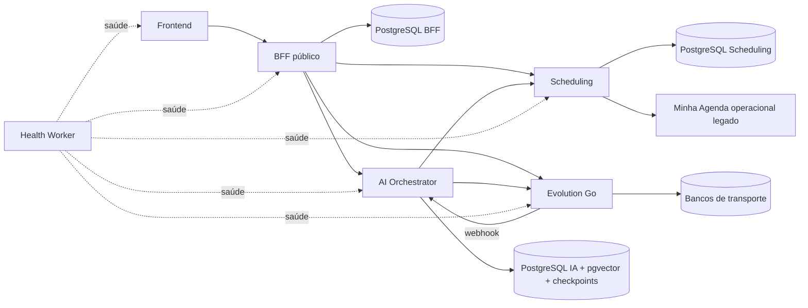

# Estado atual — baseline verificável

Auditado em 2026-09-05 no commit `5fb5d51abc1de58cb24718e7349d7a68ccaa7356`. A fotografia histórica abaixo é preservada; o delta aceito do Goal001 e o achado adicional estão ao final deste documento. Não é atestado de produção. Estado da retomada e alterações preexistentes: [AUDIT_PROGRESS](AUDIT_PROGRESS.md).

**Convenções:** FATO = observado em código/configuração; INFERÊNCIA = conclusão técnica limitada à evidência; NÃO VERIFICADO = exige execução/ambiente adicional. Divergências ficam em [GAP_ANALYSIS](GAP_ANALYSIS.md); propostas, em [TARGET_ARCHITECTURE](TARGET_ARCHITECTURE.md).

## Monorepo e fronteiras

| Unidade | Fato: responsabilidade e tecnologia declarada | Persistência / consumidores |
| --- | --- | --- |
| `apps/frontend` | Next `^16.3.3`, React `19.2.4`, TypeScript; App Router; browser acessa BFF | Sessão/API BFF; package legal |
| `apps/bff` | Fastify `^5.6.2`, Prisma `7.10.0`, Zod, jose, bcryptjs; API pública `/v1`, autenticação e composição | PostgreSQL BFF; chama AI, Scheduling e Evolution |
| `apps/scheduling-service` | Fastify/Prisma/PostgreSQL; agenda, catálogo, clientes e integração de calendário | API interna consumida por BFF e IA |
| `apps/ai-orchestrator` | Fastify/Prisma; LangGraph `1.4.13`, LangChain OpenAI `1.5.8`, checkpointer PostgreSQL `1.0.5` | Conversas/IA e pgvector; chama Scheduling e Evolution |
| `apps/evolution-go` | Go `1.25.0`, Gin `1.10.0`, GORM `1.25.10`; transporte WhatsApp e whatsmeow vendorizado | Autenticação/sessões de dispositivo e instâncias; BFF e IA |
| `apps/health-worker` | Node, sem dependências npm; sonda saúde dos serviços | Não é proprietário de dados de produto |
| `packages/contracts` | Zod/TypeScript, saída `dist`; exporta raiz e common | Nenhum import de runtime encontrado nos apps pela busca dirigida |
| `packages/legal-contract` | Constantes JS + declarações TS para versões legais | Importado efetivamente por frontend e BFF |

Versões acima são declarações dos `package.json` e `go.mod`, não verificação de compatibilidade com versões mais recentes. Há locks npm por aplicação; a raiz não declara npm workspaces nem gerenciador de tarefas de monorepo. O script raiz delega comandos por diretório.

A relação HTTP IA → Evolution → webhook IA é um circuito de mensagens, não evidência de import circular. Não há import entre apps identificado na busca dirigida; não foi feita prova exaustiva de ausência de ciclos entre todos os módulos. O grafo ajuda a localizar dependências, mas seu escopo não inclui vault, design e whatsmeow vendorizado.

## BFF e autenticação

- **FATO:** `apps/bff/src/lib/auth.ts:14` assina JWT HS256 com subject do usuário; `requireAuth` aceita Bearer ou cookie HttpOnly. Logout remove cookie; tokens já emitidos não têm revogação por sessão ou mudança de senha no código examinado.
- **FATO:** `apps/bff/src/lib/tenant-context.ts:13` resolve associação pelo usuário autenticado, rejeita ausência, múltiplas associações ou papel incompatível. O MVP não apresenta seletor de tenant. A restrição do banco é somente `(tenantId,userId)`; cardinalidade de um negócio por usuário e um usuário por negócio não é garantida por índices exclusivos separados.
- **FATO:** cadastro em `apps/bff/src/modules/auth/routes.ts:81` cria usuário, tenant, membership, perfil, AI settings e aceite legal na mesma transação. Senha é hash; recuperação usa token aleatório armazenado como hash e claim transacional de uso único.
- **FATO:** BFF possui recuperação real de senha quando configurado delivery. O escopo atual do MVP exige somente representação visual desse fluxo, o que não é autorização para ampliar a feature.
- **FATO:** `app.ts:59` configura CORS com origem específica e credenciais; `x-csrf-token` está apenas na lista de headers permitidos. Não foi localizado validador CSRF/origin/referer nas mutações. `render.yaml` configura cookie SameSite=None/Secure. Exploração real não foi testada; isso é superfície a endurecer, não incidente comprovado.
- **FATO:** `InternalHttpClient` envia segredo interno, `x-tenant-id`, `x-user-id`, `x-request-id` e audience; valida resposta via Zod. GET pode repetir até três tentativas, sem backoff explícito; mutação faz uma tentativa. Scheduling valida segredo em tempo constante e exige contexto, mas não valida audience (`shared/auth/internal-auth.ts:31`). O segredo autentica serviço confiável; não é prova independente da associação user/tenant.

## API e composição

Inventário registrado: [PUBLIC_API_V1](../../apps/bff/PUBLIC_API_V1.md). Montagem confirmada em `apps/bff/src/app.ts:78` e arquivos `src/modules/*/routes.ts`.

| Família pública | Dono da operação / observação |
| --- | --- |
| `/v1/auth/*` | BFF, sessão e conta |
| `/v1/onboarding` + `/complete` | BFF compõe perfil, catálogo, disponibilidade e IA; WhatsApp saiu da composição no Goal018 — `complete` não verifica mais instância nem status do Evolution |
| `/v1/dashboard` | Composição com estado degradado por dependência, sem zerar silenciosamente erro como sucesso |
| `/v1/appointments`, `/availability`, `/time-blocks` | Proxy validado para Scheduling; create/reschedule/cancel transportam idempotency key |
| `/v1/customers`, `/v1/services` | CRUD parcial via Scheduling; telefone obrigatório no create cliente BFF |
| `/v1/conversations/*` | IA guarda conversas; BFF passa token da instância no envio humano |
| `/v1/settings/*` | BFF grava perfil/configuração e sincroniza IA em chamadas posteriores |
| `/v1/whatsapp/*` | BFF controla provisionamento/QR/pairing/status/disconnect em Evolution e provisiona vínculo na IA |
| `/v1/calendar/integration/*`, `/calendar/migrations/*` | Contratos legados ainda montados e consumidos |

`onboarding/routes.ts:174–235` exige fonte escolhida, dois tons antigos, modalidade selecionada e endereço quando `ON_SITE` (Goal018); fonte externa dispensa disponibilidade interna, exigindo integração conectada. WhatsApp deixou de ser exigência de conclusão no Goal018 — a rota não consulta mais `WhatsAppInstance` nem o status do Evolution. `settings/routes.ts:88–100` persiste AI settings antes de sincronizar IA: falha remota deixa duas cópias divergentes. Atualização de negócio também precede sincronização. Não há transação distribuída ou reconciliação durável nesse caminho.

WhatsApp é criado remotamente antes da inserção local (`whatsapp/routes.ts:144–160`), e depois provisionado na IA. Concorrência/falha parcial pode deixar instância órfã; não foi observado incidente real. GET status atualiza a projeção local, podendo reduzir estados intermediários a CONNECTED/DISCONNECTED.

## Dados pertencentes ao BFF

Schema: `apps/bff/prisma/schema.prisma`.

| Entidade | Identidade, ownership e semântica atual |
| --- | --- |
| User | CUID, email global único, passwordHash, created/updated |
| Tenant / TenantMember | Tenant ID canônico; membership com papel OWNER; FKs locais |
| BusinessProfile | tenantId único; nome, categoria, timezone, idioma, moeda, onboardingCompletedAt; `modalities` (array), `address` (nulável) e `businessContextVersion`/`businessContextProjectedVersion` (contador gravado x versão confirmada pela IA) desde o Goal018 |
| AiSettings | tenantId único; enabled e enum de dois tons; cópia funcional na IA |
| WhatsAppInstance | userId único; id/name/token externo, número/status/QR/timestamps; token armazenado como String sem cifra neste schema/rota |
| LegalAcceptance | User + versões termos/privacidade únicas; acceptedAt |
| PasswordResetToken | User, tokenHash único, expiresAt/usedAt; sem mecanismo de revogação JWT |

Não há entidades BFF para central de notificações, exclusão recuperável da conta, consentimento específico de conexão WhatsApp ou retenção configurável. `onDelete: Cascade` local não apaga bancos de outros serviços. BusinessProfile, CalendarSettings e contexto da IA possuem cópias de timezone que requerem governança conjunta.

Migrations antigas fazem backfill estável de tenant com prefixo `legacy_tenant_`. A migration `20260831220000_goal17_legacy_cleanup` remove `IgnoredContact`, perfis/persona e settings anteriores; comentário que trata dois tons como aprovados é histórico substituído. Não se pode inferir que dados removidos sejam recuperáveis nem que a migration tenha sido aplicada em produção. Essa incerteza é parte do inventário antes de qualquer novo backfill.

## Infraestrutura, execução e qualidade

- `render.yaml`: seis serviços web, planos declarados free, três Node APIs, frontend, Go via Docker e health-worker; somente banco Scheduling declarado no blueprint. URLs hardcoded e segredos externalizados. Estado real das contas/serviços não verificado.
- Prisma com três histories independentes. BFF pode usar `DIRECT_DATABASE_URL` nas migrations. Não foi estabelecido se cada URL aponta a banco físico diferente; o ownership lógico é separado, e colisão em schema/tabelas deve ser impedida na implantação.
- Compose da IA sobe PostgreSQL/pgvector e Evolution com dois bancos de transporte; não é uma execução local completa do monorepo. Não há `.github` na baseline. Docker IA usa Node 22 enquanto blueprint fixa Node 24.13.0; alinhar execução, sem troca de framework.
- Blueprint executa `prisma:deploy` durante build antes de build TS; um build que falha pode já ter alterado banco. `scripts/build-all.sh` compila contracts, IA, BFF, frontend, verifica health e roda Go, mas omite Scheduling.
- Logs estruturados/redação de credenciais e correlação existem; saúde liveness não comprova banco, entrega WhatsApp, teste real ou aptidão da IA. Propagação de request-id não constitui tracing completo.

| Verificação | Evidência e limite |
| --- | --- |
| IA unitários, recuperado da primeira execução | 6 arquivos, 39 testes passaram, 1 falhou; expectativa antiga sem requestId em `inbound-message-processor.test.ts:423`; nenhuma correção feita |
| BFF integração | Único teste encontrado condicionado a `BFF_RUN_INTEGRATION_TESTS`; usa `/auth/register` antigo. Inspecionado, não executado contra banco |
| Scheduling | Sem script npm test na baseline; detalhes do domínio em DATA_MIGRATION |
| Frontend | Sem script de testes na baseline; inspeção detalhada em REUSE_ANALYSIS |
| Auditoria estática existente | Executada na retomada com `PRODUCTION_HEALTH_TARGETS` vazio: 14 verificações estáticas passaram, 1 health de produção pulado. O resumo do script conta o skipped como passed (15); não reportar como 15 testes reais |
| Builds/lint/Go/DB/E2E | Não executados neste checkpoint; comandos existentes não equivalem a checks aprovados |

As verificações estáticas procuram texto e estrutura; não demonstram isolamento real, correção de negócio, atomicidade, concorrência, retenção ou disponibilidade em produção.

## Evidência Graphify utilizada

Grafo existente de 3.039 nós. Consulta por vocabulário `auth tenant session business` encontrou 178 nós, com corte de orçamento explícito; refinada por `explain resolveTenantContext` e `explain InternalHttpClient`. Relações extraídas: `requireTenantContext → resolveTenantContext`; clients Scheduling, IA e Evolution importam InternalHttpClient. Código confirmou essas relações. Consultas dos domínios estão nos documentos de domínio. Sem rebuild, alteração do manifesto ou feedback escrito no grafo.

## Scheduling, catálogo, clientes e importação

**FATOS consolidados:** núcleo operacional independente da IA, com CalendarService, factory e dois providers. O provider Atendly já oferece soma de multi-serviço, snapshots em AppointmentItem, cancelamento sem apagar appointment e remarcação por atualização transacional. Create e reschedule usam Serializable e advisory lock por tenant/data. Não é uma base a descartar.

O motor de disponibilidade considera intervalos semanais, exceções por data, blocos e agendamentos não cancelados. A gestão HTTP não completa todas essas estruturas: exceções não têm rota de gestão localizada; hold, compromisso pessoal distinto, séries recorrentes, presença, falta e valor final não aparecem como capacidades completas. Serviço tem somente FIXED/ON_REQUEST, duração obrigatória e ativo. **Superado no Goal007** — ver o delta ao final deste documento. Cliente é identificado por telefone normalizado único no tenant; upsert pode renomeá-lo antes da transação de agendamento. **Superado no Goal006** — ver o delta ao final deste documento.

Minha Agenda continua recebendo leitura e escrita operacional. O snapshot de migração atual consulta hoje até dez anos à frente, deriva clientes desses agendamentos, filtra deleted e reduz estados. Migração exige destino vazio, bloqueia todos os itens se houver conflito e conclui/troca fonte automaticamente. Há tabela de job e claim condicional, mas execução usa Set/queueMicrotask locais e recuperação global no boot sem lease. Isso não implementa importação única do produto.

Inventário de entidades, constraints SQL adicionais ao Prisma, caminhos com locks, dados temporais, consumers e matriz de importação: [DATA_MIGRATION §§1–3](DATA_MIGRATION.md#1-persistência-atual-de-scheduling). Tabelas de domínio: CalendarSettings, IntegrationConnection, Customer, Service, AvailabilityRule, AvailabilityException, TimeBlock, Appointment, AppointmentItem, ExternalEntityMap, MigrationJob, MigrationConflict e CalendarMutationIdempotency. FKs compostas de cliente/serviço/appointment preservam tenant local; não há FK para o banco BFF.

## AI Orchestrator e conversas

**Fluxo confirmado:** Evolution webhook → autenticação por token → mapper → resolução de ChannelConnection por instance ID → processor → LangGraph (contexto/guard/classificação/RAG/buffer/ferramentas/resposta) → Scheduling quando necessário → Evolution sendText. `MessageGraphWorkflow` é importado e construído por InboundMessageProcessor (Graphify explain confirmou; código em `modules/graph/message-graph.ts:65` e `channel/InboundMessageProcessor.ts:168`).

- `channel/routes/evolutionWebhook.routes.ts:60–99`: processor novo por request; HTTP 202 precede `handleInboundMessage`. O buffer é Map por processor (`InboundMessageProcessor.ts:154`). Consequência inferida: debounce/cancelamento não coordena requests distintos e queda após ACK pode perder trabalho. **Superado no Goal004** — ver o delta ao final deste documento.
- `graph/message-graph.ts:206`: ProcessedEvent é criado antes do processamento. A tabela tem dedupe único, mas não estados de execução/retry. Guard de IA desligada/handoff pode encerrar antes de Message. Deduplicação não equivale a processamento concluído.
- `message-graph.ts:273` e `assistant.service.ts:622`: `fromMe` comum grava OWNER, sem acionar a pausa; comandos especiais de pausa existem. Mensagem humana no chat interno exige takeover prévio (`internal/routes.ts:167`), enquanto o produto pede que o envio assuma. Abrir conversa não deve assumir. **Superado no Goal005** — ver o delta ao final deste documento.
- `message-graph.ts:269/401`: conteúdo não textual vai para resposta genérica unsupported. Não foi localizado pipeline de transcrição; áudio, imagem e documento ainda não têm tratamentos distintos do MVP. **Superado no Goal013.** **FATO atual:** toda mensagem recebida do contato é persistida como `Message` com `kind` (`TEXT`/`AUDIO`/`IMAGE`/`DOCUMENT`/`VIDEO`/`STICKER`/`UNKNOWN`) e mídia ganha uma linha `MessageAttachment` com metadados, sem byte de mídia retido no PostgreSQL da IA; existe pipeline de transcrição (`modules/media/`, provider por porta com implementação OpenAI por HTTP e dublê em teste), num nó do grafo entre `recordInbound` e `sessionGate`, que não roda para contato ignorado nem sessão pessoal e cuja transcrição vira o texto do turno sob os mesmos guards do Goal011; e cada tipo tem tratamento próprio: imagem gera handoff determinístico sem chamar o modelo, documento e vídeo são confirmados sem interpretação (a legenda do documento segue como texto do contato), e sticker, GIF (`videoMessage` com `gifPlayback`) e `unknown` persistem sem resposta, sem handoff e sem renovar a sessão.
- `message-graph.ts:581–631`: registro de outbound é marcado com ID local antes de send e depois atualizado; não há estado separado de entrega. Envio humano remove mensagem pendente se send falha (`internal/routes.ts:174–208`), inclusive quando timeout não prova ausência de entrega. **Superado no Goal004** — ver o delta ao final deste documento.
- Classificação existente em `assistant.service.ts` usa `potential_customer`, `supplier_or_partner`, `personal_contact`, `unknown` dentro de JSON do agente. Não equivale às três abas, override manual, Contact ignorado e sessão de aproximadamente 24h do produto. Não há esses modelos explícitos no schema. **Superado no Goal005** — ver o delta ao final deste documento.

### Dados e memória da IA

`apps/ai-orchestrator/prisma/schema.prisma`: ChannelConnection (único provider/instance e tenant/provider), Conversation (único tenant/channel/contact), Message (dedupe tenant/channel/externalMessageId), ProcessedEvent, AiRun, AiToolCall, Handoff, AiTenantConfig, KnowledgeDocument e KnowledgeChunk. FKs compostas protegem tenant/channel nas relações internas. **Superado nos Goals 012 e 013** na lista de entidades: o schema vigente também tem `CustomerMemory` (Goal012) e `Message.kind` com a tabela `MessageAttachment` (Goal013) — ver os deltas ao final deste documento. Não há FK cross-database para User, Customer ou Appointment.

AiRun/AiToolCall guardam modelo, promptVersion, status, argumentos, resultados e erros: base útil de auditabilidade, também conteúdo potencialmente pessoal. Message/ProcessedEvent guardam rawPayload. **Superado no Goal013** na parte de mídia: nenhum dos dois retém o `base64` do provedor — ele é purgado ao concluir o evento e no estoque por backfill, preservando o restante do proto; ver o delta ao final deste documento. Handoff tem status e pausa; não é entidade de sessão de contato. AiTenantConfig replica enabled/tone/contexto do BFF. Conhecimento guarda versão/checksum/status e embedding `vector(1536)`. `pgvector-knowledge-store.ts:142–149` filtra tenant do chunk e do documento e somente documentos ACTIVE: proteção concreta, sem prova de RLS ou teste de invasão.

Checkpointer usa schema PostgreSQL `langgraph` e executa setup no boot (`graph/checkpointer.ts:3–12`); thread_id é conversationId (`message-graph.ts:78`). Tabelas de checkpoints são persistência adicional fora do schema Prisma. Não há rotina de retenção de conteúdo/checkpoints/runs localizada. O seed de conhecimento não representa CRUD de FAQ pronto no produto. **Superado no Goal012** na parte de conhecimento, memória do cliente e propósito do `AiRun` — ver o delta ao final deste documento; a retenção continua aberta (Goal022).

## WhatsApp / Evolution Go

BFF usa API admin para criar instância e token da instância para conectar/status/QR/pair/send. IA deriva tenant do vínculo cadastrado, rejeitando instância não vinculada/ativa (`ChannelConnectionService.ts:106`). Provisionamento rejeita vínculo da mesma instância a outro tenant e há índice único correspondente. Grupos são desabilitados na criação pelo BFF; essa proteção também precisa de guard de produto, sem presumir que configuração remota seja suficiente.

Evolution permanece transporte, Gin/Go e whatsmeow, com bancos configuráveis de autenticação e usuários/sessões (`POSTGRES_AUTH_DB`, `POSTGRES_USERS_DB`). Pode persistir mensagens do transporte por configuração; Compose auditado desativa `DATABASE_SAVE_MESSAGES`. A configuração efetiva de produção não foi inspecionada. Esse armazenamento pode duplicar conteúdo guardado pela IA e precisa entrar na retenção.

**FATO de autorização:** `pkg/routes/routes.go:120–133` monta GET/PUT advanced-settings sob Auth de instância. `auth_middleware.go:21` resolve token e põe a instância em contexto; handlers `instance_handler.go:589/619` passam `instanceId` da URL ao service sem comparação com esse contexto; service `instance_service.go:825/837` usa o ID recebido. Um token de uma instância não fica vinculado ao alvo nessas duas rotas. Falha confirmada por análise estática do caminho; não explorada remotamente.

`webhook_producer.go:43–72`: entrega em goroutine, cinco tentativas, intervalo de 30s, cliente HTTP sem timeout; 2xx termina retry. Logs imprimem URL inteira, incluindo query token configurada pelo BFF. Payload de evento carrega instanceToken em `pkg/whatsmeow/service/whatsmeow.go` (confirmado na auditoria recuperada); IdempotencyStore guarda raw integral. Há testes Go de transporte/configuração/instância, mas não foram executados nesta auditoria nem comprovam cobertura do defeito acima.

## Health Worker e jobs

`apps/health-worker/src/index.js`: sonda cinco alvos a cada 40 segundos, timeout de 10 segundos, request-id e logs; expõe `/health` e `/targets`. Não possui fila, banco, agendamento de lembretes, retenção, conclusão automática ou expiração de holds. Sua responsabilidade atual é coerente e reaproveitável. Jobs de domínio são uma necessidade nova a resolver no dono do dado, não uma extensão automática deste serviço.

## Frontend, referência visual e contratos

Frontend usa Context/hooks locais (`ProductRuntime.tsx`), gate de sessão e redirect; serviços BFF centralizados em `data/services/registry.ts`, client HTTP e Zod local. Há telas Product* reais e telas/scenarios de demonstração em preview: presença de um frame ou mock não demonstra feature integrada. Não há dependência de store externo/form library no manifest. Forms são implementados nas features; componentes Dialog/States/Button/RouteAnnouncer oferecem base para foco, feedback e navegação, a revalidar na substituição visual.

`AppShell.tsx:68` assume WhatsApp connected se o caller omite estado; `:269/310` mostra apenas três destinos + Mais e esconde Clientes. São divergências concretas. CSS usa Inter/IBM Plex Mono; referência Recepção usa Literata/Hanken Grotesk, superfícies quentes/petróleo, ícones e motion com reduced-motion. O HTML aprovado especifica resultado visual, não arquitetura React. A análise foi seletiva por índice/módulos e código; não foi validação visual de todos os frames ou sessão de browser.

O protótipo possui conflito localizado: Movimento.dc.html:396 restringe Semana/Mês a landscape/desktop; Agenda.dc.html e vault preservam Dia/Semana/Mês no mobile. O vault prevalece. Matriz completa de módulos e tokens: [REUSE_ANALYSIS](REUSE_ANALYSIS.md).

`packages/contracts` exporta utilitários common; índices auth/calendar/conversations/customers/dashboard/internal/migrations/onboarding/services/settings/tenant/whatsapp são placeholders. Parsers reais estão duplicados no frontend, nos clients BFF e IA e nas rotas Scheduling. Centralizar deve migrar consumidores efetivos, sem anunciar que o pacote já fornece o contrato público.

## Fechamento factual e limites

Os domínios obrigatórios foram inspecionados em profundidade suficiente para decisões arquiteturais. Permanecem **NÃO VERIFICADOS**: população/migrations implantadas, backups restauráveis, capacidades completas da API Minha Agenda, disponibilidade e custo do deploy efetivo, entrega WhatsApp real, comportamento visual em aparelhos e testes reais cross-tenant/concorrência. São gates explícitos da execução futura; não justificam aprofundamento indiscriminado nesta fase.

## Delta aceito — Goal001, 2026-09-05

HEAD documental `4ca130128cafd620ea316c3ed9c51a46b34f8541`; implementação ainda em working tree, identificada pelos hashes do [review001](reviews/001-review.md). Não há alteração de código entre esse HEAD e a baseline; a mudança funcional é o diff001.

- **FATO atual:** GET/PUT advanced-settings chamam `authorizeInstanceTarget` antes do bind/service. Contexto ausente, tipo inválido, ponteiro/interface nil ou ID vazio retornam401; alvo diferente retorna403 genérico sem consultar sua existência; alvo próprio usa o ID autenticado. A falha G-01 descrita na fotografia histórica está corrigida nesse diff aceito.
- Auth/AuthAdmin, endpoints, payloads legítimos, services, schemas e dependências permanecem iguais. BFF/IA não chamam essas rotas; manager combina ID/token próprios. Teste administrativo espelha o registro real, que foi inspecionado e não mudou.
- **EXECUÇÃO:** 31 nós de autorização passaram; testes cruzados novos retornaram RED sobre baseline com somente a fixture copiada. Build/vet Go passaram. Suite Go completa:95 nós passaram/2 testes falharam por cleanup de arquivo aberto em service/webhook, reproduzido no baseline isolado. Dependências desses pacotes não incluem o handler. Detalhes/limites no review; o teste não comprova deploy ou isolamento integral do produto.
- **PRECISÃO:** gofmt é equivalente sobre conteúdo LF; checkout CRLF faz `gofmt -l` listar os três arquivos. Isso foi verificado separadamente, sem formatar o código do executor.

## Descoberta adicional — metadados de mensagem no transporte

**FATO estático G-35, não corrigido pelo Goal001:** `POST /message/status` recebe ID de mensagem, verifica client conectado da instância autenticada e consulta `GetMessageByID(data.Id)` sem scoping por instância (`message_service.go:349`, `message_repository.go:27`). Repository é compartilhado; Message guarda id/message_id/timestamp/status/source, sem instanceId. `source` deriva do identificador de chat/telefone (`whatsmeow.go:1645/1662`), não do dono da instância.

Com registro de B existente, seu ID conhecido e token/client A válidos, o caminho não impede leitura desses metadados de B. Não há texto da mensagem nesse modelo. Gravação examinada depende de `DATABASE_SAVE_MESSAGES=true`; exemplo versionado usa false. Configuração/linhas de produção não foram verificadas, e desligar escrita não prova ausência de histórico. Isso refina o inventário da persistência opcional de transporte: a tabela examinada contém metadados, sem pressupor conteúdo integral.

Foram contados72 MustGet em dez arquivos de handlers; o uso em si indica fragilidade para contexto ausente/nil, não comprova IDOR. Auth repository retorna ponteiro válido quando encontra token. O achado de objeto acima é distinto e permanece como requisito de segurança do Goal003 antes de004. **Corrigido no Goal003** — ver o delta ao final deste documento.

## Delta implementado — Goal002, 2026-09-05 (ACCEPTED na rodada 3)

A fotografia histórica acima permanece como registro da baseline. O que mudou
com o Goal002 é infraestrutura de validação, não comportamento de produto.

- **FATO atual:** `scripts/build-all.sh` também compila o Scheduling Service, e
  os comandos canônicos passaram a ser `npm run validate:core` e
  `npm run validate:integration` ([VALIDATION_GATE](VALIDATION_GATE.md)).
- **FATO atual:** o teste de integração do BFF usa `POST /v1/auth/register` e
  exige `BFF_TEST_DATABASE_URL` apontando para PostgreSQL descartável em
  loopback; sem essa URL o runner recusa com exit2, sem tocar o banco default.
- **FATO atual:** `final-production-audit.mjs` reporta `skipped` em contagem
  própria (14 passed /0 failed /1 skipped); o resumo antigo de "15 passed" não
  existe mais. O script continua sendo auditoria estática por regex.
- **FATO atual:** as duas fixtures Go de cleanup fecham o logger da instância
  antes da remoção do `t.TempDir()`. A suíte Go completa passa no Windows
  (7 pacotes `ok`), incluindo os 31 nós de autorização do Goal001. A asserção de
  `requestId` da IA foi corrigida e passa.
- **FATO atual:** `tests/channel/evolution.routes.test.ts` prepara o ambiente e
  importa o módulo de rotas uma única vez, na avaliação do arquivo. O custo de
  carregar a cadeia LangGraph/Prisma/embeddings deixou de ser pago dentro de
  cada caso e o `testTimeout` padrão de5000ms deixou de estourar. Fastify,
  guard de token, mapper e as respostas401/400/404 continuam reais. A suíte da
  IA passa40/40 e `validate:core` retorna exit0.
- **FATO atual:** `BFF_TEST_DATABASE_URL` só é aceita com uma allowlist de
  query parameters e com o destino efetivo conferido pelo parser do driver do
  BFF; `validate:integration` gera o client Prisma antes de migrar e testar.
- **FATO atual:** existe `.github/workflows/validate.yml` — a baseline não tinha
  `.github`. **NÃO VERIFICADO:** execução hospedada desse workflow.
- Continuam **NÃO VERIFICADOS** todos os limites listados no fechamento
  factual: deploy, restore, E2E, concorrência, entrega WhatsApp real e
  persistência dos demais domínios.

## Delta implementado — Goal003, 2026-09-07 (ACCEPTED na rodada 2)

A fotografia histórica acima permanece como registro da baseline. Os FATOs de
"BFF e autenticação", "WhatsApp / Evolution Go" e "Descoberta adicional" que
descrevem JWT sem revogação, CSRF ausente, segredo interno único,
`instanceToken` do corpo como autoridade e `/message/status` sem dono estão
superados pelos fatos abaixo, verificados no [review003](reviews/003-review.md)
sobre a base `99a7210`.

- **FATO atual:** `apps/bff/src/lib/auth.ts` assina o JWT com `sid`;
  `requireAuth` carrega `UserSession` a cada requisição e recusa sessão
  inexistente, expirada, revogada ou de outro usuário com 401; JWT sem `sid`
  recebe 401 `SESSION_REAUTH_REQUIRED` sem criar sessão. `POST /v1/auth/logout`
  revoga a sessão corrente; `PATCH /v1/auth/password` e
  `POST /v1/auth/reset-password` revogam todas, cookie e Bearer.
- **FATO atual:** mutações autenticadas por cookie exigem `Origin`/`Referer` na
  allowlist de `FRONTEND_ORIGIN` e header `x-csrf-token` conferido contra o
  hash guardado na sessão; Bearer não exige CSRF e header declaratório não
  autentica. O token é derivado por sessão e entregue no cookie legível
  `atendly_csrf` e no header de resposta `x-csrf-token`, exposto pelo CORS só
  à origem permitida, porque em produção frontend e BFF estão em hosts distintos
  sob `onrender.com`. `BffHttpClient` guarda o token em memória e o reenvia;
  `test:frontend` cobre esse adapter sem cookie jar.
- **FATO atual:** `WhatsAppInstance.tenantId` é único com FK para `Tenant`;
  `userId` único foi conservado. `apps/bff/src/modules/whatsapp/instance-link.ts`
  resolve o vínculo pelo tenant autenticado e recusa com 409 os estados pendente
  (linha do usuário sem tenant) e divergente (duas linhas, ou dono de negócio
  diferente do usuário); só `DELETE /v1/whatsapp` descarta a linha pendente, e
  apenas para o dono. **Nota:** a classificação de pendente não exige `tenantId`
  nulo na linha do usuário; inalcançável com a associação única vigente,
  endurecimento registrado no review.
- **FATO atual:** credenciais internas são derivadas por
  `HMAC(INTERNAL_SERVICE_TOKEN, chamador:audiência:uso)` ou definidas
  explicitamente por variável; o valor bruto do segredo raiz não é aceito por
  BFF→IA, BFF→Scheduling nem IA→Scheduling. A IA autoriza por escopo mapeado por
  método e caminho (`internal:unmapped` negado) e exige `x-tenant-id`/`x-user-id`
  explícitos depois da credencial; o fallback de primeira `ChannelConnection`
  ativa foi removido. Scheduling identifica o chamador pela credencial e recusa
  `x-service-audience` divergente com 403.
- **FATO atual:** o token da instância é guardado no BFF como envelope
  AES-256-GCM `v1.<keyId>.<iv>.<ct>` com AAD `tenantId|evolutionInstanceName`,
  versionado por `credentialVersion`/`credentialKeyId`; envelope de chave antiga
  é regravado na leitura e estoque legado em texto puro é selado na primeira
  leitura autorizada. Falha de chave, envelope ou vínculo levanta
  `CREDENTIAL_UNAVAILABLE` e impede a operação. `WHATSAPP_CREDENTIAL_KEYS` é
  obrigatório em produção.
- **FATO atual:** a IA recebe a credencial como projeção em
  `PUT /internal/channel-connections/evolution`, guarda-a cifrada com chaves
  próprias (`CHANNEL_CREDENTIAL_KEYS`) e resolve-a pelo vínculo de forma
  preguiçosa no envio; `readInstanceToken(request.body)` não existe mais, o
  payload do webhook é saneado por `redactSensitive` antes do mapeamento e
  `EvolutionProvider` não cai em `EVOLUTION_API_KEY`. Vínculo em
  `credentialVersion` 0 recebe e persiste o inbound e só falha ao responder;
  `GET /v1/whatsapp` reprojeta a credencial de forma idempotente.
- **FATO atual:** `apps/evolution-go/pkg/message/model/message_model.go` tem
  `instance_id` e índice único `(instance_id, message_id)`; `InsertMessage`
  recusa dono vazio e faz upsert nesse par; `GetMessageByID`,
  `GetLatestMessageID`, `DeleteMessagesByInstance` e a limpeza de
  `instance_repository.Delete` são escopadas por instância (a limpeza anterior
  filtrava por `source`, telefone, e não removia nada). `POST /message/status`
  devolve 401 antes de ler o body sem sujeito autenticado e `result` nulo
  idêntico para ID alheio e desconhecido. Writers de recibo em `whatsmeow.go`
  gravam `InstanceID = mycli.Instance.Id`. Expand roda no boot com inventário
  logado; `EVOLUTION_MESSAGE_OWNERSHIP_CUTOVER=true` remove a unicidade global de
  `message_id` só com o índice composto presente. Linhas legadas sem dono ficam
  preservadas e inalcançáveis.
- **FATO atual, não alterado:** o produtor Go ainda inclui `instanceToken` no
  payload dos eventos (`whatsmeow.go`, cinco pontos) e `webhook_producer.go`
  ainda loga a URL completa com o token de query. O consumer descarta e sanea; a
  retirada no produtor é do Goal004.
- **FATO atual:** `validate:core` executa `test:frontend` (deixou de ser skip) e
  `validate:integration` tem seis passos, incluindo o ensaio da migration de
  vínculo e a suíte de ownership do Go em bancos derivados do alvo descartável
  ([VALIDATION_GATE](VALIDATION_GATE.md)). Swagger e wiki do Evolution foram
  alinhados cirurgicamente para `/message/status` e `advanced-settings`.
- Continuam **NÃO VERIFICADOS:** prova em navegador real do CSRF cross-host,
  execução hospedada da CI, corte do Go em banco implantado, drift da migration
  da IA contra o schema (o cluster local não tem pgvector), deploy, WhatsApp
  real e os demais limites do fechamento factual.

## Delta implementado — Goal004, 2026-09-07 (ACCEPTED na rodada 2)

A fotografia histórica acima permanece como registro da baseline. Os FATOs de
"AI Orchestrator e conversas" e "WhatsApp / Evolution Go" que descrevem ACK
antes do processamento, buffer em `Map`, outbound marcado antes do envio,
`delete` da tentativa do dono, `instanceToken` no payload e produtor sem
persistência estão superados pelos fatos abaixo, verificados no
[review004](reviews/004-review.md) sobre a base `b3a019c`.

- **FATO atual:** `channel/routes/evolutionWebhook.routes.ts` saneia,
  classifica e persiste o evento em `ProcessedEvent` antes de responder 202;
  falha ao persistir devolve 5xx; duplicata devolve 202 sem novo efeito;
  eventos técnicos recebem 2xx (presença descartada, ciclo de vida da conexão
  registrado como IGNORED); `Receipt` vira trabalho de reconciliação; vínculo
  não resolvido devolve 503. Não há mais processamento em promise solta depois
  do ACK.
- **FATO atual:** `ProcessedEvent` carrega `eventType`, `conversationKey`
  (`tenant:canal:contato`), `status` RECEIVED/PROCESSING/DONE/FAILED/IGNORED/
  LEGACY, tentativas, `nextAttemptAt`, lease (`leaseOwner`, `leaseToken`,
  `leaseExpiresAt`), `supersedeRequestedAt`, resultado e erro sanitizado.
  `InboxStore.claimNext` varre candidatos excluindo conversas com PROCESSING
  de lease vivo, fixa a linha com `FOR UPDATE SKIP LOCKED`, usa
  `pg_try_advisory_xact_lock` por conversa e agrupa os fragmentos pendentes
  dentro da janela; só lease expirado é recuperado; `complete`/`fail` exigem
  o `leaseToken` do claim; dead-letter após `INBOX_MAX_ATTEMPTS` fica visível
  em `inboxDeadLetters` no painel interno, sem reenvio em massa.
- **FATO atual:** `InboxWorker` roda no processo da IA (`INBOX_WORKER_ENABLED`,
  `INBOX_POLL_INTERVAL_MS`, `INBOX_LEASE_SECONDS` 120,
  `INBOX_MAX_CONCURRENT_CONVERSATIONS`), acordado pelo webhook sem bloquear o
  ACK; `InboundEventDispatcher` executa o lote com `eventAlreadyGuarded`, então
  o guard do grafo não repete `remember` sobre a própria linha da inbox. O
  lease não é renovado durante a execução.
- **FATO atual:** a janela de fragmentos e a espera da primeira mensagem
  ambígua de contato sem histórico são recalculadas por
  `InboxStore.applyConversationWindow` em `nextAttemptAt` sobre os pendentes
  da conversa (`inbox-policy.ts`: mínimo `AI_DEBOUNCE_MIN_SECONDS`, degraus
  por texto longo ou vários fragmentos, seguimento urgente, teto
  `AI_DEBOUNCE_MAX_SECONDS`, limite `AI_DEBOUNCE_MAX_WAIT_SECONDS` desde o
  primeiro evento; `AI_AMBIGUOUS_WAIT_SECONDS` 120 e
  `AI_AMBIGUOUS_MAX_WAIT_SECONDS` 300). O `Map` do processador ficou só como
  gatilho local e está desligado no caminho do worker. Mensagem nova durante a
  execução marca supersede e `sendResponse` cancela a resposta ainda não
  enviada (`superseded`).
- **FATO atual:** toda saída existe em `Message` antes do transporte, com
  `correlationId` estável (que viaja como id da mensagem no envio) e
  `deliveryState` PENDING/SENT/FAILED/UNKNOWN mais `deliveryDetail`,
  `deliveryAttempts` e `deliveryUpdatedAt`. `EvolutionProvider` tem timeout
  (`EVOLUTION_SEND_TIMEOUT_MS` 15000) mapeado para `EVOLUTION_SEND_TIMEOUT`;
  `outbox-policy.classifySendFailure` faz 4xx = FAILED definitivo, timeout/5xx/
  erro pós-envio = UNKNOWN sem retry, conexão nunca estabelecida = FAILED
  retentável, credencial não projetada = FAILED com motivo; `markOutboundDelivery`
  substitui a marcação antecipada de envio. `POST /internal/conversations/:id/messages`
  não apaga mais a tentativa: devolve 201 quando SENT e 202 com o estado real
  quando FAILED/UNKNOWN. `OutboxStore.reconcileFromReceipt` leva PENDING/UNKNOWN
  a SENT por `correlationId` ou `externalMessageId`, escopado a tenant e canal.
- **FATO atual:** `messageDto` da IA, o client do BFF e `publicApiSchemas.ts`
  do frontend expõem `deliveryState`/`deliveryDetail` como opcionais e
  anuláveis ([PUBLIC_API_V1](../../apps/bff/PUBLIC_API_V1.md)); não há UI nova.
- **FATO atual:** no Evolution Go, `webhook_producer.go` persiste a tentativa em
  `webhook_deliveries` (`AutoMigrate` aditivo) antes da goroutine, com destino
  redigido; 2xx conclui, 4xx é recusa definitiva sem retry, 5xx/timeout/rede
  ficam pendentes com retry limitado; `ResumePending` no boot resolve o destino
  real pela instância. O payload de evento não carrega mais `instanceToken`
  (sete pontos em `whatsmeow.go` e dois em `send_service.go`); os logs não
  imprimem a URL com token. 429 e 408 são tratados como 4xx definitivo.
- **FATO atual:** `validate:integration` tem dez passos, incluindo o ensaio da
  migration 004 (que também cria tabelas de apoio sem linhas, porque o cluster
  descartável não tem pgvector), a geração do client Prisma da IA, a suíte de
  durabilidade/dispatch contra PostgreSQL e o outbox do Go
  ([VALIDATION_GATE](VALIDATION_GATE.md#transporte-durável-do-goal004)).
- Continuam **NÃO VERIFICADOS:** WhatsApp real (inclusive se o transporte honra
  `correlationId` como ID da mensagem), execução hospedada da CI, deploy,
  `migrate deploy`/`diff` da IA em banco com pgvector, capacidade de execução
  contínua do worker e os demais limites do fechamento factual.

## Delta implementado — Goal005, 2026-09-08 (ACCEPTED na rodada 2)

A fotografia histórica acima permanece como registro da baseline. Os FATOs de
"AI Orchestrator e conversas" que descrevem `fromMe` sem pausa, takeover
prévio obrigatório, classificação só no JSON do agente e ausência de Contact,
sessão e categoria persistidas estão superados pelos fatos abaixo, verificados
no [review005](reviews/005-review.md) sobre a base `8551717`.

- **FATO atual:** `apps/ai-orchestrator/prisma/schema.prisma` tem `Contact`
  (identidade externa única por tenant e canal, `ignored` com autor/origem/data,
  `aiPaused` com motivo, `categoryOverride` com autor/data) e
  `ConversationSession` (`startedAt`, `lastContactMessageAt`, `expiresAt`,
  `endedAt`, categoria vigente com `categorySource`, `suggestedCategory` com
  proveniência, `humanHandling` com origem e autor, `contextResetAt`,
  `inboundVersion`, `backfillNote`); `Conversation.contactId` é opcional.
- **FATO atual:** `src/modules/session/session-policy.ts` decide sem Prisma:
  expiração por inatividade do contato (`AI_SESSION_INACTIVITY_SECONDS`,
  86400), precedência override manual > sugestão > Não classificadas, tradução
  da classificação técnica sem inventar Comercial, elegibilidade na ordem
  ignorado → pessoal → canal → IA desligada → pausa do contato → atendimento
  humano, e guard de execução comparando a versão de entrada.
  `SessionService` resolve contato e sessão, rotaciona por expiração
  sincronizando o espelho legado da conversa (salvo contato pausado ou
  ignorado), assume o controle humano em transação, grava override, ignore e
  pausa do contato, e `releaseToAi` marca `contextResetAt` e reseta o rascunho.
- **FATO atual:** `message-graph.ts` executa `loadSession` antes de
  `operationalGuard`; o guard só anota a decisão e `sessionGate` encerra
  **depois** de `recordInbound`, então a mensagem do cliente é persistida com
  IA desligada, canal desconectado, handoff, sessão pessoal e contato ignorado,
  e o conteúdo bloqueado não chega a `understandMessage`, RAG, modelo nem
  memória. `executeTool` e `sendResponse` consultam `executionBlockReason`
  (versão de entrada, controle humano, elegibilidade, categoria, ignore).
- **FATO atual:** mensagem manual do dono pelo WhatsApp (`fromMe` que não é
  saída do bot) cai em `ownerActivity`, assume a sessão e pede supersede da
  resposta pendente; `/ia_pause` e `/bot off` gravam `Contact.aiPaused`;
  `/bot on` libera a sessão como Retomar IA. `POST /internal/conversations/:id/messages`
  e `takeover` assumem a sessão (o `409 HUMAN_HANDOFF_REQUIRED` saiu; o takeover
  não grava mais relógio 9999); `release` chama `releaseToAi`; `GET` não altera
  estado. `HandoffService.isBotPaused` consulta a sessão antes de retomar por
  relógio vencido.
- **FATO atual:** `AssistantService` recebe uma porta de sugestão: a
  classificação do agente é gravada como `suggestedCategory` com proveniência
  `agent:<promptVersion>` e nunca como override; `contextSince` limita o
  histórico do turno após Retomar IA.
- **FATO atual:** rotas internas `PUT /internal/conversations/:id/category`
  (`null` limpa) e `PUT .../ignore` sob `conversations:write`; filtros
  `category`/`handling`/`ignored`; DTO de conversa com `category`,
  `categorySource`, `suggestedCategory`, `handling`, `ignored`/`ignoredAt`,
  `aiPaused` e `session`. BFF expõe `PUT /v1/conversations/:id/category` e
  `/ignore` com tenant da sessão e CSRF ([PUBLIC_API_V1](../../apps/bff/PUBLIC_API_V1.md));
  frontend aceita campos e operações novas sem tela.
- **FATO atual (resíduos do 004):** `InboxStore.renewLease` com fencing pelo
  token e heartbeat no `InboxWorker` (`INBOX_LEASE_HEARTBEAT_SECONDS`, 30); a
  espera da mensagem ambígua se estende enquanto os fragmentos seguintes forem
  saudação, até `AI_AMBIGUOUS_MAX_WAIT_SECONDS`.
- **FATO atual:** `validate:integration` tem onze passos, com o ensaio da
  migration 005 e as suítes de sessão e controle humano contra PostgreSQL;
  `tests/session/**` e `tests/internal/**` rodam no core sobre um Prisma em
  memória de teste.
- Continuam **NÃO VERIFICADOS:** WhatsApp real, execução hospedada da CI, deploy,
  `migrate deploy`/`diff` da IA em banco com pgvector e os demais limites do
  fechamento factual. Handoffs `OPEN` legados não são resolvidos pela rotação
  de sessão (resolvido no Goal006), e mensagens não textuais do contato não
  renovam a sessão.

## Delta implementado — Goal006, 2026-09-08 (ACCEPTED na rodada 1)

A fotografia histórica acima permanece como registro da baseline. Os FATOs de
"Scheduling, catálogo, clientes e importação" que descrevem cliente por
telefone único e upsert que renomeia, e o resíduo do Goal005 sobre handoffs
`OPEN`, estão superados pelos fatos abaixo, verificados no
[review006](reviews/006-review.md) sobre a base `8acd4c6`.

- **FATO atual:** `apps/scheduling-service/prisma/schema.prisma` tem `Customer`
  com `phone`/`normalizedPhone` opcionais e índice não exclusivo
  `(tenantId, normalizedPhone)`; `(tenantId, id)` continua a identidade
  referenciada pelas FKs. `CustomerRelation` (um responsável principal por
  cliente, `proposedBy`/`status`/`confirmedBy` com datas), `CustomerNote` e
  `CustomerTag` (ambas com `aiAuthorized`, padrão falso), com FK composta por
  tenant. Migrations `20260908160000_goal006_customer_identity_expand` e
  `20260908161000_goal006_customer_phone_not_unique` (corte da unicidade
  antiga, sem tocar em linha).
- **FATO atual:** `AtendlyCustomerService.create` exige nome ou telefone e
  nunca consulta por telefone; `update` é a única operação que altera nome e
  telefone; `findCandidatesByPhone`/`list({ phone })` devolvem candidatos;
  `primaryGuardian`/`setPrimaryGuardian`/`confirmPrimaryGuardian`/
  `clearPrimaryGuardian` (a IA só propõe); notas e tags com autorização;
  `aiAuthorizedContext` filtra na consulta e só inclui responsável
  `CONFIRMED`. O upsert por telefone e `findByPhone` não existem mais.
- **FATO atual:** no provider Atendly, `createAppointment` executa dentro da
  transação `lockCalendarDay` → validação do slot → `resolveCustomerForAppointment`
  (obter por `customerId` ou criar) → `appointment.create`; `listAppointments`
  aceita `customerId` ou candidatos por telefone. O provider Minha Agenda
  recusa agendamento por `customerId`. `CUSTOMER_PHONE_DUPLICATED` deixou de
  ser conflito do serviço de migração de calendário.
- **FATO atual:** rotas internas do Scheduling `GET/POST /internal/customers`,
  `GET/PATCH /internal/customers/:id`, `GET .../ai-context`, responsável
  principal, notas e tags (treze rotas). BFF expõe `/v1/customers` e
  sub-recursos equivalentes sob tenant da sessão e CSRF por cookie; `POST
  /v1/appointments` aceita `customerId` opcional
  ([PUBLIC_API_V1](../../apps/bff/PUBLIC_API_V1.md)); frontend aceita telefone
  nulo, `primaryGuardian`, `notes` e `tags` sem tela nova.
- **FATO atual:** na IA, `SchedulingClient` busca candidatos, contexto
  autorizado e compromissos por `customerId`; `assistant-tools.ts` tem
  `list_customer_candidates` e `get_customer_context`, `resolveScheduleCustomer`
  devolve `CUSTOMER_IDENTITY_AMBIGUOUS` com vários candidatos e
  `proposedCustomerId` com um só, `confirmSchedule` agenda por
  `pending.customerId ?? pending.proposedCustomerId` e
  `linkContactToCustomer` grava `Contact.customerId`/`customerLinkedAt` por
  tenant, canal e ID externo (migration `20260908170000_goal006_contact_customer_link`,
  sem backfill nem FK entre bancos).
- **FATO atual (resíduos do 005):** `syncLegacyPauseMirror` resolve o handoff
  `OPEN` da conversa ao limpar o espelho legado;
  `20260908171000_goal005_single_open_session` fecha sessões abertas excedentes
  e cria o índice único parcial `ConversationSession_one_open_per_conversation`
  (só em SQL); a criação da sessão absorve a violação (`isUniqueViolation`,
  `P2002`/`23505`) e adota a sessão vencedora.
- **FATO atual:** `scripts/final-production-audit.mjs` tem a regra
  `no_tenant_scoped_phone_unique_constraint`; o Scheduling tem suíte própria —
  `tests/unit` (13) no `validate:core`, que deixou de pular
  `test:scheduling-service`, e `tests/integration` (10) no
  `validate:integration`, agora com dezesseis passos, incluindo os ensaios
  `goal006-migration-rehearsal.mjs` e `goal006-ai-migration-rehearsal.mjs` e
  `provision-scheduling-test-database.mjs`.
- Continuam **NÃO VERIFICADOS:** WhatsApp real, execução hospedada da CI, deploy,
  `migrate deploy`/`diff` da IA em banco com pgvector e os demais limites do
  fechamento factual. Mensagens não textuais do contato não renovam a sessão;
  `findCustomerAppointments` na IA ainda lista por telefone sobre todos os
  candidatos do número; o identificador `actor` de proveniência vem do cliente
  do BFF (os dois últimos resolvidos no Goal007).

## Delta implementado — Goal007, 2026-09-09 (ACCEPTED na rodada 3)

A fotografia histórica acima permanece como registro da baseline. O FATO de
"Scheduling, catálogo, clientes e importação" que descreve serviço com dois
tipos de preço, duração obrigatória e sem atributos, e as observações 2, 3 e 4
do Goal006 (proveniência vinda do corpo, compromissos por telefone, `addTag`
reescrevendo autorização), estão superados pelos fatos abaixo, verificados no
[review007](reviews/007-review.md) sobre a base `9494eb6`.

- **FATO atual:** `apps/scheduling-service/prisma/schema.prisma` tem
  `PriceType` com `FIXED`, `STARTING_AT`, `ON_REQUEST` e `NOT_INFORMED`;
  `Service.durationMinutes` opcional com `needsReview` (lockstep por
  `Service_review_check`) e `reviewOrigin` (`IMPORT`/`MANUAL`, só com pendência);
  `description`, `colorToken` (enum `ServiceColorToken`),
  `bufferBeforeMinutes`/`bufferAfterMinutes` (default 0) e
  `recurrenceIntervalDays`; `AppointmentItem.durationMinutesSnapshot` opcional.
  Migrations `20260908170000_goal007_catalog_expand` e
  `20260908171000_goal007_catalog_constraints` (substituem
  `Service_price_check`, `Service_durationMinutes_check` e o par de
  `AppointmentItem`; separadas porque o valor novo do enum não pode ser
  referenciado na transação que o criou). Nenhum registro reclassificado.
- **FATO atual:** `AtendlyServiceService` valida preço por tipo (obrigatório
  em `FIXED`/`STARTING_AT`, proibido nos outros), aceita duração ausente como
  revisão, preserva a origem da revisão em `PATCH` que não toca a duração,
  valida descrição, cor, buffers e recorrência; `isOperationalService` é o
  predicado único (ativo, com duração, fora de revisão) usado por
  `listOperational`/`listForScheduling` e por `requireActive`, que recusa
  serviço em revisão com `SERVICE_NEEDS_REVIEW` e inativo com
  `SERVICE_INACTIVE`.
- **FATO atual:** `calendar-provider.ts` define `computeAgreementTotal` (soma
  quando todos fixos; `STARTING_AT` quando há algum a partir de e nenhum sem
  preço; `NONE` nos demais) e `CalendarAppointment.totalPriceType`; o provider
  Atendly grava snapshots com as quatro semânticas, aplica a regra ao listar e
  deriva a duração da remarcação de `endAt − startAt`; o schema de replay da
  idempotência aceita os quatro tipos e duração nula, com
  `totalPriceType` default `NONE`.
- **FATO atual:** `CalendarService.listServices` devolve o catálogo completo da
  fonte vigente (serviço em revisão incluído) para `/internal/service-catalog`;
  `listOperationalServices` filtra pelo predicado único para qualquer fonte e
  alimenta `GET /internal/services` e `countOperationalServices`, que define
  `capabilities.aiActivationReady` em `/internal/calendar` (falha da fonte
  externa conta como zero). O BFF recusa `PATCH /v1/settings/ai` com
  `enabled: true` sem serviço operacional (`409 CONFLICT`).
- **FATO atual:** o mapper do Minha Agenda (`toCalendarService`,
  `appointmentServices`, `toCalendarAppointment`) não fabrica `FIXED`/zero:
  preço desconhecido vira `NOT_INFORMED`, duração desconhecida vira ausência
  explícita, item multi-serviço não herda a duração total;
  `calendar-migration-service.ts` grava `reviewOrigin: IMPORT` para serviço
  sem duração e `diagnoseSnapshot` não bloqueia duração ausente.
- **FATO atual:** rotas `GET/POST /internal/service-catalog` e
  `PATCH /internal/service-catalog/:id` com os campos novos; BFF
  `GET/POST /v1/services` e `PATCH /v1/services/:id` idem
  ([PUBLIC_API_V1](../../apps/bff/PUBLIC_API_V1.md), seção do Goal007);
  frontend `serviceSchema`/`appointmentSchema` aceitam quatro tipos, duração
  nula, `needsReview` e atributos, o diretório exibe "A partir de", "Sob
  consulta", "Não informado" e "Precisa de revisão", e o onboarding normaliza
  tipos novos para o par binário sem gravar zero. Na IA, `list_services` expõe
  `priceType` sempre e o valor só quando existe; `calculateAgreementTotal` e
  `totalPriceType` viajam em `AvailabilityLookup`, no rascunho pendente e nos
  resultados; o comentário do agendamento tem quatro textos; serviço em revisão
  nunca chega à IA porque `/internal/services` só devolve operacional.
- **FATO atual (resíduos do 006):** `addTag` é idempotente por rótulo
  (`update: {}`); o BFF deriva `actor`/`proposedByActor`/`confirmedByActor` da
  sessão e não aceita mais do corpo; `list_customer_appointments` consulta por
  `customerId` quando `Contact.customerId` está preenchido e só cai em
  candidatos por telefone sem vínculo.
- **FATO atual:** `validate:integration` tem dezessete passos, com o ensaio
  `goal007-migration-rehearsal.mjs` (fixture legada com preço zero explícito,
  expansão e constraints em passos separados, sondas por tipo); a suíte de
  integração do Scheduling tem 19 testes (catálogo e acordo incluídos) e a
  unitária 40; frontend 15 (`service-schema.test.ts`).
- Continuam **NÃO VERIFICADOS:** WhatsApp real, Minha Agenda real, execução
  hospedada da CI, deploy, `migrate deploy`/`diff` da IA em banco com pgvector
  e os demais limites do fechamento factual. Mensagens não textuais do contato
  não renovam a sessão; a resposta do Minha Agenda não é validada por schema.

## Delta implementado — Goal008, 2026-09-09 (ACCEPTED na rodada 2)

A fotografia histórica acima permanece como registro da baseline. O FATO de
"Scheduling, catálogo, clientes e importação" que descreve cancelamento e
bloqueio escrevendo fora de transação, `status` textual em
`SCHEDULED`/`CANCELLED`, ausência de hold, de eventos e de conclusão, e
resultado idempotente gravado depois do commit, está superado pelos fatos
abaixo, verificados no [review008](reviews/008-review.md) sobre a base
`26593db`.

- **FATO atual:** `apps/scheduling-service/src/modules/calendar/write-policy.ts`
  é a política única de escrita na agenda: transação Serializable,
  `lockCalendarDay` para **todos** os dias afetados em ordem estável de datas
  (a remarcação trava o dia original e o novo), revalidação de disponibilidade
  dentro da transação e retry limitado de abortos serializáveis
  (`40001`/`40P01`/`P2034`), com `CALENDAR_WRITE_RETRY_EXCEEDED` quando o
  limite é excedido. Confirmar, remarcar, cancelar, criar/remover bloqueio
  (`calendar/time-blocks.ts`) e criar/consumir/liberar hold passam por ela;
  cancelamento deixou de ser `update` solto.
- **FATO atual:** sobreposição só existe por decisão humana explícita —
  `source: USER`, flag de override e motivo obrigatórios
  (`OVERLAP_OVERRIDE_NOT_ALLOWED`, `OVERLAP_OVERRIDE_REASON_REQUIRED`),
  registrada como evento `OVERLAP_OVERRIDE`; origem `AI` nunca a obtém.
  Atendimento manual excepcional sem serviço cadastrado é aceito só para
  `USER`, com `title` e duração informados, sem `AppointmentItem` e com total
  `NONE`; a constraint trigger deferrable
  `Appointment_title_required_without_items` garante o título quando não há
  itens (checagem entre tabelas, fora do alcance do Prisma).
- **FATO atual:** `calendar/idempotency.ts` grava o resultado no **mesmo
  commit** do efeito, com `effectEntityType`/`effectEntityId` em
  `CalendarMutationIdempotency`. Um `PENDING` vencido cuja referência de efeito
  já existe é recuperado como sucesso em vez de reexecutado; falha antes do
  commit deixa `FAILED` com código e o retry da mesma chave reexecuta sob a
  política. O schema de replay deriva `totalPriceType` de `totalPrice` quando
  o registro antigo não traz o campo (resíduo do Goal007).
- **FATO atual:** `AppointmentHold` (módulo `modules/holds/`) tem intervalo,
  dia, serviços e duração propostos em JSON, `customerId` ou `contactRef`,
  origem `AI`/`USER`, `expiresAt` **TIMESTAMPTZ** calculado com `now()` do
  banco mais `CALENDAR_HOLD_TTL_SECONDS` (300), `consumedAt` e `releasedAt`.
  Hold vigente conta como ocupação em `atendly-availability.ts` para todos,
  exceto para a confirmação que o consome; hold vencido é ignorado sem
  depender de worker. Confirmação e remarcação aceitam `holdId`; hold vencido
  devolve `APPOINTMENT_HOLD_EXPIRED` e a operação revalida a disponibilidade.
  A remarcação mantém o horário original reservado até o commit. O provider
  Minha Agenda recusa holds e ciclo de vida.
- **FATO atual:** `Appointment.status` é validado nos quatro estados do produto
  (`CONFIRMED`, `COMPLETED`, `CANCELLED`, `NO_SHOW`) por
  `Appointment_status_check`, com o valor bruto anterior preservado em
  `statusRaw`, gravado uma vez e nunca reescrito por transição. Colunas novas:
  `title`, `completedAt`/`completedBy`/`completionOrigin`,
  `noShowAt`/`noShowNote`, `presenceConfirmedAt` (alimentado a partir do
  Goal021) e `finalValue`/`finalValueSetAt`/`finalValueSetBy` (Decimal
  opcional, nunca inferido do preço previsto).
  `appointment-lifecycle-service.ts` implementa concluir, falta, valor final e
  presença de forma idempotente e recusa transição inválida
  (`APPOINTMENT_COMPLETION_INVALID`, `APPOINTMENT_NO_SHOW_INVALID`,
  `APPOINTMENT_RESCHEDULE_INVALID`).
- **FATO atual:** `AppointmentEvent` grava tipo, origem
  (`AI`/`USER`/`SYSTEM`/`INTEGRATION`), ator, motivo, antes/depois em JSON,
  `occurredAt` e `sequence` (`BIGSERIAL`), sempre na mesma transação da
  mutação, com FK `ON DELETE RESTRICT` para o atendimento. A leitura é por
  atendimento, ordenada por `occurredAt` e desempatada por `sequence` —
  necessário porque `CURRENT_TIMESTAMP` é o instante de início da transação e
  eventos irmãos compartilham o valor. Nenhum evento é fabricado
  retroativamente para atendimentos existentes.
- **FATO atual:** `appointments/auto-complete-loop.ts` é o primeiro loop de
  jobs dentro do próprio Scheduling (D-008): marca `COMPLETED` com origem
  `AUTO` os atendimentos confirmados cujo término venceu há
  `CALENDAR_AUTO_COMPLETE_GRACE_MINUTES` (30) pelo relógio do banco, com lease
  por `pg_try_advisory_xact_lock`, intervalo
  `CALENDAR_AUTO_COMPLETE_POLL_INTERVAL_MS` (60000) e desligável por
  `CALENDAR_AUTO_COMPLETE_ENABLED`; registrado em `build-app.ts` e disparável
  por `POST /internal/appointments/auto-complete` para teste. Nunca toca
  cancelados nem faltas e permite correção posterior para falta.
- **FATO atual:** o Scheduling expõe `POST/GET/GET :id/DELETE
  /internal/holds`; `/internal/appointments` e `/internal/appointments/:id/
  reschedule` aceitam `holdId`, `overlapOverride` com motivo, `title`,
  `durationMinutes` e `source`; `/cancel` aceita motivo; existem
  `/complete`, `/no-show`, `/final-value`, `/presence` e `/events` por
  atendimento. O BFF espelha por operação em `/v1/holds`, `/v1/holds/:id` e
  `/v1/appointments/:id/{complete,no-show,final-value,presence,events}`, com
  tenant da sessão, CSRF nas mutações por cookie e `source: USER` sempre
  forçado ([PUBLIC_API_V1](../../apps/bff/PUBLIC_API_V1.md), seção do
  Goal008).
- **FATO atual:** na IA, `assistant-tools.ts` cria hold ao apresentar opções
  (`holdProposedSlot`), guarda `holdId` no rascunho pendente, envia na
  confirmação e na remarcação, e ao receber `APPOINTMENT_HOLD_EXPIRED`
  consulta a disponibilidade de novo e devolve alternativas em vez de
  confirmar silenciosamente; quando a fonte não oferece hold, segue sem
  reserva. Nenhuma tool aceita override de sobreposição nem cria atendimento
  sem serviço. No frontend, `publicApiSchemas.ts` aceita os quatro estados,
  `title`, valor final, presença e conclusão, continua decodificando respostas
  antigas com `SCHEDULED`, e `appointmentStatusLabel`/
  `isActiveAppointmentStatus` substituem o filtro fixo por `CANCELLED` na tela
  de agenda existente (sem tela nova — Goal016).
- **FATO atual:** três migrations aditivas —
  `20260909180000_goal008_agenda_expand` (tabelas de hold e evento, colunas
  novas, referência de efeito, constraints e a constraint trigger do título),
  `20260909181000_goal008_appointment_status` (guarda contra status
  desconhecido, normalização `SCHEDULED → CONFIRMED` com bruto preservado e
  `Appointment_status_check`) e `20260909182000_goal008_agenda_fixups`
  (corrige a checagem de `expiresAt` para comparar com `createdAt` em UTC e
  acrescenta a de fim posterior ao início). Nenhum atendimento mudou de
  horário, acordo, cliente ou estado por migração; nenhum foi marcado
  concluído ou falta.
- **FATO atual:** `validate:integration` tem dezoito passos, com o ensaio
  `goal008-migration-rehearsal.mjs`; a suíte de integração do Scheduling tem
  34 testes, incluindo `goal008-agenda.test.ts` com 15 cenários contra
  PostgreSQL com dois `PrismaClient` em paralelo, e a limpeza compartilhada em
  `tests/integration/support/reset-tenant.ts`; a unitária tem 97 e a IA 191 no
  `validate:core`.
- Continuam **NÃO VERIFICADOS:** WhatsApp real, Minha Agenda real, execução
  hospedada da CI, deploy, `migrate deploy`/`diff` da IA em banco com pgvector
  e os demais limites do fechamento factual. Nenhum tenant real foi migrado.
  As rotas internas ainda aceitam `source` do corpo em vez de derivá-lo do
  token do chamador; a IA não libera o hold de um rascunho substituído por
  nova proposta; não há teste dedicado do BFF nem de schema do frontend para
  as rotas e campos novos; `createdAt`/`occurredAt` continuam `TIMESTAMP`.

## Delta implementado — Goal009, 2026-09-09 (ACCEPTED na rodada 2)

A fotografia histórica acima permanece como registro da baseline. O FATO de
"Scheduling, catálogo, clientes e importação" que descreve o motor de
disponibilidade gerando slots a partir do `stepMinutes` da requisição, sem
antecedência mínima ou máxima e sem buffers, `AvailabilityException` sem rota
de gestão, `TimeBlock` sem tipo, título nem recorrência, e buffers e
`recurrenceIntervalDays` do catálogo sem efeito operacional, está superado
pelos fatos abaixo, verificados no [review009](reviews/009-review.md) sobre a
base `9013f14`.

- **FATO atual:** `CalendarSettings` guarda as regras de oferta do negócio —
  `minLeadMinutes`, `maxLeadDays` e `granularityMinutes`, com defaults iguais
  ao comportamento anterior (0/90/30) e `CalendarSettings_offer_rules_check`
  (granularidade múltipla de 5 entre 5 e 120, mínima menor que a máxima).
  `atendly-availability.ts` as lê do banco em toda oferta e as aplica dentro
  do motor: nenhum slot antes de `now()` do banco mais a antecedência mínima,
  nenhum depois da máxima, passo sempre igual à granularidade do negócio.
  `GET /v1/availability` e `GET /internal/availability` não aceitam mais
  `stepMinutes`; a confirmação e o hold ainda aceitam o campo no corpo, e o
  ignoram. Só o override humano de sobreposição (Goal008) escapa da grade — a
  IA nunca.
- **FATO atual:** buffer do serviço passou a ocupar tempo. O atendimento e o
  hold ocupam `[startAt − bufferBefore, endAt + bufferAfter]` para terceiros,
  a partir de `bufferBeforeMinutesSnapshot`/`bufferAfterMinutesSnapshot` e de
  `proposedBufferBeforeMinutes`/`proposedBufferAfterMinutes` gravados na
  linha, nunca recalculados do catálogo. Em multi-serviço o buffer externo é o
  **maior** de cada lado (`maxServiceBuffer`), nunca a soma; os intermediários
  não existem. `startTime`/`endTime` do DTO não mudam — a ocupação estendida é
  dado separado. Como a busca de ocupação compara colunas cruas, a janela
  consultada é alargada pelo maior buffer gravado no tenant somado ao do
  conjunto proposto, para que um vizinho fora do range cru (a fronteira da
  meia-noite, com `assertAvailable` consultando um dia) ainda bloqueie o slot.
- **FATO atual:** `calendar/availability-exceptions.ts` gere exceções sob a
  política única de escrita: disponibilidade extra em data normalmente
  fechada, indisponibilidade pontual ou de dia inteiro, listagem por período e
  remoção. Indisponibilidade que cobre atendimento confirmado é recusada com
  `EXCEPTION_APPOINTMENT_CONFLICT`, salvo decisão humana explícita gravada na
  própria exceção (`decidedBy`/`decidedReason`). Exceção nunca altera
  atendimento existente.
- **FATO atual:** `TimeBlock` distingue bloqueio operacional de compromisso
  pessoal (`kind` `BLOCK`/`PERSONAL`, default `BLOCK`), tem `title` opcional e
  `seriesId`/`occurrenceDate` para ocorrência de série.
  `calendar/block-series.ts` cria séries semanais **sempre finitas** — por
  data ou por contagem, nunca as duas nem nenhuma
  (`BlockSeries_termination_check`, `INVALID_BLOCK_SERIES_TERMINATION`) — com
  teto configurável (`BLOCK_SERIES_MAX_OCCURRENCES`, 104 por default) e
  ocorrências **materializadas** como `TimeBlock` na criação, nunca geradas
  sob demanda. Conflito é reportado por ocorrência
  (`BLOCK_SERIES_APPOINTMENT_CONFLICT`) e só uma decisão humana o resolve —
  pular as ocorrências em conflito ou forçar a sobreposição com motivo.
  Remover ou mover uma ocorrência não toca a série; editar "desta data em
  diante" encerra a série atual (`supersededById`) e cria outra, preservando
  as ocorrências passadas; remover a série remove só as futuras.
- **FATO atual:** `appointments/appointment-series-service.ts` implementa a
  recorrência de atendimento como série finita a partir do serviço. A
  pré-visualização calcula cada ocorrência no intervalo alvo
  (`recurrenceIntervalDays` do serviço ou intervalo explícito), ajusta ao
  horário disponível mais próximo dentro de
  `APPOINTMENT_SERIES_ADJUST_WINDOW_DAYS` sob as regras de oferta e os
  buffers, e cria um hold por ocorrência. A confirmação roda em uma única
  transação com lock de todos os dias afetados: consome cada hold, cria todos
  os atendimentos com `seriesId`, snapshots e um evento `CREATED` cada; se
  qualquer ocorrência falhar, **nada** é criado e a resposta identifica a
  ocorrência (`occurrenceIndex`, `holdId`, `occurrenceDate`) com alternativas
  — `APPOINTMENT_HOLD_EXPIRED` quando o hold morreu,
  `SLOT_UNAVAILABLE` quando o horário foi tomado entre a pré-visualização e a
  confirmação. O resultado é gravado como efeito idempotente
  `APPOINTMENT_SERIES`, então a mesma `Idempotency-Key` faz replay da série já
  criada. O teto (`APPOINTMENT_SERIES_MAX_OCCURRENCES`, 52 por default) vale
  na pré-visualização e na confirmação. Depois de criados, os atendimentos são
  independentes: `seriesId` é referência de leitura.
- **FATO atual:** as rotas internas de agenda derivam a origem do chamador
  autenticado (`callerSource`: BFF → `USER`, IA → `AI`) e ignoram `source` do
  corpo — o resíduo apontado na observação 1 do [review008](reviews/008-review.md).
  `requireHumanCaller` recusa a IA (`AI_CALLER_NOT_ALLOWED`) em exceção,
  bloqueio, compromisso pessoal, séries deles e regras de oferta. Do lado da
  IA existem apenas `prepare_recurring_appointments` e
  `confirm_recurring_appointments`, sem granularidade própria e sem qualquer
  caminho para override, exceção ou bloqueio; `get_availability` deixou de
  fixar o passo. O provider Minha Agenda recusa o que só a Agenda Atendly
  garante.
- **FATO atual:** o BFF expõe as operações equivalentes com tenant da sessão e
  CSRF por cookie — `/v1/availability-exceptions/*`, `/v1/block-series/*`,
  `/v1/time-blocks/:id/occurrence` (remover e mover) e
  `/v1/appointments/series/preview|confirm` —, `PATCH /v1/settings/availability`
  aceita as regras de oferta de forma aditiva, `PUBLIC_API_V1.md` documenta
  tudo isso, e `internal-http-client` propaga `upstreamDetails` para que a
  ocorrência que falhou e suas alternativas cheguem ao cliente sem reescrita.
  O frontend só ganhou schemas e serviços de dados (bloco com `kind`/`title`/
  `seriesId`, atendimento com buffers e `seriesId`, exceções, séries e
  pré-visualização), com as respostas anteriores continuando decodificáveis;
  não há tela — Goal016 e Goal018.
- **Limites do fechamento:** valem os mesmos limites do Goal008 — sem
  WhatsApp real, deploy, CI hospedada, Minha Agenda real ou credencial real em
  fixture. Nenhum tenant real foi migrado. `decidedBy` da decisão humana na
  indisponibilidade ainda vem do corpo, não do chamador autenticado;
  `maxNeighborBuffer()` agrega por tenant sem recorte de intervalo a cada
  busca de slots; a IA continua sem liberar o hold de rascunho substituído
  (Goal011).

## Delta implementado — Goal010, 2026-09-12 (ACCEPTED na rodada 2)

A fotografia histórica acima permanece como registro da baseline. O FATO de
"Scheduling, catálogo, clientes e importação" que descreve Minha Agenda
recebendo leitura e escrita operacional, o snapshot de migração consultando
dez anos à frente e filtrando `deleted`, a migração exigindo destino vazio,
bloqueando todos os itens quando há conflito e concluindo/trocando fonte
automaticamente, e a execução por `Set`/`queueMicrotask` locais com
recuperação global no boot sem lease, está superado pelos fatos abaixo,
verificados no [review010](reviews/010-review.md) sobre a base `e381c15`.

- **FATO atual:** a importação tem modelo de dados próprio — `ImportSession`,
  `ImportSessionCategory`, `ImportItem` e `ImportDecision`, com os enums
  `ImportCategory` (oito categorias: serviço, cliente, disponibilidade,
  bloqueio, futuro, histórico, cancelado e falta), `ImportSessionStatus`,
  `ImportItemStatus`, `ImportDecisionScope` e `ImportDecisionKind`. A sessão
  guarda a identidade da conta de origem, a `previewVersion`, o lease da
  execução, os contadores e a conclusão. Duas invariantes existem **só em
  SQL**, porque o Prisma não modela índice único parcial:
  `ImportSession_one_completed_per_tenant` sobre `("tenantId") WHERE
  "completedAt" IS NOT NULL` — a conclusão única e irreversível por negócio,
  recusada pelo **banco** inclusive com duas conexões concorrentes — e
  `ImportSession_one_live_per_tenant`, restrito aos estados vivos, que é a
  "uma sessão por negócio". `ImportSession_completion_check` amarra `status =
  COMPLETED` a `completedAt` nos dois sentidos; `ImportItem_status_check`
  fecha o conjunto de estados do item. `ExternalEntityType` ganhou
  `TIME_BLOCK` e `AVAILABILITY_EXCEPTION` de forma aditiva.
- **FATO atual:** a análise não escreve dado operacional.
  `ImportPreviewService.analyze` persiste apenas preview e contadores e em
  nenhum caminho toca `Customer`, `Service`, `Appointment`,
  `AvailabilityRule` ou `TimeBlock`. Cada reanálise incrementa
  `previewVersion` e reconcilia por `(category, externalId)`: a linha do item
  nunca é apagada nem recriada, e item já resolvido por execução anterior
  (`IMPORTED`/`SKIPPED`/`FAILED`) nunca é revertido por análise nova.
  Conflito com a base já preenchida é classificado por item em `EXACT`
  (mesclável), `SIMILAR` (apenas sugere) e `DIVERGENT` (exige decisão), com
  fingerprint do registro de origem. Executar exige `previewVersion` no
  corpo, no Scheduling e no BFF: preview obsoleto é recusado com `409
  IMPORT_PREVIEW_STALE`, e sem o campo a requisição nem chega a executar
  (`400 VALIDATION_ERROR`).
- **FATO atual:** o adaptador do Minha Agenda valida a resposta por schema
  antes de qualquer mapeamento e lê **por categoria**, com cobertura
  explícita por categoria (`sourceSupported`, `sourceReportedCount`,
  `readCount`, `limitationCode`, `limitationDetail`). Duas limitações da
  origem estão declaradas e quantificadas em vez de contornadas:
  `CUSTOMER_DIRECTORY_UNAVAILABLE` — a origem não expõe endpoint de listagem
  de clientes, então só fica visível quem estiver vinculado a um agendamento
  ou bloqueio lido no período — e `NO_SHOW_NOT_MODELED_BY_SOURCE` — a origem
  não modela falta como estado distinto de cancelado. Nenhuma
  disponibilidade, duração, preço ou status é fabricado a partir de dado
  ausente.
- **FATO atual:** a transação monolítica do `importToAtendly` deixou de ser o
  caminho. `ImportExecutionService` processa item a item sob `runCalendarWrite`
  e os locks do Goal008, gravando efeito, mapa de origem
  (`ExternalEntityMap`, a chave de idempotência por origem/item) e checkpoint
  no **mesmo commit**; `maxItems` recorta o lote e é também como uma queda no
  meio é exercitada. Falha ou conflito de um item marca aquele item e o lote
  segue. Agendamento futuro cujo intervalo já está ocupado por atendimento
  vigente que não veio da importação não é sobreposto: `findSlotHolder` lê a
  ocupação dentro do lock de dia e o item vai para `NEEDS_REVIEW` com
  `APPOINTMENT_SLOT_TAKEN`, sem escrever. A checagem vale só para
  `FUTURE_APPOINTMENT` — histórico, cancelado e falta não ocupam agenda.
- **FATO atual:** a execução é coordenada por lease pelo relógio do banco
  (`import-lease.ts`), na própria linha de `ImportSession`: a reivindicação é
  um único UPDATE condicional (`leaseOwner IS NULL OR leaseExpiresAt <= now()
  OR leaseOwner = :owner`), sem leitura-antes-de-escrever decidindo direito,
  com TTL em `IMPORT_LEASE_TTL_SECONDS` (120s por default). `resumeIncomplete`
  — que varria `MigrationJob` de todos os negócios no boot, sem lease e sem
  recorte por tenant, reiniciando inclusive job vivo — **não existe mais**; a
  retomada é por tenant e sob lease, em `resumeImportSessions`.
- **FATO atual:** `CalendarProviderFactory` não importa mais
  `MinhaAgendaCalendarProvider`. Escrita ou oferta operacional com fonte
  remota recebe `409 MINHA_AGENDA_OPERATIONAL_SOURCE_DISABLED`; a leitura da
  origem sobrevive apenas dentro da importação, chamada direto pelo módulo.
  Os endpoints de integração foram reescopados para o ciclo da importação:
  `connect` não exige mais que a agenda seja externa e recusa `enableWrites`
  com `409 INTEGRATION_WRITES_NOT_SUPPORTED` — a origem é somente leitura — e
  `DELETE /internal/calendar/integration` não toca mais `CalendarSettings`,
  ou seja, desconectar a origem de importação não desativa a agenda
  operacional.
- **FATO atual:** os `MigrationJob` legados são classificados, nunca
  convertidos (U-02). `LegacyMigrationJobReconciliation` preenche
  `legacyClass` (`UNCLASSIFIED`, `TECHNICAL_COMPLETED`,
  `TECHNICAL_INCOMPLETE`, `TECHNICAL_FAILED`, `NEEDS_REVIEW`) e os campos de
  auditoria, é idempotente — job já classificado não é reclassificado — e
  oferece inventário por classe e a lista dos casos isolados. `COMPLETED` sem
  a prova esperada (`summary.imported`) vira `NEEDS_REVIEW`, nunca conclusão
  presumida. O direito de importação é estrutural: mora só em
  `ImportSession.completedAt`, e as duas tabelas não se comunicam. O
  protocolo antigo continua alcançável como compatibilidade declarada até o
  Goal026, mas seu `start` chama `assertImportAvailable` — depois da
  conclusão única nem por ali se reprocessa a origem.
- **FATO atual:** sete rotas por operação existem no Scheduling e no BFF
  (`POST /v1/calendar/imports`, `analyze`, `GET
  .../categories/:category/items`, `decision`, `execute`, `progress`,
  `complete`), com `Idempotency-Key` onde há efeito, tenant e ator sempre da
  sessão, e `PUBLIC_API_V1.md` atualizado — a linha "Migração bidirecional"
  foi substituída. Não existe contrato de importação do lado da IA, e isso é
  asserção executável: `apps/ai-orchestrator/tests/tools/import-out-of-reach.test.ts`
  falha se alguma tool passar a tocar o caminho de importação. O frontend
  aceita as operações e campos novos mantendo os schemas antigos de migração
  decodificáveis; não há tela (Goal020).
- **Limite verificado:** a capacidade da API real do Minha Agenda continua
  **sem prova** — não há credencial autorizada no ambiente de migração. Toda
  origem exercitada é dublê ou fixture, M4 não foi exercitado e nenhum tenant
  real foi importado. Tenant legado com `CalendarSettings.source =
  MINHA_AGENDA` ainda não tem caminho novo para voltar a `ATENDLY`: a
  conclusão da importação não move a fonte e só o `importToAtendly` legado o
  faz. O inventário do U-02 existe como serviço e é exercitado por ensaio e
  por suíte de unidade, mas ainda não tem rota.

## Delta implementado — Goal011, 2026-09-13 (ACCEPTED na rodada 3)

A fotografia histórica acima permanece como registro da baseline. O FATO de
"AI Orchestrator e conversas" que descreve o estilo como enum de **dois**
valores, o prompt mandando respeitar a persona configurada, a versão do
prompt como string de ambiente, o erro de infraestrutura chegando cru ao
modelo e a ausência de qualquer suíte de políticas de conversa está superado
pelos fatos abaixo, verificados no [review011](reviews/011-review.md) sobre a
base `0f4ac74`.

- **FATO atual:** o estilo de conversa é dado do negócio com **três** valores
  — `PROFESSIONAL`, `BALANCED` (equilibrado, o default) e `CASUAL` — nos dois
  bancos. O enum `AiTone` foi expandido por migration **aditiva em passos
  separados** (`ALTER TYPE ... ADD VALUE IF NOT EXISTS`, depois backfill,
  depois default), porque no PostgreSQL um valor de enum criado numa transação
  não pode ser usado nela. O mapa de backfill é único e declarado:
  `PROFESSIONAL_OBJECTIVE` → `PROFESSIONAL` e `LIGHT_CLOSE` → `BALANCED`;
  nenhuma linha nasce em `CASUAL`. A IA fecha com o passo de default
  (`BALANCED`); o BFF **não** tem default de banco, porque `AiSettings.tone`
  nulo significa "o negócio ainda não escolheu" — distinção que sustenta a
  pendência `AI_TONE_NOT_SELECTED` do onboarding. Os dois valores antigos
  continuam membros válidos do tipo e de `schema.prisma`, legíveis até o
  Goal027 — a v47 redirecionou para lá toda retirada de **valor legado de
  dado**, porque o Goal026 retira código e contrato sem criar migration.
- **FATO atual:** o vocabulário do estilo é o mesmo nos dois lados
  (`apps/bff/src/lib/ai-conversation-style.ts` e
  `apps/ai-orchestrator/src/modules/tenant-config/ai-settings.ts`): entrada
  aceita os três valores novos e os dois antigos como **alias declarado**,
  valor fora desses cinco é recusado com `AI_CONVERSATION_STYLE_UNKNOWN` (com
  `details.accepted` e `details.legacyAliases`) e toda saída — settings,
  onboarding, projeção interna para a IA e schemas do frontend — usa sempre o
  vocabulário novo, inclusive para linha gravada antes desta versão. Negócio
  sem configuração é projetado no equilibrado sem que isso seja gravado como
  escolha.
- **FATO atual:** o prompt não tem persona. Não há instrução de respeitar
  personagem, nem de parecer ou fingir ser humana; a IA responde como extensão
  do negócio e se identifica como assistente virtual quando perguntada
  diretamente. A versão do prompt é **derivada do conteúdo**:
  `derivePromptVersion(style)` devolve `prompt-v1-<estilo>-<hash>`, com hash
  sobre o texto estável montado (identidade, regras, contexto do negócio,
  scheduling, os três ramos de conhecimento, estilo, handoff e resposta).
  Mudar texto estático sem mudar o identificador semântico derruba os hashes
  fixados em `tests/prompts/system.test.ts`, e o log de decisão de cada turno
  registra a versão do prompt efetivamente enviado, por estilo.
  `AiTenantConfig.promptVersion`, projetado por `internal/routes.ts`, continua
  vindo de `env.AI_PROMPT_VERSION` — conceito distinto, ainda não reconciliado.
- **FATO atual:** confirmação explícita é exigida por **código**. O turno vem
  de `deriveTurnId(message)` (`channelId:messageId`), atravessa o grafo
  (`graph-state`/`message-graph`) e fica gravado em
  `pendingAction.preparedInTurnId`. Tool com efeito só executa sobre rascunho
  preparado em turno **anterior**: preparar e confirmar no mesmo turno é
  recusado com `CONFIRMATION_REQUIRED_SAME_TURN` e confirmar sem rascunho com
  `NO_PENDING_CONFIRMATION`. A série de atendimento entrou na mesma regra, com
  compatibilidade declarada para rascunho legado sem turno; o guard antes de
  efeito do Goal005 continua valendo.
- **FATO atual:** erro de domínio e erro de infraestrutura são vocabulários
  distintos. O `SchedulingClient` classifica na origem — 5xx, timeout,
  resposta fora do formato e falha de autenticação/contexto interno viram
  `InfrastructureError`; 4xx de negócio viram `DomainError` com o código real.
  `graphToolFailure` entrega ao modelo o código de domínio, mas colapsa toda
  infraestrutura num único `TOOL_INFRASTRUCTURE_ERROR` com mensagem genérica;
  o detalhe real vai só para o log, com `requestId` e `aiRunId`, e o turno
  segue pela mensagem genérica com handoff. Nenhum host, URL, token ou nome de
  serviço interno chega ao contexto do modelo ou a mensagem enviada.
- **FATO atual:** rascunho substituído ou descartado **libera** o hold que
  segurava. `releasePendingHolds` roda dentro de `setPendingAction` e de
  `clearPendingAction`, no mesmo caminho que grava o novo estado; falha ao
  liberar não derruba o turno, mas é registrada com `requestId`/`aiRunId`.
  `releaseHold` é idempotente no Scheduling. Provado contra PostgreSQL real em
  `tests/integration/hold-release.test.ts`, olhando o hold no banco.
- **FATO atual:** `/internal/services` emite `recurrenceIntervalDays` —
  `CalendarServiceDefinition` e `toCalendarService` passaram a carregá-lo — e a
  IA o projeta no catálogo, então serviço com intervalo de referência é
  ofertável. Oferecer não cria nada: a série continua exigindo hold por
  ocorrência e confirmação global explícita (Goal009), e sem intervalo
  cadastrado a IA não propõe cadência.
- **FATO atual:** existe suíte de **evals determinísticos** no `validate:core`
  (`apps/ai-orchestrator/tests/evals/`), com modelo dublê, gateway do
  Scheduling em memória e `fetch` interceptado para falhar se qualquer eval
  abrir rede — sem chave e sem custo. Os casos cobrem condução da conversa,
  equivalência operacional entre os três estilos, transparência sobre ser
  assistente virtual, desconto e encaixe levando a handoff com irritação
  resolvível não levando, e a separação entre falha de domínio e de
  infraestrutura. Cada arquivo termina com um caso que falha se algum passo do
  roteiro do dublê não tiver sido consumido.
- **Limite verificado:** os evals provam o que o runtime executou, recusou e
  persistiu — **não** qualidade de modelo real. Nenhum modelo real foi chamado
  em teste. Mídia (G-23) e conhecimento, memória e sugestões (G-24) continuam
  fora: são dos Goals 013 e 012.

## Delta implementado — Goal012, 2026-09-13 (ACCEPTED na rodada 3)

A fotografia histórica acima permanece como registro da baseline. Os FATOS de
"Dados e memória da IA" que descrevem o conhecimento como algo que só entra por
seed, sem CRUD de FAQ no produto, e a memória da IA como JSON por conversa
estão superados pelos fatos abaixo, verificados no
[review012](reviews/012-review.md) sobre a base `4116149`.

- **FATO atual:** conhecimento é editável por rota, não por seed. `GET/POST
  /internal/knowledge/documents`, `GET/PUT/DELETE
  /internal/knowledge/documents/:id` e `PUT /internal/knowledge/other-info` na
  IA, expostos no BFF sob `/v1/knowledge/...` com tenant de sessão e CSRF,
  criam, editam, listam e desativam FAQ geral, FAQ por serviço, orientação,
  cuidado, procedimento, política textual e o campo livre. Cada salvamento cria
  **versão nova e inativa a anterior na mesma transação**; desativar é
  `INACTIVE`, nunca apagar; a identidade estável é o `source` e a chave única
  `(tenantId, type, source, version)` continua valendo. Conteúdo igual (mesmo
  `checksum`) não gera versão nem reindexação. `npm run knowledge:seed` passou a
  usar o mesmo serviço e é ferramenta de desenvolvimento, não interface
  operacional.
- **FATO atual:** o embedding é calculado **antes** da transação. Falha do
  provider devolve `KNOWLEDGE_INDEX_UNAVAILABLE` e não altera nada no banco —
  não existe documento `ACTIVE` sem chunks correspondentes.
- **FATO atual:** `KnowledgeDocument` tem `serviceId` (nulo, índice
  `(tenantId, serviceId)`), então FAQ pode ser **do serviço**. A recuperação
  continua restrita ao tenant e a `ACTIVE` e passou a filtrar `serviceId IS NULL
  OR = ANY(focus)`, com o serviço em foco lido só do estado persistido (rascunho
  ou ação pendente): documento de outro serviço não entra. O prompt apresenta os
  trechos na precedência do produto — regra do serviço em foco > FAQ > dados
  estruturados do negócio > campo livre — e manda seguir apenas a fonte de maior
  precedência em caso de conflito. Pergunta secundária desconhecida recebe
  resposta simples sem handoff; pergunta material para decisão ou segurança vai
  para handoff; a IA não completa com conhecimento geral o que o negócio não
  cadastrou.
- **FATO atual:** existe `CustomerMemory` no banco da IA, por `(tenantId,
  customerId)` da pessoa do Scheduling — quatro tipos (`PREFERRED_PERIOD`,
  `PREFERRED_DAY`, `RECURRING_SERVICE`, `OBSERVATION`), origem
  `CUSTOMER_STATED`/`AI_INFERRED`/`PROFESSIONAL`, `aiAllowed` **por linha** com
  default `false` e filtrado na própria consulta, confiança, conversa e
  mensagens de origem, `observedAt`/`lastReinforcedAt`, `supersededById` e
  `removedAt`/`removedBy`. Contradição **substitui** sem apagar. No prompt, item
  mais antigo que `CUSTOMER_MEMORY_STALE_DAYS` (180) entra marcado como antigo e
  `CUSTOMER_MEMORY_PROMPT_LIMIT` (12) corta por relevância, recente primeiro. A
  `ConversationMemory` de sessão continua existindo, separada, e não vira
  memória da pessoa por si só.
- **FATO atual:** a IA só infere memória a partir de **efeito verificável** do
  turno — `AiToolCall` `SUCCEEDED` do `AiRun` daquele turno, `create_appointment`
  com `action = confirm` ou `confirm_recurring_appointments` —, nunca do JSON de
  decisão nem de rascunho não confirmado. `RECURRING_SERVICE` só nasce de série
  recorrente confirmada; atendimento avulso apenas reforça e nunca cria linha.
  Não há inferência de contato ignorado, sessão pessoal ou turno atendido por
  humano. A profissional lista, cria (origem `PROFESSIONAL`, permissão explícita
  e negada por padrão), altera a permissão e remove qualquer item, inclusive
  inferido, por `GET/POST /internal/customers/:id/memory` e `PATCH/DELETE
  .../:memoryId`.
- **FATO atual:** o resumo do cliente é gerado sob demanda por `POST
  /internal/customers/:id/summary` **exclusivamente** a partir de material
  autorizado (memória permitida, notas e tags `aiAuthorized` do Scheduling,
  próximos atendimentos), não é persistido como verdade e **sempre** tem
  `AiRun` com `kind = SUMMARY`: sem pessoa vinculada recusa `CUSTOMER_NOT_LINKED`
  e sem conversa para ancorar o registro recusa `SUMMARY_NOT_AUDITABLE` (409),
  antes de qualquer chamada ao modelo. `aiRunId` é obrigatório no DTO da IA, do
  BFF e do frontend.
- **FATO atual:** a única sugestão da IA deixou de ser a categoria da sessão.
  `POST /internal/conversations/:id/suggestions` (BFF
  `/v1/conversations/:id/suggestions`) devolve até três sugestões de resposta em
  `{ conversationId, suggestions, aiRunId, promptVersion }`, **fora do grafo**,
  com binding de tools somente leitura: nenhuma tool com efeito é oferecida ao
  modelo e nenhum hold, rascunho, `Message` ou linha de outbox nasce, provado
  por asserção de alcance com contagem. O registro é `AiRun` com
  `kind = SUGGESTION`. Cinco recusas próprias, todas anteriores ao modelo:
  `CONTACT_IGNORED`, `SESSION_PERSONAL`, `HUMAN_HANDLING_REQUIRED`,
  `AI_DISABLED` e `NO_TEXTUAL_MESSAGE`. O envio continua sendo o caminho humano
  existente, inalterado.
- **FATO atual:** `AiRun` tem `kind` (`TURN` default, `SUGGESTION`, `SUMMARY`),
  então toda chamada de modelo da IA — turno, sugestão e resumo — é auditável
  pela mesma tabela e distinguível por propósito. As rotas novas têm escopo
  interno próprio (`knowledge:read/write`, `customer-memory:read/write`,
  `customer-summary:write`), com o destino `internal:unmapped` preservado: rota
  interna sem escopo declarado continua falhando fechada.
- **Limite verificado:** a persistência de `KnowledgeChunk` com embedding
  continua sem prova contra banco nesta máquina — o PostgreSQL descartável dos
  gates não tem a extensão `vector`, e o ensaio do Goal012 a pula com skip
  nomeado. Nenhum modelo e nenhum provider de embedding real foi chamado em
  teste. Mídia (G-23) continua fora: é do Goal013.

## Delta implementado — Goal013, 2026-09-13 (ACCEPTED na rodada 2)

A fotografia histórica acima permanece como registro da baseline. Os FATOS que
descrevem conteúdo não textual como resposta genérica `unsupported`, o schema da
IA sem tipo de mensagem nem anexo, e o payload do provedor guardado inteiro na
inbox durável estão superados pelos fatos abaixo, verificados no
[review013](reviews/013-review.md) sobre a base `e602b4b`.

- **FATO atual:** toda mensagem recebida do contato é persistida como `Message`,
  texto ou não, com `kind` (`TEXT` default, `AUDIO`, `IMAGE`, `DOCUMENT`,
  `VIDEO`, `STICKER`, `UNKNOWN`). Mídia ganha uma linha `MessageAttachment` por
  `(tenantId, messageId)` com mimetype, nome, tamanho, duração de áudio,
  `mediaUrl` quando o provedor hospedou, `tooLarge` e o resultado da transcrição
  com proveniência (texto, status, erro, motivo de pulo, provider, modelo,
  `transcribedAt`). Índices `(tenantId, messageId)` e
  `(tenantId, transcriptStatus)`.
- **FATO atual:** a IA **não retém byte de mídia**. `stripMediaBase64` remove
  `data.Message.base64` do `Message.rawPayload` na persistência e do
  `ProcessedEvent.rawPayload` nos três pontos terminais do `InboxStore`
  (registro já ignorado, conclusão e falha exaurida), com o fencing por
  `leaseToken` preservado, e o backfill da migration
  `20260913140000_goal013_media_kinds_attachments` faz o mesmo no estoque de
  evento **concluído** — evento pendente nunca é tocado. As demais chaves do
  proto (`url`, `mediaKey`, `directPath`, `fileSHA256`) são preservadas: são a
  chave do download sob demanda, não os bytes.
- **FATO atual:** mídia não é mais perdida por tamanho. A rota do webhook da
  Evolution declara `bodyLimit` próprio (`EVOLUTION_WEBHOOK_BODY_LIMIT_BYTES`,
  32 MiB) em vez do 1 MiB default do Fastify, e o Evolution Go aplica
  `WEBHOOK_MEDIA_INLINE_MAX_BYTES` (16 MiB) por `decideMediaInline`: acima do
  teto o webhook segue sem `base64`, com `mimetype`, `mediaSize`, `fileName` e
  `mediaTooLarge: true`. A política de entrega do webhook no Go (retry e
  rejeição definitiva por `4xx`) não mudou — o que mudou é não haver mais `4xx`
  por tamanho.
- **FATO atual:** existe pipeline de transcrição em `modules/media/`, com porta
  `TranscriptionProvider`, implementação OpenAI por HTTP
  (`OPENAI_TRANSCRIPTION_MODEL`, padrão `gpt-4o-mini-transcribe`, idioma `pt`) e
  dublê em teste. O nó `transcribeAudio` do grafo fica **entre `recordInbound` e
  `sessionGate`**: áudio é transcrito também com a IA desligada, em pausa e em
  atendimento humano, porque a inbox mostra o texto de qualquer jeito, e é
  bloqueado apenas por contato ignorado e sessão pessoal, que gravam `SKIPPED`
  com motivo nomeado antes de qualquer byte ou chamada de rede. Os bytes vêm do
  `base64` do evento em processamento ou de `POST /message/downloadmedia` no Go,
  pela mesma credencial de instância do envio.
- **FATO atual:** a transcrição concluída vira o texto do turno, marcada com
  `[audio transcrito]`, e o template de prompt subiu para **v3** por causa da
  seção de áudio em `buildStablePromptContent`. Confirmação clara em áudio vale
  como confirmação sob exatamente os mesmos guards de rascunho preparado e
  confirmação explícita do Goal011, sem exceção nova. Falha grava `FAILED` com
  motivo e **não inventa texto**: a IA pede o conteúdo por escrito.
- **FATO atual:** cada tipo de mídia tem tratamento próprio. Imagem com a IA
  elegível vai para handoff determinístico (`reason` `image_received`) decidido
  antes de qualquer chamada de modelo e sem interpretar a legenda; documento e
  vídeo recebem confirmação fixa, sem interpretação e sem handoff, com a legenda
  de documento seguindo como texto do contato; sticker, GIF (`videoMessage` com
  `gifPlayback: true`) e `unknown` persistem sem resposta, sem handoff e sem
  renovar a sessão. Áudio, imagem, documento e vídeo renovam.
- **FATO atual:** a mídia é exibível sob demanda.
  `GET /internal/conversations/:id/messages/:messageId/media` devolve os bytes
  com `content-type` e nome, por `mediaUrl` ou por download no Go, com recusas
  próprias (`MESSAGE_NOT_FOUND`, `MEDIA_TOO_LARGE`, `MEDIA_UNAVAILABLE`) em vez
  de `500`; o BFF expõe o equivalente em `/v1/...` com o tenant da sessão. O DTO
  de mensagem ganhou `kind` e `attachment` (ambos opcionais) na IA, no BFF e no
  frontend, sem expor a URL real da mídia — só `mediaAvailable`.
  `generateSuggestions` passou a aceitar a transcrição `DONE` do último áudio
  como texto do cliente; imagem, documento e transcrição indisponível continuam
  recusados como `NO_TEXTUAL_MESSAGE`.
- **Limite verificado:** nenhuma transcrição real foi executada — todo provider
  é dublê, e os evals provam roteamento e guards, não qualidade de
  reconhecimento de voz. A plataforma **não guarda cópia** dos bytes: a exibição
  depende da origem (WhatsApp pelo `directPath`, ou MinIO quando habilitado), e
  a purga do `base64` não é reversível. Armazenamento durável próprio (MinIO/S3)
  segue como decisão de infraestrutura fora deste Goal; player, visualizador e
  envio de mídia pela profissional são do Goal017; retenção é do Goal023.
  `webhook_deliveries` no Go continua guardando o payload integral do evento,
  incluindo o `base64` — o mesmo limite já registrado em G-04.

## Delta implementado — Goal014, 2026-09-14 (ACCEPTED na rodada 3)

A fotografia histórica acima permanece como registro da baseline. Os FATOS da seção
"Frontend, referência visual e contratos" que descrevem WhatsApp `connected` presumido,
bottom nav com três destinos escondendo Clientes, identidade Inter/IBM Plex Mono e
telas de preview como parte do frontend estão superados pelos fatos abaixo, verificados
no [review014](reviews/014-review.md) sobre a base `7ad3b66`.

- **FATO atual:** `src/shared/styles/tokens.css` é a fonte única dos tokens semânticos
  do frontend — cor da direção Recepção (papel `#F7F4EF`, superfície `#FFFDFA`,
  petróleo `#0F5F63`, tinta `#221E1A` e as funcionais de estado), tipografia,
  espaçamento, raio, sombra, anel de foco, escala de z-index nomeada e movimento com
  durações, easing e `prefers-reduced-motion`. Literata (display) e Hanken Grotesk
  (corpo) são servidas localmente de `public/fonts/` em woff2, com `OFL.txt` de cada
  família no repositório e fallback declarado; nenhuma fonte é carregada de terceiro em
  runtime. Inter e IBM Plex Mono saíram da base e os `.ttf` foram removidos. Os
  `atendly-*.css` por módulo continuam valendo para as telas ainda não redesenhadas,
  mas herdam os tokens pelos nomes de variável que já usavam. Tema claro apenas.
- **FATO atual:** o shell é mobile-first com **cinco** destinos. `shared/layout/navigation.ts`
  guarda o modelo como dado testável: sidebar com Início, Conversas, Agenda, Clientes e
  Serviços; bottom nav mobile com Início, Conversas, Agenda, Clientes e "Mais", sendo
  "Mais" uma **lista de destinos** (Serviços, Negócio, Agenda, IA, WhatsApp, Importação,
  Conta) e não um painel de cards. Clientes deixou de estar escondido. `+` é contextual
  por módulo. Skip link, `aria-current` (inclusive em "Mais" para qualquer destino fora
  das quatro abas), anúncio de rota e menu de conta por teclado seguem existindo.
- **FATO atual:** o `AppShell` é montado **uma vez** por `src/app/(platform)/layout.tsx`,
  sobre `ShellConfigProvider`. As telas não renderizam mais o próprio shell: declaram
  destino ativo, título, ação contextual e sinalizadores por `useShellConfig`, e uma tela
  pode pedir `chrome: false` para sair do shell. Trocar de rota não remonta sidebar,
  bottom nav nem o status. Vale a invariante **uma chamada de `useShellConfig` por
  árvore renderizada**: o hook roda um layout effect sem lista de dependências, então
  duas declarações vivas na mesma cadeia pai/filho com configs divergentes produzem
  `Maximum update depth exceeded` — foi o blocker das rodadas 1 e 2.
- **FATO atual:** as telas de demonstração sem prefixo `Product` (`AgendaScreen`,
  `ConversationsScreen`, `DirectoryScreen`, `PreviewScreen`), as rotas
  `src/app/%5Fpreview/` e a pasta `public/personas-ui/` não existem mais. O inventário do
  frontend deixou de misturar caminho real com cenário de demonstração.
- **FATO atual:** existe read model honesto de status. Na IA,
  `GET /internal/ai-tenant-config` devolve `enabled`, `tone` e `promptVersion` efetivos do
  tenant do contexto confiável, ou `null` quando o tenant nunca foi projetado, sob escopo
  próprio `tenant-config:read` concedido só ao uso `command` — o `PUT` continua em
  `tenant-config:write`. No BFF, `GET /v1/status` verifica Evolution e IA **na própria
  requisição**, em paralelo com a leitura local de `AiSettings`, e devolve `whatsapp`
  (`CONNECTED | DISCONNECTED | UNKNOWN`, `phoneNumber`, `checkedAt` do instante da
  verificação), `ai` (`desiredEnabled` do BFF, `effectiveEnabled` da IA ou `null` e o
  `state` derivado `ACTIVE | OFF | PENDING | UNKNOWN`) e `degraded`. Dependência
  indisponível vira `UNKNOWN` com `200` e `degraded: true`, nunca `500`. O tenant é
  sempre o da sessão. `GET /v1/dashboard` não mudou de contrato.
- **FATO atual:** `shared/runtime/systemStatus.ts` mapeia fase da requisição mais valor do
  read model para quatro estados visuais distintos — `loading` antes da primeira resposta,
  `unknown` quando a requisição falha, `active` só com leitura confirmada e `off` no resto.
  Não existe mais default `connected` no código. `PENDING` é um estado do contrato, mas na
  UI ainda se apresenta como "IA desligada": copy própria fica para o Goal018, junto com a
  reconciliação desired/effective e a autoativação.
- **FATO atual:** login e cadastro estão no visual aprovado **sem** perder a integração
  real do Goal003 (`/v1/auth/login`, `/v1/auth/register` com aceite de Termos e Política,
  `/v1/auth/session`, `/v1/auth/logout`), com erro do BFF junto ao campo certo e os demais
  valores preservados. A recuperação de senha é experiência **visual**: máquina de estados
  pura em `features/auth/recoveryMachine.ts` com quatro passos (e-mail, código, nova senha,
  sucesso), sem chamada de rede e sem copy que afirme envio de e-mail. O fluxo por link do
  Goal003 — `/nova-senha`, `/link-expirado` e as rotas do BFF — continua intacto e
  funcional, apenas sem entrada a partir da UI.
- **FATO atual:** `/inicio` usa as primitivas e o read model para status de IA e WhatsApp,
  pendências e próximos atendimentos do `GET /v1/dashboard`, com skeleton, erro recuperável
  que preserva a estrutura e empty states. `shared/ui/` passou a ter `Badge`, `Field`,
  `ListItem`, `PageHeader`, `Spinner` e `Toast` ao lado de `Button`, `Dialog` (modal, sheet
  e drawer), `States` e `RouteAnnouncer`. `Field`, `ListItem`, `Toast` e `Spinner` ainda não
  têm consumidor de tela.
- **LIMITE:** nenhuma tela autenticada é exercitada renderizada. O gate `validate:ui`
  (Playwright em 360, 390, 768, 1024 e 1440) cobre apenas rotas públicas — login, cadastro,
  recuperação, política de privacidade e solicitação enviada —, e `tests/` não monta nenhuma
  tela de dentro do shell. Sidebar, bottom nav, "Mais" e a linha de status não passaram por
  render em nenhuma largura. Em ≤1099px, a regra legada `.sidebar .wa-status span` esconde
  também o `.status-dot`, então o rail fica sem indicador de status — herdado do CSS
  anterior, não introduzido aqui.

## Delta implementado — Goal015, 2026-09-14 (ACCEPTED na rodada 3)

A fotografia histórica acima permanece como registro da baseline. Os FATOS que descrevem
o diretório como uma tela única de clientes e serviços estão superados pelos fatos abaixo,
verificados no [review015](reviews/015-review.md) sobre a base `908c4a1`. Nenhum contrato
público, migration, serviço ou dado foi tocado: o diff é inteiramente de frontend.

- **FATO atual:** `features/directory/ProductDirectoryScreen.tsx` não existe mais. O arquivo
  de 1318 linhas que servia sete rotas e fazia cinco chamadas de `useShellConfig` foi
  decomposto em `features/customers/` (`ProductCustomersScreen`, `CustomerList`,
  `CustomerForm`, `CustomerProfile`, `CustomerAgenda`, `CustomerNotes`, `CustomerTags`,
  `CustomerMemory`, `CustomerSummary`, `PrimaryGuardianPanel`, `AuthorizationControl`) e
  `features/services/` (`ProductServicesScreen`, `ServiceList`, `ServiceForm`), com CSS de
  módulo próprio em `atendly-customers.css` e `atendly-services.css`. As sete rotas de
  `app/(platform)/clientes/**` e `app/(platform)/servicos/**` apontam para os dois
  despachantes, que escolhem lista, criação, perfil ou edição.
- **FATO atual:** cada tela declara `useShellConfig` **uma única vez**, no topo do seu branch
  mutuamente exclusivo, com os valores derivados do estado. `tests/goal015-shell-invariant.test.tsx`
  monta `ShellConfigProvider` mais as telas reais e falha em `Maximum update depth` — é a
  primeira prova renderizada de tela autenticada no repositório, e fecha na parte que não
  exige sessão fabricada o resíduo que o [review014](reviews/014-review.md) dirigiu aos
  Goals 015–018.
- **FATO atual:** o perfil do cliente é por **ID** e mostra o que os Goals 006, 007 e 012 já
  persistiam e nenhuma tela alcançava: nome e telefone editáveis com ausência explícita,
  responsável principal com proveniência (`PROPOSED`/`CONFIRMED`, quem propôs e quando) e as
  ações propor, confirmar e remover, observações e tags com criar/alternar autorização/remover,
  memória com origem, permissão e idade, e resumo sob demanda que declara cobrir apenas o
  material autorizado.
- **FATO atual:** observação, tag e memória criadas pela profissional nascem **não autorizadas**
  para a IA — nenhum formulário envia `aiAuthorized`/`aiAllowed` — e a autorização só muda por
  ação explícita. `AuthorizationControl` comunica o estado por texto mais ícone, nunca só por cor.
  Há teste por superfície.
- **FATO atual:** a agenda e o histórico do perfil são requisitados por `customerId`.
  `ListAppointmentsQuery` em `data/services/BffCalendarService.ts` ganhou o campo, de forma
  aditiva — `customerPhone` continua no adapter para os outros chamadores —, e o perfil não usa
  telefone em nenhuma requisição. Cliente sem telefone passou a ter agenda, e número
  compartilhado deixou de misturar agendas de pessoas distintas.
- **FATO atual:** a lista de clientes não mostra último atendimento, próximo atendimento nem
  contagem, porque `GET /v1/customers` não os devolve; a busca é **local** sobre a lista
  carregada e a tela não sugere paginação ou filtro de servidor. Cliente sem nome e cliente sem
  telefone têm apresentação própria, sem placeholder fabricado. Criar cliente não exige telefone;
  número já pertencente a outras pessoas apresenta os candidatos de `listCandidatesByPhone` e
  exige escolha explícita, sem fusão automática.
- **FATO atual:** a lista de serviços mostra as quatro semânticas de preço distintas
  (`FIXED`, `STARTING_AT`, `ON_REQUEST`, `NOT_INFORMED`), duração ausente como ausente,
  ativo/inativo e `needsReview` com a origem (`IMPORT`/`MANUAL`) em texto. O formulário usa
  progressive disclosure com `
`: nome, duração, preço e tipo visíveis; descrição,
  `colorToken` com preview, buffers antes/depois, recorrência e status atrás da revelação, que
  já nasce aberta quando o serviço editado usa algum desses campos. Preço sem valor em `FIXED`
  ou `STARTING_AT` é recusado junto ao campo.
- **FATO atual:** `features/customers/types.ts` não declara mais `lastContact`,
  `nextAppointment` nem `appointments`; reexporta o `Customer` dos schemas, com nome e telefone
  nuláveis. `src/mocks/data/directory.ts` saiu do repositório. `Field`, `ListItem`, `Spinner` e
  `Toast`, entregues sem consumidor no Goal014, passaram a ser a base da composição; `ListItem`
  envolve as variantes link e botão num `.list-row` com `role="listitem"`, preservando os papéis
  implícitos.
- **LIMITE:** o gate de browser (`validate:ui`, cinco larguras) continua cobrindo **apenas rotas
  públicas**. As telas novas foram verificadas em jsdom — estrutura, papéis, teclado e axe —, não
  em largura, contraste ou foco reais. Nenhum backend real foi exercitado: as suítes usam dublê
  do registry de serviços.
- **LIMITE:** em tenant com fonte externa, o perfil não funciona e não deve ser lido como tela de
  Minha Agenda: `GET /internal/customers/:id` está atrás de `requireAtendlyCalendar` e responde
  `409 OPERATION_MANAGED_EXTERNALLY`. O provider Minha Agenda ignora `customerId` e só filtra por
  `customerPhone`, então qualquer tela futura de agenda em fonte externa precisa de guard
  explícito por fonte — resíduo dirigido ao Goal016.
- **LIMITE:** métricas do cliente continuam sem read model; `features/customers/types.ts` e
  `features/services/types.ts` ficaram sem importador e o segundo ainda descreve um catálogo
  fictício; `shared/styles/atendly-directory.css` segue importado por `globals.css` com
  `features/directory/` vazia. São resíduos de limpeza, não comportamento.

## Delta implementado — Goal016, 2026-09-14 (ACCEPTED na rodada 4)

A fotografia histórica acima permanece como registro da baseline. Os FATOS que descrevem a
agenda como lista semanal de uma tela só, e os que dizem que nenhuma tela consome hold,
ciclo de vida, histórico, exceção ou série, estão superados pelos fatos abaixo, verificados no
[review016](reviews/016-review.md) sobre a base `2297b71`. Nenhuma migration e nenhum dado
foram tocados; o contrato público mudou em dois pontos.

- **FATO atual:** existe leitura de bloqueio em todas as camadas. `GET /internal/time-blocks`
  no Scheduling (`calendar/time-blocks.ts` + `internal-api/routes.ts:971`) e
  `GET /v1/time-blocks?startDate&endDate` no BFF são escopados por tenant, exigem a janela e
  devolvem `id`, `startAt`, `endAt`, `reason`, `kind`, `title` e `seriesId` — a mesma forma das
  respostas de escrita. A mudança é aditiva: nenhuma rota existente mudou de forma. Antes deste
  Goal não havia rota de leitura de bloco em camada alguma, e a agenda mentia sobre ocupação.
- **FATO atual:** `POST /v1/availability-exceptions/unavailable` não aceita mais `decidedBy` no
  corpo. O BFF o deriva de `internalContext(request).userId` (`calendar/routes.ts:520`),
  preservando o par ambos-ou-nenhum que o refine do Scheduling exige; `decidedReason` continua
  vindo do corpo, porque é conteúdo humano e não identidade. Corpo antigo que ainda envie
  `decidedBy` é aceito com o valor ignorado, nunca `400`. Fecha o resíduo do
  [review009](reviews/009-review.md): quem decide não se autodeclara.
- **FATO atual:** `features/calendar/ProductAgendaScreen.tsx` não existe mais. A agenda vive em
  `features/agenda/` — 24 módulos, cerca de 6,4 mil linhas — com `ProductAgendaScreen` como
  despachante de nove cenários mutuamente exclusivos e **apenas dois call sites** de
  `useShellConfig` (`AgendaBoard` e o `AppointmentFlowShell` compartilhado pelos fluxos).
  `tests/goal016-shell-invariant.test.tsx` monta `ShellConfigProvider` mais as telas reais e
  falha em `Maximum update depth`.
- **FATO atual:** as rotas de agenda são nove. Às seis existentes somam-se `/agenda/serie`
  (série de atendimento), `/agenda/bloquear/serie` (série de bloqueio) e `/agenda/excecoes`
  (exceções de disponibilidade), criadas porque fluxos obrigatórios as exigiam. Todo cenário do
  despachante é alcançável por rota.
- **FATO atual:** Dia, Semana e Mês existem sobre a mesma janela de dados, alternáveis com a
  escolha visível e compartilhando a mecânica `--start`/`--span`/lane de `timeGrid.ts`. A grade
  mostra atendimentos, bloqueios operacionais, compromissos pessoais, exceções de
  disponibilidade e a ocupação por buffer, distinguíveis por texto e forma; cancelado e falta
  ficam distintos de confirmado. O Dia filtra por data antes de posicionar, então bloco que
  atravessa a meia-noite não é desenhado no dia seguinte.
- **FATO atual:** criar atendimento identifica a pessoa por `customerId`; nome e telefone só são
  enviados para cliente novo, criado na confirmação. Cliente sem telefone pode ser agendado.
  `serviceIds` é lista: a duração somada é apresentada e o total obedece `totalPriceType` — com
  serviço `ON_REQUEST` ou `NOT_INFORMED` nenhum valor fechado é exibido.
- **FATO atual:** o hold tem ciclo de vida na UI (`holdSession.ts`): escolher horário reserva,
  confirmar consome (`holdId` no corpo), abandonar o fluxo ou trocar de horário libera, e
  expiração tem mensagem própria que leva a reescolher. Conflito apresenta o que ocupa o
  intervalo e oferece outro horário ou sobreposição explícita; sem `overlapOverrideReason` o
  envio não sai, e com motivo o evento `OVERLAP_OVERRIDE` aparece no histórico.
- **FATO atual:** bloqueio operacional e compromisso pessoal são criados como `kind` distintos.
  Série finita aceita **um** entre data final e contagem; conflito oferece pular
  (`skipConflicts`) ou forçar com motivo (`forceOverlapReason`), mostrando antes o que será
  pulado. "Esta ocorrência" (remover/mover) e "a série a partir daqui" (editar/remover) são
  ações distintas com chamadas distintas, e a tela diz que editar a partir de uma data encerra a
  série atual e preserva o passado.
- **FATO atual:** a série de atendimento segue o contrato: a pré-visualização mostra ocorrência
  `adjusted` como ajustada e `unavailable` como indisponível, e a confirmação é única, com
  `Idempotency-Key` estável por conjunto de holds. A tela não oferece confirmação parcial.
- **FATO atual:** o detalhe do atendimento mantém os três eixos do Goal008 separados — estado,
  `presenceConfirmedAt` e `finalValue` —, com concluir, marcar falta com nota, confirmar
  presença e registrar valor final como ações próprias; `completionOrigin: "AUTO"` é apresentado
  como conclusão automática. O histórico por evento ordena por `occurredAt` com desempate por
  `sequence` e mostra tipo, origem, ator e motivo: o que a IA fez aparece como feito pela IA.
- **FATO atual:** exceções de disponibilidade são geridas por data na tela — disponibilidade
  extra e indisponibilidade total ou parcial, criar e remover. Indisponibilidade que cobre
  atendimento confirmado mostra o afetado e só reenvia com `decidedReason`; não existe campo
  `decidedBy` no formulário.
- **FATO atual:** o guard por fonte é explícito. `getCalendar` é resolvido antes de qualquer
  outra requisição; bloco e exceção só são pedidos em `source === "ATENDLY"`; `source: null` tem
  painel próprio; cada fluxo consulta a capability antes de se oferecer, e `sourceGuard.ts`
  nomeia a operação indisponível em vez de erro genérico. Fecha o resíduo que o
  [review015](reviews/015-review.md) dirigiu a este Goal.
- **FATO atual:** o resíduo de limpeza do Goal015 saiu. `features/calendar/types.ts`,
  `src/mocks/data/appointments.ts`, `features/customers/types.ts`, `features/services/types.ts` e
  `shared/styles/atendly-directory.css` (889 linhas) não existem mais, com o `@import` removido
  de `globals.css`; o que ainda tinha dono migrou para `atendly-customers.css`,
  `atendly-services.css` e `atendly.css`. "Revisar dados" do `CustomerForm` preserva nome e
  telefone digitados.
- **LIMITE:** bloco que atravessa a meia-noite não é exibido depois da virada.
  `timeBlockEntries` atribui ao bloco o dia de início e trunca em 24h, então o trecho a partir de
  00:00 do dia seguinte não aparece em visualização alguma. Hoje não há produtor na UI —
  `BlockForm` só cria bloco intra-dia —, mas a rota devolve esses blocos por sobreposição de
  janela.
- **LIMITE:** `minha-agenda/provider.ts` continua ignorando `customerId` e filtrando por
  `customerPhone`. O risco foi fechado pela via da interface (em `EXTERNAL` a agenda por pessoa
  não é requisitada), não pelo provider; qualquer leitura futura por pessoa em fonte externa
  precisa do mesmo guard.
- **LIMITE:** nenhum gate cobre `apps/frontend/tests/`. `npm run lint` é `eslint src`,
  `validate-core.mjs` não tem passo de lint e o workflow de CI também não — variável sem uso em
  arquivo de teste passa despercebida.
- **LIMITE:** o gate de browser (`validate:ui`, cinco larguras) continua cobrindo **apenas rotas
  públicas**. As telas de agenda foram verificadas em jsdom — estrutura, papéis, teclado e axe —,
  não em largura, contraste ou foco reais. Nenhum backend real, WhatsApp real, tenant com Minha
  Agenda real ou CI hospedada foi exercitado.

## Delta implementado — Goal017, 2026-09-14 (ACCEPTED na rodada 3)

A fotografia histórica acima permanece como registro da baseline. Os FATOS que descrevem a tela
de conversas como monolito com filtros locais, sem abas de privacidade, sem mídia, sem
transcrição e sem estado de entrega estão superados pelos fatos abaixo, verificados no
[review017](reviews/017-review.md) sobre a base `6582a65`. Nenhuma migration e nenhum dado foram
tocados; o contrato público mudou em um campo aditivo e na semântica documentada do envio.

- **FATO atual:** `conversationDto` projeta `contact.customerId` (`internal/routes.ts:1070`), e o
  campo atravessa o schema do cliente da IA no BFF e o `conversationSchema` do frontend como
  **opcional e nulável**. Resposta anterior a este campo continua decodificando. É o único campo
  novo do Goal, e existe porque sem ele o painel de contato só poderia casar pessoa por telefone.
- **FATO atual:** `POST /v1/conversations/:id/messages` tem **dois** sucessos e o BFF repassa o
  status da IA em vez de colapsar tudo em `201`. `InternalHttpClient.requestWithStatus` preserva o
  status do serviço interno, `AiOrchestratorClient.sendMessage` devolve `{ message, status }` e
  `modules/conversations/routes.ts:118-130` responde `202` quando a IA respondeu `202`. `201` é
  gravado e despachado ao transporte; `202` é tentativa registrada sem confirmação de despacho.
  Nenhum dos dois significa entrega — quem diz isso continua sendo `deliveryState`.
- **FATO atual:** o proxy de mídia do BFF tem teto próprio. `INTERNAL_HTTP_MEDIA_TIMEOUT_MS`
  (default 90 s) vale só em `requestBinary`; as rotas JSON seguem em `INTERNAL_HTTP_TIMEOUT_MS`
  (10 s). O teto é maior que o `EVOLUTION_DOWNLOAD_MEDIA_TIMEOUT_MS` de 60 s da IA, então áudio
  grande deixa de virar `UPSTREAM_ERROR` 502 antes de a IA responder. Fecha o resíduo do
  [review013](reviews/013-review.md).
- **FATO atual:** `features/conversations/ProductConversationsScreen.tsx` não é mais um monolito.
  São 28 linhas de despachante sobre doze módulos de `features/conversations/` (2 326 linhas), com
  **um call site de `useShellConfig` por cenário vivo** — `ConversationInbox` (`/conversas`) e
  `ConversationThread` (`/conversas/[id]`). `tests/goal017-shell-invariant.test.tsx` monta
  `ShellConfigProvider` com as telas reais e falha em `Maximum update depth` se a invariante
  quebrar. Nenhuma rota nova nasceu: as duas existentes continuam servindo os dois cenários.
- **FATO atual:** a inbox é servida pelo backend, não por filtro em memória. `lensQuery`
  (`inboxLenses.ts`) traduz as abas Comercial, Não classificadas e Pessoal em `category`, a
  entrada de ignorados em `ignored`, e a busca em `search` viajando junto da aba corrente, com
  debounce de 300 ms e teto explícito de 50 itens — a tela apresenta recorte, nunca total.
  "Buscando", "sem resultado" e "aba vazia" são estados distintos. `prioritizeWaiting` sobe
  conversa em `Aguardando você` ao topo da aba Comercial e não reordena as demais.
- **FATO atual:** os seis estados de linguagem interna do vault — IA ativa, IA pausada, IA
  atendendo, IA com instabilidade, Aguardando você, Você atendendo — são derivados em
  `conversationState.ts` a partir de `status`, `humanHandoff`, `handling`, `aiPaused`, `ignored`,
  `category` e `session`. O componente automatizado é chamado de **IA**, e `handoffReason` é
  apresentado quando existe.
- **FATO atual:** aba, contador e badge de `unreadCount` não existem mais em tela. Enquanto
  `conversationDto` devolve zero literal e nenhuma camada calcula leitura, a interface não afirma
  o que ninguém sabe. Estado de leitura por usuário continua sem contrato em camada alguma.
- **FATO atual:** override de categoria e ignorados existem na tela. `setCategory` cobre os três
  valores e `null` (volta à classificação automática), com `categorySource` distinguindo decisão
  da profissional de classificação da plataforma e `suggestedCategory` apresentada como sugestão a
  aceitar ou recusar. `setIgnored` marca e desmarca pela mesma operação, atrás de confirmação que
  diz o efeito antes de aplicar: a IA deixa de usar a conversa como contexto, e nada é apagado.
- **FATO atual:** o chat compõe `deliveryState` nos quatro valores (`MessageTimeline.tsx`), com
  `deliveryDetail` quando existe. `UNKNOWN` se apresenta como **não confirmado** e não oferece
  reenvio, porque reenviar o que pode ter chegado duplica no WhatsApp do cliente; `FAILED` oferece
  nova tentativa; mensagem sem o campo aparece sem badge, e mensagem recebida nunca exibe estado
  de entrega. Autoria `CUSTOMER`, `AI` e `OWNER` é distinguível, e o que a IA escreveu se
  apresenta como escrito pela IA.
- **FATO atual:** mídia e transcrição são exibidas, sempre pelo proxy. `useAttachmentMedia`
  (`MessageAttachment.tsx`) busca os bytes por `getMedia` sob demanda, cria blob local, permite
  cancelar e libera a URL depois; nenhuma URL da origem entra na árvore. Áudio tem player quando
  `mediaAvailable`, e sem bytes na origem a tela diz isso em vez de oferecer reprodução;
  `tooLarge` aparece como metadado. As três recusas próprias
  (`MESSAGE_ATTACHMENT_NOT_FOUND`, `MEDIA_TOO_LARGE`, `MEDIA_UNAVAILABLE`) são lidas de
  `error.details.upstreamCode` e têm copy própria. Os quatro `transcriptStatus` são apresentados
  distintamente, e `FAILED` nunca exibe texto no lugar da transcrição.
- **FATO atual:** enviar assume. A tela avisa junto ao campo, antes do envio, que responder assume
  o atendimento — o backend grava o controle humano antes do transporte desde o Goal005 — e
  reflete `Você atendendo` depois. `takeover`, `release` e `resolve` continuam alcançáveis, com
  "Retomar IA" explicando que a IA reavalia o contexto atual. Abrir a conversa não altera estado.
- **FATO atual:** sugestões só são oferecidas com atendimento humano vigente, até três, para usar,
  editar ou ignorar; nenhuma é enviada sozinha. As cinco recusas — `CONTACT_IGNORED`,
  `SESSION_PERSONAL`, `HUMAN_HANDLING_REQUIRED`, `AI_DISABLED` e `NO_TEXTUAL_MESSAGE` — têm copy
  própria na tela e estão nominalmente em `PUBLIC_API_V1.md`, fechando o resíduo do
  [review012](reviews/012-review.md).
- **FATO atual:** o painel de contato liga para a pessoa por `customerId` quando há vínculo e, sem
  vínculo, diz que o contato ainda não é cliente cadastrado — sem casar por telefone. Nada de
  memória, nota ou tag é criado ou editado no chat.
- **FATO atual:** `npm run lint` do frontend é `eslint src tests --max-warnings=0`. O buraco que o
  [review016](reviews/016-review.md) registrou está fechado: `tests/` passou a ser lintado, e o
  que a ampliação acusou foi corrigido na origem — inclusive nas suítes dos Goals 013 e 016 e no
  helper de axe — sem afrouxar regra nenhuma. `src/mocks/data/conversations.ts` e
  `features/conversations/types.ts` saíram do repositório.
- **LIMITE:** envio de mídia pela profissional continua fora. `POST /v1/conversations/:id/messages`
  aceita só texto e o transporte expõe apenas `sendText`; habilitar mídia seria contrato novo em
  três serviços e no adapter de transporte.
- **LIMITE:** eventos internos (handoff, pausa, assunção, mudança de categoria) não chegam ao chat
  como eventos próprios: `source` admite apenas `CUSTOMER`, `AI` e `OWNER`, e não há contrato para
  linha de evento no histórico de mensagens.
- **LIMITE:** "IA com instabilidade" é derivada por substring sobre o `handoffReason` livre —
  única fonte disponível hoje. Um vocabulário fechado de motivo tornaria a derivação
  determinística.
- **LIMITE:** `apps/bff/tests/goal017-send-status.integration.test.ts` existe e nunca foi
  executado: roda no gate `validate:integration`, que exige PostgreSQL descartável provisionado. O
  repasse de `201`/`202` foi verificado por leitura da rota e pelo teste unitário do cliente
  interno.
- **LIMITE:** o gate de browser (`validate:ui`, cinco larguras) continua cobrindo **apenas rotas
  públicas**. As telas de conversas foram verificadas em jsdom — estrutura, papéis, teclado e axe
  —, não em largura, contraste ou foco reais. Nenhum WhatsApp real, transcrição real, modelo real
  ou CI hospedada foi exercitado.

## Delta implementado — Goal018, 2026-09-14 (ACCEPTED na rodada 3)

A fotografia histórica acima permanece como registro da baseline. Os FATOS que descrevem o
negócio como um par de campos, o onboarding como monolito com protótipo embutido e WhatsApp
obrigatório, e o status da IA sem distinguir `PENDING`, estão superados pelos fatos abaixo,
verificados no [review018](reviews/018-review.md) sobre a base `4606f54`. Há **uma migration**,
aditiva, e o contrato público mudou em três pontos aditivos mais uma remoção declarada.

- **FATO atual:** `BusinessProfile` deixou de ser nome, categoria, timezone, idioma e moeda.
  `20260914000000_goal018_business_profile_modalities` cria o enum `BusinessModality`
  (`ON_SITE`, `AT_HOME`, `ONLINE`) e acrescenta `modalities` (array, `DEFAULT '{}'`), `address`
  (`TEXT` nulável), `businessContextVersion` (`DEFAULT 1`) e `businessContextProjectedVersion`
  (`DEFAULT 0`). Só `ADD COLUMN`, nenhum `UPDATE`: linha existente nasce sem modalidade, sem
  endereço e com a versão projetada atrás da corrente. `category` continua sendo o único campo de
  segmento; nenhuma taxonomia concorrente entrou no banco.
- **FATO atual:** a regra de endereço vive num lugar só. `apps/bff/src/lib/business-profile.ts`
  funde corpo e estado gravado e distingue omissão de valor explícito (`"address" in patch`):
  `modalities` ausente preserva o gravado e nunca grava conjunto vazio por omissão; retirar
  `ON_SITE` não apaga o endereço. `ON_SITE` sem endereço não vazio é recusado com
  `400 BUSINESS_ADDRESS_REQUIRED` e `details.field: "address"`, sem gravar nada. As duas telas que
  editam negócio — onboarding e `configuracoes/negocio` — omitem a chave `address` em vez de
  enviar `null`, que é o que faz a garantia valer pelo caminho que o produto oferece.
- **FATO atual:** nada de negócio é projetado para o Scheduling. Segmento, modalidade e endereço
  ficam no BFF; nenhum consumidor de lá os lê.
- **FATO atual:** o contexto enviado à IA deixou de ter dois campos. `businessContextSchema`
  ganhou `version`, `segment`, `modalities` e `address` com defaults, então `AiTenantConfig.settings`
  gravado antes deste Goal continua parseando sem cair no default inteiro;
  `buildTenantContextPrompt` imprime os campos novos e diz `[nao configurado]` para o que faltar,
  sem inventar — modalidade vazia nunca vira afirmação de que o negócio não atende daquele jeito.
  `PROMPT_TEMPLATE_VERSION` subiu de `v3` para `v4`. `businessContextConfigured` **não** mudou:
  continua sendo `businessName`.
- **FATO atual:** falha de projeção deixou de ser invisível. O BFF grava a versão corrente do
  contexto e a última projetada com sucesso, e `businessContextProjectionState` deriva
  `PROJECTED`/`PENDING` da comparação das duas — nunca de um booleano, que ficaria mentindo depois
  da próxima mudança. `GET/PATCH /v1/settings` e a seção `business` de `GET/PATCH /v1/onboarding`
  expõem `contextVersion`, `contextProjectedVersion` e `contextProjectionStatus`. Projeção falha
  **não** vira `500`: o dado do BFF já foi gravado, a resposta é de sucesso com `PENDING` como
  aviso. Reconciliação automática continua não existindo — é do Goal019.
- **FATO atual:** `POST /v1/onboarding/complete` não olha mais para WhatsApp. A consulta a
  `WhatsAppInstance` e ao status do Evolution saiu da rota, e `WHATSAPP_NOT_CONFIGURED` e
  `WHATSAPP_NOT_CONNECTED` não existem mais — é a única mudança subtrativa do Goal, declarada em
  `PUBLIC_API_V1.md`. Os oito códigos que restam em `error.details.issues` passaram a estar
  nomeados no contrato, incluindo `BUSINESS_MODALITY_NOT_SELECTED` e `BUSINESS_ADDRESS_REQUIRED`.
  Concluir continua gravando só `onboardingCompletedAt` e **não** liga a IA, agora sob teste que
  falha se alguém acoplar as duas coisas.
- **FATO atual:** `features/onboarding/` não é mais um monolito com protótipo embutido. Passou de
  2 437 linhas para 1 376, em dez módulos: despachante (`OnboardingScreen.tsx`), casca
  (`OnboardingShell.tsx`), `OnboardingRuntime.tsx`, `blocks.ts` (rótulos, ordem e progresso),
  `blocks/registry.ts` e os quatro blocos `business`/`schedule`/`ai`/`whatsapp` mais `shared.tsx`.
  `PrototypeOnboardingScreen`, a prop `preview` e `features/onboarding/types.ts` não existem mais —
  nenhum deles tinha chamador.
- **FATO atual:** `scenarios.ts` foi de 34 entradas para 15, e cada uma é alcançável pelo fluxo do
  produto. Saíram os oito `importar-*` (a importação na UI é do Goal020), onze dos doze
  `minha-agenda-*` — fica `minha-agenda-conectar`, que ainda serve a recusa honesta — e
  `validacao`, o resumo de texto fixo que afirmava "WhatsApp: Conectado" e "Negócio: Configurado"
  sem ler estado. Entraram `whatsapp-conectar` e `whatsapp-concluido`. Como `onboardingOrder`
  alimenta `generateStaticParams`, cenário removido deixou de virar rota estática.
- **FATO atual:** o progresso é por bloco — Seu negócio, Sua agenda, Sua IA, WhatsApp — com o bloco
  corrente nomeado e nenhuma contagem de telas em tela. `nextRequiredStep` checa nome, categoria,
  modalidade e endereço condicional antes da agenda, e WhatsApp deixou de ser pendência
  bloqueante: o bloco explica o uso de número pessoal antes de oferecer a conexão e dá duas ações,
  `Conectar meu WhatsApp` e `Fazer isso depois` — esta conclui o onboarding com a IA inativa.
- **FATO atual:** `/inicio` tem checklist pós-onboarding derivado de leitura real.
  `GET /v1/dashboard` passou a devolver `capabilities.aiActivationReady` e
  `capabilities.hoursConfigured` (mesmo predicado de `AVAILABILITY_REQUIRED`/
  `CALENDAR_INTEGRATION_NOT_CONNECTED`), que somados a `whatsapp.status` de `GET /v1/status`
  alimentam os três itens; o bloco some quando a IA está efetivamente ativa. "Teste concluído" não
  aparece, porque nenhuma camada o calcula.
- **FATO atual:** os dois resíduos de status do [review014](reviews/014-review.md) foram fechados.
  `StatusView` ganhou o valor `pending`, então os quatro estados de `GET /v1/status` mais o
  carregamento inicial são distinguíveis em tela e `PENDING` deixou de se apresentar como "IA
  desligada"; e `SystemStatusProvider` monta o único poller da árvore, com `AppShell` envolvendo o
  próprio chrome — chrome e tela filha leem o mesmo resultado, provado por render da Home dentro do
  shell real.
- **LIMITE:** ativação por teste real, autoativação, demonstração da IA, consentimento/contatos
  ignorados no onboarding, reconciliação automática desired/effective e o item "teste concluído" do
  checklist são do **Goal019**. `PATCH /v1/settings/ai` mantém a regra vigente — ao menos um
  serviço operacional — e nada mais.
- **LIMITE:** em `PATCH /v1/settings/ai`, falha de projeção continua não marcando `PENDING` em
  `contextProjectionStatus`; o estado só fica observável por `GET /v1/status` (`ai.state`).
- **LIMITE:** a migration foi aplicada em PostgreSQL descartável recriado do zero pelo gate
  `validate:integration` (23/23 passos, exit 0). Nenhum banco implantado foi tocado, e o efeito
  sobre estoque real continua não observado.
- **LIMITE:** o gate de browser (`validate:ui`, cinco larguras) continua cobrindo **apenas rotas
  públicas**, e as rotas de onboarding exigem sessão. As telas novas foram verificadas em jsdom —
  estrutura, papéis, teclado e axe —, não em largura, contraste ou foco reais. Nenhum WhatsApp
  real, modelo real ou CI hospedada foi exercitado.

## Delta implementado — Goal019, 2026-09-14 (ACCEPTED na rodada 4 do [review019](reviews/019-review.md))

A fotografia acima permanece como registro. Os FATOS que descrevem o número da plataforma como
inexistente, o teste real como ausente, a ativação da IA como decidida só por "ao menos um serviço
operacional" e a reconciliação desired/effective como inexistente estão superados pelos fatos
abaixo. Há **três migrations** na IA e **uma** no BFF, todas aditivas e sem backfill.

- **FATO atual:** a instância oficial da Atendly é configuração do serviço, não vínculo de negócio.
  `apps/ai-orchestrator/src/config/platform-whatsapp.ts` resolve instância, credencial e número a
  partir do ambiente, e `PlatformWhatsAppSender` só envia para o número do tenant que está
  executando um teste. Nenhuma linha de `ChannelConnection` ou `WhatsAppInstance` é criada para
  ela, e a credencial da plataforma não é alcançável pelo caminho que resolve credencial de
  negócio. Sem configuração, o teste é recusado com `PLATFORM_NUMBER_NOT_CONFIGURED` — não há
  queda para a demonstração nem progresso simulado.
- **FATO atual:** a execução do teste real é entidade persistida. `ActivationTestRun` e
  `ActivationTestMilestone` (migrations `20260914120000`, `20260914130000` e `20260914140000`)
  guardam estado, passo corrente e concluído, tentativas, o limite declarado em código, o passo que
  falhou, a pausa por interferência, os IDs do que a execução criou, o estado da limpeza e o
  resíduo. Índice único parcial em `finishedAt IS NULL` garante **uma** execução viva por tenant;
  `factKind`/`factId` são `NOT NULL`, então marco sem fonte não é representável no banco.
- **FATO atual:** o teste **exercita a IA**. Cada fala do cliente simulado entra por
  `AssistantService.handleIncomingText` (porta `ActivationTestAiPort`,
  `ActivationTestAiDriver`), com o mesmo agente, o mesmo prompt e as mesmas ferramentas de
  qualquer atendimento. Os marcos de IA derivam do que **ela** registrou: `SERVICE_IDENTIFIED` da
  chamada de `list_services`, `AVAILABILITY_CHECKED` da de `get_availability`,
  `PRICE_INFORMED` da mensagem `source: AI` gravada na conversa e `APPOINTMENT_CONFIRMED` do
  agendamento criado pela ferramenta `create_appointment` dela. `ActivationTestService` não compõe
  nenhum texto de resposta, não consulta disponibilidade e não cria agendamento — se a IA não
  atender, o passo correspondente falha.
- **FATO atual:** a resposta da IA no teste **sai pelo canal do tenant**, e não fica só gravada.
  O envio é nó do grafo, então o driver não o alcança por chamar o assistente: quem entrega é
  `TenantChannelReplySender`, pela mesma porta do atendimento normal, com o `deliveryState` da
  linha reconciliado depois. Mensagem registrada sem entrega confirmada é recusa própria
  (`ACTIVATION_TEST_AI_REPLY_NOT_DELIVERED`), não passo concluído — o negócio não vê uma conversa
  de teste de um lado só.
- **FATO atual:** o que a execução grava em `createdMessageIds` é o **id da linha** em `Message`,
  não o id externo do envio. `ActivationTestAiDriver` chama `recordInboundText` e
  `handleBufferedText` — o par que `handleIncomingText` encadeia internamente — justamente para ter
  o id da fala do cliente simulado, que `handleIncomingText` descarta. Sem isso, a remoção por
  chave primária não alcançaria nenhuma mensagem da execução, e conversa e contato de teste
  sobreviveriam com resíduo de motivo falso.
- **FATO atual:** a remoção dos dados de teste remove de verdade. O vault manda remover
  agendamento e cliente de teste, e cancelar não é remover — atendimento cancelado continua na
  agenda. `CalendarRemovalService` no Scheduling (`DELETE /internal/appointments/:id` e
  `DELETE /internal/customers/:id`, ambas internas e só para a agenda própria) apaga **por ID**;
  a remoção da pessoa é recusada com `CUSTOMER_HAS_APPOINTMENTS` enquanto sobrar atendimento dela.
  A limpeza só chama essas operações com os IDs que a execução gravou na criação, confere os read
  models depois e grava o que sobrou em `cleanupResidue`, com alvo e razão. `CLEAN` só existe com
  resíduo vazio.
- **FATO atual:** execução `RUNNING` órfã deixou de travar o tenant. `POST /internal/activation-test`
  continua respondendo `202` com a execução rodando no servidor, mas uma execução que para de dar
  sinal de vida por mais de `ACTIVATION_TEST_STALE_AFTER_MS` (cinco minutos, declarado em código) é
  encerrada como `FAILED` com `ACTIVATION_TEST_ABANDONED` na leitura seguinte — uma por requisição,
  idempotente, sempre para estado terminal, e ela **não** ativa a IA.
- **FATO atual:** sucesso, e só sucesso, liga a IA. `apps/bff/src/lib/ai-activation.ts` reconcilia
  em `GET /v1/status` e `GET /v1/dashboard`: execução `SUCCEEDED` que ainda vale liga a IA **pela
  regra vigente** (sem serviço operacional não liga nem por teste bem-sucedido), gravando a
  execução que autorizou em `AiSettings.activatedByRunId` (migration
  `20260914150000_goal019_ai_activated_by_test`). Reconciliar a mesma execução duas vezes não
  duplica ativação nem projeção. A reconciliação é limitada a uma tentativa por requisição, nunca
  lança e deixa `ai.reconciled` legível em `GET /v1/status`.
- **FATO atual:** trocar ou revincular o WhatsApp invalida o teste.
  `ActivationTestRun.channelInstanceId` grava a instância contra a qual o teste rodou, e o DTO
  interno deriva `supersededByChannelChange` comparando-a com o vínculo ativo — comparar só o `id`
  de `ChannelConnection` não bastaria, porque revincular atualiza a mesma linha. Execução superada
  não ativa, e desliga a IA que ela mesma tinha ligado.
- **FATO atual:** `PATCH /v1/settings/ai` deixou de afirmar projeção que não aconteceu. `syncAi`
  devolve se a projeção **daquela requisição** chegou na IA, e `settingsState` responde `PENDING`
  quando ela falhou. A resposta continua sendo sucesso: o dado do BFF foi gravado.
- **FATO atual:** o checklist da Home tem os quatro itens do vault.
  `calendar.capabilities.activationTestCompleted` em `GET /v1/dashboard` é `true` só com execução
  `SUCCEEDED` que ainda vale para o WhatsApp de hoje.
- **FATO atual:** o onboarding ganhou sete cenários novos e todos são alcançáveis pelo fluxo:
  `demonstracao-da-ia`, `contatos-ignorados` e as cinco telas do teste real (`teste-real`,
  `teste-real-progresso`, `teste-real-interferencia`, `teste-real-falha`, `teste-real-sucesso`).
  A leitura de progresso tem intervalo próprio e **para** em estado terminal; continua existindo um
  poller de `GET /v1/status` por árvore renderizada.

- **LIMITE:** nada disso prova envio real. Nenhum WhatsApp real, número da plataforma real, modelo
  real ou CI hospedada foi exercitado: a porta de envio e a IA são exercitadas contra dublê, e o
  PostgreSQL é descartável. O envio real continua sendo gate operacional, na mesma classe do M4 do
  Goal010.
- **LIMITE:** a reconciliação cobre `AiSettings.enabled` e o contexto de negócio. O timezone
  replicado entre `BusinessProfile`, `CalendarSettings` e o contexto da IA continua sem
  reconciliação.
- **LIMITE:** `DELETE /internal/appointments/:id` e `DELETE /internal/customers/:id` existem só
  para a agenda própria (`ATENDLY`) e só nas rotas internas; não há entrada por `/v1` e nenhuma
  tela as alcança. Retenção e exclusão de conta continuam sendo do Goal023.
- **LIMITE:** o gate de browser (`validate:ui`) continua cobrindo apenas rotas públicas, e as telas
  do teste exigem sessão. Elas foram verificadas em jsdom — estrutura, papéis e axe —, não em
  largura, contraste ou foco reais. Fidelidade visual à referência aprovada continua sendo
  conferência humana.

## Delta aceito — Goal020, 2026-09-15 ([review020](reviews/020-review.md))

A fotografia acima permanece como registro. Os fatos abaixo são do diff aceito na rodada 2 sobre a
base `c977cbf`, sem commit nem deploy. O FATO de "Frontend, referência visual e contratos" que
descreve a agenda/importação como não redesenhada e o residual do G-19/G-10 na fotografia de
GAP_ANALYSIS estão parcialmente superados pelos fatos abaixo.

- **FATO atual:** `GET /v1/calendar/imports` (BFF) e `GET /internal/calendar/imports`
  (Scheduling) leem o estado da importação do negócio sem efeito — direito (`right`), sessão viva
  (`session`, `null` se não houver) e histórico (`history`, `null` até a conclusão) — e nunca abrem
  sessão, mudam status nem consomem o direito. `ImportCompletionService.getLiveSession` monta a
  sessão viva a partir de `ImportItem`/`ImportSessionCategory` (mesma fonte de `describe`, não os
  contadores cacheados na sessão), com `selected` por categoria e contagem por categoria.
- **FATO atual:** `POST /v1/calendar/imports/:sessionId/categories/:category/selection` (BFF) e o
  equivalente interno marcam/desmarcam uma categoria inteira da sessão (`selected`) sem tocar
  `previewVersion` nem os itens; recusam com `IMPORT_SESSION_NOT_SELECTABLE` (409) em sessão
  terminal (`COMPLETED`/`FAILED`/`SUPERSEDED`) e com `IMPORT_SESSION_CATEGORY_NOT_FOUND` (404)
  quando a categoria nunca foi descoberta por uma análise da sessão; a escrita passa pela mesma
  `withImportIdempotency` das demais rotas de importação, exigindo `Idempotency-Key`.
- **FATO atual:** a experiência que o G-19 registrava como ausente existe. `/importacao`
  (`features/imports/ImportsScreen`) lê o estado acima e decide a tela sem tentativa própria de
  abrir sessão: conexão da origem (`ConnectSourceScreen`) quando não há sessão nem histórico,
  retomar a sessão viva (`ImportPreviewScreen` antes da primeira execução, `ImportRunScreen`
  depois) quando há sessão, ou só o histórico (`ImportHistoryCard`) quando concluída — sem oferecer
  nova importação depois da conclusão. `ImportConflictsScreen` cobre as cinco decisões por item.
  `ImportSettingsSection` foi o ponto de entrada equivalente dentro de Configurações → Agenda entre
  o Goal020 e o Goal024; o hub de Configurações (Goal024) passou a apontar direto para
  `/importacao`, e o bloco saiu do repositório por perder o único consumidor que tinha. O item
  "Importação" do menu Mais passou a apontar para `/importacao` (antes
  `/migracao/para-atendly`). `features/migration/` (`MigrationScreen`, `ProductMigrationScreen`,
  `types.ts`), as rotas `app/(platform)/migracao/[step]` e `migracao/layout.tsx` e
  `shared/styles/atendly-migration.css` (628 linhas, substituído por `atendly-imports.css`) saíram
  do repositório; `RouteAnnouncer` perdeu o título de `/migracao`, sem consumidor restante.
- **FATO atual:** o onboarding oferece uma escolha real entre começar do zero e importar. No bloco
  `schedule`, `draft.servicePopulation` (`SCRATCH`/`IMPORT`) substitui a nota estática anterior; a
  importação em si não roda no onboarding — a opção só orienta por copy para Configurações →
  Agenda depois —, e o onboarding continua exigindo cadastro de ao menos um serviço na hora,
  independentemente da escolha.
- **FATO atual:** `PUBLIC_API_V1.md` passou a datar a ausência de consumidor de frontend do
  protocolo pré-Goal010 (`POST /v1/calendar/migrations/diagnose`, `POST /v1/calendar/migrations`,
  `GET /v1/calendar/migrations/:id`) a partir do fechamento do Goal010 (2026-09-12); o único
  consumidor de frontend que ainda apresentava diagnóstico/status/source-target da agenda externa
  (`ProductMigrationScreen`) foi removido neste diff.
- **FATO atual:** "Importar tudo" não pode importar menos do que promete. O resumo de
  `ImportPreviewScreen` inicializa a seleção a partir de `session.categories[].selected` e só cai
  no "tudo" do `@default(true)` quando a sessão ainda não tem categoria nenhuma (sessão `DRAFT`
  antes da primeira análise) — `collectCategorySnapshots` grava linha para as oito categorias em
  qualquer `analyze`, então não há categoria "nova" que a tela marcaria como fora por engano. Com
  alguma categoria desmarcada, o rótulo do CTA passa a `Importar N registros`, o painel diz que o
  que ficar de fora não poderá ser importado depois e o botão fica desabilitado em `N = 0`. Isso
  importa porque a execução marca categoria desmarcada como `SKIPPED/CATEGORY_NOT_SELECTED`, status
  que `RESOLVED_ITEM_STATUSES` nunca reprocessa e que a conta de `outstanding` da conclusão exclui:
  o que o resumo deixasse de fora sairia da única importação do negócio sem aparecer nem na
  confirmação final nem no histórico.
- **FATO atual:** a conclusão usa `Idempotency-Key` por corpo, não por tela. `ImportRunScreen`
  guarda `{acceptPending, key}` e gera chave nova quando `acceptPending` muda, reusando-a na
  retentativa do mesmo corpo. O domínio inclui `acceptPending` no hash da requisição idempotente e
  `CalendarMutationIdempotency.claim` recusa a mesma chave com hash diferente (`409
  IDEMPOTENCY_KEY_REUSED`) antes de qualquer reclaim — reusar a chave faria o caminho
  `IMPORT_PENDING_ACCEPTANCE_REQUIRED` → confirmar → concluir falhar contra o backend real, com a
  decisão irreversível sem saída dentro da tela. O guarda de dupla submissão continua sendo `ref`
  antes de qualquer `await`.
- **FATO atual:** `PUBLIC_API_V1.md` nomeia as recusas das duas rotas novas —
  `IMPORT_SESSION_NOT_FOUND` (404, indistinguível de sessão de outro negócio),
  `IMPORT_SESSION_NOT_SELECTABLE` (409, sessão terminal, com o `status` em `upstreamDetails`) e
  `IMPORT_SESSION_CATEGORY_NOT_FOUND` (404, categoria que esta sessão nunca descobriu) —, declara
  que `GET /v1/calendar/imports` não recusa por estado e registra que as duas chegam ao cliente
  pelo envelope `UPSTREAM_ERROR` + `details.upstreamCode`.
- **FATO atual:** `/importacao` tem título próprio no `RouteAnnouncer` (`Importação`); a entrada de
  `/migracao` saiu junto com a rota, e `tests/ui/route-announcer.test.tsx` cobre o caso.
- **LIMITE:** as nove suítes `goal020-*` novas no frontend (entrada por
  estado, preview/seleção, conflitos, execução/conclusão, seção de Configurações, alcançabilidade,
  invariante de shell, axe, schema) e as suítes de scheduling/BFF listadas no diff cobrem estrutura,
  papéis, teclado e o contrato lido em `node`/jsdom — não largura, contraste, foco reais nem
  execução contra a origem real do Minha Agenda. O gate de browser (`validate:ui`) continua
  cobrindo só rotas públicas, e a fidelidade visual à referência aprovada continua sendo
  conferência humana.
- **LIMITE:** com origem que devolve zero registro em todas as categorias suportadas,
  `selectedCount === 0` desabilita o CTA enquanto `everythingSelected` continua verdadeiro: o
  rótulo fica "Importar tudo" desabilitado e o painel de explicação não renderiza, porque ele só
  aparece quando algo está fora. Não há perda de dado nem decisão irreversível envolvida — a saída
  "Descartar e conectar outra conta" segue disponível —, e o [review020](reviews/020-review.md)
  registrou isso como observação não bloqueante.

## Delta implementado — Goal021, 2026-09-15 (ACCEPTED na rodada 2)

A fotografia acima permanece como registro. Os fatos abaixo descrevem o diff
aceito em [review021](reviews/021-review.md) — 79 arquivos, sobre a base
`9df7bf7`, cuja baseline aceita era `24b744d` —, sem commit nem deploy. O
FATO de "Scheduling, catálogo, clientes e importação" que
descreve ausência de mecanismo de lembrete e o resíduo do G-18/G-27 na
fotografia de [GAP_ANALYSIS](GAP_ANALYSIS.md) estão superados pelos fatos
abaixo.

- **FATO atual:** `apps/scheduling-service/prisma/schema.prisma` ganhou
  `ReminderSettings`/`ReminderRule` (config do negócio: até dois lembretes por
  posição `FIRST`/`SECOND`, garantido por `ReminderRule_pkey` +
  `ReminderRule_slot_check` — invariante de **esquema**, nunca validação de
  aplicação; ausência de linha é "nunca configurou", linha com zero regras é
  "desligou de propósito", mesma regra que `BusinessProfile.modalities` no
  Goal018), `Appointment.notifiableVersion` (contador monotônico do que o
  cliente precisaria saber: data, horário, serviços do acordo e status —
  observação, valor final, presença e buffer não o movem) e
  `AppointmentNotificationIntent` (trabalho durável no banco do Scheduling,
  dedupe por `(tenantId, appointmentId, kind, slot, appointmentVersion)`,
  lease por `TIMESTAMPTZ` no padrão de `AppointmentHold`/`ImportSession`, seis
  estados e vocabulário fechado de motivo). Migration única e aditiva
  `20260915120000_goal021_reminder_schedule`: nenhuma linha existente é
  reescrita, as três tabelas novas nascem vazias e nenhum compromisso ganha
  lembrete retroativo (detalhe completo em
  [DATA_MIGRATION §9](DATA_MIGRATION.md#9-migração-bff-ia-e-transporte)).
- **FATO atual:** `write-policy.ts` ganhou `appointmentVersionWrite`/
  `notifiableAppointmentFields`, o único lugar que incrementa a versão —
  sempre no mesmo `update` do efeito, nunca por trigger nem por um segundo
  caminho de escrita. `AtendlyCalendarProvider` chama
  `recomputeAppointmentIntentsWithin` na mesma transação de criar, remarcar e
  cancelar, e `appointment-lifecycle-service.ts` faz o mesmo em concluir e
  marcar falta: intenções pendentes da versão anterior são canceladas com
  motivo e as da nova nascem no mesmo commit — nunca há instante em que o
  compromisso existe sem que o lembrete dele tenha sido decidido.
- **FATO atual:** aviso de alteração (item 7 do G-27) nasce só quando
  `notifyCustomer === true` chega na mutação **e** a versão mudou; cancelar
  sempre cancela as intenções pendentes, independente do aviso — são duas
  decisões diferentes, e só a segunda é opcional. `notifyCustomer` chegou a
  `PATCH /v1/appointments/:id/reschedule` e `POST /v1/appointments/:id/cancel`
  (`apps/bff/src/modules/calendar/routes.ts`), com omitir == não notificar
  como default explícito, e ao frontend (`CancelFlow.tsx`,
  `RescheduleFlow.tsx`) marcado por padrão.
- **FATO atual:** entrega e revalidação vivem em
  `notification-dispatch-service.ts` (Scheduling): a reivindicação é um
  `UPDATE` condicional que atravessa negócios de propósito (fila por `dueAt`,
  justiça por teto de lote e por tenant —
  `NOTIFICATION_CLAIM_BATCH_LIMIT`/`NOTIFICATION_CLAIM_TENANT_LIMIT`), a
  revalidação roda dentro da própria transação do claim contra o estado do
  momento (versão divergente cancela, nunca envia; posição que a configuração
  deixou de prever é dispensada com motivo; cliente sem telefone é dispensa,
  não erro), e os fatos (nome, telefone, serviços, data/hora já formatadas no
  fuso do tenant, preço só quando a política manda e o acordo inteiro é fixo)
  são compostos pelo dono, nunca pela IA. `POST
  /internal/notification-intents/claim` e `/:id/settle` são as únicas rotas
  atrás de `requireDeliveryCaller` (`internal-auth.ts`) — simétrico a
  `requireHumanCaller`, mas para o papel de entregador (hoje só a IA).
- **FATO atual:** a IA reivindica e entrega em
  `NotificationDeliveryWorker`/`NotificationDeliveryService`
  (`apps/ai-orchestrator/src/modules/reminders/`), segundo loop no mesmo
  processo da IA, mesmo desenho do `InboxWorker` (sem broker, sem serviço
  novo), sem heartbeat de lease — a entrega é um envio de texto, não um lote
  de modelo com tools, e a devolução por vencimento não duplica porque a
  saída carrega `correlationId` determinístico, verificado antes do envio.
  Três desfechos distintos e nomeados: contato `ignored` dispensa, canal
  desconectado é falha auditável (problema do negócio, não decisão do
  cliente), IA não efetivamente habilitada dispensa. A entrega nunca chama
  `assumeHumanControl` nem a rota de envio humano, de propósito: lembrete não
  é a profissional assumindo a conversa.
- **FATO atual:** o texto do lembrete/aviso é montado por modelo de mensagem
  (`notification-message.ts`), nunca por chamada de LLM — as frases factuais
  são geradas uma única vez e entram idênticas nos três estilos de conversa;
  estilo muda só registro, informalidade e emoji. Instante nunca é formatado
  pela IA: `facts.date`/`facts.time` chegam prontos do dono, no fuso do
  negócio, e são usados literalmente.
- **FATO atual:** confirmação de presença pela resposta ao lembrete é gate do
  negócio (`ReminderSettings.confirmationEnabled`, lido antes de qualquer
  registro) mais tool própria (`confirm_appointment_presence`, só o id do
  agendamento — sem booleano "não vem"; recusa continua exigindo cancelar ou
  remarcar explícito). `confirmPresenceWithin` passou a receber `source`
  derivado do chamador (`AppointmentEventSource`), então o evento deixa de
  gravar `"USER"` literal para toda confirmação — a que vem da conversa é da
  IA, a da tela é da profissional; nada além do evento muda: confirmar
  presença continua não confirmando, não concluindo e não cancelando
  (Goal008).
- **FATO atual:** `GET/PATCH /v1/settings/reminders` (BFF) expõem a
  configuração — só humano, a IA nunca configura lembrete, no mesmo padrão de
  disponibilidade/oferta do negócio — e
  `features/reminders/ReminderSettingsSection.tsx` entrega o bloco em
  Configurações → Agenda.
- **FATO atual:** `GET /v1/appointments/:id/notifications` (BFF) expõe as
  intenções de envio **daquele** compromisso — lembretes desta ocorrência e
  aviso de alteração, com estado, motivo do vocabulário fechado e instantes —
  lidas por `listAppointmentNotifications` no Scheduling. A resposta não
  carrega `facts` nem lease: o telefone e os fatos compostos são do envio,
  não da leitura. O detalhe do agendamento (`LifecycleActions.tsx`) mostra o
  estado de lembrete **deste** agendamento a partir dessa leitura — enviado
  com o instante, ainda agendado, ou não enviado com o motivo traduzido — e a
  confirmação de presença (discreta), sem escrever nada. Sem nenhuma
  intenção (negócio sem lembrete configurado, atendimento passado, linha
  importada antes deste Goal), nenhum estado de lembrete é afirmado: a
  configuração do negócio responde outra pergunta e não substitui esta
  leitura.
- **FATO atual:** `apps/scheduling-service/tests/integration/goal021-reminders.test.ts`
  prova agendamento, dedupe, concorrência de lease/claim e isolamento por
  tenant contra PostgreSQL real, mais leitura isolada por tenant sem `facts` e
  lembrete enviado convivendo com o aviso após remarcação (11 testes). O gate
  `validate:integration` ganhou o passo `rehearse:goal021-reminder-migration`
  (de 24 para 25 passos) e foi executado inteiro pelo Tech Lead sobre a árvore
  aceita: 25/25 passos, 0 falhas, incluindo `test:scheduling-integration` (10
  arquivos, 81 testes contra PostgreSQL real) e `test:bff-integration`.
- **LIMITE (gate operacional declarado):** nenhuma mensagem saiu para um
  número real. A entrega roda contra `EvolutionProvider`/dublê de teste, sem
  prova de recebimento pelo WhatsApp — mesma classe de gate operacional do
  Goal010 (M4) e do Goal019. Central de alertas, falha de lembrete visível ao
  negócio e e-mail crítico continuam fora (G-28, Goal022); retenção do que
  fica em `AppointmentNotificationIntent.facts`/`detail` segue sem prazo
  definido (Goal022).
- **LIMITE (janela de duplicata declarada, não escondida):** a entrega é **no
  mínimo uma vez**, não exatamente uma vez, e a defesa contra duplicata é o
  `correlationId` determinístico verificado antes do envio — não a
  eliminação do risco. A janela em que a duplicata ainda é possível é o
  processo morto **entre o transporte aceitar o envio e a gravação do
  resultado** (`outbox.markSent`/liquidação em `settleNotificationIntent`):
  sem heartbeat de lease (deliberado — o orçamento de uma entrega é um envio
  de texto, não um lote de modelo), o lease pode expirar enquanto essa
  gravação ainda não aconteceu, e uma segunda varredura reivindica a mesma
  intenção. É a mesma classe de janela do outbox do Goal004; `UNKNOWN` é
  estado terminal, não motivo para reenviar. Um lembrete já enviado também
  não é desfeito por remarcação posterior: a recomputação só cancela intenção
  `PENDING`, então quem corre depois do envio é o aviso de alteração, e o
  detalhe do agendamento mostra os dois — o lembrete enviado e o aviso — a
  partir de `GET /v1/appointments/:id/notifications`. `TRANSPORT_UNKNOWN`
  aparece nesse detalhe como envio sem confirmação, nunca como "não
  enviado": a tela não afirma mais do que a liquidação sabe.

## Delta implementado — Goal022, 2026-09-15 (ACCEPTED na rodada 2 do [review022](reviews/022-review.md))

A fotografia acima permanece como registro. Os fatos abaixo descrevem o que o
diff do Goal022 entrega para G-28 ("central/alertas"): a central de
notificações persistida e suas condições de canal. O FATO de "Dados
pertencentes ao BFF" que dizia não haver entidades para central de
notificações está superado pelos fatos abaixo.

- **FATO atual:** `apps/bff/prisma/schema.prisma` ganhou `TenantNotification`
  (`kind`/`level`/`shape`/`dedupeKey`/`subjectId`/`occurredAt`/`readAt`/
  `resolvedAt`/`payload`, único por `(tenantId, dedupeKey)`), `NotificationPreference`
  (hoje só `aiAppointmentCreated`, default `false`) e `NotificationSyncState`
  (throttle e cursores por negócio), na migration única e aditiva
  `20260915140000_goal022_notification_center`. Sete espécies em vocabulário
  fechado (`apps/bff/src/modules/notifications/species.ts`), com nível e forma
  derivados do `kind` por tabela fixa no código, nunca escolha de quem
  materializa: `CUSTOMER_WAITING_HUMAN` (atenção, condição),
  `REMINDER_FAILED` (atenção, evento), `IMPORT_COMPLETED` (informativo,
  evento), `AI_APPOINTMENT_CREATED` (informativo, evento),
  `WHATSAPP_DISCONNECTED` (crítico, condição), `AI_UNAVAILABLE` (crítico,
  condição) e `SETUP_INCOMPLETE` (atenção, condição).
- **FATO atual:** não há worker, cron nem fila. A reconciliação roda dentro de
  requisições que já existiam, sob throttle persistido em
  `NotificationSyncState` (`NOTIFICATIONS_RECONCILE_MIN_INTERVAL_SECONDS`,
  default 60s). As condições de canal (`WHATSAPP_DISCONNECTED`,
  `AI_UNAVAILABLE`) reconciliam dentro de `GET /v1/status`
  (`status/routes.ts` chama `reconcileStatusConditions` com os valores que a
  própria requisição já computou, sem chamada remota extra); as demais
  espécies reconciliam dentro de `GET /v1/notifications` e
  `GET /v1/notifications/summary`. Fonte indisponível deixa o `kind` dela
  intocado (nem materializa, nem resolve) e nunca vira `500`.
- **FATO atual:** materializar de novo não reescreve `readAt` nem `occurredAt`
  da linha aberta (a idempotência é do `ON CONFLICT DO NOTHING` sobre
  `(tenantId, dedupeKey)`), mas condição **já resolvida** que a fonte volta a
  reportar **reabre**: `store.materialize` completa o `createMany` com um
  `UPDATE` filtrado por `resolvedAt IS NOT NULL` que devolve `resolvedAt` a
  nulo, zera `readAt` e move `occurredAt` para o instante do episódio novo. A
  chave de dedupe de uma condição é a identidade da condição, não a da
  ocorrência — sem essa reabertura o canal que cai pela segunda vez não seria
  reportado. É uma linha por condição ao longo dos episódios, nunca uma
  segunda linha.
- **FATO atual:** os donos ganharam leitura própria para a central, sem
  segunda cópia dos dados: `GET /internal/handoffs/awaiting-human` na IA
  (`HandoffService.listConversationsAwaitingHuman`, uma entrada por conversa
  mesmo com mais de um `Handoff` OPEN) alimenta `CUSTOMER_WAITING_HUMAN`;
  `GET /internal/notification-intents/failed` e
  `GET /internal/appointment-events/ai-created` no Scheduling (cursor
  estável, o segundo por `sequence` por ser monotônico) alimentam
  `REMINDER_FAILED` e `AI_APPOINTMENT_CREATED`; `IMPORT_COMPLETED` reusa a
  leitura de `importState` já existente da importação (Goal010/Goal020); e
  `SETUP_INCOMPLETE` reusa `onboardingIssues` sobre o mesmo `onboardingState`
  que `POST /v1/onboarding/complete` usa para recusar conclusão — extraído
  para `apps/bff/src/lib/onboarding-state.ts` neste diff para que as duas
  rotas dependam de uma única definição de "configuração essencial".
  Nenhuma dessas leituras devolve telefone, credencial, `facts` de intenção
  ou `leaseToken`; `payload` da notificação carrega só o que a copy e a
  navegação precisam. Em particular, `awaiting-human` devolve `contactName`
  como o nome do contato ou `null` — sem queda para telefone formatado, que
  seria telefone gravado em `payload` do mesmo jeito; a tela de Conversas
  continua identificando pelo número porque lê a conversa direto, sem
  persistir nada.
- **FATO atual:** quatro rotas públicas sob `requireTenantContext`, sem
  aceitar `tenantId` do chamador: `GET /v1/notifications` (paginada, filtros
  `level`/`unread`/`resolved`, janela de leitura de 90 dias — não é
  retenção), `GET /v1/notifications/summary` (`byLevel`, `unreadCount`,
  `openConditionsCount`), `POST /v1/notifications/read` (por `id` ou
  `{ all: true }`, idempotente nos dois formatos) e
  `GET`/`PATCH /v1/notifications/preferences`
  ([PUBLIC_API_V1](../../apps/bff/PUBLIC_API_V1.md#central-de-notificações-e-alertas-persistentes-goal022wu-04)).
- **FATO atual:** o frontend ganhou a entrada `/notificacoes`
  (`features/notifications/NotificationsScreen.tsx`) com os três níveis, não
  lida destacada, marcar uma ou todas como lidas, condição resolvida
  identificada, estado vazio explicado, e a seção de preferência
  (`NotificationPreferenceSection.tsx`) para `AI_APPOINTMENT_CREATED`, que
  nasce desligada. No chrome (`AppShell.tsx`, `navigation.ts`), Notificações
  entrou como destino de sidebar/"Mais" — nunca como quinta aba do bottom nav,
  que continua com as quatro de `MOBILE_TAB_SECTIONS` mais "Mais" —, com
  contador de não lidas com teto de exibição `9+`
  (`notificationsBadgeLabel`) lido do mesmo polling que já buscava
  `GET /v1/status` (`useSystemStatusPolling` ganhou uma segunda fase para
  `GET /v1/notifications/summary`, sem novo intervalo nem novo listener), e
  dois banners persistentes — WhatsApp desconectado e IA indisponível —
  derivados de `whatsappView`/`aiView` da mesma leitura de status, com copy
  distinta dos chips já existentes na sidebar.
- **FATO atual:** o gate `validate:integration` ganhou o passo
  `rehearse:goal022-notification-center-migration`
  (`scripts/goal022-notification-center-migration-rehearsal.mjs`), de 25 para
  26 passos ([VALIDATION_GATE](VALIDATION_GATE.md)).
- **LIMITE (divergência de padrão, declarada pelo próprio ensaio):**
  diferente de toda outra migration deste repositório desde o Goal009,
  `20260915140000_goal022_notification_center` não guarda `CREATE
  TYPE`/`CREATE TABLE` contra reexecução (sem `IF NOT EXISTS` nem bloco
  `duplicate_object`); reaplicá-la sobre um banco já migrado falha. Detalhe
  em [DATA_MIGRATION §9](DATA_MIGRATION.md#9-migração-bff-ia-e-transporte).
- **LIMITE (G-28 aberto na parte de alerta externo):** a central é
  inteiramente in-app — não há e-mail crítico, push nem aplicativo nativo.
  E-mail crítico depende de uma decisão de capacidade/custo ainda não tomada
  (**U-03**, isolada em
  [GAP_ANALYSIS §Incertezas isoladas](GAP_ANALYSIS.md#incertezas-isoladas-e-decisões-necessárias):
  "capacidade contínua do deploy e email crítico" exige ambiente/custo/contas
  efetivos antes de comprometer um provedor ou assumir capacidade sempre
  ativa) e continua fora deste diff.
- **LIMITE:** nenhuma mensagem real de nenhuma fonte foi exercitada por este
  trabalho documental — mesma classe de gate operacional já declarada nos
  Goals 010/019/021. Retenção/purga de `TenantNotification` além da janela de
  leitura de 90 dias não tem prazo definido, no mesmo estado que
  `AppointmentNotificationIntent.facts` desde o Goal021.
- **LIMITE (contador e lista com janelas diferentes) — FECHADO no diff023:**
  `unreadCount` de `GET /v1/notifications/summary` contava toda notificação
  não lida do negócio, sem filtro de `occurredAt`, enquanto
  `GET /v1/notifications` limitava a lista aos últimos 90 dias. O Goal023/WU-04
  alinhou os dois: `historyWindowSince()` é agora a única função que vira janela
  em instante, chamada pela lista, pelo `unreadCount` e pela purga — ver o delta
  Goal023 abaixo.
- **LIMITE (prova da reabertura):** os oito gates declarados do Goal rodaram
  na rodada 1, antes de `reopenResolvedConditions` existir. A semântica de
  reabertura está provada em unidade sobre o dublê de Prisma
  (`goal022-notification-engine.test.ts`, três casos novos), mas os dois casos
  correspondentes de `goal022-notification-center.integration.test.ts` foram
  escritos e **nunca executados** contra PostgreSQL — `RUN_INTEGRATION` estava
  desligado no ambiente do executor. Rodar `validate:integration` sobre esta
  árvore fecha a lacuna sem mudar nada. Detalhe em
  [review022](reviews/022-review.md).

## Delta implementado — Goal023, 2026-09-15

A fotografia acima permanece como registro. Os fatos abaixo descrevem o que o
diff do Goal023 entrega para **G-29** na parte de conteúdo: prazo de retenção
configurável por negócio e purga cross-store. Não há um único processo de
retenção — cada dono apaga o próprio dado, e a retenção **executa** em
lugares diferentes:

- **FATO atual (BFF, onde o negócio decide):** `RetentionSettings` por
  tenant (`commercialRetentionDays`/`personalRetentionDays`, allowlist 30/
  90/180/365, mais `updatedBy` — o `userId` da sessão que gravou, rastro de
  decisão que nada lê para decidir prazo e que não sai no contrato público —,
  migration `20260915150000_goal023_retention`), sob
  `GET`/`PATCH /v1/settings/retention`
  ([PUBLIC_API_V1](../../apps/bff/PUBLIC_API_V1.md#prazo-de-retenção-configurável-goal023-wu-01-g-29)).
  Ausência de linha vale Comercial90/Pessoal30; reduzir qualquer categoria
  sem `confirmReduction: true` é recusado com `409
  RETENTION_REDUCTION_REQUIRES_CONFIRMATION`, sem gravar nada; a rota nunca
  apaga — a resposta diz `appliesFrom: "NEXT_SWEEP"`.
- **FATO atual (BFF, onde a varredura roda):** `RetentionSweepWorker`
  (`apps/bff/src/modules/retention/`) roda **dentro do processo do BFF**,
  ligado por `RETENTION_SWEEP_ENABLED` (default `false`), com
  `RetentionSweepState` por negócio (migration
  `20260915180000_goal023_retention_sweep`) guardando lease `TIMESTAMPTZ`
  com fencing por token — o mesmo desenho do Goal021 — e contagens da
  última passada por store. Não há worker externo, fila nem cron do
  sistema operacional: é `setTimeout` com reagendamento, um negócio por
  vez até `RETENTION_SWEEP_TENANT_BATCH`, teto de linhas por
  `RETENTION_SWEEP_MAX_ROWS_PER_STORE`, piso entre duas passadas completas
  do mesmo negócio por `RETENTION_SWEEP_MIN_TENANT_INTERVAL_SECONDS`
  (default 3600; quem parou no teto não espera o piso, porque sobra é
  continuação e não repetição), e falha de uma fonte isolada das demais
  (registrada em `lastError`, sem interromper as outras). `lastRunAt` marca
  toda passada terminada e `lastCompletedAt` só as que terminaram sem
  nenhuma fonte falhando — é `lastCompletedAt` que
  `GET /v1/settings/retention` devolve como última varredura concluída.
  Desligado, nada muda: nenhuma rota, leitura ou tela depende do laço.
- **FATO atual (IA, onde o conteúdo de conversa é apagado):**
  `apps/ai-orchestrator/src/modules/retention/content-purge-service.ts`,
  chamado só pela varredura via rota interna, apaga `Message` (com
  `MessageAttachment`/transcrição por cascade) e `AiRun` (com `AiToolCall`
  por cascade) mais antigos que o cutoff da categoria que governa cada
  linha; `Conversation`, `ConversationSession`, `Contact`, `Handoff`,
  `CustomerMemory` e conhecimento nunca são tocados aqui — não são
  conteúdo de conversa. `Conversation.contentExpiredThrough`
  (migration `20260915160000_goal023_conversation_content_expiry`) só
  avança, nunca retrocede, e é o que a interface lê para dizer que
  mensagens antigas expiraram — nunca se infere expiração pela ausência de
  mensagem.
- **FATO atual (IA, onde o rastro técnico do inbox expira):**
  `apps/ai-orchestrator/src/modules/retention/inbox-retention.ts`, chamado
  na mesma passada da rota interna de purga, apaga `ProcessedEvent` com
  status `DONE`, `IGNORED` ou `LEGACY` e `receivedAt` fora de
  `INBOX_RETENTION_DAYS` (default 180) — é o que faz `rawPayload` deixar de
  ser retenção indefinida. `RECEIVED` e `PROCESSING` são trabalho vivo e
  `FAILED` é evidência retomável: os três nunca são tocados. O prazo é
  **técnico**: ele não vem do BFF, não sai de `RetentionSettings` e não
  aparece na interface. A consequência sobre o dedupe de entrada
  (`(tenantId, provider, eventKey)`) está escrita junto da constante, e é
  ela que justifica o default folgado.
- **FATO atual (Scheduling, onde o esvaziamento de intenção acontece):**
  `apps/scheduling-service/src/modules/reminders/notification-retention-service.ts`,
  por rota interna, esvazia `facts`/`detail` de
  `AppointmentNotificationIntent` em estado **terminal** fora do prazo
  **técnico** `RETENTION_INTENT_CONTENT_DAYS` (default 90, no BFF) — não do
  prazo que o negócio escolheu em Configurações → Conversas, porque
  `facts`/`detail` não carregam a categoria da sessão que os originou. A
  linha e o histórico do agendamento continuam existindo, só o conteúdo
  do lembrete some. O índice `AppointmentNotificationIntent_tenantId_
  state_settledAt_idx` (migration `20260915170000_goal023_notification_
  content_retention_index`) é o que a varredura usa para encontrar essas
  linhas sem varrer a tabela inteira.
- **FATO atual (BFF, onde a notificação da central é apagada):**
  `apps/bff/src/modules/notifications/retention.ts` apaga
  `TenantNotification` fora da mesma janela de 90 dias que
  `GET /v1/notifications` já usava — `historyWindowSince()` (Goal022) é
  agora a única função que vira essa janela em instante, chamada pela
  lista, pelo `unreadCount` de `/summary` e por esta purga, fechando a
  divergência de contador/lista que o review022 registrou (ver LIMITE
  correspondente no delta Goal022 acima).
- **FATO atual (Evolution Go, independente do resto):** a varredura técnica
  do outbox (`apps/evolution-go/pkg/events/webhook/webhook_outbox.go`,
  `startRetentionSweep`) roda **no próprio processo do transporte**, sem
  rota nova nem chamada a outro serviço, reusando o ciclo de vida que já
  chamava `ResumePending` no boot: primeira varredura na construção do
  produtor, depois periódica, apagando só entrega **terminal** e mais
  antiga que o prazo configurado — nunca uma entrega em voo.
- **FATO atual (frontend):** `features/settings/RetentionSection.tsx` lê e
  grava `/v1/settings/retention` em **Configurações → Conversas**, seção
  própria e navegável do hub (`/configuracoes/conversas`, cenário
  `conversations` de `ProductSettingsScreen`, sem redecompor a tela), com
  as quatro opções **lidas da allowlist que o servidor devolve**,
  confirmação obrigatória ao reduzir e texto que não promete remover o
  grupo Não classificadas; `MessageTimeline.tsx` mostra a marca de
  conteúdo expirado quando `contentExpiredThrough` vem preenchido no DTO da
  conversa.
- **FATO atual:** o gate `validate:integration` ganhou os passos
  `test:ai-orchestrator-content-purge` (Goal023/WU-02, que cobre também a
  retenção técnica do inbox) e
  `rehearse:goal023-retention-migration` (Goal023/WU-09), de 26 para 28
  passos ([VALIDATION_GATE](VALIDATION_GATE.md)). O ensaio de migration
  prova, em PostgreSQL real e em três bancos próprios (BFF, IA,
  Scheduling), o que nenhuma das quatro migrations deste Goal provava
  isolada: reaplicada sobre um banco já migrado, nenhuma delas falha nem
  muda uma linha — a correção, **para si mesmas**, da divergência de
  retomada que o review022 registrou contra a migration do Goal022 (que
  **não** foi reescrita).
- **LIMITE:** não há prazo, coluna, parâmetro nem default para o grupo Não
  classificadas em nenhuma camada — permanece bloqueado por **U-01**, e
  nenhuma copy da interface promete removê-lo.
- **LIMITE:** exclusão de conta, suspensão de WhatsApp/automações e restore
  continuam fora — G-29 fecha aqui só na parte de conteúdo; a parte de
  conta é o **Goal024**.
- **LIMITE:** nenhuma varredura real foi executada contra dado de negócio
  implantado — o laço nasce desligado por default, e ligá-lo é decisão de
  operação posterior a este diff, na mesma classe de gate operacional já
  declarada nos Goals 010/019/021/022.

## Delta implementado — Goal024, 2026-09-16 (ACCEPTED na rodada 2 do [review024](reviews/024-review.md))

A fotografia acima permanece como registro. Os fatos abaixo descrevem o
que o diff aceito do Goal024 entrega para **G-31** na parte de
Configurações — a última superfície de tela ainda não redesenhada — e
para o resíduo de tela de **G-24**; nenhum contrato de conhecimento,
retenção, lembrete ou central mudou.

- **FATO atual (frontend, Configurações):** `ProductSettingsScreen.tsx`
  deixou de conter as dezesseis seções embutidas (942 linhas) e virou
  despachante de 105 linhas sobre módulos em `features/settings/` —
  `SettingsHub.tsx`, `BusinessSettings.tsx`, `AiSettings.tsx`,
  `AvailabilitySettings.tsx`, `CalendarSettings.tsx`,
  `ConversationsSettings.tsx`, `WhatsAppSettings.tsx` e
  `AccountSettings.tsx`. O único call site de `useShellConfig` do módulo
  continua em `ProductSettingsScreen.tsx`, declarando a configuração de
  shell uma vez por cenário vivo — os módulos de seção não chamam o hook,
  idêntico à baseline. As primitivas antes embutidas na tela
  (`Page`, `Password`, `SaveActions`, `SettingsMessage`, `ToneChoice`,
  rótulos) saíram para `features/settings/shared/fields.tsx`,
  `labels.ts` e `SettingsPage.tsx`. `RetentionSection` (Goal023),
  `ReminderSettingsSection` (Goal021) e o painel de conexão de
  `features/whatsapp/` não foram reescritos — continuam sendo montados
  como já eram, agora pelos módulos novos. O hub ganhou entrada própria
  para Importação apontando direto para `/importacao`, e
  `ImportSettingsSection` (Goal020, o bloco que vivia dentro de
  `CalendarSettings`) saiu do repositório por perder o único consumidor
  que tinha. As oito rotas de
  `app/(platform)/configuracoes/` continuam nos mesmos caminhos.
- **FATO atual (frontend, conhecimento):** `features/knowledge/`
  (`KnowledgeSection.tsx`, `KnowledgeDocumentForm.tsx`,
  `OtherInfoSection.tsx`), consumido dentro de Configurações → IA, dá a
  `BffKnowledgeService` seu primeiro consumidor real — listar, criar,
  editar, desativar e o campo livre único (`PUT /v1/knowledge/other-info`)
  —, com `BUSINESS_INFO` fora de todo seletor de tipo e tratamento
  próprio para `502`/`KNOWLEDGE_INDEX_UNAVAILABLE` (a tela diz que nada
  foi salvo). Nenhuma rota de conhecimento mudou; a tela consome
  `GET/POST /v1/knowledge/documents`, `GET/PUT/DELETE
  /v1/knowledge/documents/:id` e `PUT /v1/knowledge/other-info` como o
  Goal012 os deixou.
- **LIMITE (conhecimento, escrita-apenas):** o DTO de conhecimento
  (`knowledgeDocumentDto`) **nunca devolve o texto indexado**, então a
  tela não consegue reexibir o conteúdo vigente nem do documento nem do
  campo livre. A caixa de conteúdo nasce vazia tanto em `OtherInfoSection`
  quanto no modo edição de `KnowledgeDocumentForm`, e o que for digitado
  substitui o texto anterior por completo — corrigir só o título obriga a
  reescrever o conteúdo. As duas superfícies dizem isso na tela, e os
  testes afirmam que dizem; fechar o limite exige mudar o contrato de
  conhecimento, o que o Goal024 proibia e que D-040 registra como gatilho
  de revisão.
- **FATO atual (BFF, rotas de autenticação):** `POST /v1/auth/logout-all`
  é rota pública nova e aditiva — sessão e CSRF como as demais mutações,
  sem aceitar `userId`/`tenantId` do chamador — que reusa
  `revokeAllUserSessions(userId, reason)` (já existente desde o Goal003 e
  já usada em `PATCH /v1/auth/password`) com o motivo próprio
  `LOGOUT_ALL_DEVICES`. A sessão que fez a chamada também é revogada;
  como `UserSession` é consultada a cada requisição desde o Goal003, a
  revogação derruba os outros dispositivos na requisição seguinte deles.
  A frase da fotografia original em "BFF e autenticação" — "tokens já
  emitidos não têm revogação por sessão ou mudança de senha" — está
  **superada desde o Goal003** (revogação por sessão) e o Goal024
  acrescenta a revogação **sob demanda do próprio usuário**, disparada
  pela tela (`AccountSettings.tsx`, seção Conta), além das já existentes
  por troca de senha e reset. Prova: teste de integração no BFF contra
  PostgreSQL descartável (`apps/bff/tests/goal024-session-revocation.
  integration.test.ts`) que a sessão anterior deixa de autenticar na
  requisição seguinte e que a rota não aceita identidade do chamador.
- **FATO atual (Home, conferência):** `features/dashboard/
  DashboardScreen.tsx` foi conferida contra a seção "Início" do vault
  ("status IA/WhatsApp; pendências; próximos atendimentos; poucas
  métricas secundárias") e contra o que `GET /v1/status` e
  `GET /v1/dashboard` efetivamente devolvem (`dashboardSchema` e
  `systemStatusSchema` em `publicApiSchemas.ts`, rotas em
  `modules/dashboard/routes.ts` e `modules/status/routes.ts`). **Nenhuma
  divergência real foi encontrada** entre o que a tela afirma e o que os
  dois contratos devolvem: a faixa de status, "Agenda de hoje", "Próximo
  atendimento", "O que a Atendly fez hoje", "Precisam de atenção",
  "Ações rápidas" e o checklist pós-onboarding leem exatamente os campos
  que os schemas expõem, sem inventar métrica nem inferir estado de
  configuração local. `DashboardScreen.tsx` não foi tocada neste diff.
- **LIMITE:** exclusão de conta, suspensão de WhatsApp/automações,
  cancelamento dentro do prazo e restore com novo teste de ativação
  continuam fora — a parte de conta de **G-29** segue **explicitamente
  aberta**, redirecionada ao **Goal025**.
- **LIMITE:** esta seção descreve o diff aceito na rodada 2, não um
  commit nem um deploy. `validate:ui` cobre só rota pública, e
  Configurações é autenticada inteira: a não regressão provada é a das
  superfícies públicas e do chrome, e a fidelidade visual à referência
  aprovada continua sendo conferência humana.

## Delta aceito — Goal025, 2026-09-16 ([review025](reviews/025-review.md), rodada 5; ver [D-041](DECISIONS.md))

A fotografia acima permanece como registro. Os fatos abaixo descrevem o que o
diff aceito do Goal025 entrega para **G-29 na parte de conta** — a que o
Goal023 fechou só na parte de conteúdo e que o Goal024 deixou explicitamente
aberta. O aceite é da rodada 5, depois de quatro rodadas de CHANGES_REQUIRED;
é o estado real do código na árvore aceita, não a intenção do Goal.

- **FATO atual (BFF, máquina de estados da conta):** `AccountDeletion` é
  tabela nova por negócio (`tenantId` como chave primária, sem FK para
  `Tenant` nem `User` de propósito), com três estados —
  `SCHEDULED`/`CANCELLED`/`PURGED` — decididos em
  `apps/bff/src/modules/account/state.ts`, que não abre o Prisma nem chama
  serviço nenhum. `POST /v1/account/deletion` exige a senha atual (mesmo
  grau de reautenticação de `PATCH /v1/auth/password`), recusa senha errada
  com `401` sem tocar em nenhum efeito, e sobre acerto grava
  `status: SCHEDULED` com vencimento sete dias à frente
  (`ACCOUNT_DELETION_GRACE_PERIOD_DAYS`, constante de produto) **na mesma
  transação** que desliga `AiSettings.enabled`; a derrubada do canal na IA
  e a desconexão do WhatsApp são tentadas em seguida, toleradas se
  falharem. `DELETE /v1/account/deletion` cancela dentro do prazo, só com a
  sessão vigente, e **não restaura nada** — sem porta de efeito no módulo,
  por decisão de produto declarada em `service.ts`. Pedir de novo sobre
  `SCHEDULED` recusa com `409 ACCOUNT_DELETION_ALREADY_SCHEDULED` sem
  empurrar o vencimento; os cinco códigos de recusa do módulo (
  `apps/bff/src/modules/account/errors.ts`) são todos `409` próprios,
  fora do vocabulário genérico de `lib/errors.ts`. `GET /v1/status`
  devolve o mesmo estado sob `accountDeletion` (`status`, `dueAt`) para a
  tela contar os dias sem leitura própria.
- **FATO atual (BFF, guarda contra reativação automática):**
  `reconcileAiActivation` (`apps/bff/src/lib/ai-activation.ts`) passa a
  consultar `AccountDeletion` a cada passada; com exclusão `SCHEDULED` em
  vigor, o desejado do negócio deixa de vir de `AiSettings.enabled` e
  passa a ser `false` — inclusive contra uma execução de teste real
  `SUCCEEDED`, que em qualquer outra conta autoativaria (Goal019/D-035).
  Essa guarda está no caminho comum de reconciliação, então nenhum
  chamador que só projeta o já gravado pode esquecer de checá-la. Ela não
  é a única: `PATCH /v1/settings/ai` grava `enabled: true` e projeta na IA
  na mesma requisição, sem passar pela reconciliação, e por isso tem
  guarda própria de escrita — `assertAiActivationNotBlockedByDeletion`
  (`apps/bff/src/modules/account/service.ts`), chamada só por
  `apps/bff/src/modules/settings/routes.ts` antes da checagem de serviço
  operacional, recusando com o `409 CONFLICT` que a rota já usava, sem
  `details` novo. Ler só metade desse mecanismo foi o defeito que a
  rodada 3 registrou nesta própria seção.
- **FATO atual (BFF, purga da conta vencida):** `AccountPurgeWorker`
  (`apps/bff/src/modules/account/worker.ts`) é um segundo laço batido no
  processo do BFF, independente do `RetentionSweepWorker` do Goal023,
  desligado por default por variável própria (`ACCOUNT_PURGE_ENABLED`,
  separada de `RETENTION_SWEEP_ENABLED`). Uma passada (`purgeAccount` em
  `apps/bff/src/modules/account/purge.ts`) reivindica a conta vencida por
  `UPDATE` atômico com lease em `TIMESTAMPTZ` e fencing por
  `leaseToken`, purga IA e Scheduling pela rota interna de cada um, depois
  remove a instância na Evolution (antes do apagamento local, porque a
  credencial selada vive em `WhatsAppInstance`, que o `DELETE` do `Tenant`
  cascatearia embora) e só então apaga `Tenant`/`TenantMember` e, se
  nenhum outro negócio os usa, os `User` donos. `status: PURGED` só é
  escrito quando as três lojas confirmaram nesta passada; falha ou teto
  de linhas atingido mantém `SCHEDULED` para a passada seguinte retomar.
  A linha `AccountDeletion` sobrevive à purga como prova, sem dado
  pessoal depois de `PURGED`.
- **FATO atual (IA, purga por negócio e derrubada de canal):**
  `apps/ai-orchestrator/src/modules/internal/tenantPurge.ts` enumera as
  ~16 tabelas do schema da IA com `tenantId` próprio
  (`TENANT_PURGE_TABLES`, ordem segura de chave estrangeira), exposta por
  `POST /internal/retention/tenant` sob o escopo interno novo
  `tenant:purge` (deliberadamente distinto de `retention:purge` do
  Goal023: apagar todo o rastro do negócio não é consequência de poder
  apagar só conteúdo de conversa), idempotente e sob teto de linhas por
  passada. `DELETE /internal/channel-connections/evolution` é rota nova
  que derruba o canal do negócio (`deactivateTenantChannels`), chamada
  pelo início da exclusão para que `supersededByChannelChange` passe a
  valer e a reconciliação não tenha como religar a IA por esse caminho.
- **FATO atual (IA, intenção de notificação de negócio em exclusão):**
  `NotificationDeliveryService` passou a avaliar a IA desligada **antes**
  de canal ausente, com a razão escrita na linha. A intenção pendente de
  um negócio em exclusão termina como `AI_NOT_ENABLED`/`DISMISSED` —
  dispensa — em vez de `CHANNEL_NOT_CONNECTED`/`FAILED`, que abriria
  alerta na central para uma conta que o próprio dono mandou excluir.
  Nenhum valor novo entrou no vocabulário fechado de
  `AppointmentNotificationReason`; a mudança é de ordem de avaliação e
  vale para qualquer negócio com a IA desligada, não só para os que estão
  em exclusão.
- **FATO atual (Scheduling, purga por negócio):**
  `apps/scheduling-service/src/modules/internal-api/tenantPurge.ts` segue
  o mesmo contrato da IA sobre as ~27 tabelas do próprio schema com
  `tenantId`, exposta pela mesma forma de rota
  (`POST /internal/retention/tenant`), sob autenticação interna
  (`requireInternalAuth`) e o mesmo corpo `{ maxRows }` sem campo para
  identificar outro negócio.
- **FATO atual (frontend, Configurações → Conta):**
  `features/settings/AccountSettings.tsx` deixou de ser só a seção
  decomposta pelo Goal024 e passou a consumir `GET /v1/status` (campo
  `accountDeletion`) e `POST`/`DELETE /v1/account/deletion` de verdade:
  pedir a exclusão pede a senha atual, mostra o vencimento contado a
  partir de `dueAt`, e cancelar dentro do prazo devolve a seção ao estado
  normal. Enquanto a exclusão está `SCHEDULED`, o aviso persistente do
  shell (`shared/layout/AppShell.tsx`, alimentado pelo mesmo
  `useSystemStatus`) vem do estado do servidor, é o **primeiro** bloco do
  `<main>` e **suprime** os dois banners do Goal022 — "Atendimento
  automático parado / Reconecte o WhatsApp" e "IA indisponível" —, porque
  o WhatsApp desconectado é consequência da própria exclusão e reconectar
  não faz a IA voltar a responder enquanto o prazo corre. Conviver com
  eles foi o defeito das rodadas 1 e 2.
  `data/services/BffAccountService.ts` é o primeiro consumidor
  desses dois contratos.
- **FATO atual (suíte, prova contra banco real):**
  `apps/bff/tests/goal025-account-lifecycle.integration.test.ts` prova
  contra PostgreSQL descartável o ciclo inteiro: pedir e cancelar,
  vencimento e purga com retomada depois de falha simulada numa loja,
  purga dupla idempotente, e recusa de login com a senha antiga e de
  sessões anteriores depois que a conta foi purgada.
- **LIMITE:** nenhuma purga foi executada contra dado real — toda prova é
  contra PostgreSQL descartável e dublês das rotas internas remotas. O
  gate operacional de capacidade contínua de execução (mesma classe do
  M4/Goal010/Goal019/Goal023) também vale aqui: `ACCOUNT_PURGE_ENABLED`
  nasce desligado, e ligá-lo em produção é decisão de operação, não deste
  diff.
- **LIMITE:** o teto de linhas por passada vale para as duas lojas
  remotas (IA e Scheduling, por `maxRows` na rota interna); o apagamento
  local do BFF é um `DELETE` em cascata a partir de `Tenant`, sem teto.
  Aceito porque as tabelas por tenant do BFF são limitadas por natureza,
  mas é a única loja em que uma conta grande roda numa transação só.
- **LIMITE:** `decideCancel` usa o relógio do processo enquanto o claim
  da purga usa o do banco — mesma tolerância já praticada no Goal023, e
  não uma divergência nova deste Goal.

## Delta aceito — diff026, 2026-09-19 ([review026](reviews/026-review.md), rodada 3; [D-042](DECISIONS.md))

A fotografia acima permanece como registro. Os fatos abaixo descrevem o
diff026 aceito: a retirada do protocolo de migração pré-Goal010, do writer
remoto e do pacote de contratos vazio, com regra estática contra o retorno.

- **FATO atual (Scheduling, protocolo antigo removido):**
  `CalendarMigrationService` (939 linhas) foi apagada, e as três rotas
  internas que a expunham (`POST /internal/calendar/migrations/diagnose`,
  `POST /internal/calendar/migrations`,
  `GET /internal/calendar/migrations/:id`) saíram de
  `apps/scheduling-service/src/modules/internal-api/routes.ts`. Nenhuma
  migration acompanha a mudança: a tabela `MigrationJob` e as linhas já
  gravadas não são tocadas, e `LegacyMigrationJobReconciliation`
  (classificação de legado, U-02) continua lendo-as do mesmo jeito.
- **FATO atual (Scheduling, writer remoto removido):** a classe que
  implementava `CalendarProvider` para o Minha Agenda
  (`minha-agenda/provider.ts`, `MinhaAgendaCalendarProvider`) foi renomeada
  para `MinhaAgendaImportSourceReader`
  (`minha-agenda/import-source-reader.ts`) e deixou de implementar essa
  interface: `createAppointment`, `rescheduleAppointment`,
  `cancelAppointment`, `getAvailability`, `listAppointments` e
  `getMigrationSnapshot` saíram junto (~600 linhas). A retirada alcança também
  o client HTTP da origem (`minha-agenda/client.ts`) e seus tipos:
  `createAppointment`, `updateAppointment`, `cancelWithComments`,
  `createCustomer`, `getAppointment`, `appointmentExists` e `searchCustomers`
  saíram da classe `MinhaAgendaClient` e da interface
  `MinhaAgendaSourceClient`, porque o adapter apagado era o último chamador;
  sobraram as quatro leituras que `import-source-reader.ts` consome
  (`listServices`, `findAppointmentsByDateRange`, `getCompanyWorkSchedule`,
  `getEmployeeWorkScheduleByEmployeeId`). Não há mais nenhum método de
  escrita, hold, disponibilidade ou leitura operacional em `minha-agenda/`.
  No adapter, só `listServices` e
  `getImportSnapshot` permanecem — as duas leituras que o ciclo de
  importação única (`ImportSession`, Goal010) efetivamente chama, nos
  mesmos dois pontos de instanciação de antes (validação de `connect` e
  `buildMinhaAgendaReader`). Nenhum comportamento do ciclo de importação
  muda.
- **FATO atual (BFF, protocolo antigo removido):** as três rotas públicas
  (`POST /v1/calendar/migrations/diagnose`, `POST /v1/calendar/migrations`,
  `GET /v1/calendar/migrations/:id`) saíram de
  `apps/bff/src/modules/migrations/routes.ts` junto dos helpers
  `publicMigration`/`internalSource`/`publicSource`, e os métodos
  correspondentes (`diagnoseMigration`/`createMigration`/`getMigration`) e
  os schemas de resposta saíram do client interno para o Scheduling
  (`apps/bff/src/clients/scheduling/index.ts`). `PUBLIC_API_V1.md` retirou
  a linha dessas três rotas da tabela de contratos legados e registrou a
  retirada como a primeira remoção subtrativa de rota pública desta
  migração.
- **FATO atual (frontend, schemas e resíduo de auth removidos):**
  `migrationDiagnosisSchema`/`migrationStartSchema`/`migrationSchema` e os
  tipos derivados saíram de
  `apps/frontend/src/data/mappers/publicApiSchemas.ts` — não tinham
  consumidor desde a remoção de `ProductMigrationScreen` no diff020. Na
  mesma varredura, o resíduo de auth morto desde o Goal014 e apontado pelo
  [review015](reviews/015-review.md) — `src/mocks/services/MockAuthService.ts`,
  seu export em `src/mocks/index.ts`, e o branch `preview` de
  `features/auth/AuthScreen.tsx`/`features/auth/types.ts` — foi removido:
  nenhuma rota passava `preview=true`, então nada de comportamento real
  muda.
- **FATO atual (pacote de contratos vazio removido):** `packages/contracts`
  inteiro — código, `package.json`, `tsconfig.json`, lockfile — saiu do
  repositório, junto dos passos `build:contracts`/`test:contracts` do gate
  (`scripts/validate-core.mjs`, `scripts/build-all.sh`, `package.json`
  raiz) e do loop de `npm ci` do CI em `.github/workflows/validate.yml`, sem o
  que o job quebraria na instalação antes de chegar ao gate. Os skips
  declarados de `validate:core` passaram de três para dois (`test:bff`,
  `test:health-worker`). O pacote nunca teve import de runtime em nenhum app
  (linha "Monorepo e fronteiras" acima); a remoção **não fecha G-32** — os três
  parsers duplicados (frontend, client interno do BFF, rotas do
  Scheduling) continuam duplicados exatamente como estavam.
- **FATO atual (regra estática contra o retorno):**
  `scripts/final-production-audit.mjs` ganhou quatro checagens — nenhuma
  fonte sob `apps/` referencia rota de migração antiga; nenhuma fonte
  referencia `CalendarMigrationService`; nenhum arquivo sob
  `apps/scheduling-service/src/modules/integrations/minha-agenda` declara
  `MinhaAgendaCalendarProvider`, `implements CalendarProvider` ou qualquer um
  dos dezesseis nomes de método de escrita, hold, disponibilidade ou leitura
  operacional da origem; `apps/frontend/src/mocks` não existe — cada uma com
  caso positivo e negativo em
  `scripts/tests/final-production-audit-legacy-regression.test.mjs`
  (16 casos). O audit roda com 20 checagens, 19 verdes e o skip declarado
  `production_health`.
- **LIMITE:** nada disto muda o gate M4 sobre a origem real do Minha
  Agenda (ver [DATA_MIGRATION §11](DATA_MIGRATION.md)): é retirada de
  código morto do lado do produto, não prova contra a API real, que segue
  sem credencial autorizada.
- **LIMITE:** este delta descreve o diff aceito na rodada 3 do Goal026 sobre
  a base `7253ce0`, ainda sem commit de fechamento integrado em `main`. A
  linha "Monorepo e fronteiras" da fotografia acima ainda cita
  `packages/contracts` como package do monorepo: é registro histórico, não
  estado atual.

## Delta aceito — diff027, 2026-09-19 ([review027](reviews/027-review.md), rodada 6; [D-043](DECISIONS.md))

A fotografia acima permanece como registro. Os fatos abaixo descrevem o diff027
aceito: a retirada da fonte externa da agenda do dado, dos guards
operacionais e do contrato público. Todo trecho anterior que cita `fonte
externa`, `EXTERNAL`, `requireAtendlyCalendar`, `CALENDAR_INTEGRATION_NOT_CONNECTED`
ou o predicado duplo de `capabilities.hoursConfigured` (Goals 015, 016, 018)
é histórico superado por este delta, não estado atual — o padrão já usado
pelo delta do diff026 para a linha "Monorepo e fronteiras".

- **FATO atual (Scheduling, dado reescrito e travado):** a migration
  `20260919120000_goal027_calendar_source_atendly` primeiro reescreve toda
  linha de `CalendarSettings` com `source <> 'ATENDLY'` para `ATENDLY`
  (`updatedAt` avança só nas linhas tocadas) e depois acrescenta
  `CalendarSettings_source_atendly_check CHECK (source = 'ATENDLY')`. É a
  primeira migration deste repositório que reescreve dado existente, não só
  acrescenta estrutura. `scripts/goal027-calendar-source-migration-rehearsal.mjs`
  prova contra PostgreSQL descartável, coluna a coluna: negócio já `ATENDLY`
  fica intocado (nem `updatedAt` se move); negócio `MINHA_AGENDA` só muda
  `source`/`updatedAt`, com a contagem de linhas reescritas **reportada**, não
  silenciosa; negócio sem linha de `CalendarSettings` continua sem;
  `MigrationJob` com `source`/`target` legados sobrevive sem alteração; um
  `UPDATE`/`INSERT` de volta para `MINHA_AGENDA` depois da migration é
  recusado pelo banco com `23514` (o mesmo `UPDATE` era aceito antes da
  migration, provando que a trava é nova); e a segunda execução da migration
  não muda uma linha. O enum `CalendarSource` **não** é reduzido: continua com
  `ATENDLY` e `MINHA_AGENDA` porque `MigrationJob.source`/`target` são
  histórico preservado por D-026/D-042 — só a tabela `CalendarSettings` passa
  a exigir `ATENDLY`.
- **FATO atual (Scheduling, guards removidos):** `CalendarProviderFactory.create`
  só instancia `AtendlyCalendarProvider`; o parâmetro `source` e o ramo de
  recusa (`409 MINHA_AGENDA_OPERATIONAL_SOURCE_DISABLED`) saíram —
  `provider-factory.ts` não tem mais o que escolher. `calendar-service.ts`
  perdeu o método `requireAtendlySource` (que recusava histórico e ciclo de
  vida com `409 EXTERNAL_CALENDAR_LIFECYCLE_UNSUPPORTED`): as chamadas que
  dependiam de fonte para histórico, eventos e notificações passaram a exigir
  só `CalendarSettings` existir, preservando o `404 CALENDAR_SETTINGS_NOT_FOUND`
  para tenant sem calendário configurado, sem o `409` condicional por fonte.
- **FATO atual (BFF, contrato público reduzido):** `calendar.source` é
  `"ATENDLY" | null` em toda rota que o expõe (`GET`/`PATCH /v1/onboarding`,
  `GET /v1/calendar`, `GET`/`PATCH /v1/settings`, `GET /v1/dashboard`) —
  `EXTERNAL` saiu do domínio de leitura. O schema público de
  `PATCH /v1/onboarding` foi de `z.enum(["ATENDLY", "EXTERNAL"])` para
  `z.enum(["ATENDLY"])`; qualquer outro valor é `400` antes de chegar ao
  Scheduling, e o mapeador que convertia `MINHA_AGENDA` em `EXTERNAL` para o
  consumidor (`onboarding-state.ts`, `calendar/routes.ts`) foi removido, sem
  outro valor para mapear. `CALENDAR_INTEGRATION_NOT_CONNECTED` saiu do
  vocabulário de `onboardingIssues`: `AVAILABILITY_REQUIRED` passa a valer
  para toda fonte já escolhida, e `capabilities.hoursConfigured` usa o mesmo
  predicado único em vez de dois predicados por fonte. `PUBLIC_API_V1.md`
  registra essa redução como a **segunda remoção subtrativa** do contrato
  público desta migração — a primeira foi de rota, no Goal026; esta é de
  domínio de um campo que continua existindo.
- **FATO atual (IA, hold sem exceção silenciosa):** `holdProposedSlot` deixou
  de engolir falha de hold com um `catch` que devolvia `null` — `holdsUnsupported`
  e o `catch` que o chamava saíram inteiros de `assistant-tools.ts`. Antes
  deste Goal, fonte externa sem hold fazia a proposta seguir sem reserva
  (comportamento correto enquanto existia uma fonte legitimamente sem essa
  capacidade); hoje toda agenda tem hold, então uma falha ao criar hold é
  informação real sobre a agenda — da mesma classe de "horário não está
  livre" — e propaga pelo caminho normal de erro da tool, coberto por teste
  (`assistant-tools.test.ts`).
- **FATO atual (regra estática nova, distinguindo fonte de origem de
  importação):** `scripts/final-production-audit.mjs` ganhou três checagens.
  `findCalendarSourceExternalComparisons` recusa comparação
  (`===`/`!==`/`==`/`!=`) entre `source`/`calendarSource` e
  `"EXTERNAL"`/`"MINHA_AGENDA"`, exigindo o operador colado ao campo — o que a
  separa de `IntegrationProvider.MINHA_AGENDA` e `provider: "MINHA_AGENDA"`
  da importação única, que continuam legítimos. As outras duas recusam os
  cinco códigos de erro retirados (`EXTERNAL_CALENDAR_HOLD_UNSUPPORTED`,
  `EXTERNAL_CALENDAR_LIFECYCLE_UNSUPPORTED`, `EXTERNAL_CALENDAR_SERIES_UNSUPPORTED`,
  `MINHA_AGENDA_OPERATIONAL_SOURCE_DISABLED`, `OPERATION_MANAGED_EXTERNALLY`)
  como string literal e qualquer referência a `requireAtendlyCalendar`. Vinte
  casos positivo/negativo em
  `scripts/tests/final-production-audit-legacy-regression.test.mjs`.
- **Residual encontrado pela regra nova, corrigido na rodada 2 (FIX-001):** a
  primeira rodada de `no_external_calendar_source_comparison` contra a árvore
  real citava três arquivos fora do escopo das WU-01 a WU-06:
  `apps/frontend/src/features/settings/shared/labels.ts` (`sourceLabel` ainda
  ramificava em `"EXTERNAL"`), `apps/scheduling-service/src/modules/internal-api/routes.ts`
  (`sourceSchema = z.enum(["ATENDLY", "MINHA_AGENDA"])` ainda validava
  `MINHA_AGENDA` em `PATCH /internal/calendar`, e `/internal/customers`/
  `/internal/service-catalog` ainda ramificavam por
  `settings.source === "MINHA_AGENDA"`/`"ATENDLY"`) e
  `apps/bff/tests/goal018-onboarding-complete.integration.test.ts` (o tipo do
  fixture de teste ainda declarava `calendarSource?: "ATENDLY" | "MINHA_AGENDA" | null`).
  Os três foram corrigidos: `sourceLabel` só reconhece `"ATENDLY"`,
  `sourceSchema` interno virou `z.enum(["ATENDLY"])`, os dois ramos mortos por
  `MINHA_AGENDA` saíram de `internal-api/routes.ts`, e o fixture de teste
  declara só `"ATENDLY" | null`. `scripts/final-production-audit.mjs` roda
  hoje com 23 checagens: 22 passam (incluindo
  `no_external_calendar_source_comparison`) e 1 é o skip declarado
  `production_health` — **`smoke:final-audit`/`validate:core` fecham limpos.**
  O tipo de `SchedulingClient.configureCalendar` foi estreitado na rodada 3:
  `{ source: "ATENDLY"; timezone: string }`, sem `MINHA_AGENDA`.
- **LIMITE:** nada disto muda o gate M4 sobre a origem real do Minha Agenda
  (ver [DATA_MIGRATION §11](DATA_MIGRATION.md#11-gates-de-rollout-e-remoção)):
  é dado/contrato/código do lado do produto, não prova contra a API real. A
  leitura de importação (`listServices`, `getImportSnapshot`) não é tocada.
- **LIMITE:** este delta descreve o diff das WU-01 a WU-07 do Goal027,
  round 1, mais as correções das rodadas 2 a 6 — a rodada 6 (FIX-001)
  corrigiu os blockers apontados pela revisão da rodada 5. Aceito na
  rodada 6 ([review027](reviews/027-review.md)), ainda sem commit de
  fechamento integrado em `main`.

## Delta implementado — diff028, 2026-09-20 ([D-044](DECISIONS.md))

A fotografia acima permanece como registro. Os fatos abaixo descrevem o
diff028: ferramental de gate (ensaio de release, ensaio de restore e gate
estático de configuração de produção) e o resíduo de tela do Goal027. Nenhuma
migration nova, nenhum dado de produto movido.

- **FATO atual (gate, dois passos novos de integração):**
  `scripts/validate-integration.mjs` passou de 29 para 31 passos.
  `rehearse:goal028-release-migrations`
  (`scripts/goal028-release-rehearsal.mjs`) cria um banco descartável **vazio**
  por serviço (BFF, IA, Scheduling), aplica `prisma migrate deploy` do zero,
  compara o número de linhas de `_prisma_migrations` com `finished_at IS NOT
  NULL` contra o número de diretórios lido de `prisma/migrations`, exige
  nenhuma linha com `rolled_back_at`, reexecuta sem aplicar nada e exige
  `prisma migrate diff` vazio entre o banco migrado e o `schema.prisma`.
  `rehearse:goal028-restore` (`scripts/goal028-restore-rehearsal.mjs`) semeia
  dado em cadeia nesses bancos, faz `pg_dump` em formato custom, restaura em
  banco novo e compara contagem por tabela, `_prisma_migrations`, índices,
  constraints nomeadas e enums — provando por `UPDATE` real que
  `CalendarSettings_source_atendly_check` sobrevive ao restore e recusa
  `MINHA_AGENDA` com `23514`. Os dois recusam com `exit 2` e mensagem
  `REFUSED — …` quando falta variável, o destino não é loopback descartável ou
  `pg_dump`/`pg_restore` não está no PATH; nenhum caminho de skip silencioso
  foi introduzido.
- **FATO atual (gate estático, cinco regras novas):**
  `scripts/final-production-audit.mjs` passou de 23 para 28 checagens —
  `production_config_render_env_coverage`,
  `production_config_loop_flags_explicit`,
  `production_config_no_development_defaults`,
  `production_config_build_paths_exist` e
  `production_config_env_example_parity` —, cada uma como função pura com caso
  negativo executável em `scripts/tests/goal028-production-config.test.mjs`.
  Hoje 27 passam e 1 é o skip declarado `production_health`.
- **FATO atual (`render.yaml`):** os cinco flags de loop têm valor explícito
  no blueprint, com o motivo escrito ao lado: `RETENTION_SWEEP_ENABLED=false` e
  `ACCOUNT_PURGE_ENABLED=false` (a purga é destrutiva e nenhuma rota, leitura
  ou tela depende do laço), `INBOX_WORKER_ENABLED=true`,
  `NOTIFICATION_DELIVERY_ENABLED=true` (são o próprio caminho de mensagem e de
  lembrete) e `CALENDAR_AUTO_COMPLETE_ENABLED=true`. O inventário dos cinco —
  arquivo, flag, default, intervalo, lote, lease e consultas por ciclo — está
  em [VALIDATION_GATE](VALIDATION_GATE.md).
- **FATO atual (CI):** `.github/workflows/validate.yml` usa
  `pgvector/pgvector:pg16` no service container de `validate:integration`.
  `postgres:16-alpine` não traz a biblioteca pgvector, e o histórico da IA
  exige `CREATE EXTENSION vector` desde `20260829180000_rag_pgvector`.
- **FATO atual (tela de sistema):** `SystemScenario` é
  `"offline" | "error" | "session-expired"`. O cenário `external-unavailable`,
  a rota `"agenda-indisponivel"` e a frase "Minha Agenda está indisponível"
  não existem mais no frontend. O `ShellConfig` perdeu o campo
  `source?: "atendly" | "external"` inteiro, e `AppShell` deixou de ramificar
  o rótulo de agenda oficial: ele é a constante `"Agenda Atendly"`.
  `apps/frontend/tests/goal028-system-scenarios.test.tsx` prova que cada
  cenário sobrevivente renderiza seu texto e sua ação e que a rota removida não
  resolve para cenário nenhum.
- **FATO atual (`schema.prisma` da IA e do Scheduling):** o datamodel dos dois
  serviços passou a declarar o que o histórico de migrations já cria —
  `@default(now())` nas colunas `updatedAt` que as migrations criam com
  default, `map:` explícito nas FKs cujo nome o histórico grava, e a relação
  `Contact.channel` (`Contact_channel_fkey`), que existe no banco desde o
  Goal005 e não estava no `schema.prisma`. **Zero SQL emitido, nenhuma
  migration criada ou editada** — a divergência era de declaração, e é o passo
  de drift novo que a revelou. Ver
  [DATA_MIGRATION §15](DATA_MIGRATION.md#15-ensaio-de-release-restore-e-configuração-de-produção-goal028).
- **LIMITE:** a auditoria estática continua sem verificar deploy. Ela passou a
  verificar a **declaração** de configuração de produção; nenhum serviço é
  subido, nenhum endereço é chamado e nenhum banco implantado é tocado.
- **LIMITE:** **U-03** (capacidade e custo do deploy contínuo) continua aberta
  e **M4** continua aberto. O inventário de loops é insumo para a decisão de
  uma pessoa, não a decisão: nenhuma carga foi simulada, nenhum throughput foi
  medido, nenhum plano foi recomendado e nada foi contratado.
- **LIMITE:** este delta descreve o diff028 da rodada 1 mais as correções da
  rodada 2, que fecharam os seis blockers da revisão — entre eles o falso
  positivo da própria regra de segredo literal e o campo `source` residual do
  `ShellConfig`. Aceito na rodada 2 ([review028](reviews/028-review.md)),
  ainda sem commit de fechamento integrado em `main`. O reviewer não
  reexecutou `validate:integration` na rodada 2 (o cluster descartável usado
  pela execução não existia mais) e aceitou o log nativo com saída real; o
  limite está declarado no review.

## Delta implementado — diff029, 2026-09-20 ([D-045](DECISIONS.md))

A fotografia acima permanece como registro, inclusive a nota de "Dados pertencentes ao BFF" de que `BusinessProfile`, `CalendarSettings` e o contexto da IA têm cópias de timezone que requerem governança conjunta — o que muda é que essa governança agora existe entre as duas primeiras. Nenhuma migration nova, nenhum dado de agenda tocado.

- **FATO atual (dono único do fuso):** `BusinessProfile.timezone` é o único decisor do fuso do negócio (`businessTimezoneOwner`, `apps/bff/src/lib/timezone-reconciliation.ts`). `CalendarSettings.timezone`, no Scheduling, continua sendo a base da matemática de data usada por todo mundo que já a lê, mas deixou de ser uma decisão própria: é réplica derivada.
- **FATO atual (propagação, fora da transação do BFF):** `PATCH /v1/settings/business` chama `reconcileBusinessTimezone` uma vez, depois de commitar a própria transação, e só quando `timezone` mudou nesta requisição — negócio sem mudança de fuso não paga chamada nova ao Scheduling. A chamada nunca lança: falha vira log `WARN` e a resposta da escrita do dono continua `200`, porque o dado do dono já está gravado e comitado antes dela. A direção é sempre BFF → Scheduling; o Scheduling não passou a consultar o BFF.
- **FATO atual (dois pontos de reconciliação na leitura):** `GET /v1/settings` e `GET /v1/calendar` tentam convergir antes de responder, sem laço de fundo e sem consulta nova ao Scheduling além da que a própria rota já fazia: no máximo uma tentativa por requisição, idempotente (tenant já convergido devolve `NOOP` sem escrita), nunca lança (o Scheduling recusando a **escrita de convergência** deixa a resposta sair `200` com o `timezone` que já tinha sido lido, sem afirmar convergência que não aconteceu) e honesta (`calendar.timezone` sai divergente de `business.timezone` na mesma resposta quando a tentativa de convergir falha). Réplica **ausente** não é réplica divergente: negócio que nunca escolheu agenda não tem `CalendarSettings`, a reconciliação devolve `ABSENT` sem escrever, e as duas rotas continuam respondendo `source: null` com as `capabilities` de agenda em `false` — criar a linha numa leitura ligaria a agenda de quem nunca a escolheu. A **leitura do calendário** em si continua sendo dado da requisição, como sempre foi: o Scheduling indisponível continua respondendo `502 UPSTREAM_ERROR`, e nenhuma das duas rotas passou a devolver um calendário vazio (`source: null`, `capabilities` todas `false`) no lugar de uma leitura que falhou — esse é um estado de produto real e afirmá-lo por indisponibilidade seria a tela mentir.
- **FATO atual (contrato público reduzido a confirmar/herdar):** as três entradas que antes podiam gravar um fuso independente em `CalendarSettings` — `calendar.timezone` e `availability.timezone` em `PATCH /v1/onboarding`, `timezone` em `PATCH /v1/settings/availability` — têm `timezone` opcional agora: ausente herda `business.timezone` já gravado (ou o que acabou de ser gravado na mesma requisição de onboarding); presente e divergente é recusado com `400 VALIDATION_ERROR`; sem `business.timezone` gravado nenhuma das duas resolve, também `400`. Ver [PUBLIC_API_V1](../../apps/bff/PUBLIC_API_V1.md#calendartimezone-e-availabilitytimezone-seguem-businesstimezone-goal029-2026-09-20).
- **FATO atual (ensaio):** `scripts/goal029-timezone-reconciliation-rehearsal.mjs` (passo `rehearse:goal029-timezone-reconciliation` de `validate:integration`) semeia divergência real entre `BusinessProfile.timezone` e `CalendarSettings.timezone` em duas bases descartáveis próprias, exercita as rotas públicas `GET /v1/settings` e `GET /v1/calendar` do BFF real — cada uma com o seu próprio tenant divergente, sob sessão de verdade — contra um `scheduling-service` real, e prova convergência por leitura direta das duas bases, nunca pela resposta HTTP. Ver [DATA_MIGRATION §16](DATA_MIGRATION.md#16-reconciliação-do-fuso-único-do-negócio-goal029).
- **LIMITE:** o único efeito de escrita provado é a atualização de `CalendarSettings.timezone` em linha já existente — nenhum caminho deste mecanismo cria `CalendarSettings`. Nenhuma linha de `Appointment`, `AvailabilityRule`, `AvailabilityException` ou `TimeBlock` é lida ou escrita por este mecanismo, em nenhum dos três pontos nem pelo ensaio.
- **LIMITE:** a cópia do fuso projetada para a IA (`AiTenantConfig.settings.businessContext.timezone`) não foi tocada por este Goal — continua a seguir `BusinessProfile.timezone` pela mesma projeção versionada de `modalities`/`address` do Goal018/019, sem exercício novo deste diff.
- **LIMITE:** este delta descreve o diff029 aceito na rodada 3 pelo Tech Lead Agent ([review029](reviews/029-review.md)), sem deploy. Duas lacunas de prova estão declaradas ali: o ensaio contra banco real só semeia tenants **com** `CalendarSettings` — a prova de que leitura não cria a linha vem dos testes de integração do BFF —, e os guards de destino descartável do ensaio novo não têm teste permanente em `scripts/tests/`, diferente dos ensaios do Goal028.

## Delta implementado — diff030, 2026-09-20 ([D-046](DECISIONS.md))

Este delta não muda nenhum fato de schema, rota ou runtime descrito acima: o
diff030 é a auditoria final do MVP, e o único código que produz é o ensaio de
composição. A fotografia dos deltas anteriores permanece exatamente como
estava. O que segue é o que a **composição** de 29 Goals fechados revelou
sobre o produto vigente — fatos que nenhum delta isolado, provando o próprio
domínio contra fixture ou banco próprio, tinha condição de revelar.

- **FATO revelado (a composição encaixa):** `scripts/goal030-mvp-journey-rehearsal.mjs`
  (passo `rehearse:goal030-mvp-journey`, último de `validate:integration`, 33
  passos) prova, contra BFF, Scheduling e IA reais em três bancos descartáveis
  próprios e um único tenant, que cadastro, onboarding, catálogo, cliente,
  agenda, conversa, lembrete, notificação, fuso (Goal029), retenção e exclusão
  de conta continuam encaixando quando atravessados na ordem em que um negócio
  real os atravessaria — nenhum Goal anterior tinha exercitado essa cadeia
  inteira sobre o mesmo tenant. Nove elos são cobertos por controle negativo
  nomeado (`GOAL030_BREAK_LINK`), e cada um derruba o ensaio com `exit 1`
  quando deixa de acontecer. Ver [DATA_MIGRATION §17](DATA_MIGRATION.md#17-percurso-único-de-produto-ponta-a-ponta-goal030).
- **FATO revelado (a exclusão de conta é honesta):** depois da etapa 11, o
  processo pai relê as três bases em conexões novas, com os três serviços já
  mortos, e a contagem por tabela do percurso é zero nas três — a prova de
  exclusão não é o `200` do pedido, é a releitura.
- **FATO revelado (a resposta automática da IA nunca foi provada ponta a
  ponta):** a etapa 6 deste percurso — e nenhuma suíte anterior fora dela —
  monta o `AssistantService` real com um `ModelProvider` dublê que **lança**
  se for chamado, e ele não é chamado: o que existe provado, em qualquer Goal
  deste repositório, é recebimento durável e persistência na conversa, nunca a
  resposta que o cliente receberia. Isso não é regressão do Goal030; é o
  primeiro Goal em posição de revelar essa lacuna, porque é o primeiro a
  montar as três fatias vivas ao mesmo tempo.
- **FATO revelado (o inventário de conformidade encontrou um bloqueador
  novo):** [FINAL_AUDIT](FINAL_AUDIT.md) — a auditoria linha a linha dos
  gaps G-01 a G-35, dos gates M0 a M6, das incertezas U-01 a U-03 e dos
  guardrails de `AGENTS.md`, contra a árvore e não contra a documentação que a
  descreve — encontrou 1 achado `BLOQUEADOR-MVP` com reprodução executável
  (A-01, alvo de toque de 13×13 pixels no aceite legal do cadastro e no
  `/login` em mobile, herdado de uma exceção do diff014 sem prazo cumprido),
  11 `PENDENCIA-POS-MVP` e 7 `LIMITE-DECLARADO`. Nenhum arquivo de `apps/*/src`
  foi tocado por esta auditoria; toda correção listada em FINAL_AUDIT pertence
  a Goal próprio.
- **LIMITE:** este delta não afirma fidelidade visual à referência aprovada
  (`docs/design-reference/claude-design/`) — o gate renderizado decide
  overflow horizontal, alvo de toque mínimo AA, contraste computado, foco
  visível e `prefers-reduced-motion`; fidelidade visual continua sendo
  conferência humana. Também não afirma nada sobre deploy hospedado, sobre a
  origem real da Minha Agenda, nem sobre envio real de WhatsApp — os três
  seguem como gate operacional fora do que esta árvore pode provar.
- **LIMITE:** este delta descreve o diff030 aceito na rodada 1 pelo Tech Lead
  Agent ([review030](reviews/030-review.md)), sem commit e sem deploy. O aceite
  é do trabalho de auditoria, **não** de conformidade do produto: A-01
  permanece aberto como `BLOQUEADOR-MVP`, e nenhum Goal de correção foi criado
  por este fechamento. A reprodução de A-03
  (`apps/bff/tests/goal030-a03-contract-drift.repro.mjs`) continua em exit 1 de
  propósito, fora do caminho verde do gate, até alguém fechar G-32.

## Delta implementado — diff031, 2026-09-20 ([D-047](DECISIONS.md))

Este delta muda um fato do frontend público: o defeito de A-01, o único achado
`BLOQUEADOR-MVP` que o Goal030 tinha encontrado. Nenhuma rota, nenhum contrato
público e nenhuma migration mudou.

- **FATO atual (a régua de alvo de toque mede o alvo real):**
  `apps/frontend/e2e/viewport-matrix.spec.ts` passou a medir, para um
  `<input>` visualmente escondido (`opacity: 0`, `visibility: hidden` ou
  `display: none`) com um `<label>` associado (aninhado ou por `for`/`id`), a
  caixa do próprio `<label>` — o alvo real que um dedo toca — em vez da caixa
  do `<input>`; nos demais controles a régua continua medindo a caixa própria
  do elemento, sem unir as duas caixas. Não é uma união: um controle escondido
  por `display: none` reporta caixa degenerada `(0,0,0,0)`, e unir essa caixa
  à do rótulo por `Math.min`/`Math.max` esticaria a região medida da origem do
  viewport até o canto do rótulo. Uma rota cujo seletor não coleta nenhum
  controle agora falha o teste, em vez de passar em silêncio.
  `KNOWN_SMALL_TARGETS` está vazia; a asserção "exceção que deixou de
  reproduzir falha" continua no arquivo para a próxima regressão real ter onde
  ser nomeada.
- **FATO atual (dois dos três achados de A-01 eram defeito de medição, não de
  produto):** os checkboxes `remember` (`/login`) e `terms` (`/cadastro`) já
  eram, na árvore, `<input>` aninhado dentro de `<label className="check">`
  com o texto inteiro clicável — o alvo real sempre foi maior que 24px. A
  régua antiga só media o `<input type="checkbox">` nativo, visualmente
  escondido (`opacity: 0`) e do tamanho padrão do navegador (13×13px) — não o
  marcador visual (``, que sempre teve 22×22px,
  `atendly.css:492`–`:506`) e não o alvo que um dedo toca. Nenhuma linha de
  produto mudou para esses dois controles.
- **FATO atual (um dos três era defeito real, corrigido):** o link
  `Voltar para entrar` em `/link-expirado` dependia só da altura de linha do
  texto (115×18px). `apps/frontend/src/features/auth/AuthScreen.tsx` deu a ele
  a classe `auth-link--standalone`, e
  `apps/frontend/src/shared/styles/atendly.css` define
  `min-height: 24px` com `display: inline-flex` e `padding: 4px 2px` — larga
  o alvo de toque sem alterar fonte nem cor. Medida nova: 119×29px nas duas
  larguras com toque.
- **FATO atual (a régua ainda morde):** o comentário em
  `viewport-matrix.spec.ts:31`–`:54` registra três mutações de controle
  negativo aplicadas e revertidas, cada uma contra um seletor diferente:
  `.check` (`remember` em `/login`, `terms` em `/cadastro` — o `<input>`
  nativo segue `opacity: 0`, o `<label>` encolhido a `height: 16px; overflow:
  hidden`, vermelho nomeando o `<input>` a 350×16px — a caixa do rótulo, pela
  regra de rótulo associado — nas duas rotas); `.auth-link--standalone`
  (`link-expirado`, encolhido a 16px de altura com `overflow: hidden`,
  vermelho nomeando o link a 115×16px); e `.field-action` (o botão de olho
  visível de `PasswordField` em `/login`, encolhido a 16×16px, medido pela
  própria caixa — nunca pela união com o rótulo, porque é um `<button>`, não
  um `<input>` escondido — vermelho nomeando o botão a 16×16px). As três
  rodaram nesta unidade (`npm run build && npx playwright test -g
  "<rota>.*touch targets" --project=mobile-390`), cada uma revertida depois de
  confirmado o vermelho. Ver [FINAL_AUDIT §8](FINAL_AUDIT.md#8-fechamento-de-a-01--goal031-2026-09-20)
  e [GAP_ANALYSIS G-31](GAP_ANALYSIS.md).
- **FATO revelado (a auditoria final recontada):** com A-01 corrigido, a
  contagem de achados `BLOQUEADOR-MVP` do inventário de FINAL_AUDIT passa de 1
  para 0. Os 11 `PENDENCIA-POS-MVP` e os 7 `LIMITE-DECLARADO` (A-02 a A-19)
  não foram tocados, corrigidos nem reclassificados por este delta — A-02
  (nenhuma tela autenticada é medida pelo gate) continua aberto, sem Goal
  atribuído.
- **LIMITE:** este delta não afirma fidelidade visual à referência aprovada
  (`docs/design-reference/claude-design/`) — continua sendo conferência
  humana — nem estende o gate renderizado a nenhuma tela autenticada.
- **LIMITE:** este delta descreve o diff031 (WU-01 a WU-08), **ACCEPTED na
  rodada 4 de 4 do [review031](reviews/031-review.md)** (três rodadas
  anteriores de `CHANGES_REQUIRED`, todas sobre o mesmo risco: régua capaz de
  aprovar um controle real abaixo de 24px e documento enunciando regra mais
  ampla que a do código), sem commit e sem deploy. O aceite é deste diff — não
  é declaração de que o
  MVP está pronto para produção de forma absoluta: é o registro do que mudou
  na árvore e do que a auditoria recontada, em FINAL_AUDIT §8, passa a dizer
  sobre A-01 especificamente.

## Delta implementado — diff032, 2026-09-20 ([D-048](DECISIONS.md))

Este delta fecha a lacuna que o delta030 tinha revelado e deixado para este
Goal: a resposta automática da IA nunca tinha sido provada ponta a ponta.
Nenhuma rota, nenhum contrato público, nenhuma migration e nenhum arquivo fora
de `apps/ai-orchestrator/`, `scripts/`, `package.json` e `docs/migration/`
mudou.

- **FATO atual (a fronteira do OpenAI é configurável por ambiente, como a do
  WhatsApp já era):** `LangChainModelProvider.createChatOpenAI()`
  (`apps/ai-orchestrator/src/modules/model/model-provider.ts:57`–`:66`) e
  `OpenAIEmbeddingProvider`
  (`apps/ai-orchestrator/src/modules/knowledge/embedding-provider.ts:12`–`:18`)
  passam a usar `env.OPENAI_BASE_URL`, do mesmo jeito que
  `openai-transcription-provider.ts:41` já usava. O default continua
  `https://api.openai.com/v1`, nenhuma variável de ambiente nova foi criada, e
  `requireOpenAiEnv()`/`requireEmbeddingEnv()` continuam exigindo o que já
  exigiam. `apps/ai-orchestrator/tests/model/openai-base-url.test.ts` afirma a
  base efetiva dos dois provedores, no default e redirecionada.
- **FATO atual (a resposta automática roda pelo caminho de produção inteiro,
  sem substituto interno):** `scripts/goal032-auto-reply-rehearsal.mjs` sobe o
  orquestrador de IA real com `INBOX_WORKER_ENABLED` ligado contra um banco
  descartável próprio, entrega a mensagem por `POST /webhooks/evolution` real
  e deixa o `InboundEventDispatcher` cair em `buildInboundMessageProcessor`
  **sem** `buildProcessor` injetado — grafo, assistente, sessão, memória e
  ferramentas reais. Os dois únicos dublês são as duas fronteiras externas
  (OpenAI e Evolution Go), redirecionadas por `OPENAI_BASE_URL`/
  `EVOLUTION_BASE_URL` para servidores em `127.0.0.1`, com o endereço efetivo
  conferido depois do `listen`. As janelas que adiam o trabalho são encurtadas
  por ambiente; não há claim manual nem relógio falso — quem reivindica o
  evento é o worker real, com teto de espera declarado
  (`WORKER_WAIT_TIMEOUT_MS`).
- **FATO atual (a prova é por leitura do banco e pelo que o transporte
  recebeu):** o ensaio confere, contra `ProcessedEvent`/`Message` do banco do
  dono e contra as chamadas recebidas pelo dublê de transporte, que a linha
  `OUTBOUND` já existia quando o transporte foi chamado — a ordem do G-09 —
  com o mesmo texto que o dublê de modelo devolveu naquela execução, nunca um
  texto fixo comparado consigo mesmo.
- **FATO atual (controle negativo por elo declarado):**
  `GOAL032_BREAK_LINK` derruba o ensaio com `exit 1` e mensagem própria quando
  um dos quatro elos obrigatórios deixa de acontecer — `human-control`,
  `ignore-ai`, `idempotency`, `supersede` (`BREAKABLE_LINKS`). Os dois
  primeiros também afirmam que o dublê de modelo **não** foi chamado. Quebrar
  um elo é sempre pular uma etapa do percurso, nunca relaxar uma asserção nem
  tocar código de produção.
- **FATO atual (os guards do ensaio têm teste permanente e o ensaio é passo do
  gate):** a recusa de destino não descartável (`resolveRehearsalPlan`) e o
  registro dos quatro elos (`BREAKABLE_LINKS`) têm suíte própria em
  `scripts/tests/goal032-auto-reply-rehearsal.test.mjs`, rodada por
  `npm run test:gate` — fechando, para este ensaio, o resíduo de ferramental
  que o [review029](reviews/029-review.md) declarou e o Goal030 herdou. O
  ensaio é o 34º passo de `validate:integration`
  (`rehearse:goal032-auto-reply`), depois de `rehearse:goal030-mvp-journey`.
- **LIMITE:** **M4** — envio real a número real — continua aberto como gate
  operacional: nenhuma chamada saiu, neste diff, para um provedor de LLM real
  nem para o WhatsApp real. O laço de ferramentas contra o Scheduling real,
  áudio, mídia e grupo continuam declaradamente fora do ensaio
  (`SCHEDULING_SERVICE_BASE_URL` aponta para loopback onde nada escuta). A
  origem real da Minha Agenda e o deploy hospedado seguem fora do que esta
  árvore prova.
- **LIMITE:** este delta descreve o diff032 sobre a baseline aceita
  `dcc00466abf82cdfabadf14ead54648e2181d260` (fechamento do Goal031),
  **ACCEPTED na rodada 1 de 1 do [review032](reviews/032-review.md)** (zero
  blockers, com execução própria do reviewer: ensaio exit 0 contra cluster
  descartável e os quatro elos quebrados um a um com `exit 1`), sem commit e
  sem deploy. Nenhum achado de A-02 a A-19 foi corrigido ou reclassificado por
  este delta, e a contagem do veredito de FINAL_AUDIT §7 não muda.
